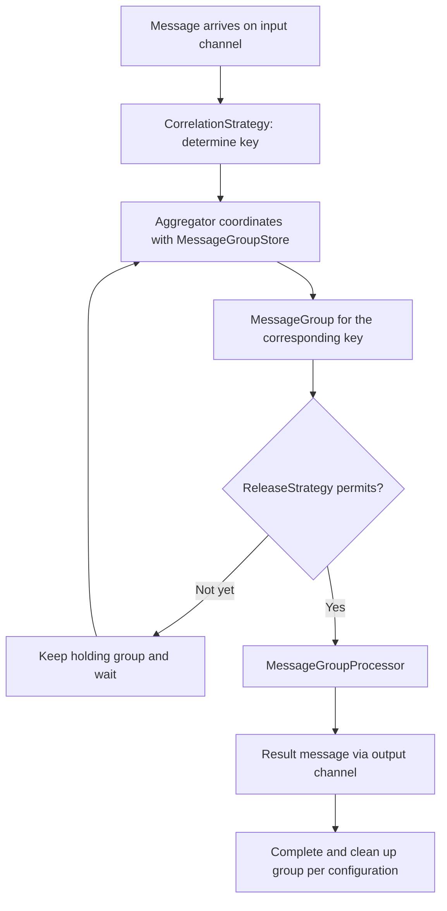

# MessageGroup

In the Aggregator chapter of the **SPRING_INTEGRATION_CORE** module, `MessageGroup` is the model that reveals the stateful side of a message-aggregation flow: which messages a group currently holds, which run it belongs to, and whether it is closed. Understanding this model connects sending a `Message` through a `MessageChannel` with the behavior of the aggregator endpoint, rather than treating an aggregator merely as a function that takes a list and sums it.

After this lesson, you can:

- Distinguish between messages, groups, the group store, and the aggregated result.
- Read `size()`, `getSequenceSize()`, `isComplete()`, and timestamps accurately.
- Design correlation keys and release conditions around data-part identity.
- Observe groups in Java DSL, handle incomplete groups, and handle late-arriving messages.
- Identify the states to test as a group is created, accumulated, completed, and removed.

## 1. The Problem: Three Data Parts of One Processing Run

Suppose each order processing run must receive three parts: `P1`, `P2`, `P3`. Parts may finish on different branches and arrive out of order:

| Arrival | Processing Run Key | Part | Value |
| --- | --- | --- | --- |
| 1 | `parts:ORDER-42:attempt-1` | `P2` | 20 |
| 2 | `parts:ORDER-99:attempt-1` | `P1` | 100 |
| 3 | `parts:ORDER-42:attempt-1` | `P1` | 10 |
| 4 | `parts:ORDER-42:attempt-1` | `P3` | 30 |

After the third arrival, `ORDER-42`'s group holds two messages; `ORDER-99`'s group holds one message. They must coexist concurrently without mixing data. After the fourth arrival, the first group has enough parts to produce a total of 60; the second group keeps waiting.

This is a custom example designed for the lesson. Three business decisions must be expressed separately:

1. **Which group?** The same key for a single processing run.
2. **Is it complete?** Exactly the three required parts, once each.
3. **What result to produce?** A summary containing the key, part count, and total value.

A `MessageGroup` represents a group of related messages processed in the same context. This interface allows implementations to have different mutability and thread-safety characteristics; do not infer from the interface name alone that every implementation provides identical guarantees. [MessageGroup Javadoc](https://docs.spring.io/spring-integration/api/org/springframework/integration/store/MessageGroup.html)

## 2. Where Does MessageGroup Sit Inside an Aggregator?

`MessageGroup` is not an endpoint and does not receive messages directly from a channel. Inside an aggregator, the handler coordinates the following components:

| Component | Responsibility |
| --- | --- |
| `CorrelationStrategy` | Computes the group key from an incoming message |
| `MessageGroupStore` | Stores messages and state keyed by group key |
| `MessageGroup` | Represents one specific group |
| `ReleaseStrategy` | Decides whether the group is ready to be processed |
| `MessageGroupProcessor` | Computes the result from the released group |
| Output channel | Receives the result emitted by the endpoint |

This is the division of responsibilities for an aggregator in Spring Integration. [Aggregator Documentation](https://docs.spring.io/spring-integration/reference/aggregator.html)



The diagram depicts the normal processing path. When adding timeouts, late-arriving messages, or errors, also consider the lifecycle policies in later sections.

In the order example, track two distinct objects: the input group holding individual parts and the output message carrying `BatchSummary`. Receiving a result on the output channel does not mean every trace of the group has vanished from the store.

## 3. Reading a Group's State

### 3.1. Common Methods

| Method | How to Read It |
| --- | --- |
| `getGroupId()` | Key linking the messages |
| `size()` | Current number of messages |
| `getSequenceSize()` | Expected sequence length; `0` if unknown |
| `isComplete()` | Group is closed and expects no further messages |
| `getMessages()` | Messages available at access time |
| `getOne()` | One message in the group |
| `getTimestamp()` | Group creation timestamp, in epoch milliseconds |
| `getLastModified()` | Most recent update timestamp, in epoch milliseconds |

These semantics form the `MessageGroup` contract. [MessageGroup source, 6.5.x branch](https://github.com/spring-projects/spring-integration/blob/6.5.x/spring-integration-core/src/main/java/org/springframework/integration/store/MessageGroup.java)

When investigating `ORDER-42`'s group, an observation record like the following is more readable than merely printing payloads:

```text
groupId = parts:ORDER-42:attempt-1
size = 2
complete = false
partIds = [P2, P1]
```

Here, two parts have arrived, while `P3` has not. You cannot conclude a group is complete merely because `size` is greater than 0.

### 3.2. Current Count Differs from Expected Count

If messages carry `sequenceSize = 3`, a group currently holding two messages may show:

```text
size() = 2
getSequenceSize() = 3
```

If a flow uses a business key and custom release, messages might not carry sequence headers. In that case, `getSequenceSize()` returning 0 does not mean the business batch must be empty; the application needs another contract to know which parts to wait for.

In this lesson, that contract is the set `{P1, P2, P3}`. For an order with a variable line count, the contract might be a list of line IDs resolved at the start of the flow. This is an application design decision.

### 3.3. isComplete() Differs from canRelease(group)

`ReleaseStrategy` provides `canRelease(MessageGroup group)` to decide when a group may pass the waiting point. [ReleaseStrategy Javadoc](https://docs.spring.io/spring-integration/api/org/springframework/integration/aggregator/ReleaseStrategy.html)

In the example:

- Right as `P3` is added, the group has enough parts for `canRelease(group)` to return `true`.
- That does not require `group.isComplete()` to have been set to `true` beforehand.
- The handler runs result processing and manages group completion.

Therefore, never write a release strategy like this:

```java
group -> group.isComplete()
```

This predicate does not express "P1, P2, and P3 have arrived." Inspect the data the business logic is waiting for.

### 3.4. One Message Does Not Represent the Whole Group

In `SimpleMessageGroup`, `getOne()` may return `null` when the group is empty. The collection returned by `getMessages()` cannot be modified directly in this implementation. [SimpleMessageGroup source](https://github.com/spring-projects/spring-integration/blob/6.5.x/spring-integration-core/src/main/java/org/springframework/integration/store/SimpleMessageGroup.java)

Practical rules:

- Read a property from a single message only when ingress guarantees that property is consistent across the whole group.
- To verify all parts belong to the same data version, inspect every part or validate before the aggregator.
- If the result requires a business order, sort by business key or sequence number.

In the order example, `P2` arriving before `P1` must not alter the sum. If the result is a list of order lines, define the desired ordering explicitly.

## 4. Observing with SimpleMessageGroup

The following example uses Java 17 and the `spring-integration-core` dependency. It demonstrates the state of an in-memory group object without creating an integration flow.

```java
import java.util.List;

import org.springframework.integration.IntegrationMessageHeaderAccessor;
import org.springframework.integration.store.MessageGroup;
import org.springframework.integration.store.SimpleMessageGroup;
import org.springframework.messaging.Message;
import org.springframework.messaging.support.MessageBuilder;

public class MessageGroupBasics {

    private static Message<String> part(String payload, int number) {
        return MessageBuilder.withPayload(payload)
                .setHeader(
                        IntegrationMessageHeaderAccessor.CORRELATION_ID,
                        "parts:ORDER-42:attempt-1")
                .setHeader(
                        IntegrationMessageHeaderAccessor.SEQUENCE_NUMBER,
                        number)
                .setHeader(
                        IntegrationMessageHeaderAccessor.SEQUENCE_SIZE,
                        3)
                .build();
    }

    public static void main(String[] args) {
        Message<String> p1 = part("P1", 1);
        Message<String> p2 = part("P2", 2);
        Message<String> p3 = part("P3", 3);

        MessageGroup group = new SimpleMessageGroup(
                List.of(p2, p1), "parts:ORDER-42:attempt-1");

        System.out.println(group.size());            // 2
        System.out.println(group.getSequenceSize()); // 3
        System.out.println(group.isComplete());      // false

        group.add(p3);
        System.out.println(group.size());            // 3
        System.out.println(group.isComplete());      // false

        group.complete();
        System.out.println(group.isComplete());      // true
        System.out.println(group.size());            // 3

        group.clear();
        System.out.println(group.size());            // 0
        System.out.println(group.isComplete());      // true
    }
}
```

In `SimpleMessageGroup`, `complete()` sets the completion status, while `clear()` removes the elements. These two operations are separate; adding all three messages does not automatically call `complete()`. [SimpleMessageGroup source](https://github.com/spring-projects/spring-integration/blob/6.5.x/spring-integration-core/src/main/java/org/springframework/integration/store/SimpleMessageGroup.java)

The key name passed to the constructor in the example does not inspect the messages' correlation headers on its own. This is manually constructed illustrative code. In a real flow, let the aggregator coordinate the correlation strategy and store to manage groups.

Likewise, never call `group.complete()` inside a release strategy to "help" the endpoint. The strategy should answer the condition; group lifecycle belongs to the handler's coordination.

## 5. Designing Context-Aware Group Keys

`CorrelationStrategy.getCorrelationKey(message)` returns the message's correlation key. [CorrelationStrategy Javadoc](https://docs.spring.io/spring-integration/api/org/springframework/integration/aggregator/CorrelationStrategy.html)

In the example, `ORDER-42` alone may be insufficient. The same order might be re-aggregated after data changes. The key:

```text
parts:ORDER-42:attempt-1
```

expresses three pieces of information: work type, business entity, and processing run.

When serving multiple independent tenants, you might choose:

```text
tenant-A:parts:ORDER-42:attempt-1
```

This is a design suggestion for the illustrative scenario, not a mandatory Spring Integration format.

| Key Choice in the Example | Consequences to Weigh |
| --- | --- |
| Only `orderId` | Two runs can be merged together |
| Each part's message ID | Every part can fall into its own separate group |
| `orderId + attemptId` | Isolates processing runs |
| Add tenant and work type | Isolates business domains sharing infrastructure |

`MessageHeaders.ID` identifies a single message. `groupId` identifies the entire set of messages being processed together. An upstream-supplied `correlationId` header can be used as the key, or the flow can compute a business key itself.

The design rule is that all parts of the same processing run must compute equal keys, whereas runs requiring independent outcomes must compute distinct keys.

## 6. MessageGroupStore Is Where State Storage Is Managed

`BasicMessageGroupStore` provides operations such as `addMessageToGroup`, `getMessageGroup`, and `removeMessageGroup`. If a key has no group yet, `getMessageGroup` returns an empty group; thus checking only `size() == 0` is not enough to distinguish a new key from a closed group that retains metadata. [BasicMessageGroupStore Javadoc](https://docs.spring.io/spring-integration/api/org/springframework/integration/store/BasicMessageGroupStore.html)

`MessageGroupStore` adds operations such as `completeGroup`, removing messages from a group, and registering expiry callbacks. [MessageGroupStore Javadoc](https://docs.spring.io/spring-integration/api/org/springframework/integration/store/MessageGroupStore.html)

The standalone snippet below only demonstrates the store API:

```java
import org.springframework.integration.store.MessageGroup;
import org.springframework.integration.store.MessageGroupStore;
import org.springframework.integration.store.SimpleMessageStore;
import org.springframework.messaging.Message;
import org.springframework.messaging.support.MessageBuilder;

MessageGroupStore store = new SimpleMessageStore();
String key = "parts:ORDER-42:attempt-1";

Message<String> first = MessageBuilder.withPayload("P1").build();
store.addMessageToGroup(key, first);

MessageGroup observed = store.getMessageGroup(key);
System.out.println(observed.size());       // 1
System.out.println(observed.isComplete()); // false

store.completeGroup(key);
System.out.println(store.getMessageGroup(key).isComplete()); // true

store.removeMessageGroup(key);
```

In a running flow, business code should not concurrently mutate groups owned by an aggregator. Manually adding to or closing groups can leave the release condition out of sync with what the endpoint is handling.

A `MessageGroup` instance obtained from a store is also no promise that direct mutations to that object will be persisted durably. Use the store's API for coordinated management operations, and perform a fresh read when observing post-processing state.

`SimpleMessageStore` is an in-memory store; its no-arg constructor creates an unbounded store. [SimpleMessageStore Javadoc](https://docs.spring.io/spring-integration/api/org/springframework/integration/store/SimpleMessageStore.html)

## 7. Lifecycle: Accumulation, Release, Completion, and Removal

For a standard aggregator, after release the handler marks the group complete and then clears its messages. When `expireGroupsUponCompletion` is `false`, group metadata is retained; when `true`, the group is deleted completely. [AggregatingMessageHandler source, 6.5.x branch](https://github.com/spring-projects/spring-integration/blob/6.5.x/spring-integration-core/src/main/java/org/springframework/integration/aggregator/AggregatingMessageHandler.java)

Four states can be used to analyze the example:

| Observed State | Held Messages | Meaning in the Run |
| --- | --- | --- |
| No group stored yet | None | No parts received yet or group was deleted |
| Open group | Some parts | Waiting for complete data |
| Group eligible for release | All parts per predicate | Handler can build the result |
| Completed group retaining metadata | No input parts left | Marker remains to recognize already-processed key |

This table is a teaching model. "Eligible for release" is the result of evaluating the predicate, not an enum status persisted inside `MessageGroup`.

### 7.1. Why Retain an Empty Group?

Suppose `P1`, `P2`, `P3` produced total 60. Later the source system resends `P2` with the same key.

If completion metadata is retained, the endpoint still has a basis to treat this message as a late arrival. If the group was deleted completely, the key can open a brand-new group. Retaining versus deleting therefore directly governs how subsequent arrivals are received. [AggregatingMessageHandler source](https://github.com/spring-projects/spring-integration/blob/6.5.x/spring-integration-core/src/main/java/org/springframework/integration/aggregator/AggregatingMessageHandler.java)

In this lesson, one key corresponds to one outcome. When recalculation is needed, the application issues `attempt-2` instead of reusing `attempt-1`.

### 7.2. Do Not Use isComplete() as Proof of a Business Transaction

The completion flag only describes group lifecycle. For example, if accounting entries are posted downstream after the aggregator, the application still needs to know whether posting succeeded.

Similarly, if two recalculation requests arrive, they must be distinguished at the business level. A completed-group marker does not replace end-to-end idempotency, result persistence, and processing confirmation in the system.

## 8. The Release Condition Must Reflect Data Identity

`SimpleSequenceSizeReleaseStrategy` compares current message count against `sequenceSize`. This strategy does not support partial sequence release, and a handler using it does not check for duplicate sequence numbers on its own. [SimpleSequenceSizeReleaseStrategy Javadoc](https://docs.spring.io/spring-integration/api/org/springframework/integration/aggregator/SimpleSequenceSizeReleaseStrategy.html)

Consider an example where three newly created messages arrive with business identities:

```text
P1, P1, P2
```

There are three messages, yet `P3` is still missing. Therefore, in this problem, a predicate checking only `group.size() == 3` fails to express the full requirement.

The Java DSL example below picks a strict rule:

```text
message count = 3
and partId set = {P1, P2, P3}
```

This rule is intentional: a batch containing a duplicate part will not emit a success result and will instead follow the timeout policy. It does not silently strip duplicates.

In a real system, you might choose another policy, such as deduplicating by event ID upstream of the aggregator. In that case, identify duplicates using stable business data rather than assuming two messages with equal payloads are always the same event.

Also distinguish "the last part arrived" from "all parts arrived." With arrival order `P3, P1, P2`, receiving `P3` first does not prove the other two parts are present.

## 9. Java DSL: Observing MessageGroup in a Flow

The self-contained example below uses Java 17, Spring Integration 6.x-style Java DSL, and `spring-integration-core`. Place the configuration in `MessageGroupConfig.java` inside a project with compatible Spring dependencies. The example requires neither Spring Boot nor a broker.

Input contract:

- Payload is `Part` with a valid part ID and amount.
- Header `batchKey` uniquely identifies one processing run.
- A successful batch contains exact parts `P1`, `P2`, `P3`.
- Incomplete batches or batches with duplicate parts must not be published as successful.

Options `messageStore`, `groupTimeout`, `releaseStrategy`, and `discardChannel` belong to the correlation handler DSL; `outputProcessor` belongs to `AggregatorSpec`. [CorrelationHandlerSpec Javadoc](https://docs.spring.io/spring-integration/api/org/springframework/integration/dsl/CorrelationHandlerSpec.html), [AggregatorSpec Javadoc](https://docs.spring.io/spring-integration/api/org/springframework/integration/dsl/AggregatorSpec.html)

```java
import java.math.BigDecimal;
import java.util.HashSet;
import java.util.Objects;
import java.util.Set;

import org.springframework.context.annotation.Bean;
import org.springframework.context.annotation.Configuration;
import org.springframework.integration.channel.DirectChannel;
import org.springframework.integration.channel.QueueChannel;
import org.springframework.integration.config.EnableIntegration;
import org.springframework.integration.dsl.IntegrationFlow;
import org.springframework.integration.store.MessageGroup;
import org.springframework.integration.store.MessageGroupStore;
import org.springframework.integration.store.SimpleMessageStore;
import org.springframework.messaging.Message;

@Configuration
@EnableIntegration
public class MessageGroupConfig {

    private static final Set<String> EXPECTED_IDS =
            Set.of("P1", "P2", "P3");

    public record Part(String partId, BigDecimal amount) {
        public Part {
            Objects.requireNonNull(partId, "partId");
            Objects.requireNonNull(amount, "amount");
        }
    }

    public record BatchSummary(
            String batchKey, int partCount, BigDecimal total) {
    }

    @Bean
    public DirectChannel partsInput() {
        return new DirectChannel();
    }

    @Bean
    public QueueChannel summaries() {
        return new QueueChannel();
    }

    @Bean
    public QueueChannel discardedParts() {
        return new QueueChannel();
    }

    @Bean
    public MessageGroupStore aggregationStore() {
        return new SimpleMessageStore();
    }

    @Bean
    public IntegrationFlow partsFlow(MessageGroupStore aggregationStore) {
        return IntegrationFlow.from("partsInput")
                .aggregate(spec -> spec
                        .messageStore(aggregationStore)
                        .correlationStrategy(message -> {
                            String key = message.getHeaders()
                                    .get("batchKey", String.class);
                            if (key == null || key.isBlank()) {
                                throw new IllegalArgumentException(
                                        "batchKey is required");
                            }
                            return key;
                        })
                        .releaseStrategy(MessageGroupConfig::hasAllParts)
                        .outputProcessor(MessageGroupConfig::summarize)
                        .groupTimeout(10_000L)
                        .sendPartialResultOnExpiry(false)
                        .expireGroupsUponCompletion(false)
                        .expireGroupsUponTimeout(false)
                        .discardChannel("discardedParts"))
                .channel("summaries")
                .get();
    }

    static boolean hasAllParts(MessageGroup group) {
        if (group.size() != EXPECTED_IDS.size()) {
            return false;
        }

        Set<String> actualIds = new HashSet<>();
        for (Message<?> message : group.getMessages()) {
            if (!(message.getPayload() instanceof Part part)) {
                return false;
            }
            actualIds.add(part.partId());
        }
        return actualIds.equals(EXPECTED_IDS);
    }

    private static BatchSummary summarize(MessageGroup group) {
        BigDecimal total = BigDecimal.ZERO;
        for (Message<?> message : group.getMessages()) {
            Part part = (Part) message.getPayload();
            total = total.add(part.amount());
        }
        return new BatchSummary(
                group.getGroupId().toString(), group.size(), total);
    }
}
```

`MessageGroupProcessor` receives the group to produce the processing result; the method reference `MessageGroupConfig::summarize` fills that role in the example. [MessageGroupProcessor Javadoc](https://docs.spring.io/spring-integration/api/org/springframework/integration/aggregator/MessageGroupProcessor.html)

Reading the flow against the business requirements:

1. Messages enter `partsInput`.
2. The `batchKey` value determines the group.
3. `hasAllParts` verifies both count and part ID set.
4. `summarize` computes `BatchSummary` once complete.
5. The result is sent to `summaries`.
6. Incomplete groups that time out are routed to the discard branch per configuration.

There are no sequence headers in this flow's contract because release uses `partId`. Do not copy a `sequenceSize`-based predicate here and expect it to understand part ID sets.

The flow retains metadata after completion and after timeout. To keep the example easy to observe, no cleanup task for these markers is configured; for long-running usage, choose an appropriate retention window and cleanup mechanism.

## 10. Running and Inspecting State Before and After Release

Place the following class in the same package as `MessageGroupConfig`:

```java
import java.math.BigDecimal;

import org.springframework.context.annotation.AnnotationConfigApplicationContext;
import org.springframework.integration.channel.DirectChannel;
import org.springframework.integration.channel.QueueChannel;
import org.springframework.integration.store.MessageGroup;
import org.springframework.integration.store.MessageGroupStore;
import org.springframework.messaging.Message;
import org.springframework.messaging.support.MessageBuilder;

public class MessageGroupDemo {

    public static void main(String[] args) {
        try (var context = new AnnotationConfigApplicationContext(
                MessageGroupConfig.class)) {

            DirectChannel input =
                    context.getBean("partsInput", DirectChannel.class);
            QueueChannel output =
                    context.getBean("summaries", QueueChannel.class);
            QueueChannel discarded =
                    context.getBean("discardedParts", QueueChannel.class);
            MessageGroupStore store =
                    context.getBean("aggregationStore", MessageGroupStore.class);

            String key = "parts:ORDER-42:attempt-1";

            input.send(part(key, "P2", "20"));
            input.send(part(key, "P1", "10"));

            MessageGroup pending = store.getMessageGroup(key);
            System.out.println(pending.size());       // 2
            System.out.println(pending.isComplete()); // false
            System.out.println(output.receive(0));    // null

            input.send(part(key, "P3", "30"));

            Message<?> result = output.receive(1_000);
            if (result == null) {
                throw new IllegalStateException("Expected a summary");
            }

            var summary =
                    (MessageGroupConfig.BatchSummary) result.getPayload();
            System.out.println(summary.partCount()); // 3
            System.out.println(summary.total());     // 60

            MessageGroup completed = store.getMessageGroup(key);
            System.out.println(completed.size());       // 0
            System.out.println(completed.isComplete()); // true

            input.send(part(key, "P2", "20"));
            System.out.println(discarded.receive(1_000) != null); // true
            System.out.println(output.receive(0));                // null
        }
    }

    private static Message<MessageGroupConfig.Part> part(
            String key, String id, String amount) {
        return MessageBuilder.withPayload(
                        new MessageGroupConfig.Part(
                                id, new BigDecimal(amount)))
                .setHeader("batchKey", key)
                .build();
    }
}
```

These are the expected results when running the configuration above. `DirectChannel` is used so the demo observes state right after each send call finishes. Subsequent reads fetch a fresh group instance from the store rather than inferring from the earlier `pending` variable.

The total lives in the `BatchSummary` payload; do not try to read the total from a group whose messages have already been cleared. The sample code also embeds `batchKey` directly in the result object so downstream consumers have an explicit business key for lookup.

For flows using an executor, broker, or poller, use a bounded wait mechanism when asserting results. Sending a message into an asynchronous system does not prove the aggregator has finished processing that message.

## 11. Timeouts and Groups That Never Complete

A batch might never receive `P3`. Timeout determines when the endpoint stops waiting according to the chosen policy.

A duration-based `groupTimeout` is rescheduled whenever a new message arrives while the group has not yet released. It measures the wait interval since the latest arrival rather than creating a fixed deadline from the first arrival. [CorrelationHandlerSpec Javadoc](https://docs.spring.io/spring-integration/api/org/springframework/integration/dsl/CorrelationHandlerSpec.html), [AbstractCorrelatingMessageHandler source](https://github.com/spring-projects/spring-integration/blob/6.5.x/spring-integration-core/src/main/java/org/springframework/integration/aggregator/AbstractCorrelatingMessageHandler.java)

Example with a 10-second threshold:

```text
t = 0s: P1 arrives
t = 8s: P2 arrives
t ≈ 18s: timeout if no further part arrives
```

If the business requires closing within 10 seconds of opening the group, express that timestamp explicitly, such as using the timeout variant based on group creation timestamp. Choosing the deadline is part of the business contract.

### 11.1. Separating the Three Options

| Option | Question to Answer |
| --- | --- |
| `groupTimeout` | When should handling of a waiting group trigger? |
| `sendPartialResultOnExpiry` | When incomplete, should a partial result be emitted? |
| `expireGroupsUponTimeout` | Should the group be deleted completely after timeout handling? |

The example chooses not to emit partial results and not to delete markers. When only `P1` and `P2` arrive, the success output must not contain a two-part `BatchSummary`. The `discardedParts` branch needs a consumer in a real application, such as recording the incomplete batch and proposing reprocessing under a new key.

The handler may re-evaluate the release strategy during timeout handling. Therefore, distinguish the normal release path from the still-incomplete case before applying the partial or discard policy. [AbstractCorrelatingMessageHandler source](https://github.com/spring-projects/spring-integration/blob/6.5.x/spring-integration-core/src/main/java/org/springframework/integration/aggregator/AbstractCorrelatingMessageHandler.java)

If switching to emitting partial results, the output model should include an explicit status such as `PARTIAL` and the list of missing parts. That is an output contract change, not merely flipping a configuration flag.

### 11.2. Timeout Does Not Cover Every Failure Mode

Distinguish three events in the example:

- **Missing part:** group waits until timeout and follows the discard policy.
- **Message arrives after group closes:** handled according to the late-arrival policy.
- **Code throws an exception:** such as missing `batchKey` or a calculation error in the processor.

`discardChannel` is the branch for data dropped under endpoint lifecycle policy. It does not replace exception handling. With synchronous calls in the demo, errors propagate back to the caller; with asynchronous infrastructure, verify the error-routing mechanism of that specific infrastructure.

## 12. Persistence, Concurrency, and Group Access Cost

### 12.1. Persisting to Recover State

Spring Integration offers message stores for JDBC, Redis, and other backends. With persistent stores, payloads and headers must be compatible with the chosen serialization mechanism. [Message Store documentation](https://docs.spring.io/spring-integration/reference/message-store.html)

The lesson's example uses the `Part` record and `SimpleMessageStore` to study lifecycle. If switching to `JdbcMessageStore` with the default serializer, adapt data serializability rather than merely swapping the store bean.

Consider a concrete scenario: the application receives `P1`, restarts, and then receives `P2` and `P3`. Expected behavior must be explicitly defined and verified against the real store type.

Persisting the group also does not automatically guarantee downstream actions execute only once. In an accounting-posting example, pair group state with a deduplication key and business transaction status.

### 12.2. Concurrency Must Cover the Whole Operation Sequence

Two threads may add the final part to a group concurrently. What needs protection is the full sequence: "read group, add, check, compute result, update lifecycle."

The handler uses `LockRegistry` to coordinate by group key. When multiple instances share state, choose a locking mechanism suited for those instances. [AbstractCorrelatingMessageHandler source](https://github.com/spring-projects/spring-integration/blob/6.5.x/spring-integration-core/src/main/java/org/springframework/integration/aggregator/AbstractCorrelatingMessageHandler.java)

For the three-part problem, avoid placing slow HTTP calls inside `hasAllParts`. The predicate needs a fast answer from already-available data. If an external service must be queried, fetch that data as part of the flow before evaluating the group.

It is also good practice to dedicate a separate store per endpoint when using group-sweeping mechanisms so lifecycle management tasks have a clear scope.

### 12.3. Reading the Entire Group Has a Cost

`MessageGroupStore` provides APIs to retrieve messages in a group and stream a group's messages. How data is stored and loaded depends on the implementation. [MessageGroupStore Javadoc](https://docs.spring.io/spring-integration/api/org/springframework/integration/store/MessageGroupStore.html)

In the example, each check reads at most a few parts. With large batches, if every incoming message re-scans the entire group, cumulative element inspections from 1 to `n` approach:

```text
1 + 2 + ... + n = n(n + 1) / 2
```

This is an algorithmic estimate for a naive re-scan implementation, not a claim that every store executes the same number of queries. For large batches, measure in practice and consider checking counts first, storing condition-supporting metadata, or sizing batches appropriately.

`MessageGroup` also has `getCondition()`/`setCondition()` to carry a condition string; this value does not automatically become a counter or executable predicate. How it is maintained and used must be designed alongside the strategy and store. [MessageGroup Javadoc](https://docs.spring.io/spring-integration/api/org/springframework/integration/store/MessageGroup.html)

## 13. What Should Be Tested Around MessageGroup?

Verify both outputs and group state, rather than asserting only the final sum.

| Lesson Scenario | Expectation |
| --- | --- |
| Receive only `P1`, `P2` | No summary yet; open group has 2 messages |
| Receive `P2`, `P1`, `P3` | One summary with total 60 |
| Two batch keys interleaved | Each group holds only parts for its own key |
| Receive new messages `P1`, `P1`, `P2` | No success summary |
| Incomplete group expires on timeout | Routed to the configured discard branch |
| Resend `P2` after completion | Message appears on discard, no new summary |
| Send parts with `attempt-2` | Produces an independent result |
| Missing `batchKey` | Errors out, not merged into a default group |
| Complete with marker-retention enabled | Re-read group is empty and `isComplete() == true` |
| Restart with persistent store | Recovery behavior matches the chosen contract |

This table outlines a test plan for the example, not executed test results.

For unit tests of `hasAllParts`, construct a `SimpleMessageGroup` from `Part` items to verify ID sets and duplicates. For integration tests, use a real context and inspect both channels and store.

When testing timeouts, use a bounded wait and clear observation assertions. Never assert a timeout fires at an exact millisecond. For concurrent tests, send the final part from multiple tasks and verify the actual number of emitted results.

## 14. Diagnosing from Group State

| Symptom | First Thing to Check |
| --- | --- |
| Every group has only one part | Are parts computing the same key? |
| Group has enough messages yet never releases | Do part identities and predicate match? |
| Wrong total despite three messages | Are there duplicate parts or parts from another run? |
| No messages visible in group after success | Did the endpoint clear messages and keep only the marker? |
| New message goes straight to discard | Does that key already have a completed group? |
| Incomplete group lingers too long | Is timeout or an old-group cleanup mechanism configured? |
| Group lacks data after restart | Was pre-restart state persisted durably? |
| Memory grows despite batches succeeding | Are retained markers and cleanup policy appropriate? |

When logging for this example, the minimal useful set of fields is `batchKey`, `partId`, observed message count, and completion status. If the same order has multiple runs, always log `attemptId` as well.

Do not dump large payloads into logs just to see what is missing from a group. With a known set of parts, logging the list of received and missing part IDs is usually much more direct for investigation.

## 15. Reinforcement Exercises

Make the following changes to the example to test your understanding:

1. Send `P3` before `P1` and `P2`. Explain why receiving the part named "last" is not enough to release.
2. Interleave two keys, each receiving all three parts. Predict the number of summaries and each group's state.
3. Send `P1` twice as two new messages followed by `P2`, `P3`. Explain why the lesson's strict predicate does not let that batch succeed.
4. Keep the same key after completion and resend one part. Then switch to a key with `attempt-2` and compare.
5. Propose an output contract for partial results: what status and missing-part fields should be added?

The key takeaway is that a group simultaneously has **identity**, a **set of messages**, and a **lifecycle state**. When these three aspects are clearly designed, reading Java DSL and explaining an aggregator's behavior becomes concrete: what data it is waiting for, when it may emit a result, and which processing run a later message belongs to.
