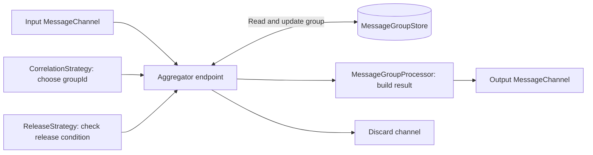
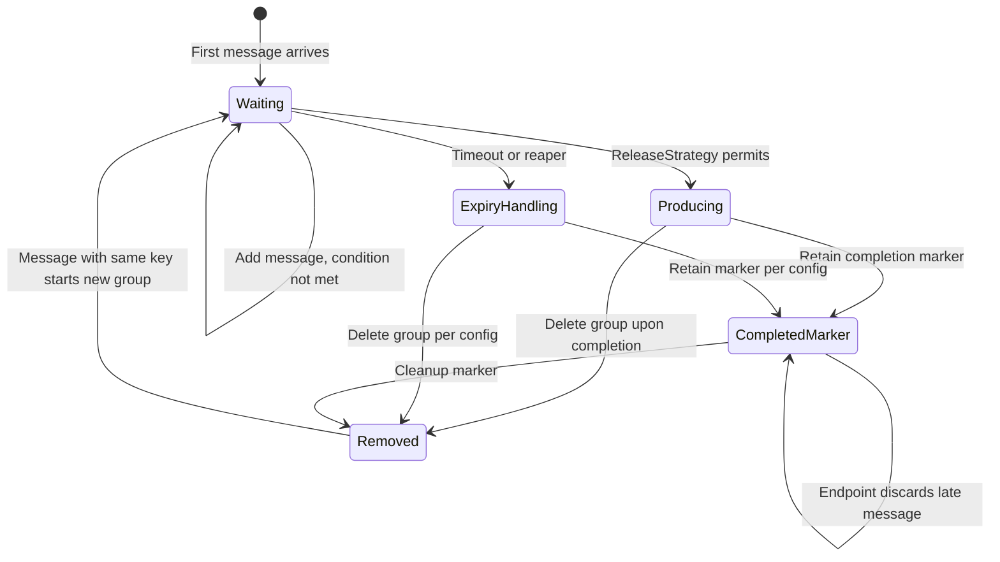

# MessageGroupStore

## Lesson Objectives

In the **SPRING_INTEGRATION_CORE** module, `MessageGroupStore` is the state storage component that enables an aggregator to wait for and process multiple related `Message` instances. This lesson belongs to the **Aggregator** chapter and focuses on choosing a store, wiring it to an endpoint with Java DSL, and managing group data in practice.

After this lesson, you can:

- Distinguish a group store from channels, individual message stores, and metadata stores.
- Explain the group lifecycle, including accumulation, release, completion, and deletion.
- Configure an aggregator with an in-memory or JDBC store.
- Design policies for timeouts, late-arriving messages, restarts, and concurrency.
- Verify both emitted outputs and remaining state inside the store.

The running example is an inventory check request that must collect replies from three warehouses: `HN`, `DN`, and `HCM`. Replies can arrive out of order and at different times.

## 1. Why Does an Aggregator Need a Group Store?

Suppose request `T01:req-001` has received two replies while the third warehouse has not answered yet. The endpoint must remember the first two replies to pair them with the final one. A local variable inside a per-message handler method cannot represent state spanning multiple arrivals.

The processing flow can be pictured as follows:



The store holds state; the correlation strategy chooses the group; the release strategy decides when to process; the processor builds the result. The store does not know on its own which three warehouses are required and does not decide whether two replies are enough. This separation lets you swap storage mechanisms while keeping most business logic intact. [Aggregator Reference](https://docs.spring.io/spring-integration/reference/aggregator.html).

A `QueueChannel` can hold messages waiting for a consumer. Once a message has been received by the consumer and added to the aggregator, waiting for the remaining members belongs to the group store. These are two storage locations with different lifecycles.

## 2. Distinguishing Easily Confused Abstractions

| Component | Primary Subject | Responsibility |
|---|---|---|
| `MessageChannel` | Sending and receiving messages | Connects endpoints and provides delivery semantics per channel type |
| `MessageStore` | A single message identified by ID | Adds, retrieves, and removes individual messages |
| `BasicMessageGroupStore` | Groups keyed by `groupId` | Basic group operations |
| `MessageGroupStore` | Groups and associated state | Adds group completion, expiry callbacks, and advanced group operations |
| `ChannelMessageStore` | Data backing a channel | Storage contract tailored for store-backed channels |
| `MetadataStore` | Metadata key-value pairs | Stores processed markers or small per-endpoint state |

`MessageGroupStore` extends `BasicMessageGroupStore`; it is not a sub-interface of `MessageStore`. An implementation such as `SimpleMessageStore` or `JdbcMessageStore` can implement both contracts simultaneously. Therefore, declaring the aggregator's dependency as `MessageGroupStore` accurately states what it needs. [MessageGroupStore API](https://docs.spring.io/spring-integration/api/org/springframework/integration/store/MessageGroupStore.html), [MessageStore API](https://docs.spring.io/spring-integration/api/org/springframework/integration/store/MessageStore.html).

`MetadataStore` can serve duplicate-processing prevention, but it does not replace where the aggregator holds payloads and group state. [Metadata Store](https://docs.spring.io/spring-integration/reference/meta-data-store.html).

## 3. What Information Does MessageGroup Hold?

A `MessageGroup` describes messages sharing a correlation context. Commonly observed fields include:

| API | Meaning |
|---|---|
| `getGroupId()` | Key identifying the group |
| `getMessages()` | Messages currently present |
| `size()` | Current number of messages in the group |
| `isComplete()` | Whether the group has been marked complete |
| `getTimestamp()` | Group creation timestamp |
| `getLastModified()` | Group last-modified timestamp |
| `getSequenceSize()` | Sequence size metadata when the group uses sequences |
| `getLastReleasedMessageSequenceNumber()` | Released sequence state, useful for sequence-aware components |

Do not equate `size()` with the count of valid business members. Three messages could be two replies from `HN` and one from `DN`, while `HCM` is still missing.

Likewise, a group with `size() == 0` can be a completed-group marker. Inspecting size alone is not enough to conclude the group was deleted. [MessageGroup API](https://docs.spring.io/spring-integration/api/org/springframework/integration/store/MessageGroup.html).

### Designing a Stable groupId

In this lesson, the `requestId` header carries both the tenant and the request run ID:

```text
requestId = T01:req-001
groupId   = stock-v1:T01:req-001
```

A new check run needs a new ID, even for the same SKU. Using only the product SKU as the key could merge replies from two checks or cause a prior run's marker to reject the new run.

The key must be computed identically across deliveries, across restarts, and across instances. For composite keys, agree on component encoding to avoid ambiguous strings. The prefix in the example is an application business convention, not a framework-generated namespace.

## 4. Essential Store Operations

| Operation | Purpose | Point to Note |
|---|---|---|
| `addMessageToGroup(id, message)` | Adds a message to a group | Returns the group view after adding |
| `addMessagesToGroup(id, messages...)` | Adds multiple messages | Optimization capability depends on implementation |
| `getMessageGroup(id)` | Reads the group view | For an unseen key, returns an empty group |
| `messageGroupSize(id)` | Gets group size | Useful when only counting is needed |
| `completeGroup(id)` | Marks the group complete | Does not itself invoke the aggregator's processor |
| `removeMessagesFromGroup(id, messages...)` | Removes specific messages from a group | Differs from deleting the whole group |
| `removeMessageGroup(id)` | Deletes the group | Leaves no marker for the endpoint to recognize prior completion |
| `registerMessageGroupExpiryCallback(callback)` | Registers handler when expiry triggers | Registering a callback does not create a schedule |
| `expireMessageGroups(timeout)` | Finds expired groups and invokes callbacks | `timeout` is a threshold in milliseconds |

The basic operations live in `BasicMessageGroupStore`; the extended API adds completion and expiry. [BasicMessageGroupStore](https://docs.spring.io/spring-integration/api/org/springframework/integration/store/BasicMessageGroupStore.html), [MessageGroupStore](https://docs.spring.io/spring-integration/api/org/springframework/integration/store/MessageGroupStore.html).

### Trying Operations on a Standalone Store

The snippet below demonstrates only the storage contract, not an aggregator flow:

```java
import org.springframework.integration.store.MessageGroupStore;
import org.springframework.integration.store.SimpleMessageStore;
import org.springframework.messaging.Message;
import org.springframework.messaging.support.MessageBuilder;

public class GroupStoreDemo {

    public static void main(String[] args) {
        MessageGroupStore store = new SimpleMessageStore();
        String groupId = "stock-v1:T01:req-001";

        Message<String> first = MessageBuilder
                .withPayload("HN:12")
                .build();

        Message<String> second = MessageBuilder
                .withPayload("DN:8")
                .build();

        store.addMessageToGroup(groupId, first);
        store.addMessageToGroup(groupId, second);

        System.out.println(store.messageGroupSize(groupId)); // 2

        store.completeGroup(groupId);
        System.out.println(
                store.getMessageGroup(groupId).isComplete()); // true

        store.removeMessageGroup(groupId);
        System.out.println(store.getMessageGroupCount()); // 0
    }
}
```

Calling `completeGroup()` directly only manipulates store state; no aggregated result appears automatically. In a real flow, let the aggregator coordinate message addition, release, and cleanup.

Do not mutate the collection of a group actively managed by an endpoint to "mark as processed." With `SimpleMessageStore`, the returned view may directly reference the internal group; with persistent stores, data representation and synchronization differ. [Notes on SimpleMessageStore](https://docs.spring.io/spring-integration/reference/message-store.html).

## 5. Group Lifecycle: Completing and Deleting Are Two Different Actions

A typical lifecycle:



The diagram shows logical states on the success path; error paths also depend on transactions and error handling.

In the three-warehouse example:

1. `HN` arrives: group holds one message, no output yet.
2. `DN` arrives: group holds two messages, still waiting.
3. `HCM` arrives: condition met, processor builds one result.
4. Endpoint clears processed members and either retains a marker or deletes the group per configuration.
5. A late reply with the same key is handled differently depending on whether the marker still exists.

The completion marker remembers that the request run has ended. It consumes metadata space even with no payload left. Deleting the marker means the application accepts that a message with the same key can start a new group.

## 6. Choosing an Implementation

| Option | Characteristics | When Suitable | What Else Must Be Designed |
|---|---|---|---|
| `SimpleMessageStore` | Stored in JVM heap | Learning, testing, disposable state | Memory bounds, timeouts, business recovery |
| `JdbcMessageStore` | Stored in a relational database | Need groups to survive restarts, RDBMS available | Schema, serializer, transactions, and multi-instance locking |
| `RedisMessageStore` | Stored in Redis | Redis infrastructure fits the app | Durability config, serializer, and access coordination |
| `MongoDbMessageStore` | Stored in MongoDB | Document database fits the app | Mapping, indexes, data compatibility |

Using Redis or MongoDB does not by itself determine durability guarantees. Durability also depends on backend configuration and how the application records success.

`SimpleMessageStore()` imposes no capacity limit by default. Other constructors support bounds; those bounds are not an automatic disk-spill mechanism. [SimpleMessageStore API](https://docs.spring.io/spring-integration/api/org/springframework/integration/store/SimpleMessageStore.html).

For JDBC, choose `JdbcMessageStore` for an aggregator. `JdbcChannelMessageStore` serves channels and does not supply the full group contract required by an aggregator. [JDBC Message Store](https://docs.spring.io/spring-integration/reference/jdbc/message-store.html).

## 7. Java DSL Configuration: Aggregating Three Warehouse Replies

The example uses Java 17+ and Java DSL APIs available in Spring Integration 6.5. The application needs `spring-integration-core` and corresponding Spring configuration. Later JDBC examples also need `spring-integration-jdbc`, a JDBC driver, and a `DataSource`.

To focus on the store, the example assumes input has already been validated: each run has exactly one valid reply from each of `HN`, `DN`, and `HCM`. When the transport allows redeliveries, add deduplication as discussed in section 11.

```java
import java.io.Serializable;
import java.util.Comparator;

import org.springframework.beans.factory.annotation.Qualifier;
import org.springframework.context.annotation.Bean;
import org.springframework.context.annotation.Configuration;
import org.springframework.integration.channel.DirectChannel;
import org.springframework.integration.channel.QueueChannel;
import org.springframework.integration.config.EnableIntegration;
import org.springframework.integration.dsl.IntegrationFlow;
import org.springframework.integration.store.MessageGroupStore;
import org.springframework.integration.store.SimpleMessageStore;
import org.springframework.messaging.Message;
import org.springframework.messaging.MessageChannel;

@Configuration
@EnableIntegration
public class StockAggregationConfig {

    public record WarehouseReply(String warehouse, int available)
            implements Serializable {
    }

    @Bean
    public MessageChannel stockInput() {
        return new DirectChannel();
    }

    @Bean
    public QueueChannel stockOutput() {
        return new QueueChannel();
    }

    @Bean
    public QueueChannel stockDiscard() {
        return new QueueChannel();
    }

    @Bean
    public MessageGroupStore stockMessageStore() {
        return new SimpleMessageStore();
    }

    @Bean
    public IntegrationFlow stockFlow(
            @Qualifier("stockMessageStore") MessageGroupStore store) {

        return IntegrationFlow.from("stockInput")
                .aggregate(a -> a
                        .messageStore(store)
                        .correlationStrategy(
                                StockAggregationConfig::groupId)
                        .releaseStrategy(group -> group.size() == 3)
                        .outputProcessor(group ->
                                group.getMessages().stream()
                                        .map(Message::getPayload)
                                        .map(WarehouseReply.class::cast)
                                        .sorted(Comparator.comparing(
                                                WarehouseReply::warehouse))
                                        .toList())
                        .groupTimeout(30_000L)
                        .sendPartialResultOnExpiry(false)
                        .expireGroupsUponCompletion(false)
                        .expireGroupsUponTimeout(false)
                        .discardChannel("stockDiscard"))
                .channel("stockOutput")
                .get();
    }

    private static String groupId(Message<?> message) {
        String requestId =
                message.getHeaders().get("requestId", String.class);

        if (requestId == null || requestId.isBlank()) {
            throw new IllegalArgumentException(
                    "Header requestId must have a value");
        }

        return "stock-v1:" + requestId;
    }
}
```

Meaning of the decisions in the example:

- `messageStore(store)` wires the state storage bean into the endpoint.
- `correlationStrategy` derives the key from a business header without relying on splitter-generated sequences.
- `releaseStrategy` waits for three messages per the input assumption.
- `outputProcessor` returns a list of payloads sorted by warehouse code so results have deterministic order.
- `groupTimeout` caps how long a group waits since its most recent message.
- Both `expireGroupsUpon...` options are set to `false` to retain markers after both normal completion and unmet-condition timeouts.
- `sendPartialResultOnExpiry(false)` sends incomplete groups to the discard path instead of creating an incomplete snapshot.

Java DSL supports customizing the correlation strategy, release strategy, and store inside `.aggregate(...)`. [Aggregators and Resequencers](https://docs.spring.io/spring-integration/reference/dsl/java-aggregators.html). Timeout, discard, and store options reside on `CorrelationHandlerSpec`. [API 6.5.4](https://docs.spring.io/spring-integration/docs/6.5.4/api/org/springframework/integration/dsl/CorrelationHandlerSpec.html).

The two output `QueueChannel` beans in the example are in-memory and intended for observation. Switching the group store to JDBC only preserves group state within the configured storage scope; results already sent into an in-memory queue can still be lost if the JVM stops.

## 8. Replacing the In-Memory Store with JDBC

Keep the flow intact and replace only the `stockMessageStore()` bean method from the previous example:

```java
import javax.sql.DataSource;

import org.springframework.context.annotation.Bean;
import org.springframework.integration.jdbc.store.JdbcMessageStore;

@Bean
public JdbcMessageStore stockMessageStore(DataSource dataSource) {
    JdbcMessageStore store = new JdbcMessageStore(dataSource);
    store.setRegion("stock-aggregate-v1");
    return store;
}
```

This is a replacement method inside the configuration, not a second bean sharing the same name.

Before running, prepare the database schema using the script matching your database inside the `spring-integration-jdbc` artifact:

```text
org/springframework/integration/jdbc/schema-*.sql
```

Use the script from the deployed dependency version as the basis for your migration. Declaring the bean does not replace creating the schema. [JdbcMessageStore API](https://docs.spring.io/spring-integration/api/org/springframework/integration/jdbc/store/JdbcMessageStore.html).

### Region and Table Prefix

`region` logically partitions data within shared tables. Instances serving the same aggregator must see the same region; two independent business endpoints should have separate stores and isolated regions.

`tablePrefix` changes the table-name prefix in the store's SQL. If you change the prefix, the deployed schema must match. Changing `region` after a restart hides old-region data from the current endpoint even though it still exists in the database. [Partitioning a JDBC Store](https://docs.spring.io/spring-integration/reference/jdbc/message-store.html#_partitioning_a_message_store), [setRegion API](https://docs.spring.io/spring-integration/api/org/springframework/integration/jdbc/store/JdbcMessageStore.html#setRegion(java.lang.String)).

### A Recovery Scenario

| Point in Time | Event | Expected State |
|---|---|---|
| Before restart | Received `HN`, `DN`; updates committed | Persistent group holds two messages |
| Application stops | JVM exits | Heap is lost; committed database data remains |
| After restart | Starts with the same schema, region, and keys | Endpoint can access the pending group |
| Next | Receives `HCM` before the group is cleaned up | Group qualifies and emits one result |

Recovering payloads does not mean restoring all in-JVM scheduled tasks as they were. Groups left behind that receive no further messages need post-restart orphan handling; the timeout section below covers this approach.

## 9. Payloads, Headers, and Serialization

When data crosses a persistent-storage boundary, inspect the entire message, including both payload and headers.

With `JdbcMessageStore`'s default mechanism, payloads must be serializable; non-serializable headers may be dropped prior to persistence. The `WarehouseReply` record in the example implements `Serializable` with `String` and `int` fields.

Do not place connections, open streams, or service beans inside a payload and expect recovery after restart. For business DTOs, store only the required data or identifiers to reload resources.

`replyChannel` and `errorChannel` headers may hold in-JVM channel references. If they are dropped during persistence, dynamic reply routing may stop working as before. The framework offers `HeaderChannelRegistry` to map channel references to names, yet an in-memory registry does not make an awaiting gateway durable across restarts. The lesson's example picks a fixed output channel to keep the result path explicit. [Message Store and serialization](https://docs.spring.io/spring-integration/reference/message-store.html).

When changing a DTO between deployments, test reading data written by the previous version. With custom serializers, align serialization, deserialization, and compatibility policies.

## 10. Multiple Instances: A Shared Store Needs Locking

A common reasoning mistake is assuming that reading the same database automatically coordinates all aggregator operations. In reality, processing a message involves multiple steps: fetching the group, updating the group, checking release, and processing the result.

For example, two instances both see a group with two replies. If both process the next message without a shared lock on `groupId`, aggregation consistency can break.

By default, an aggregator uses local locking. When multiple instances mutate groups in a shared store, configure a `LockRegistry` backed by a shared backend and namespace. [JDBC Lock Registry](https://docs.spring.io/spring-integration/reference/jdbc/lock-registry.html).

An illustrative JDBC configuration:

```java
import javax.sql.DataSource;

import org.springframework.context.annotation.Bean;
import org.springframework.integration.jdbc.lock.DefaultLockRepository;
import org.springframework.integration.jdbc.lock.JdbcLockRegistry;

@Bean
public DefaultLockRepository stockLockRepository(
        DataSource dataSource) {

    DefaultLockRepository repository =
            new DefaultLockRepository(dataSource);
    repository.setRegion("stock-aggregate-v1");
    return repository;
}

@Bean
public JdbcLockRegistry stockLockRegistry(
        DefaultLockRepository stockLockRepository) {

    return new JdbcLockRegistry(stockLockRepository);
}
```

Then inject `JdbcLockRegistry stockLockRegistry` into the flow builder method and add it to the aggregator configuration:

```java
.lockRegistry(stockLockRegistry)
```

Place these bean methods in the appropriate configuration and provide the corresponding lock schema. The lock region and store region are separate settings; reusing the same string in the example is simply a management convention.

Each registry needs its own repository; do not share a single `DefaultLockRepository` instance across multiple `JdbcLockRegistry` instances. Coordinating instances still point to the same backend and lock region for that endpoint. [DefaultLockRepository API](https://docs.spring.io/spring-integration/api/org/springframework/integration/jdbc/lock/DefaultLockRepository.html).

If multiple aggregators are chained sequentially, check lock acquisition order and downstream calls to prevent deadlocks. Locks protecting group operations do not replace transactions and do not make sending results to external systems atomic.

## 11. Duplicate Messages: Distinguishing Technical IDs from Business Keys

Consider three messages with the same `requestId`:

```text
message A: warehouse=HN,  available=12
message B: warehouse=HN,  available=12   // redelivery, new Message ID
message C: warehouse=DN,  available=8
```

A `group.size() == 3` release strategy would trigger aggregation even though `HCM` is missing. The store cannot infer that the first two messages are the same business reply just because their payloads match.

To handle this scenario, you can:

- Set an idempotency key `requestId + warehouse` and deduplicate before the aggregator.
- Check the set of received warehouses inside the release strategy.
- Define a rule if one warehouse sends multiple versions: keep the first reply, take the latest version, or reject conflicts.

An illustrative release strategy, assuming input is already restricted to the three valid warehouses:

```java
.releaseStrategy(group -> {
    long distinctWarehouses = group.getMessages().stream()
            .map(Message::getPayload)
            .map(WarehouseReply.class::cast)
            .map(WarehouseReply::warehouse)
            .distinct()
            .count();

    return distinctWarehouses == 3;
})
```

This snippet only changes the release condition. If the group still holds duplicate replies, the list-returning processor from the earlier example will still return those duplicates. Therefore, the processor must also select one reply per warehouse, or duplicates must be filtered out before entering the group.

Deduplication must also account for failures between marking as received and saving to the group: marking first and then failing to persist can wrongly block a redelivery. When atomicity between the two steps is required, design a transaction or recovery mechanism accordingly.

## 12. Timeouts, Reapers, and Marker Retention

Distinguish four questions:

| Question | Relevant Option or Mechanism |
|---|---|
| How long may a waiting group stay idle? | `groupTimeout(...)` |
| On expiry, should an incomplete result be emitted? | `sendPartialResultOnExpiry(...)` |
| After normal completion, should the group be deleted immediately? | `expireGroupsUponCompletion(...)` |
| After timeout force-completion, should the marker be kept? | `expireGroupsUponTimeout(...)`, combined with actual release path |

A timeout can invoke the release strategy one more time. If the strategy permits release at that moment, normal completion policy also participates in cleanup decisions. Thus, never read a single flag in isolation and extrapolate all cases. [Aggregator Options](https://docs.spring.io/spring-integration/reference/aggregator.html#_configuring_an_aggregator_with_xml).

### groupTimeout Is the Wait Since the Latest Message

With `groupTimeout(30_000L)`, a new message arriving in a waiting group resets the timeout schedule. It is not automatically a 30-second deadline from the first arrival.

If the business rule is "maximum total wait time from request start," provide a timeout expression anchored to the corresponding timestamp, such as group creation time or a business deadline. When origin-system emission time matters, store creation time may not be the right anchor.

### What Does MessageGroupStoreReaper Do?

A reaper triggers store expiry by a group-age threshold. It must be invoked by a scheduler or coordinator; declaring the bean alone creates no periodic sweep. The aggregator registers callbacks so expiry flows through the endpoint's force-completion path. [MessageGroupStoreReaper API](https://docs.spring.io/spring-integration/api/org/springframework/integration/store/MessageGroupStoreReaper.html).

The supplemental example below sets a five-minute group-age threshold and sweeps every ten seconds:

```java
import org.springframework.beans.factory.annotation.Qualifier;
import org.springframework.context.annotation.Bean;
import org.springframework.context.annotation.Configuration;
import org.springframework.integration.store.MessageGroupStore;
import org.springframework.integration.store.MessageGroupStoreReaper;
import org.springframework.scheduling.annotation.EnableScheduling;
import org.springframework.scheduling.annotation.Scheduled;

@Configuration
@EnableScheduling
public class StockCleanupConfig {

    @Bean
    public MessageGroupStoreReaper stockReaper(
            @Qualifier("stockMessageStore") MessageGroupStore store) {

        MessageGroupStoreReaper reaper =
                new MessageGroupStoreReaper(store);
        reaper.setTimeout(300_000L);
        reaper.setExpireOnDestroy(false);
        return reaper;
    }

    @Bean
    public StockReaperJob stockReaperJob(
            MessageGroupStoreReaper stockReaper) {

        return new StockReaperJob(stockReaper);
    }

    public static final class StockReaperJob {

        private final MessageGroupStoreReaper reaper;

        public StockReaperJob(MessageGroupStoreReaper reaper) {
            this.reaper = reaper;
        }

        @Scheduled(fixedDelay = 10_000L)
        public void run() {
            this.reaper.run();
        }
    }
}
```

This is an additive policy requiring deliberate choice: the reaper sweeps both waiting groups and marker-retaining groups in the store's scope, not just deleting markers. A five-minute threshold can force-complete an old group even if it received a message recently.

For stores extending `AbstractMessageGroupStore`, `timeoutOnIdle` defaults to `false`, meaning expiry measures age since group creation. Calling `setTimeoutOnIdle(true)` switches measurement to time since last update. Choose between these two calculations per business requirements. [setTimeoutOnIdle API](https://docs.spring.io/spring-integration/api/org/springframework/integration/store/AbstractMessageGroupStore.html#setTimeoutOnIdle(boolean)).

Actual sweep execution also depends on scheduler intervals and processing time. "Five minutes" is an eligibility threshold, not a guarantee of deletion at millisecond 300,000.

### Post-Restart Cleanup and Store Ownership

A persistent store may contain unfinished groups that no longer have corresponding scheduled tasks after a restart. Handle them with a scheduled reaper or the correlating handler's `expireTimeout` and `expireDuration` features. [AbstractCorrelatingMessageHandler API](https://docs.spring.io/spring-integration/api/org/springframework/integration/aggregator/AbstractCorrelatingMessageHandler.html).

Each aggregator should have a dedicated store for its data scope. Avoid passing the same store bean to two independent aggregators, especially when using expiry callbacks: one endpoint's callback could affect groups belonging to the other. With JDBC, separate beans and separate regions or tables keep scopes isolated.

Marker retention duration determines how long the endpoint recognizes late-arriving messages. Once markers are purged, enforce non-reusable request keys or maintain separate idempotency history if old messages must still be rejected.

## 13. Persistence, Transactions, and Result Delivery

Persisting groups to a database solves only part of the reliability problem. Consider two events:

```text
A. Persist or complete group state in the database.
B. Send the result to a consumer or external system.
```

If A and B are not inside one atomic boundary, a failure between them can produce lost or duplicated results depending on execution order and redelivery mechanics. You cannot conclude exactly-once semantics solely from using `JdbcMessageStore`.

Typical design decisions needed:

- Which database operations are wrapped by a transaction.
- Which business key the consumer uses to record results idempotently.
- If publishing to a broker after commit, whether an outbox or equivalent delivery pattern is used.
- On error, whether the message is retried at the endpoint, redelivered by transport, or routed to a recovery path.

Transactions bind to the executing thread. Synchronous steps across a `DirectChannel` can participate in an active transaction, while handoffs across queues or executors create boundaries that must be handled separately. Declaring a transaction manager bean does not automatically wrap every flow in a transaction. [Transaction Support](https://docs.spring.io/spring-integration/reference/transactions.html).

### Synchronous Errors vs. Scheduler Errors

On synchronous flows, processing errors normally propagate back to the `send()` caller. Force completion from timeouts or reapers, however, runs on a scheduler thread with no waiting caller.

When configuring timeouts, check scheduler error handling and `errorChannel` if the application expects `ErrorMessage` notifications. Discarding due to missing members is an expected policy outcome; serializer or database errors are processing failures. Both event types should have distinct logs and recovery actions.

## 14. Memory and Data-Access Cost

An initial estimate for pending message volume is:

```text
pending group count ≈ new groups per second × average wait time

pending payload size
    ≈ pending group count
    × average messages per group
    × average size per message
```

Hypothetical application example:

```text
200 groups/sec × 20s wait = about 4,000 groups
4,000 groups × 2 messages/group × 4 KiB = about 31.25 MiB
```

These numbers estimate payload bytes under those assumptions, excluding object overhead, headers, group structures, markers, serializers, and output messages. With JDBC, there are also table storage, indexes, and I/O overhead.

Persistent stores support lazy-loading messages on demand to avoid reading the entire group on every correlation step. A release strategy using `size()` has a different cost profile from one iterating every payload to count distinct warehouses. If every arrival re-scans a growing group, total element inspections can grow roughly quadratically with group size. [MessageGroupStore Lazy-Load](https://docs.spring.io/spring-integration/reference/message-store.html#_persistent_messagegroupstore_and_lazy_load).

Useful application metrics include pending group count, marker count, oldest group age, timeout rate, discarded message count, store access latency, and lock wait time.

Some statistics methods on the interface are optional and an implementation may not support them. Do not assume `getMessageGroupCount()` and `getMessageCountForAllMessageGroups()` are cheap or available on every backend. [MessageGroupStore API](https://docs.spring.io/spring-integration/api/org/springframework/integration/store/MessageGroupStore.html).

## 15. Testing Output and Group State

A test checking only output is not enough to prove cleanup and late-message handling work correctly. For the configuration in section 7, verify:

1. The first two replies are stored without emitting a result.
2. The third reply produces exactly one result.
3. Payloads in the group are cleared while the completion marker remains.
4. Late messages go to the discard channel.

The JUnit 5 example below belongs in the same package as `StockAggregationConfig`. It uses Spring Test without mocking the store:

```java
import java.util.List;

import org.junit.jupiter.api.Test;
import org.springframework.beans.factory.annotation.Autowired;
import org.springframework.beans.factory.annotation.Qualifier;
import org.springframework.integration.channel.QueueChannel;
import org.springframework.integration.store.MessageGroup;
import org.springframework.integration.store.MessageGroupStore;
import org.springframework.messaging.Message;
import org.springframework.messaging.MessageChannel;
import org.springframework.messaging.support.MessageBuilder;
import org.springframework.test.context.junit.jupiter.SpringJUnitConfig;

import static org.junit.jupiter.api.Assertions.*;

@SpringJUnitConfig(StockAggregationConfig.class)
class StockAggregationTest {

    @Autowired
    @Qualifier("stockInput")
    MessageChannel input;

    @Autowired
    @Qualifier("stockOutput")
    QueueChannel output;

    @Autowired
    @Qualifier("stockDiscard")
    QueueChannel discard;

    @Autowired
    @Qualifier("stockMessageStore")
    MessageGroupStore store;

    @Test
    void shouldKeepCompletionMarkerAndDiscardLateReply() {
        String requestId = "T01:test-001";
        String groupId = "stock-v1:" + requestId;

        assertTrue(input.send(reply(requestId, "HN", 12)));
        assertTrue(input.send(reply(requestId, "DN", 8)));

        assertNull(output.receive(0));
        assertEquals(2, store.messageGroupSize(groupId));

        assertTrue(input.send(reply(requestId, "HCM", 20)));

        Message<?> result = output.receive(1_000);
        assertNotNull(result);
        assertEquals(List.of(
                new StockAggregationConfig.WarehouseReply("DN", 8),
                new StockAggregationConfig.WarehouseReply("HCM", 20),
                new StockAggregationConfig.WarehouseReply("HN", 12)
        ), result.getPayload());
        assertNull(output.receive(0));

        MessageGroup completed = store.getMessageGroup(groupId);
        assertTrue(completed.isComplete());
        assertEquals(0, completed.size());

        assertTrue(input.send(reply(requestId, "HN", 12)));
        assertNotNull(discard.receive(1_000));
        assertNull(output.receive(0));
    }

    private static Message<?> reply(
            String requestId, String warehouse, int available) {

        return MessageBuilder.withPayload(
                        new StockAggregationConfig.WarehouseReply(
                                warehouse, available))
                .setHeader("requestId", requestId)
                .build();
    }
}
```

This test uses synchronous input, so inspecting immediately after `send()` fits this configuration. If adding an executor or asynchronous transport, wait on conditions with a finite timeout.

Additional scenarios should be verified independently:

| Scenario | What to Prove |
|---|---|
| Two interleaved requests | Messages never enter the wrong group |
| Same request ID but different tenants | Key convention keeps the two groups isolated |
| Duplicate warehouse message with a new ID | Does not release prematurely before all required warehouses arrive |
| One warehouse missing | Follows timeout/discard path and retains marker per policy |
| Restart after two replies | Committed JDBC group resumes on the third reply |
| Restart with no new messages | Orphan group is cleaned up by the chosen mechanism |
| Two instances handling the same key | No uncoordinated group mutation occurs |
| Downstream error | Store state, rollback, and redelivery match design |

Persistence tests should use two application contexts connected to the same populated database, closing the first context before opening the second. Creating a fresh `SimpleMessageStore` bean does not test durable recovery.

Spring Integration provides modules for flow testing and mock endpoints; this small example uses channels and the store directly to observe state. [Testing Support](https://docs.spring.io/spring-integration/reference/testing.html).

## 16. Diagnosing Common Symptoms

| Symptom | Possibility to Check | Remediation |
|---|---|---|
| No output despite receiving many messages | Wrong correlation key or wrong expected member count | Inspect groupId, release strategy, and headers |
| Three messages yet one warehouse missing | Business duplicates counted toward size | Design deduplication and release condition |
| Groups lost on restart | Using in-memory store, uncommitted write, or changed region | Check store implementation, transactions, and region config |
| Store grows despite small payloads | Accumulated markers or incomplete groups never expiring | Separate marker metrics from waiting groups; add cleanup |
| Data exists in JDBC yet group not found | Region, prefix, or key convention changed | Compare config before and after deployment |
| Timeouts not handled after restart | Groups hold data without old JVM tasks | Configure reaper or per-endpoint orphan purge |
| Duplicate results on retry | Marker deleted too early or failure gap between persist and send | Review retention, idempotency, and output transaction |
| Works on one instance, fails on multiple | Only local locking present | Configure shared locking for the same group |
| Expiry affects the wrong flow | Store scope shared across independent endpoints | Separate beans, regions, and group ownership |

When investigating, log `requestId`, `groupId`, warehouse code, member count, completion status, and handling instance. Avoid logging full payloads if data is large or contains sensitive fields.

## 17. Key Takeaways

`MessageGroupStore` holds group data and state so an aggregator can operate across multiple message arrivals. Flow reliability also depends on key construction, release conditions, serialization, concurrency locking, transactions, and result delivery paths.

For every configuration, define three milestones explicitly: when a group has enough data to release, when a group is force-completed for waiting too long, and when markers may be deleted. These three decisions directly govern how the application handles missing, duplicate, and late-arriving replies.
