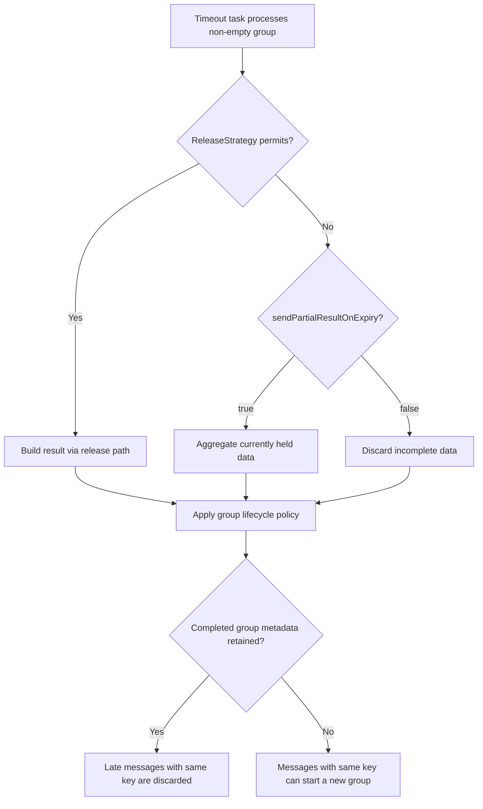

# Group Timeout

In the **Aggregator** chapter of the **SPRING_INTEGRATION_CORE** module, timeouts allow a message flow to stop waiting on an incomplete group. This lesson connects `Message`, `MessageChannel`, the aggregator endpoint, gateways, and Java DSL through a quote-collection scenario: some partners reply slowly, some never reply, yet the system must still produce a meaningful outcome.

After this lesson, you can:

- Distinguish an idle wait timeout without new messages from a deadline measured from group creation.
- Choose between emitting partial results or routing incomplete data to a discard channel.
- Decide whether to retain or delete group state and predict how late-arriving messages are handled.
- Configure a scheduler, group cleanup, and error handling path.
- Design tests for timing thresholds and post-timeout state.

Java examples use Java 17 and APIs available in Spring Integration 6.5. When integrating into an application, align dependency versions with your project's Spring or Spring Boot configuration.

## 1. Why Does an Aggregator Need a Timeout?

Suppose a pricing comparison service sends requests to three suppliers `A`, `B`, and `C`. Each reply is normalized into a message; the `requestKey` header identifies a single quote round.

```text
requestKey = Q-2026-001:round-1

A -> replies after 150 ms
B -> replies after 400 ms
C -> no reply
```

The normal completion condition is receiving all three suppliers. With only that condition, a group containing replies from A and B could sit in the store indefinitely.

Determine the business meaning of expiry upfront:

| Business Case | Appropriate Decision |
| --- | --- |
| Display a reference price list | Can return a partial result clearly listing missing suppliers |
| Approval requiring all three confirmations | Never use an incomplete result for approval |
| Collect data for reconciliation | Route incomplete data to a reconciliation flow |
| Collect events over a time window | Close the window on schedule and handle late events via a separate policy |

**Timeout stops waiting; business rules determine the outcome afterward.** Two replies do not automatically become a complete result simply because time ran out.

Furthermore, an aggregator can only schedule timeouts for groups it already knows about. If A, B, and C all fail to send any message, no input group exists for this mechanism to detect the stalled request. The zero-reply case must be managed in the request-issuing flow via a request deadline or a separate tracker.

## 2. Distinguishing Different Timeout Types in One Flow

### 2.1. Numeric Group Timeout Is Idle Time Without New Messages

With `.groupTimeout(5_000L)`, a group not yet eligible for release is scheduled for handling after roughly 5 seconds. When a new message arrives in the group and it still cannot release, the previous schedule is replaced by one computed from the new arrival. Official documentation describes this as a timeout measured from the most recent arriving message. [Spring Integration: configuring group timeout](https://docs.spring.io/spring-integration/reference/aggregator.html).

Example assuming the group needs three replies from different sources:

```text
t = 0 s: A arrives          -> expected timeout at 5 s
t = 3 s: B arrives          -> expected timeout shifts to 8 s
t = 5 s:                -> not timed out under new schedule
t ≈ 8 s: C still missing -> triggers timeout handling
```

If C arrives at 4 seconds, the group meets the condition and can release immediately without waiting until 8 seconds.

If messages keep getting accepted without satisfying the release condition, this kind of wait limit can keep getting pushed back. Therefore, do not infer from `groupTimeout = 5 seconds` that a quote round is guaranteed to finish within 5 seconds of starting.

### 2.2. Deadline from Group Creation Time

Another requirement is: "Even if new messages keep arriving, close the group once 5 seconds have elapsed since the group was created."

Let:

- `t_created`: group creation timestamp.
- `t_last`: most recent timestamp a message entered the group.
- `T`: configured duration.

Two different scheduling calculations:

```text
Idle wait without new messages: t_target ≈ t_last + T
Deadline by group age:          t_target = t_created + T
```

The Java DSL timeout API accepts a function on `MessageGroup`; the return value can be a numeric duration or a `java.util.Date` representing the scheduled timestamp. [CorrelationHandlerSpec 6.5 Javadoc](https://docs.spring.io/spring-integration/docs/6.5.0/api/org/springframework/integration/dsl/CorrelationHandlerSpec.html).

This reflects system processing time. `MessageGroup.getTimestamp()` differs from each individual message's `timestamp` header and from when the event originated at the supplier. If the business requires a deadline measured from request dispatch, carry that deadline in request state or a consistent header and compute the schedule from it.

A scheduled timestamp is also not an absolute barrier rejecting every message past the deadline. When ingress timing cutoff must be strictly enforced, validate the deadline on the ingress path; a message could still arrive while the timeout task is waiting for CPU or a lock.

### 2.3. Timeouts Do Not Substitute for Each Other

| Mechanism | What It Bounds | Consequence to Remember |
| --- | --- | --- |
| `groupTimeout` | Wait duration of an unreleased group | Can lead to partial result or discard |
| Deadline from group creation | Target time to close group by age | Not extended merely by new messages |
| `MessageGroupStoreReaper` | Periodic group expiration sweeps | Depends on store, callback, and sweep cadence |
| `sendTimeout` | Sending a message to a blocking/bounded channel | Does not represent waiting for all members |
| Gateway `replyTimeout` | Caller waiting for a reply | Caller timing out does not end the group |
| `QueueChannel.receive(timeout)` | Consumer waiting to poll one message | Does not expire groups in another endpoint |
| Broker or store TTL | Data lifetime in that storage system | Does not automatically invoke aggregator output logic |

Gateways have their own timeout settings. When designing a synchronous API, account for request dispatch, aggregator wait time, scheduler lag, and output processing time. [Spring Integration: Messaging Gateways](https://docs.spring.io/spring-integration/reference/gateway.html).

For instance, if the caller waits only 1 second while the aggregator emits a partial result after 2 seconds, the caller will time out first. Choose compatible timeouts or return a tracking ID so clients fetch results asynchronously.

## 3. What Happens When the Timeout Task Runs?

For a group that still holds data and is not yet complete, the aggregator re-checks state under per-group synchronization. The release strategy is consulted again; if it still cannot release, the next step depends on `sendPartialResultOnExpiry`. This flow lives in `forceComplete` and `expireGroup` on the handler. [AbstractCorrelatingMessageHandler 6.5 source](https://github.com/spring-projects/spring-integration/blob/v6.5.0/spring-integration-core/src/main/java/org/springframework/integration/aggregator/AbstractCorrelatingMessageHandler.java).



Separate three decisions:

1. **Is enough data present to complete normally?** Determined by the release strategy.
2. **If still incomplete at expiry, where does current data go?** Determined by partial-result / discard policy.
3. **Afterward, remember that the group ended?** Determined by expiration and store-cleanup policies.

Never use `.releaseStrategy(group -> true)` to "enable timeouts." That configuration makes the group eligible for release on the very first message.

Also do not assume timeout automatically produces an `ErrorMessage`. Missing data under a configured policy can be a normal business outcome. Exceptions during aggregation or result delivery are what constitute technical error-handling issues.

## 4. Configurations That Must Be Read Together

| Java DSL Option | Role |
| --- | --- |
| `groupTimeout(2_000L)` | Sets numeric wait duration in milliseconds |
| `groupTimeout(group -> ...)` | Computes schedule per group |
| `groupTimeoutExpression("...")` | Computes schedule via SpEL on `MessageGroup` |
| `sendPartialResultOnExpiry(true)` | Sends currently held data through output processor when still unreleased |
| `discardChannel("...")` | Receives dropped data, including arrivals after group completion |
| `expireGroupsUponTimeout(false)` | Retains group marker when closed by timeout |
| `expireGroupsUponCompletion(false)` | Retains metadata after completion instead of deleting the whole group |
| `minimumTimeoutForEmptyGroups(...)` | Participates in cleanup policy for retained empty groups |
| `taskScheduler(...)` | Selects the scheduler for aggregator tasks |

Output APIs like `outputProcessor` live on `AggregatorSpec`; correlation, timeout, and discard options are inherited from `CorrelationHandlerSpec`. [AggregatorSpec 6.5 Javadoc](https://docs.spring.io/spring-integration/docs/6.5.0/api/org/springframework/integration/dsl/AggregatorSpec.html).

Notable defaults are `sendPartialResultOnExpiry = false`, `expireGroupsUponTimeout = true`, and `expireGroupsUponCompletion = false`. Thus, if you only enable `groupTimeout` without configuring the remaining policies, do not expect partial results or expect late messages after timeout to always be blocked. [AbstractCorrelatingMessageHandler Javadoc](https://docs.spring.io/spring-integration/api/org/springframework/integration/aggregator/AbstractCorrelatingMessageHandler.html), [AggregatingMessageHandler source](https://github.com/spring-projects/spring-integration/blob/v6.5.0/spring-integration-core/src/main/java/org/springframework/integration/aggregator/AggregatingMessageHandler.java).

In this lesson's group-retaining example, both expire flags are set to `false` for consistency across normal completion and timeout. Do not misread `expireGroupsUponTimeout(false)` as "the group keeps waiting for missing data": the group is closed, and the remaining metadata is used to detect late messages.

### Dynamic Values: Distinguishing null and Zero

In Spring Integration 6.5:

- `null` means do not schedule a timeout for that evaluation.
- A positive numeric value is the wait interval in milliseconds.
- `0` triggers force completion immediately on the current thread.
- Do not use negative numbers as a general convention to disable timeouts; the non-positive handling branch can trigger immediate force completion.

This behavior is implemented in `scheduleGroupToForceComplete`; when you want not to schedule yet, explicitly return `null`. [Timeout scheduling source 6.5](https://github.com/spring-projects/spring-integration/blob/v6.5.0/spring-integration-core/src/main/java/org/springframework/integration/aggregator/AbstractCorrelatingMessageHandler.java).

The example below schedules a timeout only after at least two messages have arrived:

```java
.groupTimeout(group -> group.size() >= 2 ? 2_000L : null)
```

A group with only one message will not be closed automatically by this rule; add a separate cleanup mechanism if the business cannot retain it indefinitely.

## 5. Java DSL Example: Returning Partial Results and Detecting Late Messages

### 5.1. Input Data Contract

The quote flow uses these rules:

- Payload is `Quote`; provider belongs to `{A, B, C}`.
- Header `requestKey` is a non-blank string uniquely identifying one quote round.
- The ingress layer already validated data types and deduplicated by `requestKey + provider`.
- Receiving all three providers releases immediately.
- If incomplete and no new message arrives within 2 seconds, return what has arrived.
- After closing, retain metadata so late replies route to `discardedQuoteReplies`.

The release condition checks the provider set instead of treating message count as proof of three distinct sources. For instance, three copies from A do not count as three suppliers.

### 5.2. Flow Configuration

```java
package example.integration;

import java.math.BigDecimal;
import java.util.Comparator;
import java.util.HashSet;
import java.util.List;
import java.util.Set;
import java.util.stream.Collectors;

import org.springframework.beans.factory.annotation.Qualifier;
import org.springframework.context.annotation.Bean;
import org.springframework.context.annotation.Configuration;
import org.springframework.integration.channel.DirectChannel;
import org.springframework.integration.channel.MessagePublishingErrorHandler;
import org.springframework.integration.channel.QueueChannel;
import org.springframework.integration.config.EnableIntegration;
import org.springframework.integration.dsl.IntegrationFlow;
import org.springframework.integration.store.MessageGroup;
import org.springframework.integration.store.SimpleMessageStore;
import org.springframework.messaging.Message;
import org.springframework.scheduling.concurrent.ThreadPoolTaskScheduler;

@Configuration
@EnableIntegration
public class QuoteAggregationConfig {

    private static final Set<String> EXPECTED = Set.of("A", "B", "C");

    public record Quote(String provider, BigDecimal amount) {
    }

    public record QuoteBatch(
            String requestKey,
            List<Quote> quotes,
            Set<String> missingProviders,
            boolean complete) {
    }

    @Bean
    public DirectChannel quoteReplies() {
        return new DirectChannel();
    }

    @Bean
    public QueueChannel quoteResults() {
        return new QueueChannel();
    }

    @Bean
    public QueueChannel discardedQuoteReplies() {
        return new QueueChannel();
    }

    @Bean
    public QueueChannel aggregationErrors() {
        return new QueueChannel();
    }

    @Bean
    public SimpleMessageStore quoteGroupStore() {
        return new SimpleMessageStore();
    }

    @Bean
    public MessagePublishingErrorHandler aggregationErrorHandler(
            @Qualifier("aggregationErrors") QueueChannel errors) {

        MessagePublishingErrorHandler handler =
                new MessagePublishingErrorHandler();
        handler.setDefaultErrorChannel(errors);
        return handler;
    }

    @Bean
    public ThreadPoolTaskScheduler aggregationScheduler(
            MessagePublishingErrorHandler aggregationErrorHandler) {

        ThreadPoolTaskScheduler scheduler = new ThreadPoolTaskScheduler();
        scheduler.setPoolSize(2);
        scheduler.setThreadNamePrefix("quote-group-");
        scheduler.setRemoveOnCancelPolicy(true);
        scheduler.setErrorHandler(aggregationErrorHandler);
        return scheduler;
    }

    @Bean
    public IntegrationFlow quoteAggregation(
            SimpleMessageStore quoteGroupStore,
            ThreadPoolTaskScheduler aggregationScheduler) {

        return IntegrationFlow.from("quoteReplies")
                .aggregate(spec -> spec
                        .messageStore(quoteGroupStore)
                        .correlationExpression("headers['requestKey']")
                        .releaseStrategy(group ->
                                providers(group).containsAll(EXPECTED))
                        .groupTimeout(2_000L)
                        .sendPartialResultOnExpiry(true)
                        .expireGroupsUponTimeout(false)
                        .expireGroupsUponCompletion(false)
                        .discardChannel("discardedQuoteReplies")
                        .taskScheduler(aggregationScheduler)
                        .outputProcessor(QuoteAggregationConfig::summarize))
                .channel("quoteResults")
                .get();
    }

    private static Set<String> providers(MessageGroup group) {
        return group.getMessages().stream()
                .map(Message::getPayload)
                .map(Quote.class::cast)
                .map(Quote::provider)
                .collect(Collectors.toSet());
    }

    private static QuoteBatch summarize(MessageGroup group) {
        List<Quote> quotes = group.getMessages().stream()
                .map(Message::getPayload)
                .map(Quote.class::cast)
                .sorted(Comparator.comparing(Quote::provider))
                .toList();

        Set<String> missing = new HashSet<>(EXPECTED);
        missing.removeAll(providers(group));

        Message<?> first = group.getMessages().iterator().next();
        String requestKey =
                first.getHeaders().get("requestKey", String.class);

        return new QuoteBatch(
                requestKey,
                quotes,
                Set.copyOf(missing),
                missing.isEmpty());
    }
}
```

The business result is built by the output processor; Java DSL lets you receive `MessageGroup` directly to construct the outgoing payload. [outputProcessor API](https://docs.spring.io/spring-integration/docs/6.5.0/api/org/springframework/integration/dsl/AggregatorSpec.html#outputProcessor(org.springframework.integration.aggregator.MessageGroupProcessor)).

With input containing only A and B:

```text
QuoteBatch:
  requestKey       = Q-2026-001:round-1
  quotes           = [quote from A, quote from B]
  missingProviders = [C]
  complete         = false
```

The `complete` field is computed from business data. It is not a header automatically added by Spring Integration on timeout. If you need to distinguish "missing source due to timeout," "canceled by user," and "rejected due to invalid data," model explicit business statuses and corresponding emission paths.

The `QueueChannel` beans here assist output observation and testing. In a real application, they need consumers to process results, store late replies, and handle errors. The in-memory store and retained metadata also need a cleanup policy; this example is not a production persistence configuration.

### 5.3. Switching to a Policy That Rejects Partial Results

Change the option:

```java
.sendPartialResultOnExpiry(false)
```

When timeout occurs and the release strategy is still unmet, no partial `QuoteBatch` appears on `quoteResults`. Dropped data goes to `discardedQuoteReplies` per the discard configuration.

Do not assume the discard channel receives a single aggregated error message for the entire request. If you need exactly one `QuoteRequestTimedOut` event per quote round, add request-state tracking so you do not emit one event per discarded reply.

## 6. Setting a Fixed Deadline or Combining Two Limits

### 6.1. Close 2 Seconds After Group Creation

In the configuration above, **replace** `.groupTimeout(2_000L)` with:

```java
.groupTimeout(group ->
        new java.util.Date(group.getTimestamp() + 2_000L))
```

Or use the SpEL equivalent:

```java
.groupTimeoutExpression(
        "new java.util.Date(timestamp + 2000)")
```

Choose only one schedule calculation in a configuration. When re-evaluated after a new message arrives, the timestamp remains group creation time plus 2 seconds. Returning `Date` is documented in the aggregator reference since Spring Integration 5.5. [Spring Integration: Aggregator and Group Timeout](https://docs.spring.io/spring-integration/reference/aggregator.html#_aggregator_and_group_timeout).

If that timestamp is already in the past, the scheduler can run the task as soon as possible; do not read it as a request to sleep another 2 seconds.

### 6.2. Close After 2 Seconds Idle, but No Later Than 5 Seconds Total Age

For example, when you want both to avoid infinite waiting and to give closely spaced replies a brief cushion:

```java
.groupTimeout(group -> {
    long idleDeadline = System.currentTimeMillis() + 2_000L;
    long ageDeadline = group.getTimestamp() + 5_000L;
    return new java.util.Date(Math.min(idleDeadline, ageDeadline));
})
```

This is an application-chosen schedule calculation:

```text
Target close time = min(idle deadline without new messages, group age deadline)
```

Validate business deadlines, inputs, and consistent clocks across nodes when running distributed. A task scheduled at second 5 may actually execute later when the scheduler or store is overloaded.

## 7. Late-Arriving Messages and Group Lifecycle

Suppose A and B were returned as a partial result, and then C arrives.

| State Remaining in Store | How Reply C with Same Key Is Handled |
| --- | --- |
| Group completely deleted | Can start a new group, causing an unexpected second aggregation |
| Completed group metadata still present | Recognized as late message and routed to discard channel |
| Metadata was retained but later purged | Can again start a new group |

With an aggregator, completion can keep an empty group to record completion status. `expireGroupsUponCompletion(true)` deletes that marker too. [AggregatingMessageHandler 6.5 source](https://github.com/spring-projects/spring-integration/blob/v6.5.0/spring-integration-core/src/main/java/org/springframework/integration/aggregator/AggregatingMessageHandler.java).

There are two separate problems:

- **Blocking late replies for a bounded window:** retain metadata long enough.
- **Ensuring a request concludes only once in business terms:** manage state and idempotency in storage with appropriate durability.

Keeping metadata in RAM does not replace a committed result record in a database. Once metadata is purged or the application restarts with an in-memory store, late-reply protection disappears.

The correlation key should include the processing-run ID. For instance, `orderId + pricingAttemptId` is clearer than `orderId` alone if the same order has multiple quote rounds. To retry, issue a new attempt instead of accidentally reusing a completed group's key.

## 8. Group Cleanup with a Reaper and Post-Restart Handling

### 8.1. A Reaper Must Be Scheduled to Run

`MessageGroupStoreReaper` is a `Runnable` that invokes the store's expiry mechanism. Merely declaring the bean does not run periodic sweeps; something must call `run()`. [MessageGroupStoreReaper Javadoc](https://docs.spring.io/spring-integration/api/org/springframework/integration/store/MessageGroupStoreReaper.html).

The optional XML configuration below schedules the reaper every 5 seconds. It references the `quoteGroupStore` bean from the Java configuration:

```xml
<beans xmlns="http://www.springframework.org/schema/beans"
       xmlns:xsi="http://www.w3.org/2001/XMLSchema-instance"
       xmlns:task="http://www.springframework.org/schema/task"
       xsi:schemaLocation="
         http://www.springframework.org/schema/beans
         https://www.springframework.org/schema/beans/spring-beans.xsd
         http://www.springframework.org/schema/task
         https://www.springframework.org/schema/task/spring-task.xsd">

    <bean id="quoteGroupReaper"
          class="org.springframework.integration.store.MessageGroupStoreReaper">
        <constructor-arg ref="quoteGroupStore"/>
        <property name="timeout" value="60000"/>
    </bean>

    <task:scheduled-tasks scheduler="aggregationScheduler">
        <task:scheduled ref="quoteGroupReaper"
                        method="run"
                        fixed-rate="5000"/>
    </task:scheduled-tasks>
</beans>
```

To use it, import the XML into the Spring context, such as via `@ImportResource`. This snippet is an optional addition; the earlier Java configuration does not load it automatically.

Even with an idle scheduler, a group that just crossed the expiry threshold may wait nearly one additional sweep interval. Load and lock contention can delay it further; never treat `60s + 5s` as a hard real-time guarantee.

### 8.2. Know Which Timestamp the Store Uses to Measure Age

For stores extending `AbstractMessageGroupStore`, expiration defaults to measuring from group creation time. You can call `setTimeoutOnIdle(true)` to measure from the most recent modification. This is a store setting, distinct from the endpoint's `groupTimeout`. [AbstractMessageGroupStore 6.5 source](https://github.com/spring-projects/spring-integration/blob/v6.5.0/spring-integration-core/src/main/java/org/springframework/integration/store/AbstractMessageGroupStore.java).

Example:

```java
@Bean
public SimpleMessageStore quoteGroupStore() {
    SimpleMessageStore store = new SimpleMessageStore();
    store.setTimeoutOnIdle(true);
    return store;
}
```

This replaces the bean of the same name in the main example. Do not declare two `quoteGroupStore` beans simultaneously.

If empty-group markers should be kept for at least 5 minutes from last modification, add:

```java
.minimumTimeoutForEmptyGroups(300_000L)
```

This property participates in empty-group cleanup conditions; it neither turns missing members into complete ones nor guarantees every group type is purged at the exact 5-minute mark. Evaluate it alongside reaper schedule, store policy, and completion paths. [minimumTimeoutForEmptyGroups Javadoc](https://docs.spring.io/spring-integration/api/org/springframework/integration/aggregator/AbstractCorrelatingMessageHandler.html#setMinimumTimeoutForEmptyGroups(long)).

Do not share one store instance across multiple independent aggregators and expect expiry callbacks to route to the right endpoint automatically. Isolate stores or partition data appropriately so one endpoint does not affect another endpoint's groups. The store's single-callback registration warns about this case. [Expiry callback registration source](https://github.com/spring-projects/spring-integration/blob/v6.5.0/spring-integration-core/src/main/java/org/springframework/integration/store/AbstractMessageGroupStore.java).

### 8.3. A Persistent Store Does Not Automatically Restore Every Timer

Persisting groups in durable storage preserves data across restarts, yet an in-memory `ScheduledFuture` does not become a durable timer record. If no new messages arrive after a restart, old groups need an appropriate recovery sweep.

The aggregator provides `expireTimeout` and `expireDuration` to sweep old groups via `purgeOrphanedGroups()` on startup and periodically. You can use them or a dedicated application reaper; understand the interaction if enabling both. [Orphaned groups handling Javadoc](https://docs.spring.io/spring-integration/api/org/springframework/integration/aggregator/AbstractCorrelatingMessageHandler.html#setExpireTimeout(long)).

In multi-node systems, a shared store also requires appropriate locking and group ownership policies. Choosing a timeout duration alone does not resolve concurrent contention or guarantee single output emission.

## 9. Scheduler, Errors, and Operational Observability

### 9.1. Scheduled Time Differs from Actual Completion Time

Observed latency can be analyzed with this model:

```text
Actual latency
  ≈ configured wait interval
  + scheduler delay
  + lock wait and store access time
  + aggregation and output send time
```

`ThreadPoolTaskScheduler` executes tasks on scheduler threads. If a synchronous output flow performs long blocking work, scheduler threads can be tied up. [ThreadPoolTaskScheduler Javadoc](https://docs.spring.io/spring-framework/docs/current/javadoc-api/org/springframework/scheduling/concurrent/ThreadPoolTaskScheduler.html).

In the example, results are sent to a `QueueChannel` to decouple polling results from the group-closing task. When replacing this with another flow, evaluate consumer latency, channel capacity, and full-channel behavior.

### 9.2. Scheduler Errors Need a Separate Reception Path

When timeout runs after the caller has already finished sending a message, an exception thrown on the scheduler cannot be caught by an already-exited `try/catch` on the caller thread. This is a fundamental difference between synchronous `DirectChannel` handling and asynchronous execution. [Spring Integration: Error Handling](https://docs.spring.io/spring-integration/reference/error-handling.html).

The example configures `MessagePublishingErrorHandler` to route scheduler errors to `aggregationErrors`. That component publishes an `ErrorMessage` to the channel. [MessagePublishingErrorHandler Javadoc](https://docs.spring.io/spring-integration/api/org/springframework/integration/channel/MessagePublishingErrorHandler.html).

If completion happens directly on the message-sending thread because all data arrived, exception propagation follows a different path. Once errors are routed to a channel, a real consumer is still needed to record and handle them; an unread queue merely piles up errors.

Metrics worth collecting from the flow and business state:

| Metric | What to Investigate on Unexpected Spikes |
| --- | --- |
| Open group count and oldest group age | Missing replies, wrong release condition, or cleanup not running |
| Partial-result count and missing providers | Response reliability of each partner |
| Late or discarded message count | Timeout too short, slow retries, or key reuse |
| Completed-group marker count | Marker retention duration and purge throughput |
| Timeout task execution latency | Contention in scheduler, locks, store, or output |
| Aggregation and delivery failures | Invalid data or unavailable downstream resources |

Do not attach every `requestKey` as an unbounded metric label. Record keys in logs or traces and use bounded labels such as provider, flow name, and outcome type.

## 10. Testing Timeout Behavior

Tests must inspect both output messages and group state. Checking only "a message arrived after a few seconds" can miss bugs where late replies open a new group.

Minimum scenario checklist:

| Scenario | Expectation to Verify |
| --- | --- |
| A, B, C all arrive before deadline | One complete result, no second timeout result |
| Only A and B arrive, partial allowed | One result missing C |
| Only A and B arrive, partial disallowed | No partial result on output; data follows discard policy |
| C arrives after close while metadata remains | C enters discard channel, no new result |
| Metadata purged, same key reused | Observe ability to form a new group |
| New message arrives before idle timeout | Close schedule shifts while group remains unreleased |
| Same input but fixed deadline | Target close timestamp stays unchanged |
| Zero replies arrive | Request tracker handles the no-group case |
| Restart with persistent store | Old groups are reclaimed per chosen policy |

### 10.1. JUnit: Partial Result and Late Reply

The template below uses JUnit Jupiter in the same package as the Java config. Each test creates its own context to avoid sharing groups and queues across cases.

```java
package example.integration;

import java.math.BigDecimal;
import java.util.Set;

import org.junit.jupiter.api.Test;
import org.springframework.context.annotation.AnnotationConfigApplicationContext;
import org.springframework.integration.channel.DirectChannel;
import org.springframework.integration.channel.QueueChannel;
import org.springframework.integration.store.SimpleMessageStore;
import org.springframework.messaging.Message;
import org.springframework.messaging.support.MessageBuilder;

import static org.junit.jupiter.api.Assertions.*;

class QuoteAggregationTimeoutTest {

    @Test
    void returnsPartialThenDiscardsLateReply() {
        try (var context = new AnnotationConfigApplicationContext(
                QuoteAggregationConfig.class)) {

            DirectChannel input =
                    context.getBean("quoteReplies", DirectChannel.class);
            QueueChannel output =
                    context.getBean("quoteResults", QueueChannel.class);
            QueueChannel discarded =
                    context.getBean("discardedQuoteReplies", QueueChannel.class);
            SimpleMessageStore store =
                    context.getBean(SimpleMessageStore.class);

            String key = "Q-timeout:attempt-1";
            assertTrue(input.send(reply(key, "A")));
            assertTrue(input.send(reply(key, "B")));

            Message<?> result = output.receive(5_000);
            assertNotNull(result);

            var batch = assertInstanceOf(
                    QuoteAggregationConfig.QuoteBatch.class,
                    result.getPayload());

            assertEquals(key, batch.requestKey());
            assertEquals(2, batch.quotes().size());
            assertFalse(batch.complete());
            assertEquals(Set.of("C"), batch.missingProviders());

            var group = store.getMessageGroup(key);
            assertTrue(group.isComplete());
            assertEquals(0, group.size());

            Message<?> late = reply(key, "C");
            assertTrue(input.send(late));

            Message<?> rejected = discarded.receive(1_000);
            assertNotNull(rejected);
            assertEquals(late.getHeaders().getId(),
                    rejected.getHeaders().getId());
            assertNull(output.receive(0));
        }
    }

    @Test
    void releasesNormallyWhenEveryProviderReplies() {
        try (var context = new AnnotationConfigApplicationContext(
                QuoteAggregationConfig.class)) {

            DirectChannel input =
                    context.getBean("quoteReplies", DirectChannel.class);
            QueueChannel output =
                    context.getBean("quoteResults", QueueChannel.class);

            String key = "Q-complete:attempt-1";
            assertTrue(input.send(reply(key, "A")));
            assertTrue(input.send(reply(key, "B")));
            assertTrue(input.send(reply(key, "C")));

            Message<?> result = output.receive(1_000);
            assertNotNull(result);

            var batch = assertInstanceOf(
                    QuoteAggregationConfig.QuoteBatch.class,
                    result.getPayload());

            assertTrue(batch.complete());
            assertEquals(3, batch.quotes().size());
            assertTrue(batch.missingProviders().isEmpty());

            assertNull(output.receive(2_500));
        }
    }

    private static Message<?> reply(String key, String provider) {
        var quote = new QuoteAggregationConfig.Quote(
                provider, new BigDecimal("100.00"));

        return MessageBuilder.withPayload(quote)
                .setHeader("requestKey", key)
                .build();
    }
}
```

`receive(5_000)` in the test is the test's wait budget. It does not alter the aggregator's 2-second timeout configuration. Waiting conditionally on the channel lets the test proceed as soon as the result appears instead of always sleeping a fixed duration.

The first test verifies metadata remains and late replies are discarded. The second test observes past the timeout mark to catch an unexpected second output. For tests sensitive to the boundary between idle timeout and fixed deadline, use a controllable scheduler or signal synchronization; avoid requiring millisecond-exact timing on CI machines.

The test snippets are templates to run in a project with compatible dependencies; they are not claims that the current environment compiled or executed the code.

## 11. Common Design Mistakes

| Configuration or Assumption | Potential Issue | How to Adjust |
| --- | --- | --- |
| Enabling partial results without an expiry schedule | Group can still wait forever | Configure timeout trigger or sweep mechanism |
| Setting idle timeout equal to total request budget | New messages keep extending wait time | Use a fixed deadline or combine both limits |
| Checking only `group.size() == 3` | Three copies count as three sources | Check distinct business members and deduplicate |
| Returning partial list without a status flag | Consumer mistakes partial data for complete | Return completion status and missing list |
| Deleting group immediately then reusing correlation key | Late reply starts a new group | Scope keys per attempt and set marker retention |
| Keeping all metadata forever | Store grows steadily with request count | Define retention policy and monitor scale |
| Assuming gateway timeout cancels the aggregator | Group keeps living unexpectedly | Manage timeouts and cancellation at each layer |
| Catching timeout errors only around `send()` | Scheduler errors go unrecorded | Configure an error handler and error-channel consumer |
| Assuming persistent store also persists timers | Old groups are forgotten after restart | Add recovery or orphaned-group purge |

## 12. Key Takeaways When Applying

When designing a timeout for an aggregator, be able to answer: **which key identifies the group, what is the completion condition, from which timestamp is time measured, how is incomplete data handled, and how long is group state retained**.

In a quote flow, partial results can be a helpful choice if consumers explicitly understand what is missing. In approval or reconciliation flows requiring complete data, timeouts should transition to an appropriate status or handling flow. Closing the group, replying to the caller, and protecting business outcomes must be designed together.
