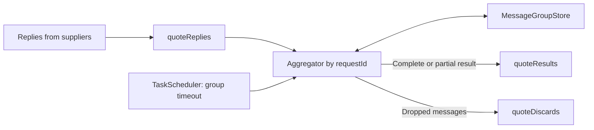
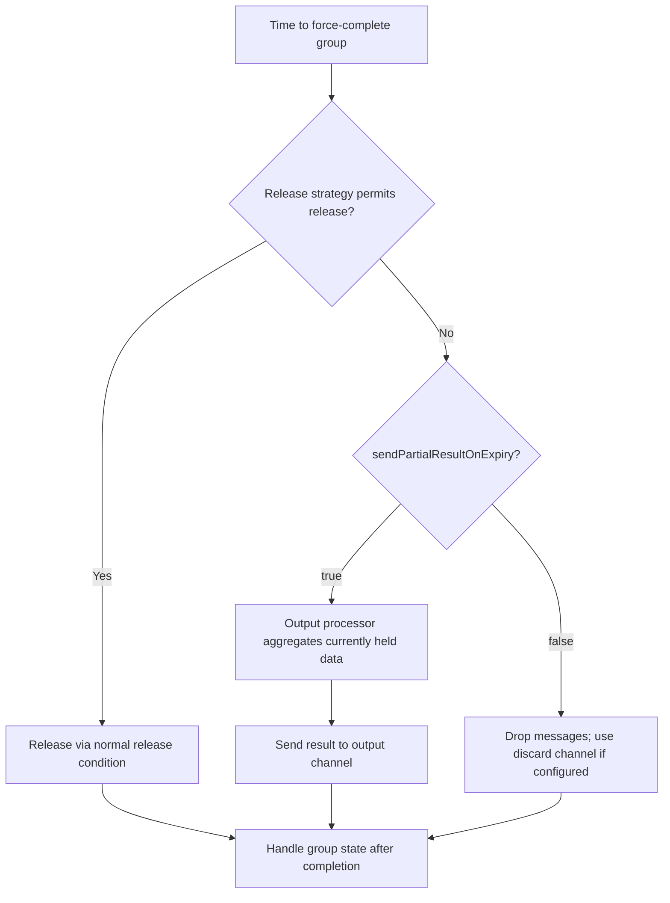

# Send Partial Result on Expiry — Emitting Partial Results When the Aggregator Expires

## 1. Goal and Problem

In the **Aggregator** chapter of the **SPRING_INTEGRATION_CORE** module, this lesson examines how to conclude a message-aggregation round when some parts do not arrive on time. The focus is the `sendPartialResultOnExpiry` option combined with `Message`, `MessageChannel`, the Aggregator endpoint, and Java DSL. You will design an output carrying missing-part details, handle late-arriving messages, and write tests for that integration flow.

Suppose a service requests quotes from three suppliers A, B, and C. Each reply is a `Message<QuotePart>`. The Aggregator must combine replies sharing the same `requestId` into one `QuoteSummary`:

- A, B, and C all reply: return the complete result as soon as all data arrives.
- Only A and B reply, then the group expires: return a partial result so the customer can still view two quotes.
- C replies after the aggregation round has ended: handle according to the late-arrival policy.

Accepting the absence of C is a business decision. For a price-comparison UI, two quotes may still be useful. For a workflow requiring confirmation from all three parties before executing a transaction, emitting a partial result must lead to an appropriate pending or rejected status.

After this lesson, you should be able to explain three separate questions: when a group has enough data, when a group must stop waiting, and how far an incomplete result is allowed to proceed.

## 2. Aggregator Processing Model

A simple flow has the following roles:



To understand the configuration, separate four responsibilities:

| Component | Question Answered by the Component |
| --- | --- |
| Correlation strategy | Which request round does the message belong to? |
| Release strategy | Has the current group met the normal release condition yet? |
| Timeout or expiry mechanism | When to stop waiting for an unreleased group? |
| Output processor | From the messages actually in the group, what result should be built? |

In the quote example, the correlation key is `requestId`; the release strategy checks the presence of expected suppliers. The output processor builds a summary from the received quotes.

`sendPartialResultOnExpiry(true)` allows emitting an aggregated result when a group is forced to complete while still not meeting the release condition. The default value is `false`. Enabling this flag alone does not expire groups on its own; an expiry trigger must also be configured. See the attribute description in [Spring Integration: Aggregator](https://docs.spring.io/spring-integration/reference/6.3/aggregator.html).

## 3. What Happens When a Timeout Triggers?

For an incomplete group that still holds messages, the branching logic can be pictured as follows:



The release strategy is re-evaluated during force completion. Therefore, "the timeout task ran" does not strictly mean "an incomplete result." If the strategy permits release on this check, the group takes the normal release path. This mechanism is described in [Aggregator and Group Timeout](https://docs.spring.io/spring-integration/reference/aggregator.html#agg-and-group-to).

There are two important consequences for business code:

1. The output processor must tolerate fewer replies than expected when partial results are enabled. An aggregation function that hardcodes `quotes.get(2)` will fail if the group has only two elements.
2. Incomplete status must be represented in the output contract. A two-element list alone does not tell the receiver whether the system only expected two items or missed a reply.

Partial results travel through the Aggregator's output path. This is not a mechanism that automatically creates an `ErrorMessage`, resends missing parts, or re-calls suppliers.

## 4. Choosing an Expiration Mechanism

### 4.1. `groupTimeout`: Limiting Group Idle Time

Example:

```java
.aggregate(a -> a
    .groupTimeout(3_000L)
    .sendPartialResultOnExpiry(true))
```

This snippet illustrates only two options; correlation, release, and output processor are added in the complete configuration.

With a fixed timeout duration, the wait timer resets when the group receives a new message while still not meeting the release condition. Consider `groupTimeout = 3,000 ms`:

| Time | Event | Expected Timeout After Event |
| --- | --- | --- |
| `t = 0 ms` | Receive A | Around `t = 3,000 ms` |
| `t = 800 ms` | Receive B | Around `t = 3,800 ms` |
| Afterward | C does not arrive | Partial result emitted around the new mark |

Actual execution timing also depends on the scheduler and resource contention. Do not infer from this configuration that every request finishes exactly three seconds after starting.

### 4.2. Deadline from Group Creation Time

If the business requirement is "wait at most three seconds from the first reply that created the group," use an expression returning a `java.util.Date`:

```java
.groupTimeoutExpression("new java.util.Date(timestamp + 3000)")
```

Here `timestamp` is the `MessageGroup` creation timestamp in milliseconds. Choose this setting **instead of** `groupTimeout(3_000L)`. Returning `Date` has been supported since Spring Integration 5.5; timeout APIs are documented in [CorrelationHandlerSpec](https://docs.spring.io/spring-integration/api/org/springframework/integration/dsl/CorrelationHandlerSpec.html).

For a request sent at 10:00:00 whose first reply arrives at 10:00:02, group age begins at 10:00:02. If the SLA is measured from request dispatch time, carry the request deadline into the flow and base waiting on that deadline. Group age does not yet represent total request processing time.

### 4.3. `MessageGroupStoreReaper`: Sweeping the Store on a Schedule

Another option is using `MessageGroupStoreReaper` to trigger expiry handling for eligible groups in the store. The reaper must have `run()` invoked on a schedule; declaring the bean alone does not create a periodic sweep task. The API is documented at [MessageGroupStoreReaper](https://docs.spring.io/spring-integration/api/org/springframework/integration/store/MessageGroupStoreReaper.html).

The example below is an **alternative** to per-group timeouts. Place the beans in a `@Configuration` class with `@EnableScheduling`, and omit `groupTimeout(...)` from the Aggregator if using only the sweep policy:

```java
@Bean
MessageGroupStoreReaper quoteReaper(SimpleMessageStore quoteStore) {
    MessageGroupStoreReaper reaper = new MessageGroupStoreReaper(quoteStore);
    reaper.setTimeout(30_000L);
    return reaper;
}

@Bean
QuoteReaperJob quoteReaperJob(MessageGroupStoreReaper quoteReaper) {
    return new QuoteReaperJob(quoteReaper);
}

static class QuoteReaperJob {
    private final MessageGroupStoreReaper reaper;

    QuoteReaperJob(MessageGroupStoreReaper reaper) {
        this.reaper = reaper;
    }

    @Scheduled(fixedDelay = 1_000L)
    public void reap() {
        this.reaper.run();
    }
}
```

Additional imports for this snippet are `org.springframework.integration.store.MessageGroupStoreReaper`, `org.springframework.scheduling.annotation.EnableScheduling`, and `org.springframework.scheduling.annotation.Scheduled`.

With a 30-second timeout and a one-second sweep interval, emission timing still depends on the next sweep and processing time. Do not assume a reaper produces the exact same kind of deadline as per-group timeouts. When using a persistent store, understand the store's group-age criteria and active sweep policy.

Do not share a single `MessageGroupStore` instance across multiple Aggregators that rely on expiry callbacks. When sharing database infrastructure, partition stores appropriately for each endpoint.

## 5. Designing the Result So Receivers Understand Missing Data

In the example, we define the output contract:

```text
QuoteSummary
  requestId
  quotes              // Received quotes
  expectedSuppliers   // Required sources for the request round
  missingSuppliers    // Sources absent at aggregation time
  partial             // Whether any contracted source is missing
```

A partial result can be serialized as JSON:

```json
{
  "requestId": "REQ-42",
  "quotes": [
    {"requestId": "REQ-42", "supplier": "A", "amount": 120000},
    {"requestId": "REQ-42", "supplier": "B", "amount": 125000}
  ],
  "expectedSuppliers": ["A", "B", "C"],
  "missingSuppliers": ["C"],
  "partial": true
}
```

`partial`, `expectedSuppliers`, and `missingSuppliers` are application-defined fields. Do not mistake them for headers or payloads automatically added by Spring Integration.

In this contract, `partial` describes **data completeness**, not why the output processor was invoked. If you need to distinguish "deadline expired," "old group swept," and "admin forced completion," add cause metadata in the coordinator or track the corresponding events.

The expected-supplier list must be fixed per request at fan-out time. If the list is fetched again from global configuration during aggregation, mid-flight configuration changes can distort missing-part detection.

## 6. Complete Java DSL Configuration

The example uses Java 17+ and APIs available in Spring Integration 6.3. Include `org.springframework.integration:spring-integration-core` at the version managed by your project's dependency management. Tests use JUnit Jupiter. No broker is required to practice this flow.

Place the following class in package `example.integration`. Data classes are declared as nested records to keep the example self-contained.

```java
package example.integration;

import java.math.BigDecimal;
import java.util.List;
import java.util.Set;
import java.util.TreeMap;
import java.util.TreeSet;
import java.util.stream.Collectors;

import org.springframework.context.annotation.Bean;
import org.springframework.context.annotation.Configuration;
import org.springframework.integration.channel.DirectChannel;
import org.springframework.integration.channel.QueueChannel;
import org.springframework.integration.config.EnableIntegration;
import org.springframework.integration.dsl.IntegrationFlow;
import org.springframework.integration.store.MessageGroup;
import org.springframework.integration.store.SimpleMessageStore;
import org.springframework.messaging.Message;

@Configuration
@EnableIntegration
public class QuoteAggregationConfig {

    public record QuotePart(
            String requestId,
            String supplier,
            BigDecimal amount) {
    }

    public record QuoteSummary(
            String requestId,
            List<QuotePart> quotes,
            Set<String> expectedSuppliers,
            Set<String> missingSuppliers,
            boolean partial) {
    }

    @Bean
    public DirectChannel quoteReplies() {
        return new DirectChannel();
    }

    @Bean
    public QueueChannel quoteResults() {
        return new QueueChannel();
    }

    @Bean
    public QueueChannel quoteDiscards() {
        return new QueueChannel();
    }

    @Bean
    public SimpleMessageStore quoteStore() {
        return new SimpleMessageStore();
    }

    @Bean
    public IntegrationFlow quoteAggregationFlow(SimpleMessageStore quoteStore) {
        return IntegrationFlow.from("quoteReplies")
                .aggregate(a -> a
                        .messageStore(quoteStore)
                        .correlationStrategy(message ->
                                ((QuotePart) message.getPayload()).requestId())
                        .releaseStrategy(QuoteAggregationConfig::hasAllSuppliers)
                        .outputProcessor(QuoteAggregationConfig::toSummary)
                        .groupTimeout(3_000L)
                        .sendPartialResultOnExpiry(true)
                        .expireGroupsUponTimeout(false)
                        .expireGroupsUponCompletion(false)
                        .discardChannel("quoteDiscards"))
                .channel("quoteResults")
                .get();
    }

    private static boolean hasAllSuppliers(MessageGroup group) {
        Set<String> received = group.getMessages().stream()
                .map(Message::getPayload)
                .map(QuotePart.class::cast)
                .map(QuotePart::supplier)
                .collect(Collectors.toSet());

        return received.containsAll(expectedSuppliers(group));
    }

    private static QuoteSummary toSummary(MessageGroup group) {
        Set<String> expected = expectedSuppliers(group);
        TreeMap<String, QuotePart> quotesBySupplier = new TreeMap<>();

        group.getMessages().stream()
                .map(Message::getPayload)
                .map(QuotePart.class::cast)
                .forEach(quote ->
                        quotesBySupplier.putIfAbsent(quote.supplier(), quote));

        Set<String> missing = new TreeSet<>(expected);
        missing.removeAll(quotesBySupplier.keySet());

        QuotePart first = quotesBySupplier.firstEntry().getValue();
        return new QuoteSummary(
                first.requestId(),
                List.copyOf(quotesBySupplier.values()),
                expected,
                Set.copyOf(missing),
                !missing.isEmpty());
    }

    private static Set<String> expectedSuppliers(MessageGroup group) {
        Object value = group.getOne().getHeaders().get("expectedSuppliers");
        if (!(value instanceof Set<?> expected)
                || expected.isEmpty()
                || expected.stream().anyMatch(item -> !(item instanceof String))) {
            throw new IllegalArgumentException(
                    "expectedSuppliers must be a non-empty Set<String>");
        }

        return expected.stream()
                .map(String.class::cast)
                .collect(Collectors.toUnmodifiableSet());
    }
}
```

Input assumptions of the example:

- `requestId`, `supplier`, and `amount` are valid; `supplier` belongs to the expected list.
- All replies with the same `requestId` carry the exact same immutable `expectedSuppliers`.
- Each fan-out round uses a distinct `requestId`. If retrying the whole round, issue a new round ID or include `attemptId` in the correlation key.
- A supplier has one effective quote per round. Duplicate deliveries must carry identical content; if multiple quote versions exist, define an explicit version-selection rule.

In a production flow, a transformer can normalize replies from HTTP or a broker into `QuotePart`. A filter or validation step before the Aggregator checks the assumptions above and routes invalid data to a dedicated error-handling flow.

### 6.1. Explaining the Choices in the Configuration

`quoteReplies` is the input channel of the Aggregator endpoint. `quoteResults` receives one `QuoteSummary` per aggregation round; it receives both complete and partial results. Using a queue at the output helps observe scheduler-emitted results during practice.

The release strategy checks the **supplier set** rather than only `group.size() == 3`. Three messages A, A, B do not fulfill the A, B, C contract. The output processor also groups by supplier and sorts quotes by supplier name so results are easy to read. `putIfAbsent` only fits the assumption that duplicate deliveries share identical content; store iteration order is not a basis for picking the newest quote.

We intentionally set both `expireGroupsUponTimeout(false)` and `expireGroupsUponCompletion(false)` to retain markers of finished groups. These two flags control keeping versus deleting group state, distinct from the flag deciding whether to emit partial results. They are documented in [AbstractCorrelatingMessageHandler](https://docs.spring.io/spring-integration/api/org/springframework/integration/aggregator/AbstractCorrelatingMessageHandler.html) and [AggregatingMessageHandler](https://docs.spring.io/spring-integration/api/org/springframework/integration/aggregator/AggregatingMessageHandler.html).

The example uses the scheduling infrastructure set up by `@EnableIntegration`. `SimpleMessageStore` works for a single-process lab; it does not persist group data across restarts.

### 6.2. Sending Replies into the Flow

The snippet below runs inside a method of a demo program with the corresponding Java, Spring Context, and Spring Messaging imports:

```java
try (var context = new AnnotationConfigApplicationContext(
        QuoteAggregationConfig.class)) {

    DirectChannel input = context.getBean("quoteReplies", DirectChannel.class);
    QueueChannel results = context.getBean("quoteResults", QueueChannel.class);
    Set<String> expected = Set.of("A", "B", "C");

    input.send(MessageBuilder.withPayload(
                    new QuoteAggregationConfig.QuotePart(
                            "REQ-42", "A", new BigDecimal("120000")))
            .setHeader("expectedSuppliers", expected)
            .build());

    input.send(MessageBuilder.withPayload(
                    new QuoteAggregationConfig.QuotePart(
                            "REQ-42", "B", new BigDecimal("125000")))
            .setHeader("expectedSuppliers", expected)
            .build());

    Message<?> result = results.receive(6_000L);
    if (result == null) {
        throw new IllegalStateException("No aggregation result received");
    }

    System.out.println(result.getPayload());
}
```

Additional imports are `org.springframework.context.annotation.AnnotationConfigApplicationContext` and `org.springframework.messaging.support.MessageBuilder`.

Because C is never sent, expected output has two quotes, `missingSuppliers = {C}`, and `partial = true`. The 6-second wait on `receive` is the observer program's wait limit, separate from the Aggregator's 3-second timeout.

## 7. Late-Arriving Messages and Group State

After emitting the A, B result, suppose C arrives with `requestId = REQ-42`. There are two basic policies:

| Policy | Design Consequence |
| --- | --- |
| Retain finished-group marker | C is recognized as late and routed to the configured discard channel |
| Delete group completely | C can start a brand-new group with the same correlation key |

In the lesson's configuration, we choose to retain group markers. Retaining the marker does not mean keeping all A and B quotes in the group after emission. It allows recognizing that the aggregation round has finished. How the Aggregator marks completion and clears messages can be seen in [AggregatingMessageHandler source](https://raw.githubusercontent.com/spring-projects/spring-integration/6.3.x/spring-integration-core/src/main/java/org/springframework/integration/aggregator/AggregatingMessageHandler.java).

If deleting the group immediately on timeout, C alone could start a new round and later produce an extra result. That typically violates the "one final outcome per request round" contract.

Likewise, do not keep group markers forever by default. Suppose 10,000 new `requestId` values arrive per minute; marker count will grow continuously. Retention design must answer:

- What is the maximum lateness window for a message?
- Past that window, does another layer prevent an old `requestId` from reopening a round?
- Do late replies need to be stored for reconciliation or supplier latency analytics?

Reapers and empty-group cleanup policies help manage metadata lifecycle. The main example omits retention configuration to keep lesson behavior clear; add this policy before long-running operation.

Partial results in this lesson are **final results closing the round**. If the requirement is to emit A and B first and later emit an updated result when C arrives, you need a versioned result contract and state management for updates. Enabling partial-on-expiry does not automatically supply that update behavior.

## 8. Distinguishing Output, Discard, and Error

Three paths must be understood separately:

| Situation | Path in the Example |
| --- | --- |
| A, B, C all arrive | One complete `QuoteSummary` goes to `quoteResults` |
| Timeout with only A, B and partial enabled | One `QuoteSummary` missing C goes to `quoteResults` |
| C arrives after close while marker remains | Message C goes to `quoteDiscards` |
| Output processor or downstream step throws exception | Error handled per thread and configured error handling |

If changing `sendPartialResultOnExpiry` to `false`, a group not meeting the release condition at expiry will not create a partial `QuoteSummary`. Under the default discard configuration in Spring Integration 6.3, each message in the group goes to the discard channel if configured. This branch can be inspected in [AbstractCorrelatingMessageHandler source](https://raw.githubusercontent.com/spring-projects/spring-integration/6.3.x/spring-integration-core/src/main/java/org/springframework/integration/aggregator/AbstractCorrelatingMessageHandler.java).

In production, a valid partial result can still be accepted successfully downstream. Use `partial` or `missingSuppliers` to route the outcome to the right step: display available quotes, ask the user for confirmation, or transition to a follow-up workflow.

### 8.1. Which Thread Does an Error Occur On?

When the final reply completes the group via `DirectChannel`, processing runs on the thread sending that reply. When timeout triggers partial emission, execution starts on a scheduler thread. A `try/catch` around the earlier send of A will not catch an exception thrown later on the scheduler.

With a custom scheduler, configure an appropriate `MessagePublishingErrorHandler` if task exceptions should route to an error channel. Spring Integration's default scheduling infrastructure has its own error publishing mechanism; details on synchronous and asynchronous errors are in [Spring Integration: Error Handling](https://docs.spring.io/spring-integration/reference/error-handling.html).

Successfully placing `QuoteSummary` into the output queue does not guarantee downstream writes or service calls will succeed. Test at the actual failure points. Retries, transactions, persistent stores, and deduplication must align with application processing boundaries; the partial-result flag alone does not guarantee exactly-once behavior.

### 8.2. Gateways Also Have Their Own Timeout

If a gateway fronts the entire quote flow and waits for the aggregated outcome, the gateway's reply timeout must align with fan-out time, group wait time, and downstream processing.

For instance, if the gateway waits only one second while the group may wait three seconds after the last reply, the caller can time out before the Aggregator emits a partial result. Decide how to handle results produced after the caller stopped waiting, or expose an asynchronous API queried by `requestId`.

## 9. Testing Result Emission Behavior

Do not merely assert property values on the configuration. Practice requires observing messages leaving the endpoint:

| Test Case | Data Sent | What to Assert |
| --- | --- | --- |
| Complete sources | A, B, C with same requestId | `partial = false`, no missing suppliers |
| Missing source | A, B | After timeout, `partial = true`, missing C |
| Duplicate delivery | A, A, B | Not treated as having all A, B, C |
| Late arrival | A, B, wait for result, then C | C goes to discard; no new result under marker-retention policy |
| Two independent groups | A for R1, B for R2 | Quotes never mix across the two requestIds |
| Partial result disabled | A, B then expiry | No partial summary; observe discard |
| Error during aggregation | Output processor throws exception | Observe error on synchronous or scheduler path respectively |

Below are three JUnit 5 tests using the configuration class from section 6. Each test creates its own context to isolate store and queue state.

```java
package example.integration;

import java.math.BigDecimal;
import java.util.Set;

import org.junit.jupiter.api.Test;
import org.springframework.context.annotation.AnnotationConfigApplicationContext;
import org.springframework.integration.channel.DirectChannel;
import org.springframework.integration.channel.QueueChannel;
import org.springframework.messaging.Message;
import org.springframework.messaging.support.MessageBuilder;

import example.integration.QuoteAggregationConfig.QuotePart;
import example.integration.QuoteAggregationConfig.QuoteSummary;

import static org.junit.jupiter.api.Assertions.*;

class QuoteAggregationTest {

    @Test
    void emitsCompleteResultWhenAllSuppliersArrive() {
        try (var context = new AnnotationConfigApplicationContext(
                QuoteAggregationConfig.class)) {
            DirectChannel input = context.getBean(
                    "quoteReplies", DirectChannel.class);
            QueueChannel output = context.getBean(
                    "quoteResults", QueueChannel.class);

            send(input, "R-full", "A");
            send(input, "R-full", "B");
            assertNull(output.receive(0));

            send(input, "R-full", "C");
            QuoteSummary summary = receiveSummary(output);

            assertEquals("R-full", summary.requestId());
            assertFalse(summary.partial());
            assertTrue(summary.missingSuppliers().isEmpty());
            assertEquals(3, summary.quotes().size());
        }
    }

    @Test
    void emitsPartialResultOnExpiry() {
        try (var context = new AnnotationConfigApplicationContext(
                QuoteAggregationConfig.class)) {
            DirectChannel input = context.getBean(
                    "quoteReplies", DirectChannel.class);
            QueueChannel output = context.getBean(
                    "quoteResults", QueueChannel.class);

            send(input, "R-partial", "A");
            send(input, "R-partial", "B");

            QuoteSummary summary = receiveSummary(output);
            assertEquals("R-partial", summary.requestId());
            assertTrue(summary.partial());
            assertEquals(Set.of("C"), summary.missingSuppliers());
            assertEquals(2, summary.quotes().size());
        }
    }

    @Test
    void discardsLateReplyWhileCompletedGroupIsRetained() {
        try (var context = new AnnotationConfigApplicationContext(
                QuoteAggregationConfig.class)) {
            DirectChannel input = context.getBean(
                    "quoteReplies", DirectChannel.class);
            QueueChannel output = context.getBean(
                    "quoteResults", QueueChannel.class);
            QueueChannel discards = context.getBean(
                    "quoteDiscards", QueueChannel.class);

            send(input, "R-late", "A");
            send(input, "R-late", "B");
            assertTrue(receiveSummary(output).partial());

            send(input, "R-late", "C");
            Message<?> late = discards.receive(1_000L);
            assertNotNull(late);
            assertEquals("C", ((QuotePart) late.getPayload()).supplier());
            assertNull(output.receive(0));
        }
    }

    private static void send(
            DirectChannel input, String requestId, String supplier) {
        boolean sent = input.send(MessageBuilder.withPayload(
                        new QuotePart(requestId, supplier,
                                new BigDecimal("100000")))
                .setHeader("expectedSuppliers", Set.of("A", "B", "C"))
                .build());
        assertTrue(sent);
    }

    private static QuoteSummary receiveSummary(QueueChannel output) {
        Message<?> message = output.receive(6_000L);
        assertNotNull(message, "Expected an aggregation result");
        return assertInstanceOf(QuoteSummary.class, message.getPayload());
    }
}
```

`receive(timeout)` performs a bounded wait and returns immediately when a message arrives, eliminating the need for `Thread.sleep` to guess timeout timing. Six seconds is the test wait budget for the three-second configuration; under heavy load, pick an appropriate budget.

These three tests cover the primary branches. They do not prove every race condition, retention policy, or restart behavior. To verify idle-timeout shifting when B arrives, write a dedicated test controlling A and B send timing and observing the emission timestamp, or use a test-controllable scheduler.

When testing with partial results disabled, create a separate test configuration with `sendPartialResultOnExpiry(false)`, wait for all discarded messages, and assert no summary is produced. Checking an empty output right after sending A proves nothing about the expiry branch.

## 10. Edge Cases Requiring Decisions

### 10.1. No Supplier Replies at All

If zero messages reach the Aggregator, there is no group to time out and no data to build a `QuoteSummary`. Simply enabling partial results cannot produce an empty list for every request with zero replies.

One approach is storing request state and deadline in the fan-out coordinator, emitting a "no replies received" result once the deadline passes. If injecting a group-initializing message into the aggregation flow itself, design correlation, release strategy, and output processor to distinguish it from actual quote replies.

### 10.2. Duplicates and Quote Updates

Counting distinct suppliers prevents treating A, A, B as complete. However, it does not resolve the case where the same supplier sends two different prices. Choose an explicit business rule: first valid wins, highest version wins, or route conflicts to a reconciliation flow.

### 10.3. Messages Arriving Right Around Timeout

C may arrive while the timeout task is contending to process the group. Never write contracts assuming every message timestamped before the deadline is guaranteed to be included. If business logic depends on source event time, validate event time and define an explicit lateness acceptance window.

### 10.4. Restarts and Multiple Instances

Switching to a persistent store preserves group data, yet does not automatically persist the previous process's in-memory timeout tasks. Recovery plans must account for unfinished groups, sweeping stale groups, and handling redeliveries.

With multiple instances, design how messages sharing a correlation key reach the right processing node, or use a suitable store and locking mechanism. Do not infer that merely sharing a database solves all cross-instance coordination.

## 11. Operational Observability and Diagnostics

In the quote service, monitor complete result count, partial result count, end-to-end latency from request dispatch to result, open group count, and late reply count. When detailed logs are needed, record `requestId`, expected source count, received source count, and missing sources. Avoid using `requestId` as a metric label because cardinality grows with every request.

| Symptom | First Thing to Check |
| --- | --- |
| Group waits forever | Is timeout or reaper actually running; is the scheduler starved? |
| Result emitted with missing data unknown to consumer | Does the payload contract declare missing parts? |
| Same requestId spawns a second result when C arrives late | Was the group deleted; was the correlation key reused? |
| Memory grows with request volume | Open group count, completed markers, and retention policy |
| `try/catch` at send site misses expiry errors | Did the error occur on the scheduler; where does the error handler route? |
| Callers time out before summary arrives | Are gateway budget, fan-out, and group timeout consistent? |

A rising partial-result rate may signal a slow supplier, network issues, or an overloaded scheduler. Choose remediation based on which parts are missing and measured latencies rather than blindly raising timeouts for all groups.

## 12. Hands-On Practice

1. Run the flow with A, B, C and then with only A, B; compare the `missingSuppliers` field.
2. Send A, A, B and explain why the release strategy does not yet emit a complete result.
3. Switch to a deadline measured from group creation time; design a test distinguishing it from idle time since the last reply.
4. Route `QuoteSummary` with `partial = true` to a separate channel to display missing parts clearly to users.
5. Try deleting groups after timeout and observe what happens when sending C with the same `requestId`; then choose the policy matching the service contract.

When finished, you should be able to narrate the whole journey: replies become `Message` objects, enter a `MessageChannel`, are grouped by the Aggregator by `requestId`, are emitted when complete or upon expiry, and are processed downstream according to result completeness.
