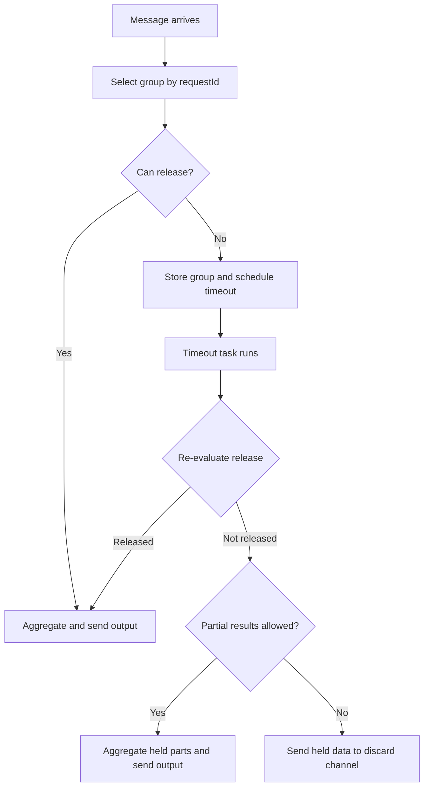

# Discard Channel on Timeout

## Objectives and Context

In the **Aggregator** chapter of the **SPRING_INTEGRATION_CORE** module, this lesson focuses on handling messages that have arrived yet have not formed a group eligible for aggregation. You will wire `Message`, `MessageChannel`, the aggregator endpoint, and Java DSL into two observable branches: valid aggregated results and data dropped from aggregation.

After this lesson, you can:

- Configure the routing path for messages belonging to a timed-out group.
- Distinguish discards, partial-result emission, and processing errors.
- Choose how to handle late-arriving messages after a group has closed.
- Separately test discard decisions and scheduler execution.

The examples use **Spring Integration 6.5** APIs, Java 17, and JUnit Jupiter. Only `spring-integration-core`, compatible Spring Context, and JUnit Jupiter for tests are required; if using Spring Boot, let Boot's BOM manage compatible versions. The `discardIndividuallyOnExpiry` option in this lesson is available since 6.5. Classes and DSL methods align with [CorrelationHandlerSpec 6.5 API](https://docs.spring.io/spring-integration/docs/6.5.0/api/org/springframework/integration/dsl/CorrelationHandlerSpec.html).

## 1. The Problem: Receiving Two Out of Three Quotes

A purchase request `REQ-42` is sent to three suppliers. Each reply carries a `requestId` so the aggregator can identify its group. The example's business rules require all three replies before moving to price comparison.

Suppose:

| Illustrative Time | Incoming Message | Desired State |
| --- | --- | --- |
| 0 ms | Quote from supplier A | Create group `REQ-42` |
| 400 ms | Quote from supplier B | Keep waiting for C |
| Around 2,400 ms | No new reply for 2 seconds | End the wait; route A and B to the missing-data branch |
| 3,000 ms | Quote from supplier C | Handle as a late message if closed-group trace remains |

The discard branch preserves A and B for inspection, reconciliation, or deciding whether to start a new request round. It does not fabricate quote C, re-invoke suppliers automatically, or make business decisions on its own.

In the example, each supplier sends at most one reply per request round. A real system must validate inputs and deduplicate before using a simple condition like `group.size() == 3`. Three messages do not necessarily come from three distinct suppliers.

## 2. When Does a Group Go to the Discard Channel?

The aggregator groups messages by correlation key. Whenever a message is added to a group, `ReleaseStrategy` decides whether the group is ready. When the timeout task actually runs, the release strategy is evaluated again; thus, a timeout does not mean discard in every case.

| Evaluation Result When Timeout Task Runs | `sendPartialResultOnExpiry` | Path Taken |
| --- | --- | --- |
| Released | `true` or `false` | Aggregate and send to output |
| Not released | `true` | Aggregate currently held parts and send to output |
| Not released | `false` | Route held messages to discard channel if configured |

Without a configured discard channel, the final branch has no destination where the application can recover data. `sendPartialResultOnExpiry(false)` is an expiry handling policy; it does not start a timer by itself. You still need a trigger such as `groupTimeout` or store-level expiry. See [Aggregator: Group Timeout](https://docs.spring.io/spring-integration/reference/aggregator.html#agg-and-group-to).



The diagram omits contention among arriving messages, group locks, and the timeout task to focus on routing decisions.

## 3. Distinguishing Timeout Types

With `groupTimeout(2_000L)`, an unreleased group is scheduled for handling after an idle duration without additional messages. A new message accepted into the group can reset this schedule. This is not a guarantee of finishing in exactly two seconds from the first reply.

For example, if A arrives at 0 ms and B arrives at 1,500 ms: waiting can extend until around 3,500 ms. Add scheduler execution lag when observing wall-clock times.

Three timing concepts should be designed separately:

| Concept | Business or Technical Question |
| --- | --- |
| Group wait time | How long has the group gone without a new reply? |
| Request deadline | By what wall-clock time must the purchase request conclude? |
| Channel send timeout | How long may sending wait to deliver a message to a congested destination? |

`sendTimeout` belongs to sending through a channel. It does not replace `groupTimeout`. For requests with a fixed deadline, use `groupTimeoutExpression` returning `java.util.Date` based on group creation time or a validated business deadline, rather than treating a numeric timeout as an absolute deadline. [DSL timeout API](https://docs.spring.io/spring-integration/docs/6.5.0/api/org/springframework/integration/dsl/CorrelationHandlerSpec.html#groupTimeoutExpression(java.lang.String)).

An important limitation of this model: if none of the three suppliers ever send a message, the aggregator has no group to wait on. Detecting requests that received zero replies requires request tracking state or an orchestrator-level deadline.

## 4. Complete Java DSL Configuration

The following configuration provides a synchronous input, a store holding groups, and two queues to observe results. The example's default discard mode receives each original message individually.

```java
package example.integration;

import org.springframework.context.annotation.Bean;
import org.springframework.context.annotation.Configuration;
import org.springframework.integration.channel.DirectChannel;
import org.springframework.integration.channel.QueueChannel;
import org.springframework.integration.config.EnableIntegration;
import org.springframework.integration.dsl.IntegrationFlow;
import org.springframework.integration.store.MessageGroupStore;
import org.springframework.integration.store.SimpleMessageStore;
import org.springframework.messaging.Message;

@Configuration
@EnableIntegration
public class QuoteAggregationConfig {

    public record QuotePart(String supplier, int amount) {
    }

    @Bean
    public DirectChannel quoteParts() {
        return new DirectChannel();
    }

    @Bean
    public QueueChannel completedQuotes() {
        return new QueueChannel(100);
    }

    @Bean
    public QueueChannel discardedQuoteParts() {
        return new QueueChannel(100);
    }

    @Bean
    public MessageGroupStore quoteGroupStore() {
        return new SimpleMessageStore();
    }

    @Bean
    public IntegrationFlow collectQuotes(MessageGroupStore quoteGroupStore) {
        return IntegrationFlow.from(quoteParts())
                .aggregate(a -> a
                        .messageStore(quoteGroupStore)
                        .correlationExpression("headers['requestId']")
                        .releaseStrategy(group -> group.size() == 3)
                        .groupTimeout(2_000L)
                        .sendPartialResultOnExpiry(false)
                        .discardChannel(discardedQuoteParts())
                        .discardIndividuallyOnExpiry(true)
                        .expireGroupsUponTimeout(false)
                        .expireGroupsUponCompletion(false)
                        .outputProcessor(group -> group.getMessages().stream()
                                .map(Message::getPayload)
                                .toList()))
                .channel(completedQuotes())
                .get();
    }
}
```

`requestId` is the business header chosen as the group key; the example does not rely on `sequenceSize` or `sequenceNumber`. Every input must carry a valid `requestId`. `IntegrationFlow.from(...)` creates the endpoint chain registered in the Spring Context; the configuration must be loaded into the context for consumers and schedulers to run. [IntegrationFlow API](https://docs.spring.io/spring-integration/docs/6.5.0/api/org/springframework/integration/dsl/IntegrationFlow.html).

An input message can be built as follows:

```java
Message<QuoteAggregationConfig.QuotePart> first =
        org.springframework.messaging.support.MessageBuilder
                .withPayload(new QuoteAggregationConfig.QuotePart("A", 120))
                .setHeader("requestId", "REQ-42")
                .build();
```

Calling `quoteParts.send(first)` only confirms sending and input handling per channel semantics. It does not prove three quotes have arrived. The testing section below shows how to observe both branches.

Assumptions to maintain when using this configuration:

- The three replies belong to the same request round and have no duplicate suppliers.
- `amount` is an illustrative number; currency rules and quote validity are checked at the system boundary.
- `SimpleMessageStore` and the two `QueueChannel` instances serve this in-memory example. Design persistent storage if state must survive process restarts.
- The example retains markers of closed groups to demonstrate late messages. Add a state-cleanup policy for long-running operation.

`outputProcessor` builds a list of payloads for the success branch. Do not infer A, B, C order from group element order; price comparison should identify suppliers via the `supplier` field.

## 5. What Kind of Message Does the Discard Channel Receive?

### 5.1. Per-Message Mode

With `discardIndividuallyOnExpiry(true)`, a group containing A and B produces two sends to the discard channel. The consumer receives each original message, preserving its `QuotePart` payload and original headers such as `requestId` and `id`.

This fits when individual replies must be persisted separately for lookup. Do not cast the payload to `Throwable`, and do not assume the framework attaches a `reason=TIMEOUT` header to each message.

If the application wants to normalize dropped data, it can construct a record containing:

| Application-Defined Field | Purpose |
| --- | --- |
| `requestId` and attempt ID | Identifies the exact request and processing round |
| `originalMessageId` | Correlates back to the original message |
| `supplier` | Identifies where the reply came from |
| `observedAt` | Records when the discard branch received the data |
| `reason` | Reason determined from the processing context |

A neutral label such as `DISCARDED_BY_QUOTE_AGGREGATOR` is suitable if the consumer does not yet distinguish expiry from late arrivals. Labeling every message here as `TIMEOUT` makes monitoring data inaccurate.

### 5.2. Whole-Group Mode

Starting in Spring Integration 6.5, you can change just this option:

```java
.discardIndividuallyOnExpiry(false)
```

When a group is discarded on expiry, the channel receives one message whose payload is the list of `Message<?>` objects in the group. Note that this is a list of messages, not a list of `QuotePart`. This mode is meaningful only when `sendPartialResultOnExpiry(false)` and a discard channel is configured. [setDiscardIndividuallyOnExpiry API](https://docs.spring.io/spring-integration/docs/6.5.0/api/org/springframework/integration/aggregator/AbstractCorrelatingMessageHandler.html#setDiscardIndividuallyOnExpiry(boolean)).

Data shape comparison:

```text
Per-message mode:
  Message(payload=QuotePart(A), headers.requestId=REQ-42)
  Message(payload=QuotePart(B), headers.requestId=REQ-42)

Whole-group mode:
  Message(payload=[
    Message(payload=QuotePart(A), headers.requestId=REQ-42),
    Message(payload=QuotePart(B), headers.requestId=REQ-42)
  ])
```

A consumer in whole-group mode must read business metadata from the inner messages or from an application-constructed envelope. Do not rely on the outer message automatically having `requestId`. The 6.5 codebase creates a new outer message for the list while still sending rejected late arrivals individually; hence a shared discard channel can receive both shapes. [AbstractCorrelatingMessageHandler 6.5 source](https://github.com/spring-projects/spring-integration/blob/v6.5.0/spring-integration-core/src/main/java/org/springframework/integration/aggregator/AbstractCorrelatingMessageHandler.java).

If you want one missing-replies record per request round, whole-group mode surfaces all held replies at once. Still, the list of A and B by itself does not tell you C is missing. The expected supplier set must come from business request state.

## 6. Group Lifecycle and Late Messages

Discard determines where data goes. Expiry settings also determine whether the group's trace is deleted completely or retained in a closed state.

| Post-Timeout Setting | Consequence for a New Message with Same Key |
| --- | --- |
| `expireGroupsUponTimeout(true)` | Group is deleted; new message can initialize another group with the same key |
| `expireGroupsUponTimeout(false)` with closed-group retention | Group is kept in complete state; late message is rejected and routed to discard channel if configured |

The default value of `expireGroupsUponTimeout` is `true`; the example explicitly sets `false`. [setExpireGroupsUponTimeout API](https://docs.spring.io/spring-integration/docs/6.5.0/api/org/springframework/integration/aggregator/AbstractCorrelatingMessageHandler.html#setExpireGroupsUponTimeout(boolean)).

The example also sets `expireGroupsUponCompletion(false)` to keep group traces after successful aggregation. In the aggregator, the retention branch marks the group complete and removes processed messages from the group. What remains is metadata identifying a closed group. [AggregatingMessageHandler 6.5 source](https://github.com/spring-projects/spring-integration/blob/v6.5.0/spring-integration-core/src/main/java/org/springframework/integration/aggregator/AggregatingMessageHandler.java).

Applied to `REQ-42`:

1. A and B arrive, while C is missing.
2. Timeout routes A and B to the discard channel.
3. The group is retained as a closed group.
4. C arrives with the same `requestId` and is also routed to the discard channel.

Once the group's metadata is purged, this mechanism can no longer recognize C as an old reply. If old replies must be blocked longer than metadata retention, check request status in the business layer.

For a new retry attempt, include an attempt ID in the key, such as `REQ-42:attempt-2`. Reusing `REQ-42` while the old group remains closed causes new replies to be treated as late arrivals.

### Intentional State Cleanup

Keeping metadata forever makes the group count grow monotonically. Determine the maximum window during which late replies are still expected, then purge closed groups older than that retention window.

`MessageGroupStoreReaper` provides `run()` to trigger expiry by age threshold; a scheduler must call it on an appropriate cadence. It is not purely a metadata-deletion tool: incomplete groups eligible for expiry can also pass through expiry callbacks. Do not add a reaper with a short threshold and assume it preserves the example's two-second wait policy. [MessageGroupStoreReaper API](https://docs.spring.io/spring-integration/docs/6.5.0/api/org/springframework/integration/store/MessageGroupStoreReaper.html).

When designing cleanup, consider reaper interval, expiry threshold, and empty-group retention duration together. Test concrete scenarios: C arriving right before cleanup, right after cleanup, and during a new attempt.

## 7. How Does Discard Differ from errorChannel and DLQ?

An incomplete group is an outcome of the waiting policy. It can happen without any Java code throwing an exception.

| Branch | Typical Situation | Data the Consumer Must Expect |
| --- | --- | --- |
| Output | Enough replies or partial results allowed | Aggregated result |
| Discard | Replies dropped by group policy | Original message or configured group envelope |
| Error | Handler throws exception and error handling routes it | `ErrorMessage` with exception payload |
| Application or broker DLQ | Unprocessable data per custom failure-storage policy | Contract defined by application or broker |

Spring Integration models asynchronous errors using `ErrorMessage`. With `DirectChannel`, exceptions usually propagate to the sending thread. When a timeout task runs, work executes on a scheduler thread; do not expect an earlier input-send call to catch exceptions thrown later. [Error Handling](https://docs.spring.io/spring-integration/reference/error-handling.html).

For example, the discard consumer saves A to a database and then throws an exception saving B. That is a processing error in the discard branch, distinct from the original cause of missing C. The application must decide how to retry persistence and avoid duplicating A.

Naming a channel `discardedQuoteParts` does not turn it into a durable DLQ. If data must survive restarts, connect a consumer to durable storage and specify who may replay data, where to replay it, and under what attempt ID.

Similarly, a reply timeout on a messaging gateway is a caller-side limit. It must be coordinated with aggregator policy; a gateway timing out does not automatically move groups to discard.

## 8. Channel Characteristics Affect the Timeout Branch

The two queues in the example let us read results with `receive(timeout)` without attaching extra consumers. A `QueueChannel` can have bounded capacity; when full, sends may block. A `DirectChannel` invokes its consumer directly on the sending thread, so using it for discard means slow consumer operations can tie up scheduler threads. Default queues in the example are in-memory. [Message Channel Implementations](https://docs.spring.io/spring-integration/reference/channel/implementations.html).

Therefore, operational design should answer three concrete questions:

- When discards spike, what drains the queue and at what rate?
- When storage slows down, is it acceptable to stall timeout tasks for other groups?
- When discard handling fails, how are duplicates observed and handled?

You cannot infer exactly-once guarantees solely from having a `MessageGroupStore` or discard channel. For instance, saving A and failing on B can cause A to be seen again on a subsequent attempt. A persistence consumer should have a business-appropriate deduplication key instead of treating every delivery as a brand-new reply.

When measuring metrics, separate **timed-out group count** from **discarded message count**. One group missing C can emit two discarded messages; if C arrives late, the message count rises further. The two metrics answer two different questions.

## 9. Testing Discard Decisions and Timeout Tasks

The test suite below uses the exact configuration from section 4. Each test opens a separate Spring Context to avoid sharing queues, groups, and timeout schedules.

The first three tests use synchronous flow or explicitly trigger expiry. The last test verifies the real scheduled path. The code snippets are learning examples; run them in a project with compatible dependencies to confirm in your specific environment.

```java
package example.integration;

import java.util.List;
import java.util.Set;

import org.junit.jupiter.api.AfterEach;
import org.junit.jupiter.api.BeforeEach;
import org.junit.jupiter.api.Test;
import org.springframework.context.annotation.AnnotationConfigApplicationContext;
import org.springframework.integration.channel.DirectChannel;
import org.springframework.integration.channel.QueueChannel;
import org.springframework.integration.store.MessageGroupStore;
import org.springframework.messaging.Message;
import org.springframework.messaging.support.MessageBuilder;

import static org.junit.jupiter.api.Assertions.*;

class QuoteAggregationTest {

    private AnnotationConfigApplicationContext context;
    private DirectChannel input;
    private QueueChannel output;
    private QueueChannel discarded;
    private MessageGroupStore store;

    @BeforeEach
    void openContext() {
        context = new AnnotationConfigApplicationContext(
                QuoteAggregationConfig.class);
        input = context.getBean("quoteParts", DirectChannel.class);
        output = context.getBean("completedQuotes", QueueChannel.class);
        discarded = context.getBean("discardedQuoteParts", QueueChannel.class);
        store = context.getBean("quoteGroupStore", MessageGroupStore.class);
    }

    @AfterEach
    void closeContext() {
        context.close();
    }

    @Test
    void threePartsProduceOneAggregate() {
        input.send(quote("REQ-OK", "A", 120));
        input.send(quote("REQ-OK", "B", 115));
        input.send(quote("REQ-OK", "C", 125));

        Message<?> result = output.receive(0);
        assertNotNull(result);
        List<?> parts = assertInstanceOf(List.class, result.getPayload());
        assertEquals(3, parts.size());
        assertTrue(parts.stream().allMatch(
                QuoteAggregationConfig.QuotePart.class::isInstance));
        assertNull(output.receive(0));
        assertNull(discarded.receive(0));
    }

    @Test
    void forcedExpiryDiscardsOriginalMessagesAndClosesGroup() {
        Message<?> first = quote("REQ-EXPIRE", "A", 120);
        Message<?> second = quote("REQ-EXPIRE", "B", 115);
        input.send(first);
        input.send(second);

        // Trigger the expiry callback immediately; do not wait for the two-second timer.
        store.expireMessageGroups(-1);

        Message<?> discardedFirst = discarded.receive(0);
        Message<?> discardedSecond = discarded.receive(0);
        assertNotNull(discardedFirst);
        assertNotNull(discardedSecond);
        assertEquals(
                Set.of(first.getHeaders().getId(), second.getHeaders().getId()),
                Set.of(discardedFirst.getHeaders().getId(),
                        discardedSecond.getHeaders().getId()));
        assertEquals("REQ-EXPIRE",
                discardedFirst.getHeaders().get("requestId"));
        assertEquals("REQ-EXPIRE",
                discardedSecond.getHeaders().get("requestId"));
        assertNull(discarded.receive(0));
        assertNull(output.receive(0));
        assertTrue(store.getMessageGroup("REQ-EXPIRE").isComplete());
        assertEquals(0, store.getMessageGroup("REQ-EXPIRE").size());
    }

    @Test
    void latePartIsDiscardedWhileClosedGroupIsRetained() {
        input.send(quote("REQ-LATE", "A", 120));
        input.send(quote("REQ-LATE", "B", 115));
        store.expireMessageGroups(-1);
        assertNotNull(discarded.receive(0));
        assertNotNull(discarded.receive(0));

        Message<?> late = quote("REQ-LATE", "C", 125);
        input.send(late);

        assertSame(late, discarded.receive(0));
        assertNull(discarded.receive(0));
        assertNull(output.receive(0));
    }

    @Test
    void scheduledTimeoutEventuallyDiscardsIncompleteGroup() {
        input.send(quote("REQ-TIMER", "A", 120));
        input.send(quote("REQ-TIMER", "B", 115));

        // Bounded wait for the scheduler task to actually run.
        Message<?> first = discarded.receive(5_000);
        Message<?> second = discarded.receive(5_000);

        assertNotNull(first);
        assertNotNull(second);
        assertEquals("REQ-TIMER", first.getHeaders().get("requestId"));
        assertEquals("REQ-TIMER", second.getHeaders().get("requestId"));
        assertNull(discarded.receive(0));
        assertNull(output.receive(0));
    }

    private Message<QuoteAggregationConfig.QuotePart> quote(
            String requestId, String supplier, int amount) {
        return MessageBuilder.withPayload(
                        new QuoteAggregationConfig.QuotePart(supplier, amount))
                .setHeader("requestId", requestId)
                .build();
    }
}
```

`expireMessageGroups(-1)` tells the store to apply expiry to eligible groups without waiting for a positive age threshold. That call executes through the callback registered by the aggregator; it tests expiry-handling decisions, not that the `groupTimeout` task ran. Hence a separate timer test is needed. [MessageGroupStore.expireMessageGroups API](https://docs.spring.io/spring-integration/docs/6.5.0/api/org/springframework/integration/store/MessageGroupStore.html#expireMessageGroups(long)).

`receive(0)` fits synchronous assertions after an operation has already finished. The scheduler test uses bounded `receive` instead of `Thread.sleep` and asserting at the exact two-second mark. Five seconds is the test's wait budget; slower CI environments may need adjustment.

When extending the configuration, add these test scenarios:

| Scenario | What to Verify |
| --- | --- |
| `sendPartialResultOnExpiry(true)` with two parts | Output holds a two-part aggregate; discard is empty |
| `discardIndividuallyOnExpiry(false)` | One envelope holds both original messages on expiry |
| Completely delete group after timeout | New reply with same key can form a new group |
| Two `requestId` values interleaved | Only parts sharing a key aggregate together |
| Input duplicates a supplier | Deduplication prevents false size satisfaction |
| Discard consumer fails mid-batch | Already saved data is not unexpectedly duplicated |
| Zero replies arrive | External deadline mechanism detects forgotten requests |

These are test design scenarios; each scenario requires isolated configuration and data, avoiding modifying a bean holding another test's groups.

## 10. Common Misconceptions

| Misconception | Accurate Understanding |
| --- | --- |
| Setting `sendPartialResultOnExpiry(false)` enables timeout | Must also configure an expiry trigger or group timeout |
| Timeout always goes to discard | Release strategy is re-checked before deciding how to handle missing parts |
| Discard receives exceptions | Usually receives original business messages; whole-group mode receives a message list |
| One timed-out group produces one discard message | Depends on discard mode; late arrivals can emit more |
| Having `errorChannel` removes the need for discard | The two branches solve different situations |
| Deleting the group still recognizes old messages | Deleting metadata also erases the trace the aggregator uses to spot closed groups |
| Resending the same `requestId` always starts a new try | Can be rejected if the old group is retained in complete state |
| The queue in the example is durable error storage | Default queues hold data only inside the process |

## 11. Practice Exercises

Starting from the initial configuration, perform these steps in order:

1. Send A and B for `REQ-LAB:attempt-1`, leaving C missing. Observe payloads and headers on the discard channel.
2. Send C after receiving the two discarded messages. Explain why no successful aggregate is produced.
3. Create another context with `sendPartialResultOnExpiry(true)`. Compare output and discard while still sending only A and B.
4. Create another context with `discardIndividuallyOnExpiry(false)`. Read `requestId` from each inner message inside the envelope.
5. Open `REQ-LAB:attempt-2`, send all A, B, C, and verify the new attempt does not mix with old data.
6. Design a record for persisting dropped replies with a deduplication key. Specify how to distinguish a new attempt from reprocessing the same message.

A solid solution should explain both the data path and the group state after each step. Then the discard channel becomes an explicit part of the integration flow contract: replies not used to build a result still have a clear place to be received, observed, and handled further per business policy.
