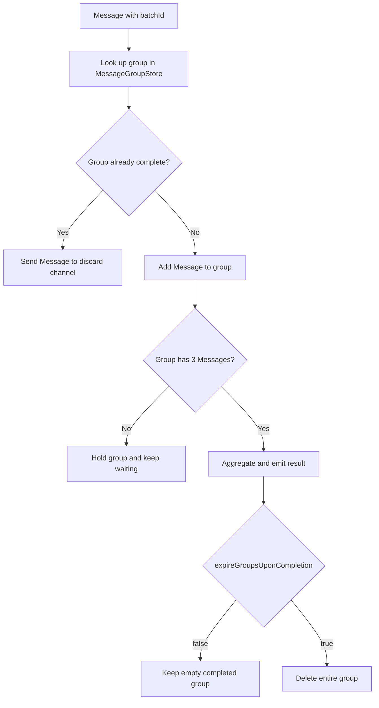

# Expire Groups Upon Completion — Removing Groups When the Aggregator Completes

In the **Aggregator** chapter of the **SPRING_INTEGRATION_CORE** module, this lesson focuses on the state-management decision after aggregating messages: retaining a trace of the completed group or deleting the entire group so the correlation key can be reused.

After this lesson, you can configure `expireGroupsUponCompletion` with Java DSL, predict the path of late-arriving messages, and inspect both emitted outputs and state inside `MessageGroupStore`. These skills help design message flows across `Message`, `MessageChannel`, and the Aggregator endpoint according to business requirements.

## 1. The Actual Question Behind This Setting

Suppose a flow receives three parts of the same batch:

```text
batchId=batch-A: A1, A2, A3
             → Aggregator
             → one Message whose payload contains A1, A2, A3
```

After producing the result, what happens if `A4` still carries `batchId=batch-A`?

- If this is a late-arriving part of an already-closed batch, the application wants to isolate it for inspection.
- If this is the opening part of a brand-new aggregation round, the application wants to accept it.

`expireGroupsUponCompletion` controls the state that distinguishes these two behaviors. Its default value is `false`.

| Value | State After Normal Group Completion | Next Message with the Same Correlation Key |
| --- | --- | --- |
| `false` | Clears aggregated messages, keeps an empty group marked complete | Discarded because the group is already complete |
| `true` | Deletes both the group and completion status from the store | Can start a new group |

Here, **expire** means removing the entire group record. Keeping an empty group preserves the fact that "this key has already completed." This rule is described in [Expiring Groups in the Aggregator documentation](https://docs.spring.io/spring-integration/reference/aggregator.html).

## 2. Separating Three Decisions: Grouping, Releasing, State Cleanup

To read the configuration accurately, evaluate three questions in order:

| Component | Question | Example in This Lesson |
| --- | --- | --- |
| `CorrelationStrategy` | Which group does the message belong to? | Value of the `batchId` header |
| `ReleaseStrategy` | Is the group ready to emit a result? | Group has three messages |
| `expireGroupsUponCompletion` | After completion, should a trace of the group remain? | Retain or delete the empty group |

For example, enabling `expireGroupsUponCompletion(true)` does not make a two-part group meet a three-part condition on its own. This setting matters only in the post-release state-cleanup step.

In `AggregatingMessageHandler`, the cleanup branch marks completion and then chooses whether to delete the whole group or only remove messages from the group. You can verify this in the `afterRelease` method of [AggregatingMessageHandler source](https://github.com/spring-projects/spring-integration/blob/main/spring-integration-core/src/main/java/org/springframework/integration/aggregator/AggregatingMessageHandler.java).

The diagram below shows the normal path of the example when output succeeds:



In this diagram, the already-complete branch rejects messages before evaluating release. A different `ReleaseStrategy` will not automatically reopen a retained completed group. This behavior can be checked in `processMessageForGroup` in [AbstractCorrelatingMessageHandler source](https://github.com/spring-projects/spring-integration/blob/main/spring-integration-core/src/main/java/org/springframework/integration/aggregator/AbstractCorrelatingMessageHandler.java).

## 3. Predicting Behavior with a Timeline

Suppose all messages below share `batchId=batch-A`, arrive sequentially, and no timeout or other group cleanup runs:

| Time | Input | When Configured `false` | When Configured `true` |
| --- | --- | --- | --- |
| t1 | A1 | Group open, size 1 | Group open, size 1 |
| t2 | A2 | Group open, size 2 | Group open, size 2 |
| t3 | A3 | Emits batch 1, empty complete group remains (size 0) | Emits batch 1, group deleted |
| t4 | A4 | A4 goes to discard | New group created, size 1 |
| t5 | A5 | A5 goes to discard | New group has size 2 |
| t6 | A6 | A6 goes to discard | Emits batch 2, group deleted again |

This table reflects direct reasoning for the three-part scenario, not time-based windowing. With `true`, batch boundaries here are formed solely by the three-message condition and completion moments.

If `A4` was actually a late old part, it gets folded into the new batch. If `A5` and `A6` belong to another processing run reusing the same key, results can mix runs together.

A cleaner design for independent business batches uses a key with batch identity, such as:

```text
store-17 / import-2026-11-19-001
store-17 / import-2026-11-19-002
```

Deciding whether to retain or delete state after completion is still required, but the key already expresses the exact unit of work. Using only `store-17` forces the application to infer batch boundaries from arrival order.

## 4. Complete Java DSL Configuration

The example below uses a `DirectChannel` as input, two `QueueChannel` beans to observe results and dropped messages, and a `SimpleMessageStore` dedicated to the Aggregator.

The code uses `IntegrationFlow.from(...)`, compatible with Spring Integration 6.x/7.x. Select library versions via your project's dependency management. Tests need JUnit Jupiter; the Spring classes used below belong to core Spring Integration and Spring Context dependencies.

```java
package example.integration;

import org.springframework.beans.factory.annotation.Qualifier;
import org.springframework.beans.factory.annotation.Value;
import org.springframework.context.annotation.Bean;
import org.springframework.context.annotation.Configuration;
import org.springframework.integration.channel.DirectChannel;
import org.springframework.integration.channel.QueueChannel;
import org.springframework.integration.config.EnableIntegration;
import org.springframework.integration.dsl.IntegrationFlow;
import org.springframework.integration.store.SimpleMessageStore;

@Configuration(proxyBeanMethods = false)
@EnableIntegration
public class ExpireGroupsConfig {

    @Bean
    public DirectChannel partsInput() {
        return new DirectChannel();
    }

    @Bean
    public QueueChannel batchesOutput() {
        return new QueueChannel();
    }

    @Bean
    public QueueChannel lateParts() {
        return new QueueChannel();
    }

    @Bean
    public SimpleMessageStore batchStore() {
        return new SimpleMessageStore();
    }

    @Bean
    public IntegrationFlow batchesFlow(
            @Qualifier("partsInput") DirectChannel input,
            @Qualifier("batchesOutput") QueueChannel output,
            @Qualifier("lateParts") QueueChannel discard,
            SimpleMessageStore batchStore,
            @Value("${demo.expire-on-completion:true}")
            boolean expireOnCompletion) {

        return IntegrationFlow.from(input)
                .aggregate(a -> a
                        .messageStore(batchStore)
                        .correlationStrategy(message ->
                                message.getHeaders().get("batchId"))
                        .releaseStrategy(group -> group.size() == 3)
                        .expireGroupsUponCompletion(expireOnCompletion)
                        .discardChannel(discard))
                .channel(output)
                .get();
    }
}
```

The `expireGroupsUponCompletion(boolean)` DSL method resides on [AggregatorSpec](https://docs.spring.io/spring-integration/api/org/springframework/integration/dsl/AggregatorSpec.html). Methods `messageStore`, `correlationStrategy`, `releaseStrategy`, and `discardChannel` are provided by [CorrelationHandlerSpec](https://docs.spring.io/spring-integration/api/org/springframework/integration/dsl/CorrelationHandlerSpec.html).

Intentional choices in the example:

- Header `batchId` must hold a valid value before entering the endpoint. In a real application, validate input with a filter or invalid-data branch.
- The `size() == 3` condition keeps focus on observing group lifecycle. It counts messages without verifying three distinct business parts.
- No timeout, reaper, or empty-group expiry is configured; the tests below examine only normal completion.
- Property `demo.expire-on-completion` defaults to `true` **for this example**. The framework's own default remains `false`.

When no output processor is specified, the example uses the default aggregation behavior: producing one result containing the group's collection of payloads. See [DefaultAggregatingMessageGroupProcessor](https://github.com/spring-projects/spring-integration/blob/main/spring-integration-core/src/main/java/org/springframework/integration/aggregator/DefaultAggregatingMessageGroupProcessor.java). The tests treat the payload as `Collection<?>` without asserting element ordering.

`SimpleMessageStore` stores data in memory; its no-arg constructor sets no capacity limit. It is a convenient choice for observing this lesson, per [SimpleMessageStore API](https://docs.spring.io/spring-integration/api/org/springframework/integration/store/SimpleMessageStore.html).

### Mapping to XML or Direct Handler Configuration

If a project uses XML, the corresponding attribute is `expire-groups-upon-completion`:

```xml
<int:aggregator
        input-channel="partsInput"
        output-channel="batchesOutput"
        discard-channel="lateParts"
        message-store="batchStore"
        correlation-strategy-expression="headers['batchId']"
        release-strategy-expression="size() == 3"
        expire-groups-upon-completion="true"/>
```

This is an alternative configuration for the Java DSL endpoint, assuming channels and store are already declared and the `int` namespace is configured. Register only one endpoint for this illustrative flow.

When constructing `AggregatingMessageHandler` directly, the corresponding setter is:

```java
handler.setExpireGroupsUponCompletion(true);
```

The setter name and parameter semantics are documented in [AggregatingMessageHandler API](https://docs.spring.io/spring-integration/api/org/springframework/integration/aggregator/AggregatingMessageHandler.html).

## 5. Testing Both Output and Group State

Checking only for emitted output is insufficient to verify this setting: both `true` and `false` emit the same first batch. The difference appears in the store and subsequent messages.

The class below belongs in the same package as `ExpireGroupsConfig`. Each test creates its own context so group and message counts in the store reflect only the scenario under test.

```java
package example.integration;

import java.util.Collection;
import java.util.HashSet;
import java.util.Map;
import java.util.Set;

import org.junit.jupiter.api.Test;
import org.springframework.context.annotation.AnnotationConfigApplicationContext;
import org.springframework.core.env.MapPropertySource;
import org.springframework.integration.channel.DirectChannel;
import org.springframework.integration.channel.QueueChannel;
import org.springframework.integration.store.SimpleMessageStore;
import org.springframework.messaging.Message;
import org.springframework.messaging.support.MessageBuilder;

import static org.junit.jupiter.api.Assertions.*;

class ExpireGroupsCompletionTest {

    @Test
    void trueRemovesGroupAndAcceptsNextBatch() {
        try (var context = openContext(true)) {
            var input = context.getBean("partsInput", DirectChannel.class);
            var output = context.getBean("batchesOutput", QueueChannel.class);
            var discard = context.getBean("lateParts", QueueChannel.class);
            var store = context.getBean(SimpleMessageStore.class);

            send(input, "A1");
            send(input, "A2");
            assertNull(output.receive(0));
            assertEquals(1, store.getMessageGroupCount());
            assertEquals(2, store.getMessageCountForAllMessageGroups());

            send(input, "A3");
            assertBatch(output.receive(0), "A1", "A2", "A3");
            assertEquals(0, store.getMessageGroupCount());
            assertEquals(0, store.getMessageCountForAllMessageGroups());

            send(input, "A4");
            assertNull(output.receive(0));
            assertNull(discard.receive(0));
            assertEquals(1, store.getMessageGroupCount());
            assertEquals(1, store.getMessageCountForAllMessageGroups());

            send(input, "A5");
            send(input, "A6");
            assertBatch(output.receive(0), "A4", "A5", "A6");
            assertEquals(0, store.getMessageGroupCount());
            assertEquals(0, store.getMessageCountForAllMessageGroups());
            assertNull(output.receive(0));
            assertNull(discard.receive(0));
        }
    }

    @Test
    void falseKeepsCompletionStateAndDiscardsLateMessage() {
        try (var context = openContext(false)) {
            var input = context.getBean("partsInput", DirectChannel.class);
            var output = context.getBean("batchesOutput", QueueChannel.class);
            var discard = context.getBean("lateParts", QueueChannel.class);
            var store = context.getBean(SimpleMessageStore.class);

            send(input, "A1");
            send(input, "A2");
            send(input, "A3");
            assertBatch(output.receive(0), "A1", "A2", "A3");
            assertEquals(1, store.getMessageGroupCount());
            assertEquals(0, store.getMessageCountForAllMessageGroups());
            assertTrue(store.getMessageGroup("batch-A").isComplete());

            send(input, "A4");
            Message<?> late = discard.receive(0);
            assertNotNull(late);
            assertEquals("A4", late.getPayload());
            assertNull(output.receive(0));
            assertEquals(1, store.getMessageGroupCount());
            assertEquals(0, store.getMessageCountForAllMessageGroups());
        }
    }

    private static AnnotationConfigApplicationContext openContext(
            boolean expireOnCompletion) {
        var context = new AnnotationConfigApplicationContext();
        context.getEnvironment().getPropertySources().addFirst(
                new MapPropertySource("testProperties", Map.of(
                        "demo.expire-on-completion",
                        String.valueOf(expireOnCompletion))));
        context.register(ExpireGroupsConfig.class);
        context.refresh();
        return context;
    }

    private static void send(DirectChannel input, String payload) {
        assertTrue(input.send(MessageBuilder.withPayload(payload)
                .setHeader("batchId", "batch-A")
                .build()));
    }

    private static void assertBatch(Message<?> result, String... expected) {
        assertNotNull(result);
        Collection<?> values = assertInstanceOf(
                Collection.class, result.getPayload());
        assertEquals(expected.length, values.size());
        assertEquals(Set.of(expected), new HashSet<>(values));
    }
}
```

`getMessageGroupCount()` and `getMessageCountForAllMessageGroups()` measure two distinct quantities, per [MessageGroupStore API](https://docs.spring.io/spring-integration/api/org/springframework/integration/store/MessageGroupStore.html). In the `false` test, one group with zero messages is the expected state.

Use group count to prove the group was removed. An empty group object returned by a key lookup is insufficient to tell whether a stored record remains; examine the store implementation's behavior. The assertions here target each context's dedicated `SimpleMessageStore`.

`receive(0)` polls immediately without waiting. This fits synchronous flows using `DirectChannel` into a `QueueChannel`. When adding an executor, broker, or timeout, use bounded waits and condition-based synchronization.

This is illustrative test code to add to a practice project; this article does not claim the tests were compiled or executed in the current workspace.

## 6. Normal Completion and Timeout Are Two Different Situations

Three options are often conflated into one:

| Option | What It Decides |
| --- | --- |
| `expireGroupsUponCompletion` | Group cleanup after normal completion |
| `expireGroupsUponTimeout` | Group deletion policy on the timeout path |
| `sendPartialResultOnExpiry` | When force-closing an incomplete group, emit held parts or discard |

By default `expireGroupsUponTimeout` is `true`, while `sendPartialResultOnExpiry` is `false`. When a timeout occurs, the framework re-queries the release strategy before choosing how to conclude the group; therefore, you cannot infer full timeout behavior from the completion flag alone. Interaction details are in [Aggregator — Expiring Groups and Group Timeout](https://docs.spring.io/spring-integration/reference/aggregator.html).

In the lesson's three-part scenario, if the release strategy still returns `false` and the application wants to drop incomplete groups upon timeout:

```java
// Options added to the same AggregatorSpec of the example.
.groupTimeout(30_000L)
.expireGroupsUponTimeout(true)
.sendPartialResultOnExpiry(false)
```

This defines a dedicated policy for groups waiting too long. The corresponding methods and millisecond unit of `groupTimeout` are documented in [CorrelationHandlerSpec API](https://docs.spring.io/spring-integration/api/org/springframework/integration/dsl/CorrelationHandlerSpec.html).

Conversely, enabling `expireGroupsUponCompletion(true)` alone still leaves a two-part group waiting forever if no other termination policy exists. From a design standpoint, define both milestones: when data is sufficient and when waiting must stop.

## 7. Retaining Traces Temporarily Before Purging

Immediate deletion is convenient for key reuse. Infinite retention causes completed keys to accumulate over time. You can retain completed groups for a bounded window to detect late messages and purge them afterward.

For example, replace the completion option in DSL with:

```java
.expireGroupsUponCompletion(false)
.minimumTimeoutForEmptyGroups(300_000L)
```

`minimumTimeoutForEmptyGroups` is in milliseconds. Modern versions support scheduling empty-group cleanup after release; this property is also used when cleaning empty groups via a reaper. Ensure the scheduler/cleanup mechanism is configured and running. See [setMinimumTimeoutForEmptyGroups and scheduling in AbstractCorrelatingMessageHandler](https://github.com/spring-projects/spring-integration/blob/main/spring-integration-core/src/main/java/org/springframework/integration/aggregator/AbstractCorrelatingMessageHandler.java).

This duration protects only while the group trace still exists. For instance, assuming the group is actually purged at t+5 minutes:

```text
Group completed            Old message             Group purged
      t0                     t+2 min                   t+5 min
      |-------------------------|--------------------------|
      completion marker retained → discard
                                                        |
                                             old message arriving afterward
                                             can start a new group
```

Thus, five minutes is an assumption about source delay and redelivery windows, not a permanent duplicate-processing guarantee.

A design estimate: if 50 new keys complete per second and traces are kept for roughly one hour, steady-state marker count is around `50 × 3,600 = 180,000`. That estimates marker group count only, excluding open groups, purge lag, indexes, or implementation memory overhead.

Monitor open groups, retained completed groups, and discarded messages separately. If message count is zero while group count climbs steadily, inspect the completed-state retention policy.

## 8. Deduplication, Processing Errors, and Persistent Storage

### 8.1. Replaying an Entire Batch Can Emit Another Result

With `true`, suppose the source replays all three business events `A1`, `A2`, `A3` after the first batch already completed. Because the previous group's state was deleted, a new batch can gather three parts and emit another result.

This is a design consequence of forgetting completed keys. If results create invoices or post ledger entries, enforce a business idempotency key at the persistence boundary, such as `(batchId, operationType)`. Checking the key and writing side effects require a consistency mechanism matching your storage backend.

With `false`, the completion trace blocks messages with the same key after completion for as long as the trace exists. Still, while the group is open, `size() == 3` can count three duplicate business events if sent as three distinct `Message` instances. Thus the part-count example only serves lifecycle observation; requiring three distinct parts needs `partId` and an explicit check.

### 8.2. Discards and Technical Errors Must Be Observed Separately

`lateParts` in the example observes messages dropped because the group already completed. Exceptions from the processor or downstream steps must follow the flow's error-handling path; do not look for them in this discard channel by default.

Likewise, do not interpret "completion" as "all downstream side effects committed." The normal release path cleans state inside a `finally` block; exceptions, transactions, and retries must be designed together. You can inspect this structure in [AbstractCorrelatingMessageHandler](https://github.com/spring-projects/spring-integration/blob/main/spring-integration-core/src/main/java/org/springframework/integration/aggregator/AbstractCorrelatingMessageHandler.java). When safe retries are required, verify both group state and side effects already applied at the target.

### 8.3. Swapping Stores Does Not Replace Lifecycle Policies

`SimpleMessageStore` does not survive process restarts. To preserve in-flight groups or completion state across restarts, evaluate an appropriate persistent store. Spring Integration provides implementations for JDBC, Redis, and MongoDB; see [Message Store](https://docs.spring.io/spring-integration/reference/message-store.html).

Suppose a persistent store successfully persisted a completion marker and has not purged it yet: after restart, that marker continues rejecting messages with the same key. If the configuration deleted groups upon completion, switching to a persistent store does not recover deleted history.

When multiple instances process concurrently, verify per-group-ID locking and consistency across store, locks, transactions, and downstream systems. The completion flag by itself does not solve those coordination requirements. Starting with a dedicated store per endpoint makes observation and group cleanup clearer.

## 9. Choosing a Policy from Business Requirements

The following scenarios offer design guidance based on the analyzed behavior:

| Requirement | Recommended Choice | What to Verify |
| --- | --- | --- |
| One key represents one batch; late messages must be dropped | Keep completion state with `false` | Trace retention duration and post-restart recovery |
| Intentionally group every three consecutive messages sharing a key | Can use `true` | Whether the source can replay old batches or interleave runs |
| Business batches have independent IDs | Include batch ID in correlation key | Whether completion traces are still needed to block replays |
| Retaining state too long inflates group count | Set a retention window then purge | Window during which the source may redeliver old data |
| Incomplete groups hang indefinitely | Add a timeout policy | Whether partial results are emitted and late parts accepted |

Before applying to a production flow, clarify the correlation key unit, completeness condition, path for late arrivals, and when the system may forget a processed key. Your test suite should cover the first batch, a late part, key reuse, and full-batch replay. Those scenarios directly reflect the business semantics of `expireGroupsUponCompletion`.
