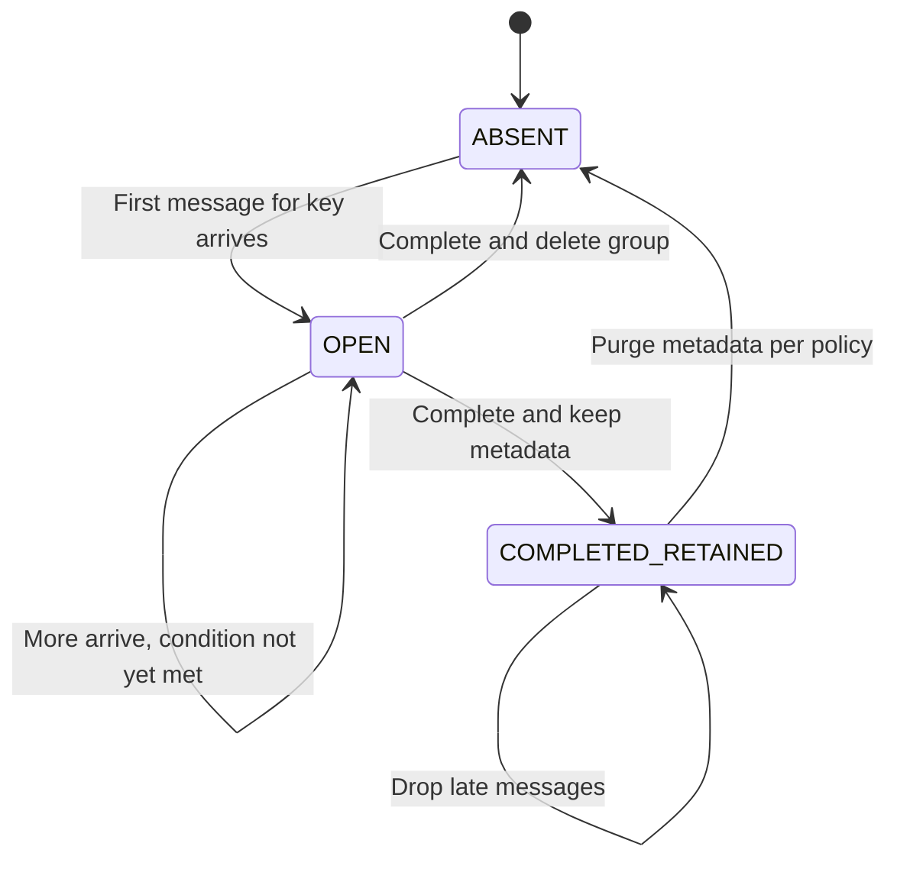

# Stateful Aggregator

In the **Aggregator** chapter of the **SPRING_INTEGRATION_CORE** module, this lesson explains how a message flow remembers arrived messages, waits for a completion condition, and releases state. The focus is designing group-level state with `MessageGroupStore`, coordinating `CorrelationStrategy`, `ReleaseStrategy`, the output processor, and expiration policies.

The running example is an order-approval service. Each approval run requires results from three branches: inventory check, payment check, and fraud check. Branches may reply out of order, resend results, or fail to reply. The lesson connects `Message`, `MessageChannel`, endpoints, and Java DSL to those scenarios; the final part covers flow verification and error handling.

Java examples use Java 17+ and Spring Integration 6.5.x APIs. The project needs `spring-integration-core`; `spring-boot-starter-integration` can be used in Spring Boot applications. The JDBC section also needs `spring-integration-jdbc`, a JDBC driver, and a `DataSource`. Manage dependency versions via a compatible project BOM.

## 1. What Does Stateful Mean?

A transformer converting individual messages can compute its output solely from the current message. For an approval request, a payment result alone is not enough to decide: the system needs to know whether inventory and fraud results for the **same approval run** have arrived yet.

An aggregator therefore maintains state across multiple message arrivals. State is tied to a **message group**, which does not mean putting a shared list into a field on a business bean. Spring Integration separates group management from processing strategies; strategy logic itself can remain stateless. [Spring Integration — Aggregator](https://docs.spring.io/spring-integration/reference/6.5/aggregator.html).

A single reception step can be modeled as follows:

```text
key k = determineGroup(message)
newGroup = update(storedGroupFor(k), message)

if eligible for release:
    result = aggregate(newGroup)
    forward result to output
    apply group completion policy
if not ready yet:
    hold group waiting for next message or expiry handling
```

This is a mental model, not source code or a specification of internal framework transaction ordering.

If two requests A and B run concurrently, the system holds two independent states. Payment results from A must never fill in missing results for B. Likewise, a second approval run for A must not be treated as a continuation of an already-finished first run.

## 2. Where Does State Live?

Components coordinate as follows:

| Component | Responsibility | Question in the Example |
| --- | --- | --- |
| `CorrelationStrategy` | Determines the group key from a message | Which approval run does the result belong to? |
| `MessageGroup` | Represents a group and its metadata | Which results does the group currently hold? |
| `MessageGroupStore` | Stores and retrieves group state | Where is the group kept while waiting? |
| `ReleaseStrategy` | Decides when the group is ready to process | Have all three check types arrived? |
| `MessageGroupProcessor` | Builds the result from the released group | Approve or reject the request? |
| `AggregatingMessageHandler` | Coordinates endpoint execution | When to accept, aggregate, and finish? |

`MessageGroup` provides data such as group ID, message set, count, creation/modification timestamps, and completion flag. These fields mean different things: a group with zero messages left can still exist to record that the approval run has finished. [Javadoc — MessageGroup](https://docs.spring.io/spring-integration/docs/6.5.0/api/org/springframework/integration/store/MessageGroup.html).

`MessageGroupStore` is the contract for storing group state. When an aggregator uses a persistent store, distinguish database rows from Java objects loaded into memory for processing. Never modify a `MessageGroup` fetched from a store via ad-hoc admin code while the endpoint is active; out-of-band edits can break locking and lifecycle assumptions.

## 3. Lifecycle of a Group

The diagram below depicts three states useful for business design. `OPEN`, `COMPLETED_RETAINED`, and `ABSENT` are illustrative labels for this lesson, not a Spring Integration enum.



There are two separate decisions:

1. **Completing processing:** has an aggregated result been produced or has the group been closed by expiry?
2. **Deleting traces:** is metadata kept to recognize messages belonging to an already-closed group?

For normal completion, `expireGroupsUponCompletion(false)` keeps completion markers; `true` deletes the group so the same key can start a new group. The default value is `false`. [Javadoc — AggregatingMessageHandler](https://docs.spring.io/spring-integration/docs/6.5.0/api/org/springframework/integration/aggregator/AggregatingMessageHandler.html).

Suppose request `REQ-101` received all three results. Afterward, a redelivery of the payment result arrives:

| Retained State | Behavior to Expect |
| --- | --- |
| Completed group metadata still exists | Message with the same key is treated as late and routed to discard channel if configured |
| Group has been deleted | Message can open a new group with the same key and start waiting again |

A retained completion marker is commonly called a *tombstone*. It helps over a bounded window, but it does not replace a business history store or long-term deduplication.

## 4. Choosing a Correlation Key by Business Lifecycle

In the example, `requestId` identifies **one approval run**, such as `tenant-7/order-105/attempt-2`. Every branch receives the same value from the start of processing. When explicitly re-evaluating an order, the system creates a new attempt.

A sound key has these traits:

- Present and valid before the message enters the aggregator.
- Identical across all branches of the same processing run.
- Distinguishes tenant, workflow type, or attempt when those scopes share one storage area.
- Stable throughout the group lifecycle; avoid key objects whose fields mutate after being used as a key.

By default, correlation relies on the `correlationId` header. You can replace it with a business strategy. Returned keys must be non-`null` with proper `equals()`/`hashCode()` semantics. [Spring Integration — Correlation Strategy](https://docs.spring.io/spring-integration/reference/6.5/aggregator.html#aggregator-correlation-strategy).

A common bug is using `customerId`: two orders from the same customer get mixed together. Using `orderId` alone is also insufficient when multiple approval runs for the same order can overlap.

Distinguish the identifier types:

| Identifier | Example | Purpose |
| --- | --- | --- |
| `MessageHeaders.ID` | UUID of one message | Identifies the message object |
| Correlation key | `tenant-7/order-105/attempt-2` | Identifies the group to aggregate |
| Branch result key | `(requestId, PAYMENT)` | Identifies duplicated business results |

When an adapter creates a new message for the same event, its UUID can change. Therefore, deduplicating by message ID is not enough to claim business-level deduplication.

## 5. Enough Messages Does Not Mean Enough Information

Suppose the release condition is only `group.size() == 3`. The following stream has three messages yet is missing one check type:

| Arrival Order | Result Type | Types Present |
| --- | --- | --- |
| 1 | `INVENTORY` | Inventory |
| 2 | `PAYMENT` | Inventory, Payment |
| 3 | `PAYMENT` resent | Still only Inventory, Payment |
| 4 | `FRAUD` | All three types |

The lesson uses the condition:

```text
present check types cover {INVENTORY, PAYMENT, FRAUD}
```

The aggregator handles identical duplicates by taking one result. If two results of the same type conflict in content, the aggregator throws an error to enter conflict handling.

Three questions must be answered independently:

- **Correlation:** which group does the message belong to?
- **Release:** does the group have enough information to make a decision?
- **Aggregation:** given that information, what is the decision?

An `accepted=false` result is still a valid check result. In the example's policy, the system waits for all three branches and then issues a rejection decision. If business rules want fast rejection, redesign both the release condition and how still-running branches are handled.

When using a splitter and sequence-based release, keep sequence metadata consistent across endpoints. A mid-flow filter dropping a message can leave the aggregator waiting for parts that never arrive. An alternative representation is sending a branch result marked rejected or not-applicable, instead of silently dropping an item the group is still expecting.

## 6. Complete In-Memory Java DSL Example

The configuration below defines a `DirectChannel` input, two `QueueChannel` beans for output and discards, and a dedicated store for the aggregator. `QueueChannel` helps observe outputs in the example; a real application needs continuous consumers and appropriate capacity limits.

```java
package example.integration;

import java.io.Serializable;
import java.util.EnumMap;
import java.util.EnumSet;
import java.util.List;
import java.util.Map;
import java.util.Objects;
import java.util.Set;

import org.springframework.beans.factory.annotation.Qualifier;
import org.springframework.context.annotation.Bean;
import org.springframework.context.annotation.Configuration;
import org.springframework.integration.channel.DirectChannel;
import org.springframework.integration.channel.QueueChannel;
import org.springframework.integration.config.EnableIntegration;
import org.springframework.integration.dsl.IntegrationFlow;
import org.springframework.integration.store.MessageGroup;
import org.springframework.integration.store.MessageGroupStore;
import org.springframework.integration.store.SimpleMessageStore;
import org.springframework.messaging.Message;
import org.springframework.messaging.MessageChannel;

@Configuration
@EnableIntegration
public class ApprovalAggregationConfiguration {

    public enum CheckType { INVENTORY, PAYMENT, FRAUD }

    public record CheckResult(
            String requestId,
            CheckType type,
            boolean accepted) implements Serializable {

        public CheckResult {
            Objects.requireNonNull(requestId, "requestId");
            Objects.requireNonNull(type, "type");
            if (requestId.isBlank()) {
                throw new IllegalArgumentException("requestId must not be blank");
            }
        }
    }

    public record Decision(
            String requestId,
            boolean accepted,
            List<CheckResult> checks) implements Serializable {
    }

    private static final Set<CheckType> REQUIRED =
            Set.of(CheckType.INVENTORY, CheckType.PAYMENT, CheckType.FRAUD);

    @Bean
    public MessageChannel approvalInput() {
        return new DirectChannel();
    }

    @Bean
    public QueueChannel approvalOutput() {
        return new QueueChannel();
    }

    @Bean
    public QueueChannel approvalDiscard() {
        return new QueueChannel();
    }

    @Bean
    public MessageGroupStore approvalStore() {
        return new SimpleMessageStore();
    }

    @Bean
    public IntegrationFlow approvalFlow(
            @Qualifier("approvalInput") MessageChannel input,
            @Qualifier("approvalOutput") QueueChannel output,
            @Qualifier("approvalDiscard") QueueChannel discard,
            @Qualifier("approvalStore") MessageGroupStore store) {

        return IntegrationFlow.from(input)
                .aggregate(a -> a
                        .messageStore(store)
                        .correlationStrategy(message ->
                                ((CheckResult) message.getPayload()).requestId())
                        .releaseStrategy(
                                ApprovalAggregationConfiguration::hasAllChecks)
                        .outputProcessor(
                                ApprovalAggregationConfiguration::makeDecision)
                        .groupTimeout(30_000L)
                        .sendPartialResultOnExpiry(false)
                        .expireGroupsUponCompletion(false)
                        .expireGroupsUponTimeout(false)
                        .minimumTimeoutForEmptyGroups(300_000L)
                        .discardChannel(discard))
                .channel(output)
                .get();
    }

    private static boolean hasAllChecks(MessageGroup group) {
        Set<CheckType> received = EnumSet.noneOf(CheckType.class);
        for (Message<?> message : group.getMessages()) {
            received.add(((CheckResult) message.getPayload()).type());
        }
        return received.containsAll(REQUIRED);
    }

    private static Decision makeDecision(MessageGroup group) {
        Map<CheckType, CheckResult> unique = new EnumMap<>(CheckType.class);

        for (Message<?> message : group.getMessages()) {
            CheckResult current = (CheckResult) message.getPayload();
            CheckResult previous = unique.putIfAbsent(current.type(), current);
            if (previous != null && !previous.equals(current)) {
                throw new IllegalStateException(
                        "Conflicting result: " + current.requestId()
                                + "/" + current.type());
            }
        }

        if (!unique.keySet().containsAll(REQUIRED)) {
            throw new IllegalStateException("Incomplete approval group");
        }

        List<CheckResult> checks = List.copyOf(unique.values());
        String requestId = checks.get(0).requestId();
        boolean accepted = checks.stream().allMatch(CheckResult::accepted);
        return new Decision(requestId, accepted, checks);
    }
}
```

`outputProcessor(...)` accepts a `MessageGroupProcessor`. Correlation, release, store, and timeout settings are separate options in Java DSL. [Javadoc — AggregatorSpec](https://docs.spring.io/spring-integration/docs/6.5.0/api/org/springframework/integration/dsl/AggregatorSpec.html), [Javadoc — CorrelationHandlerSpec](https://docs.spring.io/spring-integration/docs/6.5.0/api/org/springframework/integration/dsl/CorrelationHandlerSpec.html).

Key points to read carefully in the example:

- `REQUIRED` is an immutable constant. Each evaluation creates a local `received` set; never use a field to accumulate results across groups.
- `hasAllChecks()` makes no external calls, does not mutate the group, and causes no side effects.
- `makeDecision()` creates a new result object. List order is determined by `EnumMap`, independent of message arrival order.
- Identical duplicates can still reside in the store while waiting. Collapsing them when building output does not protect store capacity against a flood of duplicate messages.
- Conflicts are detected only during aggregation. If they must be detected immediately when a branch sends a second result, validate before the aggregator with version management or idempotency.
- Because `sendPartialResultOnExpiry(false)` is set, incomplete groups do not enter `makeDecision()` to be emitted as complete results. Messages in expired groups go to the discard branch.

The configuration's input contract accepts only valid `CheckResult` objects. For external sources, transformers or validation endpoints must enforce this contract before sending to `approvalInput`.

### Gateway for Ingestion

You can provide a one-way gateway so branches do not have to build `Message` objects manually:

```java
package example.integration;

import example.integration.ApprovalAggregationConfiguration.CheckResult;
import org.springframework.integration.annotation.MessagingGateway;

@MessagingGateway(defaultRequestChannel = "approvalInput")
public interface ApprovalResultsGateway {
    void submit(CheckResult result);
}
```

The application must register the gateway via appropriate scanning, such as `@IntegrationComponentScan`. This is an ingestion gateway for branch results; the final decision arrives at `approvalOutput` once the group is complete.

If designing a request/reply gateway for the entire approval request, define the mapping between the initial request and aggregated result, wait timeout, and where results go after a caller times out. Do not expect every `submit()` call to immediately return a `Decision`.

## 7. Timeout Is a Policy to Stop Waiting

`groupTimeout(30_000L)` expresses idle time without a new message for the group, not necessarily 30 seconds from the first arrival. For messages arriving at seconds 0, 20, and 40 without yet meeting the release condition, the expiration timestamp can keep shifting with each new arrival.

To anchor the deadline on group creation time, replace `groupTimeout(...)` with:

```java
.groupTimeoutExpression("new java.util.Date(timestamp + 30_000L)")
```

Here `timestamp` belongs to `MessageGroup`. Do not configure both styles simultaneously. The scheduler executes tasks on a best-effort basis, so this mark is not a hard real-time guarantee. If a business deadline must survive restarts, persist that deadline in durable data and design recovery logic. [Javadoc — CorrelationHandlerSpec.groupTimeoutExpression](https://docs.spring.io/spring-integration/docs/6.5.0/api/org/springframework/integration/dsl/CorrelationHandlerSpec.html#groupTimeoutExpression(java.lang.String)).

When the expiry task runs, the release strategy is re-evaluated. If still unmet, `sendPartialResultOnExpiry` governs how the group concludes:

| Policy | How Incomplete Groups Are Handled | Meaning in the Example |
| --- | --- | --- |
| `false` | Routes messages to discard channel if configured | Never emit a decision from an incomplete check set |
| `true` | Aggregates currently held data into an output result | Requires changing the processor and output model to represent missing data |

Do not flip the configuration above to `true` while leaving `makeDecision()` unchanged: the processor intentionally rejects incomplete check sets. To emit provisional results, design a result model with `complete=false`, missing types, and closing reason. Downstream must distinguish complete results from provisional ones.

`expireGroupsUponTimeout` controls whether to delete or keep the group after the timeout branch, distinct from whether to emit partial results. Its default is `true`; the example sets `false` to detect late messages after timeout. When the release strategy permits release during the timeout check itself, normal completion policy also participates in deciding group deletion. [Javadoc — AbstractCorrelatingMessageHandler](https://docs.spring.io/spring-integration/api/org/springframework/integration/aggregator/AbstractCorrelatingMessageHandler.html#setExpireGroupsUponTimeout(boolean)).

Timeout does not cancel work running in payment or fraud systems. Results from those systems may arrive after the group closes and must be observed, reconciled, or compensated per business rules.

## 8. Group Cleanup and Post-Restart Recovery

### 8.1. Groups Receiving No More Messages Must Still Have an Exit

Not every group reaches release. A branch might lose a message or a producer might stop midway. Besides waiting groups, completed-group metadata also consumes space.

`SimpleMessageStore` keeps data in memory; its default constructor sets no capacity limit. It suits learning and quick tests but does not retain groups after the JVM stops. [Javadoc — SimpleMessageStore](https://docs.spring.io/spring-integration/docs/6.5.0/api/org/springframework/integration/store/SimpleMessageStore.html).

`MessageGroupStoreReaper` exposes `run()` to expire groups in the store by timeout. Declaring the reaper bean does not replace scheduling calls to that method. [Javadoc — MessageGroupStoreReaper](https://docs.spring.io/spring-integration/docs/6.5.0/api/org/springframework/integration/store/MessageGroupStoreReaper.html).

You can pair the following configuration with the main example:

```java
package example.integration;

import org.springframework.beans.factory.annotation.Qualifier;
import org.springframework.context.annotation.Bean;
import org.springframework.context.annotation.Configuration;
import org.springframework.integration.store.MessageGroupStore;
import org.springframework.integration.store.MessageGroupStoreReaper;
import org.springframework.scheduling.annotation.EnableScheduling;
import org.springframework.scheduling.annotation.Scheduled;

@Configuration
@EnableScheduling
public class ApprovalCleanupConfiguration {

    @Bean
    public MessageGroupStoreReaper approvalReaper(
            @Qualifier("approvalStore") MessageGroupStore store) {
        MessageGroupStoreReaper reaper = new MessageGroupStoreReaper(store);
        reaper.setTimeout(60_000L);
        return reaper;
    }

    @Bean
    public CleanupJob approvalCleanupJob(
            @Qualifier("approvalReaper") MessageGroupStoreReaper reaper) {
        return new CleanupJob(reaper);
    }

    public static class CleanupJob {
        private final MessageGroupStoreReaper reaper;

        public CleanupJob(MessageGroupStoreReaper reaper) {
            this.reaper = reaper;
        }

        @Scheduled(fixedDelay = 10_000L)
        public void reap() {
            reaper.run();
        }
    }
}
```

The thresholds in the lesson serve distinct roles:

| Setting | Role |
| --- | --- |
| `groupTimeout(30_000L)` | Stops waiting when a group receives no new messages for the configured interval |
| `reaper.setTimeout(60_000L)` | Group age threshold for the store to invoke expiry callbacks |
| `fixedDelay = 10_000L` | Pause between sweep runs in the example |
| `minimumTimeoutForEmptyGroups(300_000L)` | Keeps empty groups long enough before purge to handle late arrivals |

`expireMessageGroups(timeout)` selects groups based on group timestamp; do not interpret the reaper threshold as an inactivity timeout like `groupTimeout`. Expiration runs through the registered callback, which can emit results or discard depending on endpoint configuration. [Javadoc — MessageGroupStore.expireMessageGroups](https://docs.spring.io/spring-integration/docs/6.5.0/api/org/springframework/integration/store/MessageGroupStore.html#expireMessageGroups(long)).

The 5-minute threshold for empty groups does not guarantee deletion at exact second 300. Sweep cadence and scheduling affect real timing. More importantly, once the completion marker is purged, messages with the same key can start a new group. Therefore, metadata retention must align with expected source redelivery windows and the application's idempotency policy.

### 8.2. A Persistent Store Does Not Restore Everything Automatically

A persistent store preserves waiting groups across restarts; in-memory scheduler tasks do not become persistent merely by swapping the store. The system must re-scan remaining groups, restore schedules, or apply an old-group handling policy.

One option on the correlation endpoint is configuring `expireTimeout(...)` and `expireDuration(...)` to sweep stale groups at startup and periodically. This closes groups based on the chosen threshold rather than guaranteeing exact restoration of pre-shutdown timer instants. [Javadoc — AbstractCorrelatingMessageHandler, managing old groups](https://docs.spring.io/spring-integration/api/org/springframework/integration/aggregator/AbstractCorrelatingMessageHandler.html#setExpireTimeout(long)).

In an approval system, decide explicitly: after restart, keep waiting until the business deadline, close overdue requests, or ask branches to replay. Each choice needs its own state and rules; it cannot be inferred merely from the group still existing in the database.

## 9. Switching to JDBC Storage and Running Multiple Instances

### 9.1. Swapping the Store

To test persistent storage, replace the `approvalStore()` bean with the following, without declaring two beans of the same name:

```java
@Bean
public MessageGroupStore approvalStore(DataSource dataSource) {
    JdbcMessageStore store = new JdbcMessageStore(dataSource);
    store.setRegion("approval-aggregation");
    return store;
}
```

Additional imports:

```java
import javax.sql.DataSource;
import org.springframework.integration.jdbc.store.JdbcMessageStore;
```

`JdbcMessageStore` supports aggregator state. `JdbcChannelMessageStore` is for channel message persistence and is not an equivalent substitute for this need. Create the schema matching your database and library version; `region` partitions data when sharing tables. [Spring Integration — JDBC Message Store](https://docs.spring.io/spring-integration/reference/jdbc/message-store.html).

With `JdbcMessageStore`'s default serialization, payloads must be serializable; non-serializable headers may be stripped. That is why the example uses `Serializable` records, though all real data must still be verified. A temporary `replyChannel` reference cannot be expected to live across restarts; you may need channel-name mapping or asynchronous result delivery. [Spring Integration — Message Store](https://docs.spring.io/spring-integration/reference/message-store.html).

With a dedicated store per endpoint, multiple nodes of the **same endpoint** can share the same region. Two distinct aggregators need separate storage regions and expiry callback scopes. Merely making correlation keys differ is insufficient to ensure a full-store sweep never touches another endpoint's groups.

### 9.2. Coordinating Locks Across Nodes

When nodes A and B both receive messages for one group, prevent both from simultaneously deciding they must emit a decision. A shared database provides shared storage, yet it does not replace endpoint-level coordination of group operations.

`JdbcLockRegistry` can be configured for aggregators sharing a `MessageGroupStore` to coordinate across instances. Nodes must share a lock scope matching the same group key. [Spring Integration — JDBC Lock Registry](https://docs.spring.io/spring-integration/reference/jdbc/lock-registry.html).

Since Spring Integration 6.5, `AbstractMessageGroupStore` also maintains its own locking for metadata operations. Store locks and correlation-endpoint locks serve different coordination layers; verify both for the implementation in use. [Javadoc — AbstractMessageGroupStore](https://docs.spring.io/spring-integration/docs/6.5.0/api/org/springframework/integration/store/AbstractMessageGroupStore.html).

A deployment design should answer:

1. Do both nodes point to the same data partition and same lock space?
2. Does the lock remain valid throughout the entire protected operation?
3. How is recovery handled if a node dies while holding a lock?
4. When multiple schedulers sweep concurrently, are expiration operations coordinated?

Locking prevents racing updates. It does not guarantee a result is delivered to an external system exactly once.

## 10. Errors, Transactions, and Side Effects

### 10.1. Discard and Error Are Two Branches with Different Meanings

The discard channel handles messages discontinued per group policy, such as late arrivals or incomplete groups that expired. `errorChannel` handles flow exceptions according to the active execution model.

In the main example, input is a `DirectChannel`. If `makeDecision()` throws an exception due to conflicting results, the exception propagates to the sender's flow. Do not assume all such errors automatically become messages on `errorChannel`. For asynchronous or scheduler tasks, configure an error handler to route failures to monitoring and handling. [Spring Integration — Error Handling](https://docs.spring.io/spring-integration/reference/error-handling.html).

A discard record should capture correlation key, branch type, arrival timestamp, and enough context to trace root cause. If you want explicit labels like "late" or "expired," add classification logic; do not assume every message on the same discard channel already carries that business reason.

### 10.2. State Store and Side Effects Can Fail at Different Moments

Consider two design scenarios:

| Failure | Risk to Address |
| --- | --- |
| External system received decision; app crashes before committing local state | Redelivery can produce a duplicate decision or side effect |
| Local state considers request finished, but result delivery failed | Downstream may miss the decision without a recovery mechanism |

These are boundaries to analyze, not a claim that every aggregator configuration executes in one fixed order. Actual outcomes depend on channel type, transaction manager, store, broker, and transaction boundaries.

Processing can be structured around these principles:

- The aggregator builds pure decision data; downstream steps execute side effects.
- The decision-consuming step uses an idempotency key scoped to `requestId` and action type.
- When persisting the decision must couple with external publishing, consider an outbox and controlled replay.
- Bound retries; conflicting data must not be handled by infinitely retrying the same operation.

Do not maintain an ad-hoc `Map<requestId, result>` field inside a singleton to patch store consistency. That introduces another state source with its own lifecycle, locking, and recovery gaps.

### 10.3. Lock Hold Duration Affects Throughput

A group with many messages can become a contention hotspot. If the processor re-scans the entire group on every arrival and makes HTTP calls during processing, lock hold time and latency climb rapidly.

With synchronous chains of multiple aggregators, check lock acquisition order and the risk of holding locks across downstream steps. Options include decoupling via asynchronous channels, separating lock scopes, or evaluating `releaseLockBeforeSend(true)` against consistency needs. That option does not prevent duplicate side-effect emission. [Javadoc — CorrelationHandlerSpec.releaseLockBeforeSend](https://docs.spring.io/spring-integration/docs/6.5.0/api/org/springframework/integration/dsl/CorrelationHandlerSpec.html#releaseLockBeforeSend(boolean)).

## 11. Verifying Stateful Behavior

Do not test only the aggregation calculation. Prove that groups stay isolated, do not release when incomplete, and handle duplicate/late messages properly.

The JUnit 5 example below needs `spring-test`, JUnit Jupiter, and AssertJ, obtainable via `spring-boot-starter-test`. The test loads only the main configuration, excluding cleanup scheduling. Short receive timeouts on outputs allow tests to read results; immediate assertions after sending rely on synchronous `DirectChannel` input.

```java
package example.integration;

import example.integration.ApprovalAggregationConfiguration.CheckResult;
import example.integration.ApprovalAggregationConfiguration.CheckType;
import example.integration.ApprovalAggregationConfiguration.Decision;
import org.junit.jupiter.api.Test;
import org.springframework.beans.factory.annotation.Autowired;
import org.springframework.beans.factory.annotation.Qualifier;
import org.springframework.integration.channel.QueueChannel;
import org.springframework.messaging.Message;
import org.springframework.messaging.MessageChannel;
import org.springframework.messaging.support.MessageBuilder;
import org.springframework.test.context.junit.jupiter.SpringJUnitConfig;

import static org.assertj.core.api.Assertions.assertThat;

@SpringJUnitConfig(ApprovalAggregationConfiguration.class)
class ApprovalAggregationTest {

    @Autowired
    @Qualifier("approvalInput")
    MessageChannel input;

    @Autowired
    @Qualifier("approvalOutput")
    QueueChannel output;

    @Autowired
    @Qualifier("approvalDiscard")
    QueueChannel discard;

    @Test
    void keepsRequestsSeparateAndAllowsOutOfOrderResults() {
        send("isolation-A", CheckType.PAYMENT);
        send("isolation-B", CheckType.FRAUD);
        send("isolation-A", CheckType.INVENTORY);
        assertThat(output.receive(0)).isNull();

        send("isolation-A", CheckType.FRAUD);
        Decision a = receiveDecision();
        assertThat(a.requestId()).isEqualTo("isolation-A");
        assertThat(a.accepted()).isTrue();
        assertThat(a.checks()).hasSize(3);
        assertThat(output.receive(0)).isNull();

        send("isolation-B", CheckType.PAYMENT);
        send("isolation-B", CheckType.INVENTORY);
        assertThat(receiveDecision().requestId()).isEqualTo("isolation-B");
    }

    @Test
    void doesNotReplaceMissingCheckWithDuplicateAndDiscardsLateResult() {
        send("duplicate-C", CheckType.INVENTORY);
        send("duplicate-C", CheckType.PAYMENT);
        send("duplicate-C", CheckType.PAYMENT);
        assertThat(output.receive(0)).isNull();

        send("duplicate-C", CheckType.FRAUD);
        Decision decision = receiveDecision();
        assertThat(decision.checks()).hasSize(3);

        send("duplicate-C", CheckType.PAYMENT);
        Message<?> late = discard.receive(1_000L);
        assertThat(late).isNotNull();
        assertThat(late.getPayload()).isEqualTo(
                new CheckResult("duplicate-C", CheckType.PAYMENT, true));
        assertThat(output.receive(0)).isNull();
    }

    private void send(String requestId, CheckType type) {
        input.send(MessageBuilder.withPayload(
                new CheckResult(requestId, type, true)).build());
    }

    private Decision receiveDecision() {
        Message<?> message = output.receive(1_000L);
        assertThat(message).isNotNull();
        return (Decision) message.getPayload();
    }
}
```

Both tests use distinct request IDs and consume the outputs they create. If adding parallel execution or error tests, isolate contexts/channels/stores or reset state so one test's data never skews another test's assertions.

Additional scenarios should be verified in a suitable environment:

| Scenario | What to Prove |
| --- | --- |
| One branch returns `accepted=false` | All three branches still release; decision is rejected |
| One check type missing | No complete `Decision` produced; expiry routes to discard |
| Two conflicting results of the same type | Error path executes; never silently approves |
| Message arrives right around timeout | Concludes per valid policy without unexpectedly emitting two decisions |
| Metadata purged then same key replayed | Understand new-group creation and downstream idempotency |
| Stop and restart with JDBC store | Old groups continue or close per recovery policy |
| Two instances receive the same key | Distributed locking and shared state work properly |
| Downstream fails after receiving decision | Retries/reconciliation do not create duplicate side effects |

For timeout tests, use a shorter test-specific timeout and bounded conditional waits. For restart tests, close and create a new application context against the same database; reusing the same context does not prove recovery capability.

## 12. Capacity and Operational Signals

A planning estimate is:

```text
pending group count ≈ new group creation rate × average wait time

held message data ≈ pending group count
                         × average messages per group
                         × average stored size per message
```

This estimates a relatively steady system, excluding metadata, indexes, Java objects, serialization copies, and outputs queued downstream. When a branch responds slowly or stops replying, wait time grows and storage grows with it, even if ingress traffic stays constant.

For example, creating 100 groups per second with a 20-second average wait gives around 2,000 open groups. If an incident forces groups to be held for 120 seconds, that number can climb to roughly 12,000 groups before expiration policies take effect.

Collect metrics with clear semantics:

- Open groups, completed groups still retaining metadata, and total stored messages.
- Oldest waiting group age and elapsed time from group open to close.
- Counts of full releases, timeouts, discards, and aggregation errors.
- Rate of duplicate or conflicting branch results.
- Lock wait duration, store latency, and output consumer latency.

Do not use raw group count in the store directly as active in-flight requests: the store may retain many completion markers. When investigating a long-waiting group, check correlation key, actually received result types, last arrival time, release condition, and expiration policy before deciding to replay.

A stateful aggregator fits when coordinating multiple related messages over time. To design it right, define group boundaries, what "enough data" means, where state lives, when waiting stops, and how messages arriving after a round closes are handled.
