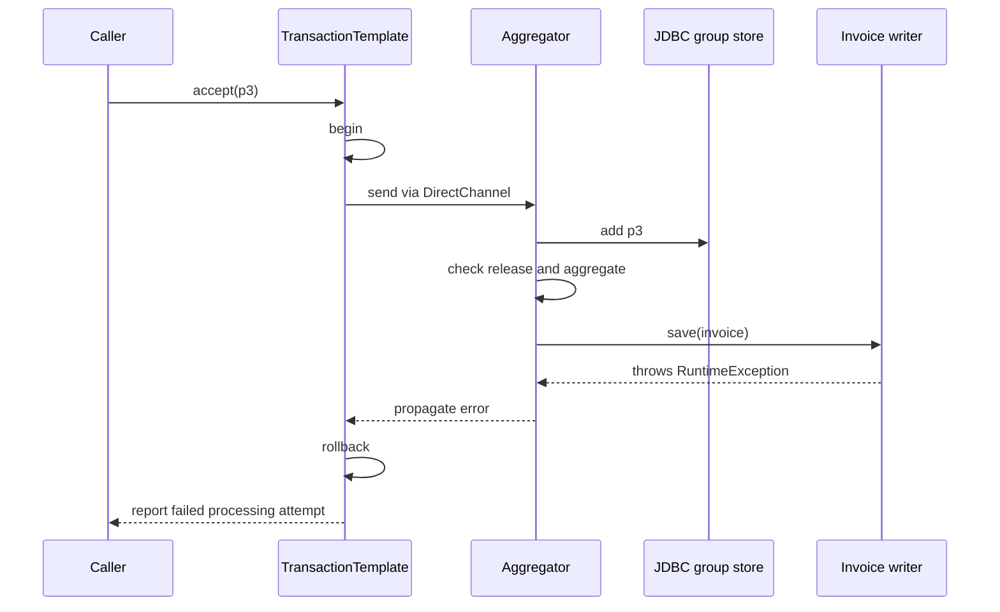
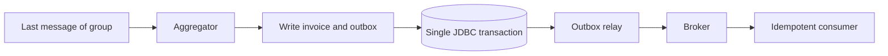

# Aggregator and Transactions

In the **SPRING_INTEGRATION_CORE** module, this lesson belongs to the **Aggregator** chapter and focuses on coordinating message group state with database transactions. The goal is to design flows using `Message`, `MessageChannel`, endpoints, gateways, and Java DSL so you know precisely which work commits, which work can roll back, and which messages must be resent.

An aggregator may wait for data fragments for several minutes, whereas each transaction lives only for one brief processing step. Therefore, **message group lifecycle and transaction lifecycle are two separate concepts**. That is the starting point for designing resilience in this integration pattern.

## 1. The Problem: Group State and Output Persistence Must Stay Consistent

Suppose an order receives three pricing results from three processing steps. Messages carrying the same `orderId` are grouped together; once all three parts arrive, the system creates an invoice.

```text
Part 1 ─┐
Part 2 ─┼─> aggregator ─> write invoice
Part 3 ─┘       │
                └─> MessageGroupStore
```

In this business example, two states must align:

- **Integration state:** which parts the group holds, and whether it completed or was deleted.
- **Business state:** whether the corresponding invoice was persisted successfully.

If the group is deleted yet the invoice was not persisted, the input data needed to retry may already be lost. If the invoice was persisted yet the input source did not receive confirmation, the source may resend and trigger duplicate side effects.

The aggregator orchestrates grouping, while transactions define atomic resource changes within a concrete boundary. Official documentation describes aggregators via correlation, release strategies, and message stores. [Spring Integration — Aggregator](https://docs.spring.io/spring-integration/reference/aggregator.html).

## 2. A Group Usually Spans Multiple Transactions

Suppose each part arrival opens a separate transaction:

| Arrival | Work Inside Transaction | State After Commit |
|---|---|---|
| `T1`: receive `p1` | Add `p1`, release condition not met | Group holds `p1` |
| `T2`: receive `p2` | Add `p2`, release condition not met | Group holds `p1, p2` |
| `T3`: receive `p3` | Add `p3`, aggregate, write invoice, update group | Invoice is durable if committed |

If writing the invoice causes `T3` to roll back, in a JDBC design sharing the same transaction:

```text
Before T3:    group = {p1, p2}; invoice = none
During T3:    add p3; compute result; attempt to write invoice
T3 rollback:  group = {p1, p2}; invoice = none
```

`p1` and `p2` remain because they committed in `T1` and `T2`. `p3` must be resent or recovered by a transactional source for reprocessing.

This analyzes the scenario above under the assumption that adding the message, processing the group, and writing the invoice participate in the same JDBC transaction. You cannot infer that behavior solely from the aggregator component name.

Never keep one transaction open while waiting for the entire group. Waiting ties up connections, holds locks, and increases timeout risk. Instead, persist each step of group progress durably and open short transactions for subsequent processing steps.

## 3. Three Conditions for Rollback to Be Meaningful

### 3.1. A Real Transaction Boundary Wraps the Work

For flows invoked directly by the application, start a transaction via `TransactionTemplate`, a `@Transactional` service, or properly scoped transaction advice.

Placing a transaction only on the invoice-writing service protects that write. It does not retroactively extend to aggregator operations that already executed before that service was called.

Spring Integration builds on Spring's transaction support; flow entry points such as gateways or `MessageChannel.send(...)` can participate in an application-started transaction. [Spring Integration — Transaction Support](https://docs.spring.io/spring-integration/reference/transactions.html).

### 3.2. State Storage Resources Join the Same Transaction

Common options for this problem:

| Configuration | Capability to Understand |
|---|---|
| In-memory store and business JDBC | JDBC rollback does not undo all mutations in the in-memory store |
| `JdbcMessageStore` and business table on the same `DataSource` | Can participate together in a local JDBC transaction |
| Store and business table in two separate databases | A single local transaction manager cannot atomically commit both |
| JDBC and an HTTP call | Database rollback does not undo side effects already applied at the HTTP system |

`JdbcMessageStore` works for aggregators. `JdbcChannelMessageStore` is optimized for message channels; the two classes serve different purposes. Initialize the schema matching your database and library version. [Spring Integration — JDBC Message Store](https://docs.spring.io/spring-integration/reference/jdbc/message-store.html).

### 3.3. Synchronous Flow and Errors Propagate to the Transaction Controller

`DirectChannel` invokes subscribers on the sender's thread. Therefore, an active transaction can wrap the send, the aggregator, and downstream JDBC work. If no transaction is active, `DirectChannel` itself does not start one. [Spring Integration — Message Channel Implementations](https://docs.spring.io/spring-integration/reference/channel/implementations.html).



The diagram shows the failure path. On the success path, changes to the group store and the invoice table commit in the same transaction when sharing the configured JDBC resource.

## 4. Java DSL Example: Transaction Wrapping One Arrival

### 4.1. Assumptions and Preparation

The example uses Spring Integration's imperative APIs and Spring JDBC. The code uses Java records; choose compatible JDK, Spring Framework, Spring Integration, and dependency BOM versions for your project.

Required libraries:

- `spring-integration-core`.
- `spring-integration-jdbc`.
- Spring JDBC and Spring Transaction.
- Database JDBC driver.
- When running the demo tests: JUnit Jupiter and a test database.

The application provides a `DataSource` bean. Initialize the message store tables from the JDBC schema bundled with the exact Spring Integration version. Also create the business table for the exercise:

```sql
create table invoice (
    order_id varchar(100) primary key,
    total decimal(19, 2) not null
);
```

To focus on transactions, assume each order has exactly three distinct parts, sent sequentially without concurrent processing for the same order. Each part is resent only after a previous attempt failed and rolled back cleanly. The `group.size() == 3` rule below does not handle duplicate deliveries outside this assumption.

### 4.2. Configuration, Payload, and Endpoints

```java
import java.io.Serializable;
import java.math.BigDecimal;
import java.util.List;
import java.util.concurrent.atomic.AtomicBoolean;

import javax.sql.DataSource;

import org.springframework.context.annotation.Bean;
import org.springframework.context.annotation.Configuration;
import org.springframework.integration.channel.DirectChannel;
import org.springframework.integration.config.EnableIntegration;
import org.springframework.integration.dsl.IntegrationFlow;
import org.springframework.integration.jdbc.store.JdbcMessageStore;
import org.springframework.jdbc.core.JdbcTemplate;
import org.springframework.jdbc.datasource.DataSourceTransactionManager;
import org.springframework.messaging.MessageChannel;
import org.springframework.messaging.MessageDeliveryException;
import org.springframework.messaging.support.MessageBuilder;
import org.springframework.transaction.PlatformTransactionManager;
import org.springframework.transaction.support.TransactionTemplate;

@Configuration(proxyBeanMethods = false)
@EnableIntegration
public class AggregatorTransactionConfig {

    public record Part(
            String orderId,
            String itemId,
            BigDecimal amount) implements Serializable {
    }

    public record Invoice(String orderId, BigDecimal total) {
    }

    @Bean
    DirectChannel partsInput() {
        return new DirectChannel();
    }

    @Bean
    JdbcMessageStore groupStore(DataSource dataSource) {
        JdbcMessageStore store = new JdbcMessageStore(dataSource);
        store.setRegion("invoice-aggregation");
        return store;
    }

    @Bean
    PlatformTransactionManager transactionManager(DataSource dataSource) {
        return new DataSourceTransactionManager(dataSource);
    }

    @Bean
    JdbcTemplate businessJdbc(DataSource dataSource) {
        return new JdbcTemplate(dataSource);
    }

    @Bean
    AtomicBoolean failAfterInsert() {
        // Flag for the rollback practice exercise.
        return new AtomicBoolean(false);
    }

    @Bean
    InvoiceWriter invoiceWriter(
            JdbcTemplate businessJdbc,
            AtomicBoolean failAfterInsert) {
        return new InvoiceWriter(businessJdbc, failAfterInsert);
    }

    @Bean
    IntegrationFlow invoiceFlow(
            DirectChannel partsInput,
            JdbcMessageStore groupStore,
            InvoiceWriter invoiceWriter) {

        return IntegrationFlow.from(partsInput)
                .aggregate(a -> a
                        .messageStore(groupStore)
                        .correlationStrategy(message ->
                                ((Part) message.getPayload()).orderId())
                        .releaseStrategy(group -> group.size() == 3)
                        .outputProcessor(group -> {
                            List<Part> parts = group.getMessages().stream()
                                    .map(message -> (Part) message.getPayload())
                                    .toList();

                            BigDecimal total = parts.stream()
                                    .map(Part::amount)
                                    .reduce(BigDecimal.ZERO, BigDecimal::add);

                            return new Invoice(parts.get(0).orderId(), total);
                        })
                        .expireGroupsUponCompletion(true))
                .handle(invoiceWriter, "save")
                .get();
    }

    @Bean
    PartIngress partIngress(
            DirectChannel partsInput,
            PlatformTransactionManager transactionManager) {
        return new PartIngress(partsInput, transactionManager);
    }

    public static final class PartIngress {

        private final MessageChannel input;
        private final TransactionTemplate transactions;

        public PartIngress(
                MessageChannel input,
                PlatformTransactionManager transactionManager) {
            this.input = input;
            this.transactions = new TransactionTemplate(transactionManager);
            this.transactions.setTimeout(5); // Unit: seconds.
        }

        public void accept(Part part) {
            transactions.executeWithoutResult(status -> {
                var message = MessageBuilder.withPayload(part).build();
                if (!input.send(message)) {
                    throw new MessageDeliveryException(
                            message, "Failed to send part into flow");
                }
            });
        }
    }

    public static final class InvoiceWriter {

        private final JdbcTemplate jdbc;
        private final AtomicBoolean failAfterInsert;

        public InvoiceWriter(
                JdbcTemplate jdbc,
                AtomicBoolean failAfterInsert) {
            this.jdbc = jdbc;
            this.failAfterInsert = failAfterInsert;
        }

        public void save(Invoice invoice) {
            jdbc.update(
                    "insert into invoice(order_id, total) values (?, ?)",
                    invoice.orderId(),
                    invoice.total());

            if (failAfterInsert.get()) {
                throw new IllegalStateException("Simulated error after INSERT");
            }
        }
    }
}
```

Key consistency points in the example:

1. `PartIngress.accept(...)` opens or joins a transaction before sending the message.
2. `partsInput` is a `DirectChannel`; subsequent steps execute synchronously.
3. The group store, `JdbcTemplate`, and transaction manager share the same `DataSource` bean.
4. `InvoiceWriter.save(...)` returns `void`, ending the flow after writing data.
5. Exceptions are not caught and swallowed inside the callback.

`TransactionTemplate` executes work inside the callback and applies commit/rollback to the corresponding transaction. [Spring Framework — Programmatic Transaction Management](https://docs.spring.io/spring-framework/reference/data-access/transaction/programmatic.html).

`Part` is serializable for storage in the JDBC store. Avoid placing in-memory-only objects like connections, streams, or callbacks into payloads or headers that need recovery. Payload and header serializability is an independent requirement of persistent stores. [Spring Integration — Message Store](https://docs.spring.io/spring-integration/reference/message-store.html).

`expireGroupsUponCompletion(true)` is chosen to observe the group being deleted after success. With this policy, a late message with the same key can open a new group. In a real system, decide explicitly on completion-marker retention and deduplication windows. [Spring Integration — AggregatorSpec](https://docs.spring.io/spring-integration/api/org/springframework/integration/dsl/AggregatorSpec.html).

### 4.3. Replacing with a Transactional Service or Gateway

You can put `@Transactional` on a service calling `partsInput.send(...)` or call a messaging gateway backed by a synchronous request channel. With standard proxy-based AOP, calls must pass through the Spring proxy; self-invocation on the same object does not trigger advice that way.

What must hold is that the transaction starts **before** sending into the aggregator. Annotating only the aggregation calculation method does not put the store addition inside the transaction.

If a transaction must begin at the endpoint itself, distinguish advice wrapping `handleMessage()` from advice wrapping only the handler's internal processing. Spring Integration provides `HandleMessageAdvice` for wrapping full message handling; advice placement determines which downstream steps are included. [Spring Integration — Handling Message Advice](https://docs.spring.io/spring-integration/reference/handler-advice/handle-message.html).

## 5. Observing Rollback via Integration Tests

A meaningful test here must use a JDBC group store against a real or embedded database. Mocking `MessageGroupStore` does not prove that group updates and invoice writes roll back together.

The test snippet below assumes the Spring test context loaded the configuration above, provided a `DataSource`, and initialized the store schema and `invoice` table. Fields `ingress`, `store`, `jdbc`, and `failAfterInsert` are injected from the context. Import JUnit Jupiter `assertEquals` and `assertThrows`, along with `AggregatorTransactionConfig.Part`.

```java
@Test
void rollbackLastArrivalThenRetry() {
    String orderId = "ORDER-TX-001";

    Part p1 = new Part(orderId, "ITEM-1", new BigDecimal("10.00"));
    Part p2 = new Part(orderId, "ITEM-2", new BigDecimal("20.00"));
    Part p3 = new Part(orderId, "ITEM-3", new BigDecimal("30.00"));

    ingress.accept(p1); // T1 commit.
    ingress.accept(p2); // T2 commit.

    assertEquals(2, store.getMessageGroup(orderId).size());

    failAfterInsert.set(true);
    try {
        assertThrows(RuntimeException.class, () -> ingress.accept(p3));

        // These reads execute after T3 has rolled back.
        assertEquals(2, store.getMessageGroup(orderId).size());

        Integer failedCount = jdbc.queryForObject(
                "select count(*) from invoice where order_id = ?",
                Integer.class,
                orderId);
        assertEquals(0, failedCount.intValue());
    }
    finally {
        failAfterInsert.set(false);
    }

    // Previous p3 did not commit, so resend p3.
    ingress.accept(p3); // T4 commit.

    BigDecimal total = jdbc.queryForObject(
            "select total from invoice where order_id = ?",
            BigDecimal.class,
            orderId);
    assertEquals(0, new BigDecimal("60.00").compareTo(total));

    Integer successCount = jdbc.queryForObject(
            "select count(*) from invoice where order_id = ?",
            Integer.class,
            orderId);
    assertEquals(1, successCount.intValue());

    // Group deleted after completion; no messages remain in the group.
    assertEquals(0, store.getMessageGroup(orderId).size());
}
```

Do not put `@Transactional` on this entire test method. If an outer transaction exists, each `accept(...)` call using default propagation joins that outer transaction; then `T1`, `T2`, and `T3` are no longer three independent commits/rollbacks as required by the scenario.

Three signals should be verified together: the group still has two parts after failure, the invoice table has zero rows, and the retry creates exactly one invoice. Checking only that an exception was thrown is insufficient.

When moving to a production database, add concurrency tests and restart tests against the same persistent store. An embedded database tests basic rollback flow but does not substitute for verifying isolation levels, locking, and SQL behavior on the target database.

## 6. Poller-Initiated Flows: Transactions Must Cover receive()

With a `PollableChannel` input, the poller can start a transaction before `receive()`. This matters when pulling the message from the source must also be rolled back if the aggregator fails.

The DSL snippet below shows how to attach a transaction to a poller. It is an alternative head configuration assuming `durableParts` is a `PollableChannel` bean backed by a compatible store:

```java
return IntegrationFlow.from("durableParts")
        .aggregate(a -> a
                .messageStore(groupStore)
                .correlationStrategy(message ->
                        ((Part) message.getPayload()).orderId())
                .releaseStrategy(group -> group.size() == 3)
                .poller(Pollers.fixedDelay(500)
                        .maxMessagesPerPoll(1)
                        .transactional(transactionManager)))
        .handle((payload, headers) -> {
            // Illustrates synchronous post-aggregator handling position.
            // Supply an appropriate outputProcessor and invoice writer
            // if substituting into the previous invoice configuration.
            return null;
        })
        .get();
```

Additional import is `org.springframework.integration.dsl.Pollers`. Passing the transaction manager to the poller configures transaction advice on the polling task. [Spring Integration — PollerSpec](https://docs.spring.io/spring-integration/api/org/springframework/integration/dsl/PollerSpec.html).

Distinguish the polled source types:

| Polled Input | After Processing Fails |
|---|---|
| Plain in-memory `QueueChannel` | Cannot assume a polled message is put back into the queue by a JDBC rollback |
| Queue backed by JDBC store joining the same JDBC transaction | Message dequeue can roll back alongside database changes |
| External broker | Depends on broker transaction/ack semantics and coordination with JDBC |

To focus on one arrival at a time, the example sets `maxMessagesPerPoll(1)`. Do not assume raising this value merges an entire multi-minute group into a single transaction.

If the source is HTTP or a direct application call as in section 4, rollback undoes only transactional resources; the caller must handle resending. A transaction does not manufacture redeliveries on its own.

## 7. Thread Handoffs Create New Transaction Boundaries

Consider this change:

```text
Transaction T
  → aggregator
  → ExecutorChannel
      → invoice writer runs on another thread
```

Once handing work off to the executor succeeds, the sender may finish and commit its transaction before the invoice writer completes. An invoice-write failure on the receiving thread cannot propagate backward to roll back an already-committed transaction.

With a `QueueChannel`, sender and consumer must likewise be treated as two separate processing stages. A durable queue can persist the handoff, yet the consumer still needs its own transaction for its own work. [Spring Integration — Message Channel Implementations](https://docs.spring.io/spring-integration/reference/channel/implementations.html).

Do not assume the transaction commits at the exact channel call line in every setup. More accurately, **work on the new thread does not automatically join the sender thread's imperative transaction**; the sender's transaction finishes at its own configured boundary.

Therefore, when adding an executor for throughput, redesign durable handoff points and retry handling, and re-verify atomicity assumptions.

## 8. Group Timeouts Need Their Own Transaction Path

There are two completion paths:

- A new message arrives and causes the release strategy to accept the group.
- A scheduler or reaper triggers completion/expiry of an old group.

In the second case, the transaction from the earlier message arrival has already ended. You can configure transaction advice for `forceComplete()` via `forceReleaseAdvice(...)`.

The snippet below shows options added to the aggregator inside the `a -> a...` lambda:

```java
.groupTimeout(30_000)
.sendPartialResultOnExpiry(false)
.discardChannel("expiredParts")
.forceReleaseAdvice(
        new TransactionInterceptorBuilder()
                .transactionManager(transactionManager)
                .build())
```

Additional import is `org.springframework.integration.transaction.TransactionInterceptorBuilder`. Channel `expiredParts` must be defined with an appropriate consumer. If expiry must be persisted durably, a synchronous consumer can write a failure record using the same `DataSource`.

`forceReleaseAdvice` applies to forced-completion execution. It does not replace the transaction needed on the normal message-arrival path. [Spring Integration — CorrelationHandlerSpec](https://docs.spring.io/spring-integration/api/org/springframework/integration/dsl/CorrelationHandlerSpec.html).

In this illustrative policy, expired groups move to the discard branch instead of issuing a partial invoice. Decide how to handle late arrivals and recover old groups after restart. Storing groups in a database does not persist in-memory timer tasks. See the expiration management section of [Spring Integration — Aggregator](https://docs.spring.io/spring-integration/reference/aggregator.html).

`groupTimeout` defines when a waiting group is processed, whereas transaction timeout caps how long one transaction may run. Never use transaction timeout to represent the full business waiting window.

## 9. Error Channel and Rollback Are Two Separate Responsibilities

An error channel forwards error details to an error-handling flow. Rollback decisions depend on the transaction boundary, exceptions crossing that boundary, and rollback rules.

For synchronous flows calling channels directly, exceptions normally return to the sender. For asynchronous flows or schedulers, error handling must route error details through the appropriate channel. [Spring Integration — Error Handling](https://docs.spring.io/spring-integration/reference/error-handling.html).

A common mistake:

```java
transactions.executeWithoutResult(status -> {
    try {
        input.send(message);
    }
    catch (RuntimeException ex) {
        logger.error("Processing failed", ex);
        // Neither rethrows nor marks rollback-only.
    }
});
```

If nothing else marked the transaction rollback-only, the callback above can exit normally and commit. Logging an exception does not signal a rollback request.

In this exercise, let the exception escape the callback. If there is a reason to catch inside the callback, explicitly call `status.setRollbackOnly()` and design how failure is reported to the caller.

With `@Transactional`, default rollback applies to `RuntimeException` and `Error`; checked exceptions need explicit rollback rules if they should roll back. Also check the actual exception type exiting the messaging layer since it may be wrapped. [Spring Framework — Rolling Back a Declarative Transaction](https://docs.spring.io/spring-framework/reference/data-access/transaction/declarative/rolling-back.html).

Do not catch a database error and continue issuing more operations inside the same transaction pretending recovery succeeded. Some errors or advices may already have marked the transaction rollback-only.

## 10. Retries Must Start a Clean New Attempt

In the invoice example, the proper retry sequence is:

```text
Attempt 1 → begin T3 → error → rollback T3
Attempt 2 → begin T4 → reprocess p3 → commit T4
```

If a retry executes inside a transaction already marked rollback-only, the subsequent call does not run in a clean transaction state. In direct application calls, the clearest way is calling `ingress.accept(p3)` again only after the failed call has exited.

When combining advices, check actual execution order. Retry wrapping transaction can open a fresh transaction per attempt; transaction wrapping retry can trap all attempts inside one failing transaction.

Propagation must also match consistency goals:

| Option | Consequence in the Example |
|---|---|
| `REQUIRED` | Writer can join the active transaction when sharing the right manager/resource |
| `REQUIRES_NEW` on writer | Writer runs in an independent transaction; it can commit even if outer transaction rolls back |
| `NESTED` | Depends on savepoint support; does not make non-database resources atomic |
| `readOnly = true` | Unsuitable for a scope intended to add messages and write invoices |

Spring distinguishes physical transactions from logical transaction scopes; `REQUIRES_NEW` uses an independent transaction. [Spring Framework — Transaction Propagation](https://docs.spring.io/spring-framework/reference/data-access/transaction/declarative/tx-propagation.html).

Retries must be bounded and distinguish transient failures from bad data. A group with invalid data should go to a failure path that preserves diagnostics rather than looping forever.

## 11. Locks Protect Concurrency; Transactions Protect Atomicity

Two messages sharing the same `orderId` may arrive almost simultaneously. Group locks prevent multiple threads from mutating the same group concurrently.

When multiple instances share a persistent group store, JVM-local locks cannot coordinate across instances. `JdbcLockRegistry` is one shared-locking option for aggregators. [Spring Integration — JDBC Lock Registry](https://docs.spring.io/spring-integration/reference/jdbc/lock-registry.html).

Still, locks and transactions solve different problems:

| Mechanism | Primary Responsibility |
|---|---|
| Group lock | Coordinates access to the group |
| JDBC transaction | Commits or rolls back changes inside the transaction |
| Business unique constraint | Prevents persisting two results with the same business key |
| Idempotency | Defines how reprocessing the same request or event behaves |

Handler locks also do not prove the entire outer transaction stays locked until commit. In multi-instance designs, examine lock release timing, database isolation levels, and retry behavior under contention.

Keep synchronous processing downstream of the aggregator brief. Chained aggregators or slow calls prolong lock hold time. `releaseLockBeforeSend(true)` changes when the group lock is released; it does not mean committing the transaction. [Spring Integration — CorrelationHandlerSpec](https://docs.spring.io/spring-integration/api/org/springframework/integration/dsl/CorrelationHandlerSpec.html).

If resolving contention by introducing an `ExecutorChannel`, address the new transaction boundary analyzed in section 7 at the same time.

## 12. Publishing Results Externally: Designing with Outbox and Idempotency

Suppose after writing the invoice, the flow must publish an `InvoiceCreated` event to a broker.

```text
write invoice → send to broker → commit JDBC
```

In a design with only a local JDBC transaction, two failure windows appear:

1. Broker receives the event, then JDBC rolls back: the event announces an invoice that never persisted.
2. JDBC commits, then the process crashes before sending the event: the invoice exists, yet the event was never published.

This follows from two resources not sharing a single atomic commit. One design for this scenario is the transactional outbox:



Inside the group-completing transaction, write both the invoice and an outbox row into the same database. A relay reads committed rows and publishes independently.

Example table keys:

```sql
create table integration_outbox (
    event_id varchar(100) primary key,
    aggregate_id varchar(100) not null,
    event_type varchar(100) not null,
    payload_text clob not null,
    published boolean not null
);
```

The DDL above is illustrative; adapt column types to your database. Deterministic event IDs can be derived from business version, such as `InvoiceCreated:ORDER-123:v1`.

An outbox closes the lost-intent window between database commit and publishing. The relay may still publish duplicates if the broker received the message before the relay marked it published. Consumers must process idempotently by `event_id`.

Similarly, on the ingress side, distinguish:

- `orderId`: correlation key for grouping.
- `itemId` or `eventId`: part/event identifier for deduplication.
- Business version: separates a new aggregation run from late messages of an old run.

Never use message count as proof that distinct business parts have arrived. For example, three messages `ITEM-1, ITEM-1, ITEM-2` do not form the valid triple `ITEM-1, ITEM-2, ITEM-3`.

If adding an inbox/dedup table, marking receipt must stay consistent with updating the group in an appropriate transaction. Marking first and then failing to update the group can wrongly block retries.

## 13. Diagnosing Common Failures

| Symptom | Hypothesis to Verify | Remediation |
|---|---|---|
| Invoice rolls back yet group does not revert | In-memory store or store work ran outside transaction | Check store, transaction start point, and manager |
| Downstream exception does not fail the send | Async boundary exists or recovery turned error into normal output | Trace threads and error propagation path |
| Poller fails and input message is lost | Source did not join a recoverable transaction | Use a transactional source or explicit redelivery |
| Event redelivery creates duplicate result | Missing idempotency by business key | Design deduplication, constraints, and duplicate behavior |
| Retries keep hitting rollback-only | Attempts share an already-failed transaction | Start a new transaction after prior attempt rolled back |
| Deadlocks or long connection holds | Conflicting lock order, slow downstream, or overly wide transaction | Shorten processing, inspect locks and handoff points |
| Old groups remain after restart without progressing | Missing recovery plan for incomplete groups | Design expiration/reaper or input replay |

When logging, include correlation key, part ID, attempt count, and exception root cause. Verification reads checking rollback results should run after the failed transaction has ended; reading from an uncommitted transaction can lead to false conclusions.

## 14. Questions You Should Be Able to Answer After This Lesson

After this lesson, you should be able to trace a message from ingress through channels to the aggregator and result-writing endpoint, while identifying:

1. Where each transaction begins and ends.
2. Whether the group store and business data share the same transaction.
3. When the final message fails, what state previously committed messages remain in.
4. Which source is responsible for redelivering a failed message.
5. On thread handoffs or timeouts, which work needs its own transaction.
6. How duplicate side effects are prevented when re-ingesting or republishing an event.

In a sound design, those answers are backed by configuration, business data keys, and rollback tests that inspect state. The aggregator manages grouping progress; end-to-end consistency comes from clearly designed transaction boundaries, durable storage, and retry handling.
