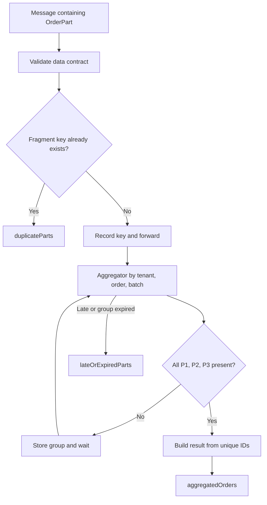

# Aggregator and Duplicate Messages

## Objectives and Scope

In the **Aggregator** chapter of the **SPRING_INTEGRATION_CORE** module, this lesson explains how a message-aggregation flow is affected when the same event or the same business element is delivered multiple times. The goal is to design group completion conditions, deduplication keys, and retry policies so aggregated results neither miss elements nor double-count data.

The lesson connects `Message`, `MessageChannel`, filters, the aggregator endpoint, `MessageGroupStore`, and Java DSL in an order example. Content focuses on duplicates at the aggregator boundary while also examining downstream failures, timeouts, restarts, and flow testing.

After this lesson, you can:

- Distinguish message ID, correlation key, sequence number, and business deduplication key.
- Explain why having enough messages does not mean having all required elements.
- Place a deduplication filter before the aggregator and enforce uniqueness when building the result.
- Identify gaps between recording receipt, persisting the group, and executing downstream side effects.
- Define retention, replay, and required test scenarios.

Examples use Java 17 and Spring Integration 6.4 APIs for a concrete reference baseline. This is a choice for the exercise, not a claim about the latest release. Configuration uses in-memory stores for illustration; durable deployment is analyzed separately.

## 1. One Duplicate Can Break Both Completion Condition and Result

Suppose an order aggregation batch requires three elements `P1`, `P2`, `P3`:

| Element | Value, in Minor Currency Units |
| --- | ---: |
| P1 | 100 |
| P2 | 200 |
| P3 | 300 |

A valid result contains all three elements and totals `600`. However, actual delivery order may be:

```text
P1 -> P2 -> P1 redelivered -> P3
```

If the release condition is only `group.size() == 3`, the redelivery of `P1` can complete the group before `P3` arrives. Naive summation then produces `100 + 200 + 100 = 400`.

There are two distinct bugs:

1. **Early completion:** the duplicate is counted as a missing element.
2. **Wrong aggregation:** the same element is summed multiple times.

Fixing only the addition to skip duplicates does not solve the first bug. The group can emit a result with `P1`, `P2` and close before `P3` arrives. Conversely, if the release condition checks distinct IDs yet the output processor sums all messages, the total can still be wrong.

Given expected element set `E` and actually received valid ID set `U`, the example's contract is:

```text
Released when U = E.
Each ID in U contributes at most once to the result.
```

Duplicates commonly occur when a producer resends after a lost acknowledgement, a consumer fails before acknowledging a broker, or a replay job reprocesses history. These are design cases to handle under at-least-once delivery. Calling `MessageChannel.send()` inside the application does not by itself define an external broker's acknowledgement protocol.

## 2. Identifying What Counts as a Duplicate

### 2.1. Four Identifiers with Different Responsibilities

| Identifier | Question It Answers | Example | Enough for Business Deduplication? |
| --- | --- | --- | --- |
| `MessageHeaders.ID` | Which message object is this at the messaging layer? | A UUID | Not guaranteed stable across resends or message reconstruction |
| Correlation key | Which group does this message belong to? | `tenantA\|O42\|B1` | No; distinct elements in the same group share this key |
| `sequenceNumber` | What position does the message hold in a sequence? | `1`, `2`, `3` | Useful only within a sequence with an explicit sequence contract |
| Deduplication key | Is this a business element already received earlier? | `v1\|tenantA\|O42\|B1\|P1` | Yes, if the key accurately expresses the business contract |

A producer may build a fresh message for the same `P1`, changing the envelope UUID while the business element remains a duplicate. Two messages with equal payloads may also be two valid distinct transactions. Thus, mechanically comparing payloads or relying on UUIDs can fail.

### 2.2. Event Duplicates vs. Element Duplicates

At least two questions must be separated:

- **Has the event been redelivered?** Use a stable `eventId` assigned by the source.
- **Has this element already contributed to the group?** Use a key combining batch and part ID.

For example, the source emits two events with different `eventId` values that both represent `P1` of batch `B1`. Filtering by `eventId` lets both pass. If the contract allows one contribution per part in a batch, the aggregator still needs protection by `batchId + partId`.

Conversely, if each event is an adjustment that must be accumulated, two distinct events for the same item can both be valid. In that case, keying only by `productId` loses data. Define the unit of contribution before choosing the key.

### 2.3. Key Scope Must Include Business Lifecycle

For the order example, we choose:

```text
correlationKey = tenantId | orderId | batchId
fragmentKey    = order-fragments:v1 | correlationKey | partId
aggregateKey   = order-result:v1 | correlationKey
```

`tenantId` prevents cross-customer mixing; `batchId` separates aggregation runs of the same order; the version prefix separates key contracts as the system evolves.

String concatenation must avoid ambiguity. The exercise restricts IDs to characters excluding `|`. If real IDs can contain arbitrary characters, use length-prefixed encoding or a canonical representation before hashing. If hashing, still define collision handling and traceability back to raw data.

## 3. What Spring Integration Provides and What Must Be Added

### 3.1. Default Release Strategy Is Not a Business Duplicate Filter

In Spring Integration 6.4, `SimpleSequenceSizeReleaseStrategy` decides based on `group.getSequenceSize() == group.size()` and does not check for duplicate sequence numbers. For example, three messages with sequence numbers `1, 1, 2`, all declaring sequence size `3`, can satisfy the count condition even though position `3` has not arrived. See [SimpleSequenceSizeReleaseStrategy 6.4.0 source](https://raw.githubusercontent.com/spring-projects/spring-integration/v6.4.0/spring-integration-core/src/main/java/org/springframework/integration/aggregator/SimpleSequenceSizeReleaseStrategy.java).

Do not rely on a collection type or store implementation recognizing the exact same `Message` instance as proof that all business duplicates are eliminated. A newly constructed message for the same element still requires evaluation by business identity.

### 3.2. Sequence Checking Has Its Own Scope

`SequenceSizeReleaseStrategy` provides a path aware of duplicate sequences; it is an alternative to the simple default strategy. Still, sequence-based protection only holds when the source preserves stable correlation, sequence numbers, and sequence size. It cannot know on its own that two events with different sequence numbers represent the same business element. See the release strategy section in [Aggregator 6.4 Documentation](https://docs.spring.io/spring-integration/reference/6.4/aggregator.html).

If choosing this approach, pass the concrete implementation into configuration, such as:

```java
.aggregate(a -> a.releaseStrategy(new SequenceSizeReleaseStrategy()))
```

This snippet requires importing `org.springframework.integration.aggregator.SequenceSizeReleaseStrategy`. Do not wrap it in a forwarding lambda and assume the correlating handler's sequence-aware behavior remains identical: the 6.4 handler checks the release strategy's type to enable sequence-aware mode. See details in [AbstractCorrelatingMessageHandler source](https://raw.githubusercontent.com/spring-projects/spring-integration/v6.4.0/spring-integration-core/src/main/java/org/springframework/integration/aggregator/AbstractCorrelatingMessageHandler.java).

This lesson uses a part-ID contract, so it configures release by the expected ID set without depending on sequence headers.

### 3.3. Message Group Store and Metadata Store Are Two Different States

| State | Component in the Example | Key Point to Remember |
| --- | --- | --- |
| Collecting group | `MessageGroupStore` | Messages currently in the group and completion state |
| History of received elements | `ConcurrentMetadataStore` | Keys of contributions accepted by the filter |
| Committed business side effect | Result table or target service | Which results have been applied successfully |

There is no reason to assume these three states share the same lifetime or commit atomically together. Choosing a persistent store for one state does not automatically make the other two durable.

`SimpleMetadataStore` retains data only for the lifetime of the application context. The [Metadata Store documentation](https://docs.spring.io/spring-integration/reference/6.4/meta-data-store.html) describes persistent storage options. Across multiple nodes, a genuinely shared backend is required; a concurrent interface does not turn separate JVM-local maps into shared data.

## 4. Processing Flow Design

The learning flow includes two content-protection layers:

1. A filter before the aggregator blocks already-received elements by business key.
2. Both the release strategy and output processor operate on the same unique-by-ID element representation.



The return arrow from the waiting group represents re-evaluation when the next message arrives, not an active message-sending loop.

Validate input before reserving the deduplication key. If a malformed message claims the key and is then rejected, a corrected redelivery could be blocked by the filter. In the Java example below, `OrderPart`'s constructor validates data before the object is sent to the channel.

## 5. Complete Single-Process Java DSL Example

### 5.1. Example Contract

A batch has exact parts `P1`, `P2`, `P3`. Each part is immutable within a batch: redeliveries must carry identical content. A new calculation uses a new `batchId`.

Each `amountMinor` is a non-negative integer in minor currency units, avoiding floating-point arithmetic for monetary sums. The expected ID set is fixed so the lesson stays focused on duplicates. In systems with variable part sets, replace this constant with a trusted per-batch manifest checking version and membership.

Configuration requires `spring-integration-core` and matching Spring dependencies. Tests need JUnit Jupiter. If the project uses Spring Boot/BOM, rely on the project's dependency management to keep libraries aligned.

### 5.2. Configuration

```java
package example.integration;

import java.util.List;
import java.util.Map;
import java.util.Set;
import java.util.TreeMap;

import org.springframework.beans.factory.annotation.Qualifier;
import org.springframework.context.annotation.Bean;
import org.springframework.context.annotation.Configuration;
import org.springframework.integration.channel.DirectChannel;
import org.springframework.integration.channel.QueueChannel;
import org.springframework.integration.config.EnableIntegration;
import org.springframework.integration.dsl.IntegrationFlow;
import org.springframework.integration.metadata.ConcurrentMetadataStore;
import org.springframework.integration.metadata.SimpleMetadataStore;
import org.springframework.integration.selector.MetadataStoreSelector;
import org.springframework.integration.store.MessageGroup;
import org.springframework.integration.store.MessageGroupStore;
import org.springframework.integration.store.SimpleMessageStore;
import org.springframework.messaging.Message;
import org.springframework.messaging.MessageChannel;
import org.springframework.messaging.support.MessageBuilder;

@Configuration(proxyBeanMethods = false)
@EnableIntegration
public class DuplicateSafeAggregatorConfig {

    private static final Set<String> EXPECTED_PARTS = Set.of("P1", "P2", "P3");

    public record OrderPart(
            String tenantId,
            String orderId,
            String batchId,
            String partId,
            int amountMinor) {

        public OrderPart {
            requireToken(tenantId);
            requireToken(orderId);
            requireToken(batchId);
            requireToken(partId);
            if (!EXPECTED_PARTS.contains(partId)) {
                throw new IllegalArgumentException("Unexpected partId: " + partId);
            }
            if (amountMinor < 0) {
                throw new IllegalArgumentException("amountMinor must be non-negative");
            }
        }
    }

    public record OrderResult(
            String tenantId,
            String orderId,
            String batchId,
            List<String> partIds,
            long totalMinor) {
    }

    @Bean
    DirectChannel partsInput() {
        return new DirectChannel();
    }

    @Bean
    QueueChannel aggregatedOrders() {
        return new QueueChannel();
    }

    @Bean
    QueueChannel duplicateParts() {
        return new QueueChannel();
    }

    @Bean
    QueueChannel lateOrExpiredParts() {
        return new QueueChannel();
    }

    @Bean
    ConcurrentMetadataStore fragmentKeys() {
        return new SimpleMetadataStore();
    }

    @Bean
    MessageGroupStore orderGroups() {
        return new SimpleMessageStore();
    }

    @Bean
    MetadataStoreSelector firstDelivery(ConcurrentMetadataStore fragmentKeys) {
        return new MetadataStoreSelector(
                message -> fragmentKey(part(message)),
                message -> "accepted",
                fragmentKeys);
    }

    @Bean
    IntegrationFlow orderAggregationFlow(
            @Qualifier("partsInput") MessageChannel input,
            @Qualifier("aggregatedOrders") MessageChannel output,
            MetadataStoreSelector firstDelivery,
            MessageGroupStore orderGroups) {

        return IntegrationFlow.from(input)
                .filter(firstDelivery,
                        filter -> filter.discardChannel("duplicateParts"))
                .aggregate(aggregator -> aggregator
                        .messageStore(orderGroups)
                        .correlationStrategy(message -> groupKey(part(message)))
                        .releaseStrategy(DuplicateSafeAggregatorConfig::allPartsPresent)
                        .outputProcessor(DuplicateSafeAggregatorConfig::toResult)
                        .expireGroupsUponCompletion(false)
                        .expireGroupsUponTimeout(false)
                        .groupTimeout(30_000L)
                        .sendPartialResultOnExpiry(false)
                        .discardChannel("lateOrExpiredParts"))
                .channel(output)
                .get();
    }

    public static String groupKey(OrderPart part) {
        return part.tenantId() + "|" + part.orderId() + "|" + part.batchId();
    }

    public static String fragmentKey(OrderPart part) {
        return "order-fragments:v1|" + groupKey(part) + "|" + part.partId();
    }

    private static OrderPart part(Message<?> message) {
        return (OrderPart) message.getPayload();
    }

    private static void requireToken(String value) {
        if (value == null || !value.matches("[A-Za-z0-9_-]{1,40}")) {
            throw new IllegalArgumentException("Invalid identifier");
        }
    }

    private static Map<String, OrderPart> uniqueParts(MessageGroup group) {
        Map<String, OrderPart> unique = new TreeMap<>();
        for (Message<?> message : group.getMessages()) {
            OrderPart current = part(message);
            OrderPart previous = unique.putIfAbsent(current.partId(), current);
            if (previous != null && !previous.equals(current)) {
                throw new IllegalStateException(
                        "Conflicting content for partId=" + current.partId());
            }
        }
        return unique;
    }

    private static boolean allPartsPresent(MessageGroup group) {
        return uniqueParts(group).keySet().equals(EXPECTED_PARTS);
    }

    private static Message<OrderResult> toResult(MessageGroup group) {
        Map<String, OrderPart> unique = uniqueParts(group);
        OrderPart first = unique.values().iterator().next();
        long total = unique.values().stream()
                .mapToLong(OrderPart::amountMinor)
                .sum();
        OrderResult result = new OrderResult(
                first.tenantId(), first.orderId(), first.batchId(),
                List.copyOf(unique.keySet()), total);

        return MessageBuilder.withPayload(result)
                .setHeader("aggregateKey", "order-result:v1|" + groupKey(first))
                .build();
    }
}
```

### 5.3. How to Read the Configuration

`MetadataStoreSelector` writes the key when first accepting a message. Once the key exists, the selector rejects and the filter forwards the message to `duplicateParts`. Acceptance and key recording occur right inside the selector, before the aggregator runs. This is shown directly in [MetadataStoreSelector source](https://raw.githubusercontent.com/spring-projects/spring-integration/v6.4.0/spring-integration-core/src/main/java/org/springframework/integration/selector/MetadataStoreSelector.java).

`uniqueParts()` builds a map keyed by `partId`. Both the release condition and output processor rely on this map, so both interpret contributions under the exact same contract. `TreeMap` gives the output ID list deterministic ordering; message arrival order does not affect the result.

`OrderResult` is wrapped in a `Message` carrying an application-set `aggregateKey` header. This key remains stable for the same batch and can be used downstream to prevent applying the result multiple times.

`duplicateParts` and `lateOrExpiredParts` use `QueueChannel` so tests can poll them directly. These are in-memory queues that require consumers and capacity limits if adapting this pattern to a long-running application.

### 5.4. First-Wins Contract and Conflict Detection Limits

The filter in the example writes a constant metadata value `accepted`. Thus, the same key is blocked regardless of whether new content matches or differs from the old content. The policy at this boundary is **accept first arrival and route all subsequent ones to the duplicate branch**.

Conflict detection inside `uniqueParts()` only catches entries sharing a `partId` with differing content if both actually enter the group—for example, if metadata was accidentally deleted while the group remained open. It never sees messages previously blocked by the filter.

If the source can send the same key with differing content, add conflict detection at the deduplication layer or persistent inbox. Do not treat the check inside the output processor as a catch-all conflict detector.

### 5.5. Cost of the Release Condition

The example has only three elements, so building the map during release evaluation is tiny. For large groups, re-scanning the entire group on every arrival can scale nearly quadratically with element count. When optimizing, maintain unique-ID state consistently with transactions and the store, rather than dropping correctness checks to count raw messages.

## 6. Testing Observable Behavior

Tests must construct a new message for the same element, because resending the exact same Java `Message` object does not fully exercise redelivery with a fresh envelope.

The example below shares the package with the configuration above. Each test opens its own context to avoid sharing deduplication history. `partsInput` is a `DirectChannel`, so synchronous processing completes before `send()` returns; `receive(0)` polls queues immediately without sleeping.

```java
package example.integration;

import java.util.List;

import org.junit.jupiter.api.AfterEach;
import org.junit.jupiter.api.BeforeEach;
import org.junit.jupiter.api.Test;
import org.springframework.context.annotation.AnnotationConfigApplicationContext;
import org.springframework.integration.channel.QueueChannel;
import org.springframework.integration.metadata.ConcurrentMetadataStore;
import org.springframework.messaging.Message;
import org.springframework.messaging.MessageChannel;
import org.springframework.messaging.support.MessageBuilder;

import example.integration.DuplicateSafeAggregatorConfig.OrderPart;
import example.integration.DuplicateSafeAggregatorConfig.OrderResult;

import static org.junit.jupiter.api.Assertions.*;

class DuplicateSafeAggregatorTest {

    private AnnotationConfigApplicationContext context;
    private MessageChannel input;
    private QueueChannel output;
    private QueueChannel duplicates;
    private QueueChannel late;

    @BeforeEach
    void openContext() {
        context = new AnnotationConfigApplicationContext(
                DuplicateSafeAggregatorConfig.class);
        input = context.getBean("partsInput", MessageChannel.class);
        output = context.getBean("aggregatedOrders", QueueChannel.class);
        duplicates = context.getBean("duplicateParts", QueueChannel.class);
        late = context.getBean("lateOrExpiredParts", QueueChannel.class);
    }

    @AfterEach
    void closeContext() {
        context.close();
    }

    @Test
    void duplicateDoesNotReleaseEarlyOrIncreaseTotal() {
        OrderPart p1 = part("B1", "P1", 100);
        Message<OrderPart> original = MessageBuilder.withPayload(p1).build();
        Message<OrderPart> replay = MessageBuilder.withPayload(p1).build();
        assertNotEquals(original.getHeaders().getId(), replay.getHeaders().getId());

        send(part("B1", "P2", 200));
        assertTrue(input.send(original));
        assertNull(output.receive(0));

        assertTrue(input.send(replay));
        assertNotNull(duplicates.receive(0));
        assertNull(output.receive(0));

        send(part("B1", "P3", 300));
        Message<?> emitted = output.receive(0);
        assertNotNull(emitted);
        OrderResult result = (OrderResult) emitted.getPayload();
        assertEquals(List.of("P1", "P2", "P3"), result.partIds());
        assertEquals(600L, result.totalMinor());
        assertEquals("order-result:v1|T1|O42|B1",
                emitted.getHeaders().get("aggregateKey"));

        send(part("B1", "P3", 300));
        assertNotNull(duplicates.receive(0));
        assertNull(output.receive(0));
    }

    @Test
    void newBatchOfSameOrderIsAccepted() {
        sendBatch("B1");
        sendBatch("B2");

        Message<?> first = output.receive(0);
        Message<?> second = output.receive(0);
        assertNotNull(first);
        assertNotNull(second);
        assertEquals("B1", ((OrderResult) first.getPayload()).batchId());
        assertEquals("B2", ((OrderResult) second.getPayload()).batchId());
        assertNull(output.receive(0));
        assertNull(duplicates.receive(0));
    }

    @Test
    void completedGroupStillRejectsReplayAfterDedupKeyIsRemoved() {
        sendBatch("B1");
        assertNotNull(output.receive(0));

        OrderPart replay = part("B1", "P1", 100);
        ConcurrentMetadataStore keys = context.getBean(
                "fragmentKeys", ConcurrentMetadataStore.class);
        keys.remove(DuplicateSafeAggregatorConfig.fragmentKey(replay));

        send(replay);
        assertNotNull(late.receive(0));
        assertNull(duplicates.receive(0));
        assertNull(output.receive(0));
    }

    private void sendBatch(String batchId) {
        send(part(batchId, "P1", 100));
        send(part(batchId, "P2", 200));
        send(part(batchId, "P3", 300));
    }

    private void send(OrderPart part) {
        assertTrue(input.send(MessageBuilder.withPayload(part).build()));
    }

    private OrderPart part(String batchId, String partId, int amount) {
        return new OrderPart("T1", "O42", batchId, partId, amount);
    }
}
```

The third test intentionally removes a key to prove the two independent state layers: a message passing the filter can still be rejected by the aggregator because the group is already complete. This is a test probe, not how metadata should be purged in operations.

These tests verify synchronous single-context flows. They do not prove restart durability, failure atomicity, or multi-node coordination.

## 7. Distinguishing Valid Duplicates from Conflicting Content

Suppose the same key `T1|O42|B1|P1` appears twice:

| Earlier Content | Later Content | Meaning to Consider |
| --- | --- | --- |
| Value 100 | Value 100 | Likely a redelivery of the same element |
| Value 100 | Value 150 | Data conflict or an improperly identified update |
| Schema v1 | Schema v2 | Requires explicit conversion contract and versioning |

A normalized fingerprint can classify them. Compute the fingerprint over immutable business content, excluding per-delivery fields like arrival timestamp, retry count, or trace ID.

An illustrative algorithm for a backend with atomic `putIfAbsent`:

```text
key = fragment key
fingerprint = hash of normalized business content
old = store.putIfAbsent(key, fingerprint)

if old does not exist:
    accept first delivery
if old equals fingerprint:
    route to duplicate branch
if old differs from fingerprint:
    route to conflict branch for investigation
```

This is still only a reservation step before processing finishes. For reliable error recovery, add processing state and commit boundaries as shown next.

If the business permits amending `P1`, choose one explicit contract:

- Issue a new aggregation batch or revision.
- Define an adjustment event with its own ID and delta calculation rule.
- Maintain element versions and a controlled group-state update mechanism.

Do not simply append `revision` to the dedup key and keep summing every message. Two revisions of the same element would sit in the same group and be summed as two contributions.

`MetadataStoreSelector.compareValues` can compare old and new values to decide acceptance, yet letting a newer version through does not automatically replace the old contribution already inside the aggregator. See [Idempotent Receiver](https://docs.spring.io/spring-integration/reference/6.4/handler-advice/idempotent-receiver.html).

## 8. Critical Gap: Claiming a Key Does Not Mean Processing Completed

### 8.1. Failure Between Selector and Aggregator

In the learning configuration, execution proceeds as:

```text
t1: selector writes key P1 -> accepted
t2: forward message to aggregator
t3: aggregator stores P1 in group
t4: process further or wait for other parts
```

Suppose a failure occurs after `t1` yet before `t3` is durably persisted. If the deduplication key remains while the message is not saved in the group, redelivering `P1` will be blocked. The group could permanently lack `P1` until timeout.

Another variant is a durable dedup store paired with an in-memory group store. A restart loses the group while keeping receipt history, preventing previously seen elements from being re-ingested through the normal path.

This is why you cannot infer failure safety merely from the deduplication filter working in happy-path tests.

### 8.2. Failure After Emitting the Result

Suppose the aggregator emitted the result and downstream posted a ledger entry, but the success acknowledgement was lost. Reprocessing can emit the exact same result again. Deduplicating individual input parts does not replace deduplicating application at the target.

Downstream should receive a stable `aggregateKey`. One design places a unique constraint on the result key and persists both result and business side effect in the same transaction. If the same key arrives again, compare content to distinguish an identical replay from a data conflict.

When calling an external service outside a transaction, use an idempotency protocol supported by the target service or an appropriate reconciliation/compensation workflow. Writing a key in a local database does not enroll an external HTTP call into that transaction.

### 8.3. Two Approaches to Durable Implementation

**Approach A: Transaction covering compatible storage operations.**

With JDBC, you can design key reservation and related state writes to join one transaction using the right transaction manager and resource. Verify the actual call path, propagation, commit, rollback, and input acknowledgement boundary. Merely sharing the same database is insufficient to prove all operations run in one transaction.

`JdbcMetadataStore` supports atomic metadata operations and joins transactions; documentation notes data becomes visible after commit and is not added on rollback. See [JDBC Metadata Store](https://docs.spring.io/spring-integration/reference/6.4/jdbc/metadata-store.html).

**Approach B: Durable inbox and outbox for results.**

An application architecture might look like:

```text
Receive message
  -> Write to inbox with unique fragment key
  -> Acknowledge after durable receipt per ingress protocol
  -> Worker reads incomplete inbox rows
  -> Update aggregation state
  -> Write result/outbox inside appropriate transaction
  -> Dispatcher publishes result, may redeliver
  -> Downstream processes idempotently by aggregateKey
```

Inbox states should distinguish `RECEIVED`, `PROCESSING`, `APPLIED`, or an equivalent recoverable model. A redelivery of a message still in `RECEIVED` must not become an excuse to drop unfinished work.

This is an application architecture direction; the DSL snippet above does not implement inbox/outbox or distributed transactions.

### 8.4. Do Not Blindly Delete Keys When Catching Exceptions

A hasty fix is catching every error and calling `remove(key)` so retries get accepted. That can reopen the key even when the element was already saved in the group, or when downstream side effects already occurred.

Releasing a reservation must rely on committed state and operation ownership. In multi-worker systems, a failing worker must also never delete another worker's valid reservation. Transaction rollback or conditional state transitions are usually clearer than unconditional deletion.

## 9. Multiple Threads and Multiple Nodes

Two concurrency problems must be addressed separately:

| Problem | Tool to Consider | What It Does Not Solve on Its Own |
| --- | --- | --- |
| Two duplicates racing for one key | Atomic key reservation on a shared store | Does not coordinate two distinct parts of the same group |
| Two nodes mutating one aggregator group | Locking or partitioning matched to the group store | Does not recognize two events representing the same element |

Never use `get(key)` followed by `put(key)` as an atomic check-and-set:

```text
Node A: get(key) -> absent
Node B: get(key) -> absent
Node A: put(key) -> let through
Node B: put(key) -> also let through
```

`MetadataStoreSelector` uses `putIfAbsent` on its normal acceptance path. Effectiveness across nodes depends on the shared backend implementation, not merely declaring beans with the same name.

For groups, Spring Integration provides `lockRegistry`; the handler's default lock is local. When multiple instances mutate groups on a shared store, configure an appropriate coordination mechanism. See [CorrelationHandlerSpec 6.4.0](https://raw.githubusercontent.com/spring-projects/spring-integration/v6.4.0/spring-integration-core/src/main/java/org/springframework/integration/dsl/CorrelationHandlerSpec.java).

Another architectural option is routing all messages sharing a correlation key to one group-owning consumer. Whether choosing partitioning or shared locks, define behavior during consumer failover, restarts, or loss of ownership.

## 10. Group Completion, Timeout, and Retention

### 10.1. Retaining Completion Markers Differs from Retaining Every Message

After a group releases successfully, the system can keep metadata indicating the group completed in order to reject late messages. Deleting the group completely allows a message with the same correlation key to initialize a new group.

In the example:

- `expireGroupsUponCompletion(false)` retains markers for normally completed groups.
- `expireGroupsUponTimeout(false)` keeps metadata when groups complete via timeout under this configuration.
- `sendPartialResultOnExpiry(false)` avoids emitting a supposedly complete result from an incomplete group.
- `groupTimeout(30_000L)` bounds idle time without new messages reaching the aggregator; duplicates blocked by the filter never reach it.

`groupTimeout` is neither a TTL for dedup keys nor an absolute deadline measured from the first event. Timeout and group-lifecycle details are documented in [Aggregator 6.4](https://docs.spring.io/spring-integration/reference/6.4/aggregator.html).

### 10.2. Three Retention Windows That Must Be Designed Together

| Retention Window | Purpose | If Purged Too Early |
| --- | --- | --- |
| Active collecting group | Waits for required elements | Loses received elements or forces recovery |
| Closed group marker | Prevents an old group from reopening | Can produce duplicate results for the same correlation key |
| Fragment deduplication key | Recognizes redeliveries | Duplicates can enter a new processing path |

In addition, downstream `aggregateKey` history must cover the result replay window permitted by the business.

Retention should derive from maximum delay, retry policies, service outage windows, and historical replay capabilities. An estimate holds only if the system actually enforces those bounds. If operators can replay arbitrarily old data, a short TTL cannot guarantee indefinite deduplication.

For instance, if redeliveries can arrive within 24 hours while both keys and completion markers are purged after one hour, a replay of all three parts in hour two can generate another result. Raising group wait timeout from 30 seconds to 60 seconds does not fix this retention gap.

### 10.3. Do Not Purge the Two Stores Independently

| State After Failure or Cleanup | Possible Behavior |
| --- | --- |
| Group lost, dedup key remains | Resends are blocked even though the group is missing data |
| Open group remains, dedup key lost | Duplicates can enter the group; output must enforce unique IDs |
| Completion marker remains, dedup key lost | Duplicates pass the filter and are then rejected by the aggregator |
| Both completion marker and dedup key lost | Entire old batch can be re-aggregated |

The learning configuration lacks periodic group and metadata cleanup. For long-running operation, add monitored cleanup policies; keeping all keys and group markers forever grows state linearly with batch count.

## 11. Gateways and Error Handling in Duplicate-Prone Flows

An aggregator normally holds messages without returning an immediate reply. A duplicate-blocking filter can also terminate processing with no reply. Therefore, if placing a request-reply messaging gateway in front of this flow, define explicitly what callers receive when messages are blocked or a batch is incomplete.

You can choose one-way submission, return a separate receipt acknowledgement, or expose a batch-status query API. Never let the absence of a reply turn into a confusing caller timeout.

For errors, distinguish:

- **Identical duplicate:** usually an expected control branch, not requiring infinite retries.
- **Same key, different content:** route to conflict handling with trace metadata.
- **Technical error writing to store:** needs proper retry/rollback; must not count as received.
- **Incomplete group on expiry:** needs reconciliation or batch recovery workflow.

In the example using `DirectChannel`, synchronous exceptions propagate back to the `send()` caller. The discard branch is not automatically synonymous with `errorChannel`. For asynchronous flows or timeout tasks on a scheduler, configure the corresponding error-handling path rather than assuming every exception returns to the original sender.

If using `IdempotentReceiverInterceptor` instead of a filter, note the default configuration may merely add a `duplicateMessage=true` header and still invoke the handler. To block before the aggregator, configure an appropriate discard or rejection policy. This behavior is noted in [Idempotent Receiver](https://docs.spring.io/spring-integration/reference/6.4/handler-advice/idempotent-receiver.html).

## 12. Test Matrix for a Production Implementation

Beyond the illustrative tests, select tests matching system commitments:

| Scenario | What to Prove |
| --- | --- |
| `P2, P1, P1, P3` with new UUID on redelivery | No release while `P3` is missing; final total is `600` |
| `P1, P1, P1` | Does not complete merely from receiving three messages |
| Permutations of all three elements | Result is independent of arrival order |
| Same order, different batch | Each batch aggregates separately |
| Same order/batch but different tenant | Never mixes groups or falsely blocks across tenants |
| Same key, different content | Enforces the declared conflict policy |
| Two duplicates arrive concurrently | Only one valid contribution is accepted |
| Two distinct parts hit two nodes | No lost group updates under contention |
| Error right after claiming dedup key | Resend or recovery worker can still process the part |
| Restart mid-aggregation | State recovers cleanly or follows an explicit replay procedure |
| Downstream commits then reply is lost | Re-sending result causes no extra business side effects |
| Timeout before full element set arrives | No complete result emitted; incomplete batch trace exists |
| Replay after retention expires | Behavior matches contract, without assuming infinite safety |

Concurrency tests should use latches/barriers or deliberate synchronization to force contention. Timeout tests should control the scheduler if infrastructure permits, or perform bounded waits on observable events. Avoid arbitrary sleep durations as sole proof of correctness.

When testing JDBC or shared stores, use a backend with transaction and concurrency semantics matching real deployment; an in-memory map test does not substitute for those tests.

## 13. Operational Observability and Diagnostics

A useful metric set includes newly accepted parts, duplicates, conflicts, open batches, expired batches, and downstream rejections by duplicate key. Read duplicate metrics alongside completed and incomplete batch counts: rising duplicates may reflect normal retries or a replay loop.

Structured logs should allow tracing:

```text
messageId
sourceEventId, if available
correlationKey
fragmentKey
aggregateKey, if available
outcome: accepted / duplicate / conflict / late / expired / failed
```

Use logs or sampled traces to look up high-cardinality keys; never put individual `orderId` or `fragmentKey` values into metric labels, as time-series cardinality can explode.

If a group waits forever despite the source sending all messages, check in order:

1. Verify which business IDs are actually inside the group.
2. Check whether the key omitted batch or tenant, causing false blocking.
3. Cross-check recorded dedup keys against messages stored in the group.
4. Check whether messages entered duplicate, conflict, or discard branches.
5. Check timestamps of restarts, rollbacks, retention purges, and consumer rebalances.

If totals are double-counted, verify whether the output processor sums all messages instead of unique contributions, or whether keys identify events when business rules require identifying elements.

## 14. Extended Practice

Start from the configuration above and work through these steps in order:

1. Add a fingerprint storage layer separating identical duplicates from conflicting-content entries. Preserve the immutable one-contribution-per-part-per-batch contract.
2. Replace `{P1, P2, P3}` with a per-batch manifest, rejecting parts outside the manifest and protecting manifest version.
3. Design a test injecting a failure between key reservation and group storage, then build recovery explainable via committed state.
4. Add a downstream consumer persisting results with a unique constraint on `aggregateKey`, then simulate replaying the same result.
5. Derive retention from the retry/replay contract and describe a deliberate replay procedure after deduplication history has been purged.

Completion criteria are demonstrating that each valid element contributes at most once within a batch, completeness is enforced per contract, and unfinished work has a recovery path after failures. These guarantees must be proven at the actual storage and side-effect boundaries used by the application.
