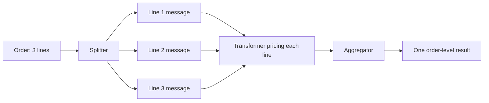

# Aggregator After Splitter

In the **Aggregator** chapter of the **SPRING_INTEGRATION_CORE** module, this lesson builds a flow that splits one message into multiple parts and combines their results into a single reply. `Message`, `MessageChannel`, endpoints, transformers, and Java DSL are wired together in a single example; gateways, routers, filters, and error handling are examined where they directly affect group completion.

After this lesson, you can explain what data a splitter must pass to an aggregator, write an order-pricing flow, diagnose why a group stays waiting, and design tests for complete, out-of-order, or missing results.

## 1. The Problem: Processing Per Part While Returning One Request-Level Outcome

Suppose an order contains three order lines. Each line must be priced individually; afterward, the system returns the total amount and the list of processed lines to the calling application.



The arrows show messages flowing through the pipeline, not a claim that the three parts execute concurrently. Execution concurrency depends on the configured channels and executors.

The splitter breaks data apart; the aggregator holds state for related parts, waits for a completion condition, and builds a combined result. This pattern is commonly called **split-process-aggregate**, an implementation of Composed Message Processor. [Splitter reference](https://docs.spring.io/spring-integration/reference/splitter.html).

"Aggregating back" does not necessarily mean reconstructing the original payload. The input may be an order while the output is a price quote, an error report, or a summed total. Define the output per business needs before writing the aggregation function.

## 2. The Contract Between Splitter and Aggregator

### 2.1. Three Headers Describing a Split

With a standard splitter with `applySequence` enabled, parts receive sequence metadata. In a typical single-level split:

| Header | Meaning | Example for Second Part |
| --- | --- | --- |
| `correlationId` | Key linking parts of the same split | ID of the splitter's input message |
| `sequenceNumber` | Position of the part in the sequence, 1-based | `2` |
| `sequenceSize` | Total number of parts if known | `3` |

The corresponding constants live on `IntegrationMessageHeaderAccessor`: `CORRELATION_ID`, `SEQUENCE_NUMBER`, `SEQUENCE_SIZE`. Standard splitters enable `applySequence` by default. [Splitter API](https://docs.spring.io/spring-integration/api/org/springframework/integration/splitter/AbstractMessageSplitter.html).

Example of a parent message with symbolic ID `M-100`:

```text
Before splitter:
  id = M-100
  payload = [line A, line B, line C]

After splitter:
  message A: correlationId=M-100, sequenceNumber=1, sequenceSize=3
  message B: correlationId=M-100, sequenceNumber=2, sequenceSize=3
  message C: correlationId=M-100, sequenceNumber=3, sequenceSize=3
```

`M-100` is just an illustrative label; actual message IDs are typically UUIDs. Each child message has its own ID. Therefore, using a child message's `headers.id` as the correlation key creates distinct groups and breaks aggregation.

### 2.2. Correlation and Release Answer Two Different Questions

An aggregator normally uses `correlationId` to determine **which group a message belongs to**, while the release strategy decides **whether the group qualifies to produce a result**. The aggregation function only decides **what the group's result is**. [Aggregator model](https://docs.spring.io/spring-integration/reference/aggregator.html).

| Responsibility | Order Example |
| --- | --- |
| Correlation | Three results from the same pricing run belong to one group |
| Release | Compute the quote only once all required results arrive |
| Output processing | Build the line list and sum amounts |
| Message group store | Holds pending results |

Never try to fix a bad correlation key using a release condition. If two requests get merged into one group, counting parts can permit emitting a result containing data from both requests.

### 2.3. Enough Quantity Does Not Guarantee Distinct Parts

In the standard case, the default `SimpleSequenceSizeReleaseStrategy` compares group message count against `sequenceSize`. This strategy does not check for duplicate `sequenceNumber` values. Thus, it fits when the flow guarantees each part yields exactly one result; it does not provide business deduplication on its own. [Release strategy API](https://docs.spring.io/spring-integration/api/org/springframework/integration/aggregator/SimpleSequenceSizeReleaseStrategy.html).

Example of the design risk:

```text
Expected: part 1, part 2, part 3
Actually received: part 1, redelivery of part 1, part 3
```

If the redelivery carries a new message ID and enters the group, counting three messages can mask that part 2 is still missing. On channels with redelivery, define a unique part key such as `(requestId, lineNo)` along with deduplication before relying on counts.

## 3. Invariants to Preserve Between the Two Endpoints

When aggregating all parts of a finite list, establish four invariants:

1. Each part produces exactly one final outcome for the aggregator, including failure outcomes if business rules allow aggregating errors.
2. Parts of the same request share the same correlation key; independent requests have distinct keys.
3. Sequence metadata is preserved across transformers, service activators, and processing branches.
4. A policy exists for parts that never return, rather than leaving groups open indefinitely.

Example of two interleaved requests:

| Arrival | Correlation | Sequence | Expected State |
| --- | --- | --- | --- |
| 1 | `request-A` | `1/2` | A is waiting |
| 2 | `request-B` | `2/2` | B is waiting, despite receiving the last sequence number |
| 3 | `request-A` | `2/2` | Emits one result for A |
| 4 | `request-B` | `1/2` | Emits one result for B |

This example also shows that receiving `sequenceNumber == sequenceSize` does not prove all preceding parts have arrived. Never use that comparison alone as a completion condition when arrivals can be out of order.

## 4. Java DSL Example: Pricing Each Line Then Aggregating the Order

### 4.1. Scope of the Example

The example uses Java 17 and the Spring Integration 6.x Java DSL API, with dependency `org.springframework.integration:spring-integration-core`. If the project uses Spring Boot, add the integration starter and let the project's BOM manage compatible versions.

This is a standalone Spring configuration without depending on running a Spring Boot application. Data types are nested in one class so the example can be copied without hunting for extra domain classes.

Problem conventions:

- An order has at least one line; each line has positive quantity and non-negative unit price.
- All lines use the same currency. Taxes, discounts, and rounding rules are omitted for clarity.
- `orderId` is business data propagated via a header.
- The splitter's default correlation separates individual processing runs, even when two runs share the same `orderId`.
- Results go into a named output queue for easy observation and testing.

### 4.2. Complete Configuration

```java
package example.integration;

import java.math.BigDecimal;
import java.util.ArrayList;
import java.util.Comparator;
import java.util.List;

import org.springframework.context.annotation.Bean;
import org.springframework.context.annotation.Configuration;
import org.springframework.integration.config.EnableIntegration;
import org.springframework.integration.channel.DirectChannel;
import org.springframework.integration.channel.QueueChannel;
import org.springframework.integration.dsl.IntegrationFlow;
import org.springframework.integration.store.MessageGroup;
import org.springframework.integration.IntegrationMessageHeaderAccessor;
import org.springframework.messaging.Message;

@Configuration
@EnableIntegration
public class OrderAggregationConfig {

    public record OrderLine(
            int lineNo, String sku, int quantity, BigDecimal unitPrice) {
    }

    public record OrderRequest(String orderId, List<OrderLine> lines) {
        public OrderRequest {
            if (orderId == null || orderId.isBlank()) {
                throw new IllegalArgumentException("orderId is required");
            }
            lines = List.copyOf(lines);
            if (lines.isEmpty()) {
                throw new IllegalArgumentException("Order must not be empty");
            }
        }
    }

    public record PricedLine(int lineNo, String sku, BigDecimal amount) {
    }

    public record OrderSummary(
            String orderId, List<PricedLine> lines, BigDecimal total) {
        public OrderSummary {
            lines = List.copyOf(lines);
        }
    }

    @Bean(name = "orders.input")
    public DirectChannel orderInput() {
        return new DirectChannel();
    }

    @Bean(name = "orders.output")
    public QueueChannel orderOutput() {
        return new QueueChannel(100);
    }

    @Bean(name = "orders.discard")
    public QueueChannel orderDiscard() {
        return new QueueChannel(100);
    }

    @Bean
    public IntegrationFlow orderPricingFlow() {
        return IntegrationFlow.from("orders.input")
                .enrichHeaders(h -> h.headerFunction(
                        "orderId",
                        (Message<OrderRequest> message) ->
                                message.getPayload().orderId(),
                        true))
                .split(OrderRequest.class, OrderRequest::lines)
                .transform(OrderLine.class, OrderAggregationConfig::price)
                .channel("orders.toAggregate")
                .aggregate(a -> a
                        .outputProcessor(OrderAggregationConfig::summarize)
                        .groupTimeout(5_000)
                        .sendPartialResultOnExpiry(false)
                        .expireGroupsUponCompletion(false)
                        .expireGroupsUponTimeout(false)
                        .discardChannel("orders.discard"))
                .channel("orders.output")
                .get();
    }

    private static PricedLine price(OrderLine line) {
        if (line.quantity() <= 0
                || line.unitPrice() == null
                || line.unitPrice().signum() < 0) {
            throw new IllegalArgumentException("Invalid line: " + line.lineNo());
        }
        BigDecimal amount = line.unitPrice()
                .multiply(BigDecimal.valueOf(line.quantity()));
        return new PricedLine(line.lineNo(), line.sku(), amount);
    }

    private static OrderSummary summarize(MessageGroup group) {
        List<Message<?>> messages = new ArrayList<>(group.getMessages());
        messages.sort(Comparator.comparingInt(
                OrderAggregationConfig::sequenceNumber));

        List<PricedLine> lines = messages.stream()
                .map(message -> (PricedLine) message.getPayload())
                .toList();

        BigDecimal total = lines.stream()
                .map(PricedLine::amount)
                .reduce(BigDecimal.ZERO, BigDecimal::add);

        String orderId = messages.get(0).getHeaders()
                .get("orderId", String.class);
        return new OrderSummary(orderId, lines, total);
    }

    private static int sequenceNumber(Message<?> message) {
        Integer number = message.getHeaders().get(
                IntegrationMessageHeaderAccessor.SEQUENCE_NUMBER,
                Integer.class);
        if (number == null) {
            throw new IllegalArgumentException("Missing sequenceNumber");
        }
        return number;
    }
}
```

`headerFunction(..., true)` extracts `orderId` from the current payload and overwrites any previous value if present. That clarifies the trusted source of data in the example. This header serves business context; the flow does not replace default correlation with `orderId`. [HeaderEnricherSpec API](https://docs.spring.io/spring-integration/api/org/springframework/integration/dsl/HeaderEnricherSpec.html).

Endpoints without an explicitly declared channel are wired by DSL via `DirectChannel`. Channel `orders.toAggregate` is a named junction, useful when tests need to send directly into the aggregator's input. [How Java DSL wires endpoints](https://docs.spring.io/spring-integration/reference/dsl/java-channels.html).

### 4.3. How Does the Data Transform?

```text
OrderRequest
    -> splitter
OrderLine + correlationId + sequenceNumber + sequenceSize
    -> transformer
PricedLine + same sequence metadata
    -> aggregator
OrderSummary
```

The transformer returns payload `PricedLine` without manually constructing a brand-new payload-only message. `summarize` receives the full `MessageGroup` so it can read sequence numbers and sort before constructing `OrderSummary`.

`outputProcessor` constructs the result after the group is released; it does not replace the release condition. If only a list of payloads is needed with no custom total calculation, the default processor can group payloads into a single message. [AggregatorSpec API](https://docs.spring.io/spring-integration/api/org/springframework/integration/dsl/AggregatorSpec.html), [default processor](https://docs.spring.io/spring-integration/api/org/springframework/integration/aggregator/DefaultAggregatingMessageGroupProcessor.html).

Example input and expected output:

| Line | Quantity | Unit Price | Amount |
| --- | --- | --- | --- |
| `BOOK` | 2 | 10.000 | 20.000 |
| `PEN` | 1 | 30.000 | 30.000 |
| `CLIP` | 5 | 1.000 | 5.000 |
| Total | | | **55.000** |

### 4.4. Why Sort Explicitly?

A list in the result must follow the chosen business requirement. In the example, that is the order of the list sent into the splitter. The aggregation function therefore copies the group's messages and sorts by `sequenceNumber`.

Never mutate the `MessageGroup`'s collection directly, and never return that internal collection for external code to retain. Business outputs should hold data independent of the group's storage lifecycle.

If the business wants ordering by SKU or priority, write the corresponding comparator. `sequenceNumber` only expresses the split order, not automatically the business order for every domain.

### 4.5. Operational Limits of the Illustrative Configuration

The example intentionally avoids returning an incomplete total upon timeout. It also retains markers of completed or timed-out groups so late arrivals can be recognized per handler policy. This is a learning example storing state in memory, not a persistence configuration for arbitrary production loads.

Both queues bounded at 100 messages must be drained regularly by consumers. `QueueChannel` buffers messages waiting for receivers; a full queue can cause senders to block. [QueueChannel behavior](https://docs.spring.io/spring-integration/reference/channel/implementations.html).

Group metadata cleanup is discussed in section 9. If deploying this configuration in a long-running process, add an appropriate cleanup policy.

## 5. Testing Flow and Aggregator Contracts

The tests below are illustrative code to add to a project with JUnit Jupiter. They need no broker, HTTP server, or database. The first test runs end-to-end through splitter-transformer-aggregator; the second sends processed parts directly to the aggregator to control arrival order.

```java
package example.integration;

import java.math.BigDecimal;
import java.util.List;

import org.junit.jupiter.api.Test;
import org.springframework.context.annotation.AnnotationConfigApplicationContext;
import org.springframework.integration.channel.QueueChannel;
import org.springframework.integration.IntegrationMessageHeaderAccessor;
import org.springframework.messaging.Message;
import org.springframework.messaging.MessageChannel;
import org.springframework.messaging.support.MessageBuilder;

import example.integration.OrderAggregationConfig.OrderLine;
import example.integration.OrderAggregationConfig.OrderRequest;
import example.integration.OrderAggregationConfig.OrderSummary;
import example.integration.OrderAggregationConfig.PricedLine;

import static org.junit.jupiter.api.Assertions.*;

class OrderAggregationTest {

    @Test
    void aggregatesAllPricedLinesIntoOneSummary() {
        try (var context = new AnnotationConfigApplicationContext(
                OrderAggregationConfig.class)) {
            MessageChannel input = context.getBean(
                    "orders.input", MessageChannel.class);
            QueueChannel output = context.getBean(
                    "orders.output", QueueChannel.class);

            var request = new OrderRequest("ORD-42", List.of(
                    new OrderLine(1, "BOOK", 2, new BigDecimal("10000")),
                    new OrderLine(2, "PEN", 1, new BigDecimal("30000")),
                    new OrderLine(3, "CLIP", 5, new BigDecimal("1000"))));

            assertTrue(input.send(
                    MessageBuilder.withPayload(request).build()));

            Message<?> reply = output.receive(1_000);
            assertNotNull(reply);
            OrderSummary summary = assertInstanceOf(
                    OrderSummary.class, reply.getPayload());

            assertEquals("ORD-42", summary.orderId());
            assertEquals(List.of("BOOK", "PEN", "CLIP"),
                    summary.lines().stream().map(PricedLine::sku).toList());
            assertEquals(0, new BigDecimal("55000")
                    .compareTo(summary.total()));
            assertNull(output.receive(0));
        }
    }

    @Test
    void waitsForAllPartsAndRestoresSequenceOrder() {
        try (var context = new AnnotationConfigApplicationContext(
                OrderAggregationConfig.class)) {
            MessageChannel aggregateInput = context.getBean(
                    "orders.toAggregate", MessageChannel.class);
            QueueChannel output = context.getBean(
                    "orders.output", QueueChannel.class);

            assertTrue(aggregateInput.send(part("request-42", 3)));
            assertNull(output.receive(0));

            assertTrue(aggregateInput.send(part("request-42", 1)));
            assertNull(output.receive(0));

            assertTrue(aggregateInput.send(part("request-42", 2)));
            Message<?> reply = output.receive(1_000);
            assertNotNull(reply);
            OrderSummary summary = assertInstanceOf(
                    OrderSummary.class, reply.getPayload());

            assertEquals(List.of("SKU-1", "SKU-2", "SKU-3"),
                    summary.lines().stream().map(PricedLine::sku).toList());
            assertNull(output.receive(0));
        }
    }

    private Message<PricedLine> part(String correlationId, int number) {
        return MessageBuilder.withPayload(new PricedLine(
                        number, "SKU-" + number, new BigDecimal("1000")))
                .setHeader("orderId", "ORD-42")
                .setHeader(IntegrationMessageHeaderAccessor.CORRELATION_ID,
                        correlationId)
                .setHeader(IntegrationMessageHeaderAccessor.SEQUENCE_NUMBER,
                        number)
                .setHeader(IntegrationMessageHeaderAccessor.SEQUENCE_SIZE, 3)
                .build();
    }
}
```

`receive(0)` checks immediately whether a message is present. With synchronous input in the example, this works well to verify non-release after each send. In asynchronous flows, negative checks need a synchronization mechanism or a suitable finite observation window; never infer "no result will ever arrive" from a single instantaneous poll.

Expand test cases according to real risks:

| Case | Outcome to Verify |
| --- | --- |
| Two groups receive interleaved messages | Lines from the two requests never mix |
| Same `orderId`, two independent submissions | Both pricing runs stay isolated |
| One part missing | No complete quote; timeout routes group per chosen policy |
| One part resent with a new ID | Deduplication or custom release enforces contract |
| Line dropped by filter | Group does not wait forever without a policy |
| Empty list | Rejected or handled by an empty-reply branch before splitter |
| Message missing sequence metadata | Flow detects contract violation on input |
| Part arrives after group completion | Does not generate an unwanted extra quote |

Do not rely solely on `Thread.sleep()` to assert timeouts. Poll from the discard queue with a bounded timeout, or control the scheduler in a dedicated test.

## 6. Filters and Routers Can Leave Groups Incomplete

### 6.1. A Filter After the Splitter Changes the Actual Count

Suppose a splitter produces three lines and then a filter drops a line with an invalid quantity:

```text
Splitter emits:  A(1/3), B(2/3), C(3/3)
Filter passes:   A(1/3),         C(3/3)
Aggregator sees: 2 messages, still expects 3
```

The filter dropping B does not automatically update `sequenceSize` on A and C. Under the initial three-part contract, the aggregator cannot tell whether B was intentionally dropped or is still in progress.

There are three design options:

| Approach | When Appropriate | What Must Be Defined |
| --- | --- | --- |
| Filter list before splitter | Known immediately which parts enter processing | Whether post-filter input may be empty |
| Emit a marker result for dropped parts | Need per-line reporting | Payload status for success, skipped, failed |
| Custom release with completion signal | Result count is not a fixed list | Protocol announcing total count or batch end |

For the pricing problem, a sound design is rejecting invalid orders before splitting, or returning an error outcome for that specific line. Dropping a message and hoping the aggregator infers the new count is an incomplete contract.

### 6.2. Routers Must Converge Results Back to the Same Aggregator

After a splitter, a router may send standard lines and promotional lines to two separate branches. If a quote needs both line types, results from both branches must return to the same aggregator carrying metadata from the same split.

If one part is cloned to multiple branches and each branch returns a result, the total result count changes. In that case, design a separate fan-out/gather layer or a new release strategy. Do not reuse the previous splitter's part count unchanged without re-evaluating.

## 7. A Per-Part Error Does Not Automatically Become That Part's Result

In a synchronous flow using `DirectChannel`, processing errors propagate back to the sender. With asynchronous processing, errors are usually represented as `ErrorMessage` and routed to an appropriate error channel. [Spring Integration error handling](https://docs.spring.io/spring-integration/reference/error-handling.html).

Suppose line 1 already reached the aggregator, while pricing line 2 throws an exception. The group may already hold one part while the caller receives an error. Logging the exception neither puts the missing part into the group nor cancels the already-created group.

Before implementing retries or error flows, choose one business contract:

- **All-or-nothing request:** one line error fails the whole request; already-stored parts must expire or cancel via request management.
- **Per-line status reporting:** every line, including failed ones, returns exactly one outcome to the aggregator.
- **Allow incomplete data:** the output must state how many parts are missing and why; receivers can distinguish it from a complete result.

For the second approach, you can use a unified payload:

```java
public enum LineStatus {
    SUCCESS, FAILED, SKIPPED
}

public record LineOutcome(
        int lineNo,
        LineStatus status,
        BigDecimal amount,
        String reason) {
}
```

This is an alternative model to `PricedLine` in the main example, not a payload type you can mix directly into the current `summarize` method. When switching designs, update both per-line processing and the aggregation function.

An error flow constructing `LineOutcome` must pull metadata from the **failed part message**, not treat the outer `ErrorMessage` envelope as if it were the original part. You must also ensure only one final outcome is sent per line: a retry success and an earlier emitted error outcome must never both be counted for the same line.

When constructing a replacement message from a processing outcome, copy necessary headers explicitly. The snippet below assumes `failedPart` is the child message and `outcome` is the replacement payload:

```java
Message<LineOutcome> replacement = MessageBuilder.withPayload(outcome)
        .copyHeaders(failedPart.getHeaders())
        .build();
```

This template still belongs inside a controlled error flow managing retries, routing, and payload types. Sending an entire `ErrorMessage` straight into a pricing aggregator breaks the payload contract.

## 8. Group Timeout vs. Gateway Timeout

### 8.1. Timeout Bounds Waiting, Not Result Completeness

In the example, `groupTimeout(5_000)` allows handling an unreleased group after the configured wait interval. The unit is milliseconds. With a standard fixed timeout, the schedule resets whenever a new message arrives; it measures idle time without new parts, not an absolute deadline since the gateway received the request. [Correlation handler configuration API](https://docs.spring.io/spring-integration/api/org/springframework/integration/dsl/CorrelationHandlerSpec.html).

If an SLA from request start is required, embed the deadline in the processing contract. For example, a request with a 10-second deadline must not stretch indefinitely just because parts trickle in occasionally.

### 8.2. Expiry Can Discard the Group or Emit Partial Results

Two choices must be decided at the business level:

| Setting | Meaning When Incomplete Group Expires |
| --- | --- |
| `sendPartialResultOnExpiry(false)` | Does not build an incomplete aggregated result; sends dropped parts to discard channel if configured |
| `sendPartialResultOnExpiry(true)` | Allows building an aggregated result from currently held parts |

An aggregation function serving partial reporting may need to return `expectedCount`, `receivedCount`, failed parts list, and completion status. Merely summing arrived lines and labeling the output "order total" can lead to wrong business decisions.

In the main example, the discard queue observes dropped messages; it does not automatically turn expiry into an error reply to the caller. To return a request-level error reply, add a mechanism detecting expired requests and building the corresponding reply.

### 8.3. Gateway Timing Out Does Not Mean the Aggregator Stopped

A messaging gateway exposes a business invocation interface and supports waiting for replies. Gateway reply timeout is separate from aggregator group wait time. [Messaging Gateways documentation](https://docs.spring.io/spring-integration/reference/gateway.html).

Suppose asynchronous processing runs:

```text
0s: gateway sends request.
2s: gateway reply timeout expires.
4s: a processing part finishes and arrives at the aggregator.
```

Do not assume the request was canceled merely because the caller timed out. Decide what happens to results arriving past the caller's deadline: persist for lookup, send a notification, or drop per request status.

In a synchronous chain running on the caller's thread, reply timeout is likewise not an interrupt mechanism for an executing handler. If an external service call can hang, configure a timeout on that I/O operation itself.

The main example ends at `orders.output`. When switching to a request-reply gateway model, design the reply routing properly—for example, letting results return to the request's `replyChannel`. Do not merely slap a gateway onto the front of the flow and assume a fixed output queue becomes the gateway's reply.

## 9. Group Lifecycle, Late Messages, and State Storage

### 9.1. Distinguish the Two Expiration Settings

`expireGroupsUponCompletion` controls group deletion after normal completion; `expireGroupsUponTimeout` controls group deletion on timeout. Deleting group traces completely lets a late part with the same key open a new group. Keeping completion markers helps detect late arrivals, but retention duration must be managed. [AbstractCorrelatingMessageHandler API](https://docs.spring.io/spring-integration/api/org/springframework/integration/aggregator/AbstractCorrelatingMessageHandler.html).

The main example sets both options to `false` to highlight retaining post-processing state. Still, metadata for every request cannot be kept forever. Define the late-message acceptance window and when traces are purged via a reaper or scheduled cleanup.

Distinguish these decisions:

| Decision | Business Question |
| --- | --- |
| Open-group wait duration | How long to wait for missing parts? |
| Outcome upon expiry | Report failure or allow incomplete results? |
| Completion-marker retention | How long to recognize late-arriving messages? |
| Business deduplication | Must reprocessing be prevented even after markers are purged? |

### 9.2. In-Process Memory vs. Persistent Store

The default in-memory store is convenient for small examples, yet pending state is lost when the process stops. If requests must resume across restarts, pick a suitable persistent `MessageGroupStore` and verify payload and header serializability. [Message Store documentation](https://docs.spring.io/spring-integration/reference/message-store.html).

Persisting state solves only part of the problem. Also define how unfinished groups resume or expire after restarts, how two processes are prevented from mutating the same group concurrently, and how duplicate outputs are avoided when output sending fails.

In multi-instance deployments, parts sharing a key must reach a place sharing group state visibility or route to the same owner. If each instance keeps its own local store while parts scatter randomly, each instance sees only a slice of the request.

For capacity, estimate roughly using your system's traffic profile:

```text
Memory for open groups is approximately
    open group count
  × average stored parts per group
  × average message size

Then add store, header, and completed-group marker overhead.
```

A flow that works fine for a three-line order can accumulate excessive state with thousands of concurrent requests and one slow downstream dependency. Monitor both open group count and oldest group age.

## 10. Cases Where the Finite-List Model Cannot Be Applied Blindly

### 10.1. Empty List

If the splitter emits zero parts, no first message ever creates a group. You cannot wait for the aggregator to emit an empty list on its own from "zero messages."

The main example rejects empty lists right inside `OrderRequest`. A search API or optional batch may choose to return an empty result via a dedicated branch before the splitter. Splitters also support a discard channel for empty split results, though discard does not automatically fabricate a success reply. [Splitter documentation](https://docs.spring.io/spring-integration/reference/splitter.html).

### 10.2. Iterators or Streams with Unknown Part Count

If a splitter cannot determine total part count, `sequenceSize` can be `0`. In that case, do not rely on default sequence-size release as you would for a sized `List`.

You need another protocol: an expected count supplied by the source, an explicit batch-end signal, or a well-defined time window. When using an end signal and parts can arrive out of order, ensure that signal does not release the group ahead of parts still in flight.

### 10.3. Nested Splitters

An order may split into packages, and each package splits into lines. Aggregate lines into package results first, then aggregate packages into the order result:

```text
Order
  -> split packages
      -> split lines of one package
      -> process line
      -> aggregate into package result
  -> aggregate into order result
```

At each level, preserve the right sequence metadata. Spring Integration supports restoring enclosing sequence context via `popSequence`; do not manually assign one shared correlation key across all levels without redesigning group keys and release strategies.

## 11. Moving to Parallel Processing

Adding a splitter does not increase thread count by itself. In the main example, per-line steps run over synchronous channel wiring. If pricing requires independent I/O per line, insert an executor channel **after the splitter, before line processing**.

Change at that point, assuming `pricingExecutor` is a Spring-managed executor:

```java
.split(OrderRequest.class, OrderRequest::lines)
.channel(c -> c.executor(pricingExecutor))
.transform(OrderLine.class, OrderAggregationConfig::price)
```

When introducing an executor, re-evaluate the problem's constraints:

- Completed parts may arrive out of order; the comparator inside `summarize` must preserve the promised output order.
- Do not assume the sender thread's transaction or thread-local context crosses the async boundary.
- Bound the executor to match the pricing service's capacity.
- Error flows must produce a final status for the part or for the whole request.
- Timeouts must account for queuing time, service calls, retries, and aggregation latency.

In the independent three-line scenario, adding workers can reduce wall-clock latency if external services support concurrency. However, if all workers contend on a connection-limited backend, raising concurrency only lengthens queues. Base decisions on measurements and actual dependency limits.

## 12. Diagnosing When a Group Produces No Result

When seeing "aggregator is stuck," inspect messages right before the aggregator and answer in order:

1. Does the message carry the same correlation key as the other parts of the request?
2. Does `sequenceSize` have the expected value or is it `0`?
3. How many results actually arrived, and were any blocked by filters, routers, or exceptions?
4. Was any part redelivered or duplicated, skewing counts?
5. Was the group already completed, expired, or discarded before the final part arrived?
6. Was the result produced into a different queue or reply channel than the one the caller awaits?

Useful log fields include request ID, order ID, correlation key, sequence number, sequence size, endpoint name, and arrival timestamp. You do not need to log entire payloads to prove a group received all parts.

Example trace sufficient to spot a missing part:

```text
request=req-42 correlation=g-42 sequence=1/3 endpoint=orders.toAggregate
request=req-42 correlation=g-42 sequence=3/3 endpoint=orders.toAggregate
```

From these two lines you can hypothesize part 2 has not arrived yet, without concluding it is permanently lost. The next step is tracing part 2's own path and checking the group's expiry state.

A complete design must specify three things: which parts belong to the same request, when the request is allowed to complete, and how missing or failed parts are reflected. Once those contracts are clear, splitters, channels, transformers, routers, filters, aggregators, and gateways compose into a testable, operable message flow.
