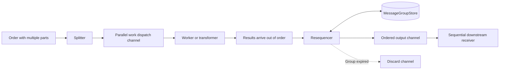

# What is a Message Resequencer

## 1. The problem: results arriving first should not necessarily be processed first

Suppose an order has three data parts, numbered `1`, `2`, `3`. The system sends each part to a worker for validation or data enrichment. The worker processing part `3` finishes fastest, part `1` completes next, while part `2` has to wait on an external service:

```text
Business order:       1 → 2 → 3
Completion order:     3 → 1 → 2
Order receiver needs: 1 → 2 → 3
```

If the receiver writes each part into a document in arrival order, the document's contents can end up out of order even though every worker processed its part correctly. The component needed here is a **message resequencer**: an endpoint that holds related messages and releases them in the order described by their metadata.

In Spring Integration, a resequencer by default groups by `correlationId`, orders by `sequenceNumber`, and uses `sequenceSize` information to recognize a finite sequence. It continues to emit individual messages, preserving their contents. See the [Spring Integration Resequencer documentation](https://docs.spring.io/spring-integration/reference/6.5/resequencer.html).

This lesson falls within the scope of **SPRING_INTEGRATION_CORE**: using `Message`, `MessageChannel`, endpoints, and Java DSL to design integration flows. After this lesson, you should be able to explain why state must be stored, choose the right sequence release mode, configure a basic flow, and determine what happens when a part of the sequence never arrives.

## 2. Placing the resequencer at the right point in the flow



This example illustrates a design choice: keeping time-consuming processing ahead of the resequencer to take advantage of parallel execution, then restoring order at the boundary where the receiver requires it.

If the worker's operation itself already requires ordering—for example, part `2` updates data based on changes from part `1`—placing the resequencer after the worker is too late. In that case, ordering must be protected before the dependent operation, or the way work is partitioned must be changed.

A FIFO `QueueChannel` also does not solve the scenario above. If results are placed onto the queue in order `3, 1, 2`, the receiver will consume them in that exact order. A `PriorityChannel` can select messages by priority or a comparator among the items currently present, but choosing from existing items does not entail deciding to wait for an item that has not arrived yet. These channel characteristics are described in [Message Channel Implementations](https://docs.spring.io/spring-integration/reference/6.5/channel/implementations.html).

## 3. Data contract: which group, which position, how many parts

### 3.1. Three headers to understand

| Header | Java constant | Question answered | Example |
| --- | --- | --- | --- |
| `correlationId` | `IntegrationMessageHeaderAccessor.CORRELATION_ID` | Which sequence does the message belong to? | `order-42:export-7` |
| `sequenceNumber` | `IntegrationMessageHeaderAccessor.SEQUENCE_NUMBER` | Which position is the message at? | `2` |
| `sequenceSize` | `IntegrationMessageHeaderAccessor.SEQUENCE_SIZE` | How many messages are in the sequence in total? | `3` |

The corresponding constants and accessors live in the [IntegrationMessageHeaderAccessor API](https://docs.spring.io/spring-integration/docs/6.5.0/api/org/springframework/integration/IntegrationMessageHeaderAccessor.html). Using the constants helps avoid header name typos; in the Java example below, the two ordering values are passed as integers.

For the finite-sequence problem in this lesson, define the input contract as follows:

- Parts of the same processing run share a single correlation key.
- Each position appears once, numbered consecutively from `1` to `N`.
- Every part in the sequence declares `sequenceSize = N`.
- The correlation key distinguishes different processing runs of the same business entity.

For example, `order-42` may go through two data exports. If both runs use `order-42` as the correlation key, their parts can get mixed together. The key `order-42:export-7` clearly identifies both the entity and the processing run.

`MessageHeaders.ID` identifies a specific message. It does not replace the grouping role of the correlation key. Similarly, the message creation timestamp or the worker completion timestamp does not automatically represent the business position expected by the receiver.

### 3.2. A valid set of messages

| Arrival order | Payload | `correlationId` | `sequenceNumber` | `sequenceSize` |
| --- | --- | --- | --- | --- |
| 1 | `part-3` | `batch-A` | 3 | 3 |
| 2 | `part-1` | `batch-A` | 1 | 3 |
| 3 | `part-2` | `batch-A` | 2 | 3 |

The resequencer has enough information to determine that all three messages belong to one sequence and the output must be `part-1`, `part-2`, `part-3`. It does not need to guess the order from substrings in the payload.

### 3.3. Where do the headers come from?

A standard splitter can generate sequence-related headers. With a publish-subscribe channel or recipient-list router, consider configuring `applySequence` if you use them to fan out branches that will later be recombined. Do not assume every router generates sequence metadata automatically. See [Splitter](https://docs.spring.io/spring-integration/reference/6.5/splitter.html) and the [correlation guide in Aggregator](https://docs.spring.io/spring-integration/reference/6.5/aggregator.html).

When messages arrive from an external system, the inbound adapter or mapping layer can map `batchId`, `partIndex`, and `partCount` to the headers above. They must be preserved across transformer steps, brokers, or transport protocols.

One scenario that requires dedicated design is an iterator or stream input whose part count is unknown upfront. The splitter may not be able to determine the size and set `sequenceSize = 0`. In that case, you cannot rely on the “all `N` parts arrived” contract from this example to conclude that the sequence is complete. You need an end-of-stream signal, a window boundary, or an appropriate release strategy; see the [Splitter Iterators section](https://docs.spring.io/spring-integration/reference/6.5/splitter.html#splitter-iterators).

## 4. How does a resequencer work?

At a conceptual level, the processing loop can be described as follows. This is a mental model for understanding the endpoint's responsibilities, not Spring Integration's internal implementation code:

```text
When a message arrives:
    determine the correlation key
    add the message to the state of the corresponding group
    check the release condition
    if eligible:
        select the messages that can be released according to sequence rules
        emit them in ascending sequenceNumber order
        update the group's state and progress
    if not yet eligible:
        continue holding the messages that must wait
```

The three concerns to keep distinct in your design are:

| Responsibility | Meaning |
| --- | --- |
| Correlation | Which messages belong to the same sequence? |
| Release | Can we release now, or do we need to wait for more? |
| Resequencing | Among the releasable messages, which message must go first? |

Java DSL provides configuration for correlation strategies and release strategies on endpoints in this family; see [Aggregators and Resequencers in Java DSL](https://docs.spring.io/spring-integration/reference/6.5/dsl/java-aggregators.html).

### 4.1. Why is storing state necessary?

When only part `3` has arrived, the endpoint cannot release it while still guaranteeing that parts `1` and `2` are emitted first. It must hold the message. With partial sequence release mode, it also has to track how far it has already released in order to determine the next contiguous segment.

Therefore, a resequencer is a **stateful** endpoint. The fact that `inputChannel.send(message)` returns successfully may only mean that the endpoint accepted the message into the waiting group. It does not prove that the final receiver has processed the message.

### 4.2. Order is determined within each group

Suppose the input interleaves two groups:

```text
A3, B2, A1, B1, A2
```

In full-sequence waiting mode, one possible output is:

```text
B1, B2, A1, A2, A3
```

Group B completes first, so it is released first. What this example guarantees is `A1` before `A2` before `A3`, and `B1` before `B2`. There is no requirement to merge all messages from every order into a single global ordering.

If the business requirement calls for a shared order across multiple entities, you must redefine the correlation domain and sequence number source. Using a single correlation key for the entire system can turn all work into one large bottleneck.

## 5. Two release modes during normal operation

### 5.1. Wait for the full sequence

With `releasePartialSequences(false)`, for example with `sequenceSize = 4` and valid positions `1..4`:

| Newly arrived message | Messages waiting | New output |
| --- | --- | --- |
| `3` | `3` | None yet |
| `1` | `1, 3` | None yet |
| `4` | `1, 3, 4` | None yet |
| `2` | Complete `1, 2, 3, 4` | `1, 2, 3, 4` |

This mode is easy to reason about when the receiver may only begin after all parts have been collected. On the other hand, part `1` still has to wait even though it arrived early.

Releasing the whole sequence means the endpoint sends four messages one after another. It does not create a single message whose payload is a list of four parts. According to the [Resequencer documentation](https://docs.spring.io/spring-integration/reference/6.5/resequencer.html), partial sequence release mode is disabled by default; the example in this lesson still configures it explicitly so readers can see the choice clearly.

Collecting the full sequence before releasing also does not automatically turn the four sends into an atomic transaction. If the receiver processes two parts and then encounters an error, the application still needs appropriate retry, rollback, or reconciliation rules.

### 5.2. Release available contiguous segments early

With `releasePartialSequences(true)`, a valid segment can be released before the entire sequence arrives. The key point is that it must continue immediately from the most recently released position:

| Newly arrived message | Previous progress | New output | Still held |
| --- | --- | --- | --- |
| `3` | Nothing released yet | None yet | `3` |
| `1` | Nothing released yet | `1` | `3` |
| `4` | Released through `1` | None yet | `3, 4` |
| `2` | Released through `1` | `2, 3, 4` | None left |

The segment `3, 4` is contiguous within itself, but it does not follow part `1` because part `2` is still missing. Simply sorting the parts currently on hand does not eliminate that gap.

Partial release rules and their relationship to already-released progress are described in the [SequenceSizeReleaseStrategy API](https://docs.spring.io/spring-integration/docs/6.5.0/api/org/springframework/integration/aggregator/SequenceSizeReleaseStrategy.html). The table above illustrates a scenario derived from those rules with valid input, no duplicate messages, and no timeout triggered.

Early release fits well if the receiver can process earlier parts sequentially as soon as they become ready. You trade some waiting latency for the requirement to manage progress and handle mid-sequence interruptions.

### 5.3. Choosing a mode based on business requirements

| Requirement in the example | Reasonable choice |
| --- | --- |
| Start only after all parts of a dossier have been collected | Wait for the full sequence |
| Can write initial pages sequentially while waiting for later pages | Release contiguous segments partially |
| May display incomplete data upon deadline expiration | Also configure an incomplete-result-on-expiry policy |
| Unbounded event stream with no end boundary | Needs a dedicated windowing and state-lifecycle design |

## 6. Java DSL example: receive `3, 1, 2`, emit `1, 2, 3`

The example uses Java 17 or higher and the Spring Integration 6.5.x API. The learning project needs the `org.springframework.integration:spring-integration-core` dependency; testing also requires JUnit Jupiter. Dependency versions should be managed consistently via your project's build configuration or BOM.

The code snippets below are educational examples. The output queue lets you observe results directly without needing to add a consumer or broker.

### 6.1. Declaring channels and the endpoint

```java
import org.springframework.context.annotation.Bean;
import org.springframework.context.annotation.Configuration;
import org.springframework.integration.channel.DirectChannel;
import org.springframework.integration.channel.QueueChannel;
import org.springframework.integration.config.EnableIntegration;
import org.springframework.integration.dsl.IntegrationFlow;
import org.springframework.integration.store.MessageGroupStore;
import org.springframework.integration.store.SimpleMessageStore;
import org.springframework.messaging.MessageChannel;

@Configuration
@EnableIntegration
public class ResequencerConfiguration {

    @Bean
    public MessageChannel resequencerInput() {
        return new DirectChannel();
    }

    @Bean
    public QueueChannel orderedOutput() {
        return new QueueChannel(100);
    }

    @Bean
    public QueueChannel resequencerDiscard() {
        return new QueueChannel(100);
    }

    @Bean
    public MessageGroupStore resequencerStore() {
        return new SimpleMessageStore();
    }

    @Bean
    public IntegrationFlow resequencerFlow() {
        return IntegrationFlow.from(resequencerInput())
                .resequence(r -> r
                        .id("orderPartsResequencer")
                        .messageStore(resequencerStore())
                        .releasePartialSequences(false)
                        .groupTimeout(5_000L)
                        .sendPartialResultOnExpiry(false)
                        .discardChannel(resequencerDiscard())
                        .sendTimeout(1_000L))
                .channel(orderedOutput())
                .get();
    }
}
```

`@EnableIntegration` activates the Spring Integration infrastructure in a plain Java application context. The `@Bean` method calls here use the default proxied `@Configuration` behavior; each call resolves to the managed bean instance.

The flow has three points to observe:

- `resequencerInput` receives each part of the sequence.
- `orderedOutput` receives messages emitted in the proper order.
- `resequencerDiscard` receives messages discarded by endpoint policy, including incomplete groups upon expiry in this configuration.

The example keeps the default correlation mechanism using the `CORRELATION_ID` header. Storage, timeout, and discard channel options are documented in the [CorrelationHandlerSpec API](https://docs.spring.io/spring-integration/docs/6.5.0/api/org/springframework/integration/dsl/CorrelationHandlerSpec.html).

`groupTimeout(5_000L)` governs group waiting duration. `sendTimeout(1_000L)` bounds how long sending to a queue channel can block when it is full. These two numbers govern two separate decisions; a queue capacity of `100` in the example bounds the output and discard buffers.

### 6.2. Testing wait-for-complete-sequence behavior

Place the test class in the same package as `ResequencerConfiguration`. Each test run creates a fresh context so group state and queues are isolated.

```java
import org.junit.jupiter.api.Test;
import org.springframework.context.annotation.AnnotationConfigApplicationContext;
import org.springframework.integration.IntegrationMessageHeaderAccessor;
import org.springframework.integration.channel.QueueChannel;
import org.springframework.messaging.Message;
import org.springframework.messaging.MessageChannel;
import org.springframework.messaging.support.MessageBuilder;

import static org.junit.jupiter.api.Assertions.assertEquals;
import static org.junit.jupiter.api.Assertions.assertNotNull;
import static org.junit.jupiter.api.Assertions.assertNull;
import static org.junit.jupiter.api.Assertions.assertTrue;

class ResequencerFlowTest {

    @Test
    void releasesThreeMessagesInSequenceOrder() {
        try (var context = new AnnotationConfigApplicationContext(
                ResequencerConfiguration.class)) {

            MessageChannel input = context.getBean(
                    "resequencerInput", MessageChannel.class);
            QueueChannel output = context.getBean(
                    "orderedOutput", QueueChannel.class);
            QueueChannel discard = context.getBean(
                    "resequencerDiscard", QueueChannel.class);

            assertTrue(input.send(part("batch-A", 3, 3)));
            assertNull(output.receive(0));

            assertTrue(input.send(part("batch-A", 1, 3)));
            assertNull(output.receive(0));

            assertTrue(input.send(part("batch-A", 2, 3)));

            for (int expected = 1; expected <= 3; expected++) {
                Message<?> actual = output.receive(1_000);
                assertNotNull(actual);
                assertEquals("part-" + expected, actual.getPayload());
                assertEquals(
                        Integer.valueOf(expected),
                        actual.getHeaders().get(
                                IntegrationMessageHeaderAccessor.SEQUENCE_NUMBER,
                                Integer.class));
                assertEquals(
                        "batch-A",
                        actual.getHeaders().get(
                                IntegrationMessageHeaderAccessor.CORRELATION_ID));
            }

            assertNull(output.receive(0));
            assertNull(discard.receive(0));
        }
    }

    private static Message<String> part(
            String batchId, int number, int size) {
        return MessageBuilder.withPayload("part-" + number)
                .setHeader(
                        IntegrationMessageHeaderAccessor.CORRELATION_ID,
                        batchId)
                .setHeader(
                        IntegrationMessageHeaderAccessor.SEQUENCE_NUMBER,
                        number)
                .setHeader(
                        IntegrationMessageHeaderAccessor.SEQUENCE_SIZE,
                        size)
                .build();
    }
}
```

The first two `assertNull` calls verify the essential aspect of full-sequence waiting: the endpoint does not release when only two of the three positions have arrived. The subsequent loop verifies both payloads and header ordering; the final assertions confirm there are no leftover messages in either queue.

The input is a `DirectChannel`, so the endpoint accepts the message immediately on the thread calling `send`. There is no need to insert `Thread.sleep` between sends in this test. That is a property of this example configuration, not an assumption to carry over to flows with an executor or poller.

If you switch to `releasePartialSequences(true)`, you must adjust the expectations: after sending part `1`, the queue already contains part `1`; after sending part `2`, parts `2, 3` follow. Keeping the original “no output yet” assertions would test the newly chosen contract incorrectly.

## 7. Placing after a splitter and transformer: watch every part's path

Java DSL can express the processing chain using `split()`, routing onto an executor channel, transforming each part, and then `resequence()`. Structural examples in the [Java DSL guide](https://docs.spring.io/spring-integration/reference/6.5/dsl/java-aggregators.html) illustrate how to connect these endpoints.

In the order example, trace the path of every position:

```text
One message containing 3 parts
    → splitter creates 3 messages carrying positions 1, 2, 3
    → worker processes each part
    → resequencer receives results and emits them in original position order
```

Three design choices commonly cause unintended gaps:

1. **A filter drops part `2` while keeping `sequenceSize = 3`.** The remaining parts cannot complete the original sequence. You need to decide whether to filter before numbering, produce a message marked “skipped”, or change the completion contract.
2. **A router sends some parts down a branch that never returns.** Clarify which branches the resequencer is waiting on; the expected part count must match the actual flow.
3. **A worker returns a new message that strips metadata.** The payload may be right, but downstream endpoints no longer know the group and position. When constructing messages manually, actively preserve or re-map the relevant headers.

A result marked “skipped” is also business data that must be handled explicitly. For example, part `2` that is ineligible for export can be replaced with a message at position `2` carrying a payload explaining why. The receiver can record and skip its content, instead of leaving the entire sequence waiting indefinitely.

## 8. Missing messages: timeout is a business policy

### 8.1. Partial release and expiry release are two independent choices

| Configuration | Question answered |
| --- | --- |
| `releasePartialSequences` | Should contiguous segments be released before the full sequence arrives? |
| `groupTimeout` | After how long without receiving another part should an incomplete group be handled? |
| `sendPartialResultOnExpiry` | When forcing an incomplete group to end, should the held parts be sent to the normal output? |
| `discardChannel` | Where should discarded messages be routed? |

A duration-based `groupTimeout` is an activity-based deadline for the group: when a new message arrives and the group has not yet been released, the wait schedule is recalculated according to the correlation handler's mechanism. Therefore, `5_000` does not strictly mean “exactly five seconds from the first part.” If you need an absolute deadline measured from group creation or a business timestamp, use an appropriate expression or timing policy. See [Aggregator and Group Timeout](https://docs.spring.io/spring-integration/reference/6.5/aggregator.html#aggregator-timeout).

### 8.2. Two options when the sequence can no longer be completed

Suppose a group has size `3`, has received `1` and `3`, and part `2` never arrives. With full-sequence waiting mode in the Java example:

| Expiry policy | Expected behavior for held parts | Meaning in the order example |
| --- | --- | --- |
| `sendPartialResultOnExpiry(false)` | Do not send `1, 3` to normal output; route them to the configured discard path | Refuse to export an incomplete dataset |
| `sendPartialResultOnExpiry(true)` | May emit available parts in order `1, 3` | Accept an incomplete result and clearly report that status |

The [Resequencer documentation](https://docs.spring.io/spring-integration/reference/6.5/resequencer.html) describes the option to send partial results when a group expires. Notice therefore that “emitted parts are in ascending order” does not mean “every position was received.”

In partial release mode, part `1` may already have gone downstream before expiry. The discard policy only applies to parts still being held; it cannot undo the side effects of parts already emitted. If you only persist discarded messages, the recovery log will not automatically capture the full sequence history; the application must also persist released progress.

Merely enabling the send-partial-result-on-expiry flag does not create an expiration timer either. The endpoint needs a corresponding trigger mechanism, such as `groupTimeout` or scanning groups with `MessageGroupStoreReaper`.

### 8.3. Late messages and group lifecycle

In the Spring Integration 6.5 API, `ResequencingMessageHandler` enforces retaining group state after a timeout so that late-arriving messages are immediately discarded. This is a detail to verify on the exact endpoint type rather than copying every lifecycle option from aggregator; see the [ResequencingMessageHandler API](https://docs.spring.io/spring-integration/docs/6.5.0/api/org/springframework/integration/aggregator/ResequencingMessageHandler.html).

The application still needs a metadata cleanup policy and a late-message acceptance window. Once group state has been purged, the ability to recognize an old processing run can change. Therefore, use a distinct correlation key per processing run and design explicitly whether a replay starts a new run or resumes the old one.

### 8.4. Discard is different from execution errors

In the example, discard is an intentional handling path for a group that cannot proceed under the contract. External service failures, data conversion errors, or errors sending to a full queue are execution failures.

With a `DirectChannel`, handler exceptions typically propagate back to the calling thread. With asynchronous or scheduled tasks, you need an appropriate mechanism to route errors to `errorChannel`. A custom scheduler also needs an appropriate error handler if you want to preserve Spring Integration's error-routing behavior. See [Error Handling](https://docs.spring.io/spring-integration/reference/6.5/error-handling.html).

For the order export problem, one concrete approach is to record a `BATCH_INCOMPLETE` event upon receiving a discard, along with the correlation key and the list of known positions. A reconciliation step can verify the missing part at the source before deciding to replay. The resequencer does not automatically re-fetch lost parts from external systems.

## 9. Distinguishing the resequencer from other endpoints

| Component | Primary job | Example result |
| --- | --- | --- |
| Resequencer | Restore message order within a sequence | `M3, M1, M2` becomes `M1, M2, M3` |
| Aggregator | Combine multiple messages into one result | Three parts become one message containing a report |
| Transformer | Convert each message's data | JSON string becomes a business object |
| Router | Choose the path for a message | Domestic order goes to the domestic processing branch |
| Filter | Decide whether a message proceeds or is dropped | Reject requests that fail a condition |
| Delayer | Defer release until a specified time | Wait until the scheduled notification time |

If the receiver requires a single complete document, an aggregator is the component responsible for combining parts. You can chain a resequencer into an aggregator when input order is part of the data-merging contract, but you do not need to add both endpoints to every flow. Start from the output shape: multiple ordered messages or a single aggregated message.

A gateway also does not replace resequencing. Specifically, in a design that waits for all three parts, if a thread calls a synchronous gateway for part `1` and blocks waiting for the result before sending parts `2` and `3`, the caller itself can prevent the sequence from completing. You can use one-way sends for each part and receive results on a separate channel, or send a single request containing all parts so the flow splits and processes them internally.

## 10. Storage, scalability, and guarantee limits

### 10.1. Choosing where to store state

`SimpleMessageStore` in the example keeps state in memory. If the process stops, you cannot rely on this store to recover waiting parts. Spring Integration provides persistent store implementations; payload and header types must be compatible with the serialization mechanism of the chosen store. See [Message Store](https://docs.spring.io/spring-integration/reference/6.5/message-store.html).

For a flow to resume after a restart, persisting payloads alone is not enough. The design must also account for group metadata, release progress, how old-group cleanup is re-triggered, and how the receiver handles redelivered results. Likewise, the resequencer's store does not automatically make `orderedOutput` or `resequencerDiscard` in the example persistent queues.

### 10.2. Estimating the volume of waiting data

Suppose at a given time there are `200` waiting groups, each holding `10` messages on average, with each payload around `8 KiB`. Payloads alone occupy approximately:

```text
200 × 10 × 8 KiB = 16,000 KiB ≈ 15.6 MiB
```

This figure excludes headers, Java object overhead, group structures, locks, timeout schedules, and copies created during processing. If every group is missing just one part and there is no wait limit, the number of stalled groups can keep growing even while workers run fast.

The [Resequencer documentation](https://docs.spring.io/spring-integration/reference/6.5/resequencer.html) recommends using this component for relatively short sequences with few gaps. For very long event streams, reconsider group boundaries, windows, and where progress is maintained.

### 10.3. Multiple instances must agree on group ownership

In a deployment with two instances A and B, if `A` receives only part `1` while `B` receives parts `2` and `3`, two local stores will not combine into a complete sequence. There are two common design approaches:

- Route consistently so that every part with the same correlation key lands on the same instance.
- Use shared state with per-group locking suitable for multiple instances.

From the requirement to “read, update, and release the same group,” it follows that sharing storage without protecting concurrent operations is insufficient. Spring Integration provides `LockRegistry` for correlation handlers; see [Lock Registry in Aggregator](https://docs.spring.io/spring-integration/reference/6.5/aggregator.html#aggregator-lock-registry).

### 10.4. Output order does not guarantee downstream completion order

If an executor is used again after the resequencer for parallel processing, part `2` can complete its business side effect before part `1`. For writing parts sequentially into a document, keep the consumer sequential within the same ordering domain or use appropriate partitioning.

Ordering also does not imply exactly-once processing. Retries or replays can redeliver the same event. Detecting duplicate sequence numbers within a group does not replace idempotency of the business operation, especially after group state has been purged. The receiver may need a unique key such as `(batchId, partIndex)` or a persistently stored event ID.

## 11. Scenarios to test next

Beyond the JUnit example collecting three parts, test the boundaries that reflect your flow's contract:

| Scenario | What to observe |
| --- | --- |
| One group arrives in order `3, 1, 2` | Final output is `1, 2, 3` |
| Partial release, input `3, 1, 4, 2` | Releases `1` early, holds `3, 4`, then releases `2, 3, 4` |
| Two correlation keys interleaved | A completed group advances without waiting for the other group |
| Missing middle part, discard policy | Incomplete sequence is not sent to normal output; data appears on the discard path |
| Partial results allowed on expiry | Receiver recognizes the result is incomplete and does not mistake it for a finished sequence |
| Two messages with duplicate position | Verify how the endpoint handles it and how business logic detects conflicting content |
| Inconsistent `sequenceSize` or missing header | Contract-violating input is caught with a clear error-handling path |
| Message arrives after timeout | Observe behavior while group metadata is still retained |
| Output queue full | Errors or send timeouts are handled as configured |
| Restart while holding groups | Behavior matches the chosen store and recovery mechanism |

For timeout tests, use timed receive operations and leave margin for the scheduler, rather than asserting a task must run at an exact millisecond. For partial release tests, verify output at each send step; checking only the final list misses whether the endpoint released prematurely across a gap.

Cases involving persistent stores, retries, and multiple instances require corresponding environments. Testing with queues in a single context only validates the local behavior of that flow.

## 12. Diagnosing when a flow does not emit or emits unexpectedly

| Symptom | What to check first |
| --- | --- |
| Many messages received but no output yet | Correlation key, missing positions, `sequenceSize`, release mode |
| One part is stuck even though other parts were released | Gaps ahead of that position and already-released progress |
| Two data exports get mixed | Whether the correlation key includes a run identifier |
| Group stalls after adding a filter | Whether the filter dropped a position in an already-numbered sequence |
| Ordered in the queue but final data is out of order | Whether downstream consumers or executors run in parallel |
| Memory grows over time | Number of incomplete groups, held parts count, and state cleanup policy |
| Messages get discarded after a while | Timeout, late arrivals, and group metadata lifecycle |
| Retries cause repeated side effects | Idempotency and history persistence scope at the receiver |

Diagnostic logs should include correlation key, sequence number, declared size, arrival timestamp, and release/discard outcome. For the order problem, the four fields `batchId`, arrived position, released position, and missing positions are usually more useful than logging the entire payload.

## 13. Practice exercise

A system receives four pages of dossier `DOC-18:RUN-2`. The results arrive in order `4, 2, 1, 3`.

1. In full-sequence waiting mode, write down the new output after each arrival.
2. In partial release mode, write down the new output and the pages still held after each arrival.
3. Suppose page `3` never arrives: propose an expiry-handling approach for a dossier that requires all pages.
4. If a new processing run of `DOC-18` is started, choose a correlation key so the two runs do not mix.

**Answer check:**

| Newly arrived message | New output (full-sequence wait) | New output (partial release) | Parts still held (partial release) |
| --- | --- | --- | --- |
| `4` | None yet | None yet | `4` |
| `2` | None yet | None yet | `2, 4` |
| `1` | None yet | `1, 2` | `4` |
| `3` | `1, 2, 3, 4` | `3, 4` | None left |

For a dossier that requires all pages, you can choose full-sequence waiting, disable sending partial results on expiry, and route the held parts to a reconciliation path. If partial release is used, you must accept that pages `1, 2` may already have been processed before detecting that page `3` is missing. A subsequent processing run can use `DOC-18:RUN-3` to distinguish it clearly from the previous run.
