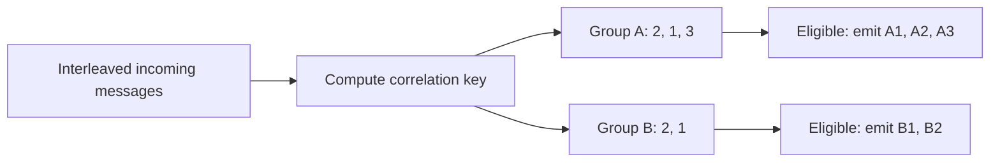

# Resequencer Correlation Key

In the `SPRING_INTEGRATION_CORE` module, a resequencer is an endpoint that temporarily holds messages arriving out of order and releases them in sequence order. This lesson in the **Resequencer** chapter focuses on the decision that happens before sorting: **which sequence does each message belong to?** The answer is represented by the correlation key—the key that identifies a message group.

The goal is to design a group key suited to business requirements, configure it in Java DSL, preserve the key across processing steps, and test isolation across interleaved sequences. The running example is a multi-tenant invoice import flow; each batch has multiple parts processed independently.

## 1. Group key, sequence number, and release condition

A resequencer must separate three questions:

| Question | Component that answers it | Example |
| --- | --- | --- |
| Which sequence does the message belong to? | `CorrelationStrategy` returning the correlation key | Invoice import sequence for tenant A, batch 42, run R1 |
| Where does the message sit in the sequence? | `SEQUENCE_NUMBER` header with standard ordering | Part 2 |
| When may held messages be released? | `ReleaseStrategy`, which can use `SEQUENCE_SIZE` | All 3 parts received |

Under default configuration, the resequencer reads the key from the `IntegrationMessageHeaderAccessor.CORRELATION_ID` header and emits messages by `SEQUENCE_NUMBER`. You can configure a custom correlation strategy to change the key source. A resequencer emits individual messages; combining payloads into a single result is the aggregator's responsibility. [Resequencer documentation](https://docs.spring.io/spring-integration/reference/6.5/resequencer.html).

Example of two interleaved sequences:

```text
Input: A2, B2, A1, B1, A3

Group A: 2, 1, 3  →  A1, A2, A3
Group B: 2, 1     →  B1, B2
```

Order is established within each group. Do not assume that overall output must emit group A before group B. In full-group waiting mode, B can be emitted first because B completes first.



If you pick the wrong key, the resequencer holds and evaluates releases on the wrong groups from the very start. Changing the sequence number comparator will not fix that grouping bug.

## 2. The correlation key contract

Conceptually, a correlation strategy can be viewed as a function:

```text
K(message) → identifier of a sequence session
```

Key design must simultaneously satisfy:

1. Parts of the same sequence session return the same key value.
2. Independent sequence sessions return different keys within the group-storage scope.
3. A part's key value remains stable as the part travels through transformers, routers, retries, and relevant transport boundaries.

These are application design invariants. For example, two parts of the same batch with different keys will be split into two incomplete groups. Conversely, two independent batches using the same key can cause position collisions and corrupted completion conditions.

### 2.1. Distinguishing types of identifiers

| Identifier | Meaning | Suitable as a correlation key? |
| --- | --- | --- |
| Current child message ID | Distinguishes each individual message | Usually not; every part has its own ID |
| Parent message ID of a split | Identifies the shared input for the parts | Suitable if a single split represents a single sequence |
| `orderId` or `batchId` | Identifies a business entity | Sufficient only if it uniquely identifies the sequence session within the usage scope |
| Trace ID | Tracks a distributed operation | Use only when trace boundaries match sequence boundaries exactly |
| Delivery attempt or retry count | Identifies a redelivery attempt of a part | Must not change the key of the same sequence session |
| `runId` of an import job | Identifies one business execution run | Suitable for separating two independent runs of the same batch |

`MessageHeaders.ID` identifies an individual message, whereas `CORRELATION_ID` links multiple messages together. The `SEQUENCE_NUMBER` and `SEQUENCE_SIZE` headers are of type `Integer`; the correlation ID can be an object. Therefore, never equate an individual part's ID with the shared sequence ID. [Message and headers documentation](https://docs.spring.io/spring-integration/reference/6.5/message.html).

A UUID generated **once for the entire sequence session**, then attached to every part, is a valid choice. Generating a new UUID inside the correlation strategy for each message will place every part into a different group.

### 2.2. Missing keys must be detected explicitly

The `CorrelationStrategy` API has the primary method:

```java
Object getCorrelationKey(Message<?> message);
```

The strategy should throw an exception when a key cannot be determined, rather than returning `null`. This is also the contract described in the interface source code. [CorrelationStrategy, branch 6.5.10](https://github.com/spring-projects/spring-integration/blob/v6.5.10/spring-integration-core/src/main/java/org/springframework/integration/aggregator/CorrelationStrategy.java).

Do not use a fallback key like `"UNKNOWN"` to mask missing data errors. If multiple bad messages fall into that key, they will be treated as parts of the same sequence. In the invoice import application, reject messages missing key data before they enter the group-holding area and preserve enough context for reprocessing.

## 3. Designing keys around business boundaries

Suppose the system receives the following data parts:

| Tenant | Batch | Run | Sequence number | Sequence size |
| --- | --- | --- | ---: | ---: |
| A | 42 | R1 | 2 | 3 |
| B | 42 | R1 | 2 | 2 |
| A | 42 | R1 | 1 | 3 |
| B | 42 | R1 | 1 | 2 |
| A | 42 | R1 | 3 | 3 |

If only `batchId = 42` is used, both tenants share the same key. The group ends up with duplicate positions and two different size expectations. You should not rely on duplicate-part rejection to catch this design flaw; the exact outcome depends on which message arrives first and the group's state at that moment.

For the business case in question, a suitable key structure is:

```text
(flowNamespace, tenantId, batchId, runId)
```

Example readable representation:

```text
invoice-import|A|42|R1
invoice-import|B|42|R1
invoice-import|A|42|R2
```

These illustrative strings assume individual components do not contain the `|` character. When real data allows delimiter characters, use a consistent escaping or encoding rule; never concatenate strings arbitrarily.

Role of each component:

- `flowNamespace` distinguishes flow types or processing stages that may share a group storage area.
- `tenantId` isolates customers that share identical batch numbers.
- `batchId` links parts belonging to the same batch.
- `runId` separates two independent processing runs of the same batch.

Not every application needs all four components. If each batch already has a global UUID and is processed in only one session, that UUID may suffice. The deciding factor is the business sequence boundary rather than the number of fields in the key.

### 3.1. Distinguishing retries from business reruns

```text
Redelivering part A2 of run R1:
    keep key invoice-import|A|42|R1

Running a new import run R2 for batch A/42:
    use key invoice-import|A|42|R2
```

If every retry of A2 generates a new `runId`, A1 and A3 stay in R1 while A2 moves to another group. If a new run reuses R1, new data risks interacting with leftover state or late messages from the previous run.

Therefore `runId` should be established when the business session begins and propagated with every part. It should not be computed from the current timestamp when each part reaches the resequencer.

### 3.2. Keys must have a stable representation

With object keys, preserve immutability and proper `equals()`/`hashCode()` semantics. However, in real deployments you must also check how the message store encodes or maps group IDs. Do not assume every store handles Java objects in the exact same way.

A normalized `String` key is often convenient when crossing brokers, databases, and multiple programming languages. The development team must agree on data types, escaping, case sensitivity, and key schema versioning. Do not automatically lowercase all codes if the business treats `Ab1` and `ab1` as two distinct codes.

One unambiguous encoding approach is length-prefixing each component:

```text
invoice-import|1:A2:422:R1
              └── tenant A, batch 42, run R1
```

This is only an example application convention. If adopted, every producer and operations tool must use the exact same encoder; never mix it with delimiter-joined strings within the same sequence session.

## 4. Using the default correlation ID

When the producer already manages sequences, it can attach the standard headers directly:

```java
import org.springframework.integration.IntegrationMessageHeaderAccessor;
import org.springframework.messaging.Message;
import org.springframework.messaging.support.MessageBuilder;

Message<String> part2 = MessageBuilder.withPayload("A2")
        .setHeader(IntegrationMessageHeaderAccessor.CORRELATION_ID,
                "invoice-import|A|42|R1")
        .setHeader(IntegrationMessageHeaderAccessor.SEQUENCE_NUMBER, 2)
        .setHeader(IntegrationMessageHeaderAccessor.SEQUENCE_SIZE, 3)
        .build();
```

With the default resequencer configuration, the remaining parts of sequence A must share the same correlation ID; their sequence numbers are 1 and 3 respectively. Tenant B's parts must use a separate correlation ID.

If the input is a collection split by a splitter, the splitter can populate the sequence headers. You must preserve them across subsequent independent processing steps. In particular, an iterator-style output may have an unknown size and carry `SEQUENCE_SIZE = 0`; in that case, do not apply the finite-size completion assumption used in this lesson's example. [Splitter documentation](https://docs.spring.io/spring-integration/reference/6.5/splitter.html).

Example parallel processing flow structure:

```text
Parent message
    → splitter creates parts and sequence metadata
    → process parts via executor
    → resequencer
    → endpoint consuming each ordered part
```

When there are multiple splitter layers, each layer has its own sequence boundary. Determine which layer's order the resequencer is restoring before overwriting correlation metadata. If a business identifier must survive end-to-end, use a dedicated business header such as `batchId` or `sequenceKey`.

## 5. Configuring a custom correlation strategy with Java DSL

The following example uses Java 17 and the Spring Integration 6.5.x API. The application needs the `org.springframework.integration:spring-integration-core` dependency, with compatible Spring dependencies managed accordingly. Tests use JUnit Jupiter. The example intentionally uses a synchronous input channel and a queue output channel so results can be observed clearly.

The producer places the normalized key in the application header `sequenceKey`. The resequencer is configured to read the key from that header:

```java
import org.springframework.beans.factory.annotation.Qualifier;
import org.springframework.context.annotation.Bean;
import org.springframework.context.annotation.Configuration;
import org.springframework.integration.aggregator.CorrelationStrategy;
import org.springframework.integration.channel.DirectChannel;
import org.springframework.integration.channel.QueueChannel;
import org.springframework.integration.config.EnableIntegration;
import org.springframework.integration.dsl.IntegrationFlow;
import org.springframework.messaging.MessageChannel;

@Configuration(proxyBeanMethods = false)
@EnableIntegration
public class ResequencerCorrelationConfig {

    public static final String SEQUENCE_KEY = "sequenceKey";

    @Bean
    public DirectChannel resequenceInput() {
        return new DirectChannel();
    }

    @Bean
    public QueueChannel resequenceOutput() {
        return new QueueChannel();
    }

    @Bean
    public CorrelationStrategy sequenceKeyStrategy() {
        return message -> {
            String key = message.getHeaders().get(SEQUENCE_KEY, String.class);
            if (key == null || key.isBlank()) {
                throw new IllegalArgumentException(
                        "Missing or blank sequenceKey");
            }
            return key;
        };
    }

    @Bean
    public IntegrationFlow invoicePartsFlow(
            @Qualifier("resequenceInput") MessageChannel input,
            @Qualifier("resequenceOutput") QueueChannel output,
            @Qualifier("sequenceKeyStrategy") CorrelationStrategy strategy) {

        return IntegrationFlow.from(input)
                .resequence(r -> r
                        .correlationStrategy(strategy)
                        .releasePartialSequences(false))
                .channel(output)
                .get();
    }
}
```

Java DSL supports customizing the correlation strategy on `.resequence(...)`. With the configuration above, `sequenceKey` determines the group; `CORRELATION_ID` is no longer the key source used by this endpoint. `sequenceKey` is an application-defined header, not a standard header automatically understood by every resequencer. [Java DSL: Aggregators and Resequencers](https://docs.spring.io/spring-integration/reference/6.5/dsl/java-aggregators.html).

The strategy only identifies the group and validates the key. It does not reassign `SEQUENCE_NUMBER`, infer `SEQUENCE_SIZE`, or modify the correlation ID header. The producer must still supply accurate sequence numbers and sizes for the finite sequence in the example.

Here `releasePartialSequences(false)` is set explicitly to wait for the full group using the default size strategy. With valid, unique, and consistent metadata, a sequence of size 3 releases once all three parts arrive. If partial release is enabled, the resequencer can release contiguous segments starting from the next unreleased position; receiving part 2 before part 1 does not mean part 2 is released immediately. [SequenceSizeReleaseStrategy, branch 6.5.10](https://github.com/spring-projects/spring-integration/blob/v6.5.10/spring-integration-core/src/main/java/org/springframework/integration/aggregator/SequenceSizeReleaseStrategy.java).

Do not replace the release strategy with `group.size() == 3` just to mask inconsistencies across groups of different sizes. Release conditions and key correctness are two separate contracts to design independently.

### 5.1. Concise configuration using an expression

If input has already been strictly validated, you can replace the resequencer configuration block with:

```java
.resequence(r -> r
        .correlationExpression("headers['sequenceKey']")
        .releasePartialSequences(false))
```

`correlationExpression` is a Java DSL option provided alongside `correlationStrategy`. Choose only one way to determine the key on an endpoint so readers of the configuration clearly see which key source is active. [CorrelationHandlerSpec, branch 6.5.10](https://github.com/spring-projects/spring-integration/blob/v6.5.10/spring-integration-core/src/main/java/org/springframework/integration/dsl/CorrelationHandlerSpec.java).

The expression above does not replace checking for missing or blank headers. A strategy bean throwing an explicit exception is often more convenient when you need to signal input contract violations.

## 6. Testing interleaved sequences

A test that only sends A2 then A1 does not prove the correlation key is correct: even a constant key would pass a single-group case. You need at least two concurrent groups, ideally with different sizes and closely similar business metadata.

The test class below sits in the same package as `ResequencerCorrelationConfig`. Each flow test creates a fresh context so it does not reuse another test's message store.

```java
import org.junit.jupiter.api.Test;
import org.springframework.context.annotation.AnnotationConfigApplicationContext;
import org.springframework.integration.IntegrationMessageHeaderAccessor;
import org.springframework.integration.aggregator.CorrelationStrategy;
import org.springframework.integration.channel.DirectChannel;
import org.springframework.integration.channel.QueueChannel;
import org.springframework.messaging.Message;
import org.springframework.messaging.support.MessageBuilder;

import static org.junit.jupiter.api.Assertions.assertEquals;
import static org.junit.jupiter.api.Assertions.assertNotNull;
import static org.junit.jupiter.api.Assertions.assertNull;
import static org.junit.jupiter.api.Assertions.assertThrows;
import static org.junit.jupiter.api.Assertions.assertTrue;

class ResequencerCorrelationTest {

    @Test
    void keepsInterleavedSequencesSeparate() {
        try (var context = new AnnotationConfigApplicationContext(
                ResequencerCorrelationConfig.class)) {

            DirectChannel input = context.getBean(
                    "resequenceInput", DirectChannel.class);
            QueueChannel output = context.getBean(
                    "resequenceOutput", QueueChannel.class);

            String keyA = "invoice-import|A|42|R1";
            String keyB = "invoice-import|B|42|R1";

            assertTrue(input.send(part(keyA, 2, 3, "A2")));
            assertTrue(input.send(part(keyB, 2, 2, "B2")));
            assertTrue(input.send(part(keyA, 1, 3, "A1")));

            // Neither A nor B has all parts yet.
            assertNull(output.receive(0));

            assertTrue(input.send(part(keyB, 1, 2, "B1")));
            assertPart(output, keyB, 1, "B1");
            assertPart(output, keyB, 2, "B2");
            assertNull(output.receive(0));

            // A completes after B even though A appeared first.
            assertTrue(input.send(part(keyA, 3, 3, "A3")));
            assertPart(output, keyA, 1, "A1");
            assertPart(output, keyA, 2, "A2");
            assertPart(output, keyA, 3, "A3");
            assertNull(output.receive(0));
        }
    }

    @Test
    void rejectsMissingOrBlankKey() {
        CorrelationStrategy strategy =
                new ResequencerCorrelationConfig().sequenceKeyStrategy();

        Message<String> missing = MessageBuilder.withPayload("A1").build();
        Message<String> blank = MessageBuilder.withPayload("A1")
                .setHeader(ResequencerCorrelationConfig.SEQUENCE_KEY, " ")
                .build();

        assertThrows(IllegalArgumentException.class,
                () -> strategy.getCorrelationKey(missing));
        assertThrows(IllegalArgumentException.class,
                () -> strategy.getCorrelationKey(blank));
    }

    private static Message<String> part(
            String key, int number, int size, String payload) {

        return MessageBuilder.withPayload(payload)
                .setHeader(ResequencerCorrelationConfig.SEQUENCE_KEY, key)
                .setHeader(IntegrationMessageHeaderAccessor.SEQUENCE_NUMBER,
                        number)
                .setHeader(IntegrationMessageHeaderAccessor.SEQUENCE_SIZE,
                        size)
                .build();
    }

    private static void assertPart(
            QueueChannel output, String key, int number, String payload) {

        Message<?> message = output.receive(1_000);
        assertNotNull(message);
        assertEquals(payload, message.getPayload());
        assertEquals(key, message.getHeaders().get(
                ResequencerCorrelationConfig.SEQUENCE_KEY));
        assertEquals(Integer.valueOf(number), message.getHeaders().get(
                IntegrationMessageHeaderAccessor.SEQUENCE_NUMBER,
                Integer.class));
    }
}
```

`output.receive(0)` is appropriate for immediate checks here because `DirectChannel` processes the send call on the calling thread. If switching to an executor or broker, wait on a condition with an appropriate timeout; do not assume sending means processing has finished.

The two tests verify two different layers of the contract: the first observes endpoint behavior; the second invokes the strategy directly to test key errors. Exceptions passing through an endpoint may be wrapped by Spring, so do not treat the strategy test's exception type as a guarantee of the outermost flow exception.

Additional scenarios to add when applying this to an application:

| Scenario | What to prove |
| --- | --- |
| Same tenant and batch, different `runId` | Both sessions are kept independent |
| Key components containing delimiter characters | Encoder does not produce colliding keys |
| One part is redelivered | Does not cause duplicate business side effects outside allowed policy |
| Missing one part | Clear timeout and recovery policy exists |
| Changing key structure while groups are still in the store | Does not split an in-flight session in two |
| Using a persistent store and restarting | Keys, metadata, and state can be read back accurately |

## 7. Preserving keys and metadata across endpoints

### 7.1. Transformer

If you manually build a new message from only the payload, the application can lose metadata needed by the resequencer:

```java
// Does not copy metadata from the original message.
Message<String> changed = MessageBuilder
        .withPayload(original.getPayload().trim())
        .build();
```

When intentionally constructing a new message from an original `Message<String>`, you can preserve relevant headers with:

```java
Message<String> changed = MessageBuilder.fromMessage(original)
        .setPayload(original.getPayload().trim())
        .build();
```

This snippet illustrates manual message construction; it does not mean every transformer drops headers. Verify header-copying behavior and header filter configuration on the actual endpoints you use. With custom keys, monitor `sequenceKey`, `SEQUENCE_NUMBER`, and `SEQUENCE_SIZE` together at the resequencer input.

### 7.2. Router and filter

A router can send parts to different processing branches. If they still belong to the same sequence, all branches must preserve the same key and eventually route data back to a place that can access the same group state.

Filters must be evaluated alongside the size contract. For instance, if the producer declares 3 parts and a filter drops part 2, the remaining two parts can never satisfy the expectation of receiving all three parts. Changing the correlation key on the remaining two parts does not fix the gap.

Explicitly establish one of these business policies: avoid generating the excluded part upfront and renumber metadata before parallel processing; emit a placeholder result for the skipped part; or accept an incomplete sequence and handle it via expiration. The policy must fit the meaning of the data, not merely force the group to release.

### 7.3. Gateway and transport boundaries

A gateway's request/reply correlation ID or tracing ID does not automatically become a valid sequence key. One request may spawn multiple independent sequences, and one sequence may also span multiple calls.

If messages cross HTTP, JMS, or another broker, define how headers map to transport format and restore their exact types on receipt. For example, a sequence number `"2"` in an external protocol must be converted to `Integer` when constructing the Spring message for the configuration in this lesson.

## 8. Group keys, timeouts, and error handling

A correct key can still encounter an incomplete sequence due to a lost, overly late, or rejected part. Design an expiry policy instead of holding every incomplete group indefinitely.

You can replace the `.resequence(...)` block in the earlier configuration with the snippet below and add a discard channel bean:

```java
.resequence(r -> r
        .correlationStrategy(strategy)
        .releasePartialSequences(false)
        .groupTimeout(30_000)
        .sendPartialResultOnExpiry(false)
        .discardChannel("resequenceDiscard"))
```

```java
@Bean
public QueueChannel resequenceDiscard() {
    return new QueueChannel();
}
```

In this example, messages belonging to an expired group are routed to the discard channel instead of being emitted as a complete result. `groupTimeout` is rescheduled as additional messages in the group are processed; do not interpret `30_000` as an immutable deadline measured from the first part. Normal contiguous partial release and releasing partial results on expiry serve two different scenarios. [Timeout configuration in CorrelationHandlerSpec](https://github.com/spring-projects/spring-integration/blob/v6.5.10/spring-integration-core/src/main/java/org/springframework/integration/dsl/CorrelationHandlerSpec.java), [correlating handler scheduling mechanism](https://github.com/spring-projects/spring-integration/blob/v6.5.10/spring-integration-core/src/main/java/org/springframework/integration/aggregator/AbstractCorrelatingMessageHandler.java).

The discard `QueueChannel` here is an observation point for the example. In a real application, a consumer must read that channel to perform recovery, logging, or dead-letter routing as required.

Do not conflate two distinct events:

- **Key computation failure:** the strategy throws an exception before the group is processed; on a synchronous channel, the error may propagate back to the sender. Design error catching and routing for the actual flow.
- **Group expired or part rejected by the group:** the configured discard policy and discard channel apply. Do not assume every exception automatically goes to the discard channel.

In branch 6.5, the resequencer by default retains completion metadata after a timeout to discard late-arriving parts. Retaining and purging this state affects key reusability. For normal completion of a finite-sized sequence, the resequencer has a path that removes the group upon reaching the size; therefore, do not treat group state as a permanent deduplication store. [ResequencingMessageHandler, branch 6.5.10](https://github.com/spring-projects/spring-integration/blob/v6.5.10/spring-integration-core/src/main/java/org/springframework/integration/aggregator/ResequencingMessageHandler.java).

A business-safe design keeps the same key for redeliveries of the same session, assigns a new session key for an independent run, and enforces idempotency where side effects occur when needed. Resequencing does not by itself provide exactly-once business processing guarantees.

## 9. Store scope and multiple instances

A correlation key only works when parts can locate the same group state. If A1 arrives at instance one and A2 arrives at instance two while each instance has its own in-memory store, both groups are incomplete despite sharing the same key.

Depending on architecture, either route parts with the same key to the same instance, or use a shared message group store with cross-instance compatible locking. The same key must map to the same state scope and the same synchronization mechanism. Adding a shared database while keeping local in-process locks is not sufficient to ensure correctness under concurrent updates.

When multiple endpoints share one store scope, avoid using the same group ID for different purposes. Prefixes like `invoice-import` and `payment-reconcile` are one way to namespace names; separate stores or data regions are another option. The requirement to keep group IDs unique across handlers sharing a store is stated in the correlating handler base class. [AbstractCorrelatingMessageHandler](https://github.com/spring-projects/spring-integration/blob/v6.5.10/spring-integration-core/src/main/java/org/springframework/integration/aggregator/AbstractCorrelatingMessageHandler.java).

A persistent store also imposes a serialization contract on payloads and headers. Using a stable string key does not automatically guarantee every piece of data in the message is serializable; verify the serializer of the chosen store. [Message Store documentation](https://docs.spring.io/spring-integration/reference/6.5/message-store.html).

When changing the key structure—such as adding `runId`—account for waiting groups already in flight. If early parts use the old key and later parts use the new key, the same sequence splits in two. You can let old sessions finish under the old contract before switching producers, or apply a dedicated state-migration procedure.

## 10. Diagnosing correlation bugs

| Symptom | Question to check | Remediation |
| --- | --- | --- |
| Many groups with only one part | Are per-message IDs, fresh UUIDs, or arrival timestamps used as the key? | Generate the key once at the session level and pass it to every part |
| Two tenants interfere with each other | Does the key omit the tenant within a local batch code scope? | Add tenant boundary or use globally unique IDs |
| Group waits forever despite seemingly complete sends | Do all parts truly share the exact same key, type, and schema version? | Cross-check keys, metadata, and state storage location |
| Retries create extra incomplete groups | Does redelivery change `runId`? | Preserve the business session identifier |
| Batch rerun mixes with a previous run | Are two independent sessions using the same key? | Issue a new session key and manage late messages |
| Group stops emitting after adding a filter | Did the filter drop a part while `SEQUENCE_SIZE` stayed unchanged? | Redefine the sequence contract and recovery policy |
| Endpoint output order is right, but downstream finishes out of order | Is there parallel processing after the resequencer? | Identify where order must hold and configure execution accordingly |

When logging at the resequencer input, include the flow name, key (or redacted representation for sensitive data), sequence number, expected size, and run ID. These fields help distinguish grouping bugs from missing-part issues.

Example:

```text
flow=invoice-import tenant=A batch=42 run=R1 sequence=2 expectedSize=3
```

Group keys typically have high cardinality. You can include them in logs for tracing; when designing metrics, aggregate by flow and error type rather than creating a metric label for every key.

## 11. Key takeaways

A correlation key represents the identity of **one sequence session**. Parts of that session must share the same key; independent sessions must use distinct keys within the state-storage scope. The group key does not determine position and does not replace the release condition.

When implementing a resequencer, verify with interleaved messages from multiple groups, preserve metadata across endpoints, and explicitly define how retries, expirations, business reruns, and shared stores are handled. In the invoice import example, a key composed of flow scope, tenant, batch, and processing run makes group boundaries explainable, testable, and operable.
