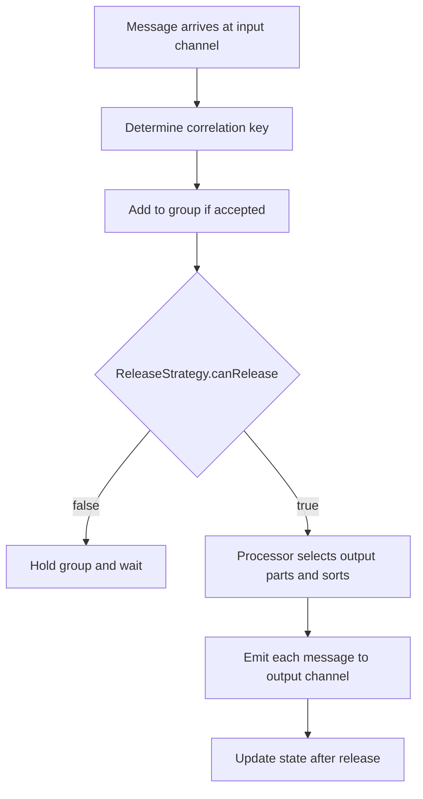

# Resequencer ReleaseStrategy

## 1. The problem: messages have arrived, but are they allowed to move forward yet?

In a document processing system, four pages of the same document are converted in parallel. Results may come back in order `3, 1, 4, 2`, whereas the document-writing step needs to receive `1, 2, 3, 4`.

A resequencer holds related messages in a group and releases them in order. `ReleaseStrategy` is the policy that answers the question: **given the current state of the group, is the resequencer allowed to perform a release now?**

Two business requirements lead to two different policies:

- **Wait for the complete document:** begin emitting only after all four pages have arrived.
- **Release valid parts early:** page 1 can proceed immediately; page 3 must still wait for page 2.

In the `SPRING_INTEGRATION_CORE` module, this topic connects `Message`, `MessageChannel`, endpoints, and Java DSL with a stateful Enterprise Integration Pattern. After this lesson, you will be able to choose a release condition, explain why a group is waiting, configure a custom policy, and design tests that observe both release timing and output order.

A resequencer emits individual messages; an aggregator typically combines them into a single result. Keep this distinction clear when designing downstream consumers. [Spring Integration: Resequencer](https://docs.spring.io/spring-integration/reference/resequencer.html).

## 2. Division of responsibilities during processing

### 2.1. The ReleaseStrategy contract

The interface resides in the `org.springframework.integration.aggregator` package, even though it is also used by the resequencer:

```java
public interface ReleaseStrategy {
    boolean canRelease(MessageGroup group);
}
```

This is a functional interface, so it can be implemented with a class, lambda, or method reference. The parameter is a **message group**, not solely the newly arrived message. Returning `true` permits entering the output processing step; it does not send messages by itself. [ReleaseStrategy Javadoc 6.3.2](https://docs.spring.io/spring-integration/docs/6.3.2/api/org/springframework/integration/aggregator/ReleaseStrategy.html).

| Component | Decision or work | Example in the document flow |
| --- | --- | --- |
| `CorrelationStrategy` | Which group the message belongs to | Same `documentId` and processing run |
| `MessageGroupStore` | Stores messages and group state | Holds page 3 while waiting for page 2 |
| `ReleaseStrategy` | Whether a release may occur | All four pages present, or next contiguous segment ready |
| `MessageGroupProcessor` | Selects and orders output parts | Picks contiguous pages by `sequenceNumber` |
| Endpoint and output channel | Forwards messages downstream | Sends each page to the document writer |

A strategy returning `true` does not mean every stored message must be emitted, nor that the entire group is finished.



### 2.2. canRelease is not a schedule

On the normal processing path, the handler evaluates the strategy after adding a message to the group. If `false`, the group continues waiting. Timeouts or a reaper are separate triggers; they are not created merely by putting a time expression inside the strategy.

For example, the following hypothetical Java expression **does not automatically wake the group after 10 seconds**:

```java
group -> System.currentTimeMillis() - group.getTimestamp() >= 10_000
```

Without a subsequent evaluation, the condition can become true by wall-clock time while the group remains idle. To act based on elapsed time, configure the corresponding timeout mechanism.

## 3. Headers underlying the release policy

For a finite sequence of `N` messages, the input contract should specify:

| Header | Meaning | Example value |
| --- | --- | --- |
| `IntegrationMessageHeaderAccessor.CORRELATION_ID` | Identifies a sequence | `document-42:attempt-1` |
| `IntegrationMessageHeaderAccessor.SEQUENCE_NUMBER` | Message position in the sequence, starting at 1 | `3` |
| `IntegrationMessageHeaderAccessor.SEQUENCE_SIZE` | Expected total number of messages | `4` |

Within a single sequence, valid positions are `1..N`, each position appears once, and messages declare the same `N`. Setting sequence number and size headers as `Integer` matches the header-accessor APIs in the examples below.

```java
import org.springframework.integration.IntegrationMessageHeaderAccessor;
import org.springframework.messaging.Message;
import org.springframework.messaging.support.MessageBuilder;

final class PageMessages {

    private PageMessages() {
    }

    static Message<String> page(String correlationId, int number, int size) {
        if (correlationId == null || correlationId.isBlank()
                || size <= 0 || number < 1 || number > size) {
            throw new IllegalArgumentException("Invalid finite page sequence");
        }

        return MessageBuilder.withPayload("page-" + number)
                .setHeader(IntegrationMessageHeaderAccessor.CORRELATION_ID,
                        correlationId)
                .setHeader(IntegrationMessageHeaderAccessor.SEQUENCE_NUMBER,
                        number)
                .setHeader(IntegrationMessageHeaderAccessor.SEQUENCE_SIZE,
                        size)
                .build();
    }
}
```

This example uses the default correlation header. If you switch the correlation strategy to another business header, ensure messages from the same processing run still group properly.

### 3.1. Knowing total count and knowing order are separate facts

A flow might know the next message carries number 18 without yet knowing the final total count. In that case:

- A full-sequence waiting policy has no valid `N` to determine completion.
- A contiguous-segment release policy can let data proceed whenever it connects to what has already been released.
- The system still needs a clear completion protocol, timeout, or group lifecycle to reclaim state.

Do not use `sequenceSize = 0` to mean “all received.” In this lesson, hands-on examples use finite sequences with a positive total count.

### 3.2. An upstream filter can introduce gaps

Suppose a splitter numbers four messages `1..4`, and then a filter drops message 2. The resequencer sees `1, 3, 4`:

- Full-sequence waiting: never reaches four messages.
- Contiguous-segment release: releases 1 and then waits for 2.

If dropping the item is valid business logic, redesign the protocol—for instance, filter before numbering, renumber the accepted sequence, or emit a meaningful placeholder event for the dropped position. Do not arbitrarily alter `sequenceSize` on a single message to unstick the group.

## 4. Full-sequence wait vs. contiguous-segment release

### 4.1. Full-sequence waiting policy

With data following the `1..N` contract, the basic condition is that the group message count reaches the expected total. At that point, the resequencer can release the sequence in order.

In the Spring Integration 6.3.2 implementation, the default configuration uses `SimpleSequenceSizeReleaseStrategy`. This strategy compares `group.size()` with `group.getSequenceSize()`, does not support partial release, and does not enable handler-level duplicate sequence number checks. Thus, simply counting enough messages does not prove the input data is valid. [SimpleSequenceSizeReleaseStrategy 6.3.2 source](https://github.com/spring-projects/spring-integration/blob/v6.3.2/spring-integration-core/src/main/java/org/springframework/integration/aggregator/SimpleSequenceSizeReleaseStrategy.java).

When you want to explicitly choose the sequence-aware strategy in the handler, you can use:

```java
new SequenceSizeReleaseStrategy(false)
```

The `false` argument indicates waiting for the full sequence. With matching sequence-aware configuration, the handler can reject duplicate sequence numbers in the group. This still must be paired with a valid header contract and an anomalous-message policy.

Example with `N = 4`, input `3, 1, 4, 2`:

| Newly arrived message | Numbers waiting before release | Output this step |
| --- | --- | --- |
| 3 | `{3}` | None yet |
| 1 | `{1, 3}` | None yet |
| 4 | `{1, 3, 4}` | None yet |
| 2 | `{1, 2, 3, 4}` | `1, 2, 3, 4` |

Suitable when the consumer should only start after all parts have arrived. However, releasing four messages at once still consists of multiple send operations; it does not automatically form an atomic transaction across all four consumer side effects.

### 4.2. Contiguous-segment release policy

`SequenceSizeReleaseStrategy(true)` allows releasing subsequent parts before the full sequence arrives. For a non-empty group, the strategy inspects the lowest waiting number and the last released number; it can release when those two values are consecutive. [SequenceSizeReleaseStrategy 6.3.2 source](https://github.com/spring-projects/spring-integration/blob/v6.3.2/spring-integration-core/src/main/java/org/springframework/integration/aggregator/SequenceSizeReleaseStrategy.java).

Let `L` be the last released number; initially `L = 0`. A valid release starts at `L + 1` and continues up to just before the first gap.

Still with `N = 4`, input `3, 1, 4, 2`:

| Newly arrived message | `L` before evaluation | Output this step | Numbers still waiting | `L` afterward |
| --- | --- | --- | --- | --- |
| 3 | 0 | None yet | `{3}` | 0 |
| 1 | 0 | `1` | `{3}` | 1 |
| 4 | 1 | None yet | `{3, 4}` | 1 |
| 2 | 1 | `2, 3, 4` | `{}` | 4 |

Consequences you can check directly from the table:

- `{3, 4}` are consecutive with each other, but they do not connect to the next required position, 2.
- When 2 arrives, the group emits three messages in a single release.
- Partial release reduces latency for 1, but does not cure a missing 2.
- A successful release does not necessarily end the sequence; state for already-released progress must continue to be maintained.

The default processor sorts by sequence number and takes the contiguous segment before the gap. Therefore, distinguish between the condition that permits a release and the selection of which messages are actually emitted. [ResequencingMessageGroupProcessor 6.3.2 source](https://github.com/spring-projects/spring-integration/blob/v6.3.2/spring-integration-core/src/main/java/org/springframework/integration/aggregator/ResequencingMessageGroupProcessor.java).

## 5. Java DSL configuration ready for hands-on practice

The example below uses the Spring Integration 6.x API, Java 17 or higher, and the `spring-integration-core` module. Implementation notes are verified against version 6.3.2. Use your application's dependency management to select compatible Spring versions.

The two flows have separate inputs and outputs so you can send the same sequence into both policies and compare. `DirectChannel` keeps message reception and resequencer processing synchronous in the example; `QueueChannel` holds outputs for observation.

```java
import org.springframework.context.annotation.Bean;
import org.springframework.context.annotation.Configuration;
import org.springframework.integration.aggregator.SequenceSizeReleaseStrategy;
import org.springframework.integration.channel.DirectChannel;
import org.springframework.integration.channel.QueueChannel;
import org.springframework.integration.config.EnableIntegration;
import org.springframework.integration.dsl.IntegrationFlow;

@Configuration
@EnableIntegration
public class ResequencerReleaseConfig {

    @Bean
    public DirectChannel fullInput() {
        return new DirectChannel();
    }

    @Bean
    public QueueChannel fullOutput() {
        return new QueueChannel();
    }

    @Bean
    public IntegrationFlow fullFlow() {
        return IntegrationFlow.from("fullInput")
                .resequence(r -> r.releaseStrategy(
                        new SequenceSizeReleaseStrategy(false)))
                .channel("fullOutput")
                .get();
    }

    @Bean
    public DirectChannel partialInput() {
        return new DirectChannel();
    }

    @Bean
    public QueueChannel partialOutput() {
        return new QueueChannel();
    }

    @Bean
    public IntegrationFlow partialFlow() {
        return IntegrationFlow.from("partialInput")
                .resequence(r -> r.releasePartialSequences(true))
                .channel("partialOutput")
                .get();
    }
}
```

Java DSL provides correlation and release configuration on the resequencer endpoint via a configuration lambda. [Spring Integration: Aggregators and Resequencers in Java DSL](https://docs.spring.io/spring-integration/reference/dsl/java-aggregators.html).

In `partialFlow`, `releasePartialSequences(true)` uses the built-in sequence mechanism. A way to declare the corresponding policy directly is:

```java
.resequence(r -> r.releaseStrategy(new SequenceSizeReleaseStrategy(true)))
```

Pick one style for readability. When using a custom strategy, configure `releaseStrategy(...)` directly and define its condition yourself. In 6.3.2, enabling `releasePartialSequences(true)` requires the strategy to be of type `SequenceSizeReleaseStrategy`; combining that flag with an arbitrary implementation can cause endpoint initialization to fail. [AbstractCorrelatingMessageHandler 6.3.2 source](https://github.com/spring-projects/spring-integration/blob/v6.3.2/spring-integration-core/src/main/java/org/springframework/integration/aggregator/AbstractCorrelatingMessageHandler.java).

### 5.1. Choosing a simple expression when the condition is truly simple

Java DSL provides `releaseExpression(...)`; the root object of the release expression is `MessageGroup`. However, the following expression only expresses counting:

```java
.resequence(r -> r.releaseExpression("size() == 4"))
```

It does not express “all positions `1, 2, 3, 4` are present.” For example, the set `{1, 2, 4, 5}` also has four elements. Using this expression as a policy for arbitrary sequences equates count with completeness. [CorrelationHandlerSpec Javadoc 6.3.2](https://docs.spring.io/spring-integration/docs/6.3.2/api/org/springframework/integration/dsl/CorrelationHandlerSpec.html).

## 6. Custom ReleaseStrategy: emit only a valid finite sequence

Suppose the system receives messages from a partner that does not guarantee consistent headers. The requirement is to release only when:

1. The group has a positive expected total.
2. The message count equals the expected total.
3. Every message declares the same total.
4. Sequence numbers are distinct and within `1..N`.

Under these four conditions, having `N` distinct numbers in the range `1..N` proves no position is missing. This is a **wait-for-full-sequence** policy, not intended for use after partial releases.

```java
import java.util.HashSet;
import java.util.Set;

import org.springframework.integration.IntegrationMessageHeaderAccessor;
import org.springframework.integration.aggregator.ReleaseStrategy;
import org.springframework.integration.store.MessageGroup;
import org.springframework.messaging.Message;

public final class StrictFullSequenceReleaseStrategy implements ReleaseStrategy {

    @Override
    public boolean canRelease(MessageGroup group) {
        if (group.size() == 0) {
            return false;
        }

        int expectedSize = group.getSequenceSize();
        if (expectedSize <= 0 || group.size() != expectedSize) {
            return false;
        }

        Set<Integer> positions = new HashSet<>();

        for (Message<?> message : group.getMessages()) {
            Integer number = message.getHeaders().get(
                    IntegrationMessageHeaderAccessor.SEQUENCE_NUMBER,
                    Integer.class);
            Integer declaredSize = message.getHeaders().get(
                    IntegrationMessageHeaderAccessor.SEQUENCE_SIZE,
                    Integer.class);

            if (number == null || declaredSize == null
                    || declaredSize != expectedSize
                    || number < 1 || number > expectedSize
                    || !positions.add(number)) {
                return false;
            }
        }

        return true;
    }
}
```

Attach it to a flow with:

```java
.resequence(r -> r.releaseStrategy(new StrictFullSequenceReleaseStrategy()))
```

This is an implementation built for this lesson, not a built-in Spring class. It only reads the group and returns a decision. The `getMessages()`, `getSequenceSize()`, and `size()` APIs belong to the `MessageGroup` model; `SimpleMessageGroup` is an implementation you can use to build test data. [SimpleMessageGroup Javadoc 6.3.2](https://docs.spring.io/spring-integration/docs/6.3.2/api/org/springframework/integration/store/SimpleMessageGroup.html).

### 6.1. Limits of validating inside the strategy

`false` means release is not permitted yet. It does not remove invalid messages, route data to a dead-letter flow, or repair the group.

For instance, if a group already holds `N` messages where two carry position 2, the strategy will keep holding the group. Without a timeout or invalid-data handling mechanism, the group can wait indefinitely.

Therefore, in a production design:

- Validate header types and value ranges before messages enter the resequencer.
- Detect duplicates by business identifier and define a clear policy for redeliveries.
- Use the strategy to decide readiness of a valid group.
- Use timeouts and a separate handling branch to resolve groups that cannot complete.

The class above holds no shared mutable state and does not mutate `MessageGroup`. Calling remote services, sending emails, performing business writes, or deleting messages inside `canRelease()` makes decisions non-repeatable and can extend the time the group lock is held.

## 7. Normal release and expiry handling

### 7.1. A group missing a message needs an exit path

If page 2 is permanently lost, waiting longer will never materialize that page. One policy for systems requiring strict ordering is to route incomplete data to a business error branch for reconciliation or replay requests.

The example below is an alternative to `fullFlow` above. Add the `resequenceDiscard` bean to the same configuration:

```java
@Bean
public QueueChannel resequenceDiscard() {
    return new QueueChannel();
}

@Bean
public IntegrationFlow fullFlow() {
    return IntegrationFlow.from("fullInput")
            .resequence(r -> r
                    .releaseStrategy(new SequenceSizeReleaseStrategy(false))
                    .groupTimeout(10_000)
                    .sendPartialResultOnExpiry(false)
                    .discardChannel("resequenceDiscard"))
            .channel("fullOutput")
            .get();
}
```

This is a replacement configuration—do not declare a second `fullFlow` bean with the same name in the same class. The queue on the discard branch is only for observation; an application needs a consumer to record and process that data.

| Mechanism | Purpose | What cannot be inferred |
| --- | --- | --- |
| `ReleaseStrategy` | Decides release based on group state | Does not create a scheduler on its own |
| `releasePartialSequences(true)` | Emits contiguous segments before the full sequence arrives | Does not allow skipping gaps |
| `groupTimeout(...)` | Triggers group handling after the configured wait duration | Does not supply missing messages |
| `sendPartialResultOnExpiry(false)` | When a group expires without meeting release conditions, routes held parts to the discard branch | Does not recall previously emitted messages |
| `sendPartialResultOnExpiry(true)` | Allows emitting incomplete output upon group expiry | Does not prove the business sequence is complete |
| `sendTimeout(...)` | Bounds waiting when sending to a channel that supports send timeouts | Not the timeout for waiting on a full group |

Do not equate “partial” in partial sequences with “partial result” on expiry. One enforces contiguity on the normal processing path; the other is an option for handling incomplete data when waiting time runs out. [Spring Integration: Resequencer configuration](https://docs.spring.io/spring-integration/reference/resequencer.html).

With a constant timeout value, the scheduled wait may be canceled and rescheduled when the group continues receiving messages. Therefore, do not interpret `groupTimeout(10_000)` as an absolute 10-second SLA measured from the first message. Clarify whether the timeout measures inactivity or an overall business deadline.

### 7.2. Discard is not the same as an exception

A message rejected by policy does not necessarily raise an exception. `discardChannel` is a dedicated handling path; do not expect every missing or duplicate data case to appear on `errorChannel`.

Conversely, if your custom strategy code throws an exception, that is a processing error. Whether the error reaches the caller or the error-handling infrastructure depends on the channel and synchronous vs. asynchronous execution boundaries.

In the `DirectChannel` example, inspect exceptions at the message send call. When switching to a channel executed on an executor, design the error-handling path for asynchronous tasks as well.

## 8. Tests must observe both release timing and order

A test that only compares the final list can miss whether the resequencer released too early. With partial release, prove both behaviors: it can release when a leading segment is valid, and it still holds messages behind a gap.

The tests below use JUnit Jupiter, the `ResequencerReleaseConfig` configuration, and the `PageMessages` helper shown earlier. Put the classes in the same package or adjust visibility accordingly in your practice project.

```java
import static org.junit.jupiter.api.Assertions.assertEquals;
import static org.junit.jupiter.api.Assertions.assertNotNull;
import static org.junit.jupiter.api.Assertions.assertNull;
import static org.junit.jupiter.api.Assertions.assertTrue;

import org.junit.jupiter.api.Test;
import org.springframework.context.annotation.AnnotationConfigApplicationContext;
import org.springframework.integration.channel.QueueChannel;
import org.springframework.messaging.Message;
import org.springframework.messaging.MessageChannel;

class ResequencerReleaseTest {

    @Test
    void fullSequenceWaitsUntilEveryPageArrives() {
        try (var context = new AnnotationConfigApplicationContext(
                ResequencerReleaseConfig.class)) {
            MessageChannel input = context.getBean("fullInput", MessageChannel.class);
            QueueChannel output = context.getBean("fullOutput", QueueChannel.class);

            send(input, "doc-full", 3, 4);
            send(input, "doc-full", 1, 4);
            send(input, "doc-full", 4, 4);
            assertNull(output.receive(0));

            send(input, "doc-full", 2, 4);
            assertPayloads(output, "page-1", "page-2", "page-3", "page-4");
            assertNull(output.receive(0));
        }
    }

    @Test
    void partialSequenceWaitsAtTheFirstGap() {
        try (var context = new AnnotationConfigApplicationContext(
                ResequencerReleaseConfig.class)) {
            MessageChannel input = context.getBean("partialInput", MessageChannel.class);
            QueueChannel output = context.getBean("partialOutput", QueueChannel.class);

            send(input, "doc-partial", 3, 4);
            assertNull(output.receive(0));

            send(input, "doc-partial", 1, 4);
            assertPayloads(output, "page-1");
            assertNull(output.receive(0));

            send(input, "doc-partial", 4, 4);
            assertNull(output.receive(0));

            send(input, "doc-partial", 2, 4);
            assertPayloads(output, "page-2", "page-3", "page-4");
            assertNull(output.receive(0));
        }
    }

    @Test
    void waitingDocumentDoesNotBlockAnotherCorrelationGroup() {
        try (var context = new AnnotationConfigApplicationContext(
                ResequencerReleaseConfig.class)) {
            MessageChannel input = context.getBean("partialInput", MessageChannel.class);
            QueueChannel output = context.getBean("partialOutput", QueueChannel.class);

            send(input, "doc-A", 2, 2);
            assertNull(output.receive(0));

            send(input, "doc-B", 1, 1);
            Message<?> fromB = output.receive(0);
            assertNotNull(fromB);
            assertEquals("doc-B", fromB.getHeaders().get("correlationId"));
            assertEquals("page-1", fromB.getPayload());

            send(input, "doc-A", 1, 2);
            assertPayloads(output, "page-1", "page-2");
            assertNull(output.receive(0));
        }
    }

    private static void send(MessageChannel input, String id, int number, int size) {
        assertTrue(input.send(PageMessages.page(id, number, size)));
    }

    private static void assertPayloads(QueueChannel output, String... expected) {
        for (String payload : expected) {
            Message<?> received = output.receive(0);
            assertNotNull(received);
            assertEquals(payload, received.getPayload());
        }
    }
}
```

`receive(0)` fits this fixture because sending to the resequencer uses a `DirectChannel` with no asynchronous steps. When switching to an executor, use bounded waits and proper test synchronization; an empty queue immediately after `send()` does not prove the message was held by the strategy.

### 8.1. Testing a custom strategy independently of the endpoint

The following snippet illustrates building a group and calling the policy directly. It tests the custom strategy's decision, not as a substitute for flow tests:

```java
import static org.junit.jupiter.api.Assertions.assertFalse;
import static org.junit.jupiter.api.Assertions.assertTrue;

import java.util.List;

import org.junit.jupiter.api.Test;
import org.springframework.integration.store.SimpleMessageGroup;

class StrictFullSequenceReleaseStrategyTest {

    @Test
    void acceptsCompletePositionsRegardlessOfArrivalOrder() {
        var group = new SimpleMessageGroup(List.of(
                PageMessages.page("valid", 3, 3),
                PageMessages.page("valid", 1, 3),
                PageMessages.page("valid", 2, 3)), "valid");

        assertTrue(new StrictFullSequenceReleaseStrategy().canRelease(group));
    }

    @Test
    void rejectsDuplicatePositionEvenWhenMessageCountMatches() {
        var group = new SimpleMessageGroup(List.of(
                PageMessages.page("duplicate", 1, 3),
                PageMessages.page("duplicate", 2, 3),
                PageMessages.page("duplicate", 2, 3)), "duplicate");

        assertFalse(new StrictFullSequenceReleaseStrategy().canRelease(group));
    }

    @Test
    void rejectsInconsistentDeclaredSizes() {
        var group = new SimpleMessageGroup(List.of(
                PageMessages.page("inconsistent", 1, 3),
                PageMessages.page("inconsistent", 2, 4),
                PageMessages.page("inconsistent", 3, 3)), "inconsistent");

        assertFalse(new StrictFullSequenceReleaseStrategy().canRelease(group));
    }
}
```

The two messages with the same position in the duplicate test are created separately, so they have distinct message IDs. This test intentionally simulates a business duplicate rather than resending the exact same object and relying on whether storage deduplicates it.

In real applications, add tests for missing leading positions, missing middle positions, group expiry, late-arriving messages, and replayed data after recovery. Those cases verify the protocol and state lifecycle, not just the sorting algorithm.

## 9. Constraints to factor into flow design

### 9.1. Within what scope is order guaranteed?

The resequencer orders within each correlation group. If document A is missing page 2, that creates no business requirement to hold document B which is already complete.

The order in which messages reach the output channel also differs from the order in which consumer side effects complete. If the consumer continues processing in parallel, page 3 can finish writing before page 2. When business logic requires ordered side effects, preserve appropriate per-document-key consumption in downstream steps.

### 9.2. Synchronous gateways can prevent producers from completing a sequence

A request-reply gateway may wait for output while the resequencer is holding the group. If the caller sends page 3 and blocks waiting for a reply before sending pages 1, 2, and 4, the caller itself prevents the sequence from completing.

For multi-message aggregation/resequencing workflows, design sending so it does not depend on per-part replies, or separate data submission from fetching the final result. A gateway timeout does not mean the group in the resequencer has expired.

### 9.3. A successful release does not replace idempotency

An application may resend a page after a network error or restart. Duplicate-handling rules within a single group are not equivalent to end-to-end exactly-once guarantees.

Identify business items using fields such as `(documentId, processingAttempt, pageNumber)`, and decide whether a redelivery is ignored, replaces prior data, or goes to reconciliation. Do not assume a new `MessageHeaders.ID` implies a new business page.

### 9.4. Group state must have a lifecycle

With partial release, the handler updates the already-released sequence state and removes processed messages from the waiting set. With expired groups, retaining or deleting metadata affects how late-arriving messages are handled. Do not directly delete store entries to “free memory” while bypassing the lifecycle protocol. [ResequencingMessageHandler 6.3.2 source](https://github.com/spring-projects/spring-integration/blob/v6.3.2/spring-integration-core/src/main/java/org/springframework/integration/aggregator/ResequencingMessageHandler.java).

Operationally, monitor at least waiting group count, stored message count, group age, and discard counts. Logging the correlation key alongside the first gap helps distinguish a valid waiting group from a sequence that can never finish.

If recovery across restarts or multi-instance processing on the same group is required, design the message store, locking mechanism, and correlation-key partitioning together. A pure custom strategy function does not solve cross-instance coordination by itself.

## 10. Choosing a policy and quick diagnosis

| Need or symptom | Reasoning | Remediation |
| --- | --- | --- |
| Consumer starts only after all parts arrive | Needs a finite-sequence completion condition | Full-sequence policy and header protocol validation |
| Want lower latency while keeping contiguous positions | Need to emit segments connecting to already-released parts | `releasePartialSequences(true)` |
| Have `{3, 4}` but no output yet | Still waiting for position 1 or 2 depending on history | Check last released number and the next gap |
| Message count matches but sequence is invalid | Count does not prove valid positions | Check duplicates, value range, and consistent totals |
| Bad message stalls the group forever | `false` is not a data-rejection action | Validate before the resequencer and configure timeout/discard |
| Strategy checks group age but does not fire when due | Missing evaluation trigger | Configure an appropriate group timeout or reaper |
| Output order is right but written results are out of order | Downstream step runs in parallel | Check consumption model and per-key side-effect order |
| Memory grows when messages are missing | Groups hold state for too long | Monitor group age, resolve gaps, and purge state by lifecycle |

When building a new flow, write down the trio clearly: **how groups are formed, the release eligibility condition, and how uncompletable groups are handled**. Then use out-of-order inputs to verify both when outputs appear and in what order messages are emitted.
