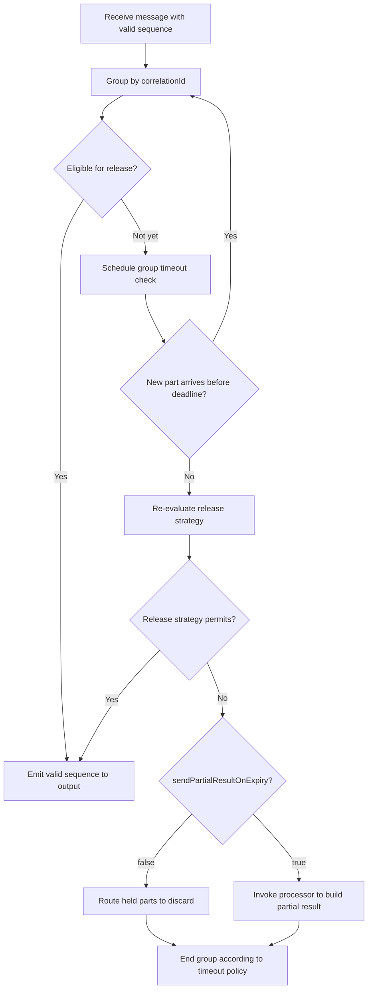

# Timeout on Missing Sequences

In a parallel processing flow, parts of the same task can finish out of order. A resequencer holds `Message` instances belonging to the same group and releases them by sequence number. A problem arises when one part never arrives: the parts already present continue occupying memory, while the receiver could wait forever.

This lesson in the **Resequencer** chapter of **SPRING_INTEGRATION_CORE** focuses on bounding wait times, choosing output behavior when parts are missing, and controlling late-arriving messages. The examples connect `Message`, `MessageChannel`, endpoints, and Java DSL to a practical integration scenario. Detailed descriptions of the default processor's behavior are verified against the **Spring Integration 6.5.10** source code; that version is a reference baseline for the examples, not a requirement to upgrade your project.

## 1. What does a missing sequence mean?

Suppose a report export service splits a report into four parts. Each part is processed independently and sent to the resequencer with these headers:

| Header | Example value | Role in the flow |
| --- | --- | --- |
| `IntegrationMessageHeaderAccessor.CORRELATION_ID` | `report-42:attempt-1` | Identifies the group for a single report processing run |
| `IntegrationMessageHeaderAccessor.SEQUENCE_NUMBER` | `3` | Position of the part within the group, starting at `1` |
| `IntegrationMessageHeaderAccessor.SEQUENCE_SIZE` | `4` | Expected total number of parts |

If the arrival order is `3 → 1 → 4`, the group is missing part `2`. While waiting for the full group, the resequencer cannot emit the normal result yet. Receiving part `4`, even though it is the highest sequence number, does not prove that every preceding part has arrived.

The resequencer orders messages based on group metadata; it does not call back to the source to fetch a missing part. The grouping and ordering mechanism is described in the [Resequencer documentation](https://docs.spring.io/spring-integration/reference/resequencer.html).

Distinguish between two kinds of input errors:

- **A missing message in a valid sequence:** the existing parts carry valid headers, but part `2` was lost or delayed excessively. A timeout is one way to bound waiting.
- **Missing or malformed headers:** a message lacks a correlation key, has a sequence number of the wrong type, or declares inconsistent sequence sizes. Validate the data contract at the input boundary; increasing the timeout will not fix metadata.

In this lesson, all examples assume finite-sized groups, valid headers, and that each sequence number represents exactly one business part.

## 2. Timeout is a decision to stop waiting

For a report that requires completeness, a three-second wait time may pair with a business rule: if parts are still missing after the wait period, mark the report export attempt as failed, persist the received parts for investigation, and allow starting a new processing run.

For a preview screen, the business may accept partial data, provided the UI clearly indicates the report is incomplete. The same timeout can drive two very different behaviors; define the policy before choosing a number.



This is a conceptual diagram for an incomplete group. **A timeout does not synthesize a replacement message for a missing part, and it does not prove the task succeeded.** The application must still record success, incomplete data, or failure status according to its requirements.

## 3. Which clock is running?

### 3.1. `groupTimeout` is the wait period while the group has not released

With `groupTimeout(3000L)`, an unreleased group is scheduled to be forced to completion after a three-second wait. When a new message arrives for the group and the group still has not released, the old schedule is replaced with a new one.

For example, with full-group waiting enabled and assuming no scheduler lag:

| Relative time | Event | Expected timeout time |
| --- | --- | --- |
| `0 ms` | Receive part `3/4` | Around `3000 ms` |
| `800 ms` | Receive part `1/4` | Around `3800 ms` |
| `1700 ms` | Receive part `4/4` | Around `4700 ms` |
| No further parts arrive | Still missing `2/4` | Timeout executes around `4700 ms` |

Measured from the first part, the group has existed for roughly 4.7 seconds. Therefore, do not interpret `3000` as “the task always finishes within three seconds of the first message.” The unit of `groupTimeout(long)` is milliseconds; the scheduling mechanism is explained in [Aggregator and Group Timeout](https://docs.spring.io/spring-integration/reference/aggregator.html#agg-group-timeout).

When the timeout task actually runs is also affected by scheduler load, group locking, and downstream send duration. A timeout configuration is not a hard real-time guarantee.

### 3.2. Deadline measured from group creation

If the report contract requires bounding total elapsed time, replace the fixed timeout with an expression returning a `Date`:

```java
.resequence(r -> r
        .groupTimeoutExpression("new java.util.Date(timestamp + 10000)")
        .releasePartialSequences(false)
        .sendPartialResultOnExpiry(false)
        .discardChannel("expiredSequence"))
```

Here `timestamp` is the `MessageGroup` creation time, not the `timestamp` header of any individual part. Each re-evaluation yields the same deadline for that group. This calculation is useful when an incomplete group should wait at most roughly ten seconds from the moment it was created.

This is still a local group deadline. If the limit must be measured from when the user requested the report, persist the business deadline upfront and design the flow around that deadline. Group creation time may be later than request receipt time.

`groupTimeout(...)` and `groupTimeoutExpression(...)` are two ways to configure the same scheduling decision; choose one for the endpoint. A function or expression form can yield different durations per group; see [CorrelationHandlerSpec](https://github.com/spring-projects/spring-integration/blob/v6.5.10/spring-integration-core/src/main/java/org/springframework/integration/dsl/CorrelationHandlerSpec.java).

### 3.3. Other timeouts do not replace the group timeout

| Configuration | What it bounds | Usage in the report scenario |
| --- | --- | --- |
| `groupTimeout` | Waiting for an unreleased group | Handles a part that never arrives |
| `sendTimeout` | Waiting to send to a capacity-bounded channel | Prevents indefinite blocking when a destination queue is full |
| Gateway reply receive timeout | Time the caller waits for a response | Lets the caller exit waiting per the API contract |
| External service call timeout | Time an I/O call is allowed to wait | Bounds a worker fetching data for one part |

A caller's reply timeout expiring does not mean the group has been cleaned up. Similarly, setting `sendTimeout` does not create a wait deadline for part `2/4`.

## 4. Three options to keep distinct

### 4.1. `releasePartialSequences`: early release during normal operation

With `releasePartialSequences(false)`, the example in this lesson waits for the full group before emitting.

With `releasePartialSequences(true)`, the default strategy allows releasing the next contiguous segment without waiting for the entire group. For instance, when part `1` arrives it is emitted; part `3` must wait for part `2` to continue the normal sequence. The condition involving the last released number is implemented in [SequenceSizeReleaseStrategy](https://github.com/spring-projects/spring-integration/blob/v6.5.10/spring-integration-core/src/main/java/org/springframework/integration/aggregator/SequenceSizeReleaseStrategy.java).

This option governs early emission timing. It does not set up a timer by itself. If business rules require “either the complete report or emit nothing,” early release is an unsuitable choice: a subsequent timeout cannot recall parts already emitted.

### 4.2. `sendPartialResultOnExpiry`: handling held data upon expiry

When the timeout fires, the framework re-evaluates the release strategy. If the strategy still does not permit release, `sendPartialResultOnExpiry(false)` routes held parts to the configured discard channel; setting `true` invokes the processor to produce a partial output. This branch can be inspected in [AbstractCorrelatingMessageHandler](https://github.com/spring-projects/spring-integration/blob/v6.5.10/spring-integration-core/src/main/java/org/springframework/integration/aggregator/AbstractCorrelatingMessageHandler.java).

**Do not infer that `true` always emits all held parts.** In Spring Integration 6.5.10, the default `ResequencingMessageGroupProcessor` sorts parts and takes the contiguous segment starting from the lowest sequence number present, stopping at the next gap. That is the processor's behavior, shown in the [ResequencingMessageGroupProcessor source code](https://github.com/spring-projects/spring-integration/blob/v6.5.10/spring-integration-core/src/main/java/org/springframework/integration/aggregator/ResequencingMessageGroupProcessor.java).

Concrete examples when early release has not occurred:

| Parts held upon expiry | `sendPartialResultOnExpiry(false)` | `sendPartialResultOnExpiry(true)` with default 6.5.10 processor |
| --- | --- | --- |
| `1, 3, 4` | Routes `1, 3, 4` to discard | Emits `1`; does not automatically emit `3, 4` |
| `2, 3, 4` | Routes `2, 3, 4` to discard | Can emit `2, 3, 4` even though leading part `1` is missing |
| `1, 2, 4` | Routes `1, 2, 4` to discard | Emits `1, 2`; does not automatically emit `4` |

With `expireGroupsUponTimeout(false)` in the example, after timeout processing finishes, the group is closed and held data is cleared. **Parts excluded from the partial result are not automatically forwarded to discard just because they did not appear on output.** If every part must be preserved for reconciliation, use a persisted discard policy rather than merely turning on partial-result emission on expiry.

If early release is already enabled, the situation differs: part `1` may already have gone to output, while the group holds only `3, 4`. When sending a partial result on expiry, the available segment may be `3, 4`; overall output now has a gap at `2`. Therefore, document both the partial-release policy and the expiry policy in the downstream contract.

### 4.3. `expireGroupsUponTimeout`: keep remembering closed groups or not?

The two settings behave differently if part `2` arrives late:

| Value | State after timeout | Consequence when a late part arrives with the same correlation key |
| --- | --- | --- |
| `false` | Retains closed-group metadata | Late part is discarded while metadata still exists |
| `true` | Deletes the group | Late part can open a new group, which then misses the other parts |

The resequencer defaults to retaining metadata on timeout. The example below still sets it explicitly so readers see the choice; see [ResequencingMessageHandler](https://github.com/spring-projects/spring-integration/blob/v6.5.10/spring-integration-core/src/main/java/org/springframework/integration/aggregator/ResequencingMessageHandler.java).

Retaining metadata requires a cleanup plan after an appropriate retention window. Purging too early loses late-part detection; keeping it forever lets closed-group records grow unboundedly. Choose the retention period based on the system's redelivery and reconciliation window.

Do not reuse a fixed correlation key for every re-export of the same report. For example, `report-42:attempt-2` expresses a new processing run much more clearly than resending parts into the closed `report-42:attempt-1` group.

## 5. Java DSL configuration: route missing-part groups to discard

Choose the policy for the example:

- Wait for all four parts before exporting the report.
- If the group is incomplete and no new part arrives for two seconds, route received parts to `expiredSequence`.
- Retain metadata after timeout so late-arriving parts go to the same business-exception channel.

The example uses `spring-integration-core`. The test section below also uses JUnit Jupiter and Spring Context. If your project already uses the Spring Boot BOM, rely on the managed versions rather than copying an isolated library version.

```java
import org.springframework.beans.factory.annotation.Qualifier;
import org.springframework.context.annotation.Bean;
import org.springframework.context.annotation.Configuration;
import org.springframework.integration.channel.DirectChannel;
import org.springframework.integration.channel.QueueChannel;
import org.springframework.integration.config.EnableIntegration;
import org.springframework.integration.dsl.IntegrationFlow;
import org.springframework.integration.store.MessageGroupStore;
import org.springframework.integration.store.SimpleMessageStore;
import org.springframework.messaging.MessageChannel;

@Configuration(proxyBeanMethods = false)
@EnableIntegration
public class ResequencerTimeoutConfiguration {

    @Bean
    public MessageChannel resequenceInput() {
        return new DirectChannel();
    }

    @Bean
    public QueueChannel orderedOutput() {
        return new QueueChannel();
    }

    @Bean
    public QueueChannel expiredSequence() {
        return new QueueChannel();
    }

    @Bean
    public MessageGroupStore resequencerStore() {
        return new SimpleMessageStore();
    }

    @Bean
    public IntegrationFlow resequencerTimeoutFlow(
            @Qualifier("resequenceInput") MessageChannel input,
            @Qualifier("orderedOutput") QueueChannel output,
            @Qualifier("expiredSequence") QueueChannel discard,
            @Qualifier("resequencerStore") MessageGroupStore store) {

        return IntegrationFlow.from(input)
                .resequence(r -> r
                        .id("reportResequencer")
                        .messageStore(store)
                        .releasePartialSequences(false)
                        .groupTimeout(2000L)
                        .sendPartialResultOnExpiry(false)
                        .discardIndividuallyOnExpiry(true)
                        .expireGroupsUponTimeout(false)
                        .discardChannel(discard))
                .channel(output)
                .get();
    }
}
```

`@EnableIntegration` provides the integration infrastructure, including the default scheduler used by the endpoint for scheduling timeouts. Java DSL builds the resequencer endpoint and wires the channels; the `.resequence(...)` configuration pattern is documented in [Aggregators and Resequencers with Java DSL](https://docs.spring.io/spring-integration/reference/dsl/java-aggregators.html).

Key points to understand when using this configuration:

1. `DirectChannel` delivers messages to the handler on the calling thread. The handler accepting and storing a part does not mean the group is complete.
2. `orderedOutput` receives each `Message` in order once the group completes; payloads do not automatically merge into a combined report. Place an aggregator or report-building service downstream if a combined result is needed.
3. `expiredSequence` in the example is a queue so tests can inspect it. In a real application, a consumer must persist those messages, update status, and trigger follow-up handling.
4. `discardIndividuallyOnExpiry(true)` clarifies that expired parts are sent to discard one message at a time. This API was added in the 6.5 line; do not copy this option into older projects without checking API availability.
5. `SimpleMessageStore` keeps data in memory. This example does not provide recovery after a process stops.

Unbounded queues in the lesson make behavior easy to observe. In production, queue capacities, durable storage, and backpressure must be sized for expected load.

## 6. Creating messages that match the contract

A sample factory method shared across tests:

```java
import org.springframework.integration.IntegrationMessageHeaderAccessor;
import org.springframework.messaging.Message;
import org.springframework.messaging.support.MessageBuilder;

static Message<String> part(String correlationId, int number, int size) {
    if (number < 1 || size < 1 || number > size) {
        throw new IllegalArgumentException("Invalid sequence coordinates");
    }

    return MessageBuilder.withPayload("part-" + number)
            .setHeader(IntegrationMessageHeaderAccessor.CORRELATION_ID,
                    correlationId)
            .setHeader(IntegrationMessageHeaderAccessor.SEQUENCE_NUMBER,
                    number)
            .setHeader(IntegrationMessageHeaderAccessor.SEQUENCE_SIZE,
                    size)
            .build();
}
```

The example sends `part("report-42:attempt-1", 3, 4)`, then part `1`, and part `4`. Part `2` is never sent. After the timeout, the three held parts go to discard; nothing is sent to `orderedOutput` under section 5's configuration.

In flows using a splitter, sequence metadata is usually generated by the splitter. When messages cross transformers, routers, or brokers, preserve the required headers or map them back at system boundaries. Avoid generating a fresh random correlation key per part: four parts would become four separate groups.

A filter dropping part `2` after the group has been numbered also creates a gap. If dropping a part is valid business logic, redesign the sequence contract rather than treating timeout as a workaround for numbering that no longer matches actual data.

## 7. Testing timeout behavior using channels

Place the test template below in the same package as the configuration class in section 5. The `part` helper is included in the test class so the snippet is self-contained. This is a learning test example; reading the lesson does not substitute for running tests in your project with your actual dependencies.

```java
import java.util.HashSet;
import java.util.Set;

import org.junit.jupiter.api.Test;
import org.springframework.context.annotation.AnnotationConfigApplicationContext;
import org.springframework.integration.IntegrationMessageHeaderAccessor;
import org.springframework.integration.channel.QueueChannel;
import org.springframework.messaging.Message;
import org.springframework.messaging.MessageChannel;
import org.springframework.messaging.support.MessageBuilder;

import static org.junit.jupiter.api.Assertions.*;

class ResequencerTimeoutTest {

    @Test
    void missingPartGoesToDiscardAndLatePartIsRejected() {
        try (var context = new AnnotationConfigApplicationContext(
                ResequencerTimeoutConfiguration.class)) {
            var input = context.getBean("resequenceInput", MessageChannel.class);
            var output = context.getBean("orderedOutput", QueueChannel.class);
            var discard = context.getBean("expiredSequence", QueueChannel.class);

            input.send(part("report-A:attempt-1", 3, 4));
            input.send(part("report-A:attempt-1", 1, 4));
            input.send(part("report-A:attempt-1", 4, 4));

            assertNull(output.receive(0));

            Set<Integer> discardedNumbers = new HashSet<>();
            for (int i = 0; i < 3; i++) {
                Message<?> message = discard.receive(10000);
                assertNotNull(message, "Expected a timed-out part");
                assertEquals("report-A:attempt-1", message.getHeaders().get(
                        IntegrationMessageHeaderAccessor.CORRELATION_ID));
                discardedNumbers.add(message.getHeaders().get(
                        IntegrationMessageHeaderAccessor.SEQUENCE_NUMBER,
                        Integer.class));
            }
            assertEquals(Set.of(1, 3, 4), discardedNumbers);
            assertNull(output.receive(0));

            input.send(part("report-A:attempt-1", 2, 4));

            Message<?> late = discard.receive(1000);
            assertNotNull(late, "Expected the late part on discard");
            assertEquals(2, late.getHeaders().get(
                    IntegrationMessageHeaderAccessor.SEQUENCE_NUMBER));
            assertNull(output.receive(0));
        }
    }

    @Test
    void completeSequenceIsReleasedInOrder() {
        try (var context = new AnnotationConfigApplicationContext(
                ResequencerTimeoutConfiguration.class)) {
            var input = context.getBean("resequenceInput", MessageChannel.class);
            var output = context.getBean("orderedOutput", QueueChannel.class);
            var discard = context.getBean("expiredSequence", QueueChannel.class);

            input.send(part("report-B:attempt-1", 4, 4));
            input.send(part("report-B:attempt-1", 2, 4));
            input.send(part("report-B:attempt-1", 1, 4));
            input.send(part("report-B:attempt-1", 3, 4));

            for (int expected = 1; expected <= 4; expected++) {
                Message<?> message = output.receive(1000);
                assertNotNull(message);
                assertEquals(expected, message.getHeaders().get(
                        IntegrationMessageHeaderAccessor.SEQUENCE_NUMBER));
            }
            assertNull(output.receive(0));
            assertNull(discard.receive(0));
        }
    }

    private static Message<String> part(String id, int number, int size) {
        return MessageBuilder.withPayload("part-" + number)
                .setHeader(IntegrationMessageHeaderAccessor.CORRELATION_ID, id)
                .setHeader(IntegrationMessageHeaderAccessor.SEQUENCE_NUMBER,
                        number)
                .setHeader(IntegrationMessageHeaderAccessor.SEQUENCE_SIZE, size)
                .build();
    }
}
```

The timeout test awaits receives with a margin wider than the configured timeout. Do not call `Thread.sleep(2000)` and assume the scheduler ran on that exact millisecond. A `Set` of sequence numbers is used for discard because iteration order of discarded parts is not part of the resequencer output contract.

Before deploying to production, expand the test matrix based on application risk:

| Scenario | What to verify |
| --- | --- |
| Missing leading part | No complete report is erroneously emitted |
| Missing middle part | Parts after the gap are handled according to policy |
| Missing trailing part | Receiving early parts is not mistaken for completion |
| Two correlation keys interleaved | One group timing out does not corrupt the completed group |
| New part arrives before timeout | Fixed wait duration resets while the group remains unreleased |
| Using deadline from group creation | New parts do not push the business deadline further out |
| Partial results enabled on expiry | Output matches exact processor behavior on the version in use |
| Late part arrives after metadata cleanup | New-group creation behavior is controlled and observed |

When testing rescheduling behavior itself, use a controllable scheduler in the test fixture to avoid depending on CI machine timing. In real integration tests, allow scheduling jitter and assert meaningful events rather than exact millisecond timestamps.

## 8. Discards, technical errors, and notifying the caller of failure

Timing out due to a missing part is an expected branch. With section 5's configuration, this branch outputs the original messages onto `expiredSequence`; those are not automatically `ErrorMessage` instances on `errorChannel`.

A discard-handling flow can:

1. Persist the original part along with correlation key, sequence number, and receipt timestamp.
2. Transition the report run status to `TIMED_OUT` idempotently.
3. Once enough diagnostic data is stored, decide whether to rerun the whole job or request the missing part from the source under a dedicated protocol.

Because each part can produce a discard message, do not send three “report failed” alerts simply because three parts were held. Use the processing run's business key to aggregate or deduplicate state transitions.

If persisting the discard or sending output throws an exception inside the scheduler task, that is a separate technical error. Configure error handling on the scheduler; when using a custom scheduler and wanting `ErrorMessage` publication, configure an appropriate `MessagePublishingErrorHandler`. The distinction between calling-thread errors and asynchronous errors is explained in [Error Handling](https://docs.spring.io/spring-integration/reference/error-handling.html).

For a gateway awaiting a response, do not simply set the reply timeout longer than the group timeout and assume the caller will learn why it failed. Provide a branch that translates timeout outcomes into a response or business status the caller can read. For long-running tasks, an API that returns a job ID and supports status polling is usually clearer than a single call blocking for the entire duration.

## 9. Storage, restarts, and observability

### 9.1. Process memory vs. persistent storage

With the in-memory example, stopping the process loses both waiting parts and group metadata. If that data loss is unacceptable, use a persistent `MessageGroupStore` suited to your environment.

Persisting parts does not mean timers from the previous process are restored verbatim. Restart design must handle leftover groups: scan with a scheduled `MessageGroupStoreReaper` or use the endpoint's orphaned-group handling mechanism. Clearly assign responsibility for expiration so two mechanisms with different deadlines do not inadvertently act on the same group.

When multiple instances can operate on the same group, pair the message store with a compatible group-locking mechanism; an in-memory lock inside each process cannot coordinate across instances. Isolate stores by endpoint or namespace so group cleanup for one endpoint does not affect groups of another endpoint.

### 9.2. Metadata cleanup and duplicate handling

After a timeout, metadata serves to remember that the group is closed. Define a retention duration and cleanup mechanism, such as a reaper configured for empty groups. Do not treat `groupTimeout` as a global cleanup policy for all data in the application.

Distinguish timeout termination from normal full-sequence completion. Do not assume the resequencer always retains a closed record for every completed group; the processor may remove the group once the entire sequence is released. Long-term business deduplication requires dedicated idempotency.

Additionally, when partial release is enabled and all currently available parts have been emitted, the group may hold zero parts for a timeout to process. Overall task deadlines and report-status closure must still be governed by the business contract.

### 9.3. Data to observe

A dashboard for the report flow can track:

| Metric or event | Question it helps answer |
| --- | --- |
| Waiting group count and oldest group age | Is the flow holding many unfinished jobs? |
| Timed-out groups per endpoint | Did the incomplete-part rate rise after a recent change? |
| Discarded parts and late parts count | Is the root cause lost parts or upstream latency? |
| Scheduler delay and channel send errors | Are timers firing late due to downstream overload? |
| Retained closed-group metadata count | Is the cleanup policy working? |

The framework provides `MessageGroupExpiredEvent` so applications can observe relevant expiration branches. You can use the event's `groupId`, `messageCount`, and `discarded` flag; its definition is in [MessageGroupExpiredEvent](https://github.com/spring-projects/spring-integration/blob/v6.5.10/spring-integration-core/src/main/java/org/springframework/integration/aggregator/MessageGroupExpiredEvent.java). Do not interpret the part count in the event as a list of missing sequence numbers: compare observed metadata against the expected sequence set.

Avoid using the correlation key as an unbounded-cardinality metric label. Include it in logs or traces for per-job troubleshooting; use endpoint name and outcome type as aggregated metric labels.

## 10. Practice exercises

### Exercise 1: Choosing policies for two report types

An accounting report must have all parts; a preview screen may show incomplete data. For each type, describe:

- Is partial segment release allowed?
- On timeout, where do held parts go and what status does the user see?
- Is a late-arriving part saved, ignored, or used for a new report build?

For the accounting report, waiting for the full group and persisting discards is a sound starting point. For the preview screen, enable partial sending only after confirming exactly which parts the processor will emit and how incomplete data will be presented.

### Exercise 2: Predicting output

A group has `sequenceSize = 5`, receives `1, 2, 4, 5`, waits for the full group, and then times out.

With section 5's configuration, there is no normal output and four parts go to discard. If you only switch to `sendPartialResultOnExpiry(true)` with the default 6.5.10 processor, output is produced from segment `1, 2`; do not assume `4, 5` will also reach output.

### Exercise 3: Recovering a failed run

Group `report-C:attempt-1` has timed out. The source resends all five parts. Design a plan so data from the old run does not mix with the new run, status updates do not repeat, and every persisted part traces back to the exact run.

One approach is to create `report-C:attempt-2`, explicitly record its relationship to the previous run, and apply idempotency keyed by run and part number. Merely replaying one missing part into a closed group will not recover the report on its own.

## 11. Key takeaways

- Decide whether the timeout measures inactivity since the latest event or a deadline for the entire task.
- Distinguish emitting contiguous segments while waiting from sending partial results upon expiry.
- If incomplete reports are unacceptable, wait for the full group and route timed-out data to an explicit storage and reconciliation branch.
- Manage closed-group metadata to handle late parts and prevent unintended correlation key reuse.
- Test output, discard, and task state together; a single successful message send does not prove the integration process completed.
