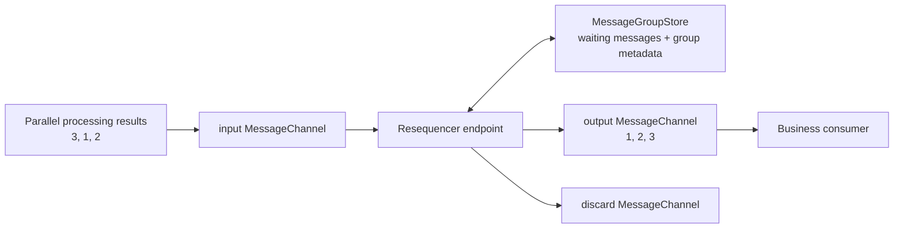

# MessageGroupStore for Resequencer

## 1. Why does a resequencer need a place to hold state?

An invoice processing flow can split work into three parts, process them in parallel, and receive results in the order `3 → 1 → 2`. However, the downstream consumer requires `1 → 2 → 3`. The resequencer must hold early-arriving parts, identify parts belonging to the same processing run, and decide when they may be emitted.

`MessageGroupStore` is the component that manages group state for that job. It stores waiting messages and group metadata; the resequencer uses this state to make decisions as new messages arrive. The storage layer and the message-release algorithm are two distinct responsibilities.

Within the scope of Spring Integration Core, this lesson connects `Message`, `MessageChannel`, the resequencer endpoint, and Java DSL to answer these questions:

- How are message groups identified and stored?
- What additional state must be preserved when releasing a sequence partially?
- When should an in-memory store or JDBC store be used?
- How should restarts, timeouts, and multiple instances receiving messages concurrently be handled?
- What should be tested to verify that state is preserved?

The examples use the **Spring Integration 6.5.x** API and Java 17 or higher. Dependency versions should follow your project's BOM; this lesson does not assume this is the latest release.

## 2. Where the store sits in the message flow



In the resequencer model, correlation identifies messages in the same group; sequence numbers determine emission order. By default, the framework uses the corresponding headers `CORRELATION_ID`, `SEQUENCE_NUMBER`, and `SEQUENCE_SIZE`. The default store resides in memory. [Resequencer documentation](https://docs.spring.io/spring-integration/reference/6.5/resequencer.html)

| Component | Responsibility in the example |
|---|---|
| `Message<?>` | Carries one part's result and sequence-identifying headers |
| Input `MessageChannel` | Delivers each result to the endpoint |
| `CorrelationStrategy` | Resolves the group ID from a message |
| `MessageGroupStore` | Stores, retrieves, updates, and cleans up group state |
| `ReleaseStrategy` | Decides whether the group meets the condition to emit |
| Resequencer | Coordinates components to emit messages in sequence order |
| Output channel | Forwards ordered messages to the next step |
| Discard channel | Receives messages rejected by endpoint policy |

**The store does not automatically sort messages in business order.** Database retrieval order, collection insertion order, or record timestamps do not replace `SEQUENCE_NUMBER`.

A queue-backed channel holds messages waiting for a consumer to pull them. A group store holds messages waiting for an endpoint's correlation and release conditions. Therefore, replacing the input channel with a persistent queue does not substitute for configuring a persistent store on the resequencer.

### 2.1. Headers to standardize before storing groups

Consider a processing run keyed by `invoice:ACME:INV-042:run-01`:

| Header | Example value | What must be consistent |
|---|---|---|
| `CORRELATION_ID` | `invoice:ACME:INV-042:run-01` | Parts of the same sequence must share the same key |
| `SEQUENCE_NUMBER` | `1`, `2`, `3` | Integers starting from 1 per this example's contract |
| `SEQUENCE_SIZE` | `3` | Total part count must be consistent within the group |

Key design must distinguish tenant, business entity, and **processing run**. Using only `INV-042` can mix messages from two tenants or two reruns of the same invoice.

Upstream transformers must preserve these headers or reconstruct a consistent set of headers. If a filter drops part 2 without an appropriate compensating or termination policy, the resequencer may hold part 3 until timeout. Even a store that persists data accurately cannot repair a broken sequence.

## 3. What does MessageGroupStore store and provide?

### 3.1. Waiting messages and group metadata

At the contract level, distinguish:

1. **Waiting messages:** payloads and headers needed for downstream processing.
2. **Group identity:** the key produced by the correlation strategy.
3. **Lifecycle status:** whether the group is still active or marked complete.
4. **Timestamps:** creation time and last-modified time.
5. **Sequence progress:** the most recently released sequence number when the endpoint releases partially.

`MessageGroup` exposes methods such as `getGroupId()`, `getMessages()`, `getTimestamp()`, `getLastModified()`, `isComplete()`, and `getLastReleasedMessageSequenceNumber()`. These methods express the state model; they do not imply each value maps to a separate column in every store implementation. [MessageGroup API](https://docs.spring.io/spring-integration/api/org/springframework/integration/store/MessageGroup.html)

`SEQUENCE_SIZE` typically travels on messages as a header. Do not assume every store persists it as an independent metadata field. Once all payloads have been released, remaining group state may still be needed for endpoint policy.

### 3.2. Common operations

The following table lists selected operations, not the full interface declaration:

| API | Meaning |
|---|---|
| `getMessageGroup(groupId)` | Read the state of a group |
| `addMessageToGroup(groupId, message)` | Attach a message to a group |
| `getMessagesForGroup(groupId)` | Read messages still in the group |
| `messageGroupSize(groupId)` | Get the count of messages held in the group |
| `setLastReleasedSequenceNumberForGroup(groupId, n)` | Persist sequence release progress |
| `removeMessagesFromGroup(groupId, messages)` | Remove specified messages from the group |
| `completeGroup(groupId)` | Mark the group complete |
| `removeMessageGroup(groupId)` | Delete the group |
| `expireMessageGroups(timeout)` | Select expired groups and invoke registered callbacks |

Several foundational operations are inherited from `BasicMessageGroupStore`. The store also provides APIs to count groups and total messages; check specific implementations for support and cost. [MessageGroupStore API](https://docs.spring.io/spring-integration/api/org/springframework/integration/store/MessageGroupStore.html)

In normal flows, **let the resequencer invoke update operations**. Manually deleting messages or mutating groups while the endpoint is processing can corrupt release state. In particular, `SimpleMessageStore` can return internal group references when copy mode is not enabled; mutating the returned object directly is not safe administration. [Notes on SimpleMessageStore](https://docs.spring.io/spring-integration/reference/6.5/message-store.html)

## 4. Tracking state through a concrete sequence

### 4.1. Waiting for the entire sequence

Suppose `releasePartialSequences(false)`, total parts is 3, and there are no duplicate messages:

| Event | Messages waiting in group | Output at event |
|---|---|---|
| Receive part 3 | `{3}` | None yet |
| Receive part 1 | `{1, 3}` | None yet |
| Receive part 2 | Full set `{1, 2, 3}` ready to release | `1, 2, 3` |

Curly braces denote the set of waiting messages, not physical storage order in the store.

The consumer receives three separate messages. It does not receive a single message with a list payload as commonly seen with an aggregator combining results.

### 4.2. Releasing contiguous segments

With `releasePartialSequences(true)`, the resequencer can release a leading contiguous segment without waiting for the whole group. The default sequence strategy supports this mode and relies on released progress. [SequenceSizeReleaseStrategy API](https://docs.spring.io/spring-integration/api/org/springframework/integration/aggregator/SequenceSizeReleaseStrategy.html)

A lesson-crafted example with 4 total parts:

| Incoming message | Waiting messages after processing | Newly emitted parts | Most recently released number |
|---|---|---|---|
| 2 | `{2}` | None | 0 |
| 1 | Empty | `1, 2` | 2 |
| 4 | `{4}` | None | 2 |
| 3 | Empty after release | `3, 4` | Reached end of sequence |

Immediately after releasing `1, 2`, the group holds no payloads, yet **the sequence is not finished**. Recorded progress of 2 makes part 4 keep waiting for part 3 rather than expecting part 1 again.

This is why you must never equate:

```text
Group has no waiting messages left
    with
Group is complete or safe to delete
```

In the Spring Integration 6.5.0 resequencer implementation, after a partial release, the handler updates the last released sequence number and removes the newly released messages from the store; there is a cleanup branch when the sequence completes. Do not copy aggregator assumptions about keeping groups after completion verbatim onto the resequencer. [ResequencingMessageHandler 6.5.0 source](https://raw.githubusercontent.com/spring-projects/spring-integration/v6.5.0/spring-integration-core/src/main/java/org/springframework/integration/aggregator/ResequencingMessageHandler.java)

The tables above describe expected outcomes at the sequence level. Exact details of whether the final record remains or is deleted must be checked against your specific version and release mode.

## 5. Choosing the right implementation

| Option | Characteristics | Suitable when |
|---|---|---|
| `SimpleMessageStore` | Stored in process memory | Learning, prototyping, state can be recreated |
| `JdbcMessageStore` | Stores messages and groups in a relational database | State recovery is needed and an RDBMS is already operated |
| Redis- or MongoDB-backed stores | Dedicated integrations exist; storage and serialization differ from JDBC | Infrastructure and data requirements match |

These are options, not a guarantee that all Redis or MongoDB configurations provide identical durability. Data loss after an outage also depends on how the storage engine is configured and operated. [Message Store types](https://docs.spring.io/spring-integration/reference/6.5/message-store.html)

### 5.1. SimpleMessageStore

`SimpleMessageStore` uses in-memory data structures; its no-arg constructor sets no store capacity bound. It does not provide recovery after the JVM stops. [SimpleMessageStore API](https://docs.spring.io/spring-integration/docs/current/api/org/springframework/integration/store/SimpleMessageStore.html)

Two application instances, each with its own `SimpleMessageStore`, may receive part 1 and part 2 respectively. Each sees only half the group. Sharing the same bean name does not turn two separate heaps into one shared store.

When sizing capacity, include groups missing parts, not only fast-completing groups. An in-memory store does not automatically create a business policy for lost messages.

### 5.2. JdbcMessageStore and JdbcChannelMessageStore

These two classes serve different purposes:

- `JdbcMessageStore` provides message and group persistence for correlating components.
- `JdbcChannelMessageStore` is optimized for queue-backed message channels.

With `resequence(...messageStore(...))`, you need an implementation fulfilling the `MessageGroupStore` contract; do not pick `JdbcChannelMessageStore` merely because its name contains JDBC. The database also needs the proper schema before the store runs. [JDBC Message Store](https://docs.spring.io/spring-integration/reference/6.5/jdbc/message-store.html)

## 6. Java DSL example with an in-memory store

### 6.1. Configuring the endpoint and channels

The example uses `spring-integration-core`. The output and discard channels are in-memory queues so the demonstration program can read results directly.

```java
package example.integration;

import org.springframework.beans.factory.annotation.Qualifier;
import org.springframework.context.annotation.Bean;
import org.springframework.context.annotation.Configuration;
import org.springframework.integration.channel.DirectChannel;
import org.springframework.integration.channel.QueueChannel;
import org.springframework.integration.config.EnableIntegration;
import org.springframework.integration.dsl.IntegrationFlow;
import org.springframework.integration.store.MessageGroupStore;
import org.springframework.integration.store.SimpleMessageStore;

@Configuration
@EnableIntegration
public class InvoiceResequencerConfig {

    @Bean
    public MessageGroupStore invoiceSequenceStore() {
        return new SimpleMessageStore();
    }

    @Bean
    public DirectChannel invoiceSequenceInput() {
        return new DirectChannel();
    }

    @Bean
    public QueueChannel invoiceSequenceOutput() {
        return new QueueChannel();
    }

    @Bean
    public QueueChannel invoiceSequenceDiscard() {
        return new QueueChannel();
    }

    @Bean
    public IntegrationFlow invoiceSequenceFlow(
            @Qualifier("invoiceSequenceStore") MessageGroupStore store) {

        return IntegrationFlow.from("invoiceSequenceInput")
                .resequence(r -> r
                        .messageStore(store)
                        .releasePartialSequences(false)
                        .groupTimeout(30_000L)
                        .expireGroupsUponTimeout(false)
                        .sendPartialResultOnExpiry(false)
                        .discardChannel("invoiceSequenceDiscard"))
                .channel("invoiceSequenceOutput")
                .get();
    }
}
```

Java DSL lets you supply the store, correlation strategy, and release strategy when configuring a resequencer. Here it keeps default header-based correlation and waits for the full sequence. [Aggregators and Resequencers in Java DSL](https://docs.spring.io/spring-integration/reference/6.5/dsl/java-aggregators.html)

Meaning of the options in this example:

- `messageStore(store)`: uses the specified bean instead of the handler's default store.
- `releasePartialSequences(false)`: does not proactively release partial segments early.
- `groupTimeout(30_000L)`: sets an inactivity timeout for waiting groups.
- `sendPartialResultOnExpiry(false)`: when forced to end without meeting normal release conditions, routes rejected messages to discard.
- `expireGroupsUponTimeout(false)`: retains group metadata after timeout to recognize late-arriving messages.
- `discardChannel(...)`: provides a destination to observe and handle discarded messages.

The store, timeout, discard, and expiration options belong to the correlating handler configuration. [CorrelationHandlerSpec 6.5.0 source](https://raw.githubusercontent.com/spring-projects/spring-integration/v6.5.0/spring-integration-core/src/main/java/org/springframework/integration/dsl/CorrelationHandlerSpec.java)

`QueueChannel` in this example is only for observation. In production, you need a consumer for output and a handling flow for discard; letting a queue accumulate unboundedly only moves the message-holding problem elsewhere.

### 6.2. Sending messages out of order

The following program uses the configuration class above:

```java
package example.integration;

import java.util.Objects;

import org.springframework.context.annotation.AnnotationConfigApplicationContext;
import org.springframework.integration.IntegrationMessageHeaderAccessor;
import org.springframework.integration.store.MessageGroupStore;
import org.springframework.messaging.Message;
import org.springframework.messaging.MessageChannel;
import org.springframework.messaging.PollableChannel;
import org.springframework.messaging.support.MessageBuilder;

public class InvoiceSequenceDemo {

    private static final String GROUP =
            "invoice:ACME:INV-042:run-01";

    public static void main(String[] args) {
        try (var context = new AnnotationConfigApplicationContext(
                InvoiceResequencerConfig.class)) {

            var input = context.getBean(
                    "invoiceSequenceInput", MessageChannel.class);
            var output = context.getBean(
                    "invoiceSequenceOutput", PollableChannel.class);
            var store = context.getBean(
                    "invoiceSequenceStore", MessageGroupStore.class);

            input.send(part(3, "C"));
            input.send(part(1, "A"));

            System.out.println(store.messageGroupSize(GROUP));
            System.out.println(output.receive(0));

            input.send(part(2, "B"));

            for (int i = 0; i < 3; i++) {
                Message<?> result =
                        Objects.requireNonNull(output.receive(1_000));
                System.out.println(result.getPayload());
            }
        }
    }

    private static Message<String> part(int number, String payload) {
        return MessageBuilder.withPayload(payload)
                .setHeader(
                        IntegrationMessageHeaderAccessor.CORRELATION_ID,
                        GROUP)
                .setHeader(
                        IntegrationMessageHeaderAccessor.SEQUENCE_NUMBER,
                        number)
                .setHeader(
                        IntegrationMessageHeaderAccessor.SEQUENCE_SIZE,
                        3)
                .build();
    }
}
```

When the three sends occur consecutively within the configured timeout, the expected output is:

```text
2
null
A
B
C
```

The first two lines show that the store is holding two messages while the output channel has no result yet. This verification does not rely on the store's collection iteration order.

With `DirectChannel`, processing on the synchronous calling path can throw exceptions back to the sender. Messages discarded by group policy and processing exceptions are two distinct outcomes; monitor both the discard channel and the flow's error-handling mechanism.

## 7. Switching to JdbcMessageStore

### 7.1. Swap the store bean, keep the flow contract

Add the `org.springframework.integration:spring-integration-jdbc` dependency, the corresponding JDBC driver, and a `DataSource` configuration. In the previous configuration class, **replace** the `invoiceSequenceStore()` method with the following; do not declare two beans with the same name simultaneously:

```java
@Bean
public MessageGroupStore invoiceSequenceStore(DataSource dataSource) {
    JdbcMessageStore store = new JdbcMessageStore(dataSource);
    store.setRegion("invoice-resequencer-v1");
    return store;
}
```

Additional imports:

```java
import javax.sql.DataSource;

import org.springframework.integration.jdbc.store.JdbcMessageStore;
```

The flow continues receiving the `MessageGroupStore` bean via qualifier. Other parts of the configuration do not need to know whether data is held in a map or a database.

`region` is `JdbcMessageStore`'s data-partitioning namespace; it is not the correlation ID. Multiple regions can share the same tables while serving distinct purposes. [JdbcMessageStore API](https://docs.spring.io/spring-integration/api/org/springframework/integration/jdbc/store/JdbcMessageStore.html)

One layout example:

```text
Integration database
├── region: invoice-resequencer-v1
│   ├── invoice:ACME:INV-042:run-01
│   └── invoice:ACME:INV-043:run-01
└── region: shipment-resequencer-v1
    └── shipment:ACME:SHP-090:run-02
```

Region names must remain stable across restarts if you want to recover stored groups. If a random region is generated on every startup, old data stays in the database while the new endpoint cannot see it.

### 7.2. Prepare the schema from the exact artifact

The JDBC JAR contains scripts named:

```text
org/springframework/integration/jdbc/schema-<database>.sql
```

For PostgreSQL, for instance, inspect `schema-postgresql.sql` inside the exact dependency version. Use that script as the basis for migrations, matching your target database and configured table prefix. Declaring the store bean does not replace creating the tables. [Initializing JDBC Message Store](https://docs.spring.io/spring-integration/reference/6.5/jdbc/message-store.html)

This lesson avoids providing abbreviated DDL because omitting a group-to-message join table or a status column can produce an example that looks plausible yet fails against the actual implementation.

### 7.3. Messages must be readable back after storage

In the example, the payload is a `String`, and correlation and sequence headers use simple types. For custom business objects, verify the store's serializer/deserializer and compatibility across application upgrades.

Questions to settle before enabling persistence:

- Does the current serializer support the payload type?
- Do the headers used for correlation and release remain intact after a write–read round trip?
- Can the new version's DTOs read waiting group data written by the previous version?
- Do deserialization allowlist rules include the required DTOs?

Headers holding channel objects or process-bound objects do not become durable reply destinations on their own. The demonstration flow uses an explicitly named output channel so it does not depend on a temporary reply channel from a single gateway call. Even a registry mapping channels to names cannot resurrect an in-JVM waiting call after the JVM stops. [Message serialization and channel headers](https://docs.spring.io/spring-integration/reference/6.5/message-store.html)

If using a synchronous gateway, include the time spent waiting for the complete sequence within the gateway's reply timeout. For work that must survive restarts, a persistently stored business output with a clear correlation key is usually easier to manage than keeping a synchronous call open.

## 8. Timeouts, group cleanup, and restart recovery

### 8.1. Three different durations

| Mechanism | What does it bound? | Do not mistake it for |
|---|---|---|
| `groupTimeout` | Time without a new message for a group, per timeout configuration | JDBC query timeout |
| Reaper interval and threshold | Scan schedule and minimum group age eligible for expiration | A dedicated timer persisted per group |
| `sendTimeout` | Wait duration when sending on a channel supporting send timeouts | Wait duration for the full sequence |

With `groupTimeout(30_000L)`, if new messages keep arriving while one part remains missing, forced termination can continue shifting forward. If business rules require an absolute deadline from the start of the run, design a timeout expression using group creation time or an explicit deadline. [Timeout and group state management](https://docs.spring.io/spring-integration/reference/6.5/aggregator.html)

Do not use database timeouts or HTTP protocol timeouts as a substitute for sequence wait deadlines. They govern different stages of the flow.

### 8.2. Expiry does not mean the group had complete data

In the strict example, receiving `1, 3` while missing `2` must not be treated as business completion:

```text
Missing part 2
    → wait timeout expires
    → attempt release decision per endpoint policy
    → if criteria unmet and partial-on-expiry is disallowed
    → discard waiting messages
    → retain or delete metadata per timeout policy
```

`releasePartialSequences(true)` and `sendPartialResultOnExpiry(true)` address two different situations:

- Partial sequence release: emits valid contiguous segments during normal message arrival.
- Partial result on expiry: allows entering the result-emission branch when a group is forced to close despite not meeting normal completion criteria.

Do not enable partial-on-expiry for a consumer that strictly requires `1..N` unless the meaning of incomplete data is defined. The default resequencer processor processes sequence segments and stops at gaps; enabling this flag does not guarantee every message remaining in the store will be emitted. [ResequencingMessageGroupProcessor 6.5.0 source](https://raw.githubusercontent.com/spring-projects/spring-integration/v6.5.0/spring-integration-core/src/main/java/org/springframework/integration/aggregator/ResequencingMessageGroupProcessor.java)

### 8.3. Post-timeout metadata and late messages

When `expireGroupsUponTimeout(false)` is used on the resequencer, metadata of the forcibly closed group is retained so late-arriving messages are rejected. If the group is deleted outright, a late message can open a new group under the same key. [Resequencer timeout policy](https://docs.spring.io/spring-integration/reference/6.5/resequencer.html)

Example:

1. Group `run-01` receives parts 1 and 3.
2. The group expires; waiting parts go to discard.
3. Part 2 of `run-01` arrives late.
4. While completion metadata still exists, the endpoint can recognize and discard this part.

Metadata retention duration defines the recognition window for groups closed by timeout. Once metadata is purged, that trace no longer exists in the group store. Therefore, a business rerun should use a new generation key such as `run-02`, paired with dedicated idempotency rules if needed.

In the basic configuration, there is no scheduled job purging post-timeout metadata yet. Do not let those retained groups grow without bound. `minimumTimeoutForEmptyGroups` can work with expiration mechanisms to keep empty groups longer; it is not a wait timeout for a missing part message.

### 8.4. Persistent stores do not automatically persist process timers

Scenario to plan for:

1. Instance A saves parts 1 and 3 into the JDBC store.
2. Instance A stops before part 2 arrives.
3. Instance B starts with the same database and region.
4. If part 2 is redelivered, B can use the stored state to continue.
5. If part 2 never arrives, a mechanism is needed to scan old groups so they are not kept forever.

In-process scheduled timeout tasks are not automatically restored merely because messages live in a database. Beyond a reaper, the handler provides `expireTimeout` and `expireDuration` options to handle orphaned groups. Select and configure an explicit recovery mechanism rather than assuming old timers are still running. [Orphaned group management in correlating handlers](https://raw.githubusercontent.com/spring-projects/spring-integration/v6.5.0/spring-integration-core/src/main/java/org/springframework/integration/aggregator/AbstractCorrelatingMessageHandler.java)

A scan mechanism must also work when no further messages arrive for the group. That is an edge case easily missed by restart tests that only verify “the missing part shows up right away.”

### 8.5. Example scheduling a MessageGroupStoreReaper

You can add the following configuration class to the application. If running with `AnnotationConfigApplicationContext` as shown earlier, register `InvoiceStoreCleanupConfig.class` as well.

```java
package example.integration;

import org.springframework.beans.factory.annotation.Qualifier;
import org.springframework.context.annotation.Bean;
import org.springframework.context.annotation.Configuration;
import org.springframework.integration.store.MessageGroupStore;
import org.springframework.integration.store.MessageGroupStoreReaper;
import org.springframework.scheduling.annotation.EnableScheduling;
import org.springframework.scheduling.annotation.Scheduled;

@Configuration
@EnableScheduling
public class InvoiceStoreCleanupConfig {

    @Bean
    public MessageGroupStoreReaper invoiceSequenceReaper(
            @Qualifier("invoiceSequenceStore") MessageGroupStore store) {

        MessageGroupStoreReaper reaper =
                new MessageGroupStoreReaper(store);
        reaper.setTimeout(120_000L);
        reaper.setExpireOnDestroy(false);
        return reaper;
    }

    @Bean
    public CleanupJob invoiceSequenceCleanupJob(
            @Qualifier("invoiceSequenceReaper")
            MessageGroupStoreReaper reaper) {

        return new CleanupJob(reaper);
    }

    public static class CleanupJob {

        private final MessageGroupStoreReaper reaper;

        public CleanupJob(MessageGroupStoreReaper reaper) {
            this.reaper = reaper;
        }

        @Scheduled(fixedDelay = 10_000L)
        public void expireOldGroups() {
            this.reaper.run();
        }
    }
}
```

Here, the scheduler invokes `run()` 10 seconds after the previous run finishes; a 120-second threshold is passed to the reaper to evaluate old groups. The reaper bean by itself does not replace the periodic schedule. `setExpireOnDestroy(false)` avoids proactively expiring the entire store when the context closes. [MessageGroupStoreReaper API](https://docs.spring.io/spring-integration/api/org/springframework/integration/store/MessageGroupStoreReaper.html)

The reaper threshold depends on how the implementation evaluates group timestamps; do not equate it with the 30-second inactivity interval in `groupTimeout`. Actual cleanup timing also depends on scan frequency, execution time, and empty-group retention settings.

When a reaper triggers release or discard, errors can also arise on the background thread. Configure and test error handling for scheduled tasks; do not assume exceptions propagate back to the original message producer.

## 9. Sharing stores across flows and across instances

### 9.1. Separating group management ownership between endpoints

A resequencer endpoint and an aggregator should not share management of the same group namespace merely because they use the same database. If they share keys and storage space, they can read, release, or expire each other's state.

Create a store per logical endpoint; with JDBC, you can share infrastructure and tables while separating regions. Changing correlation key prefixes helps distinguish groups, yet it is insufficient to isolate expiration scans across a whole store.

Example:

| Logical endpoint | Store bean | Region |
|---|---|---|
| Order invoice parts | `invoiceSequenceStore` | `invoice-resequencer-v1` |
| Aggregate daily report | `dailyReportStore` | `daily-report-aggregator-v1` |
| Order shipment events | `shipmentSequenceStore` | `shipment-resequencer-v1` |

Instances deploying **the same logical endpoint** can share the same region to continue the same set of groups; that is distinct from two endpoints with separate responsibilities. [Store partitioning and expiration across endpoints](https://docs.spring.io/spring-integration/reference/6.5/aggregator.html)

### 9.2. Shared stores require appropriate locking

Suppose two replicas receive parts 1 and 2 of the same group at the exact same moment. Even though data lives in a shared database, they can still race across reading the group, adding a message, checking release, sending output, and updating state.

Correlating endpoints use `LockRegistry` to coordinate per-group operations. The default in-process lock does not protect across all replicas. `JdbcLockRegistry` combined with a shared store can provide locking across multiple instances. [JDBC Lock Registry](https://docs.spring.io/spring-integration/reference/6.5/jdbc/lock-registry.html)

When a suitable registry bean is available, add it to the same resequencer configuration:

```java
.resequence(r -> r
        .messageStore(store)
        .lockRegistry(sharedLockRegistry)
        .releasePartialSequences(false)
        .groupTimeout(30_000L))
```

This snippet only shows where `lockRegistry` goes; it does not replace the discard and expiry options chosen earlier. `sharedLockRegistry` must be declared and injected into the configuration—for example, a `JdbcLockRegistry` backed by a `DefaultLockRepository`.

Replicas must agree on the lock namespace, corresponding schema, and lock expiry/renewal policies. If infrastructure already guarantees every message in the same group routes to one consumer, also verify behavior when a consumer is reassigned after a failure.

### 9.3. Locking does not guarantee downstream completion order

The resequencer emits messages in sequence within each group. Afterward, an `ExecutorChannel` or parallel consumer can still let part 2 finish before part 1.

Therefore, specify clearly whether the requirement refers to:

- The order the endpoint sends messages.
- The order consumers begin processing.
- The order side effects are committed.

If in-order commits per invoice are required, keep processing sequential per key or use business version checks at commit time. Do not infer global ordering across independent groups.

## 10. Persistence, transactions, and redelivery

Storing groups in JDBC preserves successfully committed state. It does not automatically combine all subsequent operations into one transaction:

```text
Read from source
    → store into group store
    → emit ordered messages
    → update state after release
    → consumer writes business result
    → acknowledge source
```

Failure points highlighted in this lesson:

| Failure point | What to verify in the design |
|---|---|
| Source acknowledged before state is durably saved | Messages may not be redelivered |
| Store saved but source not yet acknowledged | Messages may be redelivered and appear as duplicates |
| Consumer produced side effect but release process did not finish | Retries may recreate the side effect |
| Group update steps do not share the needed transaction | Post-failure state may not reflect intended processing |

Establish transaction boundaries from the inbound listener or an appropriate advice. In Spring Integration, an advice wrapping internal handling and an advice wrapping the entire `handleMessage` have different scopes; switching to another thread also changes the active thread's transaction scope. [Transaction Support](https://docs.spring.io/spring-integration/reference/6.5/handler-advice/tx-handle-message.html)

If output goes to an HTTP service outside the database transaction, a local JDBC transaction cannot roll back side effects in that service. When reliable redelivery is required, combine an outbox or durable output with an idempotent consumer.

Resequencing also does not replace business deduplication. Two messages with different `MessageHeaders.ID` values can still represent the same invoice event. A key like `tenant + invoiceId + processingRun + partNumber` can serve as a deduplication basis, while payload conflict handling and key retention windows must be defined by business rules.

## 11. Capacity, retrieval, and operational observability

### 11.1. Estimating waiting message volume

A simple capacity model:

```text
Waiting payload volume
≈ active groups
  × average waiting messages per group
  × average payload size
```

Self-check example: 1,000 groups × 20 messages × 5 KiB is approximately **97.7 MiB of payload**. This figure excludes headers, Java object overhead, group metadata, indexes, serialization copies, and temporary sorting structures.

In real systems, groups missing a part for a long time usually dictate how much data must be held. Bound open group counts, sequence sizes, and retention times; merely increasing heap or database disk does not resolve lost messages.

### 11.2. Lazy loading does not eliminate sorting cost

Persistent group stores support on-demand message loading, avoiding reading all payloads for operations that only need metadata. When processing must inspect or traverse messages, data still has to be fetched. [Persistent MessageGroupStore and lazy loading](https://docs.spring.io/spring-integration/reference/6.5/message-store.html)

Therefore:

- Do not call `getMessages()` across every group on every metrics scrape if you only need counts.
- Measure query count, deserialization time, and lock-hold duration at realistic group sizes.
- Do not infer that switching to JDBC lets a resequencer handle an unbounded sequence cheaply.
- Consider splitting large sequences into finite batches with explicit completion contracts.

The framework's guidance targets the resequencer at relatively short sequences with small gaps suited to holding and evaluating waiting messages. [Resequencer usage limits](https://docs.spring.io/spring-integration/reference/6.5/resequencer.html)

### 11.3. Monitoring both messages and metadata

| Metric or indicator | Question to answer |
|---|---|
| Waiting group count | Are producers opening groups faster than they finish? |
| Total held messages | Is backlog growing in the store or on a downstream channel? |
| Oldest group age | Are some sequences permanently missing parts? |
| Retained complete/empty group count | Is the retention policy cleaning up properly? |
| Timeouts, discards, and late messages | Are parts being dropped, delayed, or timed out too aggressively? |
| Lock wait time and query latency | Is one group hot or is the database overloaded? |
| Deserialization errors after deployment | Is old group data compatible with new code? |

A store's group count can include groups that no longer hold any payloads. When total group count climbs while held message count stays near zero, inspect metadata retention before concluding there is a processing backlog.

When tracing a sequence, log the group key, sequence number, sequence size, processing instance, and release/discard branch. Those fields help separate correlation bugs from missing-part issues or downstream errors.

## 12. Test scenarios to include

This table is a test guide for the flow and store; it does not require long real-time waits in every unit test.

| Scenario | Input or action | What to confirm |
|---|---|---|
| Out-of-order arrival | Send `3, 1, 2`, size = 3 | Output is `1, 2, 3`; no output before complete |
| Two interleaved groups | `A2, B1, A1, B2` | Each group ordered properly; A and B never mix |
| Partial release | Send `2, 1, 4, 3`, size = 4 | Emits `1, 2` then `3, 4`; progress preserved between releases |
| Missing part | Send `1, 3`, size = 3 | Timeout handles per policy; not treated as complete |
| Late message | Send part 2 after timeout | Matches chosen metadata retain/delete behavior |
| Rerun key | Send `run-02` after `run-01` ends | Two runs do not mix state |
| Duplicate delivery | Resend same part with same/different message ID | Matches deduplication policy; do not assume exactly-once |
| Restart while waiting | Store `3, 1`, close context, create new context, send 2 | Old group read back from same database and region |
| Restart after partial release | Persist progress after releasing `1, 2`, restart, receive `4, 3` | Continues with `3, 4`; does not re-emit earlier parts due to lost progress |
| Orphaned group after restart | Send no further parts after restart | Reaper or purge handles stale groups |
| Serialization | Write–read real payloads and headers | Correlation and sequence retain exact values and data types |
| Two replicas | Concurrently receive parts of the same group | Locks and transactions prevent corrupted group updates |
| Output failure | Force consumer failure | Clarifies retry, rollback, and duplicate side-effect risk |
| Metadata cleanup | Create multiple timed-out groups then run cleanup | Metadata is not retained past configured retention |

For restart tests, do not reuse the same `SimpleMessageStore` instance and call it persistence. Recreate the application context or process while keeping the test database intact. Do not re-run drop/create table scripts between the two phases of a recovery test.

For timeouts, use a controllable scheduler, bounded waits, or trigger scanning at appropriate checkpoints. Avoid tests that just call `Thread.sleep(...)` and check final counts; verify output, discard, and group state branches together.

When inspecting post-release state, distinguish **no waiting payloads left** from **no group metadata left**. Expected results must match the completion/expiration policy of the resequencer in use.

## 13. Common design mistakes

| Assumption or practice | Consequence | Correction |
|---|---|---|
| Relying on database FIFO order for sequence | Out-of-order arrival leads to wrong business order | Preserve and validate sequence headers |
| Each replica uses its own in-memory store | Group splits across instances; neither has all parts | Route consistently or use an appropriate shared store |
| Shared JDBC store with JVM-local locks only | Replicas race updating the same group | Design distributed locking or clear group ownership |
| Sharing one store region across multiple endpoints | Reaper or handler affects another flow's groups | Separate region/store per logical endpoint |
| Deleting all empty groups immediately | Can lose partial-release progress or completion markers | Clean up via endpoint policies and retention |
| Shutting down the app expecting old timers to fire | Waiting groups remain stranded in the persistent store | Configure and test reaper/purge after restart |
| Enabling partial-on-expiry when completeness is required | Consumer receives data violating its contract | Keep strict policy or explicitly define incomplete outputs |
| Adding only a persistent store and claiming exactly-once | Side effects can still duplicate on retries | Design end-to-end transactions and idempotency |
| Generating a new region on every startup | Endpoint cannot see previously persisted groups | Keep a stable namespace per logical endpoint |

A proper store configuration must preserve **waiting messages**, **group progress**, and **state coordination ownership** according to the system's recovery requirements. For a resequencer, design quality shows most clearly under missing parts, late arrivals, and mid-flight restarts.
