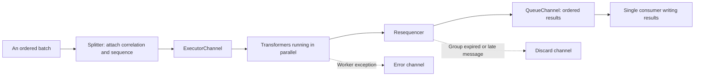

# Resequencer in Asynchronous Flows

When messages are processed across multiple threads, completion order often differs from the original order. A resequencer temporarily holds messages belonging to the same group, then emits them according to the sequence numbers assigned before parallel processing. It is a stateful endpoint: it needs to know which group a message belongs to, what position it holds, and when results may be emitted.

Within **SPRING_INTEGRATION_CORE**, this lesson connects `Message`, `MessageChannel`, splitters, transformers, and Java DSL into an explainable and testable asynchronous flow. Examples use the Spring Integration 6.5.x API and Java 17 or higher; test examples use JUnit Jupiter 5. Specific library versions should be managed by your application's BOM.

## 1. Objectives and real-world scenario

After this lesson, you will be able to:

- Identify the asynchronous boundary and where to place the resequencer.
- Design correlation and sequence headers for a finite batch.
- Choose between waiting for the full group and releasing contiguous segments as they become ready.
- Distinguish processing errors, incomplete groups, timeouts, and late-arriving messages.
- Test output ordering using intentionally reordered inputs.
- Explain resequencer limits regarding side effects, restarts, and multiple instances.

Suppose an application receives a five-part document. Each part must be normalized independently before being written into the final document:

```text
Order in document:           1, 2, 3, 4, 5
Processing completion order: 4, 1, 3, 2, 5
Required write order:        1, 2, 3, 4, 5
```

The fourth part may finish faster than the first part. The thread pool works fine, yet the document-writing consumer needs results in their original positions.

A resequencer fits this problem when parts already carry reliable sequence numbers. It does not infer business order from message arrival times.

**Boundary to remember:** if workers already write each part to the target system before the resequencer, reordering completion notifications afterward cannot fix the writes that already happened. Parallel work should prepare results; operations requiring order belong after the ordering restoration point.

## 2. Why do asynchronous flows reorder messages?

A `DirectChannel` invokes its handler on the sending thread. An `ExecutorChannel` hands work off to an executor, enabling concurrent execution. Task submission order does not determine task completion order. Furthermore, transactions on the sending thread do not automatically span handlers running on worker threads. See [MessageChannel types](https://docs.spring.io/spring-integration/reference/6.5/channel/implementations.html).

Factors that commonly cause processing durations to diverge include:

- Varying payload sizes.
- One task having to call an external service or wait on a lock.
- One task undergoing retries.
- Varying executor queues and OS thread scheduling.
- Results passing through multiple branches or consumers before converging.

Therefore, keep four kinds of order distinct:

| Kind of order | Example | Where does the resequencer act? |
| --- | --- | --- |
| Business order | Part 1 must precede part 2 | Read from pre-designed metadata |
| Endpoint arrival order | Part 4's result arrives before part 1 | May be inverted relative to business order |
| Output emission order | Endpoint emits part 1 then part 2 | This is its primary responsibility |
| Side-effect completion order | Part 2 finishes writing before part 1 | Depends on downstream consumers |

A FIFO `QueueChannel` placed after workers only stores items in enqueue order. If workers send `4, 1, 3`, the queue still yields `4, 1, 3`. A queue has no contract to wait for missing parts like a resequencer does.

## 3. Message contract: group, position, and size

With default mechanisms, the resequencer uses three headers:

| Constant | Header name | Meaning in the example |
| --- | --- | --- |
| `IntegrationMessageHeaderAccessor.CORRELATION_ID` | `correlationId` | Identifies a single document processing run |
| `IntegrationMessageHeaderAccessor.SEQUENCE_NUMBER` | `sequenceNumber` | Position of the part, starting at 1 |
| `IntegrationMessageHeaderAccessor.SEQUENCE_SIZE` | `sequenceSize` | Total number of parts in the run |

Correlation determines **the set of messages evaluated together**; sequence number determines **position within that set**. A resequencer emits individual messages, whereas an aggregator combines a group into one aggregated result. See [resequencer functionality](https://docs.spring.io/spring-integration/reference/6.5/resequencer.html).

### 3.1. Choosing correlation per finite processing run

Example:

```text
correlationId = document-42:revision-7:run-20261119-01
sequenceSize = 5
sequenceNumber = 1..5
```

If the same document is reprocessed, a new `runId` distinguishes old data from the new run's data. Using only `customerId` for correlation could mix multiple batches belonging to the same customer.

Each group needs a consistent contract:

1. Messages in the same group share the same correlation.
2. `sequenceNumber` is a positive integer reflecting the position to restore.
3. For a finite batch, `sequenceSize` is the expected part count and is consistent across the group.
4. Do not assign two different results to the same position without conflict-handling rules.
5. Preserve this metadata across transformers, retries, and transports.

A resequencer does not replace input contract validation. A group with the right element count can still hold wrong business data if the producer misnumbered it.

### 3.2. Building messages manually

When messages arrive from a system that already split the parts, you can attach metadata at the inbound adapter:

```java
import org.springframework.integration.IntegrationMessageHeaderAccessor;
import org.springframework.messaging.Message;
import org.springframework.messaging.support.MessageBuilder;

Message<String> thirdPart = MessageBuilder.withPayload("normalized-part-3")
        .setHeader(IntegrationMessageHeaderAccessor.CORRELATION_ID, "batch-A")
        .setHeader(IntegrationMessageHeaderAccessor.SEQUENCE_NUMBER, 3)
        .setHeader(IntegrationMessageHeaderAccessor.SEQUENCE_SIZE, 5)
        .build();
```

Do not use `MessageHeaders.ID` as a sequence number. ID identifies a message; sequence number represents position in the sequence.

### 3.3. When the input is a collection

A splitter can generate sequence headers for the split elements. With a `List` payload, group size is known before dispatching each part for processing. Conversely, an iterator whose size is unknown upfront may produce `sequenceSize = 0`; you cannot apply a finite-group full-wait policy verbatim. See [splitter header contract](https://docs.spring.io/spring-integration/reference/6.5/splitter.html).

If a transformer returns only a new payload, the framework typically propagates inbound headers. When constructing or serializing messages manually, verify that headers are preserved. The following example loses metadata:

```java
// Keeps only the payload, losing correlation and sequence from the input message.
Message<String> wrong = MessageBuilder.withPayload("converted").build();

// Preserve metadata when building a new message from an existing message.
Message<String> preserved = MessageBuilder
        .withPayload("converted")
        .copyHeaders(thirdPart.getHeaders())
        .build();
```

A nested splitter introduces another sequence layer. Clearly specify which layer is resequenced at each convergence point rather than treating every correlation and sequence in the flow as the same level.

## 4. Placing the resequencer at the convergence point



In this diagram:

- The fan-out point is at `ExecutorChannel`.
- Workers may complete in any order.
- The resequencer receives results and holds parts not yet eligible for release.
- The output queue lets you observe the order emitted by the endpoint.
- A single consumer reading and processing sequentially maintains order through the write step.

If the application needs only one combined result per batch, add an aggregator or suitable aggregation mechanism. A resequencer still emits multiple messages; it does not produce a `List` of results for a gateway call on its own. Java DSL supports combining these EIPs in the same flow, as described in [Aggregators and Resequencers](https://docs.spring.io/spring-integration/reference/6.5/dsl/java-aggregators.html).

## 5. Two result release policies

### 5.1. Wait for full group: `releasePartialSequences(false)`

This is the default choice. Under a valid contract for a batch of size `N`, the endpoint waits for all messages and then emits them in order.

Suitable when the consumer should start receiving the batch only after every part has succeeded.

**Waiting for completion does not mean a batch-wide transaction.** Once the group is complete, the endpoint still sends one message at a time. The consumer might succeed on part 1 and fail on part 2. If atomicity is needed, design a transaction or dedicated commit protocol.

### 5.2. Release contiguous segments: `releasePartialSequences(true)`

The endpoint can release a contiguous segment starting at the next expected position. In a fresh group, the starting position is 1; after releasing up through 3, the next position is 4.

Enabling this option does not permit skipping gaps. If waiting for 2, parts 3 and 4 must stay buffered.

With `sequenceSize = 5` and arrival order `4 → 1 → 3 → 2 → 5`:

| Newly arrived message | Full-group wait: newly emitted | Contiguous release: newly emitted | Parts still waiting in contiguous mode |
| --- | --- | --- | --- |
| 4 | None yet | None yet | 4 |
| 1 | None yet | 1 | 4 |
| 3 | None yet | None yet | 3, 4 |
| 2 | None yet | 2, 3, 4 | No waiting parts left |
| 5 | 1, 2, 3, 4, 5 | 5 | Group complete |

The contiguous-segment release condition relies on the lowest waiting position and the last released position; check [SequenceSizeReleaseStrategy](https://github.com/spring-projects/spring-integration/blob/v6.5.10/spring-integration-core/src/main/java/org/springframework/integration/aggregator/SequenceSizeReleaseStrategy.java).

| Criterion | Wait for full group | Release contiguous segments |
| --- | --- | --- |
| When consumer starts receiving | After the full batch arrives | Once the leading segment is ready |
| Leading-part latency | Depends on slowest part | Potentially lower |
| When a leading part is missing | Holds entire group | Also holds subsequent parts |
| Error after emitting a segment | No output yet if group is incomplete | Partial output already exists downstream |
| Matching business need | Process only complete batches | Can process incrementally |

## 6. Java DSL example: splitter, workers, and resequencer

The example below transforms a list of strings to uppercase strings. That transformation is chosen because it has no side effects; in practice, replace it with data normalization or independent computation.

Required classes come from `spring-integration-core`, Spring Context, and compatible dependencies managed by your application. In Spring Boot, you can use the Integration starter from your project BOM. The configuration uses `@EnableIntegration` to provide endpoint and scheduler infrastructure.

```java
import java.util.Locale;

import org.springframework.context.annotation.Bean;
import org.springframework.context.annotation.Configuration;
import org.springframework.integration.channel.DirectChannel;
import org.springframework.integration.channel.ExecutorChannel;
import org.springframework.integration.channel.QueueChannel;
import org.springframework.integration.config.EnableIntegration;
import org.springframework.integration.dsl.IntegrationFlow;
import org.springframework.integration.store.MessageGroupStore;
import org.springframework.integration.store.SimpleMessageStore;
import org.springframework.messaging.MessageHeaders;
import org.springframework.scheduling.concurrent.ThreadPoolTaskExecutor;

@Configuration
@EnableIntegration
public class AsyncResequencerConfig {

    @Bean
    public DirectChannel batchInput() {
        return new DirectChannel();
    }

    @Bean
    public DirectChannel resequencerInput() {
        return new DirectChannel();
    }

    @Bean
    public ThreadPoolTaskExecutor workerExecutor() {
        ThreadPoolTaskExecutor executor = new ThreadPoolTaskExecutor();
        executor.setCorePoolSize(4);
        executor.setMaxPoolSize(4);
        executor.setQueueCapacity(64);
        executor.setThreadNamePrefix("part-worker-");
        executor.setWaitForTasksToCompleteOnShutdown(true);
        executor.setAwaitTerminationSeconds(10);
        return executor;
    }

    @Bean
    public ExecutorChannel parallelWork(ThreadPoolTaskExecutor workerExecutor) {
        return new ExecutorChannel(workerExecutor);
    }

    @Bean
    public QueueChannel orderedResults() {
        return new QueueChannel();
    }

    @Bean
    public QueueChannel discardedResults() {
        return new QueueChannel();
    }

    @Bean
    public QueueChannel flowErrors() {
        return new QueueChannel();
    }

    @Bean
    public MessageGroupStore resequencerStore() {
        return new SimpleMessageStore();
    }

    @Bean
    public IntegrationFlow workFlow() {
        return IntegrationFlow.from("batchInput")
                .enrichHeaders(h -> h.header(MessageHeaders.ERROR_CHANNEL,
                        "flowErrors"))
                .split()
                .channel("parallelWork")
                .transform(String.class, text -> text.toUpperCase(Locale.ROOT))
                .channel("resequencerInput")
                .get();
    }

    @Bean
    public IntegrationFlow orderingFlow(MessageGroupStore resequencerStore) {
        return IntegrationFlow.from("resequencerInput")
                .resequence(r -> r
                        .messageStore(resequencerStore)
                        .releasePartialSequences(false)
                        .groupTimeout(5_000)
                        .sendPartialResultOnExpiry(false)
                        .expireGroupsUponTimeout(false)
                        .discardChannel("discardedResults"))
                .channel("orderedResults")
                .get();
    }
}
```

Splitting into `workFlow` and `orderingFlow` has two practical benefits: the convergence point is unmistakable, and there is a channel to test ordering rules in isolation.

### 6.1. Sending a batch

The call below runs inside an application initialized with the configuration above; `context` is the application's `ApplicationContext`:

```java
import java.util.List;

import org.springframework.messaging.MessageChannel;
import org.springframework.messaging.support.MessageBuilder;

MessageChannel input = context.getBean("batchInput", MessageChannel.class);

boolean accepted = input.send(
        MessageBuilder.withPayload(List.of("part-1", "part-2", "part-3"))
                .build());

if (!accepted) {
    throw new IllegalStateException("Batch was not accepted");
}
```

Expected output is three messages with payloads `PART-1`, `PART-2`, `PART-3` respectively.

`send()` returning true does not prove workers have finished. A one-way messaging gateway shares the same limitation: the call returning and batch completion are two separate events. Applications should use a batch tracking ID and completion status if callers need the final outcome.

### 6.2. Reading the configuration accurately

- `.split()` splits the `List` and creates sequence metadata.
- `parallelWork` dispatches work to a thread pool; results may return out of order.
- `transform(...)` replaces the payload while preserving message context needed downstream.
- `resequencerStore` holds groups in memory.
- `releasePartialSequences(false)` selects waiting for the complete group.
- `groupTimeout(5_000)` configures wait duration when a group cannot release yet.
- `sendPartialResultOnExpiry(false)` sends waiting parts to discard when forcing an incomplete group to close.
- `expireGroupsUponTimeout(false)` retains timed-out group markers to handle late-arriving messages.

The corresponding DSL options are defined in [CorrelationHandlerSpec](https://github.com/spring-projects/spring-integration/blob/v6.5.10/spring-integration-core/src/main/java/org/springframework/integration/dsl/CorrelationHandlerSpec.java).

The queues in the example are for learning and observation. In production, provide consumers for all three outputs, resource bounds, and queue-full policies. A bounded-queue thread pool also needs a load-shedding policy: if a batch already submitted several parts and a subsequent part is rejected, the batch can become an incomplete group.

## 7. Timeouts, gaps, and incomplete results

### 7.1. One missing message can stall the rest

Suppose group `batch-B` requires four parts, but the resequencer receives only `1, 3, 4`.

- In full-wait mode, nothing is emitted yet.
- In contiguous-segment mode, part 1 may have been emitted; parts 3 and 4 still wait for part 2.
- If part 2 was dropped by a filter, failed permanently, or got lost, the group cannot complete normally.

Therefore, when placing a filter or router between a splitter and a resequencer, account for every position in the sequence. Parts routed onto a branch that never returns also create gaps just like lost parts.

Three common design approaches:

1. **Filter before numbering:** when excluded items do not belong in the result batch, filter the collection before the splitter.
2. **Emit status results:** when every position must yield a result, convert an error or skip into an explicit result payload keeping the matching position.
3. **Terminate incomplete batches:** when one missing part invalidates the batch, let it time out and transition to a failure-handling flow.

Example data type for the second approach:

```java
record PartResult(int position, boolean successful, String value, String errorCode) {
}
```

A failed `PartResult` must be interpreted as failure by the consumer. Filling a slot in the sequence must not turn an error into a successful outcome.

### 7.2. `groupTimeout` is not a whole-request deadline

With a fixed duration, an unreleased group's timeout schedule can reset when a new message arrives. Thus, `5_000` should not be read as “every batch definitely finishes within 5 seconds of submission.” If no results have reached the resequencer yet, there isn't even a group at the endpoint for this timeout to apply to.

If business logic enforces a deadline measured from batch intake, store the intake timestamp and track the deadline at batch level. Group timeouts and group management are described in [Aggregator: group timeout and group lifecycle](https://docs.spring.io/spring-integration/reference/6.5/aggregator.html).

Beyond group timeout, distinguish channel send timeouts from gateway reply timeouts. These protect different stages; a reply timeout expiring does not automatically cancel running workers.

### 7.3. Two options containing “partial” with different purposes

| Option | When does it take effect? | Meaning |
| --- | --- | --- |
| `releasePartialSequences(true)` | During normal processing | Emits valid contiguous segments without skipping gaps |
| `sendPartialResultOnExpiry(true)` | When forcing a group to end | Allows emitting available parts even though the sequence is incomplete |

For example, part 1 was already emitted, part 2 was lost, and parts 3 and 4 are waiting. If the expiry policy permits partial output, the consumer may still receive parts 3 and 4. The observed sequence lacks part 2; it no longer satisfies an “all positions present” contract.

If the consumer cannot tolerate missing data, keep `sendPartialResultOnExpiry(false)`, route incomplete groups to discard, and mark the batch failed. If the consumer tolerates partial data, provide an explicit business signal indicating an incomplete batch.

### 7.4. Late messages and group lifecycle

After a timeout, there are two ways to handle state:

- Retain closed-group metadata: late messages can be recognized and sent to discard.
- Delete the group completely: a late message with the same correlation can open a brand-new group.

The sample configuration chooses to retain metadata after timeout. Cleaning up metadata later requires a retention policy; keeping it forever grows group count, whereas purging too early loses late-message detection. Once the retention window expires, correlation reuse must still obey business design.

Resequencer expiry mechanics can be verified in [ResequencingMessageHandler](https://github.com/spring-projects/spring-integration/blob/v6.5.10/spring-integration-core/src/main/java/org/springframework/integration/aggregator/ResequencingMessageHandler.java). Do not assume normally completed groups and timed-out groups share the exact same lifecycle.

## 8. Error channel, discard, and retry

These two branches need distinct consumers because their data and meanings differ:

| Situation | Appropriate handling path | Action at batch level |
| --- | --- | --- |
| Transformer throws an exception in a worker | Error channel receiving `ErrorMessage` | Retry or produce a failure result for that position |
| Group misses a message past the wait limit | Configured discard channel | Mark the batch failed or incomplete |
| Message arrives after a remembered timed-out group | Discard channel | Record late arrival and decide recovery |
| Missing or malformed header data | Validation step before the resequencer | Quarantine contract-violating input |
| Executor rejects additional tasks | Executor submission boundary | Handle backpressure and previously submitted batch parts |

For errors occurring in framework-executed asynchronous tasks, an error handler can send an `ErrorMessage` to the channel in the `errorChannel` header, or to the global error channel. Errors running synchronously on the calling thread can still be thrown directly back to the sender. See [Error Handling](https://docs.spring.io/spring-integration/reference/6.5/error-handling.html).

In the sample configuration, the `flowErrors` header is attached before the executor boundary. However:

- Receiving an `ErrorMessage` does not tell the resequencer which position was recovered.
- Receiving an error does not automatically synthesize a replacement message for the missing position.
- Exceptions from scheduler tasks during timeouts must be tracked via the scheduler's error mechanism.
- Never feed an `ErrorMessage` straight into the resequencer as if it were a business result.

If retrying a worker, preserve the correlation, position, and size of the part being processed. Retry only transient errors, with bounded attempts and backoff aligned with the deadline.

If replaying the entire batch after an old batch ended in failure, use a new run identifier and explicit idempotency rules. The resequencer guards some duplicate-sequence cases within a group, yet that does not guarantee side effects occur only once across restarts, expirations, or replays.

## 9. Preserving order all the way to the final consumer

### 9.1. Do not place an arbitrary parallel step after the resequencer

The following flow can scramble completion order again:

```text
Resequencer -> Multi-worker ExecutorChannel -> Write to target system
```

The endpoint emits part 1 then part 2, yet the worker writing part 2 may finish first. To preserve side-effect order within a group, choose among:

- A synchronous handler executing sequentially right after the resequencer.
- A queue with a single sequential consumer.
- Key-based partitioning ensuring parts of the same group process sequentially in that partition.

If the consumer in turn launches an asynchronous task and returns immediately, even a single consumer does not guarantee task completion order.

### 9.2. Order within a group differs from order across groups

Two groups `A` and `B` may be emitted interleaved:

```text
A1, B1, B2, A2, A3
```

This result is still valid if each group preserves its internal order. If business rules require every part of batch A to precede every part of batch B, add an inter-batch ordering contract.

### 9.3. Group locks and output sending point

Workers can concurrently submit results to the same group, so state updates must be synchronized per correlation. A slow downstream step executing while holding the group lock can increase wait times.

The `releaseLockBeforeSend` option controls when the lock is released relative to sending output. When tuning it to resolve contention or endpoint deadlocks, re-test emission order—especially across multiple partial releases of the same group. Do not treat lock tuning as an optimization independent of the ordering contract.

The sample configuration keeps default behavior and places outputs onto a queue so write operations do not prolong the resequencer's release step.

## 10. Controlled testing

Do not try to prove resequencing solely with one test running a thread pool and “hoping” results come back out of order. Separate two questions:

1. Does the endpoint restore the right order from an input known to be out of order?
2. Does the complete flow preserve headers and produce right results when running through the executor?

### 10.1. Testing full-group waiting and the async flow

Save the configuration class from the previous section in your application source. The test class below requires JUnit Jupiter and the configuration's dependencies:

```java
import java.util.List;
import java.util.UUID;

import org.junit.jupiter.api.Test;
import org.springframework.context.annotation.AnnotationConfigApplicationContext;
import org.springframework.integration.IntegrationMessageHeaderAccessor;
import org.springframework.integration.channel.QueueChannel;
import org.springframework.messaging.Message;
import org.springframework.messaging.MessageChannel;
import org.springframework.messaging.support.MessageBuilder;

import static org.junit.jupiter.api.Assertions.*;

class AsyncResequencerTest {

    @Test
    void waitsForCompleteGroupAndRestoresOrder() {
        try (var context =
                     new AnnotationConfigApplicationContext(AsyncResequencerConfig.class)) {
            MessageChannel input =
                    context.getBean("resequencerInput", MessageChannel.class);
            QueueChannel output =
                    context.getBean("orderedResults", QueueChannel.class);
            String group = UUID.randomUUID().toString();

            assertTrue(input.send(part(group, 3, 3)));
            assertNull(output.receive(0));

            assertTrue(input.send(part(group, 1, 3)));
            assertNull(output.receive(0));

            assertTrue(input.send(part(group, 2, 3)));

            for (int expected = 1; expected <= 3; expected++) {
                Message<?> result = output.receive(1_000);
                assertNotNull(result);
                assertEquals("part-" + expected, result.getPayload());
                assertEquals(expected, result.getHeaders().get(
                        IntegrationMessageHeaderAccessor.SEQUENCE_NUMBER));
                assertEquals(group, result.getHeaders().get(
                        IntegrationMessageHeaderAccessor.CORRELATION_ID));
            }

            assertNull(output.receive(0));
        }
    }

    @Test
    void fullAsyncFlowKeepsOriginalPositions() {
        try (var context =
                     new AnnotationConfigApplicationContext(AsyncResequencerConfig.class)) {
            MessageChannel input =
                    context.getBean("batchInput", MessageChannel.class);
            QueueChannel output =
                    context.getBean("orderedResults", QueueChannel.class);

            assertTrue(input.send(MessageBuilder.withPayload(
                    List.of("alpha", "beta", "gamma")).build()));

            List<String> expected = List.of("ALPHA", "BETA", "GAMMA");
            Object correlation = null;

            for (int index = 0; index < expected.size(); index++) {
                Message<?> result = output.receive(3_000);
                assertNotNull(result);
                assertEquals(expected.get(index), result.getPayload());
                assertEquals(index + 1, result.getHeaders().get(
                        IntegrationMessageHeaderAccessor.SEQUENCE_NUMBER));
                assertEquals(3, result.getHeaders().get(
                        IntegrationMessageHeaderAccessor.SEQUENCE_SIZE));

                Object current = result.getHeaders().get(
                        IntegrationMessageHeaderAccessor.CORRELATION_ID);
                assertNotNull(current);
                if (index == 0) {
                    correlation = current;
                }
                assertEquals(correlation, current);
            }

            assertNull(output.receive(0));
            assertNull(context.getBean("flowErrors", QueueChannel.class).receive(0));
        }
    }

    private static Message<String> part(String group, int number, int size) {
        return MessageBuilder.withPayload("part-" + number)
                .setHeader(IntegrationMessageHeaderAccessor.CORRELATION_ID, group)
                .setHeader(IntegrationMessageHeaderAccessor.SEQUENCE_NUMBER, number)
                .setHeader(IntegrationMessageHeaderAccessor.SEQUENCE_SIZE, size)
                .build();
    }
}
```

The first test actively creates the `3 → 1 → 2` input and verifies there is no output before the group is complete. This directly tests the core behavior.

The second test verifies the path through splitter, transformer, and executor. It does not claim every run triggers out-of-order worker completion; that ordering behavior was already tested deterministically in the first test.

The `receive(timeout)` calls are bounded so the test never hangs. With synchronous direct input, `receive(0)` inspects the queue right after message processing finishes.

### 10.2. Testing contiguous-segment release mode

In a separate test configuration, change just the policy:

```java
.resequence(r -> r
        .releasePartialSequences(true)
        .groupTimeout(5_000)
        .sendPartialResultOnExpiry(false)
        .expireGroupsUponTimeout(false)
        .discardChannel("discardedResults"))
```

Then send to the resequencer's input channel and verify step by step:

| Test step | Action | Assertion |
| --- | --- | --- |
| 1 | Send part 3, total 4 parts | Output queue is empty |
| 2 | Send part 1 | Receive exactly part 1, then queue is empty |
| 3 | Send part 4 | Queue remains empty because part 2 is missing |
| 4 | Send part 2 | Receive parts 2, 3, 4 in order |

This scenario verifies both early emission and the rule against skipping gaps.

### 10.3. Additional scenarios to test

| Scenario | Input or action | What to prove |
| --- | --- | --- |
| Two interleaved groups | `A2, B1, A1, B2` | No mixing; each group preserves its own order |
| One lost part | Send parts 1 and 3 of a three-part group | After timeout, routes to discard per policy |
| Late arrival | Send part 2 after timeout | Does not revive failed batch while metadata is retained |
| Worker error | Transformer throws exception on one part | Error is captured and batch status is consistent |
| Header lost at adapter | Omit correlation or sequence | Contract violation is caught before data stalls inexplicably |
| Replay | Resend batch after outage | Idempotency and run ID prevent unintended side effects |
| Restart with persistent store | Stop while group incomplete, restart, send missing part | State and expiry policy restore as designed |

Timeout tests should use short timeouts in a test-specific configuration, await conditions, or use `receive(timeout)`. Never use a fixed `Thread.sleep` as sole proof that a group was processed.

## 11. Resources, restarts, and multiple instances

### 11.1. Measuring held data volume

The longer messages are held, the larger the buffer grows. A rough estimate:

```text
Held messages ≈ incoming result rate × average hold duration
```

For example, if an average of 1,200 results/second must be held for roughly 4 seconds:

```text
Held messages ≈ 1,200 × 4 = 4,800
Average 32 KiB payload → about 150 MiB of payloads alone
```

This is a capacity estimate, excluding headers, Java objects, store indexes, group metadata, and other queues. When groups get stuck for long periods, measure wait-time distributions and the largest groups; averages can hide the problem.

If the leading part of a group is consistently slow, enabling contiguous-segment release may not shrink the buffer significantly: every subsequent part still waits for that gap to be filled.

### 11.2. In-memory vs. persistent stores

`SimpleMessageStore` in the example is appropriate for learning and testing within a single process. Restarts lose data held in memory.

If groups must survive restarts, evaluate a persistent `MessageGroupStore` along with:

- Serialization support for payloads and headers.
- Transactions across message receipt, store updates, and result emission.
- Replay mechanisms from the source across crashes at different points.
- Orphaned-group reclamation and restoring expiry tasks after restart.
- Retention for completed or timed-out groups.
- Deduplication safeguards at the consumer.

A persistent store solves state persistence; end-to-end correctness still depends on message delivery and side effects.

### 11.3. Multiple instances

If parts of the same group land on two instances with separate stores, each instance may see only half the group. Neither instance has enough data to release.

There are two architectural approaches:

| Approach | Necessary conditions |
| --- | --- |
| Route all parts of the same group to one instance | Stable partition key, rebalance handling, and instance failover handling |
| Multiple instances share group state | Store supporting shared access, compatible distributed locking, and output handling strategy |

A shared store with local in-process locks is insufficient to coordinate all operations across processes. Even when group state is consistent, order observed across downstream brokers or consumers must still be guaranteed by the end-to-end delivery contract.

## 12. Observability and diagnostics

Batch logs should include `runId` or correlation, sequence number, sequence size, and processing status. Do not log only the message ID because one batch spans many messages and retries can create new message IDs.

Metrics should tie directly to operational questions:

| Metric | Question answered |
| --- | --- |
| Incomplete group count | Is there a growing backlog of waiting batches? |
| Held message count | Is buffering growing past system capacity? |
| Oldest group age | Are any batches stuck unexpectedly? |
| Time from result receipt to release | How much latency is resequencing adding? |
| Timed-out groups and discarded messages | Are gaps or late arrivals frequent? |
| Worker errors by position and error type | Is the missing part linked to a specific task? |
| Executor and output queue depths | Is the bottleneck computation or result consumption? |

When a group stops emitting, trace along the data path:

1. Did all parts actually arrive at the same convergence point and the same instance?
2. Is the correlation identical for that exact processing run?
3. Is the expected total part count right and consistent?
4. Was any position dropped by an error, filter, or router?
5. Did any step strip or alter headers?
6. Is the group waiting normally, already timed out, or already complete?
7. Is output blocked by a slow consumer or full queue?

If results appear out of order in the target system, inspect right at the resequencer output and right before the side effect. Two measurement points distinguish whether ordering broke at emission or in a downstream processing step.

## 13. Practice exercise

Use the configuration and tests in this lesson as a starting point:

1. Keep full-group waiting mode, send `4, 2, 1, 3` into a four-part group; verify emission occurs only when complete and output is `1, 2, 3, 4`.
2. Enable contiguous-segment release and send the same data; record when part 1 and part 2 are emitted.
3. Make a worker fail on part 2; observe the error channel and waiting parts at the resequencer.
4. Convert the part 2 failure into a failed `PartResult`, keep the sequence intact, and have the consumer record that the batch had an error.
5. Let a group time out, then send the missing part; verify discard behavior while group metadata is retained.
6. Make the output consumer execute side effects in parallel; demonstrate that completion order can differ from receipt order, then fix the architecture to satisfy the business requirement.

Your practice results should explain three things: **which messages are waiting**, **why they have not been emitted yet**, and **what the consumer is permitted to do when a batch is incomplete**. That is the basis for using a resequencer cleanly in an asynchronous flow.
