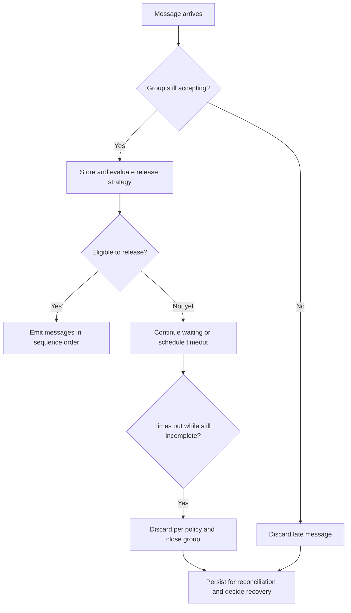

# Handling Late-Arriving Messages

In an integration flow, a message carrying `sequenceNumber = 2` can arrive after message number 3 due to varying processing durations, retries, or network disruptions. A resequencer can hold messages and restore order, but only while the group is still accepting data. If the group has already closed due to a timeout, receiving message number 2 becomes a business decision: reject it, persist it for reconciliation, or launch a new processing run.

This lesson in the **Resequencer** chapter of **SPRING_INTEGRATION_CORE** focuses on combining `Message`, `MessageChannel`, the resequencer endpoint, and Java DSL to handle this scenario. The example uses a three-part batch; the goal is to design the main path, discard path, error handling, and tests for late-arrival behavior clearly.

API examples target Spring Integration **6.5.10** as the reference baseline and use Java 17 or higher. That version is a reference anchor for the lesson; when applying this to your project, use dependency versions aligned with your project's Spring platform.

## 1. Late relative to what?

Establish the comparison baseline before writing configuration:

| Scenario | Example | Handling meaning |
| --- | --- | --- |
| Arrives out of order while group is still open | Receives `1, 3, 2` before timeout | Resequencer can still restore `1, 2, 3` |
| Arrives after the group is closed | Receives `1, 3`, times out, then receives `2` | Must apply post-closure policy |
| Redelivery of an already-processed message | Message `2` is sent again after the entire batch succeeded | Requires duplicate control and business state checks |
| Late by event time | Event occurred yesterday but arrived today | Requires defining a business window; sequence alone does not express that window |

A message can simultaneously arrive out of order and be redelivered. Therefore, do not use a single `late = true` flag to stand in for the entire state model.

By default, the resequencer groups by `correlationId`, determines position via `sequenceNumber`, and uses `sequenceSize` to recognize a finite sequence. It emits messages in order rather than merging payloads into one combined message like an aggregator. This mechanism does not automatically generate event-time watermarks. See [Resequencer documentation](https://docs.spring.io/spring-integration/reference/6.5/resequencer.html).

### Input contract for the example

For batch `import-2026-11-19:attempt-1`, the three data parts must carry:

```text
correlationId = import-2026-11-19:attempt-1
sequenceSize = 3
sequenceNumber in {1, 2, 3}
```

Messages in the same batch share the same correlation key and sequence size. Each position has a stable meaning within that processing run. Producers must distinguish a new run from a redelivery of an earlier run.

You can place a filter or transformer ahead of the resequencer to validate and normalize headers. Messages missing a position, carrying wrong types, or declaring conflicting sequence sizes should go to an invalid-data branch. They are not late messages merely because the resequencer cannot process them.

## 2. Defining the group-closure boundary on a timeline

Suppose the configuration requires all three parts before emitting, with a 5-second inactivity timeout and no partial results emitted:

| Time | Input or event | Expected state |
| --- | --- | --- |
| `t = 0s` | Receive part 1 | Group open, holds part 1 |
| `t = 1s` | Receive part 3 | Group open, holds parts 1 and 3, missing part 2 |
| Around `t = 6s` | Timeout task executes | Moves held parts to discard; closes group and retains metadata |
| `t = 8s` | Receive part 2 | While closed-group metadata still exists, routes part 2 to discard |

If part 2 arrives at `t = 4s`, the group can finish normally and emit `1, 2, 3`. No compensating handling is needed merely because part 2 arrived after part 3.

Around `t = 6s` is when the task becomes eligible to run, not a hard real-time guarantee. When a message and the timeout task race at the boundary, the outcome depends on which operation acquires the group lock first. Business design must accept valid outcomes at this boundary or enforce a business deadline via a separate mechanism.



The diagram depicts the strict policy in this lesson. Handling anti-replay state after a group completes successfully is addressed separately in section 6.

## 3. Separating three configuration decisions

These three questions are independent of one another:

1. **While waiting, what may be emitted?** Must the entire batch be present, or may ready contiguous segments be released?
2. **When the wait expires while still incomplete, where does held data go?** Output or discard?
3. **After closing due to timeout, should the old group be remembered?** Retain metadata or delete it completely so the correlation key can open a new group?

| Java DSL option | Role in this lesson |
| --- | --- |
| `releasePartialSequences(false)` | Waits for the complete sequence under the default release strategy |
| `groupTimeout(5_000L)` | Schedules group handling when no new message arrives within the wait period |
| `sendPartialResultOnExpiry(false)` | When a group expires without meeting release conditions, routes held data to discard |
| `expireGroupsUponTimeout(false)` | Retains timed-out group metadata to recognize subsequent late messages |
| `discardChannel(...)` | Specifies the destination for rejected messages |

`expireGroupsUponTimeout(false)` is the resequencer's own default at this baseline version; this lesson still configures it explicitly. Do not infer its default from aggregator. These method names are verified against [CorrelationHandlerSpec 6.5.10](https://github.com/spring-projects/spring-integration/blob/v6.5.10/spring-integration-core/src/main/java/org/springframework/integration/dsl/CorrelationHandlerSpec.java).

### Contiguous-segment release differs from release on expiry

`releasePartialSequences(true)` allows advancing whenever the next contiguous segment is ready. For instance, in sequence `1..4`, after emitting `1`, message `3` must still wait for `2`; once `2` arrives, segment `2, 3` can be emitted. See [SequenceSizeReleaseStrategy 6.5.10](https://github.com/spring-projects/spring-integration/blob/v6.5.10/spring-integration-core/src/main/java/org/springframework/integration/aggregator/SequenceSizeReleaseStrategy.java).

By contrast, `sendPartialResultOnExpiry(true)` operates on the expiry branch. Do not interpret it as “sort and send all held messages.” With the default 6.5.10 processor, the output contains only the contiguous segment starting from the lowest sequence number present. A group holding `1, 3` may emit only `1`; do not assume `3` also goes to output or is automatically moved to discard. This behavior is implemented in [ResequencingMessageGroupProcessor](https://github.com/spring-projects/spring-integration/blob/v6.5.10/spring-integration-core/src/main/java/org/springframework/integration/aggregator/ResequencingMessageGroupProcessor.java).

For data where every part must be reconciled, persist inputs or an intake log before opting into partial release on expiry. The strict configuration below uses the discard branch so held parts are easy to inspect.

## 4. Java DSL configuration: wait for full batch, route timeouts to reconciliation

The example below is a standalone Spring configuration requiring `spring-integration-core` and corresponding Spring dependencies. No HTTP adapter, broker, or database is needed to observe the core behavior.

```java
import org.springframework.context.annotation.Bean;
import org.springframework.context.annotation.Configuration;
import org.springframework.integration.channel.DirectChannel;
import org.springframework.integration.channel.QueueChannel;
import org.springframework.integration.config.EnableIntegration;
import org.springframework.integration.dsl.IntegrationFlow;
import org.springframework.integration.store.MessageGroupStore;
import org.springframework.integration.store.SimpleMessageStore;
import org.springframework.messaging.MessageChannel;

@Configuration
@EnableIntegration
public class LateArrivalConfig {

    @Bean
    public MessageChannel resequenceInput() {
        return new DirectChannel();
    }

    @Bean
    public QueueChannel orderedOutput() {
        return new QueueChannel(100);
    }

    @Bean
    public QueueChannel resequenceDiscard() {
        return new QueueChannel(100);
    }

    @Bean
    public MessageGroupStore resequencerStore() {
        return new SimpleMessageStore();
    }

    @Bean
    public IntegrationFlow lateArrivalFlow() {
        return IntegrationFlow.from(resequenceInput())
                .resequence(r -> r
                        .messageStore(resequencerStore())
                        .releasePartialSequences(false)
                        .groupTimeout(5_000L)
                        .sendPartialResultOnExpiry(false)
                        .expireGroupsUponTimeout(false)
                        .discardIndividuallyOnExpiry(true)
                        .discardChannel(resequenceDiscard())
                        .sendTimeout(1_000L))
                .channel(orderedOutput())
                .get();
    }
}
```

`DirectChannel` delivers messages to the endpoint on the current calling thread. Two `QueueChannel` beans make results easy to read during practice: one queue for valid output and one for discarded data. In long-running environments, add consumers to process and persist messages from these queues.

`discardIndividuallyOnExpiry(true)` is declared so each timed-out part becomes an individual message on the discard channel. This option was introduced in 6.5; if using an older version, check the API before copying it. `sendTimeout(1_000L)` bounds waiting when sending to a full queue; it neither extends nor shortens how long the group waits for missing parts.

### Creating a data part with sequence headers

The following helper is used in the examples and tests:

```java
import org.springframework.integration.IntegrationMessageHeaderAccessor;
import org.springframework.integration.support.MessageBuilder;
import org.springframework.messaging.Message;

static Message<String> part(String groupId, int number, int size) {
    return MessageBuilder.withPayload("part-" + number)
            .setHeader(IntegrationMessageHeaderAccessor.CORRELATION_ID,
                    groupId)
            .setHeader(IntegrationMessageHeaderAccessor.SEQUENCE_NUMBER,
                    number)
            .setHeader(IntegrationMessageHeaderAccessor.SEQUENCE_SIZE,
                    size)
            .build();
}
```

When the producer sends `part(groupId, 1, 3)`, `part(groupId, 3, 3)`, and then `part(groupId, 2, 3)` before timeout, the output is three individual messages carrying payloads `part-1`, `part-2`, and `part-3`. Ordering occurs at the endpoint; downstream consumers must still maintain processing discipline if business completion order matters.

If output is handed to a multi-worker executor, part 3 can finish its task before part 2 even though it was sent later. Process sequentially by correlation key or enforce state-version checks at the business layer when ordering requirements extend through the write step.

## 5. Inactivity timeout vs. absolute deadline

With `groupTimeout(5_000L)`, a new message can cause the group's wait schedule to recalculate. This is an inactivity-based wait for the group, not a cap on total elapsed time since the first part arrived. The shared scheduling mechanism is described in [Aggregator and Group Timeout](https://docs.spring.io/spring-integration/reference/6.5/aggregator.html#agg-group-timeout).

For instance, part 1 arrives at second 0, part 3 at second 4, and another valid part at second 8. In a large group, actual lifetime can far exceed 5 seconds if data keeps arriving without yet satisfying release conditions.

If the requirement is “the batch must close within 30 seconds of group creation,” **replace** `.groupTimeout(5_000L)` with:

```java
.groupTimeout(group ->
        new java.util.Date(group.getTimestamp() + 30_000L))
```

The function returns an absolute point in time. Each re-evaluation still targets group creation time plus 30 seconds. Do not configure both timeout forms simultaneously in the same example. The group's timestamp is also not automatically the business event time from the source system.

Three durations should be documented as three separate requirements:

| Duration | Business question |
| --- | --- |
| Wait duration for additional data | How long to wait before concluding a batch is incomplete? |
| Retention duration for closed-group markers | For how long must redeliveries or late arrivals be recognized? |
| Retention duration for reconciliation data | For how long may operators or recovery jobs inspect the data? |

An operational example might pick 30 seconds, 24 hours, and 30 days respectively. This is an illustrative design choice; pick values based on real latency, retry policy, and storage requirements.

## 6. Retaining metadata after timeout and preventing replay after success

### When an incomplete group closes on timeout

In the `1, 3` followed by timeout example, `expireGroupsUponTimeout(false)` leaves behind metadata marking the group as closed. While that marker exists, part 2 arriving afterward is discarded. You can think of that lightweight record as a *tombstone*: payloads need not remain in the group, yet the system remembers that the correlation key has ended.

If changed to `expireGroupsUponTimeout(true)`, the group is deleted outright. When part 2 arrives later, the same correlation key can open a new group containing only part 2. That is not automatic recovery of the old batch. The new group misses parts 1 and 3, waits, and may time out again.

### When a group has completed fully

Do not infer that the post-timeout metadata flag prevents replays after every successful run. In `ResequencingMessageHandler` 6.5.10, the release branch where `sequenceSize` matches group size can remove the group. Thus, a batch that completes fully in this example's wait-for-all mode is not protected from replay solely by `expireGroupsUponTimeout(false)`. See [afterRelease handling code](https://github.com/spring-projects/spring-integration/blob/v6.5.10/spring-integration-core/src/main/java/org/springframework/integration/aggregator/ResequencingMessageHandler.java).

If all three parts of a succeeded batch are replayed, they can form another group and reach output again. Business deduplication requires a dedicated layer, such as:

- Persisting `COMPLETED` or `TIMED_OUT` status keyed by `batchId` and `attemptId`.
- Storing idempotency keys per data part or business operation.
- Using unique constraints or conditional updates in the result-writing store.

This is an additional design recommendation for the example, not a built-in capability of the resequencer. If multiple instances process the same key concurrently, the check-and-write operation must be appropriately atomic. An independent `get()` followed by `put()` is insufficient to eliminate races.

### How long to keep markers and how to clean up?

Retaining metadata forever inflates store size. Deleting it too early costs the ability to distinguish old messages from a new group. Coordinate marker retention with the entire supported retry and replay window.

`minimumTimeoutForEmptyGroups(...)` and `MessageGroupStoreReaper` are mechanisms related to retaining and purging empty groups. Do not treat a single timeout value as an automatic TTL across every backend or completion path. Configure an appropriate cleanup task and verify behavior across restarts. Cleanup mechanics and retention conditions are shown in [AbstractCorrelatingMessageHandler 6.5.10](https://github.com/spring-projects/spring-integration/blob/v6.5.10/spring-integration-core/src/main/java/org/springframework/integration/aggregator/AbstractCorrelatingMessageHandler.java).

After a tombstone is purged, if old replays must still be blocked, the decision must rely on the business status ledger or persistent idempotency keys.

## 7. Designing the discard branch for recovery

The discard channel in this configuration receives at least two kinds of messages:

1. Parts held in the group that are evicted when the group times out.
2. Parts arriving after the group has closed while metadata still exists.

Do not label all data here as “late messages.” Parts 1 and 3 in the example arrived before timeout and still land on the discard channel. Furthermore, depending on group state, messages disallowed from being added can also be discarded.

A practical reconciliation branch can persist:

| Data | Purpose |
| --- | --- |
| Correlation key and attempt | Locate the exact batch and processing run |
| Sequence number and sequence size | Identify present parts and missing parts |
| Business identifier of the part | Check for duplicates during recovery |
| Receipt timestamp and closure timestamp | Distinguish delays at source, transport, or consumer |
| Batch status and classification reason | Decide retry, compensation, or termination |
| Payload or reference to payload | Reconstruct data when rerunning |

Do not assume the framework automatically adds a header explaining the exact discard reason. You can classify via application-managed status records, intake logs, and group-closure records. If exact per-decision reason codes are needed, instrument the corresponding recording points.

### Recovery procedure for a three-part batch

Suppose timed-out parts 1 and 3 as well as late part 2 have all been saved for reconciliation:

1. Read the status of `attempt-1` and verify full success has not been recorded.
2. Collect all three parts, validate integrity, and verify idempotency keys.
3. Create `attempt-2` with a new correlation key while keeping the same business batch ID.
4. Replay **the complete required dataset** with consistent sequence headers.
5. Record the recovery outcome and link the two processing runs for traceability.

Resending only part 2 under a new correlation key creates a new batch missing parts 1 and 3. Conversely, deleting the tombstone and resending part 2 under the old key will not recover parts that have already left the store.

If the system already applied some parts before timeout, reconcile already-written effects and design compensation or idempotent updates. Do not assume replaying the entire batch is automatically safe in that situation.

## 8. Discard, exceptions, and retries are three separate paths

A message rejected under the late-arrival policy does not necessarily raise an exception. `discardChannel` receives messages rejected by the endpoint; it does not take over the role of `errorChannel`.

If a call over `DirectChannel` throws an error, the exception can propagate back to the sender on the same thread. Errors raised in an executor, poller, or timeout task require corresponding error handling; when providing a custom `TaskScheduler`, configure an error handler if you want errors routed into the `ErrorMessage` flow. See [Error Handling](https://docs.spring.io/spring-integration/reference/error-handling.html).

For example, a full discard queue or unavailable reconciliation store is an infrastructure error on the discard-handling path. Monitor and recover from such errors; never record “saved for reconciliation” merely because the endpoint decided to discard.

Retries must also align with a specific purpose:

- Retry writing reconciliation data when the storage target fails transiently.
- Retry business processing that can safely be repeated.
- Do not retry a message endlessly into an already-closed group without changing state or policy.

When invoking a flow through a messaging gateway, the gateway's reply timeout and the group completion wait timeout are two separate settings. The caller stopping its wait does not mean the resequencer group was canceled or all data was rolled back.

## 9. Testing two late-arrival checkpoints with JUnit

The test snippet below uses JUnit Jupiter and the configuration from section 4. This is practice code for learners and was not executed during lesson authoring. Each test run creates its own application context so groups and queues are not shared.

```java
import java.util.Set;

import org.junit.jupiter.api.Test;
import org.springframework.context.annotation.AnnotationConfigApplicationContext;
import org.springframework.integration.IntegrationMessageHeaderAccessor;
import org.springframework.integration.channel.QueueChannel;
import org.springframework.integration.support.MessageBuilder;
import org.springframework.messaging.Message;
import org.springframework.messaging.MessageChannel;

import static org.junit.jupiter.api.Assertions.*;

class LateArrivalTest {

    @Test
    void outOfOrderMessageBeforeTimeoutCompletesTheSequence() {
        try (var context = new AnnotationConfigApplicationContext(
                LateArrivalConfig.class)) {
            MessageChannel input = context.getBean(
                    "resequenceInput", MessageChannel.class);
            QueueChannel output = context.getBean(
                    "orderedOutput", QueueChannel.class);
            QueueChannel discard = context.getBean(
                    "resequenceDiscard", QueueChannel.class);

            assertTrue(input.send(part("before-timeout", 1, 3)));
            assertTrue(input.send(part("before-timeout", 3, 3)));
            assertNull(output.receive(0));

            assertTrue(input.send(part("before-timeout", 2, 3)));

            assertEquals("part-1", payload(output.receive(0)));
            assertEquals("part-2", payload(output.receive(0)));
            assertEquals("part-3", payload(output.receive(0)));
            assertNull(output.receive(0));
            assertNull(discard.receive(0));
        }
    }

    @Test
    void messageAfterObservedTimeoutGoesToDiscard() {
        try (var context = new AnnotationConfigApplicationContext(
                LateArrivalConfig.class)) {
            MessageChannel input = context.getBean(
                    "resequenceInput", MessageChannel.class);
            QueueChannel output = context.getBean(
                    "orderedOutput", QueueChannel.class);
            QueueChannel discard = context.getBean(
                    "resequenceDiscard", QueueChannel.class);

            assertTrue(input.send(part("after-timeout", 1, 3)));
            assertTrue(input.send(part("after-timeout", 3, 3)));
            assertNull(output.receive(0));

            // Wait for timeout evidence; do not use a fixed sleep.
            Object firstDiscard = payload(discard.receive(15_000));
            Object secondDiscard = payload(discard.receive(5_000));
            assertEquals(Set.of("part-1", "part-3"),
                    Set.of(firstDiscard, secondDiscard));

            // Timeout callback may still be finishing metadata updates,
            // but the same group key serializes operations.
            assertTrue(input.send(part("after-timeout", 2, 3)));
            assertEquals("part-2", payload(discard.receive(0)));
            assertNull(output.receive(0));
            assertNull(discard.receive(0));
        }
    }

    private static Object payload(Message<?> message) {
        assertNotNull(message);
        return message.getPayload();
    }

    private static Message<String> part(
            String groupId, int number, int size) {
        return MessageBuilder.withPayload("part-" + number)
                .setHeader(IntegrationMessageHeaderAccessor.CORRELATION_ID,
                        groupId)
                .setHeader(IntegrationMessageHeaderAccessor.SEQUENCE_NUMBER,
                        number)
                .setHeader(IntegrationMessageHeaderAccessor.SEQUENCE_SIZE,
                        size)
                .build();
    }
}
```

The first test uses a synchronous path to the output queue, so results can be read immediately after `send()`. The second waits for the timed-out messages to appear before sending the late part. It does not assert the order of parts 1 and 3 on the discard channel because discard does not carry the ordering guarantee of the resequenced output path.

The 15-second wait limit ensures the test finishes in bounded time if the timeout fails to fire. When integrating into a larger test suite, you can configure shorter timeouts or control the scheduler; continue asserting observable outcomes rather than merely elapsed time.

### Additional scenarios to test in production adoption

| Scenario | What to prove |
| --- | --- |
| Final part arrives right at the timeout boundary | One valid business outcome; success is never recorded twice |
| Replay after the entire batch succeeded | Idempotency layer prevents duplicate business side effects |
| Message arrives after tombstone cleanup | Status ledger still classifies old replays accurately |
| Restart while group is incomplete | Payloads, state, and old-group handling recover properly |
| Two instances receive the same correlation key | Coordination prevents two conflicting completions |
| Reconciliation storage fails | Error trail exists along with a retry path for unsaved data |

## 10. Deployment limits and operational observability

`SimpleMessageStore` in the example stores state in memory. Restarts can lose waiting parts and closed-group markers. To preserve state across restarts, choose a suitable persistent store while also evaluating payload and header serialization and how pending work is recovered. See [Message Store](https://docs.spring.io/spring-integration/reference/message-store.html).

A persistent store does not by itself turn the entire flow into exactly-once processing. When message receipt, group updates, result writing, and broker acknowledgments span multiple transaction boundaries, you still need matching idempotency and recovery designs. Durable groups also do not mean scheduler tasks in the old JVM survive a restart intact.

In multi-instance systems, pick an appropriate coordination strategy for the same correlation key: partition by key to a single processor or use a compatible store and locking mechanism. The local configuration above illustrates only a single application context.

Useful metrics include open group count, group age, timeout count, messages entering discard, metadata volume, and successful recovery counts. Classifying “arrived after group closure” must rely on designed classification logic; do not equate it with total messages on the discard channel. Correlation keys belong in logs or traces for lookup, while metric labels should have bounded cardinality.

For finite sequences, three principles belong in every design: define when waiting stops, specify where data goes past that cutoff, and persist enough state to recover or reject replays intentionally. The resequencer coordinates ordering within a group; the business contract determines what a message arriving after group closure means.
