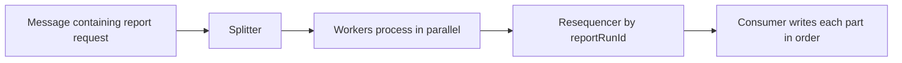
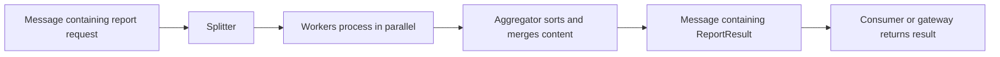

# Comparing Resequencer and Aggregator

## 1. Objectives and opening scenario

In Spring Integration Core, both a resequencer and an aggregator receive related messages and hold state while waiting. The deciding factor when choosing an endpoint is the **output contract**: a resequencer re-emits each message in sequence order; an aggregator produces a combined result from a group of messages.

Suppose a report export request is split into three parts. Workers process them in parallel so results return in the order `part 3 → part 1 → part 2`.

- If the receiver must write each part sequentially into an output stream, use a resequencer to receive `part 1 → part 2 → part 3` as three separate messages.
- If the receiver needs a single `ReportResult` object containing the entire report's contents, use an aggregator to produce one result message.
- If each part must be written in order and then a completion notification is needed afterward, you can combine both endpoints at appropriate places.

After this lesson, you will be able to read a `Message`/`MessageChannel` flow, identify whether ordering or aggregation is needed, configure Java DSL, and design tests distinguishing the two behaviors. API examples in this lesson take Spring Integration 6.5 as the reference baseline; libraries should be version-managed consistently within your project.

## 2. Output: multiple ordered messages vs. one aggregated result

### 2.1. Resequencer restores sequence order

For a group of three messages, the typical pattern is:

```text
Input:   Message(part-3), Message(part-1), Message(part-2)
Output:  Message(part-1), Message(part-2), Message(part-3)
```

A resequencer orders by the `sequenceNumber` header and keeps each message as a forwarding unit. It does not concatenate strings, sum numbers, or build a combined DTO. Ordering scope is per group sharing the same correlation key; two different reports can interleave on the same output channel. See the [Resequencer documentation](https://docs.spring.io/spring-integration/reference/6.5/resequencer.html).

“Release the whole group when complete” still means emitting multiple messages sequentially. It does not turn the group into a single message with a list payload.

### 2.2. Aggregator computes a result from the group

With the same data, an aggregator's default output is a single message whose payload contains the member payloads:

```text
Input:   Message(part-3), Message(part-1), Message(part-2)
Output:  Message(Collection(part-1, part-2, part-3))
```

The list above merely illustrates the members. Do not infer that the default aggregator automatically guarantees business order `1, 2, 3`. In the 6.5 implementation, `DefaultAggregatingMessageGroupProcessor` iterates over the group's collection to collect payloads without sorting by `sequenceNumber` on its own. When result order matters, sort explicitly in your aggregation logic. See the [default processor source code](https://github.com/spring-projects/spring-integration/blob/v6.5.0/spring-integration-core/src/main/java/org/springframework/integration/aggregator/DefaultAggregatingMessageGroupProcessor.java).

The aggregated result can also be a total amount, a selected quote, or a report DTO. The basic model is `n messages → 1 message per group release`; if you intentionally design multiple partial releases, one correlation key can produce multiple results over time.

## 3. Shared mechanisms to understand first

Both endpoints must resolve three questions:

| Question | Mechanism | Example |
|---|---|---|
| Which group does this message belong to? | `CorrelationStrategy` | Parts sharing `reportRunId` |
| When should the group be processed/released? | `ReleaseStrategy` | All three parts received |
| Where are waiting groups held? | `MessageGroupStore` | In-process memory or a suitable persistent store |

The correlation key and sequence position are two separate pieces of information. `reportRunId` identifies **which report**; `sequenceNumber` identifies **which part of that report**.

### 3.1. Three common headers

| Header | Constant in `IntegrationMessageHeaderAccessor` | Role in the example |
|---|---|---|
| `correlationId` | `CORRELATION_ID` | Same report export run |
| `sequenceNumber` | `SEQUENCE_NUMBER` | Position starting from 1: 1, 2, 3 |
| `sequenceSize` | `SEQUENCE_SIZE` | Expected total number of parts: 3 |

In the example, every message in the group must declare the same `sequenceSize`, valid positions, and a correlation key distinct per processing run. An `orderId` reused across multiple report exports may need to be paired with `runId`.

A standard splitter typically supplies sequence headers for finite output sets when sequence application is enabled. If you construct messages manually or use a splitter whose part count is unknown upfront, explicitly define how completion is signaled. Never treat `sequenceSize = 0` as a completed finite group.

### 3.2. Releasing a group and computing a result are two responsibilities

`ReleaseStrategy` only decides whether a group is ready. It does not decide what the result payload will be.

- With a resequencer, when permitted to release, the processor selects eligible messages in sequence order.
- With an aggregator, when permitted to aggregate, the processor computes the output from the group's members.

Therefore, changing an aggregator's `releaseStrategy` to `group -> group.size() == 3` does not turn it into a resequencer. Conversely, a resequencer waiting for three messages does not create a single combined report on its own.

## 4. Comparison table for choosing an endpoint

| Criterion | Resequencer | Aggregator |
|---|---|---|
| Primary need | Restore emission order of members | Compute a combined result for the group |
| Typical output | Multiple individual messages | One combined message per release |
| Member payloads | Forwarded as-is | Read to construct a result payload |
| Ordering | Based on sequence headers within each group | Must be specified if result depends on order |
| Default completion for finite sequences | Relies on sequence metadata | Relies on sequence size |
| Emit before the full sequence arrives | Supports contiguous-prefix release mode | Can design partial-release conditions |
| Business logic typically written | Sequence contract and waiting policy | Merge, select, join, sum, or DTO-building function |
| State to manage | Waiting messages and release progress | Waiting messages and group state |
| Shared caveats | Needs policies for missing, duplicate, late, and expired items | Needs policies for missing, duplicate, late, and expired items |

The table describes standard usage. Spring Integration allows customizing processors; for instance, an aggregator can be configured as a release barrier emitting individual messages using `SimpleMessageGroupProcessor`. When reading flows with such customizations, inspect the processor as well rather than inferring solely from the endpoint name. The [Aggregator documentation](https://docs.spring.io/spring-integration/reference/6.5/aggregator.html) describes exceptions and version-specific behavior.

## 5. Observing the same out-of-order sequence

Suppose group `R-42` has three parts, all with `sequenceSize = 3`, arriving in order `3 → 1 → 2`.

| Step | Incoming message | Full-group wait resequencer | Contiguous partial-release resequencer | Full-group wait aggregator |
|---|---|---|---|---|
| T1 | Part 3 | Holds part 3 | Holds part 3 because part 1 is missing | Holds part 3 |
| T2 | Part 1 | Holds parts 1 and 3 | Emits part 1; holds part 3 because part 2 is missing | Holds parts 1 and 3 |
| T3 | Part 2 | Emits 1, then 2, then 3 | Emits 2, then 3 | Produces one result from all three parts |

This is a finite scenario with no duplicates, no expiration, and no custom override of the default release strategy.

With a resequencer, `releasePartialSequences(true)` allows emitting **the next contiguous prefix**. If only parts 2 and 3 are present and part 1 has never been emitted, it must wait; sorting the present items into `2, 3` is not sufficient. Once part 1 has been emitted, part 2 becomes the next valid position. Verify this condition in [SequenceSizeReleaseStrategy](https://github.com/spring-projects/spring-integration/blob/v6.5.0/spring-integration-core/src/main/java/org/springframework/integration/aggregator/SequenceSizeReleaseStrategy.java).

This choice creates a practical trade-off:

- Wait for full group: easy to reason about completeness, but part 1 has to wait for the slowest part.
- Release contiguous prefixes: lowers latency for leading parts, but downstream may already perform partial work before discovering a later part was lost.

Once downstream has written part 1 to an external system, a timeout on part 2 will not automatically undo that write.

## 6. Java DSL example sharing the same dataset

### 6.1. Configuring two independent flows

The configuration below requires Spring Integration Core and Spring Context in the project. Inputs use `DirectChannel`; outputs use `QueueChannel` so the test program can pull messages with `receive(timeout)`. No broker is needed for this example.

```java
package example.integration;

import java.util.stream.Collectors;

import org.springframework.context.annotation.Bean;
import org.springframework.context.annotation.Configuration;
import org.springframework.integration.annotation.EnableIntegration;
import org.springframework.integration.channel.DirectChannel;
import org.springframework.integration.channel.QueueChannel;
import org.springframework.integration.dsl.IntegrationFlow;
import org.springframework.integration.support.MessageBuilder;
import org.springframework.messaging.Message;

import static org.springframework.integration.IntegrationMessageHeaderAccessor.CORRELATION_ID;
import static org.springframework.integration.IntegrationMessageHeaderAccessor.SEQUENCE_NUMBER;
import static org.springframework.integration.IntegrationMessageHeaderAccessor.SEQUENCE_SIZE;

@Configuration
@EnableIntegration
public class ReportFlows {

    public record ReportPart(int number, String text) {}

    public record ReportResult(String runId, String text) {}

    @Bean
    public DirectChannel resequenceInput() {
        return new DirectChannel();
    }

    @Bean
    public QueueChannel resequenceOutput() {
        return new QueueChannel();
    }

    @Bean
    public DirectChannel aggregateInput() {
        return new DirectChannel();
    }

    @Bean
    public QueueChannel aggregateOutput() {
        return new QueueChannel();
    }

    @Bean
    public IntegrationFlow orderedPartsFlow() {
        return IntegrationFlow.from(resequenceInput())
                .resequence(r -> r.releasePartialSequences(false))
                .channel(resequenceOutput())
                .get();
    }

    @Bean
    public IntegrationFlow completeReportFlow() {
        return IntegrationFlow.from(aggregateInput())
                .aggregate(a -> a.outputProcessor(group -> {
                    String runId = group.getMessages().iterator().next()
                            .getHeaders().get(CORRELATION_ID, String.class);

                    String text = group.getMessages().stream()
                            .sorted((left, right) -> Integer.compare(
                                    sequenceOf(left), sequenceOf(right)))
                            .map(message -> (ReportPart) message.getPayload())
                            .map(ReportPart::text)
                            .collect(Collectors.joining("|"));

                    return new ReportResult(runId, text);
                }))
                .channel(aggregateOutput())
                .get();
    }

    private static int sequenceOf(Message<?> message) {
        Integer number = message.getHeaders()
                .get(SEQUENCE_NUMBER, Integer.class);
        if (number == null) {
            throw new IllegalArgumentException("Missing sequenceNumber");
        }
        return number;
    }

    public static Message<ReportPart> part(
            String runId, int number, int total) {
        if (runId == null || runId.isBlank()
                || total < 1 || number < 1 || number > total) {
            throw new IllegalArgumentException("Invalid report sequence");
        }

        return MessageBuilder
                .withPayload(new ReportPart(number, "part-" + number))
                .setHeader(CORRELATION_ID, runId)
                .setHeader(SEQUENCE_NUMBER, number)
                .setHeader(SEQUENCE_SIZE, total)
                .build();
    }
}
```

Both flows use default correlation and release strategies; the resequencer explicitly specifies full-group waiting. Each flow maintains separate state. Using the same key value in both flows does not mean the two endpoints share a single group.

`ReportPart.number` makes payloads easy to inspect; the example intentionally sorts inside the aggregator by header to highlight the sequence contract. In real applications, verify consistency if the same position is represented in both the payload and the header.

The aggregation function returns a new `ReportResult` already containing `runId`. That keeps downstream independent of whether sequence headers remain after aggregation. With complex DTOs, avoid returning the group's internal collection because its lifecycle is managed by the group store.

The `.resequence(...)` and `.aggregate(...)` patterns are described in the [Java DSL guide](https://docs.spring.io/spring-integration/reference/6.5/dsl/java-aggregators.html); `outputProcessor` configures the result on [AggregatorSpec](https://github.com/spring-projects/spring-integration/blob/v6.5.0/spring-integration-core/src/main/java/org/springframework/integration/dsl/AggregatorSpec.java).

### 6.2. Running and observing outputs

Place the following program in the same package as the configuration class:

```java
package example.integration;

import org.springframework.context.annotation.AnnotationConfigApplicationContext;
import org.springframework.integration.channel.QueueChannel;
import org.springframework.messaging.Message;
import org.springframework.messaging.MessageChannel;

public class ReportDemo {

    public static void main(String[] args) {
        try (var context =
                new AnnotationConfigApplicationContext(ReportFlows.class)) {
            MessageChannel resequenceIn = context.getBean(
                    "resequenceInput", MessageChannel.class);
            MessageChannel aggregateIn = context.getBean(
                    "aggregateInput", MessageChannel.class);
            QueueChannel resequenceOut = context.getBean(
                    "resequenceOutput", QueueChannel.class);
            QueueChannel aggregateOut = context.getBean(
                    "aggregateOutput", QueueChannel.class);

            for (int number : new int[] {3, 1, 2}) {
                Message<ReportFlows.ReportPart> message =
                        ReportFlows.part("R-42", number, 3);
                require(resequenceIn.send(message), "Resequencer send failed");
                require(aggregateIn.send(message), "Aggregator send failed");
            }

            for (int expected = 1; expected <= 3; expected++) {
                Message<?> message = resequenceOut.receive(1_000);
                require(message != null, "Missing resequenced output");
                require(message.getPayload()
                        instanceof ReportFlows.ReportPart,
                        "Unexpected resequenced payload");
                var part = (ReportFlows.ReportPart) message.getPayload();
                require(part.number() == expected, "Wrong sequence order");
                System.out.println("resequence: " + part.text());
            }
            require(resequenceOut.receive(0) == null,
                    "Unexpected extra resequenced output");

            Message<?> message = aggregateOut.receive(1_000);
            require(message != null, "Missing aggregate output");
            var expected = new ReportFlows.ReportResult(
                    "R-42", "part-1|part-2|part-3");
            require(expected.equals(message.getPayload()),
                    "Wrong aggregate result");
            require(aggregateOut.receive(0) == null,
                    "Unexpected extra aggregate output");
            System.out.println("aggregate: " + message.getPayload());
        }
    }

    private static void require(boolean condition, String message) {
        if (!condition) {
            throw new IllegalStateException(message);
        }
    }
}
```

Expected output:

```text
resequence: part-1
resequence: part-2
resequence: part-3
aggregate: ReportResult[runId=R-42, text=part-1|part-2|part-3]
```

The key observation is **three `ReportPart` messages** versus **one `ReportResult` message**. Returning `true` from `send()` only confirms the send was accepted under the channel contract; it does not prove a group is complete. In this synchronous example, pulling from the outputs confirms the expected behavior.

## 7. Distinguishing two kinds of “partial results”

### 7.1. Partial release during normal processing

To test early release mode, change `orderedPartsFlow`'s configuration to:

```java
.resequence(r -> r.releasePartialSequences(true))
```

Create a fresh context for each test run so old group state is not reused. In this mode, an incomplete group can still emit part 1 when it arrives; part 3 continues waiting for part 2. An ordered run with a gap at the next expected position is not yet a valid prefix to release.

An aggregator can also use a release strategy that proactively releases before every member arrives—for example, upon a business condition. The output is still determined by the aggregation processor. Clearly define which parts were included, the group-closing condition, and how subsequent arrivals are handled.

### 7.2. Handling when a group expires

`sendPartialResultOnExpiry` governs group handling **upon expiration**, unlike `releasePartialSequences` during normal processing.

Example timeout policy configuration for the resequencer:

```java
.resequence(r -> r
        .releasePartialSequences(false)
        .groupTimeout(10_000)
        .sendPartialResultOnExpiry(false)
        .discardChannel("incompleteParts"))
```

Your application must provide an `incompleteParts` channel and a consumer that persists incomplete data for investigation or recovery. You can place a `QueueChannel` there if an appropriate task reads and processes the queue. Never declare a discard channel name and leave its messages unattended.

`groupTimeout` configures the timer for group expiration; it is not an execution-time limit on downstream business functions. With a fixed timeout value in the standard mechanism, the wait schedule may reset when the group receives another message; if you need a deadline measured from the first message, design a suitable timing expression or policy.

If sending partial results on expiry is enabled, define the business meaning of missing data upfront. Do not interpret every expired output as “group complete.” In particular, the resequencing processor and already-released state affect which parts can be forwarded; do not assume this option fills gaps or guarantees every position exists.

Keep three handling paths separate:

| Situation | Meaning | Handling approach |
|---|---|---|
| Group incomplete within time limit | Waiting normally | Continue holding state |
| Expired or message rejected by group policy | Completion criteria unmet | Discard channel, persist audit trail, and recover per business rules |
| Processor or downstream throws exception | Execution error | Exception handling, advice, or error flow per channel model |

`discardChannel` and `errorChannel` serve different situations. With a synchronous `DirectChannel`, exceptions typically propagate back to the calling thread; they do not automatically become an `ErrorMessage` sent to `errorChannel` simply because that header is present.

## 8. Placing the endpoint in the end-to-end flow

### 8.1. When individual side effects must happen in order



Example: output consists of file chunks where the consumer only accepts the next chunk in order. The resequencer must precede the order-sensitive write operation. Placing it after the write cannot repair side effects that already occurred out of order.

Emission order from the endpoint also does not guarantee completion order if the next step runs in parallel. If an `ExecutorChannel` with multiple workers sits immediately after the resequencer, part 2 can finish before part 1. Keep processing sequential per key where order is required; use a synchronous consumer or design suitable partitioning. Direct invocation on `DirectChannel` and executor handoff on `ExecutorChannel` are described in the [Message Channel documentation](https://docs.spring.io/spring-integration/reference/6.5/channel/implementations.html).

### 8.2. When only one final result is needed



In this scenario, the aggregator can sort the data inside its processor as shown in section 6. There is no need to add a resequencer purely to join parts if no intermediate consumer needs individual parts in order.

If you still chain `resequence() → aggregate()`, define separate responsibilities for each step. Do not rely on arrival order into the aggregator as sole proof of the output payload's order; the aggregation contract should express ordering explicitly.

### 8.3. Relationship to gateways and other endpoints

A gateway returning a single `ReportResult` fits a flow producing one aggregated result. A resequencer outputs multiple messages; you need a multi-result receiving protocol or an aggregation step before returning under a single-result request/reply contract. A Java return type of `List<ReportPart>` does not automatically combine separate replies into one reply.

If using a synchronous gateway to send each part one by one and wait for a reply on each call, early calls may block waiting on an incomplete group. Design clearly where parts are created, how they are sent, and when results are received; avoid a sequential call loop that blocks sending the remaining parts.

Transformers can normalize each part before it enters a group. Routers can select processing branches. Filters placed before a resequencer or aggregator require care: if a filter drops part 2 while the group still declares `sequenceSize = 3`, the full-group condition can never be met. The right policy must come from business requirements: emit a result marked failed, adjust the completion contract, or route the entire request to a missing-data flow. Do not arbitrarily lower `sequenceSize` on a few messages.

## 9. Behavioral tests to include

Section 6 includes checks in its demonstration program. When turning them into automated tests, use JUnit with a Spring Context; each test creates its own context or group key so state from an earlier run never interferes.

| Scenario | What to verify |
|---|---|
| Send 3, 1, then 2 in full-wait mode | No output before part 2; afterward three parts 1, 2, 3 appear |
| Send 3 then 1 with `releasePartialSequences(true)` | Part 1 is emitted; part 3 still waits |
| Send part 2 after the scenario above | Emits part 2 then part 3; does not re-emit part 1 |
| Aggregator receives 3, 1, then 2 | Exactly one `ReportResult` with content merged in order |
| Two groups A and B interleaved | Members of the two groups do not mix |
| Missing part 2 | Does not report completion merely because the highest number arrived |
| Redeliver one position | Duplicate behavior matches chosen policy; do not mistake duplicates for all positions present |
| Expires and then a late message arrives | Observe proper discard/recovery per group lifecycle |

For the sample flow using synchronous input and queue outputs, you can verify pre-completion state right after sending part 3 and part 1:

```java
require(resequenceOut.receive(0) == null,
        "Resequencer must wait for the complete sequence");
require(aggregateOut.receive(0) == null,
        "Aggregator must wait for the complete group");
```

In the prefix-release variant, send part 3 then part 1 and verify part 1 is received. A subsequent non-blocking receive must not yield part 3 yet. After sending part 2, verify 2 then 3 in order.

Never use `Thread.sleep()` to infer that a group has completed. With asynchronous flows, await outputs or observable signals with a bounded timeout; a single `receive(0)` immediately after `send()` does not prove no late result will arrive. Timeout tests should wait on a bounded expiry/discard event rather than relying on machine speed.

## 10. Common design mistakes and fixes

### 10.1. Using message count to stand in for completeness

Three arrived messages do not necessarily represent three distinct positions. For example, `1, 1, 3` has three deliveries yet still lacks position 2.

Do not treat the default aggregator as a business deduplication mechanism. `SimpleSequenceSizeReleaseStrategy` checks group size and does not enforce duplicate-sequence checks as a standalone guarantee. With sources that can redeliver, define an explicit idempotency policy—for example keying by `(runId, partNumber)` and specifying how two deliveries with the same key but different content are handled. See [SimpleSequenceSizeReleaseStrategy source](https://github.com/spring-projects/spring-integration/blob/v6.5.0/spring-integration-core/src/main/java/org/springframework/integration/aggregator/SimpleSequenceSizeReleaseStrategy.java).

Also do not equate the framework-assigned message ID with a part's business key. Two deliveries of the same part can carry two different message IDs.

### 10.2. Deleting state immediately without accounting for late messages

After finishing an aggregation or sequence run, the system may need to retain metadata to recognize a closed group. If all traces are deleted too early and a redelivery arrives, the same key can unintentionally start a new group.

Decide the late-message acceptance window, how long completion state is kept, and when cleanup runs. These choices relate to source redelivery behavior and recovery requirements, not solely memory savings.

### 10.3. Assuming a persistent store guarantees exactly-once processing

Both resequencer and aggregator are stateful. If groups live only in process memory, a restart can lose waiting parts. When state must survive restarts, select a compatible persistent `MessageGroupStore` and verify payload/header serialization.

In multi-instance deployments, also add consistent routing and compatible group-lock synchronization. If one instance holds part 1 and another holds part 2 in two local stores, neither sees a complete group.

A shared store also does not automatically create an atomic transaction across message receipt, group updates, and external side effects. Redelivery policies, idempotency, and transaction boundaries must still be designed.

### 10.4. Holding groups without bounds

An initial capacity estimate:

```text
Waiting payload volume ≈
    open groups
  × average parts held per group
  × average payload size
```

For example, 1,000 groups holding 20 parts each at 50 KiB per part already equals roughly 977 MiB for payloads alone. That excludes headers, group structures, store metadata, and object overhead. Measure with real data rather than treating this calculation as an exact heap limit.

With a resequencer, a slow low-numbered message can hold back many subsequent parts. With an aggregator, a single missing trailing result can also hold the entire group. Monitor open group count, oldest group age, held parts count, expired groups, discarded messages, and latency from the first part to result.

## 11. Selection checklist for a real requirement

1. **Describe what downstream actually receives.** If it must receive individual parts to process, determine whether exact order is needed. If it must receive one combined result, describe the result structure.
2. **Choose the group scope.** Use a key distinct per processing run; specify expected part count and positions clearly if using sequence headers.
3. **Choose the release condition.** Wait for the full group, release contiguous prefixes, or aggregate on a business condition; state precisely what may be missing at release.
4. **Define the incomplete policy.** Specify timeouts, failed parts, late messages, redeliveries, and recovery paths.
5. **Inspect ordering and state boundaries.** Check downstream channels, parallel execution, restarts, and multiple instances.
6. **Verify by observing outputs.** Check message counts, payload types, required ordering, and behavior on missing or duplicate items.

For the report problem in this lesson, choose a resequencer when forwarding each `ReportPart` in position order; choose an aggregator when building a `ReportResult`; and combine both when each step handles a distinct, observable, and verifiable requirement.
