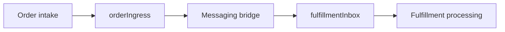
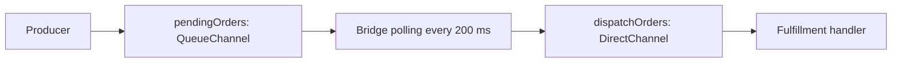

# Bridge Between Two Channels

In the **SPRING_INTEGRATION_CORE** module, a messaging bridge helps connect segments of a message flow when both sides already agree on the data contract. This lesson belongs to the **Messaging bridge** chapter, focusing on connecting two `MessageChannel`s, choosing the consumer based on the input channel, Java DSL configuration, error handling, and testing forwarding behavior.

## 1. Objectives and Use Case

After this lesson, you will be able to:

- Explain the role of a bridge in an integration flow.
- Connect a `DirectChannel` to a `QueueChannel`, or connect a `QueueChannel` to a `DirectChannel`.
- Place the poller on the right endpoint and predict the execution thread.
- Distinguish between message forwarding, data transformation, and routing.
- Verify payload, headers, timeouts, and error paths.

Suppose the order intake system publishes to the `orderIngress` channel. The fulfillment subsystem receives orders from `fulfillmentInbox`. Both use the same JSON payload and the same `orderId` header. If you only need to connect these two channel contracts, there is no need to write another service just to read the payload and create a new message.

Desired flow:



A bridge is an endpoint that connects channels or channel adapters; a typical use case is taking messages from a pollable channel and forwarding them to a subscribable channel. See [Messaging Bridge](https://docs.spring.io/spring-integration/reference/bridge.html).

To follow the examples, you need to know that a `Message` consists of a payload and headers, `send()` sends a message to a channel, and `receive()` is only available on channels that support polling-based reception. The configurations use the `IntegrationFlow.from(...)` API; choose a JDK and dependency set compatible with your application's Spring Integration version.

## 2. Channel, Endpoint, and BridgeHandler Are Three Distinct Roles

A fully configured bridge can be visualized as follows:

```text
inputChannel
    -> consumer endpoint
        -> BridgeHandler
            -> outputChannel
```

- **Channel** defines how a message is handed off to the receiver or buffered while waiting.
- **Consumer endpoint** binds the handler to the channel and manages subscription or the polling schedule.
- **BridgeHandler** performs the forwarding.

When the input is a `SubscribableChannel`, the framework uses an event-driven consumer. When the input is a `PollableChannel`, the framework uses a `PollingConsumer`. The handler does not need to write its own queue-reading loop. This is a general endpoint mechanism, not specific to bridges. See [Message Endpoints](https://docs.spring.io/spring-integration/reference/endpoint.html).

By `BridgeHandler`'s contract, the request message is forwarded to the output without being modified by this handler. A standard bridge does not actively change the payload type, add business headers, aggregate messages, or deep-copy the payload. Interceptors or tracking mechanisms configured separately on the flow can still affect the observed message. See [BridgeHandler API](https://docs.spring.io/spring-integration/api/org/springframework/integration/handler/BridgeHandler.html).

For example, if the input is:

```text
payload = {"orderId":"O-1001","amount":420000}
headers.orderId = O-1001
headers.correlationId = checkout-81
```

then the requirement for the bridge segment is that the downstream side still receives that exact content. If fulfillment requires a `ShipmentRequest` payload instead of JSON, place a transformer before the fulfillment channel.

| Need in the flow | Appropriate component |
| --- | --- |
| Forward to a configured target channel | Bridge |
| Convert JSON into a Java object | Transformer |
| Choose a target based on order type | Router |
| Accept or reject a message based on a condition | Filter |
| Invoke a business processing method | Service activator |
| Combine multiple messages by correlation group | Aggregator |
| Provide an interface to call into messaging from application code | Messaging gateway |

The table above shows how to decompose responsibilities for the order scenario: each component should take on one clear responsibility. You do not need to add a bridge after every endpoint; a transformer or service activator can already send its result to the next channel.

## 3. Choose the Channel Pair Before Writing the Bridge

| Input → output | How does the bridge receive messages? | Design meaning |
| --- | --- | --- |
| `DirectChannel → DirectChannel` | Subscriber, no poller | Connects two channel contracts; a typical direct chain runs on the sending thread |
| `DirectChannel → QueueChannel` | Subscriber, no poller | Receives directly and then places the message into the target queue |
| `QueueChannel → DirectChannel` | Polling consumer | Pulls waiting messages on a schedule, then invokes the direct chain on the polling task's thread |
| `QueueChannel → QueueChannel` | Polling consumer | Moves messages from the source queue to the target queue on a schedule |

The first thing to determine is the **type of the input channel**. Having a queue as the output does not mean the bridge needs a poller; a queue only needs polling when a consumer wants to pull messages out of it.

`DirectChannel` delivers one message to a single subscriber and processes it on the sending thread. `QueueChannel` holds messages waiting to be received; a bounded queue can cause send operations to wait or time out when full. If you want to broadcast to multiple subscribers, you must choose a channel with publish-subscribe semantics. See [Message Channel Implementations](https://docs.spring.io/spring-integration/reference/channel/implementations.html).

Design example:

```text
HTTP thread
    -> DirectChannel
        -> bridge
            -> QueueChannel
                ... message waiting ...
                    -> fulfillment consumer
```

The HTTP thread only executes the segment before the wait point. This does not mean the bridge spawns a fulfillment thread on its own. There must be a consumer downstream of the queue for the message to continue being processed.

## 4. Java DSL Example: DirectChannel to QueueChannel

Here is the standalone configuration for the first example. The classpath requires `spring-integration-core` and Spring Context; if using Spring Boot, manage dependency versions with your application's dependency management.

```java
import org.springframework.beans.factory.annotation.Qualifier;
import org.springframework.context.annotation.Bean;
import org.springframework.context.annotation.Configuration;
import org.springframework.integration.channel.DirectChannel;
import org.springframework.integration.channel.QueueChannel;
import org.springframework.integration.config.EnableIntegration;
import org.springframework.integration.dsl.IntegrationFlow;
import org.springframework.messaging.MessageChannel;

@Configuration(proxyBeanMethods = false)
@EnableIntegration
public class DirectBridgeConfig {

    @Bean
    public DirectChannel orderIngress() {
        return new DirectChannel();
    }

    @Bean
    public QueueChannel fulfillmentInbox() {
        return new QueueChannel(20);
    }

    @Bean
    public IntegrationFlow orderBridgeFlow(
            @Qualifier("orderIngress") MessageChannel source,
            @Qualifier("fulfillmentInbox") MessageChannel target) {

        return IntegrationFlow.from(source)
                .bridge(endpoint -> endpoint
                        .id("orderToFulfillmentBridge")
                        .sendTimeout(200))
                .channel(target)
                .get();
    }
}
```

Reading the configuration from top to bottom:

1. `orderIngress` is the input and supports subscribers.
2. `.bridge(...)` declares the forwarding step, with an endpoint ID for easy identification.
3. `sendTimeout(200)` limits the wait time when sending from the bridge to a channel that supports timed blocking sends.
4. `.channel(target)` specifies the forwarding destination.
5. `get()` finishes the flow declaration; Spring manages the endpoint when the context starts.

The `sendTimeout` option belongs to the consumer endpoint configuration. It is not a maximum deadline for all downstream business processing behind a `DirectChannel`. See [ConsumerEndpointSpec API](https://docs.spring.io/spring-integration/api/org/springframework/integration/dsl/ConsumerEndpointSpec.html).

Usage example after the context has started:

```java
Message<String> order = MessageBuilder
        .withPayload("{\"orderId\":\"O-1001\",\"amount\":420000}")
        .setHeader("orderId", "O-1001")
        .setHeader("correlationId", "checkout-81")
        .build();

boolean sent = orderIngress.send(order, 0);
Message<?> received = fulfillmentInbox.receive(0);
```

This snippet uses `org.springframework.messaging.Message` and `org.springframework.messaging.support.MessageBuilder`; both channel variables are retrieved from the context by bean name. With space available in the queue and no other consumer, `received` is the forwarded message.

Be careful to distinguish the two timeouts:

- `orderIngress.send(order, 0)` is the request to send to the input. With a `DirectChannel`, it does not interrupt a running chain of handler calls.
- `sendTimeout(200)` controls the send from the bridge into the target queue. When the target queue is full, forwarding can fail after this wait duration.

In this example, `sent == true` confirms that the message was accepted through the synchronous segment up to the target queue. It does not yet confirm that fulfillment has created a shipment.

## 5. Java DSL Example: QueueChannel to DirectChannel

In this case, the system needs to buffer orders before handing them off to direct processing:



Second standalone configuration:

```java
import java.time.Duration;

import org.springframework.beans.factory.annotation.Qualifier;
import org.springframework.context.annotation.Bean;
import org.springframework.context.annotation.Configuration;
import org.springframework.integration.channel.DirectChannel;
import org.springframework.integration.channel.QueueChannel;
import org.springframework.integration.config.EnableIntegration;
import org.springframework.integration.dsl.IntegrationFlow;
import org.springframework.integration.dsl.Pollers;
import org.springframework.messaging.MessageChannel;
import org.springframework.messaging.MessageHandler;

@Configuration(proxyBeanMethods = false)
@EnableIntegration
public class PolledBridgeConfig {

    @Bean
    public QueueChannel pendingOrders() {
        return new QueueChannel(100);
    }

    @Bean
    public DirectChannel dispatchOrders() {
        return new DirectChannel();
    }

    @Bean
    public QueueChannel dispatchedOrders() {
        return new QueueChannel(100);
    }

    @Bean
    public IntegrationFlow pendingToDispatchFlow(
            @Qualifier("pendingOrders") MessageChannel source,
            @Qualifier("dispatchOrders") MessageChannel target) {

        return IntegrationFlow.from(source)
                .bridge(endpoint -> endpoint
                        .id("pendingToDispatchBridge")
                        .poller(Pollers
                                .fixedDelay(Duration.ofMillis(200))
                                .maxMessagesPerPoll(5)
                                .receiveTimeout(0)))
                .channel(target)
                .get();
    }

    @Bean
    public IntegrationFlow dispatchConsumerFlow(
            @Qualifier("dispatchOrders") MessageChannel input,
            @Qualifier("dispatchedOrders") QueueChannel observed) {

        return IntegrationFlow.from(input)
                .handle((MessageHandler) message -> {
                    if (!observed.send(message, 0)) {
                        throw new IllegalStateException(
                                "Observation queue is full");
                    }
                })
                .get();
    }
}
```

`dispatchConsumerFlow` acts as an illustrative consumer: it writes messages into an observation queue for testing. In a real application, replace this handler with the fulfillment business operation. Do not register an observation handler alongside the business handler on the same `DirectChannel` and expect both to receive every message.

The poller is placed directly on `.bridge(...)` because the bridge is the direct consumer of `pendingOrders`. `dispatchConsumerFlow` receives from a `DirectChannel`, so it does not need a poller.

The options `maxMessagesPerPoll`, `receiveTimeout`, and `errorChannel` are provided by `PollerSpec`; `receiveTimeout` uses milliseconds. See [PollerSpec API](https://docs.spring.io/spring-integration/api/org/springframework/integration/dsl/PollerSpec.html).

## 6. Properly Understanding Polling and Throughput Limits

### 6.1. One Trigger Invocation Can Forward Multiple Messages

With the configuration in Section 5, each polling task:

1. Attempts to receive one message from `pendingOrders`.
2. If received, invokes the bridge and forwards to `dispatchOrders`.
3. Repeats up to the limit of five messages, or stops early when no message is received.
4. After the task completes, waits for the fixed delay interval and then runs the next task.

`maxMessagesPerPoll(5)` does not batch five orders into a single payload. The five messages are still forwarded one by one. If the queue only contains two orders, the bridge does not wait until five orders arrive.

Declaring the limit explicitly avoids relying on endpoint-type defaults. For a polling consumer, the default `maxMessagesPerPoll` is `-1`, unlike `SourcePollingChannelAdapter`, whose default is `1`. See [Channel Adapter — Poller Configuration](https://docs.spring.io/spring-integration/reference/channel-adapter.html).

### 6.2. Fixed Delay vs. Fixed Rate

- `fixedDelay`: measures the pause from when the previous task finished.
- `fixedRate`: measures the cadence from the scheduled start time.

Both mechanisms are trigger configurations, not guarantees of when processing will finish. See [Pollers API](https://docs.spring.io/spring-integration/api/org/springframework/integration/dsl/Pollers.html).

Example calculation for our design, under these assumptions:

- One polling task at a time, with no additional executor.
- The queue always has enough orders.
- Each order takes an average of 50 ms in the direct processing chain.
- Each task takes at most five messages.
- Fixed delay is 200 ms; minor scheduling overhead is ignored.

The approximate time to process one batch is:

```text
T_processing = 5 × 50 ms = 250 ms
T_cycle ≈ 250 ms + 200 ms = 450 ms
Throughput ≈ 5 / 0.45 ≈ 11.1 messages/second
```

If you simply calculate `5 / 0.2 = 25` messages/second, you are ignoring processing time. If there are receive waits, resource locks, or external service calls, actual throughput changes even further.

A poller can cause forwarding to happen in bursts; this configuration alone does not guarantee a partner's rule of "no more than N requests in any one-second window." For strict rate-limit contracts, you need to design an appropriate rate-limiting mechanism and measure traffic at the partner call site.

### 6.3. Receive Timeout Is the Wait Time for a Message

`receiveTimeout(0)` in the example causes the receive call to return immediately if the queue is empty. It allows the task to finish early in the illustrative scenario.

Do not confuse them:

| Option | Where it applies | Question it answers |
| --- | --- | --- |
| Poller trigger | Task execution schedule | When should the next task attempt to run? |
| `maxMessagesPerPoll` | Receive loop within one task | How many messages at most in this batch? |
| `receiveTimeout` | Receiving from a pollable input | How long to wait for a message to become available? |
| `sendTimeout` | Sending from the handler to output | How long to wait for the target channel to accept the message? |

Shortening `receiveTimeout` does not shorten the processing time of the fulfillment handler. Likewise, increasing `maxMessagesPerPoll` does not create extra threads on its own.

## 7. Execution Thread and the Meaning of the `send()` Result

### 7.1. Direct Chain

If both channels are `DirectChannel`s, the call path usually looks like this:

```text
Thread calling send()
    -> input.send(message)
        -> BridgeHandler
            -> output.send(message)
                -> business handler
    <- send() returns after the synchronous chain completes
```

The bridge does not create an asynchronous boundary in this configuration. If the business handler takes two seconds, the calling thread can remain blocked for those two seconds. The behavior of invoking subscribers on the sending thread is documented at [DirectChannel API](https://docs.spring.io/spring-integration/api/org/springframework/integration/channel/DirectChannel.html).

### 7.2. Queue at the Input

With the `PolledBridgeConfig` configuration:

```text
Producer thread:
    pendingOrders.send(message)
    -> puts message into the queue
    -> continues producer work

Thread executing the polling task, at a different time:
    pendingOrders.receive(...)
    -> BridgeHandler
        -> dispatchOrders.send(message)
            -> dispatchConsumerFlow
```

Do not expect to catch errors on the polling thread by wrapping only the `pendingOrders.send(...)` call in a `try/catch`. That send call may already have finished earlier.

In designs that use an `ExecutorChannel`, the thread handoff point is created by the channel's executor. When analyzing a flow, mark every queue, executor, and background task point before deciding where to handle errors.

### 7.3. What Does a Successful Send Confirm?

Express outcomes according to the observation point:

- "Order entered `pendingOrders`" when the producer successfully sends to the source queue.
- "Order passed the bridge" when the message is observed on the target channel.
- "Shipment created" when the fulfillment handler completes the business operation.
- "Persistently stored" when the relevant storage mechanism confirms success according to its configuration.

In the source-queue example, these milestones occur at different times. Collapsing them into a single "send succeeded" status makes it difficult to track stalled orders.

## 8. Configuration Using Annotations or BridgeHandler

Java DSL is one configuration option. If the application uses standalone channel beans, annotations can be used for the same purpose.

The snippets below are **alternatives** to the bridge in Section 5. Choose only one approach for the same channel pair; keep the consumer on `dispatchOrders` to receive messages.

### 8.1. BridgeTo Placed on the Source Channel

Place the following methods in a `@Configuration` class annotated with `@EnableIntegration`:

```java
@Bean
@BridgeTo(
        value = "dispatchOrders",
        poller = @Poller(fixedDelay = "200", maxMessagesPerPoll = "5",
                receiveTimeout = "0"))
public QueueChannel pendingOrders() {
    return new QueueChannel(100);
}

@Bean
public DirectChannel dispatchOrders() {
    return new DirectChannel();
}
```

Import `BridgeTo` and `Poller` from the `org.springframework.integration.annotation` package. The annotation goes on the source bean; `value` specifies the target bean name.

### 8.2. BridgeFrom Placed on the Target Channel

For the same channel pair, the connection direction can be expressed from the target side:

```java
@Bean
public QueueChannel pendingOrders() {
    return new QueueChannel(100);
}

@Bean
@BridgeFrom(
        value = "pendingOrders",
        poller = @Poller(fixedDelay = "200", maxMessagesPerPoll = "5",
                receiveTimeout = "0"))
public DirectChannel dispatchOrders() {
    return new DirectChannel();
}
```

`BridgeFrom` is in the same annotation package. `value` specifies the source bean name.

These two annotations declare a bridge during Spring configuration processing; they do not turn the two channels into the same object. See the annotation variants at [Messaging Bridge — Java Configuration](https://docs.spring.io/spring-integration/reference/bridge.html#bridge-java).

### 8.3. Declaring BridgeHandler Directly

Another variant, replacing the two annotations or the DSL above:

```java
@Bean
@ServiceActivator(
        inputChannel = "pendingOrders",
        poller = @Poller(fixedDelay = "200", maxMessagesPerPoll = "5",
                receiveTimeout = "0"))
public BridgeHandler pendingOrdersBridgeHandler() {
    BridgeHandler handler = new BridgeHandler();
    handler.setOutputChannelName("dispatchOrders");
    handler.setSendTimeout(200);
    return handler;
}
```

Import `ServiceActivator` from `org.springframework.integration.annotation` and `BridgeHandler` from `org.springframework.integration.handler`. This approach makes the handler performing the forwarding explicit; the annotation creates the appropriate consumer for the input.

If you accidentally enable both the DSL and an annotation variant at the same time, you may create multiple consumers pulling from the same source queue. Messages can then be split across consumers, making observation and error handling behave differently from a single-bridge design.

## 9. Bridge Without an Output and `replyChannel`

A terminal bridge can use the message's `replyChannel` if no output is configured. If both the output and reply channel are absent, processing will fail. See [BridgeHandler API](https://docs.spring.io/spring-integration/api/org/springframework/integration/handler/BridgeHandler.html).

Example flow method, placed in a standalone Spring Integration configuration:

```java
@Bean
public IntegrationFlow echoBridgeFlow() {
    return IntegrationFlow.from("echoInput")
            .bridge()
            .get();
}
```

After retrieving `echoInput` from the context, the sender provides the reply destination:

```java
QueueChannel replies = new QueueChannel(1);

Message<String> request = MessageBuilder
        .withPayload("bridge-check")
        .setReplyChannel(replies)
        .build();

echoInput.send(request);
Message<?> reply = replies.receive(1_000);
```

Here, the bridge forwards the message to the reply destination. It does not generate a new business result on its own. If the call goes through a messaging gateway, the gateway can set up the reply channel for the request-reply model; whether the gateway receives a message must still be interpreted according to the flow's processing contract.

In a one-way design such as sending orders to fulfillment, configuring an explicit output channel makes the intent clearer.

## 10. Error Handling at the Bridge

### 10.1. Errors in a Synchronous Chain

If the input and downstream segment run on the same thread, errors can propagate back to the `send()` caller. For example:

- The output is a `DirectChannel` with no subscriber.
- The target queue is full and the send times out.
- A downstream handler throws an exception.

Errors from a handler may be wrapped in a messaging exception; you should not assume you will always catch the exact original business exception type.

### 10.2. Errors in a Polling Task

When a producer has already placed a message into the queue and the bridge processes it later, errors cannot be thrown back across a send call that has already completed. Spring Integration's default error-handling mechanism for polling tasks can publish an `ErrorMessage`; the error channel in the request header is checked before the global default channel. See [Error Handling](https://docs.spring.io/spring-integration/reference/error-handling.html).

To demonstrate a dedicated error destination, add the following bean to `PolledBridgeConfig`:

```java
@Bean
public QueueChannel bridgeErrors() {
    return new QueueChannel(50);
}
```

Then update the existing bridge's poller to:

```java
.poller(Pollers
        .fixedDelay(Duration.ofMillis(200))
        .maxMessagesPerPoll(5)
        .receiveTimeout(0)
        .errorChannel("bridgeErrors"))
```

This is a modification to the existing flow, not registering a second bridge. This example does not attach a separate `errorChannel` header to the request.

The `bridgeErrors` queue serves as an error collection point for this exercise. In long-running production operation, there must be a consumer that processes errors or routes them to a designed storage, alerting, and recovery mechanism; a bounded queue cannot hold errors forever.

When inspecting an `ErrorMessage`, check:

- The `Throwable` in the payload.
- The cause chain if the error has been wrapped.
- The failed message if the exception is a `MessagingException` that provides it.
- The order ID or correlation ID to tie it back to the original request.

### 10.3. Routing Errors Does Not Mean Retrying

In the in-memory queue example, the poller has already removed the message from the source queue before calling the handler. If downstream fails, simply sending the error to `bridgeErrors` does not automatically put the order back into the source queue.

Suppose the handler successfully called the shipment creation API, and then failed while recording the result. If you implement a retry for the whole operation, the API might be called again. For this business case, a design could use `orderId` as an idempotency key and persist processing state before allowing a resend.

This is a business correctness decision. A bridge does not provide retries, deduplication, or exactly-once guarantees on its own.

## 11. Backpressure, Storage, and Transactions

### 11.1. A Queue Can Only Absorb a Finite Backlog

Consider a realistic measurement scenario:

```text
Producer input rate:     20 orders/second
Bridge and downstream:   11 orders/second
Backlog growth rate:     9 orders/second
Source queue capacity:   100 orders
```

If the queue starts empty and these rates remain constant, the time to fill up is approximately `100 / 9 = 11.1 seconds`. This is an estimate for this scenario and does not account for fluctuations or in-flight messages.

When the source queue becomes full, the producer must have a policy: wait within an allowed duration, reject the request, or move to an appropriate buffering store. Increasing capacity only delays the time until full if the rate mismatch persists.

Using a bounded queue and an explicit timeout turns overload into a manageable behavior. The no-argument capacity constructor of `QueueChannel` uses a limit of `Integer.MAX_VALUE`; that is not a viable memory-control strategy for business load. See [QueueChannel API](https://docs.spring.io/spring-integration/api/org/springframework/integration/channel/QueueChannel.html).

In the first example, if `fulfillmentInbox` is full, the bridge has to wait at the step of sending to the target. Adding a bridge does not create extra processing capacity in the fulfillment subsystem.

### 11.2. A Bridge Does Not Turn an In-Memory Queue into a Message Broker

The queues in the examples are created with `new QueueChannel(...)`, which uses the default in-memory storage. If messages need to survive restarts, you must choose a persistent message store or a channel/adapter solution backed by appropriate storage infrastructure. See [Message Channel Implementations — QueueChannel](https://docs.spring.io/spring-integration/reference/channel/implementations.html#channel-implementations-queuechannel).

For a critical order, determine separately:

- Where is the order stored before responding to the producer?
- After being pulled from the source but before finishing delivery to the target, what mechanism supports recovery?
- If reprocessed, what prevents creating two shipments?
- Which steps truly belong to the same transaction?

A bridge connecting two channels inside an application does not connect two JVMs on its own. To cross process or system boundaries, you need a channel implementation or adapter that handles the relevant protocol.

### 11.3. Transactions Depend on Execution Boundaries and Resources

A direct chain can participate in the calling thread's transaction if downstream operations are configured accordingly. A poller can start its own transaction for the receive-and-process task; whether receiving can be rolled back depends on whether the underlying resource participates in the transaction. See [Transaction Support](https://docs.spring.io/spring-integration/reference/transactions.html).

Therefore, do not assume that merely adding transactional configuration will make an ordinary in-memory queue automatically recover messages like a transactional queue resource. Likewise, a database transaction cannot automatically roll back an HTTP request already executed by a partner service.

For a queue-to-direct bridge, draw the intended transaction boundary around the polling task, then list the resources actually managed within that boundary.

## 12. Testing the Forwarding Contract

The code below is a test example to include in the practice project. It requires JUnit Jupiter and the two standalone configuration classes from Sections 4 and 5. No web server needs to be started to verify this flow segment.

### 12.1. Testing Both Connection Directions and a Full Target Queue

```java
import org.junit.jupiter.api.Test;
import org.springframework.context.annotation.AnnotationConfigApplicationContext;
import org.springframework.integration.channel.QueueChannel;
import org.springframework.messaging.Message;
import org.springframework.messaging.MessageChannel;
import org.springframework.messaging.MessagingException;
import org.springframework.messaging.support.MessageBuilder;

import static org.junit.jupiter.api.Assertions.*;

class BridgeFlowTest {

    @Test
    void forwardsMessageFromDirectToQueue() {
        try (var context =
                     new AnnotationConfigApplicationContext(
                             DirectBridgeConfig.class)) {

            MessageChannel input = context.getBean(
                    "orderIngress", MessageChannel.class);
            QueueChannel output = context.getBean(
                    "fulfillmentInbox", QueueChannel.class);

            Message<String> original = MessageBuilder
                    .withPayload("order-O-1001")
                    .setHeader("orderId", "O-1001")
                    .setHeader("correlationId", "checkout-81")
                    .build();

            assertTrue(input.send(original, 0));

            Message<?> actual = output.receive(0);
            assertNotNull(actual);
            assertSame(original, actual);
            assertEquals("order-O-1001", actual.getPayload());
            assertEquals("O-1001",
                    actual.getHeaders().get("orderId"));
            assertEquals("checkout-81",
                    actual.getHeaders().get("correlationId"));
            assertNull(output.receive(0));
        }
    }

    @Test
    void pollsQueuedMessageAndDispatchesIt() {
        try (var context =
                     new AnnotationConfigApplicationContext(
                             PolledBridgeConfig.class)) {

            MessageChannel input = context.getBean(
                    "pendingOrders", MessageChannel.class);
            QueueChannel observed = context.getBean(
                    "dispatchedOrders", QueueChannel.class);

            Message<String> original = MessageBuilder
                    .withPayload("order-O-1002")
                    .setHeader("orderId", "O-1002")
                    .build();

            assertTrue(input.send(original, 0));

            Message<?> actual = observed.receive(2_000);
            assertNotNull(actual);
            assertEquals(original.getPayload(), actual.getPayload());
            assertEquals(original.getHeaders().getId(),
                    actual.getHeaders().getId());
            assertEquals("O-1002",
                    actual.getHeaders().get("orderId"));
        }
    }

    @Test
    void reportsFailureWhenTargetQueueRemainsFull() {
        try (var context =
                     new AnnotationConfigApplicationContext(
                             DirectBridgeConfig.class)) {

            MessageChannel input = context.getBean(
                    "orderIngress", MessageChannel.class);
            QueueChannel output = context.getBean(
                    "fulfillmentInbox", QueueChannel.class);

            for (int i = 0; i < 20; i++) {
                Message<String> filler = MessageBuilder
                        .withPayload("filler-" + i)
                        .build();
                assertTrue(output.send(filler, 0));
            }

            Message<String> next = MessageBuilder
                    .withPayload("order-O-1003")
                    .build();

            assertThrows(MessagingException.class,
                    () -> input.send(next, 0));
            assertEquals(20, output.getQueueSize());
        }
    }
}
```

The first test verifies that the exact message instance is preserved in this minimal configuration, while checking the payload and header contract. If tracking or an interceptor is enabled that replaces the message, adjust the identity check to match that configuration; the business goal is that the required data is forwarded intact.

The second test waits at the observation point with a finite timeout. Do not use `Thread.sleep(200)` and assume the scheduler has definitely run. The 2,000 ms timeout is the wait budget for this exercise and may need adjustment depending on the test environment.

The third test fills the target queue deterministically and verifies failure on the direct segment. It does not measure timeouts using an absolute time threshold that can easily flake under scheduler or test-machine variance.

### 12.2. Testing the Polling Error Path in a Separate Configuration

Create a configuration variant dedicated to the error scenario:

1. Keep the source queue and polled bridge as in Section 5.
2. Add `bridgeErrors` and configure `.errorChannel("bridgeErrors")` as in Section 10.
3. Replace the observation handler with a handler that always throws `IllegalStateException`.
4. Send a message with `orderId` into the source queue.
5. Receive from `bridgeErrors` with a finite timeout.
6. Verify that an `ErrorMessage` is received, the error cause is found, and the failed message carries the expected order ID.

The intentionally failing handler can be written as:

```java
.handle((MessageHandler) message -> {
    throw new IllegalStateException("Simulated fulfillment error");
})
```

Do not register an error handler alongside a successful handler on the same `DirectChannel` and use that as a deterministic error test. Give the error scenario its own consumer in a separate context.

Example verifying the error details after retrieving the beans from the error configuration:

```java
Message<String> original = MessageBuilder
        .withPayload("order-O-FAIL")
        .setHeader("orderId", "O-FAIL")
        .build();

assertTrue(pendingOrders.send(original, 0));

Message<?> error = bridgeErrors.receive(2_000);
assertNotNull(error);
assertInstanceOf(
        org.springframework.messaging.support.ErrorMessage.class,
        error);

Throwable cause = (Throwable) error.getPayload();
MessagingException failed = null;
boolean foundBusinessFailure = false;

while (cause != null) {
    if (cause instanceof MessagingException messaging
            && messaging.getFailedMessage() != null) {
        failed = messaging;
    }
    if (cause instanceof IllegalStateException
            && "Simulated fulfillment error".equals(cause.getMessage())) {
        foundBusinessFailure = true;
    }
    cause = cause.getCause();
}

assertTrue(foundBusinessFailure);
assertNotNull(failed);
assertEquals("O-FAIL",
        failed.getFailedMessage().getHeaders().get("orderId"));
```

Here `pendingOrders` and `bridgeErrors` are channel beans retrieved from the error context. Sending to `pendingOrders` is verified separately from receiving error details, properly reflecting the asynchronous boundary.

## 13. Diagnosing Common Misconfigurations

| Symptom | Hypothesis to check | How to check in the order example |
| --- | --- | --- |
| Context fails to create a consumer from a queue | The bridge is missing a poller and there is no default poller | Inspect the endpoint reading `pendingOrders` |
| Poller declared but input is direct | Poller placed on a consumer receiving from a non-pollable channel | Check the input bean type and remove the poller on the direct segment |
| Send to queue succeeds but no processing occurs | No consumer, endpoint not started, or queue has a backlog | Check queue size, endpoint state, and error path |
| Reports no subscriber on the target channel | Downstream consumer not declared or not started | Check that `dispatchConsumerFlow` is registered |
| Bridge has nowhere to forward next | Missing both output channel and `replyChannel` | Check whether the intent is one-way or request-reply |
| Only one of two handlers receives orders | Both handlers are registered on a `DirectChannel` | Decide if broadcast is needed and choose the appropriate channel |
| Producer slows down when sending | Target queue is full or direct chain takes too long | Measure handler duration and monitor capacity |
| Polling errors do not appear in producer's catch block | Processing happens after send has completed | Observe the poller's error flow |
| Flow repeatedly loops the same message | A bridge path loops back to the source | Draw the channel graph and remove unintended cycles |

Cases of a missing poller or configuring a poller on an incompatible input fall under the framework's consumer creation rules. See [Message Endpoints — Configuration](https://docs.spring.io/spring-integration/reference/endpoint.html).

Example of reasoning from the graph: connecting `A → bridge → B` and then adding `B → bridge → A` creates a cycle. In a direct chain, calls can recurse on the stack; with queues, messages can circulate and consume resources. Therefore, even when splitting flows across multiple modules, you still need to inspect the full connection graph.

## 14. Extended Practice

Use the lesson's configuration to make the following small changes:

1. Send 12 orders into `pendingOrders`, each with a different `orderId`, and collect all 12 results. Observe them going through multiple tasks when the limit is five messages per task.
2. Add a transformer before the fulfillment channel to change the payload. Explain why that operation belongs to a transformer.
3. Slow down the illustrative handler, monitor the source queue size, and compare the measured throughput with the fixed-delay estimate.
4. Run the polling error scenario separately, and read the error cause and order ID from the failed message.
5. Document the application behavior required when the source queue or error queue becomes full.

When practicing, keep the success and error contexts independent so observed results do not depend on an accidentally shared consumer.

## 15. Principles to Keep in Mind When Designing

A bridge is appropriate when both sides are already message-compatible and you need a clear connection point. Before adding one to a flow, determine whether the input is subscribable or pollable, which thread passes through the processing segment, the forwarding destination, and how errors will be observed.

For the order pipeline in this lesson, the key decisions are queue capacity, polling cadence, downstream processing time, and the point of success confirmation. Retries, durable persistence, transactions, and duplicate-processing prevention must be designed alongside the application's actual resources.
