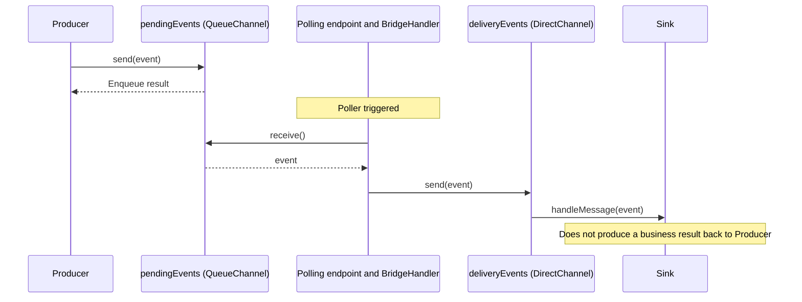

# One-Way Bridge

## 1. Lesson Objectives

In the **Messaging bridge** chapter of the **SPRING_INTEGRATION_CORE** module, this lesson focuses on connecting two `MessageChannel`s to forward messages in one direction. The running scenario is receiving an order event, passing it to a channel for the next processing stage, and not requiring a business result to be returned to the sender.

After this lesson, you will be able to:

- Design an `input channel → bridge → output channel` flow using Java DSL.
- Determine when a bridge needs a poller based on the input channel type.
- Distinguish between a one-way contract, synchronous execution, and a business reply.
- Verify payload forwarding, headers, destination delivery, and error behavior.

You should know how to create a `Message<?>`, the difference between `SubscribableChannel` and `PollableChannel`, and the role of an endpoint in Spring Integration. The examples use `spring-integration-core`; the test example also requires JUnit Jupiter and `spring-test`. Manage library versions using a compatible project dependency/BOM set.

## 2. What Does a One-Way Bridge Mean?

A messaging bridge is an endpoint that connects message channels. With a one-way bridge, the application defines a path from channel A to channel B, and the sender does not expect a business result message back through the same send operation. This channel-connecting pattern is described in [Spring Integration Messaging Bridge](https://docs.spring.io/spring-integration/reference/bridge.html).


The contract for this example is: the producer sends an `OrderAccepted` event; the consumer receives the event to perform its work. The producer does not receive an `OrderProcessingResult` object from the bridge.

`BridgeHandler` forwards the input message without actively transforming its payload or headers. Therefore, place data normalization in a transformer and content-based target selection in a router if the business logic requires those steps. This is a property of the [`BridgeHandler` API](https://docs.spring.io/spring-integration/api/org/springframework/integration/handler/BridgeHandler.html).

For example, if the producer sends the string payload `"order:42"`, the bridge does not convert it to JSON or an order object on its own. The consumer must understand the data contract agreed upon by both sides.

### One-Way and Asynchronous Are Separate Decisions

One-way describes whether the sender expects a business result. Asynchronous describes whether processing is decoupled from the sender's execution thread. You can design a one-way flow where the handlers still execute directly on the thread calling `send()`.

For instance, a log notification may not need a return value, yet the write operation still takes time. Changing a return type to `void` does not make the operation run in the background on its own.

## 3. Read the Topology Before Configuring the Bridge

A bridge consists of forwarding logic and an endpoint responsible for receiving messages. With a subscribable channel, the endpoint is invoked when a message arrives. With a channel from which messages must be pulled via `receive()`, the endpoint requires a poller. These two reception modes are explained in [Message Endpoints](https://docs.spring.io/spring-integration/reference/endpoint.html).

| Input → output | How the bridge receives messages | Next questions to resolve |
| --- | --- | --- |
| `DirectChannel → DirectChannel` | Receives via subscription | Who is the subscriber on the target channel? |
| `DirectChannel → QueueChannel` | Receives via subscription | Who will read the output queue? |
| `QueueChannel → DirectChannel` | Poller pulls messages from input | How are the polling rate and downstream errors handled? |
| `QueueChannel → QueueChannel` | Poller pulls messages from input | At what rate is the target queue consumed? |

The practical rule is to look at the **endpoint's input** to decide whether to configure a poller for the bridge. Having a queue as the output does not mean the bridge polls that queue; pulling messages from the output is the job of the next consumer.

In standard configurations, `DirectChannel` invokes its subscriber on the sender's thread, while `QueueChannel` stores messages until a consumer pulls them. `QueueChannel` stores messages in memory by default. These characteristics are presented in [Message Channel Implementations](https://docs.spring.io/spring-integration/reference/channel/implementations.html).

## 4. Java DSL Example: Forwarding Events into a Queue

Suppose the application receives order events on `ordersIngress`. The next processing component only knows `ordersBuffered`; we use a bridge to connect these two channel contracts.

```java
import org.springframework.beans.factory.annotation.Qualifier;
import org.springframework.context.annotation.Bean;
import org.springframework.context.annotation.Configuration;
import org.springframework.integration.channel.DirectChannel;
import org.springframework.integration.channel.QueueChannel;
import org.springframework.integration.config.EnableIntegration;
import org.springframework.integration.dsl.IntegrationFlow;
import org.springframework.messaging.MessageChannel;
import org.springframework.messaging.PollableChannel;

@Configuration
@EnableIntegration
public class OneWayBridgeConfig {

    @Bean
    public MessageChannel ordersIngress() {
        return new DirectChannel();
    }

    @Bean
    public PollableChannel ordersBuffered() {
        return new QueueChannel(100);
    }

    @Bean
    public IntegrationFlow ordersBridgeFlow(
            @Qualifier("ordersIngress") MessageChannel input,
            @Qualifier("ordersBuffered") PollableChannel output) {

        return IntegrationFlow.from(input)
                .bridge(endpoint -> endpoint.id("ordersOneWayBridge"))
                .channel(output)
                .get();
    }
}
```

Meaning of each part:

- `ordersIngress` is the entry point used by the producer.
- `.bridge(...)` declares the forwarding step and names the endpoint for easy identification during operation.
- `.channel(output)` specifies the forwarding destination as `ordersBuffered`.
- The queue has a capacity of 100 messages in this example; this is an illustrative choice, not a default setting to apply to every system.

The DSL represents the connection as Spring-managed endpoint and channel beans. The bridge declaration syntax can be compared with [the Java DSL section in Messaging Bridge](https://docs.spring.io/spring-integration/reference/bridge.html).

This configuration ends at the queue for convenient observation and testing. In an application, you need to add a consumer reading `ordersBuffered`. When there is no consumer yet, the bridge can still enqueue messages as long as space remains; the downstream business work has not yet been performed.

### Sending and Observing a Message

The following snippet runs once an `ApplicationContext` containing `OneWayBridgeConfig` has been initialized. The two variables `input` and `output` are the corresponding beans injected into the caller.

```java
import org.springframework.messaging.Message;
import org.springframework.messaging.support.MessageBuilder;

Message<String> event = MessageBuilder.withPayload("order:42")
        .setHeader("eventType", "OrderAccepted")
        .setHeader("orderId", "42")
        .build();

boolean accepted = input.send(event);
Message<?> forwarded = output.receive(0);
```

In this low-load example, `accepted` is `true`, and `forwarded` contains the payload `"order:42"` along with the business headers that were set. `receive(0)` is a way to inspect the queue, not a call waiting for a reply from the bridge.

`send()` returns the boolean outcome of the send operation, not the order processing result. If you need to know whether an order succeeded or failed after the consumer processes it, design an additional status event carrying the order identifier or an appropriate request–reply protocol.

## 5. Configuring via `BridgeHandler` When You Need an Explicit Output Timeout

You can replace the `ordersBridgeFlow` bean above with the following Java configuration. The `ordersIngress` and `ordersBuffered` beans remain unchanged.

```java
import org.springframework.context.annotation.Bean;
import org.springframework.integration.annotation.ServiceActivator;
import org.springframework.integration.handler.BridgeHandler;

@Bean
@ServiceActivator(inputChannel = "ordersIngress")
public BridgeHandler ordersBridgeHandler() {
    BridgeHandler bridge = new BridgeHandler();
    bridge.setOutputChannelName("ordersBuffered");
    bridge.setSendTimeout(1_000L);
    return bridge;
}
```

This is an **alternative** to the DSL bean, not a second endpoint to add to the same input. If both register on `ordersIngress`, you have created multiple consumers instead of the single bridge in the original design.

`setSendTimeout(1_000L)` configures the wait timeout for sending from the handler to an output channel that supports timeouts. It is useful when the target queue may fill up; it does not set a completion deadline for all downstream business work. See the `setSendTimeout` contract in [the message-producing handler API](https://docs.spring.io/spring-integration/api/org/springframework/integration/handler/AbstractMessageProducingHandler.html).

Likewise, do not infer that `input.send(event, 1_000L)` will stop every handler after exactly one second. In this topology, the wait limit when inserting into the target queue should be configured on the bridge's send operation.

## 6. Poller Example: Pulling Events from a Queue and Forwarding

In the second topology, the producer writes to `pendingEvents`. The bridge is responsible for pulling events and sending them to `deliveryEvents`; a sink on the target channel simply receives the messages.



The configuration below is independent of `OneWayBridgeConfig` from the previous section:

```java
import java.time.Duration;

import org.springframework.beans.factory.annotation.Qualifier;
import org.springframework.context.annotation.Bean;
import org.springframework.context.annotation.Configuration;
import org.springframework.integration.channel.DirectChannel;
import org.springframework.integration.channel.QueueChannel;
import org.springframework.integration.config.EnableIntegration;
import org.springframework.integration.dsl.IntegrationFlow;
import org.springframework.integration.dsl.Pollers;
import org.springframework.messaging.MessageChannel;
import org.springframework.messaging.MessageHandler;
import org.springframework.messaging.PollableChannel;

@Configuration
@EnableIntegration
public class PollingOneWayBridgeConfig {

    @Bean
    public PollableChannel pendingEvents() {
        return new QueueChannel(100);
    }

    @Bean
    public MessageChannel deliveryEvents() {
        return new DirectChannel();
    }

    @Bean
    public PollableChannel bridgeErrors() {
        return new QueueChannel(100);
    }

    @Bean
    public IntegrationFlow pendingToDelivery(
            @Qualifier("pendingEvents") PollableChannel input,
            @Qualifier("deliveryEvents") MessageChannel output) {

        return IntegrationFlow.from(input)
                .bridge(endpoint -> endpoint
                        .id("pendingEventsBridge")
                        .poller(Pollers.fixedDelay(Duration.ofMillis(500))
                                .maxMessagesPerPoll(10)
                                .receiveTimeout(0)
                                .errorChannel("bridgeErrors")))
                .channel(output)
                .get();
    }

    @Bean
    public IntegrationFlow deliverySink(
            @Qualifier("deliveryEvents") MessageChannel input) {

        MessageHandler sink = message ->
                System.out.println("RECEIVED: " + message.getPayload());

        return IntegrationFlow.from(input)
                .handle(sink)
                .get();
    }
}
```

The sink uses a `MessageHandler` only to illustrate the end of the flow. A real application can replace it with a persistence component or an outbound channel adapter.

### Understanding Poller Parameters Correctly

| Parameter | Role in the example |
| --- | --- |
| `fixedDelay(500 ms)` | Waits 500 ms from when the previous poll completes until the next poll begins |
| `maxMessagesPerPoll(10)` | Allows pulling and processing at most 10 messages in a single poll |
| `receiveTimeout(0)` | Does not wait for a new message if the current receive encounters an empty queue |
| `errorChannel("bridgeErrors")` | Sets the default channel for poller errors in this configuration |

`Pollers` is the poller configuration builder; `receiveTimeout` and `errorChannel` have their own contracts in [the `PollerSpec` API](https://docs.spring.io/spring-integration/api/org/springframework/integration/dsl/PollerSpec.html). Attaching pollers via the DSL is introduced in [Pollers](https://docs.spring.io/spring-integration/reference/dsl/java-pollers.html).

Messages are forwarded individually. `maxMessagesPerPoll(10)` does not combine them into a list payload and does not replace an aggregator.

With this exact illustrative configuration, suppose the queue always has enough messages, no errors occur, no extra task executor is added, and each processing step at the sink takes 100 ms. One poll processing 10 messages takes about 1 second, and only then waits an additional 500 ms. The estimated rate is `10 / 1.5 ≈ 6.7 messages/second`, excluding overhead. Therefore, you cannot calculate `10 / 0.5` and claim the system consistently achieves 20 messages/second.

`bridgeErrors` in the example is a queue so errors can be observed. When putting this into production, a consumer is needed to drain and handle the errors; declaring an error queue alone does not create a recovery policy.

## 7. Forwarding Target and the `replyChannel` Header

A readable one-way configuration should explicitly specify the output channel. However, the bridge's internal mechanism still supports resolving the destination from the message:

1. An output channel is configured: forward to that destination.
2. No output channel is configured: look up `replyChannel` in the input headers.
3. Neither is present: an error occurs when handling the message.

This fallback rule is stated explicitly in [Messaging Bridge](https://docs.spring.io/spring-integration/reference/bridge.html). Thus, omitting `.channel(output)` is not a way to declare that the bridge needs no target destination.

The following example depends on each message's header:

```java
@Bean
public IntegrationFlow headerDirectedBridge() {
    return IntegrationFlow.from("headerDirectedInput")
            .bridge()
            .get();
}
```

This snippet only illustrates the case with no output channel; it is not part of the two complete configurations above. If you send an ordinary message without a `replyChannel` here, the bridge has nowhere to forward it.

Another consequence is that the bridge does not automatically remove an existing `replyChannel`. With an explicit output channel, that header does not override the bridge's destination, but a reply-producing component further downstream can still use it. When designing a one-way flow, inspect the end of the flow rather than looking only at endpoint names.

### When the Producer Calls Through a `void` Gateway

A gateway is the boundary that translates a method call into messaging. An interface with a `void publish(...)` method can express that the caller does not need a business result. Since Spring Integration 5.4, a `void` gateway sets `replyChannel` to `nullChannel` when no reply header is explicitly provided. This behavior is described in [Messaging Gateways](https://docs.spring.io/spring-integration/reference/gateway.html).

That is the gateway's contract; the bridge still handles the channel-to-channel forwarding step. In the example with an explicit `ordersBuffered`, the event must still arrive at `ordersBuffered`, even if the input carries a different reply header.

## 8. One-Way Still Needs an Error Contract

### Errors When the Bridge Runs on the Sender's Thread

Suppose the topology is `DirectChannel → bridge → DirectChannel → handler`. If the handler throws an exception and nothing handles it earlier, the caller of `send()` can receive the exception on the same call stack. The flow does not return a business result message, yet the Java call can still fail.

### Errors After the Message Is Enqueued

In the topology `QueueChannel → poller → bridge → DirectChannel → sink`, the producer may already have finished placing the message into the queue before the sink runs. An exception raised later cannot be thrown back into a `send()` call that has already returned.

With Spring Integration's standard error infrastructure, errors from a scheduled poller are published as an `ErrorMessage`. The message's `errorChannel` header takes precedence when present; otherwise, the default error channel configured for the error-handling mechanism is used. In the example, the poller specifies `bridgeErrors`. See [Error Handling](https://docs.spring.io/spring-integration/reference/error-handling.html).

Therefore, the two points to monitor in the polling example are `pendingEvents` to know the backlog of waiting messages and `bridgeErrors` to see failed processing attempts.

### Do Not Infer Retries from the Presence of a Bridge

Suppose the sink writes a report but the database is temporarily down. The bridge does not automatically know whether that write partially succeeded, needs a retry, or should be escalated to an operator. You must decide separately:

- Which errors are retried and how many times.
- Where failed messages are stored for recovery.
- Which business key lets the consumer recognize that an event has already been processed.

For example, `orderId` is suitable for tracking an order, but if a single order has multiple events, you need an `eventId` or a key specific enough to distinguish each event. Do not use `orderId` alone to discard every subsequent occurrence of the order.

With an ordinary in-memory `QueueChannel`, assume the message has already been removed from the queue once the poller starts processing it. If crash recovery is required, choose an appropriate storage and transaction mechanism; do not treat the bridge operation as a guarantee of zero message loss or exactly-once processing.

## 9. Testing the One-Way Contract

A useful test must prove that the message reaches the intended target and that required data remains intact. With the `DirectChannel → QueueChannel` configuration, forwarding into the queue occurs directly on the send call path, so you can read with `receive(0)` after `send()` succeeds.

The following example loads only `OneWayBridgeConfig` from Section 4. Do not add any other consumer to `ordersBuffered` in this test.

```java
import org.junit.jupiter.api.Test;
import org.springframework.beans.factory.annotation.Autowired;
import org.springframework.beans.factory.annotation.Qualifier;
import org.springframework.integration.channel.QueueChannel;
import org.springframework.messaging.Message;
import org.springframework.messaging.MessageChannel;
import org.springframework.messaging.PollableChannel;
import org.springframework.messaging.support.MessageBuilder;
import org.springframework.test.context.junit.jupiter.SpringJUnitConfig;

import static org.junit.jupiter.api.Assertions.assertEquals;
import static org.junit.jupiter.api.Assertions.assertNotNull;
import static org.junit.jupiter.api.Assertions.assertNull;
import static org.junit.jupiter.api.Assertions.assertTrue;

@SpringJUnitConfig(OneWayBridgeConfig.class)
class OneWayBridgeTest {

    @Autowired
    @Qualifier("ordersIngress")
    MessageChannel input;

    @Autowired
    @Qualifier("ordersBuffered")
    PollableChannel output;

    @Test
    void forwardsPayloadAndBusinessHeadersWithoutReplyHeader() {
        Message<String> event = MessageBuilder.withPayload("order:42")
                .setHeader("eventType", "OrderAccepted")
                .setHeader("orderId", "42")
                .build();

        assertTrue(input.send(event));

        Message<?> forwarded = output.receive(0);
        assertNotNull(forwarded);
        assertEquals(event.getPayload(), forwarded.getPayload());
        assertEquals("OrderAccepted",
                forwarded.getHeaders().get("eventType"));
        assertEquals("42", forwarded.getHeaders().get("orderId"));
        assertNull(output.receive(0));
    }

    @Test
    void usesExplicitOutputInsteadOfReplyChannelHeader() {
        QueueChannel replies = new QueueChannel(1);
        Message<String> event = MessageBuilder.withPayload("order:43")
                .setHeader("orderId", "43")
                .setReplyChannel(replies)
                .build();

        assertTrue(input.send(event));

        Message<?> forwarded = output.receive(0);
        assertNotNull(forwarded);
        assertEquals("order:43", forwarded.getPayload());
        assertNull(replies.receive(0));
    }
}
```

The first test sends a message without a reply header, checks the payload along with both business headers, and verifies there are no extra messages in the queue. The second test intentionally supplies a `replyChannel`, then checks that the bridge's explicit destination is still used. It does not assert that every endpoint added in the future will ignore that header.

Both tests verify the data contract rather than requiring the entire message to retain the exact same object identity. This keeps the focus on business requirements even when the system adds interceptors or tracing metadata.

With a polling configuration, use a bounded wait at the observation point because the poller may not have run immediately after `send()`. You can use a `QueueChannel` as a test target and `receive(timeout)` or a corresponding synchronization mechanism. Avoid `Thread.sleep()` with guessed durations. Spring Integration also provides utilities for controlling and replacing components when testing flows in [Testing support](https://docs.spring.io/spring-integration/reference/testing.html).

Scenarios to add when applying this to a project include a full output queue, downstream throwing an exception, and a message missing a target when the bridge relies on `replyChannel`. For each scenario, determine beforehand whether you expect to observe the exception on the sender side or observe an `ErrorMessage` on the error channel.

## 10. Identifying Misconfigurations from Symptoms

| Symptom | Possibilities to check | Fix according to the flow contract |
| --- | --- | --- |
| Messages accumulate at a queue input | Bridge is not running or has no active poller | Check endpoint lifecycle and polling configuration |
| Sending to a direct output fails with no subscribers | No suitable consumer on the target channel | Declare or start the sink meant to receive messages |
| Bridge at the end of a flow reports no destination found | Missing output channel and reply header | Explicitly specify the forwarding target or clearly design header-based replies |
| Producer is slow even though the business method is `void` | Processing path still runs synchronously or is waiting on a target queue | Inspect topology, processing duration, and bridge send timeout |
| Error logs appear but no retries happen | No retry/recovery mechanism configured | Add a recovery policy according to business requirements |
| A single event is processed repeatedly | Source or recovery process may resend | Track event identifiers and design an idempotent consumer |

During diagnosis, endpoint names like `ordersOneWayBridge` and `pendingEventsBridge` help correlate configuration with error messages. Also monitor incoming/outgoing message counts, queue depth, and the age of the oldest event to distinguish a stalled flow from a slow consumer.

## 11. Practice Exercises

### Exercise 1: Prove the Explicit Destination

From `OneWayBridgeConfig`, send two events with different `orderId`s. One event has no `replyChannel`, and one event has a header pointing to a separate reply queue. Both must appear on `ordersBuffered`; the separate reply queue must remain empty.

Explain why checking only the boolean return value of `send()` is not enough to prove that the payload and headers are correct.

### Exercise 2: Observe the Error Contract

From `PollingOneWayBridgeConfig`, replace the sink with a handler that throws an exception for a chosen payload. Send a message without an `errorChannel` header, then perform a bounded wait on `bridgeErrors` to observe the `ErrorMessage`. Compare the time when the producer succeeds in placing the message into `pendingEvents` with the time when the error appears.

The result you should be able to explain is that the producer may already have finished its send call before the downstream error occurred. Having a message on the error channel does not prove that a retry happened.

### Exercise 3: Design for Load Capacity

Suppose the producer receives an average of 30 events per second, while a single consumer can only process 15 events per second and every order must be recorded durably. Describe how the queue behaves if this mismatch persists. Propose a capacity, full-queue response, monitoring approach, and required durable persistence mechanism.

When presenting your solution, clearly state which channels the bridge connects, where the consumer sits, where errors are observed, and which step is responsible for duplicate-processing prevention.
