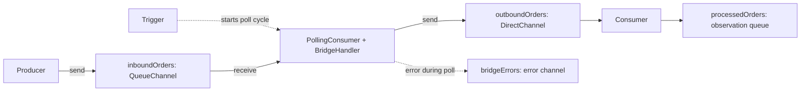

# Bridge with a Poller

## 1. Objectives and Use Case

In the **Messaging bridge** chapter of the **SPRING_INTEGRATION_CORE** module, this lesson shows how to connect a queued channel to a message processing flow using a bridge with a poller. The focus is on the relationship between `Message`, `MessageChannel`, endpoints, and Java DSL, as well as observing errors and testing asynchronous flows.

After this lesson, you will be able to:

- Explain why a bridge receiving from a `QueueChannel` needs a polling mechanism.
- Configure the trigger, `maxMessagesPerPoll`, and `receiveTimeout` according to processing needs.
- Identify which threads run the producer, the bridge, and the consumer.
- Distinguish placing a message into a queue from succeeding in business processing.
- Test both the forwarding path and the error path without relying on fixed sleep durations.

Suppose the system receives orders in bursts. The producer needs to hand off quickly, while the order processing service has finite capacity. We use a bounded-capacity queue as a buffer, then let a bridge pull messages on a schedule and forward them to the processing channel.

A bridge connects channels when the payload already matches what the receiver expects. If format conversion is needed, choose a transformer; if route selection is needed, use a router; if messages must be dropped by condition, use a filter. An aggregator is appropriate when multiple messages must be combined into one result. A bridge does not replace those responsibilities. [Messaging Bridge Documentation](https://docs.spring.io/spring-integration/reference/bridge.html).

## 2. Execution Model



Roles to keep distinct:

| Component | Responsibility in the example |
|---|---|
| `Message<?>` | Carries the order payload and business headers |
| Input `QueueChannel` | Holds messages until a consumer receives them |
| Trigger | Determines when to execute a poll cycle |
| `PollingConsumer` | Receives messages from the input channel and invokes the handler |
| `BridgeHandler` | Forwards messages to the output channel |
| Output `DirectChannel` | Invokes the registered consumer on the sending thread |

For an input implementing `PollableChannel`, Spring Integration creates a `PollingConsumer`. For an input implementing `SubscribableChannel`, the endpoint uses an event-driven mechanism. Thus the poller is configured on the endpoint consuming the queue. `QueueChannel` does not create its own schedule for moving messages onward. [Poller Documentation](https://docs.spring.io/spring-integration/reference/polling-consumer.html).

In the lesson's standard configuration, the producer runs on thread A. Once `send()` successfully enqueues the message, thread A can continue. At poll time, scheduler thread B receives the message, invokes the bridge, and calls the consumer through `DirectChannel`. The consumer continues running on thread B until it reaches another asynchronous boundary.

## 3. What Does a Poll Cycle Do?

You can picture the algorithm with the following pseudocode. This is an explanatory model, not code copied from the framework source:

```text
when trigger allows execution:
    repeat at most M times:
        message = input.receive(receiveTimeout)
        if message is null:
            end the poll cycle
        bridge forwards message to output
        wait for the synchronous downstream part of this delivery to finish
```

If `M = 4` but the queue only has two messages, the poll cycle may forward two messages and then receive `null`. If the queue is continuously replenished, a positive limit ensures the poll cycle finishes after a finite number of receives. When one processing attempt throws an unhandled exception, do not assume the remaining receives in that cycle will proceed as normal.

Notably, `maxMessagesPerPoll(4)` still forwards each message individually. The consumer does not receive a `List` of four elements. To process a batch as a single message, you must design an appropriate grouping component.

## 4. Complete Configuration with Java DSL

The example uses Java 17+, with compatible Spring Integration Core and Spring Context versions. Java DSL is provided in `spring-integration-core`. In a Spring Boot project, you can use `spring-boot-starter-integration` and let the project's dependency management select compatible versions.

The configuration below can be loaded directly with `AnnotationConfigApplicationContext`. The final consumer serves only to observe results; the string `"FAIL"` is reserved as an error-triggering input for practice.

```java
package example.bridge;

import java.time.Duration;

import org.springframework.beans.factory.annotation.Qualifier;
import org.springframework.context.annotation.Bean;
import org.springframework.context.annotation.Configuration;
import org.springframework.integration.channel.DirectChannel;
import org.springframework.integration.channel.QueueChannel;
import org.springframework.integration.config.EnableIntegration;
import org.springframework.integration.dsl.IntegrationFlow;
import org.springframework.integration.dsl.Pollers;
import org.springframework.messaging.MessageDeliveryException;
import org.springframework.messaging.MessageHandler;

@Configuration(proxyBeanMethods = false)
@EnableIntegration
public class PolledBridgeConfig {

    @Bean
    public QueueChannel inboundOrders() {
        return new QueueChannel(200);
    }

    @Bean
    public DirectChannel outboundOrders() {
        return new DirectChannel();
    }

    @Bean
    public QueueChannel processedOrders() {
        return new QueueChannel(200);
    }

    @Bean
    public QueueChannel bridgeErrors() {
        return new QueueChannel(100);
    }

    @Bean
    public IntegrationFlow ordersBridgeFlow() {
        return IntegrationFlow.from("inboundOrders")
                .bridge(endpoint -> endpoint
                        .id("ordersBridge")
                        .poller(Pollers
                                .fixedDelay(Duration.ofMillis(250))
                                .maxMessagesPerPoll(4)
                                .receiveTimeout(0)
                                .errorChannel("bridgeErrors")))
                .channel("outboundOrders")
                .get();
    }

    @Bean
    public IntegrationFlow orderConsumerFlow(
            @Qualifier("processedOrders") QueueChannel processedOrders) {

        return IntegrationFlow.from("outboundOrders")
                .handle((MessageHandler) message -> {
                    if ("FAIL".equals(message.getPayload())) {
                        throw new IllegalStateException(
                                "Simulated order processing failure");
                    }

                    if (!processedOrders.send(message, 0)) {
                        throw new MessageDeliveryException(
                                message, "Result queue is full");
                    }
                })
                .get();
    }
}
```

Reading the configuration along the message path:

1. `IntegrationFlow.from("inboundOrders")` selects an existing channel as input. This step does not pull messages from the queue by itself.
2. `.bridge(...)` declares the forwarding endpoint and attaches a poller to that endpoint.
3. The trigger uses a 250 ms pause after the previous poll completes; `maxMessagesPerPoll(4)` caps each poll to at most four messages.
4. `receiveTimeout(0)` makes the receive operation return immediately when the queue is empty.
5. `.channel("outboundOrders")` selects the bridge's output. The consumer flow subscribes to this channel.
6. `bridgeErrors` receives polling errors as configured; in the example it is a queue so the test can actively pull errors out.

`processedOrders` is an observation point for this exercise. In a real application, the consumer might call an order-persistence service, send a notification, or hand off to the next flow. In that case, define clearly which outcome counts as successful processing.

The error queue also needs a consumer or error-collection mechanism in production. Simply declaring an error queue and leaving messages sitting in it forever does not constitute an incident-handling process.

## 5. Sending Messages and Understanding the Result

The snippet below can be placed in a demo program method. Additional imports needed are `AnnotationConfigApplicationContext`, `Message`, and `MessageBuilder`.

```java
try (var context = new AnnotationConfigApplicationContext(
        PolledBridgeConfig.class)) {

    QueueChannel input = context.getBean(
            "inboundOrders", QueueChannel.class);
    QueueChannel results = context.getBean(
            "processedOrders", QueueChannel.class);

    Message<String> order = MessageBuilder
            .withPayload("ORDER-1042")
            .setHeader("orderId", "1042")
            .setHeader("source", "checkout")
            .build();

    boolean accepted = input.send(order, 1000);
    if (!accepted) {
        throw new IllegalStateException("Failed to enqueue order");
    }

    Message<?> result = results.receive(3000);
    if (result == null) {
        throw new IllegalStateException("Timed out waiting for result");
    }

    System.out.println(result.getPayload());
    System.out.println(result.getHeaders().get("orderId"));
}
```

The expected result on the success path is payload `ORDER-1042` and header `orderId` equal to `1042`. A bridge does not intentionally alter business content; tests should verify the payload and headers meaningful to the application rather than assuming every technical message-identification detail is a business contract.

A successful `input.send(order, 1000)` indicates the queue accepted the message. It does not prove the processing service ran successfully. If a gateway needs to return a business result to the caller, design a request-reply flow and corresponding timeout; wait time also includes time spent in the queue waiting for a poll cycle.

With a bounded queue, `send(message, timeout)` may wait when full and return `false` upon timeout. `receive(0)` returns immediately when no message is available. The default in-memory queue does not provide message recovery after a process crash. [QueueChannel and DirectChannel Documentation](https://docs.spring.io/spring-integration/reference/6.5/channel/implementations.html).

## 6. Parameters to Understand Before Tuning

| Configuration | Question it answers | Effect in this lesson |
|---|---|---|
| `fixedDelay(Duration)` | After finishing one cycle, how long to pause? | A slow consumer pushes back when the next cycle starts |
| `fixedRate(Duration)` | How far apart are scheduled start times? | Actual execution times still depend on the scheduler and load |
| `maxMessagesPerPoll(M)` | How many messages at most can one cycle pull? | Bounds the amount of work in a single cycle |
| `receiveTimeout(t)` | How long does one receive wait for a message? | An empty queue can hold the thread during the wait |
| Queue capacity | How many messages can accumulate? | Determines when the producer experiences backpressure |

Overloads taking `Duration` express units explicitly. `receiveTimeout` in Java DSL accepts milliseconds. [Pollers API](https://docs.spring.io/spring-integration/api/org/springframework/integration/dsl/Pollers.html), [PollerSpec API](https://docs.spring.io/spring-integration/api/org/springframework/integration/dsl/PollerSpec.html).

For `PollingConsumer`, the default `maxMessagesPerPoll` is `-1`, meaning no positive cap on receives per poll cycle. `SourcePollingChannelAdapter` has a different default of `1`. Explicitly configuring a finite value avoids confusing these two endpoint types. [Message Endpoints Documentation](https://docs.spring.io/spring-integration/reference/endpoint.html).

### 6.1. Why Set `receiveTimeout(0)`?

Suppose a poll cycle is allowed to receive four times, but only one message is present. After processing that message, the next receive encounters an empty queue:

- With a timeout of `0`, the receive returns immediately and the poll cycle ends.
- With a timeout of `1000`, the receive may wait up to one second before returning `null`.

If a new message arrives while waiting, the poller can continue processing it within the current cycle. Thus the timeout affects latency, thread utilization, and poll-cycle duration.

In this lesson, the trigger already governs the check cadence, so a timeout of `0` makes behavior easier to observe. Another system might choose a bounded wait to lower latency for a message arriving right after a check. Consider what other endpoints the scheduler also serves.

### 6.2. Application-Wide Default Poller

You can declare a default poller so polling endpoints share a policy. When applying one to a bridge, know whether the bridge uses a local poller or the default poller, and where the effective parameters come from.

This example configures a local poller to make the forwarding policy explicit. If you remove `.poller(...)`, do not assume the bridge will always run: a suitable default configuration must exist. A poller on an endpoint whose input only supports subscription also does not match the polling model. [Endpoint Configuration Documentation](https://docs.spring.io/spring-integration/reference/endpoint.html).

## 7. Message Cadence and Throughput

### 7.1. Trace of a Pre-Populated Queue

Suppose the queue holds nine messages, each message takes 40 ms for the entire synchronous downstream segment, `M = 4`, fixed delay is 250 ms, and there are no errors. Ignoring framework overhead, an illustrative progression is:

| Cycle | Relative start time | Messages processed | Completion time | Remaining in queue |
|---|---:|---:|---:|---:|
| 1 | 0 ms | 4 | 160 ms | 5 |
| 2 | 410 ms | 4 | 570 ms | 1 |
| 3 | 820 ms | 1 | 860 ms | 0 |

The `0 ms` mark is when the first cycle actually begins, not a guarantee about application startup time. The example shows that the pause is added after the previous cycle's processing time.

### 7.2. Estimate When Backlog Is Always Large Enough

Assuming a single polling task processes sequentially, the queue always has at least `M` messages, each message takes an average of `h` seconds, and fixed delay is `d` seconds:

```text
one cycle duration ≈ M × h + d
average throughput ≈ M / (M × h + d)
```

With `M = 4`, `h = 0.04`, and `d = 0.25`, the estimate is:

```text
4 / (4 × 0.04 + 0.25) ≈ 9.76 messages/second
```

This is a model calculation for the example, not a benchmark result. If the average input rate is 15 messages/second over an extended period, the buffer accumulates roughly `15 - 9.76 = 5.24` messages/second under these assumptions. A larger queue only delays when it becomes full.

`maxMessagesPerPoll` allows multiple messages to go out back-to-back within one cycle. If a partner limits requests in any one-second window, add a control mechanism matching that contract. Multiple application instances can also send to the same partner simultaneously; per-instance limits do not automatically enforce a cluster-wide limit.

### 7.3. Fixed Delay or Fixed Rate?

Fixed delay is suitable when you want a pause after each work cycle. Fixed rate is suitable when you want scheduled start ticks. A slow cycle or thread starvation can delay the actual schedule; switching to fixed rate does not make the consumer process faster.

When adding a `taskExecutor` to the poller or using an `ExecutorChannel` behind the bridge, re-evaluate pending tasks, concurrency, and completion order. Do not blindly apply the sequential formula above to a configuration whose execution model has changed.

## 8. Equivalent Declarations

The configurations below are alternatives to the Java DSL bridge; do not register them alongside `ordersBridgeFlow()` on the same queue if the goal is a single bridge.

### 8.1. `@BridgeFrom` Annotation

Place the annotation on the output channel bean, pointing to the input channel:

```java
import org.springframework.integration.annotation.BridgeFrom;
import org.springframework.integration.annotation.Poller;

@Bean
@BridgeFrom(
        value = "inboundOrders",
        poller = @Poller(
                fixedDelay = "250",
                maxMessagesPerPoll = "4",
                receiveTimeout = "0"))
public DirectChannel outboundOrders() {
    return new DirectChannel();
}
```

This snippet assumes the `inboundOrders` bean and the output consumer already exist. If switching from the main configuration to the annotation, remove the old duplicate `outboundOrders` bean and the DSL bridge. The error-handling path for the annotation configuration must also be chosen accordingly if you want to keep the dedicated error-channel behavior of the main example.

### 8.2. XML

If the project uses Spring Integration's `int` namespace, the forwarding path can be expressed as:

```xml
<int:channel id="inboundOrders">
    <int:queue capacity="200"/>
</int:channel>

<int:channel id="outboundOrders"/>

<int:bridge id="ordersBridge"
            input-channel="inboundOrders"
            output-channel="outboundOrders">
    <int:poller fixed-delay="250"
                max-messages-per-poll="4"
                receive-timeout="0"
                error-channel="bridgeErrors"/>
</int:bridge>
```

This is part of a flow configuration and must be placed inside a Spring XML document with the corresponding namespace. The `bridgeErrors` channel and the output consumer must also be declared. The DSL, annotation, and XML forms all serve the bridge model described in [the official documentation](https://docs.spring.io/spring-integration/reference/bridge.html).

## 9. Where Do Errors Occur and Who Receives Them?

With the main configuration, the producer already handed off the message into the queue before the poller called downstream. If the consumer throws an exception over `DirectChannel`, the exception returns to the polling task and is then published as an `ErrorMessage`. The producer does not receive that exception back through the already-completed `send()` call.

In the standard error-publishing mechanism, the message's `errorChannel` header can determine the error destination. Configuring `.errorChannel("bridgeErrors")` provides a dedicated default error channel for the poller when no other routing header is present. Without a dedicated configuration, the framework uses the global error channel mechanism. [Error Handling Documentation](https://docs.spring.io/spring-integration/reference/error-handling.html).

Try sending the `FAIL` payload in the example:

```text
producer successfully sends FAIL to inboundOrders
    -> poller receives message from queue
    -> bridge forwards to outboundOrders
    -> consumer throws IllegalStateException
    -> polling task routes error to bridgeErrors
```

The payload of `ErrorMessage` is the exception, usually containing failure context via `MessagingException` and `failedMessage`. When recording the error, capture the order ID, processing step, and cause for investigation or reprocessing.

Seeing an error message appear in `bridgeErrors` does not mean the original message was put back into `inboundOrders`. The example does not install a retry or requeue policy. Bounded retries, error-message quarantine, and duplicate prevention on replay must be designed separately.

If you add an asynchronous boundary after the bridge, errors from the segment after that boundary must be handled by the corresponding execution mechanism. In that case, the bridge may already have completed its handoff before the business error occurs.

## 10. Threads, Transactions, and Reliability

An in-memory `QueueChannel` is a buffer between threads. Once the poller pulls a message out, a downstream error does not automatically undo that receive. Process restarts also do not recover messages held solely in memory.

Pollers support transactions so receiving from transaction-capable resources and the related processing stay within an appropriate boundary. Rollback capability depends on the resource, transaction manager, and thread-handoff points; merely adding `.transactional(...)` does not turn an in-memory queue into a durable queue. [Transaction Support Documentation](https://docs.spring.io/spring-integration/reference/transactions.html).

When designing for critical orders, determine:

- **Durable intake point:** where is it confirmed that the message is stored safely enough for recovery?
- **Business completion point:** when is the order marked as processed?
- **Deduplication key:** if the same `orderId` is resent, how does the consumer handle it?
- **Error policy:** which messages are retried and which are moved to quarantine?
- **Transaction boundary:** which resources participate, and which segment stays on the same thread?

A bridge helps connect flows and regulate pulling messages. End-to-end delivery guarantees must be built from the decisions above.

## 11. Testing the Forwarding Path and Error Path

The test class below reuses `PolledBridgeConfig`. It requires JUnit Jupiter; in a Spring Boot project this is typically provided by `spring-boot-starter-test`. Each test opens its own context so leftover messages are not shared across runs.

```java
package example.bridge;

import org.junit.jupiter.api.Test;
import org.springframework.context.annotation.AnnotationConfigApplicationContext;
import org.springframework.integration.channel.QueueChannel;
import org.springframework.messaging.Message;
import org.springframework.messaging.MessagingException;
import org.springframework.messaging.support.ErrorMessage;
import org.springframework.messaging.support.MessageBuilder;

import static org.junit.jupiter.api.Assertions.*;

class PolledBridgeTest {

    @Test
    void forwardsPayloadAndBusinessHeaders() {
        try (var context = new AnnotationConfigApplicationContext(
                PolledBridgeConfig.class)) {

            QueueChannel input = context.getBean(
                    "inboundOrders", QueueChannel.class);
            QueueChannel results = context.getBean(
                    "processedOrders", QueueChannel.class);
            QueueChannel errors = context.getBean(
                    "bridgeErrors", QueueChannel.class);

            Message<String> request = MessageBuilder
                    .withPayload("ORDER-1042")
                    .setHeader("orderId", "1042")
                    .setHeader("source", "checkout")
                    .build();

            assertTrue(input.send(request, 1000));

            Message<?> result = results.receive(3000);
            assertNotNull(result);
            assertEquals("ORDER-1042", result.getPayload());
            assertEquals("1042", result.getHeaders().get("orderId"));
            assertEquals("checkout", result.getHeaders().get("source"));
            assertNull(errors.receive(0));
        }
    }

    @Test
    void publishesDownstreamFailureAsErrorMessage() {
        try (var context = new AnnotationConfigApplicationContext(
                PolledBridgeConfig.class)) {

            QueueChannel input = context.getBean(
                    "inboundOrders", QueueChannel.class);
            QueueChannel results = context.getBean(
                    "processedOrders", QueueChannel.class);
            QueueChannel errors = context.getBean(
                    "bridgeErrors", QueueChannel.class);

            Message<String> request = MessageBuilder
                    .withPayload("FAIL")
                    .setHeader("orderId", "broken-1043")
                    .build();

            assertTrue(input.send(request, 1000));

            Message<?> error = errors.receive(3000);
            assertNotNull(error);
            assertTrue(error instanceof ErrorMessage);
            assertTrue(error.getPayload() instanceof MessagingException);

            MessagingException failure =
                    (MessagingException) error.getPayload();
            Message<?> failedMessage = failure.getFailedMessage();
            assertNotNull(failedMessage);
            assertEquals("FAIL", failedMessage.getPayload());
            assertEquals("broken-1043",
                    failedMessage.getHeaders().get("orderId"));
            assertNull(results.receive(0));
        }
    }
}
```

Key points of the test design:

- `receive(3000)` waits conditionally and finishes as soon as a result arrives; no fixed sleep assuming the scheduler has run.
- The timeout is a wait limit for the test environment, not a promise about production latency.
- The success test verifies business content across the queue boundary.
- The failure test verifies the error path while demonstrating that successful enqueuing does not mean downstream success.

These two tests do not verify exactly four messages per poll cycle. To test the per-poll limit, control the trigger or schedule in the test, load a backlog before allowing a poll cycle to run, and record consumer invocations during that cycle. Counting results after a `Thread.sleep(250)` easily flakes due to startup timing and thread scheduling.

These test snippets are practice material to run in a project environment with compatible dependencies; they are not an execution report for this article.

## 12. Diagnosing Common Issues

| Symptom | What to check | Resolution |
|---|---|---|
| Queue has messages but output is silent | Is the endpoint started? Is there a valid poller? Is it reading from the right bean? | Check bridge configuration and lifecycle |
| Application fails creating the polling endpoint | Does a valid local or default poller exist? | Declare an explicit polling policy |
| Attaching a poller to a `DirectChannel` input causes a config error | Does the channel support `receive()`? | Use subscription for `SubscribableChannel`, polling for `PollableChannel` |
| Output reports no subscribers | Is the consumer registered and started? | Check the consumer bean and output destination |
| Producer waits long or `send()` returns `false` | Is the queue full? Is processing rate persistently lower than input rate? | Set appropriate timeouts, measure backlog, and address capacity shortfall |
| Poll cycles take long even when the queue is nearly empty | Is `receiveTimeout` holding the thread? | Adjust wait timeout based on latency goals |
| Adding a second bridge makes each side see only part of the messages | Are two consumers competing on the same queue? | Use publish-subscribe if multiple sides must receive messages |
| Failing message disappears from the input queue | Was it already pulled before downstream failed? | Read the error channel; design explicit retries or recovery |
| Test passes alone but flakes in the full suite | Are context, queues, or scheduler shared? | Isolate data and wait on conditions |

Do not diagnose solely based on the input queue being empty: messages may be in flight, already handed off elsewhere, or failed. Combine endpoint state, completed message counts, and the error channel.

## 13. Extended Practice

### Exercise 1: Observe the Per-Poll Limit

Create 12 messages with different `orderId`s. Set `maxMessagesPerPoll(3)`, fixed delay of one second, and `receiveTimeout(0)`. Log the timestamp and thread inside the consumer, then observe the batches processed per cycle. Run in an environment where the schedule is controlled; do not turn an arbitrary sleep duration into a strict claim about how many cycles ran.

### Exercise 2: Slow Consumer

In a separate demo, simulate each processing call taking 100 ms. Predict the duration of a three-message cycle and the gap until the next cycle. Compare logs against your prediction, explaining which portion of time belongs to processing and which belongs to fixed delay. Avoid putting simulated blocking calls into production flows.

### Exercise 3: Create Backpressure

Reduce input queue capacity to two, stop the bridge before sending, and use `send(message, 0)` for three messages. Explain why the third send fails. Restart the bridge and verify that the two accepted messages continue downstream. This tests queue backpressure and lifecycle, not crash recovery.

### Exercise 4: Handle Error-Triggering Messages

Send one valid order, one `FAIL` payload, and another valid order. Verify that the valid orders can complete in subsequent poll cycles and the failed order is recorded on the error channel. Propose a replay policy keyed by `orderId` so resending does not produce duplicate side effects.

## 14. Key Takeaways

A bridge with a poller is a useful connection point when you need to pull messages from a queue and hand them off to a subscription-based flow. The trigger governs the cadence of poll cycles, `maxMessagesPerPoll` governs the work per cycle, and `receiveTimeout` governs waiting during each receive.

For reliable operation, design queue capacity, downstream throughput, error paths, and completion checkpoints together. When testing, observe both results and errors beyond the asynchronous boundary, and wait conditionally with a timeout.
