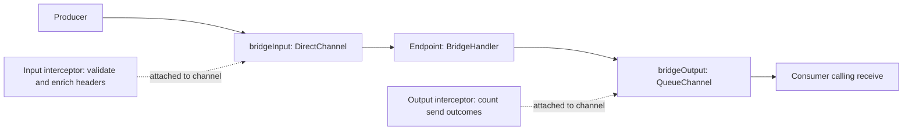

# Bridge with a Channel Interceptor

In the **Messaging bridge** chapter of the **SPRING_INTEGRATION_CORE** module, this lesson shows how to add header validation, trace IDs, and send-outcome observation on both sides of a bridge. The focus is on the relationship between `Message`, `MessageChannel`, bridge endpoints, and Java DSL when applying shared behavior to an integration flow.

After this lesson, you will be able to choose the right channel for attaching an interceptor, trace callback order, distinguish a blocked send from a processing error, and write tests confirming that messages actually pass through the bridge.

## 1. Where Does an Interceptor Sit Around a Bridge?

A messaging bridge is an endpoint connecting two channels. When no data format change is needed, a bridge can forward messages to the other side; if the input is a pollable channel, the bridge endpoint needs a poller configured. See [Messaging Bridge](https://docs.spring.io/spring-integration/reference/bridge.html).

In the order example, we want:

- Every message arriving at the entrance to have a structurally valid `tenantId`.
- Messages missing a trace ID to get a `bridgeTraceId` added.
- The target side to count queue send outcomes.
- The order payload to remain unchanged during the channel-bridging step.



An interceptor is attached to a **channel**, not directly to the bridge object. Therefore, another producer sending directly to `bridgeOutput` also triggers the target channel's interceptor. If you need to measure only the path going through this bridge, use a dedicated channel or classify via metadata produced by a trusted flow.

In the design above, the input is the message-contract validation point; the output is the point for observing buffer acceptance. The two points answer two different questions.

## 2. Callbacks You Need to Know

`ChannelInterceptor` belongs to the `org.springframework.messaging.support` package. You only need to override the callbacks that serve your requirements.

| Callback | Main purpose |
| --- | --- |
| `preSend(message, channel)` | Inspect, replace, or block a message before sending |
| `postSend(message, channel, sent)` | Observe the return value of the send operation |
| `afterSendCompletion(message, channel, sent, ex)` | Clean up or record the completion outcome of a send |
| `preReceive(channel)` | Allow or prevent pulling from the channel |
| `postReceive(message, channel)` | Process the message just received |
| `afterReceiveCompletion(message, channel, ex)` | Clean up after a receive operation |

`preSend` returning `null` prevents the send operation. `preReceive` returning `false` prevents receiving a message. An interceptor's completion callback only applies when that same interceptor's preceding step succeeded and allowed execution to proceed. This is an important condition when managing resources. See [`ChannelInterceptor` API](https://docs.spring.io/spring-framework/docs/6.1.14/javadoc-api/org/springframework/messaging/support/ChannelInterceptor.html).

In the diagram:

- `bridgeInput` uses send callbacks; it has no polling operation.
- `bridgeOutput` uses send callbacks when the bridge places a message into the queue.
- Receive callbacks on the output run when the consumer executes `receive()`, at a different time.

Receive callbacks are only meaningful for a `PollableChannel`. Do not infer the ordering between sends and receives across different threads from a single log. See [Channel Interceptors](https://docs.spring.io/spring-integration/reference/6.3/channel/interceptors.html).

## 3. Complete Example: Validating Input, Observing Output

### 3.1. Assumptions for Reading and Running the Example

The example uses Java 17 and the Spring Integration 6.3.x API. The application needs the `org.springframework.integration:spring-integration-core` dependency; the tests require JUnit Jupiter. Use a compatible version set managed by your application's BOM.

The configuration and test classes below share the `example.bridge` package. This is a standalone Java configuration example with no Spring Boot required.

We use a `QueueChannel` with capacity 10 so output messages can be observed in tests. The example only sends a few messages and immediately receives them; in continuous operation, a consumer and appropriate wait policy are required.

### 3.2. Configuration and Two Interceptors

```java
package example.bridge;

import java.util.UUID;
import java.util.concurrent.atomic.LongAdder;

import org.springframework.context.annotation.Bean;
import org.springframework.context.annotation.Configuration;
import org.springframework.integration.channel.DirectChannel;
import org.springframework.integration.channel.QueueChannel;
import org.springframework.integration.config.EnableIntegration;
import org.springframework.integration.dsl.IntegrationFlow;
import org.springframework.messaging.Message;
import org.springframework.messaging.MessageChannel;
import org.springframework.messaging.MessageDeliveryException;
import org.springframework.messaging.support.ChannelInterceptor;
import org.springframework.messaging.support.MessageBuilder;

@Configuration
@EnableIntegration
public class BridgeInterceptorConfig {

    @Bean
    public BoundaryHeaderInterceptor boundaryHeaderInterceptor() {
        return new BoundaryHeaderInterceptor();
    }

    @Bean
    public SendOutcomeInterceptor outputSendOutcome() {
        return new SendOutcomeInterceptor();
    }

    @Bean
    public DirectChannel bridgeInput(
            BoundaryHeaderInterceptor boundaryHeaderInterceptor) {
        DirectChannel channel = new DirectChannel();
        channel.addInterceptor(boundaryHeaderInterceptor);
        return channel;
    }

    @Bean
    public QueueChannel bridgeOutput(
            SendOutcomeInterceptor outputSendOutcome) {
        QueueChannel channel = new QueueChannel(10);
        channel.addInterceptor(outputSendOutcome);
        return channel;
    }

    @Bean
    public IntegrationFlow orderBridge(
            DirectChannel bridgeInput,
            QueueChannel bridgeOutput) {
        return IntegrationFlow.from(bridgeInput)
                .bridge(endpoint -> endpoint.id("orderBridgeEndpoint"))
                .channel(bridgeOutput)
                .get();
    }

    public static final class BoundaryHeaderInterceptor
            implements ChannelInterceptor {

        @Override
        public Message<?> preSend(Message<?> message,
                MessageChannel channel) {
            Object tenant = message.getHeaders().get("tenantId");
            if (!(tenant instanceof String tenantId)
                    || tenantId.isBlank()) {
                throw new MessageDeliveryException(
                        message, "tenantId must be a non-blank string");
            }

            Object trace = message.getHeaders().get("bridgeTraceId");
            if (trace == null) {
                return MessageBuilder.fromMessage(message)
                        .setHeader(
                                "bridgeTraceId",
                                UUID.randomUUID().toString())
                        .build();
            }

            if (!(trace instanceof String traceId)
                    || traceId.isBlank()) {
                throw new MessageDeliveryException(
                        message, "bridgeTraceId must be a non-blank string");
            }
            return message;
        }
    }

    public static final class SendOutcomeInterceptor
            implements ChannelInterceptor {

        private final LongAdder accepted = new LongAdder();
        private final LongAdder unsuccessful = new LongAdder();

        @Override
        public void afterSendCompletion(
                Message<?> message,
                MessageChannel channel,
                boolean sent,
                Exception ex) {
            if (sent && ex == null) {
                accepted.increment();
            }
            else {
                unsuccessful.increment();
            }
        }

        public long acceptedCount() {
            return accepted.sum();
        }

        public long unsuccessfulCount() {
            return unsuccessful.sum();
        }
    }
}
```

The DSL `.bridge()` declares the forwarding endpoint; the interceptors are registered on the two channel beans. With a `DirectChannel` as input, the example does not need a poller. The `.bridge(...)` and `.intercept(...)` methods are described in [`BaseIntegrationFlowDefinition` API](https://docs.spring.io/spring-integration/docs/6.3.2/api/org/springframework/integration/dsl/BaseIntegrationFlowDefinition.html).

### 3.3. Why Design It This Way?

`BoundaryHeaderInterceptor` validates metadata structure before the endpoint receives the message. The `tenantId` check here is the example's data contract; tenant authentication and authorization must rely on an identity trusted by the system.

When `bridgeTraceId` is missing, the interceptor builds a message with `MessageBuilder.fromMessage(message)`. This preserves the payload and existing application headers, including reply or error paths if already set.

Do not call `message.getHeaders().put(...)`. Standard message headers do not allow direct mutation. Creating a new message can generate a new `id` and `timestamp`, so use a dedicated tracking ID if you need to correlate events across multiple steps. Do not try to overwrite those two system headers. See [Message and Headers](https://docs.spring.io/spring-integration/reference/6.3/message.html).

`bridgeTraceId` is a custom header for this lesson. It does not become a distributed tracing context on its own, nor does it replace an aggregator's correlation strategy.

`SendOutcomeInterceptor` uses thread-safe counters when invoked by multiple threads. It does not hold `currentMessage` or single-send state in a shared field.

The name `acceptedCount` was chosen for what is actually measured: messages accepted by the target channel. That is not yet the count of orders saved to the database, shipped, or business-completed.

## 4. Attaching Interceptors via Java DSL or Global Configuration

### 4.1. Registering via DSL

If you want to express the attachment point directly in the flow, you can use the following variant. Remove `addInterceptor(...)` from the two channel beans in Section 3 when switching to this approach to avoid duplicate registration.

```java
@Bean
public IntegrationFlow orderBridge(
        DirectChannel bridgeInput,
        QueueChannel bridgeOutput,
        BoundaryHeaderInterceptor boundaryHeaderInterceptor,
        SendOutcomeInterceptor outputSendOutcome) {
    return IntegrationFlow.from(bridgeInput)
            .intercept(boundaryHeaderInterceptor)
            .bridge(endpoint -> endpoint.id("orderBridgeEndpoint"))
            .channel(bridgeOutput)
            .intercept(outputSendOutcome)
            .get();
}
```

`.intercept(...)` adds the interceptor to the current channel in the DSL. Declare the channel explicitly before the attachment point so readers can see where it takes effect. This registration still has channel scope: if the channel is shared across multiple flows, other sends to that channel are also affected.

Simply having a bean implementing `ChannelInterceptor` is not enough to apply it to every channel; you still need local, DSL, or global registration.

### 4.2. Using a Global Interceptor When Many Channels Share a Contract

The snippet below is an alternative to locally registering the header-validation interceptor. Place this method in a configuration with `@EnableIntegration` and import the `org.springframework.integration.config.GlobalChannelInterceptor` annotation.

```java
@Bean
@GlobalChannelInterceptor(
        patterns = {"bridgeInput"},
        order = -100)
public BridgeInterceptorConfig.BoundaryHeaderInterceptor
        boundaryHeaderInterceptor() {
    return new BridgeInterceptorConfig.BoundaryHeaderInterceptor();
}
```

`patterns` selects channel bean names. A negative `order` places the global interceptor before interceptors declared directly on the channel; a positive value places it after. See [`GlobalChannelInterceptor` API](https://docs.spring.io/spring-integration/docs/6.3.2/api/org/springframework/integration/config/GlobalChannelInterceptor.html).

In the example, only `bridgeInput` is matched because the current contract requires validation at the entrance. Do not blindly widen it to `*`: an error flow might carry an `ErrorMessage` without order metadata, and an audit flow might require a different contract.

If you replace the bean method in Section 3 with this global method, remove the corresponding local registration on `bridgeInput`. Applying the same interceptor through two paths can cause validation or counting to run twice.

When using a prefix such as `orders*`, check the actual list of channels it matches. The endpoint name `orderBridgeEndpoint` is not a channel name for pattern selection.

## 5. Reading Callback Order Across Two Channels

Suppose the input has two interceptors A and B in registration order, and the output has interceptor C. The input is a `DirectChannel`, the output is a `QueueChannel` with available capacity, there are no errors, and no consumer is receiving yet.

```text
Producer calls input.send(message)
  A.preSend
  B.preSend
  BridgeHandler forwards
    C.preSend
    Output puts message into queue
    C.postSend(sent=true)
    C.afterSendCompletion(sent=true, ex=null)
  A.postSend(sent=true)
  B.postSend(sent=true)
  B.afterSendCompletion(sent=true, ex=null)
  A.afterSendCompletion(sent=true, ex=null)
Producer receives true
```

Two nested send calls explain why the output-side callbacks appear before the input-side finishing callbacks. Completion callbacks run in reverse order of the interceptors that successfully passed the earlier step.

Other early-termination scenarios to understand:

| Situation at input | Result at bridge | Callbacks of the blocking interceptor |
| --- | --- | --- |
| A returns `null` in `preSend` | Not invoked | No completion for A |
| A passes, B returns `null` | Not invoked | No completion for B; A completes |
| A passes, B throws an exception | Not invoked | No completion for B; A completes with error |
| A and B pass, output send fails | Invoked | A and B complete with error |

The ordering above applies to the example's send path and can be cross-checked with [`AbstractMessageChannel` in Spring Integration 6.3.2](https://github.com/spring-projects/spring-integration/blob/v6.3.2/spring-integration-core/src/main/java/org/springframework/integration/channel/AbstractMessageChannel.java).

An implication for resource-management code: if `preSend` itself opened a scope and then failed before returning the message, it must clean up that scope itself. Do not leave resources dependent on a callback that is not eligible to run.

For counting interceptors, decide the measurement point first:

- Place it first in the list if you want to observe sends rejected by later interceptors.
- Place it after validation if you only want to count messages that passed the input contract.
- Place it separately on the output if you want to count acceptance into the target channel as in the example.

Do not add input and output counts together and interpret the sum as total unique orders. One traversal through the bridge produces two send operations across two channels.

## 6. Changing Channel Types Changes Observation Semantics

| Configuration around the bridge | Point to understand when reading results |
| --- | --- |
| `DirectChannel → bridge → DirectChannel` | Synchronous processing can extend through downstream handlers |
| `DirectChannel → bridge → QueueChannel` | Send success on output reflects enqueuing into the queue |
| `QueueChannel → bridge → DirectChannel` | Needs a poller; sending to input and the bridge reading input are separate operations |
| `DirectChannel → bridge → ExecutorChannel` | Do not treat send completion as completion of the handler running in the executor |

`QueueChannel` holds messages for later retrieval and supports waiting when full. Omitting a timeout can lead to indefinite waiting; a value of 0 requests an immediate return. See [Message Channel Implementations](https://docs.spring.io/spring-integration/reference/channel/implementations.html).

If you change the example's input into a queue, you can illustrate the endpoint configuration with the following snippet; both channels are passed as parameters:

```java
@Bean
public IntegrationFlow pollingBridge(
        QueueChannel polledInput,
        DirectChannel downstream) {
    return IntegrationFlow.from(polledInput)
            .bridge(endpoint -> endpoint
                    .poller(Pollers.fixedDelay(200)
                            .maxMessagesPerPoll(5)))
            .channel(downstream)
            .get();
}
```

This snippet needs `import org.springframework.integration.dsl.Pollers`. It is an alternative configuration; do not declare it alongside the flow from Section 3 on the same input.

In the polling approach, keep two measurements separate: the time for the producer to send into the input queue, and the time from when the poller pulls the message until forwarding finishes. A short send time does not explain queue wait latency.

If you need to observe the handler actually running on an executor thread, use an appropriate mechanism such as `ExecutorChannelInterceptor.beforeHandle` and `afterMessageHandled` on a supported channel. These two callbacks wrap the subscriber invocation on the executor task. See [`ExecutorChannelInterceptor` API](https://docs.spring.io/spring-framework/docs/6.1.14/javadoc-api/org/springframework/messaging/support/ExecutorChannelInterceptor.html).

Do not rely on a `ThreadLocal` variable set on the producer assuming a consumer on another thread will see that context. For logging or tracing context, use a mechanism that propagates across thread boundaries and cleans up afterward; headers are just data used by that mechanism.

## 7. Blocking, Errors, and Retries Around a Bridge

### 7.1. Returning `null` vs. Throwing an Exception Serve Two Different Contracts

Returning `null` in `preSend` is appropriate when the caller understands this is a controlled rejection decision and can handle an unsuccessful send result. In this lesson, missing `tenantId` is a contract violation, so the example throws an exception to surface the error clearly.

If you want to reject orders by business conditions and route them to another flow, a filter with a discard channel usually expresses intent more clearly. Avoid hiding multi-branch business rules inside a shared channel's interceptor.

Also distinguish where blocking happens. If an interceptor on the output returns `null`, the output send fails, yet the bridge was already invoked. Do not use the expected outcome of an input-blocking test to infer return outcomes for every bridge configuration.

### 7.2. Where Are Errors Observed?

On a synchronous send path, exceptions can propagate back to the caller. With asynchronous processing tasks or a poller, Spring Integration's error-handling mechanism can publish an `ErrorMessage` to the configured error channel. Simply adding an `errorChannel` header does not automatically turn every exception on a direct channel call into an error message. See [Error Handling](https://docs.spring.io/spring-integration/reference/error-handling.html).

In the Section 3 example:

1. The producer calls `bridgeInput.send(...)`.
2. The invalid header is rejected immediately at the input.
3. Neither the bridge nor the output is invoked.
4. The producer receives the exception; the output counter remains 0.

If an error occurs in the consumer after the message has already entered the output queue, `afterSendCompletion` for that earlier send has already finished. Observe the error at the consumer or in the consumer's error flow.

### 7.3. Do Not Retry Arbitrarily Inside an Interceptor

Calling `channel.send(message)` again directly inside that same channel's `preSend` can cause recursion. Triggering compensating sends from a completion callback also makes it hard to tell which send was the original and which was a retry.

Before placing a retry, identify which piece of work needs to be retried: the forwarding operation, a business handler, or the whole flow. Advice on an endpoint must be evaluated for the exact scope it wraps; do not assume bridge advice will handle errors from an input interceptor running before the endpoint.

If you reuse the original message for each attempt, an ID generated inside an interceptor may change across independent send attempts. To track a job across retries, generate a stable ID at a trusted entry point or ensure the metadata-enriched message is reused.

### 7.4. Timeouts Belong to Each Send Operation

The bridge sends to the output as a separate step. A timeout passed to `input.send(message, timeout)` is not a time budget that automatically propagates across the entire flow.

With a bounded queue, configure an appropriate send timeout on the bridge or sending handler. When testing a full queue, use a finite timeout or zero wait; do not let the test hang waiting for space to free up.

## 8. Testing Behavior Through the Bridge

The test suite below uses the Section 3 configuration. Each test creates its own context so counters and queues do not affect each other. The tests verify observable effects: the message reaches the target, headers are preserved, invalid messages do not cross the boundary, and synchronous callback order matches expectations.

This is illustrative test code to run in a compatible Java project; authoring this document does not imply these tests were executed here.

```java
package example.bridge;

import java.util.ArrayList;
import java.util.List;

import org.junit.jupiter.api.AfterEach;
import org.junit.jupiter.api.BeforeEach;
import org.junit.jupiter.api.Test;
import org.springframework.context.annotation.AnnotationConfigApplicationContext;
import org.springframework.integration.channel.DirectChannel;
import org.springframework.integration.channel.QueueChannel;
import org.springframework.messaging.Message;
import org.springframework.messaging.MessageChannel;
import org.springframework.messaging.MessageDeliveryException;
import org.springframework.messaging.support.ChannelInterceptor;
import org.springframework.messaging.support.MessageBuilder;

import static org.junit.jupiter.api.Assertions.*;

class BridgeInterceptorTest {

    private AnnotationConfigApplicationContext context;
    private DirectChannel input;
    private QueueChannel output;
    private BridgeInterceptorConfig.SendOutcomeInterceptor outcome;

    @BeforeEach
    void setUp() {
        context = new AnnotationConfigApplicationContext(
                BridgeInterceptorConfig.class);
        input = context.getBean("bridgeInput", DirectChannel.class);
        output = context.getBean("bridgeOutput", QueueChannel.class);
        outcome = context.getBean(
                BridgeInterceptorConfig.SendOutcomeInterceptor.class);
    }

    @AfterEach
    void tearDown() {
        context.close();
    }

    @Test
    void addsTraceAndPreservesPayloadAndRoutingHeaders() {
        QueueChannel replies = new QueueChannel();
        QueueChannel errors = new QueueChannel();
        Message<String> source = MessageBuilder
                .withPayload("ORDER-42")
                .setHeader("tenantId", "tenant-a")
                .setReplyChannel(replies)
                .setErrorChannel(errors)
                .build();

        assertTrue(input.send(source));

        Message<?> result = output.receive(0);
        assertNotNull(result);
        assertEquals("ORDER-42", result.getPayload());
        assertEquals("tenant-a", result.getHeaders().get("tenantId"));
        String trace = result.getHeaders()
                .get("bridgeTraceId", String.class);
        assertNotNull(trace);
        assertFalse(trace.isBlank());
        assertSame(replies, result.getHeaders().getReplyChannel());
        assertSame(errors, result.getHeaders().getErrorChannel());
        assertEquals(1L, outcome.acceptedCount());
        assertEquals(0L, outcome.unsuccessfulCount());
        assertNull(output.receive(0));
    }

    @Test
    void preservesAnExistingTrace() {
        Message<String> source = MessageBuilder
                .withPayload("ORDER-43")
                .setHeader("tenantId", "tenant-a")
                .setHeader("bridgeTraceId", "flow-43")
                .build();

        assertTrue(input.send(source));

        Message<?> result = output.receive(0);
        assertNotNull(result);
        assertEquals("flow-43",
                result.getHeaders().get("bridgeTraceId"));
    }

    @Test
    void rejectsMissingTenantBeforeCallingTheBridge() {
        Message<String> source = MessageBuilder
                .withPayload("ORDER-44")
                .build();

        assertThrows(MessageDeliveryException.class,
                () -> input.send(source));

        assertNull(output.receive(0));
        assertEquals(0L, outcome.acceptedCount());
        assertEquals(0L, outcome.unsuccessfulCount());
    }

    @Test
    void aNullPreSendAtInputStopsTheFlow() {
        input.addInterceptor(0, new ChannelInterceptor() {
            @Override
            public Message<?> preSend(
                    Message<?> message, MessageChannel channel) {
                return null;
            }
        });
        Message<String> source = MessageBuilder
                .withPayload("ORDER-45")
                .setHeader("tenantId", "tenant-a")
                .build();

        assertFalse(input.send(source));

        assertNull(output.receive(0));
        assertEquals(0L, outcome.acceptedCount());
    }

    @Test
    void completesOutputSendBeforeCompletingInputSend() {
        List<String> events = new ArrayList<>();
        input.addInterceptor(new RecordingInterceptor("A", events));
        input.addInterceptor(new RecordingInterceptor("B", events));
        output.addInterceptor(new RecordingInterceptor("C", events));
        Message<String> source = MessageBuilder
                .withPayload("ORDER-46")
                .setHeader("tenantId", "tenant-a")
                .build();

        assertTrue(input.send(source));

        assertEquals(List.of(
                "A.pre", "B.pre", "C.pre",
                "C.post:true", "C.done:true:true",
                "A.post:true", "B.post:true",
                "B.done:true:true", "A.done:true:true"), events);
        assertNotNull(output.receive(0));
    }

    private static final class RecordingInterceptor
            implements ChannelInterceptor {

        private final String name;
        private final List<String> events;

        private RecordingInterceptor(
                String name, List<String> events) {
            this.name = name;
            this.events = events;
        }

        @Override
        public Message<?> preSend(
                Message<?> message, MessageChannel channel) {
            events.add(name + ".pre");
            return message;
        }

        @Override
        public void postSend(
                Message<?> message,
                MessageChannel channel,
                boolean sent) {
            events.add(name + ".post:" + sent);
        }

        @Override
        public void afterSendCompletion(
                Message<?> message,
                MessageChannel channel,
                boolean sent,
                Exception ex) {
            events.add(name + ".done:" + sent + ":" + (ex == null));
        }
    }
}
```

The `ArrayList` in the last test only serves the synchronous call path described above. If switching to an executor, use a thread-safe structure and a bounded wait mechanism instead of assuming callbacks have already run as soon as `send()` returns.

Extended tests should track the risks of the actual configuration:

| Risk to test | Behavior to verify |
| --- | --- |
| Header has wrong type or only whitespace | Rejected before the message reaches the output |
| Global interceptor matches unintended channels | Only channels with the matching contract are affected |
| Output fails to receive the message | Caller or error flow receives the appropriate failure signal |
| Input is a queue while the poller is stopped | Input send can succeed even without forwarding yet |
| Consumer fails after pulling from output | Error is observed at the consumer stage |
| Interceptor registered twice | Counters and traces are not unexpectedly doubled |

Do not assert `assertSame(source, result)` as a substitute for the data contract. An interceptor adding a new header can create a new message while still preserving the payload and required headers.

## 9. Choosing the Right Component for Each Responsibility

| Need | Suitable choice in the lesson's design |
| --- | --- |
| Connect two channels with the same data contract | Bridge |
| Validate shared metadata at a channel boundary | Channel interceptor |
| Enrich headers as an explicit step in the flow | Header enricher |
| Change payload structure | Transformer |
| Drop or route rejected messages | Filter and discard channel |
| Select destination by content or header | Router |
| Aggregate multiple messages by correlation | Aggregator |
| Provide a Java API for callers | Messaging gateway |
| Observe a copy of messages via a side channel | Wire tap |

A bridge with interceptors should read cleanly across two layers of responsibility: the endpoint performs flow connection; channels enforce shared contracts and boundary behavior.

For example, when converting an order into an accounting record, place a transformer as an explicit step. When selecting a processing region by address, use a router. When gathering parts of an order, let an aggregator manage correlation rather than accumulating messages in an interceptor field.

With a gateway, preserve reply-path headers when building a new message. Blocking decisions in an interceptor must also match the calling API's contract: a silently blocked request-reply operation may fail to produce the reply the caller expects.

For operational observability, log useful fields such as channel name, measurement point, trace ID, send outcome, and error type. Avoid logging the entire payload or using a unique trace ID as a metric label, since each unique value creates a new metric series.

## 10. Applying This to a Real Flow

When adding interceptors around a bridge, proceed in this order:

1. Clearly diagram the input channel, bridge endpoint, output channel, and flow boundaries.
2. Specify the header contract at each boundary, including what missing or invalid values mean.
3. Choose measurement points matching the operational questions you need to answer.
4. Only create a new message when data changes are needed; preserve metadata for subsequent steps.
5. Define how callers observe rejections, exceptions, timeouts, or asynchronous errors.
6. Test both delivered messages and blocked messages using observable outcomes.

With this lesson's configuration, a valid send passes input validation, is forwarded by the bridge, and is accepted by the output queue. Send metrics reflect those exact points; final business outcomes must be confirmed at the endpoint executing the business logic.
