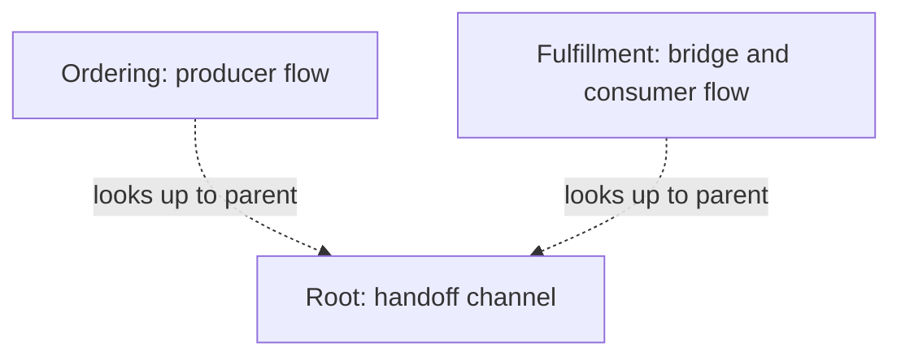
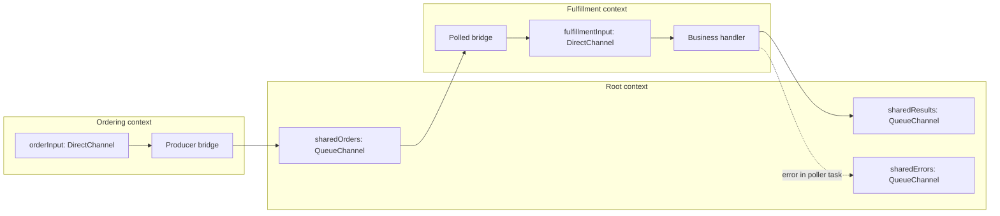

# Bridge Between Flows in Different Contexts

## 1. Problem Statement and Objectives

In Spring Integration Core, a flow receives a `Message<?>` from a `MessageChannel`, passes through endpoints, and hands off to another flow. When an application is split into multiple `ApplicationContext`s, each context can manage its own group of flows and lifecycle. At that point, a channel name in Java DSL is not enough to prove two flows are connected: you must determine which context owns the channel and which sides can access it.

For example, an order system has two parts running in the same JVM:

- The `ordering` context receives requests and emits order messages.
- The `fulfillment` context pulls messages and executes fulfillment business logic.
- A parent context holds the handoff channels so both sides can access them.

A messaging bridge creates a forwarding endpoint between channels, suitable when connecting two flow segments without needing data transformation. In a multi-context scenario, a bridge works once it has access to the exact source and target channels. See the official definition at [Messaging Bridge](https://docs.spring.io/spring-integration/reference/bridge.html).

After this lesson, you will be able to design a handoff point between contexts, configure a bridge using Java DSL, trace threads and error paths, and test the topology using genuinely separate contexts.

## 2. Distinguishing Flow, Context, and Process Boundaries

### Different Flows, Same Context

Two `IntegrationFlow` beans in the same context can share a single channel bean. Splitting configuration into two `@Bean` methods helps organize code; that split does not create a thread boundary or a network connection on its own.

```text
producerFlow -> shared channel -> consumerFlow
                same ApplicationContext
```

### Different Contexts, Same JVM

Two contexts manage separate beans. Two beans with the same name are not automatically the same Java object.

```java
// Two independent contexts each define their own "orders" bean.
MessageChannel left = leftContext.getBean("orders", MessageChannel.class);
MessageChannel right = rightContext.getBean("orders", MessageChannel.class);

// Since these are two separately created instances, the result is false.
System.out.println(left == right);
```

A bridge has no global mechanism to search across all contexts and pair beans with matching names. You need a parent–child relationship, a shared handoff point, or an explicitly passed channel reference.

### Different JVMs or Different Machines

By default, `DirectChannel` and `QueueChannel` are in-memory objects within a single process. They do not establish network connections on their own.

```text
JVM A: flow -> outbound adapter -> transport
                                      |
JVM B: flow <- inbound adapter  <-------+
```

When two flows belong to two separately deployed applications, you need a transport along with the corresponding adapters/gateways. For example, Spring Integration provides JMS channel adapters for one-way communication and JMS gateways for request/reply. Bridges may appear inside each application; the transport still handles cross-process delivery. See [JMS Support](https://docs.spring.io/spring-integration/reference/jms.html).

| Placement of the two flows | Connection point | What must be designed |
| --- | --- | --- |
| Same context | Shared channel bean | Channel type, consuming endpoint |
| Parent and child | Channel visible via parent | Ownership, avoiding bean shadowing |
| Two children sharing a parent | Shared channel in parent | Per-child lifecycle, load-sharing policy |
| Two independent contexts in a JVM | Pass channel reference | Startup order, where shared resources are closed |
| Different JVMs | Transport destination or address | Data contract, retries, delivery acknowledgment |

## 3. Bean Lookup Rules in a Context Hierarchy

In a `parent -> child` relationship, a child can look up beans in the parent when no matching bean exists locally. A bean with the same name in the child can shadow the bean in the parent. A parent does not look down into a child; one child also does not look across into a sibling. Hierarchical lookup rules are described in [BeanFactory](https://docs.spring.io/spring-framework/docs/current/javadoc-api/org/springframework/beans/factory/BeanFactory.html).



The arrows above represent bean lookup direction. Message direction is a separate configuration: a channel in the parent can still pass messages from the first child to the second child.

A common design is placing the shared communication channels in the parent, while business endpoints and bridges in the children operate on them. Neither child needs to know about the other's internal flow beans.

A common mistake is redeclaring `sharedOrders` inside fulfillment. The producer sends to the root's queue, while the bridge reads fulfillment's own separate queue. Having identical names makes the configuration look plausible while the two sides actually hold two different queues.

Check visibility, local ownership, and object identity together:

```java
boolean visible = child.containsBean("sharedOrders");
boolean local = child.containsLocalBean("sharedOrders");
boolean sameInstance = root.getBean("sharedOrders")
        == child.getBean("sharedOrders");
```

If the channel belongs solely to root, expect `visible == true`, `local == false`, and `sameInstance == true`. The APIs distinguishing local beans from ancestor beans are documented in [AbstractApplicationContext](https://docs.spring.io/spring-framework/docs/6.2.x/javadoc-api/org/springframework/context/support/AbstractApplicationContext.html).

## 4. Bridge Responsibilities at the Connection Point

`BridgeHandler` forwards the request message to the output channel without actively transforming it. In a straightforward configuration, the payload and application headers are preserved. If no output channel is configured, the bridge can use the message's `replyChannel`; missing both causes an error. This is the contract of [BridgeHandler](https://docs.spring.io/spring-integration/docs/6.5.1/api/org/springframework/integration/handler/BridgeHandler.html).

```text
Input channel -> endpoint containing BridgeHandler -> output channel
```

A bridge does not replace channel semantics:

- Input is a `QueueChannel`: the endpoint reads via a polling consumer and needs a poller.
- Input is a `DirectChannel`: the endpoint subscribes to the channel and needs no poller.
- Output is a `DirectChannel`: downstream handlers normally continue running on the thread sending to it.
- Output is a queue: the bridge hands the message off into the queue, and the queue's consumer decides when to process next.

Changing `ApplicationContext` does not change threads on its own. In the example below, the asynchronous boundary occurs at the queue together with the poller.

If two flows require different data structures, place a transformer at the conversion point. If you need branch selection, message filtering, or message aggregation, use a router, filter, or aggregator. A bridge keeps the role of connecting flow segments that have compatible data contracts.

## 5. Java DSL Example: Two Children Through Root Channels

### 5.1. Environment and Contract

The example uses Java 17+ and Spring Integration 6.x Java DSL APIs. The practice project needs `org.springframework.integration:spring-integration-core` along with compatible Spring dependencies. With Spring Boot, you can use `spring-boot-starter-integration` and the project's BOM to manage versions.

This is a standalone program using `AnnotationConfigApplicationContext` with explicit configuration registration. Each child declares `@EnableIntegration` for the flows it manages. Java DSL collects flow components to register them as beans in the context containing the flow; see [Java DSL](https://docs.spring.io/spring-integration/reference/dsl.html).



| Component | Convention in this lesson |
| --- | --- |
| Payload | Order ID string, e.g., `ORD-1001` |
| `businessCorrelationId` | Header correlating a request with its result |
| `errorChannel` | Reference to the root's error channel |
| Result | String `ACCEPTED:<order ID>` |
| Invalid data | Empty or whitespace-only order ID |
| Shared queue | Capacity 100, stored in memory |

`sharedResults` is the result collection point for this exercise. When multiple concurrent calls occur, the application must correlate using business headers; receiving the next message from the queue does not guarantee it is the reply to the current call. For a request/reply API, you can design a messaging gateway and an appropriate correlation mechanism.

### 5.2. Complete Program

Place the code below in `CrossContextBridgeDemo.java` in the practice project. No component scanning is required to build this context hierarchy.

```java
import java.time.Duration;

import org.springframework.context.annotation.AnnotationConfigApplicationContext;
import org.springframework.context.annotation.Bean;
import org.springframework.context.annotation.Configuration;
import org.springframework.integration.channel.DirectChannel;
import org.springframework.integration.channel.QueueChannel;
import org.springframework.integration.config.EnableIntegration;
import org.springframework.integration.dsl.IntegrationFlow;
import org.springframework.integration.dsl.Pollers;
import org.springframework.messaging.Message;
import org.springframework.messaging.MessageChannel;
import org.springframework.messaging.support.MessageBuilder;

public class CrossContextBridgeDemo {

    @Configuration(proxyBeanMethods = false)
    public static class RootChannels {

        @Bean
        public QueueChannel sharedOrders() {
            return new QueueChannel(100);
        }

        @Bean
        public QueueChannel sharedResults() {
            return new QueueChannel(100);
        }

        @Bean
        public QueueChannel sharedErrors() {
            return new QueueChannel(100);
        }
    }

    @Configuration(proxyBeanMethods = false)
    @EnableIntegration
    public static class OrderingFlows {

        @Bean
        public DirectChannel orderInput() {
            return new DirectChannel();
        }

        @Bean
        public IntegrationFlow orderingFlow() {
            return IntegrationFlow.from("orderInput")
                    .bridge(endpoint -> endpoint
                            .id("orderingHandoffBridge")
                            .sendTimeout(1000))
                    .channel("sharedOrders")
                    .get();
        }
    }

    @Configuration(proxyBeanMethods = false)
    @EnableIntegration
    public static class FulfillmentFlows {

        @Bean
        public DirectChannel fulfillmentInput() {
            return new DirectChannel();
        }

        @Bean
        public IntegrationFlow contextBridgeFlow() {
            return IntegrationFlow.from("sharedOrders")
                    .bridge(endpoint -> endpoint
                            .id("ordersContextBridge")
                            .poller(Pollers
                                    .fixedDelay(Duration.ofMillis(100))
                                    .maxMessagesPerPoll(10)))
                    .channel("fulfillmentInput")
                    .get();
        }

        @Bean
        public IntegrationFlow fulfillmentFlow() {
            return IntegrationFlow.from("fulfillmentInput")
                    .handle(String.class, (orderId, headers) -> {
                        if (orderId.isBlank()) {
                            throw new IllegalArgumentException(
                                    "orderId must not be blank");
                        }
                        return "ACCEPTED:" + orderId;
                    }, endpoint -> endpoint.sendTimeout(1000))
                    .channel("sharedResults")
                    .get();
        }
    }

    static AnnotationConfigApplicationContext newChild(
            AnnotationConfigApplicationContext parent,
            String id,
            Class<?> configuration) {

        AnnotationConfigApplicationContext child =
                new AnnotationConfigApplicationContext();
        child.setId(id);
        child.setParent(parent);
        child.register(configuration);
        try {
            child.refresh();
            return child;
        }
        catch (RuntimeException | Error failure) {
            child.close();
            throw failure;
        }
    }

    public static void main(String[] args) {
        try (AnnotationConfigApplicationContext root =
                     new AnnotationConfigApplicationContext(RootChannels.class)) {
            try (AnnotationConfigApplicationContext fulfillment =
                         newChild(root, "fulfillment", FulfillmentFlows.class);
                 AnnotationConfigApplicationContext ordering =
                         newChild(root, "ordering", OrderingFlows.class)) {

                MessageChannel input = ordering.getBean(
                        "orderInput", MessageChannel.class);
                QueueChannel results = root.getBean(
                        "sharedResults", QueueChannel.class);
                MessageChannel errors = root.getBean(
                        "sharedErrors", MessageChannel.class);

                Message<String> request = MessageBuilder
                        .withPayload("ORD-1001")
                        .setHeader("businessCorrelationId", "corr-1001")
                        .setErrorChannel(errors)
                        .build();

                if (!input.send(request, 1000)) {
                    throw new IllegalStateException("Request was not accepted");
                }

                Message<?> result = results.receive(5000);
                if (result == null) {
                    throw new IllegalStateException("No result within 5 seconds");
                }

                System.out.println(result.getPayload());
                System.out.println(
                        result.getHeaders().get("businessCorrelationId"));
            }
        }
    }
}
```

Expected business output, aside from startup logs:

```text
ACCEPTED:ORD-1001
corr-1001
```

The producer bridge receives synchronously from `orderInput` and hands off into the shared queue. The bridge in fulfillment is a polling consumer: it pulls messages from the queue and passes them to the business flow's local input. Using two bridges highlights the two handoffs clearly, even though in many Java DSL configurations chaining adjacent channels can also create an implicit bridge.

### 5.3. Why Do the References Resolve to the Right Channels?

Root is refreshed before the children. The names `sharedOrders`, `sharedResults`, and `sharedErrors` already exist in the parent when each child's flows are registered. A child can look up these beans through its parent without knowing its sibling's internal structure.

A channel name that does not yet exist can be auto-registered by Java DSL as a `DirectChannel`. Because of this, a typo like `sharedOrder` can create an unintended local channel instead of connecting to the shared queue. Name-reference resolution can be inspected in [IntegrationFlowBeanPostProcessor in Spring Integration 6.5.1](https://github.com/spring-projects/spring-integration/blob/v6.5.1/spring-integration-core/src/main/java/org/springframework/integration/dsl/context/IntegrationFlowBeanPostProcessor.java).

For mandatory connection points, another option is injecting the channel by qualifier and passing the reference into the DSL so a missing bean fails immediately during dependency wiring. Whichever style you choose, still test channel identity and ownership.

### 5.4. Ownership and Lifecycle

| Context | Beans it owns | Responsibility |
| --- | --- | --- |
| Root | Three shared queues | Holds handoff point, result collector, and error collector |
| Ordering | `orderInput`, producer flow, and bridge endpoint | Receives and hands off requests |
| Fulfillment | `fulfillmentInput`, two flows, polled bridge, and handler | Pulls messages and executes business logic |

Root does not need `@EnableIntegration` in this example because it only declares queues. Both children declare the infrastructure for their own flows. Do not assume a bean post-processor in the parent automatically processes every bean created inside a child.

Closing fulfillment stops its polling endpoint. The shared queues still belong to root as long as root remains active. If the producer keeps sending, the queue can fill up. Closing a context must therefore be paired with a plan for handling in-flight or waiting messages.

A suitable shutdown sequence for controlled processing is to stop accepting new requests, stop the producer, wait for or drain the backlog according to policy, then stop the consumer, and finally close shared resources. Calling `close()` on a child does not mean all messages related to that child have finished processing.

## 6. Threads, Pollers, and Load Limits

The success path in the example consists of these steps:

1. The program's calling thread sends a message to `orderInput`.
2. The producer bridge on the same thread enqueues it into `sharedOrders`.
3. The send call can finish even before fulfillment runs its business logic.
4. The poller thread pulls the message from the queue.
5. The bridge sends to `fulfillmentInput`; the handler continues on the poller thread.
6. The handler sends the result to `sharedResults` for the observer to receive later.

Buffering semantics, point-to-point delivery, and waiting behavior of `QueueChannel` are described in [Message Channel Implementations](https://docs.spring.io/spring-integration/reference/channel/implementations.html).

`maxMessagesPerPoll(10)` caps the number of messages per poll execution; it does not promise 10 messages every 100 ms. `fixedDelay` measures the pause after the previous task completes. Business processing time, receive wait time, and the scheduler all affect actual cadence. See [Pollers API](https://docs.spring.io/spring-integration/docs/6.5.0/api/org/springframework/integration/dsl/Pollers.html).

An estimate for discussing configuration, assuming sequential polling and a queue that always has enough messages:

```text
B: messages per poll
S: average processing time per message
D: fixed delay

Cycle duration approximately B × S + D
Throughput approximately B / (B × S + D)
```

For example, `B = 10`, `S = 20 ms`, `D = 100 ms` gives around 33 messages/second under this model. This is a design calculation that omits many real-world costs; measure actual workloads before setting capacity targets.

Queue capacity also does not replace an overload policy. If the producer arrives at 80 messages/second and the consumer handles 30 messages/second, the backlog grows by about 50 messages/second during that period. A queue of 100 only provides a short buffer.

`.sendTimeout(1000)` on the producer bridge bounds how long it waits when sending to a full shared queue. The timeout passed to `input.send(...)` on a `DirectChannel` does not automatically apply to every send deeper in the flow. The business handler also sets a timeout when sending to the result queue. This configuration API is documented at [ConsumerEndpointSpec](https://docs.spring.io/spring-integration/docs/6.5.2/api/org/springframework/integration/dsl/ConsumerEndpointSpec.html).

If you change the handoff point to a `DirectChannel`, remove the poller from the receiving bridge and review lifecycle dependencies: sending before a subscriber exists can fail. A direct channel also does not broadcast a copy to all consumers by default; choose an appropriate topology if fan-out is desired. See [Configuring Message Channels](https://docs.spring.io/spring-integration/reference/channel/configuration.html).

## 7. Headers, Replies, and Error Handling

### 7.1. Payload Changes at the Business Endpoint

In the example, both bridges forward the order ID. The string `ACCEPTED:ORD-1001` is produced by the business handler. When inspecting the start and end of the flow, distinguish the effect of each endpoint.

`businessCorrelationId` tracks the same request across processing steps. Do not use `MessageHeaders.ID` as an immutable business identifier across all steps: an endpoint creating a new message may generate a new ID. When interceptors, message history, or header enrichment steps are present, also do not assume every observation point receives the exact same `Message` instance.

### 7.2. Channel Names Depend on Lookup Scope

`setErrorChannel(errors)` puts the shared channel instance into the header. Error-handling infrastructure in the same JVM can use this destination directly.

If the header contains a channel name string, the processing component's resolver must be able to find that name within its own context scope. An error channel that exists only in ordering is not automatically accessible from fulfillment. Reply and error channels crossing multiple contexts also require a contract on where beans live or how references are passed.

Java channel references work for wiring inside the same JVM. When moving to an out-of-process transport, express reply/error paths via the transport contract rather than passing a channel object across JVMs.

### 7.3. Errors Before and After the Queue Boundary

Errors occurring before enqueuing can still appear on the producer's call stack. Business errors after the poller pulls the message occur on another thread; the initial send call may already have completed.

In the default infrastructure configuration, the poller task publishes errors as an `ErrorMessage`, preferring the channel in the `errorChannel` header and otherwise falling back to the configured default error channel. Therefore, placing a `try/catch` around `input.send(...)` alone will not catch every business error. See thread and scheduled poller mechanics in [Error Handling](https://docs.spring.io/spring-integration/reference/error-handling.html).

Changing the payload to `"   "` causes the handler to reject the order ID. The message is enqueued first, and then fulfillment emits an error to `sharedErrors`. A program that only waits on the success queue will time out. Real clients need a way to correlate success and error outcomes per request.

The exercise's error queue must be read in tests or consumed by an error flow. Merely declaring a queue does not create alerts, durable storage, or retries; without a consumer, the error queue can also fill up.

### 7.4. Bridges and Delivery Guarantees

With the in-memory queue in the example, a message already pulled by the poller does not automatically return to the queue if a downstream handler fails. Publishing an `ErrorMessage` also does not automatically retry business logic.

From that property, real-world adoption requires deciding which endpoint hosts retries, where failed messages are retained, whether the handler tolerates duplicate execution, and what happens when the process stops. You need a persistent message store/transport with transactions and appropriate deduplication if durable recovery is required. Adding a bridge does not create those guarantees on its own.

## 8. Testing the Actual Context Hierarchy

Tests that lump all configurations into a single context fail to catch cross-context lookup bugs. Build the actual parent and two children, verify connection-point identity, and only then check message outcomes.

The code below uses JUnit Jupiter and belongs in the same package as the example class. This is suggested test code for the practice project; presenting it does not mean a build was executed in the repository.

```java
import org.junit.jupiter.api.Test;
import org.springframework.context.annotation.AnnotationConfigApplicationContext;
import org.springframework.integration.channel.QueueChannel;
import org.springframework.messaging.Message;
import org.springframework.messaging.MessageChannel;
import org.springframework.messaging.MessagingException;
import org.springframework.messaging.support.ErrorMessage;
import org.springframework.messaging.support.MessageBuilder;

import static org.junit.jupiter.api.Assertions.*;

class CrossContextBridgeDemoTest {

    @Test
    void connectsSiblingFlowsThroughTheParentChannel() {
        try (var root = new AnnotationConfigApplicationContext(
                     CrossContextBridgeDemo.RootChannels.class);
             var fulfillment = CrossContextBridgeDemo.newChild(
                     root, "fulfillment-test",
                     CrossContextBridgeDemo.FulfillmentFlows.class);
             var ordering = CrossContextBridgeDemo.newChild(
                     root, "ordering-test",
                     CrossContextBridgeDemo.OrderingFlows.class)) {

            assertSame(root.getBean("sharedOrders"),
                    ordering.getBean("sharedOrders"));
            assertSame(root.getBean("sharedOrders"),
                    fulfillment.getBean("sharedOrders"));
            assertFalse(fulfillment.containsLocalBean("sharedOrders"));
            assertFalse(root.containsBean("fulfillmentInput"));

            Message<String> request = MessageBuilder
                    .withPayload("ORD-1001")
                    .setHeader("businessCorrelationId", "corr-1001")
                    .setErrorChannel(root.getBean(
                            "sharedErrors", MessageChannel.class))
                    .build();

            assertTrue(ordering.getBean("orderInput", MessageChannel.class)
                    .send(request, 1000));

            Message<?> result = root.getBean(
                    "sharedResults", QueueChannel.class).receive(5000);
            assertNotNull(result);
            assertEquals("ACCEPTED:ORD-1001", result.getPayload());
            assertEquals("corr-1001",
                    result.getHeaders().get("businessCorrelationId"));
        }
    }

    @Test
    void reportsTheAsynchronousBusinessFailure() {
        try (var root = new AnnotationConfigApplicationContext(
                     CrossContextBridgeDemo.RootChannels.class);
             var fulfillment = CrossContextBridgeDemo.newChild(
                     root, "fulfillment-error-test",
                     CrossContextBridgeDemo.FulfillmentFlows.class);
             var ordering = CrossContextBridgeDemo.newChild(
                     root, "ordering-error-test",
                     CrossContextBridgeDemo.OrderingFlows.class)) {

            Message<String> request = MessageBuilder
                    .withPayload("   ")
                    .setErrorChannel(root.getBean(
                            "sharedErrors", MessageChannel.class))
                    .build();

            assertTrue(ordering.getBean("orderInput", MessageChannel.class)
                    .send(request, 1000));

            Message<?> received = root.getBean(
                    "sharedErrors", QueueChannel.class).receive(5000);
            ErrorMessage error = assertInstanceOf(ErrorMessage.class, received);
            MessagingException failure = assertInstanceOf(
                    MessagingException.class, error.getPayload());
            assertNotNull(failure.getFailedMessage());
            assertEquals("   ", failure.getFailedMessage().getPayload());
            assertInstanceOf(IllegalArgumentException.class, failure.getCause());
            assertNull(root.getBean(
                    "sharedResults", QueueChannel.class).receive(0));
        }
    }
}
```

`receive(timeout)` synchronizes the test with the actual received message and bounds the wait time. There is no need to insert `Thread.sleep(...)` and guess that the poller has finished. The timeout can be tuned for the environment, while success criteria must rely on observable data.

Scenarios worth extending:

| Scenario | How to construct | Outcome to prove |
| --- | --- | --- |
| Child shadows queue | Declare an extra `sharedOrders` in a child | Identity check catches the mismatched connection point |
| Bridge stopped | Stop `ordersContextBridge` when no processing is active | New messages wait in queue; restarting processes them |
| Queue full | Stop consumer, fill shared queue | Producer hits the configured send timeout |
| Two consumers on same queue | Create two fulfillment children sharing root | Consumers compete; neither receives copies by default |
| Headers across bridge | Inspect immediately before and after connection point | Payload and business headers match the contract |
| Close one child | Close fulfillment while keeping root | Connection point stays in root; consumer has stopped |

Stop/start tests must control active poll cycles to avoid races between stopping and new messages arriving. Observing an empty queue at one instant does not prove no messages remain in flight.

## 9. When Two Contexts Have No Parent–Child Relationship

Two independent contexts in the same JVM can still share a channel if a bootstrap layer passes an explicit reference. Treat this as a cross-context dependency with explicit ownership and startup ordering.

```java
// The assembly layer retrieves the entry point published by the destination context.
MessageChannel exportedInput = destinationContext.getBean(
        "exportedInput", MessageChannel.class);

org.springframework.integration.handler.BridgeHandler bridge =
        new org.springframework.integration.handler.BridgeHandler();
bridge.setOutputChannel(exportedInput);

// Next, register the bridge and source endpoint through Spring configuration.
// This snippet only illustrates passing the channel reference.
```

The snippet above does not include endpoint registration and lifecycle management. Do not instantiate `BridgeHandler` alone and assume a consumer is already reading the input channel.

The destination context must be ready before the source sends; the source must stop before the destination is destroyed. Only one place should be responsible for closing shared resources. When you control the context hierarchy design, placing handoff channels in a parent usually makes these dependencies easier to observe.

If modules must deploy independently at the process level, design a transport contract. Running in the same JVM in the current version should not obscure future system deployment requirements.

## 10. Diagnosing Common Errors

| Symptom | Possibilities to check | How to verify |
| --- | --- | --- |
| Queue has messages but receiving flow is silent | Bridge stopped, reading wrong queue, or missing poller | Check endpoint, channel type, and identity against root |
| `Dispatcher has no subscribers` | Direct channel has no receiving endpoint | Check channel name, subscriber's context, and lifecycle |
| Root cannot find a child's internal bean | Wrong lookup direction | Use shared channel contracts instead of looking down into children |
| Send succeeds but no result arrives | Only enqueued so far or consumer failed | Inspect input queue, result queue, and error flow |
| Producer `try/catch` does not catch error | Business logic ran on poller thread | Collect `ErrorMessage` and inspect failed message |
| Added a consumer but each gets only some messages | Consumers share load on one queue | Decide between competing consumers and fan-out |
| Closing a module breaks the connection point | Shared resource placed in the wrong context | Check ownership and shutdown sequence |
| Retry causes business side effect twice | Handler lacks deduplication | Check business key and where processed state is recorded |

A useful investigation sequence is to pick one message, note its `businessCorrelationId`, verify the exact channel at each handoff point, and locate the endpoint consuming that channel. This distinguishes context errors from data errors or insufficient processing capacity.

## 11. Practice Exercises

1. Run the example and confirm both children use root's `sharedOrders`. Explain why root cannot look up `fulfillmentInput`.
2. Add a `sharedOrders` bean in fulfillment, observe the identity check and message path, then remove the shadowing declaration.
3. Replace the queue with a `DirectChannel`, remove the poller from the receiving bridge, identify which thread executes the handler, and trace how exceptions reach the producer.
4. Stop the polled bridge, send several orders, then start it again. Inspect the waiting messages and actual received results.
5. Add a transformer converting the order ID into a DTO before the handler. Identify the endpoint changing the payload and adjust input types accordingly.
6. Propose a JMS connection point when ordering and fulfillment run in two JVMs: destination, exchanged data, correlation ID, and reprocessing policy.

When explaining a design, state which context owns the handoff channel, which flow consumes it, where the asynchronous boundary lies, and where errors go. These decisions keep bridges across different-context flows predictable and verifiable.
