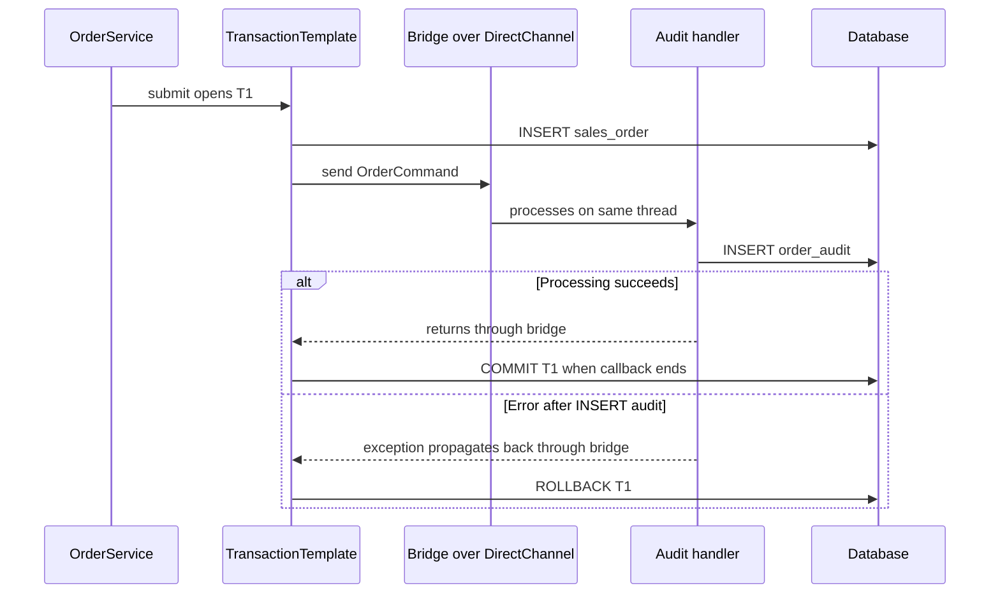

# Bridge and Transaction Boundaries

## 1. Objectives and Use Case

In the **Messaging bridge** chapter of the **SPRING_INTEGRATION_CORE** module, this lesson explains how transaction boundaries change when a bridge connects different types of channels. The content ties together designing Message, MessageChannel, and endpoint flows in Java DSL with JDBC transactions, error handling, and testing.

After this lesson, you will be able to:

- Identify which component opens a transaction and which operations participate in it.
- Distinguish successful message delivery from committed business processing.
- Design a synchronous bridge or a bridge with a transactional poller.
- Identify the conditions required to roll back both message consumption and data updates.
- Verify the outcomes of synchronous errors, asynchronous errors, and message redelivery.

Consider an application that records an order, forwards a message through a bridge, and then writes an audit record. The initial requirement is that **both records exist together or neither exists**. When the audit step moves to a background thread, the system also changes its data-consistency model.

The examples use imperative transactions with `PlatformTransactionManager`. Reactive transactions based on Reactor Context require a separate analysis.

## 2. Is a Bridge a Transaction Boundary?

A bridge forwards messages between channels. It does not inherently open a transaction, commit a transaction, or turn two resources into a single transactional resource. `.bridge()` describes flow wiring; channel and endpoint configuration determine how execution happens. See [Messaging Bridge](https://docs.spring.io/spring-integration/reference/bridge.html).

There are four questions to answer:

| Question | Example |
|---|---|
| Who opens the transaction? | A service using `TransactionTemplate`, a proxied `@Transactional` method, or a transactional poller |
| Which resources participate? | A `DataSource` managed by `DataSourceTransactionManager` |
| In which context does the code run? | The sender's thread or an executor/poller thread |
| Who observes an error before the transaction ends? | A synchronously calling service or the poller's transaction advice |

In typical imperative transactions, Spring binds transaction resources to the current thread. A flow spanning multiple endpoints can keep that context as long as it continues synchronously. Moving work onto another thread does not carry the transaction context along automatically. See [Transaction Support](https://docs.spring.io/spring-integration/reference/transactions.html).

Distinguish **not propagating a transaction across a handoff** from **committing immediately at the channel**. After sending to an executor, the service can continue running and throw an error that rolls back the service's transaction. What is not guaranteed is that the work on the receiving thread rolls back with it.

Being on the same thread is also not enough to conclude the entire flow is atomic:

- `REQUIRED` can join an existing transaction with a compatible transaction manager.
- `REQUIRES_NEW` creates an independent transaction even though the call stays on the same thread.
- Two local transaction managers managing two separate databases do not automatically provide a shared atomic commit.
- Making an HTTP call or sending an email inside a JDBC transaction does not make that side effect roll back.

Propagation and resource scope must match business requirements. See [Transaction Propagation](https://docs.spring.io/spring-framework/reference/data-access/transaction/declarative/tx-propagation.html).

## 3. Comparing Channels on Both Sides of a Bridge

| Path | Typical execution | Does the sender's transaction automatically continue to the final handler? | Meaning of a successful send |
|---|---|---|---|
| `DirectChannel → bridge → DirectChannel` | Nested call on the sending thread | Possibly, when a compatible transaction exists | Handler returned; commit still depends on the outer scope |
| `DirectChannel → bridge → ExecutorChannel` | Handoff to an executor | Not guaranteed | Work was accepted for execution |
| `DirectChannel → bridge → QueueChannel` | Enqueued, received at a different time | Does not automatically continue to the later consumer | Queue accepted the message |
| `QueueChannel → polling bridge → DirectChannel` | Poller receives and then processes synchronously | Does not receive the producer's transaction; poller can open a new transaction | Producer's send result does not represent the poller's outcome |

`DirectChannel` invokes the handler inside the send call. `QueueChannel` decouples sending and receiving; a polled consumer typically runs on another thread. `ExecutorChannel` hands work off to an executor and does not guarantee a transaction spanning from sender to receiver. See [Message Channel Implementations](https://docs.spring.io/spring-integration/reference/channel/implementations.html) and [Configuring Message Channels](https://docs.spring.io/spring-integration/reference/channel/configuration.html).

Do not rely on an executor occasionally running a task on the sending thread under overload, such as with `CallerRunsPolicy`. Atomicity must not depend on thread-pool load state.

`send()` returning `true` is also not a commit signal. The handler may return successfully, and the service may throw an exception afterward before the transaction ends, causing data to roll back.

## 4. Example: Two JDBC Updates Across a Synchronous Bridge

### 4.1. Setup

The example requires Java supporting `record`, Spring Integration Core, Spring JDBC, Spring Transaction, and a JDBC driver. Use compatible versions from your application's BOM.

The application provides a `DataSource` bean. The configuration below defines a `JdbcTemplate` and transaction manager for that same data source. If the application already has equivalent beans, reuse them instead of declaring duplicates.

Create the tables before running:

```sql
create table sales_order (
    order_id bigint primary key
);

create table order_audit (
    order_id bigint primary key,
    note varchar(100) not null
);
```

### 4.2. Java Configuration

```java
package example.bridge;

import javax.sql.DataSource;

import org.springframework.beans.factory.annotation.Qualifier;
import org.springframework.context.annotation.Bean;
import org.springframework.context.annotation.Configuration;
import org.springframework.integration.channel.DirectChannel;
import org.springframework.integration.config.EnableIntegration;
import org.springframework.integration.dsl.IntegrationFlow;
import org.springframework.jdbc.core.JdbcTemplate;
import org.springframework.jdbc.datasource.DataSourceTransactionManager;
import org.springframework.messaging.MessageChannel;
import org.springframework.messaging.support.MessageBuilder;
import org.springframework.transaction.PlatformTransactionManager;
import org.springframework.transaction.support.TransactionTemplate;

@Configuration(proxyBeanMethods = false)
@EnableIntegration
public class SynchronousBridgeConfig {

    @Bean
    JdbcTemplate jdbcTemplate(DataSource dataSource) {
        return new JdbcTemplate(dataSource);
    }

    @Bean
    PlatformTransactionManager transactionManager(DataSource dataSource) {
        return new DataSourceTransactionManager(dataSource);
    }

    @Bean
    MessageChannel orderInput() {
        return new DirectChannel();
    }

    @Bean
    MessageChannel auditInput() {
        return new DirectChannel();
    }

    @Bean
    IntegrationFlow orderBridge() {
        return IntegrationFlow.from("orderInput")
                .bridge()
                .channel("auditInput")
                .get();
    }

    @Bean
    IntegrationFlow auditFlow(JdbcTemplate jdbc) {
        return IntegrationFlow.from("auditInput")
                .handle(OrderCommand.class, (command, headers) -> {
                    jdbc.update(
                            "insert into order_audit(order_id, note) values (?, ?)",
                            command.orderId(), "AUDITED");

                    if (command.rejectAfterAudit()) {
                        throw new IllegalStateException("Error after writing audit");
                    }
                    return null; // Handler terminates, producing no reply.
                })
                .get();
    }

    @Bean
    OrderService orderService(
            JdbcTemplate jdbc,
            PlatformTransactionManager transactionManager,
            @Qualifier("orderInput") MessageChannel input) {
        return new OrderService(jdbc, transactionManager, input);
    }

    public record OrderCommand(long orderId, boolean rejectAfterAudit) {
    }

    public static final class OrderService {

        private final JdbcTemplate jdbc;
        private final TransactionTemplate tx;
        private final MessageChannel input;

        public OrderService(
                JdbcTemplate jdbc,
                PlatformTransactionManager transactionManager,
                MessageChannel input) {
            this.jdbc = jdbc;
            this.tx = new TransactionTemplate(transactionManager);
            this.input = input;
        }

        public void submit(long orderId, boolean rejectAfterAudit) {
            tx.executeWithoutResult(status -> {
                jdbc.update(
                        "insert into sales_order(order_id) values (?)",
                        orderId);

                boolean sent = input.send(
                        MessageBuilder.withPayload(
                                new OrderCommand(orderId, rejectAfterAudit))
                                .build(),
                        1_000);

                if (!sent) {
                    throw new IllegalStateException("Failed to forward message");
                }
            });
        }
    }
}
```

`TransactionTemplate` makes the transaction scope explicit: the callback encloses both the order insert and the message send call. Spring provides this API for programmatic imperative transaction management. See [Programmatic Transaction Management](https://docs.spring.io/spring-framework/reference/data-access/transaction/programmatic.html).

### 4.3. Success and Failure



With a new order ID and no outer transaction:

| Call | State after the call completes |
|---|---|
| `submit(1001L, false)` | Both the order and the audit record exist |
| `submit(1002L, true)` | Caller receives an exception; neither record for `1002` exists |

Business exceptions may be wrapped in a messaging exception. When asserting, inspect the root cause rather than requiring the outermost exception to always be `IllegalStateException`.

The bridge does not need to open an additional transaction itself. Both JDBC statements join T1 through `JdbcTemplate` and the resource bound to the thread by the transaction manager.

You can replace this with a service method annotated with `@Transactional`. In that case, enable annotation support, call through the Spring proxy, and verify rollback rules. Under typical default configuration, unchecked exceptions and `Error` trigger rollback; checked exceptions require matching rules. Self-invocation in proxy mode does not trigger transaction advice. See [Using `@Transactional`](https://docs.spring.io/spring-framework/reference/data-access/transaction/declarative/annotations.html).

## 5. Switching to `ExecutorChannel` Changes the Data Contract

Replace the `auditInput` bean in Section 4 with the following configuration:

```java
@Bean
MessageChannel auditInput(
        @Qualifier("auditExecutor") java.util.concurrent.Executor executor) {
    return new org.springframework.integration.channel.ExecutorChannel(executor);
}

@Bean
org.springframework.scheduling.concurrent.ThreadPoolTaskExecutor auditExecutor() {
    var executor =
            new org.springframework.scheduling.concurrent.ThreadPoolTaskExecutor();
    executor.setCorePoolSize(2);
    executor.setMaxPoolSize(2);
    executor.setQueueCapacity(100);
    executor.setThreadNamePrefix("audit-");
    return executor;
}
```

This replaces the old bean; do not register two beans with the same name.

One possible sequence of events is:

1. Service opens T1 and inserts `sales_order`.
2. Bridge sends the message to `ExecutorChannel`.
3. Executor accepts the task; the send call returns.
4. Service finishes the callback and commits T1.
5. Worker inserts the audit record and then encounters an error.

The worker can also start before T1 commits. This configuration does not guarantee completion ordering between the two threads.

In the original code, the audit handler does not open its own transaction on the worker. Its JDBC statement may have committed under auto-commit before the error occurred. Adding transaction T2 around the handler protects the worker's updates, but does not merge T2 with T1.

Therefore, the worker must never assume it can always read uncommitted producer data. An error after the handoff also does not travel back to roll back T1.

If background processing is required, change the contract to: **the order and the pending job are persisted atomically; a worker completes the job later**. Transactional queues or the transactional outbox pattern are design approaches for that requirement.

A gateway waiting for a reply does not reattach a transaction split across an executor or queue. When a gateway times out, the worker can still be running. A timeout is neither a task cancellation mechanism nor proof that all side effects were rolled back.

## 6. Polling Bridge: The Transaction Must Include the Receive Operation

With a `QueueChannel` input, the bridge needs a poller. Putting a transaction only on the service processing after the bridge normally excludes the `receive()` that already happened earlier.

A transactional poller wraps transaction advice around the receive operation and the synchronous processing segment that follows:

```java
@Bean
org.springframework.integration.channel.QueueChannel staging() {
    return new org.springframework.integration.channel.QueueChannel(100);
}

@Bean
IntegrationFlow stagingBridge(PlatformTransactionManager transactionManager) {
    return IntegrationFlow.from("staging")
            .bridge(endpoint -> endpoint.poller(
                    org.springframework.integration.dsl.Pollers.fixedDelay(500)
                            .maxMessagesPerPoll(1)
                            .receiveTimeout(0)
                            .transactional(transactionManager)))
            .channel("auditInput")
            .get();
}
```

This example assumes `auditInput` is the original `DirectChannel` and messages in `staging` carry an `OrderCommand` payload.

| Configuration | Role |
|---|---|
| `fixedDelay(500)` | Schedules the next poll after the previous poll completes |
| `maxMessagesPerPoll(1)` | Caps at one message per poll for easy observation |
| `receiveTimeout(0)` | Does not wait when the queue is empty |
| `transactional(transactionManager)` | Applies transaction advice to the polling task |
| Synchronous output | Allows the handler to run within the polling task's context |

Do not infer that `maxMessagesPerPoll(10)` means ten messages are always in one batch transaction. That property limits polling; transaction scope depends on where advice is applied.

Java DSL provides an overload of `transactional(...)` accepting a transaction manager. See [PollerSpec](https://docs.spring.io/spring-integration/api/org/springframework/integration/dsl/PollerSpec.html).

### An In-Memory Queue Does Not Restore Messages on JDBC Rollback

`staging` uses an in-memory queue. If the bridge receives a message and the handler throws an error:

- JDBC updates participating in the poller's transaction can roll back.
- The message does not automatically return to the in-memory queue.
- Restarts do not preserve messages stored only in memory.

Transaction advice does not turn every input into a transactional resource. To roll back the receive operation as well, the queue/store must support and properly participate in the transaction. To survive process crashes, the store must also be durable. See [MessageGroupQueue](https://docs.spring.io/spring-integration/api/org/springframework/integration/store/MessageGroupQueue.html).

## 7. JDBC Queue: Rolling Back Message Consumption Together with Business Updates

### 7.1. Deployment Prerequisites

The next example uses PostgreSQL and adds dedicated channels. It reuses the `DataSource`, `JdbcTemplate`, transaction manager, and business tables from Section 4.

Prepare:

- Compatible `spring-integration-jdbc` and PostgreSQL JDBC driver.
- Store schema from `schema-postgresql.sql` matching the exact library version.
- The same `DataSource` for both the store and the business updates that should commit/roll back together.
- A queue group key that remains stable across restarts.
- Payloads and headers compatible with the serialization mechanism in use.

`JdbcChannelMessageStore` is designed for channels, with a database-specific query provider. See [JDBC Message Store](https://docs.spring.io/spring-integration/reference/jdbc/message-store.html).

### 7.2. Store and Bridge Configuration

```java
package example.bridge;

import javax.sql.DataSource;

import org.springframework.context.annotation.Bean;
import org.springframework.context.annotation.Configuration;
import org.springframework.integration.channel.DirectChannel;
import org.springframework.integration.channel.QueueChannel;
import org.springframework.integration.dsl.IntegrationFlow;
import org.springframework.integration.dsl.Pollers;
import org.springframework.integration.jdbc.store.JdbcChannelMessageStore;
import org.springframework.integration.jdbc.store.channel
        .PostgresChannelMessageStoreQueryProvider;
import org.springframework.integration.store.MessageGroupQueue;
import org.springframework.jdbc.core.JdbcTemplate;
import org.springframework.messaging.MessageChannel;
import org.springframework.transaction.PlatformTransactionManager;

@Configuration(proxyBeanMethods = false)
public class PersistentBridgeConfig {

    @Bean
    JdbcChannelMessageStore orderStore(DataSource dataSource) {
        var store = new JdbcChannelMessageStore(dataSource);
        store.setChannelMessageStoreQueryProvider(
                new PostgresChannelMessageStoreQueryProvider());
        store.setRegion("orders-v1");
        return store;
    }

    @Bean
    QueueChannel orderJobs(JdbcChannelMessageStore orderStore) {
        return new QueueChannel(
                new MessageGroupQueue(orderStore, "order-jobs"));
    }

    @Bean
    MessageChannel orderWorker() {
        return new DirectChannel();
    }

    @Bean
    IntegrationFlow durableOrderBridge(
            PlatformTransactionManager transactionManager) {
        return IntegrationFlow.from("orderJobs")
                .bridge(endpoint -> endpoint
                        .id("durableOrderBridgeEndpoint")
                        .poller(Pollers.fixedDelay(500)
                                .maxMessagesPerPoll(1)
                                .receiveTimeout(0)
                                .transactional(transactionManager)))
                .channel("orderWorker")
                .get();
    }

    @Bean
    IntegrationFlow orderWorkerFlow(JdbcTemplate jdbc) {
        return IntegrationFlow.from("orderWorker")
                .handle(Long.class, (orderId, headers) -> {
                    jdbc.update(
                            "insert into order_audit(order_id, note) values (?, ?)",
                            orderId, "ASYNC_AUDITED");

                    if (Boolean.TRUE.equals(headers.get("simulateFailure"))) {
                        throw new IllegalStateException("Worker error for practice");
                    }
                    return null;
                })
                .get();
    }
}
```

A `Long` payload and `Boolean` failure-test header work with default serialization. Do not place database connections, servlet requests, or local channels into messages that need durable storage.

Switching databases requires changing the query provider and schema accordingly. See [PostgresChannelMessageStoreQueryProvider](https://docs.spring.io/spring-integration/api/org/springframework/integration/jdbc/store/channel/PostgresChannelMessageStoreQueryProvider.html).

### 7.3. Producer and Consumer Have Two Transactions

The snippet below shows a producer method body. `jdbc`, `tx`, and `orderJobs` are injected `JdbcTemplate`, `TransactionTemplate`, and queue beans:

```java
tx.executeWithoutResult(status -> {
    jdbc.update(
            "insert into sales_order(order_id) values (?)",
            4001L);

    boolean sent = orderJobs.send(
            org.springframework.messaging.support.MessageBuilder
                    .withPayload(4001L)
                    .build(),
            1_000);

    if (!sent) {
        throw new IllegalStateException("Failed to persist pending job");
    }
});
```

With the same data source and transaction manager, the producer can commit the order together with the message in **T1**. The poller later opens **T2** to pull the job and write the audit record:

```text
T1 - producer:
    INSERT sales_order
    INSERT message into JDBC store
    COMMIT

T2 - polling bridge and synchronous worker:
    RECEIVE/REMOVE message in JDBC store
    INSERT order_audit
    COMMIT or ROLLBACK
```

These are two separate transactions. Rolling back T2 does not delete the order already committed in T1.

If an exception escapes from the worker to the poller's transaction advice, T2 can roll back both removing the message from the store and writing the audit record. The message becomes available for the next receive attempt. When T2 commits, message consumption and the audit record are finalized together.

Do not change `orderWorker` to an `ExecutorChannel` and still expect the guarantee above: the polling task can finish right after the handoff while the worker has not yet finished processing.

A JDBC queue is one option when you need to combine business data and pending jobs in the same database. With a message broker, you must analyze the broker's resource manager, acknowledgements, and transactions separately; you do not automatically get an atomic commit across a broker and JDBC.

## 8. Exceptions, Error Channels, and Retries

### 8.1. Errors Must Reach the Right Transaction Scope

In a synchronous flow, exceptions can propagate back to the sender. With background tasks, Spring Integration supports publishing an `ErrorMessage` to an error channel. See [Error Handling](https://docs.spring.io/spring-integration/reference/error-handling.html).

Having an `ErrorMessage` does not prove whether a transaction committed or rolled back. Examine where handling occurs:

| Location | What to check |
|---|---|
| Catching errors in a handler or recovery before transaction advice sees the error | Does it turn a failure into normal completion? |
| Error handler receiving an error after it escaped past transaction advice | How did the prior transaction end; does persisting the error use its own transaction? |

Example that can hide an error from the transaction layer:

```java
try {
    updateBusinessData();
} catch (RuntimeException ex) {
    logFailure(ex);
    // Does not rethrow and does not explicitly mark rollback-only.
}
```

With a JDBC queue, this can cause message consumption to commit even though business processing did not complete. If a lower layer already marked rollback-only, catching the error will not clear that flag; the transaction still cannot commit successfully.

To roll back, let the appropriate error reach the transaction advice or mark rollback-only at the transaction management layer. To complete a message by moving it to quarantine, explicitly design atomicity between persisting the failed message and completing the source message.

### 8.2. Retries Need a Termination Point

Retrying inside a single handler invocation differs from redelivery caused by rolling back message consumption. They do not share the same transaction scope.

A message with `simulateFailure=true` in the example will fail every time it is received. That is a way to practice repeated failures, not a bounded retry policy.

A production flow must specify which error types are retried, backoff/wait times, retry limits, how permanent failures are quarantined, and an idempotency key. Retry counters must survive rollbacks and restarts as required: if updated inside the same transaction that rolls back, the attempt count may also be undone.

## 9. Transaction Synchronization and Resource Limits

If a worker calls a payment gateway and then updates JDBC, a database error does not automatically refund the payment. Committing data first and then calling an external system also leaves a gap if the process crashes before the call.

Transaction synchronization lets you attach actions before commit, after commit, or after rollback. It does not turn non-transactional resources into rollback-capable resources. `PseudoTransactionManager` also does not provide atomic commit across JDBC and HTTP. See [Transaction Synchronization and Pseudo Transactions](https://docs.spring.io/spring-integration/reference/transactions.html#transaction-synchronization).

Sending an email after commit avoids sending for a rolled-back transaction, yet does not guarantee the email is sent if the process dies right after commit. When the intent to send must be preserved, you can record it in the same database transaction and use a separate process to forward and retry. The receiver still needs to handle potential duplicates.

A `transactionId` header only serves correlation and reconciliation when defined by the application; it does not carry a JDBC transaction context.

## 10. Practicing Transaction Boundary Verification

These are scenarios to execute in a prepared environment. The illustrative code has not been run as an automated integration test suite here.

Observe the thread, active transaction state, and database state after the transaction finishes. You can place the following diagnostic snippet at the start of a handler:

```java
boolean active = org.springframework.transaction.support
        .TransactionSynchronizationManager.isActualTransactionActive();

System.out.printf("thread=%s, txActive=%s%n",
        Thread.currentThread().getName(), active);
```

Two threads both reporting `txActive=true` does not mean they share the same transaction. Logs aid diagnosis; database state verifies the business contract.

| Scenario | Expected outcome to verify |
|---|---|
| Two `DirectChannel`s, service succeeds | Both order and audit records exist |
| Two `DirectChannel`s, error after writing audit | Neither new record exists |
| `ExecutorChannel`, worker fails after sender completes | Do not expect the worker error to roll back the sender's transaction automatically |
| In-memory queue, transactional poller, error after JDBC write | JDBC rolls back; consumed message does not automatically return to the queue |
| JDBC queue, transactional poller, synchronous worker fails | Audit rolls back; message can be received again |
| JDBC queue, worker succeeds | Audit exists; message is consumed |
| Producer saves order plus JDBC message and then throws | Both the order and the new message roll back |
| JDBC store on a durable database, message waiting, then restart | Message can still be found using the same region and group key |

To inspect the queue after a single failure, control the polling endpoint's lifecycle to avoid continuously re-receiving while checking state. The example uses the ID `durableOrderBridgeEndpoint`. Stop the endpoint after observing the failure and wait for the running task to finish before inspecting the queue.

For asynchronous cases, wait conditionally with a bound or use a latch; do not rely on a fixed `sleep` duration. Query the database after the transaction ends. Avoid letting a test's own transaction mask a real commit or prevent a worker from seeing uncommitted data.

Before changing a bridge's channels, re-identify which operations must be atomic, where the transaction opens, which resources participate, how errors flow, and how messages are recovered. Those answers define the data contract after the change.
