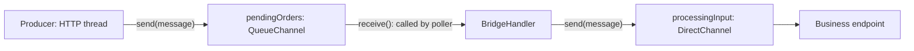

# Changing Channel Types with a Bridge

## Objectives and Context

In the **Messaging bridge** chapter of the **SPRING_INTEGRATION_CORE** module, "changing channel types" means connecting two channels with different delivery semantics so messages can pass between them. The two channels remain two separate beans; a bridge does not turn a `QueueChannel` instance into a `DirectChannel` instance.

Typical scenario: an order intake component needs to place messages into a queue to absorb a traffic spike, while business endpoints already receive messages via a `DirectChannel`. A bridge that pulls messages from the queue and sends them to the business channel preserves how downstream endpoints are wired.

After this lesson, you will be able to:

- Choose a bridge when you need to change how messages are handed off between flow segments.
- Determine whether a bridge needs a poller based on the **input channel**.
- Configure both directions (`QueueChannel → DirectChannel` and `DirectChannel → QueueChannel`) using Java DSL or annotations.
- Explain impacts on threads, throughput, errors, and transactions.
- Write tests observing payload, headers, and when messages become receivable.

The examples use `spring-integration-core`; the tests use JUnit Jupiter. Use a compatible Spring and JDK version set managed by your project. Java DSL lives in the core library, so no separate Java DSL library is needed. This lesson focuses on local channels inside a single Spring application.

## 1. What Does a Bridge Forward?

A `Message<?>` contains a payload along with headers such as `correlationId`, `replyChannel`, and `errorChannel`. A channel provides the transport path; an endpoint receives messages from a channel and performs an action.

For a pure bridge, that action is **forwarding the message to the output channel**. `BridgeHandler` by default returns the received message so the endpoint's output mechanism forwards it. It does not parse JSON, invoke a business service, or aggregate messages into a group on its own. See [`BridgeHandler` source code](https://github.com/spring-projects/spring-integration/blob/main/spring-integration-core/src/main/java/org/springframework/integration/handler/BridgeHandler.java).

Example:

```text
Before bridge:
  payload = Order(id="O-009")
  headers = { traceId="trace-009", ... }

After pure bridge:
  payload = Order(id="O-009")
  business headers are still forwarded
```

What changes is **the path and the handoff mechanism**. If the source is a queue, a consumer must call `receive()`; if the destination is a `DirectChannel`, `send()` invokes the subscriber on the sending thread.

In a real flow, interceptors, message history, or additional endpoints can affect the message. Therefore, distinguish the behavior of the bridge itself from the behavior of the overall flow. A bridge also does not deep-copy the payload: if the payload is a mutable object, forwarding does not create an independent copy of the data.

When you need to convert a JSON `String` into an `Order`, place a transformer at the right spot. When you need branch selection by order status, use a router; to drop messages by condition, use a filter; to combine multiple messages by correlation, use an aggregator. A bridge solves connecting transport segments.

## 2. Channel Contracts Determine Consumption Semantics

`MessageChannel` provides the send operation. The two common contracts encountered when configuring a bridge are:

| Contract | How the receiving side participates | Examples |
| --- | --- | --- |
| `PollableChannel` | Consumer actively calls `receive(...)` | `QueueChannel` |
| `SubscribableChannel` | Handler registers via `subscribe(...)` | `DirectChannel`, `ExecutorChannel`, `PublishSubscribeChannel` |

A variable declared as `MessageChannel` still points to a concrete implementation. Changing the declared variable type or casting does not add `receive()` or `subscribe()` behavior. Refer to [MessageChannel Contracts](https://docs.spring.io/spring-integration/reference/channel/interfaces.html).

The bridge is hosted inside an endpoint matching the source:

```text
Source PollableChannel
    → PollingConsumer
    → BridgeHandler
    → Destination MessageChannel

Source SubscribableChannel
    → EventDrivenConsumer
    → BridgeHandler
    → Destination MessageChannel
```

Selecting the endpoint based on the input channel is Spring Integration infrastructure's responsibility. In typical configuration, you declare a flow or annotation and configure a poller when the source requires polling. This mechanism is described in [Message Endpoints](https://docs.spring.io/spring-integration/reference/endpoint.html).

### Quick Selection Table

| Connection from → to | Does the bridge need a poller? | Design meaning |
| --- | --- | --- |
| `QueueChannel → DirectChannel` | Yes, on the bridge reading the queue | Moves buffered messages into a direct processing segment |
| `DirectChannel → QueueChannel` | No, on this bridge | Places messages into a queue for a downstream consumer to pull later |
| `QueueChannel → QueueChannel` | Yes, to read the source queue | Transfers from one buffer to another |
| `QueueChannel → PublishSubscribeChannel` | Yes | Pulls a message from a queue and passes it to a broadcast stage |
| `DirectChannel → ExecutorChannel` | No | Delegates downstream dispatch to an executor |

The table assumes standard channels and infrastructure-managed endpoints. For a pollable source, the poller can be declared directly or inherited from a valid default configuration. Examples in this lesson always declare it directly so readers clearly see who consumes the queue.

## 3. Direction `QueueChannel → DirectChannel`

### Problem Statement

A producer receives orders over HTTP and sends them to `pendingOrders`. You want to pace how many messages are forwarded to `processingInput` per polling cycle.



Progression of a single message:

1. The producer thread sends the message into the queue.
2. Once the queue accepts it, the producer can continue its work.
3. At poll time, the bridge endpoint pulls the message from the queue.
4. The bridge sends the message to `processingInput`.
5. `DirectChannel` invokes the registered handler on the very thread executing the poll cycle, unless another asynchronous boundary exists.

A `DirectChannel` after a queue does not move the flow back onto the HTTP thread. It simply continues synchronously on **whichever thread is sending to it**.

If the subscriber takes 300 ms to process, that time is included in the poll cycle's execution time. Setting a shorter delay does not automatically spawn more consumers running in parallel.

### Why Declaring Two Channels Alone Is Not Enough

```java
@Bean
public QueueChannel pendingOrders() {
    return new QueueChannel(100);
}

@Bean
public DirectChannel processingInput() {
    return new DirectChannel();
}
```

These two beans do not create any path between them yet. `QueueChannel` does not pull messages itself to send to another channel. You need a consumer—in this case, an endpoint containing a bridge with a poller configuration.

## 4. Complete Java DSL Example

The configuration below pairs two bridges so you can observe both directions:

```text
pendingOrders        processingInput          handoffQueue
 QueueChannel  ──→    DirectChannel     ──→     QueueChannel
               B1                      B2
          polling consumer       event-driven consumer
```

`handoffQueue` is an observation point for testing via `receive()`. A message appearing here only means it was handed off to the queue; it does not prove the order has been business-processed.

```java
package example.bridge;

import java.time.Duration;

import org.springframework.context.annotation.Bean;
import org.springframework.context.annotation.Configuration;
import org.springframework.integration.channel.DirectChannel;
import org.springframework.integration.channel.QueueChannel;
import org.springframework.integration.config.EnableIntegration;
import org.springframework.integration.dsl.IntegrationFlow;
import org.springframework.integration.dsl.Pollers;

@Configuration
@EnableIntegration
public class ChannelBridgeConfig {

    @Bean
    public QueueChannel pendingOrders() {
        return new QueueChannel(100);
    }

    @Bean
    public DirectChannel processingInput() {
        return new DirectChannel();
    }

    @Bean
    public QueueChannel handoffQueue() {
        return new QueueChannel(100);
    }

    @Bean
    public IntegrationFlow bufferedToDirect() {
        return IntegrationFlow.from(pendingOrders())
                .bridge(endpoint -> endpoint
                        .id("pendingToProcessingBridge")
                        .poller(Pollers
                                .fixedDelay(Duration.ofMillis(200))
                                .maxMessagesPerPoll(5)
                                .receiveTimeout(0)))
                .channel(processingInput())
                .get();
    }

    @Bean
    public IntegrationFlow directToBuffered() {
        return IntegrationFlow.from(processingInput())
                .bridge(endpoint -> endpoint
                        .id("processingToHandoffBridge"))
                .channel(handoffQueue())
                .get();
    }
}
```

In `bufferedToDirect()`, the poller belongs to the bridge endpoint reading `pendingOrders`. In `directToBuffered()`, the bridge is invoked when a message is sent to `processingInput`, so no poller is placed there.

`@Configuration` in the example keeps the default proxy mode: calls to `@Bean` methods within the configuration reference the Spring-managed beans. If switching to `proxyBeanMethods = false`, change wiring to inject beans rather than calling channel-creation methods directly.

In a real application, you can replace the second bridge with an existing business endpoint. If you only need to move from a source queue to a target queue and no endpoint needs the intermediate channel, consider connecting directly to avoid an unnecessary forwarding hop.

Bridge syntax in Java DSL and equivalent configuration styles are presented in [Messaging Bridge](https://docs.spring.io/spring-integration/reference/bridge.html).

## 5. Direction `DirectChannel → QueueChannel`

In the example above, calling:

```java
processingInput.send(message, 1000);
```

triggers the second bridge on the caller's thread. The bridge sends the message into `handoffQueue`. When the queue has space, enqueuing completes without needing an active consumer waiting.

This explains two points:

- This bridge does not create a separate thread; a consumer receiving from `handoffQueue` later is what creates a handoff to another processing segment.
- Having a queue as the destination does not make the source pollable. Pollers are still determined by each endpoint's source.

The `1000` in `send(message, 1000)` is not a deadline for completing the entire flow in 1 second. It is the timeout parameter for the send operation on the invoked channel and does not automatically propagate as a deadline for deeper sends inside handlers.

If `handoffQueue` is full, the bridge may wait up to the handler's own send timeout. In the learning example, each test sends just one message into a queue of capacity 100 to focus on observing the handoff.

In production, set appropriate capacities and wait policies. For instance, when configuring `BridgeHandler` directly, `setSendTimeout(500)` bounds how long the handler waits to send to a target channel that supports timeouts. That is still not a timeout for an arbitrary business task.

## 6. Pacing with a Poller: Reading the Three Parameters Correctly

The configuration:

```java
Pollers.fixedDelay(Duration.ofMillis(200))
        .maxMessagesPerPoll(5)
        .receiveTimeout(0)
```

has three independent meanings:

| Parameter | Meaning in the example | What not to infer |
| --- | --- | --- |
| `fixedDelay(200 ms)` | Wait 200 ms after the previous poll completes before scheduling the next | Does not guarantee every message waits at most 200 ms |
| `maxMessagesPerPoll(5)` | Pull at most 5 messages per poll | Not the number of threads or messages processed concurrently |
| `receiveTimeout(0)` | Each receive from the queue does not wait when empty | Does not bound subscriber execution time |

`receiveTimeout` is in milliseconds. When `receive()` returns `null`, the poll stops even if the maximum message count has not been reached. See [PollerSpec configuration](https://docs.spring.io/spring-integration/api/org/springframework/integration/dsl/PollerSpec.html).

### Estimating to Choose Initial Parameters

Suppose the queue always has data, only one poll runs at a time, and each message takes roughly 40 ms to traverse the synchronous processing segment behind the bridge.

```text
Max messages per poll:        5 messages
Processing time per poll:     5 × 40 ms = 200 ms
Delay after poll:             200 ms
Approximate cycle:            400 ms
Approximate throughput:       5 / 0.4 = 12.5 messages/second
```

This is an estimate for those assumptions, ignoring overhead, errors, and processing-time variance. Dividing `5 / 0.2 = 25` only gives a valid number when processing time is negligible compared to the delay.

`fixedRate` measures intervals by scheduled start times, whereas `fixedDelay` is based on completion times. Do not use either scheduling mode as a substitute for an exact rate-limit guarantee across arbitrary time windows. Refer to [Pollers](https://docs.spring.io/spring-integration/api/org/springframework/integration/dsl/Pollers.html).

If the producer sends 30 messages/second while the processing branch only consumes an average of 12.5 messages/second, the backlog grows by roughly 17.5 messages/second in this simple model. Increasing capacity only prolongs the time before the queue fills up. You must scale processing capacity or control intake rate to resolve a sustained mismatch.

## 7. Equivalent Configuration Using Annotations

This is an **alternative** to `ChannelBridgeConfig`. Load only one of the two configurations in the same example to avoid creating duplicate endpoints or unintended competing consumers.

```java
package example.bridge;

import org.springframework.context.annotation.Bean;
import org.springframework.context.annotation.Configuration;
import org.springframework.integration.annotation.BridgeTo;
import org.springframework.integration.annotation.Poller;
import org.springframework.integration.channel.DirectChannel;
import org.springframework.integration.channel.QueueChannel;
import org.springframework.integration.config.EnableIntegration;

@Configuration
@EnableIntegration
public class AnnotatedChannelBridgeConfig {

    @Bean
    @BridgeTo(
            value = "processingInput",
            poller = @Poller(
                    fixedDelay = "200",
                    maxMessagesPerPoll = "5",
                    receiveTimeout = "0"))
    public QueueChannel pendingOrders() {
        return new QueueChannel(100);
    }

    @Bean
    @BridgeTo("handoffQueue")
    public DirectChannel processingInput() {
        return new DirectChannel();
    }

    @Bean
    public QueueChannel handoffQueue() {
        return new QueueChannel(100);
    }
}
```

`@BridgeTo` is placed on the source channel bean, and the annotation value names the target channel.

If you prefer declaring from the opposite perspective, `@BridgeFrom` is placed on the target channel bean and points to the source channel. Choose one style for the same connection; declaring both does not make the link "more reliable" and can create an extra endpoint.

## 8. Testing the Handoff

The two tests below use the Java DSL configuration from Section 4. They observe outputs without relying on fixed sleep durations or asserting that messages are always processed in exactly 200 ms.

```java
package example.bridge;

import org.junit.jupiter.api.Test;
import org.springframework.context.annotation.AnnotationConfigApplicationContext;
import org.springframework.integration.channel.DirectChannel;
import org.springframework.integration.channel.QueueChannel;
import org.springframework.messaging.Message;
import org.springframework.messaging.support.MessageBuilder;

import static org.junit.jupiter.api.Assertions.assertEquals;
import static org.junit.jupiter.api.Assertions.assertNotNull;
import static org.junit.jupiter.api.Assertions.assertSame;
import static org.junit.jupiter.api.Assertions.assertTrue;

class ChannelBridgeConfigTest {

    record Order(String id) {
    }

    @Test
    void queueToDirectPreservesPayloadAndBusinessHeader() {
        try (var context =
                     new AnnotationConfigApplicationContext(
                             ChannelBridgeConfig.class)) {

            QueueChannel input =
                    context.getBean("pendingOrders", QueueChannel.class);
            QueueChannel output =
                    context.getBean("handoffQueue", QueueChannel.class);

            Order order = new Order("O-009");
            Message<Order> sent = MessageBuilder
                    .withPayload(order)
                    .setHeader("traceId", "trace-009")
                    .build();

            assertTrue(input.send(sent, 1000));

            Message<?> received = output.receive(3000);
            assertNotNull(received);
            assertSame(order, received.getPayload());
            assertEquals(
                    "trace-009",
                    received.getHeaders().get("traceId"));
        }
    }

    @Test
    void directToQueueEnqueuesBeforeSendReturns() {
        try (var context =
                     new AnnotationConfigApplicationContext(
                             ChannelBridgeConfig.class)) {

            DirectChannel input =
                    context.getBean("processingInput", DirectChannel.class);
            QueueChannel output =
                    context.getBean("handoffQueue", QueueChannel.class);

            Message<String> sent = MessageBuilder
                    .withPayload("O-010")
                    .build();

            assertTrue(input.send(sent, 1000));

            Message<?> received = output.receive(0);
            assertNotNull(received);
            assertEquals("O-010", received.getPayload());
        }
    }
}
```

The first test sends via the source queue and waits with a timeout at the target queue. `assertSame` verifies the bridge does not copy the payload in this specific configuration; checking the header ensures business metadata passes through.

The second test skips the source queue to enter directly into the bridge whose source is `DirectChannel`. Because this branch runs synchronously and the target queue has space, the message is already enqueued when `send()` returns. `receive(0)` verifies that immediately.

The 3-second wait in the first test is a test-environment wait budget, not a system SLA. If the test fails, check whether the endpoint started, the poller ran, and whether any downstream error occurred. Do not immediately conclude you just need to increase the timeout.

These tests prove message handoff within a single local context. They do not prove crash recovery, throughput, or database atomicity.

## 9. Thread, Error, and Transaction Boundaries

### 9.1. Comparing by Send Location

| Path | Who runs the bridge? | What does the initial caller observe? |
| --- | --- | --- |
| Caller → Direct → bridge → Direct → handler | Usually the caller's thread | Handler completes or exception propagates back up the call stack |
| Caller → Queue → poller → bridge → Direct → handler | Polling thread after the queue | Result of enqueuing; processing errors occur later |
| Caller → Direct → bridge → Queue → consumer | Caller thread runs up to the enqueue step | Handoff into the queue; consumer processes later |
| Caller → Direct → bridge → ExecutorChannel → handler | Bridge runs on caller thread; subsequent dispatch via executor | Must account for both executor configuration and task rejection policy |

`ExecutorChannel` does not always mean a different thread: some executor policies can run tasks on the caller thread under overload. When determining execution boundaries, inspect the specific executor configuration.

### 9.2. Synchronous Errors vs. Poller Errors

If `DirectChannel → bridge → DirectChannel` runs on the caller's thread and the target handler throws an exception, the caller can catch the error when calling `send()`. Simply adding an `errorChannel` header does not automatically convert every synchronous exception into an error message.

In the `QueueChannel → bridge → DirectChannel` direction, the producer already sent the message into the queue before the poller processed it. An error occurring in the polling task cannot be thrown back into a `send()` call that has already returned.

With Spring Integration's default error-handling mechanism for polling tasks, exceptions are published as an `ErrorMessage`. The message's `errorChannel` header takes priority; when absent, the corresponding default error channel is used. See [Error Handling](https://docs.spring.io/spring-integration/reference/error-handling.html).

You can update the first bridge's poller configuration with the following snippet to select a dedicated default error channel:

```java
.poller(Pollers
        .fixedDelay(Duration.ofMillis(200))
        .maxMessagesPerPoll(5)
        .receiveTimeout(0)
        .errorChannel("bridgeErrors"))
```

In that case, declare a `bridgeErrors` bean and an appropriate error-handling consumer. If you choose a queue as the error channel, there must be a consumer or mechanism draining that queue; creating a dedicated queue alone does not finish error-handling design.

### 9.3. Pulling from a Queue Does Not Mean Automatic Recovery

Consider an in-memory `QueueChannel` like the example:

```text
poller pulls message from pendingOrders
    → bridge sends to processingInput
    → downstream fails
```

The bridge does not put the message back into the source queue on its own. Publishing an error also does not mean a retry or rollback of the message receive happened.

If retries are needed, design retry at the appropriate processing scope, recovery path, or dead-letter flow. If downstream has side effects, address idempotency before replaying messages.

### 9.4. Transactions Require Participating Resources

A transaction bound to the producer's thread does not automatically follow the message onto the polling thread. The synchronous segment after the bridge can run inside a poller transaction if configured, but that does not automatically make every resource transactional.

In particular, adding `.transactional(...)` does not give an in-memory `new QueueChannel(100)` the ability to roll back message consumption. To rely on rollback and recovery, use a channel/store or broker with appropriate transactional semantics along with a suitable transaction manager. Refer to [Transaction Support](https://docs.spring.io/spring-integration/reference/transactions.html).

## 10. Switching to Publish-Subscribe or Executor

### Queue → Publish-Subscribe

Suppose an `OrderAccepted` event needs to notify both email-sending and metrics-recording branches:

```text
eventBuffer: QueueChannel
    → bridge with poller
    → orderEvents: PublishSubscribeChannel
          → emailHandler
          → metricsHandler
```

The message is pulled from the source queue once and sent to the event-broadcast channel. Delivery to subscribers is governed by `PublishSubscribeChannel`.

With a synchronous publish-subscribe channel, a slow subscriber can slow down the poll cycle; an error from one subscriber can also affect subsequent dispatches. If using an executor, evaluate error handling and per-branch ordering.

If multiple consumers read directly from the same `QueueChannel`, they compete for messages. That is not a replacement for a broadcast channel. Similarly, attaching another handler to a `DirectChannel` that already has a bridge does not cause both to always receive every message.

### Direct → Executor

```text
requestInput: DirectChannel
    → bridge
    → workerInput: ExecutorChannel
    → service activator
```

The bridge still only forwards. The target channel's executor governs dispatch. Scaling up a thread pool must be paired with evaluating completion order, resource limits, transactions, and behavior when the executor rejects tasks.

The differences among point-to-point, broadcast, and executor channels are described in [Message Channel Implementations](https://docs.spring.io/spring-integration/reference/channel/implementations.html).

For any parallel branches, immutable payloads prevent one branch from mutating data while another branch is using it. A bridge does not provide object isolation across branches.

## 11. Capacity, Ordering, and Durability

### Capacity

Choosing a bounded-capacity queue surfaces when downstream cannot keep up. When full, know whether the producer will wait, receive `false` on timeout, or encounter a send exception.

One large-payload message and one small message each occupy one slot in the queue. Capacity by message count does not directly express memory budget. Also estimate payload size, headers, and retention duration.

### Ordering

A FIFO queue with a single consumer and a simple synchronous processing segment preserves processing order matching receive order. Once you add multiple pollers, executors, or branches with varying processing times, completion order can differ from receive order.

If business logic requires ordering by `orderId`, design an appropriate partitioning or serialization mechanism. Do not treat having a bridge as proof that the entire pipeline preserves ordering.

### Durability

The queues in the examples are in-memory only. A successful send does not mean data has been durably persisted. For process-crash resilience, design an appropriate persistent store or broker with acknowledgment, retry, and idempotency policies.

Also distinguish:

```text
Message enters queue successfully
    ≠ downstream processed successfully
    ≠ side effects committed
    ≠ sender received a business reply
```

These are distinct milestones for placing logs, metrics, and success criteria.

## 12. Common Misconfigurations

| Symptom | Causes to check | How to fix |
| --- | --- | --- |
| Queue has messages but nothing moves forward | No consumer, endpoint not started, or missing valid poller | Identify which endpoint reads the queue and check lifecycle |
| Startup fails when a bridge reads a queue | No poller declared and no suitable default poller | Place a poller on endpoints with a pollable source |
| Poller attached to a bridge with a `DirectChannel` source | Confused the destination's polling need with the source | Remove the poller on this bridge; configure a consumer for the target queue if needed |
| Sending to `DirectChannel` fails with no subscribers | Target channel has no receiving endpoint | Wire the handler or flow and check startup order |
| Headers remain intact but payload type did not change | Expected bridge to act as a transformer | Add a transformer to convert format |
| Producer send succeeds but no result appears | Only enqueued so far or downstream failed later | Monitor outputs, error flow, and processing endpoints |
| Some messages "disappear" from the observed consumer | Another competing consumer on the queue or direct channel | Inspect topology and subscribers; use publish-subscribe for broadcast |
| Flow hangs under rising load | Target queue is full and forwarding send is waiting | Check full-queue behavior, send timeout, and consumption rate |
| Messages loop endlessly | Bridge A → B and also B → A with no termination condition | Fix the topology and verify connection directions |
| Bridge omits output expecting automatic destination discovery | Missing both output channel and a valid `replyChannel` | Declare destination explicitly or design proper request-reply |

A bridge without a declared output can use the message's `replyChannel`. However, preserving the reply header does not mean the gateway will receive the result on time. If the flow passes through a queue, you still need an endpoint producing or forwarding the reply and an appropriate timeout.

## 13. Applying to a Business Flow

Suppose a system receives inventory intake commands in batches. Business consumers already use `inventoryInput`, which is a `DirectChannel`.

An initial design could be:

```text
Inbound adapter
    → inventoryBuffer: bounded QueueChannel
    → bridge with poller
    → inventoryInput: DirectChannel
    → transformer normalizing data
    → filter checking conditions
    → service activator updating inventory
```

The bridge handles transitioning from the buffer segment to the direct processing segment. The transformer and filter continue to own their respective business steps. If a requirement later arises to group multiple intake lines into one receipt, an aggregator will have its own correlation and release policy; a bridge cannot replace those decisions.

Before applying, clearly determine:

1. At which step a message is considered successfully accepted.
2. Which endpoint reads each queue and where the poller sits.
3. How long arrival rate can exceed processing rate.
4. How processing errors are recorded, retried, or routed to recovery.
5. Whether durability, transaction, and ordering requirements are supported by the actual resources.
6. Which tests prove the handoff and which additional tests are needed for business side effects.

A bridge is appropriate when two flow segments already share a compatible payload contract and what needs adjusting is how messages are handed off between channels.
