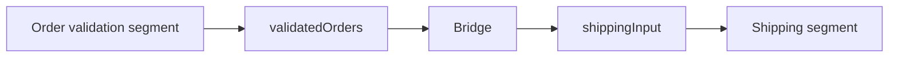
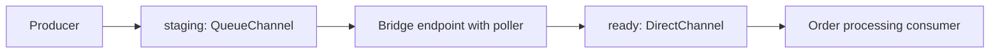

# When to Use a Bridge Instead of a Handler

## 1. Objectives and Scope

In the **Messaging bridge** chapter of the `SPRING_INTEGRATION_CORE` module, the design question is: does a step in the flow merely connect two channels, or does it perform work on the message?

**Use a bridge when the step's responsibility is forwarding a message to a specified destination with no business logic or data transformation.** Use a service activator or specialized endpoint when the step must call a service, transform data, choose a route, filter out messages, or aggregate messages.

After this lesson, you will be able to:

- Distinguish the channel-connecting role of a bridge from the processing role of a custom handler.
- Choose a bridge for boundaries between flow segments or between a queue and a subscribing consumer.
- Configure a bridge with Java DSL and understand how a poller affects forwarding speed.
- Predict the message path, execution thread, reply path, and errors.
- Design tests for the forwarding contract without confusing a successful send with business completion.

The examples use Java 17+ and Spring Integration 6.5 APIs. The project requires `spring-integration-core`; the test example also uses JUnit Jupiter. With Spring Boot, you can use the Integration starter and Test starter, letting the project's dependency management pick compatible versions. This lesson focuses on core components; adapters for JMS, HTTP, or the filesystem are separate components.

## 2. A Bridge Is Also a Handler

The word "handler" has two usages to distinguish:

| Usage | Meaning in this lesson |
|---|---|
| `MessageHandler` | Technical interface receiving a `Message<?>` to process |
| Business handler | Application code invoked via a service activator, often expressed as `.handle(...)` in the DSL |
| `BridgeHandler` | Built-in framework handler used to forward messages |
| Endpoint | Component connecting a handler to an input channel, managing message reception and lifecycle |

`BridgeHandler` extends `AbstractReplyProducingMessageHandler`. Its handling method returns the input message. Thus, "replacing a handler with a bridge" here means replacing self-written forwarding code with a dedicated built-in component. The bridge itself still uses the framework's handler mechanism. See [`BridgeHandler` 6.5.10 source](https://github.com/spring-projects/spring-integration/blob/v6.5.10/spring-integration-core/src/main/java/org/springframework/integration/handler/BridgeHandler.java).

The endpoint determines how messages are received: an input implementing `SubscribableChannel` leads to an event-driven subscribing consumer; an input implementing `PollableChannel` leads to a polling consumer. A bridge does not replace the endpoint's role in receiving messages. This mechanism is presented in [Polling Consumer](https://docs.spring.io/spring-integration/reference/6.5/polling-consumer.html).

Model to keep in mind:

```text
Input channel → Message-receiving endpoint → BridgeHandler → Output channel
```

Do not judge a step solely by a Java method name. A `forward()` method might contain business logic or merely return the message; those two cases call for different design decisions.

## 3. Criteria for Choosing a Bridge vs. a Processing Endpoint

The table below gives design criteria applied to the illustrative scenarios in this lesson:

| Requirement of the current step | Appropriate choice | Reason |
|---|---|---|
| Connect `validatedOrders` to `shippingInput`, preserving the message contract | Bridge | Only needs to declare the connection |
| Read from a queue on a cadence and feed a subscribing processing segment | Bridge with poller | Needs a consumer to read the queue and forward |
| Call `shippingService.createShipment(...)` | Service activator, usually `.handle(...)` | Performs a business action |
| Convert JSON to `Order` | Transformer | Has a data conversion contract |
| Choose a channel by country or order type | Router | Destination depends on message content |
| Block orders that do not meet criteria | Filter | Makes an accept-or-reject decision |
| Combine order lines into one result | Aggregator | Maintains group state and release conditions |
| Add a header for the next segment | Header enricher | Modifies metadata |
| Let Java callers interact through a request/reply interface | Messaging gateway | Needs an entry interface into the flow |
| Write a message to a broker or call an external API | Appropriate adapter or outbound gateway | Requires external protocol communication |

You can make the decision in three steps:

1. Describe the step in one sentence. If the sentence is simply "move the message from A to B", a bridge is a good candidate.
2. Look for additional verbs such as validate, convert, choose, save, call, or combine. Those indicate processing responsibilities that should be represented explicitly in the flow.
3. Decide whether you need to keep both channels A and B. If they do not represent a useful boundary, you can connect the preceding endpoint directly to the next segment's input instead of adding an intermediate bridge.

For example, `validatedOrders` is the output contract of the validation module, and `shippingInput` is the input contract of the shipping module. Keeping both names lets the two modules be configured independently; a bridge in the application assembly layer declares how they connect.

If both sides already share a single meaningful channel with the right distribution model, adding a bridge just to insert another step makes the graph harder to read.

## 4. Scenarios Where a Bridge Adds Value

### 4.1. Connecting Two Flow Segments with the Same Data Contract

Suppose team A emits `Message<Order>` after validation, and team B accepts that exact `Message<Order>` for shipping. There is no schema change, no service call in between, and no destination selection needed.



The bridge's value lies in structure: the connection point is explicit, and the endpoint can be named for management. Order-processing logic remains inside the respective endpoints.

If shipping later requires a different schema, add a transformer at that boundary. Having a bridge earlier is no reason to hide data conversion inside message-sending code.

### 4.2. Connecting `QueueChannel` to `DirectChannel`

Suppose a producer places orders into `staging`. Downstream only wants to receive messages from `ready` without declaring polling configuration itself.



The queue provides waiting storage; the bridge endpoint handles the queue-reading schedule; the downstream consumer receives via `DirectChannel`.

A bridge can connect channels or adapter segments when no data format translation is needed. If two systems use different protocols, adapters must still handle the corresponding communication. See [Messaging Bridge](https://docs.spring.io/spring-integration/reference/6.5/bridge.html).

### 4.3. Ending a Flow Segment via the Reply Path

A bridge is also suitable when a flow segment needs to forward the current message to the reply channel already present in the header. This is a messaging-level forwarding operation. If a new business result must be created before replying, that result must be produced by an appropriate processing endpoint.

## 5. Java DSL Example: Removing a Handler That Merely Returns the Payload

Suppose `validatedOrders` and `shippingInput` are two existing `DirectChannel` beans. The configuration below uses a service activator that simply returns the payload:

```java
@Bean
IntegrationFlow forwardingFlow() {
    return IntegrationFlow.from("validatedOrders")
            .handle(Object.class, (payload, headers) -> payload)
            .channel("shippingInput")
            .get();
}
```

The lambda performs no business work. You can express the responsibility more clearly:

```java
@Bean
IntegrationFlow forwardingFlow() {
    return IntegrationFlow.from("validatedOrders")
            .bridge(endpoint -> endpoint.id("ordersToShippingBridge"))
            .channel("shippingInput")
            .get();
}
```

Choose one `forwardingFlow` definition when applying this. The endpoint name helps operators locate the exact connection point in the graph and lifecycle.

In Java DSL, `.handle(...)` represents a service activator, whereas `.bridge(...)` represents a bridge. See the mapping table in [DSL Basics](https://docs.spring.io/spring-integration/reference/6.5/dsl/java-basics.html).

Any replacement must be based on the actual behavior of the old code. If the lambda also updates state, writes a mandatory audit record, or calls an external system, removing it changes business behavior. In that case, keep that work in an endpoint with an explicit responsibility.

### Pitfalls with Return Values

A service activator invoking a method can produce output from a non-`null` return value. Methods returning `void` or `null` normally terminate processing there, except in configurations that require a reply. You cannot infer that a handler will forward a message simply because it was invoked. See [Service Activator](https://docs.spring.io/spring-integration/reference/6.5/service-activator.html).

In particular, `MessageHandler.handleMessage(...)` has a `void` return type. A lambda implementing this interface does not have the same contract as a `GenericHandler` lambda returning a payload. When only forwarding is needed, using a bridge avoids having to write send logic and check send results yourself.

## 6. Complete Example: Queue to Subscribable Channel

The configuration below creates two channels and a bridge. The consumer of `ready` will be registered by the business segment or a test; the bridge does not create a business consumer on its own.

```java
package example.integration;

import java.time.Duration;

import org.springframework.beans.factory.annotation.Qualifier;
import org.springframework.context.annotation.Bean;
import org.springframework.context.annotation.Configuration;
import org.springframework.integration.channel.DirectChannel;
import org.springframework.integration.channel.QueueChannel;
import org.springframework.integration.config.EnableIntegration;
import org.springframework.integration.dsl.IntegrationFlow;
import org.springframework.integration.dsl.Pollers;

@Configuration
@EnableIntegration
public class BridgeConfiguration {

    @Bean
    public QueueChannel staging() {
        return new QueueChannel(100);
    }

    @Bean
    public DirectChannel ready() {
        return new DirectChannel();
    }

    @Bean
    public IntegrationFlow stagingBridgeFlow(
            @Qualifier("staging") QueueChannel staging,
            @Qualifier("ready") DirectChannel ready) {

        return IntegrationFlow.from(staging)
                .bridge(endpoint -> endpoint
                        .id("stagingToReadyBridge")
                        .poller(Pollers.fixedDelay(Duration.ofMillis(200))
                                .receiveTimeout(0)
                                .maxMessagesPerPoll(5)))
                .channel(ready)
                .get();
    }
}
```

Reading the configuration along the message path:

| Component | Meaning in the example |
|---|---|
| `staging` | Queue with a capacity of 100 messages |
| `IntegrationFlow.from(staging)` | Selects the input channel for the flow |
| `.bridge(...)` | Creates the forwarding step |
| `.id("stagingToReadyBridge")` | Names the endpoint for identification |
| `fixedDelay(200 ms)` | Sets the pause between completed poll cycles |
| `receiveTimeout(0)` | Does not wait for a new message when a receive hits an empty queue |
| `maxMessagesPerPoll(5)` | Caps the number of messages read in a single poll cycle |
| `.channel(ready)` | Sets the destination for the preceding bridge step |

With a queue that always has messages available and each message taking roughly 20 ms to traverse the synchronous processing segment, one cycle processing a full five messages takes around 100 ms. Then it pauses for 200 ms, giving an estimated throughput of:

```text
5 messages / (100 ms processing + 200 ms delay) ≈ 16.7 messages/second
```

This is an illustrative calculation with simplified assumptions, excluding overhead and resource contention. If you simply compute `5 / 0.2 = 25`, you are ignoring processing time in a fixed-delay configuration.

`maxMessagesPerPoll` caps the number of message receives per cycle; it does not create a single message containing a list of five elements. The bridge still forwards each message individually. Multi-receive polling and the meaning of `receiveTimeout` are described in [Message Endpoints](https://docs.spring.io/spring-integration/reference/6.5/endpoint.html).

Do not infer that this configuration satisfies an API quota like "no more than N requests in any one-second window". To guarantee such a limit, design an appropriate rate-limiting mechanism while also accounting for retries and application instance count. A single message can also trigger multiple downstream requests.

### 6.1. When Is a Poller Needed?

With a `PollableChannel` input, the endpoint needs either a dedicated poller or a configured default poller. With a `DirectChannel` input, the endpoint receives via subscription; do not attach a poller expecting to turn it into a queue. The rule depends on the input channel type, not on whether the processing step is a bridge or a business handler. See [Endpoint Configuration and Default Poller](https://docs.spring.io/spring-integration/reference/6.5/endpoint.html#endpoint-namespace).

Having only a `BridgeHandler` bean does not create a consumer reading a queue. It must be wired to the input by the framework through an endpoint.

### 6.2. Expressing the Same Idea with Java Annotations

Another option is declaring `BridgeHandler` with `@ServiceActivator`. The example below is an alternative to the `stagingBridgeFlow` bean, reusing the two channels from the configuration above:

```java
import org.springframework.integration.annotation.Poller;
import org.springframework.integration.annotation.ServiceActivator;
import org.springframework.integration.handler.BridgeHandler;

@Bean
@ServiceActivator(
        inputChannel = "staging",
        poller = @Poller(fixedDelay = "200", maxMessagesPerPoll = "5"))
public BridgeHandler stagingToReadyHandler() {
    BridgeHandler bridge = new BridgeHandler();
    bridge.setOutputChannelName("ready");
    return bridge;
}
```

The annotation example does not set `receiveTimeout(0)` like the DSL version; account for timeout configuration when comparing polling durations. The documentation also provides `@BridgeFrom` and `@BridgeTo` for connecting channel beans. See [Bridge Java Configuration](https://docs.spring.io/spring-integration/reference/6.5/bridge.html#bridge-java).

Register only one approach for the same job. If you keep both bridges reading `staging`, they become competing consumers on the queue; each message is taken by one consumer, not automatically broadcast to both.

## 7. Preserving Messages and the Reply Path

### 7.1. Forwarding Contract

A bridge does not actively alter the payload or business headers. This preserves headers such as `orderId`, `correlationId`, and values needed downstream. The bridge implementation returns the request message instead of extracting the payload to construct a new business result. See [BridgeHandler](https://docs.spring.io/spring-integration/api/org/springframework/integration/handler/BridgeHandler.html).

Still, the contract of the overall flow also depends on interceptors, message history, transformers, and surrounding adapters. Do not stretch "the bridge does not modify the message" into "nothing before or after the bridge modifies the message". Application tests should verify the payload along with the headers that the integration contract actually requires.

For example, if a `correlationId` needed by a downstream aggregator is lost in a custom step, the bridge will not restore that value on its own.

### 7.2. `outputChannel` and `replyChannel`

A bridge with an explicit output target forwards to that target. If no output is configured, the bridge can use the message's `replyChannel`. If neither exists, forwarding fails. See [Messaging Bridge Destination Rules](https://docs.spring.io/spring-integration/reference/6.5/bridge.html).

Example of a bridge at the end of an echo segment:

```java
@Bean
public DirectChannel echoRequests() {
    return new DirectChannel();
}

@Bean
public IntegrationFlow echoFlow() {
    return IntegrationFlow.from("echoRequests")
            .bridge()
            .get();
}
```

In caller code that already has a reference to the `echoRequests` bean:

```java
import org.springframework.messaging.Message;
import org.springframework.messaging.support.MessageBuilder;

QueueChannel replies = new QueueChannel(1);

Message<String> request = MessageBuilder.withPayload("ping")
        .setReplyChannel(replies)
        .setHeader("requestId", "REQ-17")
        .build();

echoRequests.send(request);
Message<?> response = replies.receive(1000);
```

Here, the response carries payload `ping`; the bridge does not produce a lookup result or business confirmation. `replyChannel` is the message's reply address, not a content-based branching rule for orders.

If the bridge must always send to `shippingInput`, configure the output explicitly. Rely on `replyChannel` only when that is the contract of a request/reply segment. This prevents callers from changing the route by supplying different headers.

## 8. Execution Flow, Distribution, and Errors

### 8.1. A Bridge Does Not Determine the Entire Execution Model

The following fundamental behaviors come from the channels:

| Connection segment | Consequence to understand |
|---|---|
| `DirectChannel → bridge → DirectChannel` | Normally continues on the sending thread |
| `QueueChannel → bridge with poller → DirectChannel` | Downstream consumer runs on the polling thread when no executor is added |
| `DirectChannel → bridge → QueueChannel` | Message is placed into the queue; the queue's consumer determines when it is read |
| Bridge sending to `ExecutorChannel` | The executor governs execution of the downstream segment |
| Bridge sending to `PublishSubscribeChannel` | Multi-subscriber broadcast model is provided by this channel |

`DirectChannel` has a point-to-point model; sending through it invokes the chosen handler on the sending thread. `QueueChannel` also has a point-to-point model and buffers messages in a queue. `ExecutorChannel` delegates dispatch to an executor. See [Message Channel Implementations](https://docs.spring.io/spring-integration/reference/6.5/channel/implementations.html).

In the `staging` example, the producer finishes sending once the queue accepts the message. Having the consumer after the bridge run synchronously on the poller thread does not make it run on the original producer thread.

If multiple subscribers are on a `DirectChannel`, do not expect every subscriber to receive the same message. If the requirement is delivering to both audit and shipping, design the corresponding distribution—such as using a `PublishSubscribeChannel` and defining error handling per branch.

### 8.2. Where Do Errors Appear?

In a synchronous chain using `DirectChannel`, downstream errors can propagate back to the send call. With a scheduled poller, errors occur while the poll task processes the message; the framework's error-handling mechanism can publish an `ErrorMessage` to an error channel. A bridge does not swallow errors on its own. See [Error Handling](https://docs.spring.io/spring-integration/reference/6.5/error-handling.html).

Two situations to distinguish:

```text
Producer → DirectChannel → Bridge → Consumer throws exception
          error can propagate back to producer on the same call stack

Producer → QueueChannel
                    Poller → Bridge → Consumer throws exception
                    error belongs to the poll task; producer already sent to queue earlier
```

Merely setting an `errorChannel` header does not convert every synchronous error into an error message. Inspect the invocation mechanism, any gateway in use, the poller's or executor's error handler, and the actual error-handling configuration.

Diagnostic examples:

| Symptom | What to check |
|---|---|
| Producer sends to queue successfully, but orders are not processed | Whether the bridge endpoint is running, the poller is active, or the queue has a backlog |
| Bridge sends to `DirectChannel` and fails with no subscribers | Whether the business consumer is registered and started |
| Bridge at the end of a flow reports no destination found | Whether an explicit output or valid `replyChannel` exists |
| Downstream consumer fails, but producer cannot catch it | Whether a queue, executor, or polling boundary lies between the two sides |
| Message reaches the right channel, but with the wrong payload type | Whether the two segments' contracts truly match, or if a transformer is needed |

### 8.3. Sending Successfully Is Not Business Completion

In the example, `staging.send(message, timeout)` succeeding only confirms that the queue accepted the message. It does not confirm that the consumer after the bridge finished calling the shipping service.

The default queue stores messages in memory. A bridge by itself does not provide persistence, retries, restart recovery, idempotency, or exactly-once guarantees. Do not assume a message pulled from an in-memory queue will automatically be returned to the queue if downstream fails. Persistence and recovery must be designed with a message store, broker, or appropriate mechanism. See the persistence section of [QueueChannel](https://docs.spring.io/spring-integration/reference/6.5/channel/implementations.html#channel-implementations-queuechannel).

For critical business operations, define a separate completion signal: a gateway reply, an outcome event, a business state in the database, or an external system's acknowledgment protocol. A bridge is only one segment of the message path.

## 9. Testing the Forwarding Contract

The test below initializes the configuration from Section 6, subscribes an observation consumer on `ready`, and sends a message to `staging`. The observation consumer pushes the message into a separate queue so the test can receive with a timeout.

```java
package example.integration;

import org.junit.jupiter.api.Test;
import org.springframework.context.annotation.AnnotationConfigApplicationContext;
import org.springframework.integration.channel.DirectChannel;
import org.springframework.integration.channel.QueueChannel;
import org.springframework.messaging.Message;
import org.springframework.messaging.MessageHandler;
import org.springframework.messaging.support.MessageBuilder;

import static org.junit.jupiter.api.Assertions.assertEquals;
import static org.junit.jupiter.api.Assertions.assertNotNull;
import static org.junit.jupiter.api.Assertions.assertTrue;

class BridgeConfigurationTest {

    @Test
    void forwardsPayloadAndBusinessHeaders() {
        try (AnnotationConfigApplicationContext context =
                     new AnnotationConfigApplicationContext(BridgeConfiguration.class)) {

            QueueChannel staging = context.getBean("staging", QueueChannel.class);
            DirectChannel ready = context.getBean("ready", DirectChannel.class);
            QueueChannel observed = new QueueChannel(10);

            MessageHandler collector = message -> {
                if (!observed.send(message, 0)) {
                    throw new IllegalStateException("Observation queue is full");
                }
            };
            assertTrue(ready.subscribe(collector));

            try {
                Message<String> input = MessageBuilder
                        .withPayload("ORDER-42")
                        .setHeader("orderId", "42")
                        .setHeader("correlationId", "BATCH-9")
                        .build();

                assertTrue(staging.send(input, 1000));

                Message<?> output = observed.receive(3000);
                assertNotNull(output);
                assertEquals(input.getPayload(), output.getPayload());
                assertEquals("42", output.getHeaders().get("orderId"));
                assertEquals("BATCH-9", output.getHeaders().get("correlationId"));
            }
            finally {
                ready.unsubscribe(collector);
            }
        }
    }
}
```

The test uses a timeout so it neither hangs forever nor needs `Thread.sleep`. It verifies the polled connection along with the data that must be preserved. It does not test quotas, error recovery, or shipping business logic.

Additional test cases should stem from the application's contract:

| Contract to protect | Test scenario |
|---|---|
| Bridge uses `replyChannel` when output is absent | Send a message with a reply queue; receive the expected payload and headers |
| Fixed output takes precedence | Configure output A, send a message with `replyChannel` B; verify only A receives |
| Missing destination is an error | No output and no `replyChannel`; verify the error is reported via the expected invocation path |
| Downstream errors are observed | Make the consumer throw; check caller or error channel depending on execution boundary |
| Per-poll message limit | Use a controllable trigger, enqueue more than the limit, and observe one cycle |
| Connection-point lifecycle | Stop the endpoint, send to queue, verify backlog; restart and verify forwarding |

For poll-cycle count or lifecycle tests, use utilities from `spring-integration-test` and a controllable trigger. Do not test by assuming the scheduler will always run reliably within a very short fixed duration. See [Testing support](https://docs.spring.io/spring-integration/reference/6.5/testing.html).

## 10. Misuses to Recognize

### 10.1. Using a Bridge Instead of a Transformer

Suppose side A emits a JSON string and side B expects an `Order`. The two channels can be wired in configuration, yet the data contract is not met. A bridge does not parse JSON. You need a transformer, followed by tests for schema and invalid data.

### 10.2. Using a Bridge Instead of a Router

If international orders go to `internationalShipping` and domestic orders go to `localShipping`, choosing the destination is a content-based decision. A bridge with a fixed output cannot replace that decision.

### 10.3. Adding a Handler Just to Resend the Message Yourself

A hand-written handler might look like: receive the message, call `target.send(...)`, and then ignore the return value or catch every exception and just log it. That code becomes responsible for send failures and error paths itself. If no extra work is needed, a bridge expresses intent more clearly and leverages built-in mechanics.

### 10.4. Wiring a Loop

A configuration `A → bridge → B → bridge → A` with no termination condition can cause deep recursion in a synchronous chain or make messages spin endlessly with a queue. When evaluating a new bridge, inspect the entire flow graph, not just two adjacent channels.

### 10.5. Using a Poller as an Aggregator

Setting `maxMessagesPerPoll(5)` does not group five orders sharing a `correlationId`, does not wait for a complete group, and does not produce a combined result. If the goal is batching orders by business rules, design the corresponding correlation, release strategy, and aggregator.

## 11. Applied Exercise

Given the hypothetical design:

```text
Receive order → Validate → validatedOrders
                             ↓
                        forwardOrder()
                             ↓
                        shippingInput → Create shipment
```

`forwardOrder()` currently only returns the payload and has no side effects. Replace that step with a bridge, name the endpoint, and write tests for `orderId` and `correlationId`.

Then consider each of the following changes in turn:

1. `validatedOrders` becomes a `QueueChannel` to absorb traffic spikes. Add a poller, choose queue capacity and send timeout; describe what happens when full.
2. The shipping service requires a different DTO. Add a transformation step in the right place and determine whether the bridge still represents a useful boundary.
3. International orders must go to a separate branch. Identify the router and the input contracts of each branch.
4. The shipping consumer fails after the message has been pulled from the queue. Design the error path and recovery; do not treat the bridge as a retry mechanism.
5. Multiple shipping results must be combined into a batch. Specify the aggregator, correlation key, and completion condition instead of increasing `maxMessagesPerPoll`.

A design proposal is complete when you identify each endpoint's responsibility, the forwarding destination, where messages wait, the processing thread, and how errors are observed. Only choose a bridge when the step's contract is genuinely message forwarding.
