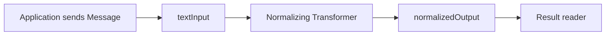
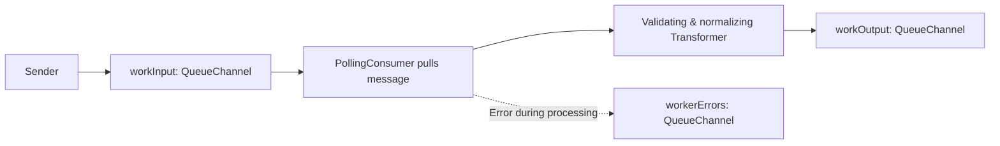

# from message channel — Starting a Java DSL Flow from a Message Channel

## 1. Objectives and Scope

In the **Java DSL** chapter of the **SPRING_INTEGRATION_CORE** module, this lesson focuses on using `IntegrationFlow.from(...)` to receive messages from a `MessageChannel`. This is the junction between the message producer and processing endpoints such as transformers, filters, routers, or aggregators.

After this lesson, you will be able to:

- Choose how to start a flow by bean name, channel object, or channel spec.
- Distinguish sending a `Message` from declaring an `IntegrationFlow`.
- Determine whether the first endpoint operates via subscription or polling.
- Configure a poller when the flow reads from a `QueueChannel`.
- Connect two flows through a shared channel and test the result with a finite timeout.

The examples use Java 17 or higher and the Spring Integration 6.4.x API. The main library is `org.springframework.integration:spring-integration-core`; the testing section requires JUnit Jupiter. For Spring Boot projects, you can use `spring-boot-starter-integration` and `spring-boot-starter-test`, letting the compatible parent/BOM manage versions. The configuration classes below explicitly use `@EnableIntegration`, so the context can also be created with plain Spring.

## 2. `from(channel)` Declares the Flow Input

Suppose the application receives a string, normalizes it, and forwards the result to an output channel:



The corresponding declaration looks like:

```java
IntegrationFlow.from("textInput")
        .<String, String>transform(value -> value.strip())
        .channel("normalizedOutput")
        .get();
```

This DSL snippet describes the processing structure. A flow is registered as a bean so the Spring Integration infrastructure creates and wires the channels, handlers, and endpoints. Calling `.get()` completes building the flow definition; it does not wait for a message or return a business result. The configuration role of a flow is explained in [DSL Basics](https://docs.spring.io/spring-integration/reference/6.4/dsl/java-basics.html).

Data enters when another component calls `send(...)` on the input channel. That can be a Java service, a messaging gateway, a protocol adapter, or an upstream flow. Without a sender, `from("textInput")` alone does not generate messages by itself.

### 2.1. Three Objects to Distinguish

| Object | Responsibility in this lesson |
| --- | --- |
| `Message<T>` | Carries the payload and headers of a single send |
| `MessageChannel` | Provides the send point and delivers messages |
| `IntegrationFlow` | Declares the processing components wired to the channel |

Example of an input message:

```java
Message<String> request = MessageBuilder
        .withPayload("  order-204  ")
        .setHeader("requestId", "req-204")
        .build();
```

`requestId` is a business header defined by application convention. Do not use `MessageHeaders.ID` as a business correlation ID because a transformer may create a new message. When a transformer returns only a payload, input headers are usually propagated to the output message. See [Message and header propagation](https://docs.spring.io/spring-integration/reference/6.4/message.html).

### 2.2. `from(...)` vs. `.channel(...)`

In the example above:

- `from("textInput")` defines the receiving point of the flow.
- `.transform(...)` processes the payload.
- `.channel("normalizedOutput")` defines where the message is forwarded after transformation.

Input and output can both be written as channel names, but their position in the DSL chain determines their role. A `.channel(...)` placed in the middle of a flow can also establish a boundary between two processing steps.

## 3. Ways to Pass a Channel to `from(...)`

### 3.1. Passing a Bean Name

```java
@Bean
public IntegrationFlow normalizeFlow() {
    return IntegrationFlow.from("textInput")
            .<String, String>transform(String::strip)
            .channel("normalizedOutput")
            .get();
}
```

If a channel bean named `textInput` exists, the DSL uses that channel. If no bean with that name exists yet, the DSL can register a `DirectChannel` with that name during context initialization. This behavior is described in [Java DSL: Message Channels](https://docs.spring.io/spring-integration/reference/6.4/dsl/java-channels.html).

Practical consequence: `from("textInpt")` can create a new channel due to a typo. If the sender still uses `textInput`, the flow will not receive data as expected. Therefore, for critical inputs or multiple channels with similar roles, declare beans explicitly and inject them with `@Qualifier`.

A string name does not determine whether a channel is a queue or publish-subscribe. If you want a `QueueChannel`, define that exact bean type; naming a channel `jobQueue` does not automatically turn the default channel into a queue.

### 3.2. Passing an Injected Channel Object

```java
@Bean
public DirectChannel textInput() {
    return new DirectChannel();
}

@Bean
public IntegrationFlow normalizeFlow(
        @Qualifier("textInput") MessageChannel input) {

    return IntegrationFlow.from(input)
            .<String, String>transform(String::strip)
            .channel("normalizedOutput")
            .get();
}
```

Here `from(input)` uses the exact object provided by Spring. `@Qualifier` disambiguates which channel to inject when the context contains multiple `MessageChannel` beans. Using `MessageChannel` as the parameter type does not strip the characteristics of the actual object: if the actual bean is a `QueueChannel`, the receiving endpoint still requires polling.

Injecting via parameters also works well with `@Configuration(proxyBeanMethods = false)`, because there is no need to call a `@Bean` method directly to obtain the channel.

### 3.3. Passing a DSL-Created Channel Spec

```java
@Bean
public IntegrationFlow inlineInputFlow() {
    return IntegrationFlow.from(MessageChannels.direct("inlineInput"))
            .<String, String>transform(String::strip)
            .channel("inlineOutput")
            .get();
}
```

`MessageChannels.direct(...)` creates a channel spec for the DSL infrastructure to process. There is no need to call `getObject()` on the spec inside the bean definition. The `IntegrationFlow` API supports overloads accepting `String`, `MessageChannel`, and `MessageChannelSpec`; see the [IntegrationFlow Javadoc](https://docs.spring.io/spring-integration/api/org/springframework/integration/dsl/IntegrationFlow.html).

Choose an inline channel spec when the channel is declared in one clear place. If multiple flows need to share it, declaring the channel as a standalone bean and injecting that same bean is easier to follow.

The snippets in section 3 illustrate alternative options; do not register multiple flow beans with the same name simultaneously in one context.

## 4. Channel Type Determines How Endpoints Receive Messages

`MessageChannel` is the message-sending interface. `SubscribableChannel` lets handlers register to receive messages, while `PollableChannel` provides `receive(...)` for the receiver to actively pull data. See [The MessageChannel Interface](https://docs.spring.io/spring-integration/reference/6.4/channel/interfaces.html).

| Input channel | How endpoint receives | Typical execution thread | Poller needed for this input? |
| --- | --- | --- | --- |
| `DirectChannel` | Subscribe | Thread calling `send(...)` | No |
| `QueueChannel` | Polling | Thread running the poller task | Yes |
| `PublishSubscribeChannel` without executor | Subscribe | Sending thread, invoking subscribers sequentially | No |
| `ExecutorChannel` | Subscribe | Hands off processing to an executor | No |

For standard channel-consuming endpoints, Spring Integration creates an `EventDrivenConsumer` for subscribable inputs and a `PollingConsumer` for pollable inputs. Thus, with the same `from(input).transform(...)` shape, changing the channel type can change the entire execution model. See [Polling Consumer](https://docs.spring.io/spring-integration/reference/6.4/polling-consumer.html).

### 4.1. Multiple Flows Sharing an Input

Distinguish "two flows both receiving from one channel" from "every message must be processed by both flows":

- `DirectChannel` has point-to-point semantics; it does not broadcast copies to every subscriber. With failover enabled, a failed processing attempt can also trigger trying another subscriber.
- A `QueueChannel` with multiple consumers causes consumers to compete for messages.
- `PublishSubscribeChannel` is used to broadcast messages to registered subscribers.

If the requirement is for every event to be received by both an audit flow and a notification flow, design a publish-subscribe input or an explicit distribution branch. If using a synchronous broadcast channel, a slow or failing subscriber can affect the send call; configure an appropriate handling policy. Channel characteristics are presented in [Message Channel Implementations](https://docs.spring.io/spring-integration/reference/6.4/channel/implementations.html).

## 5. Complete Example with `DirectChannel`

Scenario: the application sends a string, a transformer strips leading/trailing whitespace and converts it to uppercase; the result is placed into a separate queue for observation.

```java
package example.integration;

import java.util.Locale;

import org.springframework.beans.factory.annotation.Qualifier;
import org.springframework.context.annotation.Bean;
import org.springframework.context.annotation.Configuration;
import org.springframework.integration.channel.DirectChannel;
import org.springframework.integration.channel.QueueChannel;
import org.springframework.integration.config.EnableIntegration;
import org.springframework.integration.dsl.IntegrationFlow;
import org.springframework.messaging.MessageChannel;

@Configuration(proxyBeanMethods = false)
@EnableIntegration
public class DirectChannelFlowConfig {

    @Bean
    public DirectChannel textInput() {
        return new DirectChannel();
    }

    @Bean
    public QueueChannel normalizedOutput() {
        return new QueueChannel(100);
    }

    @Bean
    public IntegrationFlow normalizeFlow(
            @Qualifier("textInput") MessageChannel input) {

        return IntegrationFlow.from(input)
                .<String, String>transform(value ->
                        value.strip().toUpperCase(Locale.ROOT))
                .channel("normalizedOutput")
                .get();
    }
}
```

The calling snippet below uses plain Spring and closes the context upon completion:

```java
package example.integration;

import org.springframework.context.annotation.AnnotationConfigApplicationContext;
import org.springframework.integration.channel.QueueChannel;
import org.springframework.messaging.Message;
import org.springframework.messaging.MessageChannel;
import org.springframework.messaging.support.MessageBuilder;

public class DirectChannelDemo {

    public static void main(String[] args) {
        try (var context = new AnnotationConfigApplicationContext(
                DirectChannelFlowConfig.class)) {

            MessageChannel input = context.getBean(
                    "textInput", MessageChannel.class);
            QueueChannel output = context.getBean(
                    "normalizedOutput", QueueChannel.class);

            Message<String> request = MessageBuilder
                    .withPayload("  order-204  ")
                    .setHeader("requestId", "req-204")
                    .build();

            boolean sent = input.send(request, 1_000);
            if (!sent) {
                throw new IllegalStateException("Failed to send message");
            }

            Message<?> result = output.receive(1_000);
            if (result == null) {
                throw new IllegalStateException("No result received");
            }

            System.out.println(result.getPayload());
            System.out.println(result.getHeaders().get("requestId"));
        }
    }
}
```

Expected output:

```text
ORDER-204
req-204
```

Although the output is a queue, the transformer step still runs on the sending thread because the input is a `DirectChannel`. The output queue only holds the result for the subsequent `receive(...)`. No poller is needed on the output queue in this example because the demo code itself reads the data directly; if you attach an endpoint that automatically reads from this queue, that endpoint will need a poller.

`send(message, 1_000)` does not set a one-second deadline for the entire business operation. The timeout parameter applies to the send operation as supported by the channel; it does not forcibly stop a slow synchronous transformer. Since the output has bounded capacity, a real application also needs a policy for when the result reader is slow.

### 5.1. Channel Input Does Not Automatically Create Request-Reply

`MessageChannel.send(...)` returns a `boolean`, not the transformed payload. In the example, the result lands in `normalizedOutput`, so calling code must receive it from there.

If you want to call a Java method that returns a business result, you can use a messaging gateway and design a corresponding reply path. `from(channel)` by itself does not create a gateway. The `from(ServiceInterface.class)` overload is another option, presented in [IntegrationFlow as a Gateway](https://docs.spring.io/spring-integration/reference/6.4/dsl/integration-flow-as-gateway.html).

A shared output queue is suitable for demonstration or processing results as an event stream. With multiple concurrent requests needing results returned to the right caller, use a gateway or an appropriate reply and correlation mechanism; each caller pulling the next item from a shared queue could receive the wrong result.

## 6. Complete Example with `QueueChannel`

New scenario: the sender needs to put strings into a queue; a polling consumer periodically pulls data to normalize it. Whitespace-only strings are treated as invalid data.



```java
package example.integration;

import java.util.Locale;

import org.springframework.beans.factory.annotation.Qualifier;
import org.springframework.context.annotation.Bean;
import org.springframework.context.annotation.Configuration;
import org.springframework.integration.channel.QueueChannel;
import org.springframework.integration.config.EnableIntegration;
import org.springframework.integration.dsl.IntegrationFlow;
import org.springframework.integration.dsl.Pollers;

@Configuration(proxyBeanMethods = false)
@EnableIntegration
public class QueueChannelFlowConfig {

    @Bean
    public QueueChannel workInput() {
        return new QueueChannel(100);
    }

    @Bean
    public QueueChannel workOutput() {
        return new QueueChannel(100);
    }

    @Bean
    public QueueChannel workerErrors() {
        return new QueueChannel(100);
    }

    @Bean
    public IntegrationFlow queuedNormalizeFlow(
            @Qualifier("workInput") QueueChannel input) {

        return IntegrationFlow.from(input)
                .<String, String>transform(value -> {
                    String normalized = value.strip();
                    if (normalized.isEmpty()) {
                        throw new IllegalArgumentException(
                                "Input string must not be blank");
                    }
                    return normalized.toUpperCase(Locale.ROOT);
                }, endpoint -> endpoint
                        .id("queuedNormalizer")
                        .poller(Pollers.fixedDelay(100)
                                .maxMessagesPerPoll(10)
                                .receiveTimeout(0)
                                .errorChannel("workerErrors")))
                .channel("workOutput")
                .get();
    }
}
```

### 6.1. The Poller Belongs to the Queue-Reading Endpoint

In this configuration, the transformer is the first endpoint reading `workInput`, so the poller configuration is passed to the second lambda argument of `.transform(...)`.

Do not use the following syntax to attach a poller to a channel:

```java
// Not an overload for configuring a poller on MessageChannel.
IntegrationFlow.from(input, endpoint -> endpoint.poller(...));
```

The `from(MessageSource, endpointConfigurer)` overload is for inbound polling adapters. `MessageSource` and `MessageChannel` are two different input types. With `from(channel)`, configure the poller on the endpoint consuming the channel. See [DSL and Endpoint Configuration](https://docs.spring.io/spring-integration/reference/6.4/dsl/java-endpoints.html) and [Inbound Channel Adapters](https://docs.spring.io/spring-integration/reference/6.4/dsl/java-inbound-adapters.html).

### 6.2. Meaning of Configuration Options in the Example

| Configuration | Practical meaning |
| --- | --- |
| `fixedDelay(100)` | Schedules the next poll after a 100 ms delay from when the previous task finished, when not delegating tasks to a dedicated executor |
| `maxMessagesPerPoll(10)` | Processes at most 10 messages per poll cycle; can finish early when no more data is available |
| `receiveTimeout(0)` | Does not wait during a fetch if the queue is currently empty |
| `errorChannel("workerErrors")` | Selects the channel to receive error messages from this poller task |
| `id("queuedNormalizer")` | Names the endpoint for easier identification in operations |

A maximum of 10 messages per poll does not mean 10 threads processing in parallel. Handler execution time also affects consumption throughput. For example, if each message takes 200 ms, a full cycle of 10 messages can take around two seconds before adding the delay for the next cycle.

You can declare a default poller so multiple polling endpoints share a policy:

```java
@Bean(name = PollerMetadata.DEFAULT_POLLER)
public PollerSpec defaultPoller() {
    return Pollers.fixedDelay(100)
            .maxMessagesPerPoll(10)
            .receiveTimeout(0);
}
```

The snippet above requires importing `org.springframework.integration.scheduling.PollerMetadata` and `org.springframework.integration.dsl.PollerSpec`. It illustrates an alternative to a local poller and does not need to be added to the current example. Return `PollerSpec` for Spring to manage; do not manually call the `FactoryBean` product method inside `@Bean`. See [Java DSL: Pollers](https://docs.spring.io/spring-integration/reference/6.4/dsl/java-pollers.html).

### 6.3. Send Success vs. Processing Completion

With `workInput`, a successful `send(...)` indicates that the message was accepted into the queue. The transformer may not have run yet at that moment; or the poller might have already pulled and processed it very quickly. Calling code must wait on or observe the output if it needs to know the result.

With a bounded queue, pass a send timeout and handle the `false` case. The standalone example below illustrates a full queue without running a flow:

```java
QueueChannel queue = new QueueChannel(1);

boolean first = queue.send(
        MessageBuilder.withPayload("first").build(), 0);
boolean second = queue.send(
        MessageBuilder.withPayload("second").build(), 0);

// first == true; second == false because no one has consumed the first element yet.
```

`QueueChannel` in this lesson uses JVM memory. If data must survive restarts, design an appropriate message store or messaging infrastructure. A local queue also does not by itself provide exactly-once business processing guarantees.

## 7. Connecting Two Flows Through a Shared Channel

Suppose you want to separate input validation from normalization while keeping a clear connection point. Declare the intermediate bean once and inject that same bean into both flows:

```java
@Bean
public DirectChannel validatedText() {
    return new DirectChannel();
}

@Bean
public IntegrationFlow validationFlow(
        @Qualifier("textInput") MessageChannel input,
        @Qualifier("validatedText") MessageChannel validated) {

    return IntegrationFlow.from(input)
            .<String>filter(value -> !value.isBlank())
            .channel(validated)
            .get();
}

@Bean
public IntegrationFlow acceptedTextFlow(
        @Qualifier("validatedText") MessageChannel validated) {

    return IntegrationFlow.from(validated)
            .<String, String>transform(value ->
                    value.strip().toUpperCase(Locale.ROOT))
            .channel("normalizedOutput")
            .get();
}
```

This is an alternative to `normalizeFlow` in section 5; keep the `textInput`, `normalizedOutput` beans and related imports, then replace the old flow with the two flows above. Do not keep the old flow at the same time, as it would become another subscriber to the same input `DirectChannel`.

In this approach, blank strings stop at the filter according to the default drop behavior; no result appears on the output for that message. For a request-reply protocol, design a rejection reply or error policy instead of leaving the caller waiting for a reply that will never arrive.

Do not declare two new channel objects with the same name in two different flows, such as creating `MessageChannels.queue("sharedWork")` at both the output of flow A and the input of flow B. Sharing a name does not mean the two specs are the same object; bean registration conflicts can occur. Using a shared channel bean accurately expresses the wiring intent.

### 7.1. When You Only Need to Connect Two Channels

If the input is a queue and the output is a channel with subscribers, a bridge can handle pulling and forwarding:

```java
@Bean
public IntegrationFlow queueToDirectBridge(
        @Qualifier("workInput") QueueChannel queued,
        @Qualifier("validatedText") MessageChannel direct) {

    return IntegrationFlow.from(queued)
            .bridge(endpoint -> endpoint.poller(
                    Pollers.fixedDelay(200)
                            .maxMessagesPerPoll(5)
                            .receiveTimeout(0)))
            .channel(direct)
            .get();
}
```

This is a separate example of a bridge, requiring the corresponding beans and a subscriber processing `validatedText`. If using it instead of the flow reading `workInput` in section 6, remove the old polling consumer to avoid two flows competing on the same queue.

The poller sits on the bridge because the bridge is the endpoint directly reading the queue. A transformer downstream of the target channel does not need a poller for a `DirectChannel` input. See [Messaging Bridge](https://docs.spring.io/spring-integration/reference/6.4/bridge.html).

## 8. Error Paths Change Across Execution Boundaries

Both examples transform strings, yet where errors are observed differs:

| Input and call style | When the handler fails | Where calling code observes |
| --- | --- | --- |
| Sent directly to `DirectChannel`, processed on same thread | Exception propagates back through the send call | `try/catch` around `send(...)` |
| Sent to `QueueChannel`, poller processes later | Poller task can emit an `ErrorMessage` | Error channel or result-tracking mechanism |

In the queue configuration, `workerErrors` receives errors from the poller task pointed to that channel. Do not assume adding an `errorChannel` automatically converts every synchronous error into an error message. Gateways, advice, and other error-catching mechanisms have their own policies; see [Error Handling](https://docs.spring.io/spring-integration/reference/6.4/error-handling.html).

For the example in section 6, test valid payloads and blank strings separately:

- Valid strings appear on `workOutput` after the poller processes them.
- Blank strings cause the transformer to throw an error, observed on `workerErrors`.
- A successful `send(...)` call is not proof that the data is valid.

`workerErrors` is also a bounded queue. In a real application there must be something reading, storing, or handling errors; letting the error queue fill up can also block error emission. The appearance of an `ErrorMessage` does not automatically trigger a retry or put the original message back into the queue. Recovery requires adding an appropriate policy, while considering business idempotency before resending.

## 9. Testing Channel Inputs and Flow Outcomes

The tests below use the two configuration classes from sections 5 and 6, requiring no Spring Boot or external broker. Place them in the same `example.integration` package and include JUnit Jupiter on the test classpath.

```java
package example.integration;

import org.junit.jupiter.api.Test;
import org.springframework.context.annotation.AnnotationConfigApplicationContext;
import org.springframework.integration.channel.QueueChannel;
import org.springframework.messaging.Message;
import org.springframework.messaging.MessageChannel;
import org.springframework.messaging.MessagingException;
import org.springframework.messaging.support.ErrorMessage;
import org.springframework.messaging.support.MessageBuilder;

import static org.junit.jupiter.api.Assertions.*;

class FromMessageChannelTest {

    @Test
    void directInputProducesNormalizedPayloadAndKeepsBusinessHeader() {
        try (var context = new AnnotationConfigApplicationContext(
                DirectChannelFlowConfig.class)) {

            MessageChannel input = context.getBean(
                    "textInput", MessageChannel.class);
            QueueChannel output = context.getBean(
                    "normalizedOutput", QueueChannel.class);

            Message<String> request = MessageBuilder
                    .withPayload("  order-204  ")
                    .setHeader("requestId", "direct-204")
                    .build();

            assertTrue(input.send(request, 1_000));

            // The transformer already ran on the sending thread before send returned.
            Message<?> result = output.receive(0);
            assertNotNull(result);
            assertEquals("ORDER-204", result.getPayload());
            assertEquals("direct-204",
                    result.getHeaders().get("requestId"));
        }
    }

    @Test
    void queuedInputEventuallyProducesNormalizedPayload() {
        try (var context = new AnnotationConfigApplicationContext(
                QueueChannelFlowConfig.class)) {

            QueueChannel input = context.getBean(
                    "workInput", QueueChannel.class);
            QueueChannel output = context.getBean(
                    "workOutput", QueueChannel.class);

            assertTrue(input.send(MessageBuilder
                    .withPayload("  job-319  ")
                    .setHeader("requestId", "queued-319")
                    .build(), 1_000));

            Message<?> result = output.receive(5_000);
            assertNotNull(result);
            assertEquals("JOB-319", result.getPayload());
            assertEquals("queued-319",
                    result.getHeaders().get("requestId"));
        }
    }

    @Test
    void invalidQueuedInputIsObservedOnTheConfiguredErrorChannel() {
        try (var context = new AnnotationConfigApplicationContext(
                QueueChannelFlowConfig.class)) {

            QueueChannel input = context.getBean(
                    "workInput", QueueChannel.class);
            QueueChannel errors = context.getBean(
                    "workerErrors", QueueChannel.class);

            assertTrue(input.send(MessageBuilder
                    .withPayload("   ")
                    .setHeader("requestId", "invalid-1")
                    .build(), 1_000));

            Message<?> received = errors.receive(5_000);
            ErrorMessage error = assertInstanceOf(
                    ErrorMessage.class, received);
            MessagingException failure = assertInstanceOf(
                    MessagingException.class, error.getPayload());

            Message<?> failedMessage = failure.getFailedMessage();
            assertNotNull(failedMessage);
            assertEquals("invalid-1",
                    failedMessage.getHeaders().get("requestId"));

            Throwable rootCause = failure;
            while (rootCause.getCause() != null) {
                rootCause = rootCause.getCause();
            }
            assertInstanceOf(IllegalArgumentException.class, rootCause);
        }
    }
}
```

`receive(5_000)` waits for data to become available and returns as soon as it arrives. It differs from sleeping for a fixed duration and hoping the poller has finished. Each test creates its own context so it does not reuse data or endpoint state from another test.

Do not call `receive(...)` on `workInput` to verify "the message entered the queue" while the polling consumer is running. The test would compete with the real endpoint for messages. Verify the observable effect on the output or error channel instead.

This is illustrative test code for the lesson; running it belongs to a practice environment with the corresponding dependencies.

## 10. Common Errors and How to Inspect Them

| Symptom | What to check | Resolution |
| --- | --- | --- |
| Flow fails to start due to missing poller | Is the first endpoint reading a `PollableChannel`? | Attach a local poller or provide a default poller |
| Sent, but intended flow does not receive | Do the sender and `from(...)` use the exact same channel? | Compare bean names; inject with a qualifier when possible |
| Channel throws no-subscriber error | Has the context/endpoint started, or did you send to the wrong `DirectChannel`? | Check channel name, flow registration, and lifecycle |
| Only one of two flows receives each message | Using a point-to-point channel for a multi-recipient requirement? | Choose publish-subscribe or an appropriate distribution branch |
| Duplicate channel bean registration error | Created multiple specs/objects with the same name? | Declare one shared bean |
| `send(...)` does not return when expected | Is a slow synchronous handler running or is a queue full? | Inspect each channel boundary and timeout policy |
| Handler returns a value but finds no destination | Is there a valid output channel or reply path? | Specify an output target or design full request-reply |
| Queue test passes intermittently | Asserting too early or accidentally consuming input messages? | Wait on output with a finite timeout, isolate context per test |

A channel is an in-application connection point, not automatically synonymous with a RabbitMQ queue, a Kafka topic, or an external-to-JVM polling source. Receiving from external systems requires an appropriate adapter/gateway wired into the processing flow.

## 11. Extended Practice

1. Keep the `DirectChannel` example, add a `tenantId` header to the request, and verify it on the result. Do not use the output message's ID to infer the original request.
2. Change `maxMessagesPerPoll` in the queue example, send a batch of strings, and observe the time until all results arrive. Distinguish messages per poll cycle from concurrency level.
3. Add a filter before the transformer in the queue flow. Move the poller configuration to the filter since the filter is now the first endpoint reading the queue; design a destination for rejected data.
4. Split one flow into two flows via a shared channel bean. Verify that no old subscriber/consumer accidentally continues using the same input.

These exercises form the basis for placing a router, splitter, or aggregator behind the same input. Routing or grouping policies belong to the corresponding endpoints; choosing `from(channel)` primarily defines the junction and how the first endpoint receives messages.

## 12. References

- [DSL Basics](https://docs.spring.io/spring-integration/reference/6.4/dsl/java-basics.html): role of flow definitions and EIP endpoints.
- [Message Channels in Java DSL](https://docs.spring.io/spring-integration/reference/6.4/dsl/java-channels.html): channel references, channel creation, and sharing notes.
- [IntegrationFlow API](https://docs.spring.io/spring-integration/api/org/springframework/integration/dsl/IntegrationFlow.html): `from(...)` overloads; the API page is unpinned to a version, so select the matching documentation when checking a specific project.
- [Polling Consumer](https://docs.spring.io/spring-integration/reference/6.4/polling-consumer.html) and [Java DSL: Pollers](https://docs.spring.io/spring-integration/reference/6.4/dsl/java-pollers.html): message fetching mechanics and poll schedule configuration.
- [Error Handling](https://docs.spring.io/spring-integration/reference/6.4/error-handling.html): thread boundaries and error messages.
