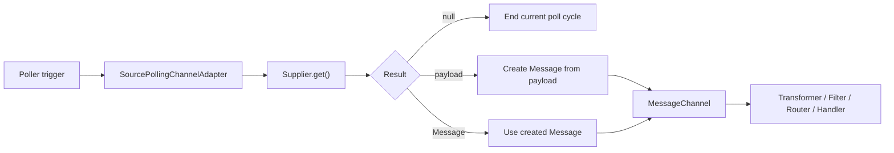

# from Supplier

## 1. Objectives and Context

In the **SPRING_INTEGRATION_CORE** module, **Java DSL** chapter, this lesson shows how to initiate a message flow from a `java.util.function.Supplier<T>`. This connects a scheduled Java data-fetching operation to core components: `Message`, `MessageChannel`, endpoints, and processing steps in Java DSL.

After this lesson, you will be able to:

- Declare a source using `IntegrationFlow.fromSupplier(...)` and identify when `Supplier.get()` is invoked.
- Choose a polling schedule, bound work per cycle, and represent the no-data state with `null`.
- Create messages with headers, wire transformers, and route errors to a separate channel.
- Write tests that control when the source starts running.

The examples use **Java 17 and Spring Integration 6.5.x** as the API baseline. When using Spring Boot, choose the dependency set managed by the matching Boot version's BOM. This lesson assumes no external broker, database, or service.

## 2. What Does "from Supplier" Mean?

### 2.1. Supplier Provides the Value, Poller Decides When to Call

`Supplier<T>` is a functional interface with a zero-argument method returning a value of type `T`:

```java
Supplier<String> source = () -> "inventory-refresh";
```

A typical flow declaration:

```java
IntegrationFlow.fromSupplier(
        source,
        endpoint -> endpoint.poller(
                Pollers.fixedDelay(Duration.ofSeconds(1))
                        .maxMessagesPerPoll(1)))
        .channel("refreshRequests")
        .get();
```

Here, `source` is not invoked merely by writing the lambda. The DSL configures a polling inbound endpoint. Once the endpoint starts, the poller calls the source on schedule; the retrieved value enters the flow. The `refreshRequests` channel in this illustrative snippet needs a corresponding configuration and receiver.

In the 6.x API, the method accepting a `Supplier` is **`IntegrationFlow.fromSupplier(...)`**. Older documentation may use `IntegrationFlows.from(...)` for a `Supplier`; do not port that syntax directly to `IntegrationFlow.from(...)` expecting the same overload. The older syntax is shown in [Spring Integration 5.2 Java DSL](https://docs.spring.io/spring-integration/docs/5.2.0.RELEASE/reference/html/dsl.html).

### 2.2. Three Easily Confused `get` Calls

| Expression | Meaning |
| --- | --- |
| `supplier.get()` | Executes the application's data-providing operation |
| `IntegrationFlow.fromSupplier(supplier, ...)` | Declares a polling source for the flow |
| `...get()` at the end of the DSL chain | Completes building the flow object |

The trailing `.get()` does not mean fetching a record from the source. Polling occurs within the endpoint lifecycle, after the flow's components are registered in the application context.

In the 6.5.x source code, `fromSupplier` wraps the supplier in an `AbstractMessageSource` and calls `messageSource.get()` inside `doReceive()`. The variant without endpoint configuration requires a default poller declared in the context. See [`IntegrationFlow` 6.5.x source](https://raw.githubusercontent.com/spring-projects/spring-integration/6.5.x/spring-integration-core/src/main/java/org/springframework/integration/dsl/IntegrationFlow.java).

## 3. Data Path and Return Contract



The supplier's result is handled as follows:

| Return value of `Supplier.get()` | Meaning in the flow |
| --- | --- |
| A POJO, string, or non-`null` value | Becomes the message payload |
| A `Message<?>` | Used directly as the message, not double-wrapped as a `Message` payload |
| `null` | No data yet; no message is emitted for this call |
| A `List<WorkItem>` | A single list-typed payload; add a splitter to process each element individually |
| An `Optional<WorkItem>` | A non-`null` value, even `Optional.empty()`; convert empty state to `null` if you want no message emitted |
| Throws an exception | Poll fails and follows the configured error-handling mechanism |

Automatic payload wrapping and preserving values that are already `Message` instances are described in [Inbound Channel Adapters in Java DSL](https://docs.spring.io/spring-integration/reference/6.5/dsl/java-inbound-adapters.html).

`null` never becomes a payload. When the source returns `null`, the endpoint can still be invoked on the next trigger. Separate the "no work currently available" state from data-read errors: an empty source returns `null`; access failures should be represented with an exception or an intentional business result model.

For example, a repository returning `Optional` can be adapted like this:

```java
// repository.findNextPending() returns Optional<WorkItem>.
Supplier<WorkItem> source =
        () -> repository.findNextPending().orElse(null);
```

The snippet above only illustrates converting the return type. A real repository must also handle claiming records so multiple workers do not pick up the same work item.

## 4. Configuring the Poller: Schedule and Work Volume

### 4.1. `fixedDelay`, `fixedRate`, and cron

```java
// Wait 2 seconds after the previous poll task completes.
Pollers.fixedDelay(Duration.ofSeconds(2));

// Measure interval between scheduled start instants.
Pollers.fixedRate(Duration.ofSeconds(2));

// Every 30 seconds; Spring cron has a leading seconds field.
Pollers.cron("*/30 * * * * *");
```

The first two forms use `PeriodicTrigger`. `fixedDelay` measures from task completion, whereas `fixedRate` measures from scheduled start times. See [`PeriodicTrigger` Javadoc](https://docs.spring.io/spring-framework/docs/6.2.x/javadoc-api/org/springframework/scheduling/support/PeriodicTrigger.html).

Suppose a poll takes 700 ms and `fixedDelay(2 seconds)` is configured without an executor offloading the poll task: the interval between two starts is roughly 2.7 seconds. This is a load-design estimate; scheduler wait time for resources can delay runs further.

`fixedRate` does not automatically spawn multiple processing threads. To change concurrency, you must examine the scheduler, executor, channel, and thread-safety of the data source. The `Pollers` API offers overloads taking `Duration` and overloads taking `long` milliseconds; using `Duration` makes units explicit. See [`Pollers` 6.5.x source](https://raw.githubusercontent.com/spring-projects/spring-integration/6.5.x/spring-integration-core/src/main/java/org/springframework/integration/dsl/Pollers.java).

### 4.2. `maxMessagesPerPoll` Bounds a Single Poll Cycle

A **poll cycle** is one firing of the polling task. Within that cycle, the source can be invoked multiple times:

```java
Pollers.fixedDelay(Duration.ofSeconds(1))
        .maxMessagesPerPoll(3);
```

If the source returns `A`, `B`, `null` in sequence, this cycle emits two messages and stops. If it returns `A`, `B`, `C`, this cycle emits three messages and waits for the next trigger.

| Value | Behavior with `SourcePollingChannelAdapter` |
| --- | --- |
| Positive number `N` | At most `N` fetches in the cycle; can stop early when the source returns `null` |
| `1` | Fetches at most one item per cycle; also the default for source adapters |
| `0` | Skips calling the source |
| Negative number, typically `-1` | No count limit; keeps fetching until the source returns `null` |

This default differs from `PollingConsumer`, which defaults to `-1`. The rule and special meaning of `0` are stated in [Channel Adapter](https://docs.spring.io/spring-integration/reference/6.5/channel-adapter.html).

With a source like `() -> "heartbeat"`, configuring `-1` means the source always has more data within the same cycle. Choose a finite limit for such unbounded sources. For a source returning an entire list, `maxMessagesPerPoll(1)` limits how many times the list is fetched, not how many elements a downstream splitter creates afterward.

### 4.3. Default Poller

If multiple sources share the same schedule, you can declare a default poller:

```java
import java.time.Duration;

import org.springframework.context.annotation.Bean;
import org.springframework.integration.dsl.Pollers;
import org.springframework.integration.scheduling.PollerMetadata;

@Bean(name = PollerMetadata.DEFAULT_POLLER)
public PollerMetadata defaultPoller() {
    return Pollers.fixedDelay(Duration.ofSeconds(1))
            .maxMessagesPerPoll(1)
            .getObject();
}
```

When a default poller exists, you can omit the endpoint configuration argument if no other customization is needed:

```java
IntegrationFlow.fromSupplier(source)
        .channel("refreshRequests")
        .get();
```

For a flow whose polling schedule and error channel need to be inspected individually, declaring the poller directly on the source lets readers see related configuration in one place.

## 5. Complete Example: Pulling Pending Work and Normalizing Data

### 5.1. Preparing Dependencies

In a Spring Boot project with appropriate managed dependency versions, you need the following starter:

```xml
<dependency>
    <groupId>org.springframework.boot</groupId>
    <artifactId>spring-boot-starter-integration</artifactId>
</dependency>
```

The example runs with `AnnotationConfigApplicationContext`, so no web server is required. Without Boot, declare `org.springframework.integration:spring-integration-core` along with compatible Spring dependencies. The test section below requires JUnit Jupiter, `spring-test`, and `spring-integration-test`; the Boot test starter provides JUnit and Spring Test when used.

### 5.2. Data Source and Flow Configuration

Place all of the following code in `SupplierLessonConfiguration.java`, package `example.integration`:

```java
package example.integration;

import java.time.Duration;
import java.util.Locale;
import java.util.Objects;
import java.util.Queue;
import java.util.concurrent.ConcurrentLinkedQueue;
import java.util.function.Supplier;

import org.springframework.context.annotation.AnnotationConfigApplicationContext;
import org.springframework.context.annotation.Bean;
import org.springframework.context.annotation.Configuration;
import org.springframework.integration.channel.QueueChannel;
import org.springframework.integration.config.EnableIntegration;
import org.springframework.integration.dsl.IntegrationFlow;
import org.springframework.integration.dsl.Pollers;
import org.springframework.messaging.Message;

@Configuration(proxyBeanMethods = false)
@EnableIntegration
public class SupplierLessonConfiguration {

    public record WorkItem(String id, String customer) {
    }

    public static final class PendingWorkSupplier
            implements Supplier<WorkItem> {

        private final Queue<WorkItem> pending =
                new ConcurrentLinkedQueue<>();

        public void submit(WorkItem item) {
            pending.add(Objects.requireNonNull(item));
        }

        @Override
        public WorkItem get() {
            return pending.poll();
        }
    }

    @Bean
    public PendingWorkSupplier pendingWorkSupplier() {
        return new PendingWorkSupplier();
    }

    @Bean
    public QueueChannel workResults() {
        return new QueueChannel(100);
    }

    @Bean
    public QueueChannel supplierErrors() {
        return new QueueChannel(20);
    }

    @Bean
    public IntegrationFlow pendingWorkFlow(PendingWorkSupplier source) {
        return IntegrationFlow
                .fromSupplier(source, endpoint -> endpoint
                        .id("pendingWorkSource")
                        .poller(Pollers
                                .fixedDelay(Duration.ofMillis(200))
                                .maxMessagesPerPoll(1)
                                .errorChannel("supplierErrors")))
                .<WorkItem, String>transform(item -> {
                    if (item.id() == null || item.id().isBlank()) {
                        throw new IllegalArgumentException(
                                "Missing work item id");
                    }
                    return item.id() + ":"
                            + item.customer().strip()
                                    .toUpperCase(Locale.ROOT);
                })
                .channel("workResults")
                .get();
    }

    public static void main(String[] args) {
        try (var context = new AnnotationConfigApplicationContext(
                SupplierLessonConfiguration.class)) {

            var source = context.getBean(PendingWorkSupplier.class);
            var results = context.getBean(
                    "workResults", QueueChannel.class);

            source.submit(new WorkItem("JOB-01", "  lan  "));

            Message<?> result = results.receive(2_000);
            if (result == null) {
                throw new IllegalStateException(
                        "No result received within timeout");
            }

            System.out.println(result.getPayload());
        }
    }
}
```

Expected output:

```text
JOB-01:LAN
```

`@EnableIntegration` registers the Spring Integration infrastructure in this plain Java example context. `@Bean` causes the flow to be registered and its lifecycle managed; simply constructing a flow object outside the context is not enough for the source to start running.

### 5.3. Reading the Example by Role

| Component | Responsibility in the example |
| --- | --- |
| `PendingWorkSupplier` | Stores submitted items and retrieves one item via `poll()` |
| `fromSupplier(source, ...)` | Connects the Java source to the messaging mechanism |
| `pendingWorkSource` endpoint | Controls the source's polling lifecycle |
| Poller 200 ms, max one message | Limits work volume per poll cycle |
| Transformer | Validates id and normalizes customer name |
| `workResults` | Holds results for the program or test to read via `receive(timeout)` |
| `supplierErrors` | Holds error messages for observation in this practice lesson |

When the `pending` queue is empty, `ConcurrentLinkedQueue.poll()` returns `null`. After `submit(...)` adds data, the next poll cycle can pick up that work item. Therefore, the empty state right when the application starts is normal.

`pending` is a Java queue storing domain objects, not a `MessageChannel`. `workResults` is a `QueueChannel` storing `Message<?>`. Distinguishing these two layers helps pinpoint where data is turned into messages.

The example uses an in-memory queue for easy observation. It does not yet provide durability, recovery when the process stops, or automatically returning work to the source if the transformer fails.

## 6. When You Need to Build Messages and Headers Yourself

If you want to attach origin or business-key metadata as soon as data is fetched, you can replace the source initialization with the following snippet. The `source` variable and channel beans are reused from the configuration in section 5:

```java
import org.springframework.integration.support.MessageBuilder;
import org.springframework.messaging.Message;

Supplier<Message<WorkItem>> messageSupplier = () -> {
    WorkItem item = source.get();
    if (item == null) {
        return null;
    }

    return MessageBuilder.withPayload(item)
            .setHeader("sourceSystem", "pending-work")
            .setHeader("businessKey", item.id())
            .build();
};

IntegrationFlow flow = IntegrationFlow
        .fromSupplier(messageSupplier, endpoint -> endpoint
                .poller(Pollers.fixedDelay(Duration.ofMillis(200))
                        .maxMessagesPerPoll(1)
                        .errorChannel("supplierErrors")))
        .channel("workResults")
        .get();
```

This is a flow variant to declare as a bean if applied to an application; do not register it alongside the old flow reading the same `source` if you only want one consumer. The output payload of this variant is `WorkItem`, because this illustrative snippet does not add the transformer.

The `businessKey` header helps correlate multiple processing attempts for the same work item. When adding deduplication, use a stable business key such as `WorkItem.id()`, rather than relying on the technical id generated for a single message emission.

`Supplier.get()` receives no request message, so there is no incoming payload or headers to inspect. If data requires parameters from a business call, consider a gateway or a flow starting from an input channel.

## 7. How Supplier Differs from MessageSource, Input Channels, and Gateways

| Entry point | How data enters the flow | Suitable when |
| --- | --- | --- |
| `fromSupplier(supplier, ...)` | Poller actively calls a zero-argument function | You have a short Java operation to fetch the next item or emit a periodic signal |
| `from(messageSource, ...)` | Poller calls `MessageSource.receive()` | You already have a source following Spring Integration's abstraction |
| `from("inputChannel")` | A producer sends a message to the channel | The application or another component decides when to send |
| Messaging gateway | Application code calls a method with a messaging contract | You need a parameterized Java API, possibly with request and reply |

An equivalent `MessageSource` example for the source in section 5:

```java
import org.springframework.integration.core.MessageSource;
import org.springframework.messaging.support.GenericMessage;

MessageSource<WorkItem> messageSource = () -> {
    WorkItem item = source.get();
    return item == null ? null : new GenericMessage<>(item);
};

IntegrationFlow flow = IntegrationFlow
        .from(messageSource, endpoint -> endpoint
                .poller(Pollers.fixedDelay(Duration.ofMillis(200))
                        .maxMessagesPerPoll(1)))
        .channel("workResults")
        .get();
```

Both approaches create a polling source. The primary difference here is the type contract: a supplier can return a POJO, while `MessageSource.receive()` returns a message or `null`.

Do not confuse a source poller with a poller on an endpoint reading a `QueueChannel`. The former uses `SourcePollingChannelAdapter`; the latter uses `PollingConsumer`. The [Poller](https://docs.spring.io/spring-integration/reference/6.5/polling-consumer.html) documentation explains both polling locations.

For files, JDBC, or protocols with dedicated adapters, check the capabilities of those adapters before writing a custom supplier. For instance, processing file lists, resource management, and tracking already-read state usually require more than a simple function call.

## 8. Threads, Processing Speed, and Queues

In the main example, the poller fetches a work item and runs the transformer across default synchronous links before sending to `workResults`. `DirectChannel` invokes handlers on the sender's thread. `QueueChannel` buffers messages for a receiver to pull later; an endpoint reading downstream from a queue needs its own polling mechanism. See [Message Channel Implementations](https://docs.spring.io/spring-integration/reference/6.5/channel/implementations.html).

Practical consequences in the exercise:

- A slow transformer prolongs the poll task when there is no asynchronous boundary.
- A full `workResults` channel can cause send operations to block; a receiver is needed if the source runs continuously.
- Stopping the source prevents new fetches according to endpoint lifecycle; it does not delete messages already sitting in queues.
- Adding an executor or letting multiple flows read the same source requires re-checking thread-safety and processing order.

For a source with plenty of data, you can estimate capacity before choosing a schedule:

```text
N = maxMessagesPerPoll, N > 0
t = average time to synchronously fetch and process one message
d = fixedDelay

Time per cycle ≈ N × t + d
Throughput ≈ N / (N × t + d)
```

If `N = 5`, `t = 40 ms`, `d = 1 second`, throughput is approximately `5 / 1.2`, or about 4.17 messages/second. This formula assumes the source always has enough data, runs one task sequentially, and experiences no output blocking; it is not a guarantee of actual runtime speed.

`ConcurrentLinkedQueue` in the example makes basic add/poll operations thread-safe when called from different threads. That alone does not make multi-step business logic atomic. For instance, a sequence like "read record, mark in-progress, write result" still requires its own concurrency design.

## 9. Error Handling at the Source and Downstream

### 9.1. Two Places Where Failures Can Happen

**Before a message exists:** the supplier calls an external system and throws an exception. At that point there may be no business payload to store in the `failedMessage` property.

**After a message exists:** a transformer or handler fails. The error is typically wrapped in a `MessagingException` carrying the processed message; check types and nullness before accessing.

Exceptions from a poll task are turned into an `ErrorMessage` by Spring Integration's error-handler infrastructure. The general mechanism is explained in [Error Handling](https://docs.spring.io/spring-integration/reference/6.5/error-handling.html).

### 9.2. Dedicated Error Channel on the Poller

The main example configured:

```java
Pollers.fixedDelay(Duration.ofMillis(200))
        .maxMessagesPerPoll(1)
        .errorChannel("supplierErrors");
```

`PollerSpec.errorChannel(...)` configures the default channel for the poller's error handler. You can pass a bean name or a channel object. See [`PollerSpec` 6.5.x source](https://raw.githubusercontent.com/spring-projects/spring-integration/6.5.x/spring-integration-core/src/main/java/org/springframework/integration/dsl/PollerSpec.java).

Code to observe errors, run from the application or test thread:

```java
import org.springframework.messaging.Message;
import org.springframework.messaging.MessagingException;
import org.springframework.messaging.support.ErrorMessage;

Message<?> received = errors.receive(2_000);

if (received instanceof ErrorMessage error) {
    Throwable problem = error.getPayload();
    System.err.println("Polling error: " + problem.getMessage());

    if (problem instanceof MessagingException messagingException) {
        Message<?> failed = messagingException.getFailedMessage();
        if (failed != null) {
            System.err.println("Failed payload: " + failed.getPayload());
        }
    }
}
```

Here `errors` is the `supplierErrors` bean obtained from the context. In a real system, a consumer must process the error channel so the queue does not accumulate indefinitely.

If a message carries an `errorChannel` header, error-channel resolution may prioritize that header. When adding an `ExecutorChannel` or asynchronous endpoint downstream, errors occurring after the handoff are no longer on the source poller's call stack; configure and test the error path at that boundary.

### 9.3. Having an Error Does Not Return Work to the Source

In the example, `source.get()` already removed the item from `pending` before the transformer ran. If the transformer throws an exception, that work item does not automatically return to `ConcurrentLinkedQueue`. `ErrorMessage` helps observe and route errors; it is not a source-data recovery mechanism.

A real deployment design should decide clearly:

- When an item is considered claimed and when it is considered complete.
- Which errors are retried, how many attempts, and the delay between attempts.
- Where failed items are stored so they can be reprocessed.
- Which business key prevents side effects from being executed multiple times.

If the source is a database, transactions must enclose the intended fetch and processing steps. Thread-bound transactions do not automatically cross asynchronous boundaries; nor do they make a plain Java queue rollback-capable. See [Transaction Support](https://docs.spring.io/spring-integration/reference/6.5/transactions.html).

## 10. Testing Without Relying on Thread.sleep

### 10.1. Testing the Supplier Contract

The source in section 5 can be tested independently of any scheduler:

```java
package example.integration;

import org.junit.jupiter.api.Test;

import example.integration.SupplierLessonConfiguration.PendingWorkSupplier;
import example.integration.SupplierLessonConfiguration.WorkItem;

import static org.junit.jupiter.api.Assertions.assertEquals;
import static org.junit.jupiter.api.Assertions.assertNull;

class PendingWorkSupplierTest {

    @Test
    void returnsNullWhenEmptyAndConsumesAnItemOnce() {
        var source = new PendingWorkSupplier();
        var item = new WorkItem("JOB-01", "lan");

        assertNull(source.get());

        source.submit(item);

        assertEquals(item, source.get());
        assertNull(source.get());
    }
}
```

This test verifies the empty-state contract and single retrieval from the queue. It does not yet verify flow wiring or polling mechanics.

### 10.2. Testing the Flow with the Source Endpoint Initially Stopped

Add the test dependency if not already present:

```xml
<dependency>
    <groupId>org.springframework.integration</groupId>
    <artifactId>spring-integration-test</artifactId>
    <scope>test</scope>
</dependency>
```

`@SpringIntegrationTest(noAutoStartup = ...)` prevents the source endpoint from running immediately when the context is created. The name used here is the endpoint id `pendingWorkSource`, not the flow bean name `pendingWorkFlow`. See [Testing support](https://docs.spring.io/spring-integration/reference/6.5/testing.html).

```java
package example.integration;

import org.junit.jupiter.api.AfterEach;
import org.junit.jupiter.api.Test;
import org.springframework.beans.factory.annotation.Autowired;
import org.springframework.beans.factory.annotation.Qualifier;
import org.springframework.integration.channel.QueueChannel;
import org.springframework.integration.endpoint.SourcePollingChannelAdapter;
import org.springframework.integration.test.context.SpringIntegrationTest;
import org.springframework.messaging.Message;
import org.springframework.messaging.support.ErrorMessage;
import org.springframework.test.annotation.DirtiesContext;
import org.springframework.test.context.junit.jupiter.SpringJUnitConfig;

import example.integration.SupplierLessonConfiguration.PendingWorkSupplier;
import example.integration.SupplierLessonConfiguration.WorkItem;

import static org.junit.jupiter.api.Assertions.assertEquals;
import static org.junit.jupiter.api.Assertions.assertInstanceOf;
import static org.junit.jupiter.api.Assertions.assertNotNull;
import static org.junit.jupiter.api.Assertions.assertNull;

@SpringJUnitConfig(SupplierLessonConfiguration.class)
@SpringIntegrationTest(noAutoStartup = "pendingWorkSource")
@DirtiesContext(classMode = DirtiesContext.ClassMode.AFTER_EACH_TEST_METHOD)
class SupplierFlowTest {

    @Autowired
    PendingWorkSupplier source;

    @Autowired
    @Qualifier("pendingWorkSource")
    SourcePollingChannelAdapter sourceEndpoint;

    @Autowired
    @Qualifier("workResults")
    QueueChannel results;

    @Autowired
    @Qualifier("supplierErrors")
    QueueChannel errors;

    @AfterEach
    void stopSource() {
        sourceEndpoint.stop();
    }

    @Test
    void pollsAndTransformsPendingWork() {
        source.submit(new WorkItem("JOB-01", "  lan  "));

        sourceEndpoint.start();

        Message<?> result = results.receive(2_000);
        assertNotNull(result);
        assertEquals("JOB-01:LAN", result.getPayload());
        assertNull(errors.receive(0));
    }

    @Test
    void publishesDownstreamFailureToThePollerErrorChannel() {
        source.submit(new WorkItem("", "lan"));

        sourceEndpoint.start();

        ErrorMessage failure = assertInstanceOf(
                ErrorMessage.class, errors.receive(2_000));

        Throwable cause = failure.getPayload();
        while (cause.getCause() != null) {
            cause = cause.getCause();
        }

        assertInstanceOf(IllegalArgumentException.class, cause);
        assertEquals("Missing work item id", cause.getMessage());
        assertNull(results.receive(0));
    }
}
```

`receive(2_000)` waits up to two seconds and returns early when a message arrives. This bound is a wait limit for the exercise, not an assumption that the flow always takes two seconds. `receive(0)` only inspects the immediate queue state; it does not prove that no future task will emit a message.

`@DirtiesContext` isolates the two tests that modify source state differently. As the test suite grows, you can design appropriate fixtures and state-reset mechanisms to reduce context recreation overhead.

The two integration tests above verify the success path and downstream error path under the example's synchronous model. To test an exception thrown directly inside `Supplier.get()`, use a test supplier that explicitly throws an error and assert on `ErrorMessage`, without assuming `failedMessage` is always present.

## 11. Common Mistakes and Diagnosis

| Symptom | What to check | Adjustment |
| --- | --- | --- |
| No overload found when passing supplier to `from(...)` | Accidentally using older DSL syntax? | For 6.x examples, use `IntegrationFlow.fromSupplier(...)` |
| Context reports missing poller | Source has no local poller and no default poller exists | Declare a schedule on the endpoint or a default poller bean |
| Endpoint exists but source is never called | `autoStartup`, endpoint state, trigger schedule, and `maxMessagesPerPoll` | Check endpoint id; check whether the limit is set to `0` |
| Continuous polling in a single cycle | Negative limit combined with a source that always returns data | Choose an appropriate positive limit |
| Receiving `Optional.empty()` as payload | Supplier returns `Optional` instead of the source's empty state | Convert with `orElse(null)` when semantically appropriate |
| Only one message containing many items | Supplier returns a collection | Add `.split()` if downstream needs each item |
| App is slow despite short poll schedule | Source, transformer, handler, or output queue is blocking | Time each step and check the consumer side |
| Error observed, but work item is not retried | Source already removed the item before the later step failed | Design retries, error storage, or acknowledgment mechanisms |
| Test consumes items before assertions are prepared | Source auto-started when context was created | Use `noAutoStartup` and call `start()` after loading data |

When investigating a source that emits no data, trace in order: has the endpoint started, does the poller invoke the source, what does the supplier return, which channel does the message enter, and only then check downstream handlers. Recording invocation counts, `null` return counts, work counts, and error counts is usually more informative than counting output messages alone.

## 12. Applying to a Larger Integration Flow

After the supplier source, you can chain the enterprise integration patterns you have learned:

- **Transformer:** convert source data into an internal model, like normalizing names in the example.
- **Filter:** skip work items that fail business rules, optionally sending them to a discard channel for tracking.
- **Router:** select a processing branch based on work type or origin header.
- **Aggregator:** combine messages in the same group once correlation, completion condition, and wait timeout are designed.

The supplier is only the input creation point. It does not create group relationships for an aggregator, split collections automatically, or provide a gateway's request–reply contract.

Design example: a supplier fetches reserved inventory sync requests, a transformer converts them into internal commands, a router selects the warehouse system, a handler sends the command, and a completion step updates status. Before implementing, define the work key, atomic claiming mechanism, and what happens if sending the command succeeds while updating status fails.

## 13. Key Takeaways

`IntegrationFlow.fromSupplier(...)` connects a zero-argument Java function to a Spring Integration polling source. The poller decides the call schedule and work volume per cycle; the supplier decides whether data is available; downstream endpoints decide how messages are processed.

An operable configuration clarifies four points: when the source returns `null`, how many items are fetched per cycle, where errors go, and how work is recovered when processing fails.
