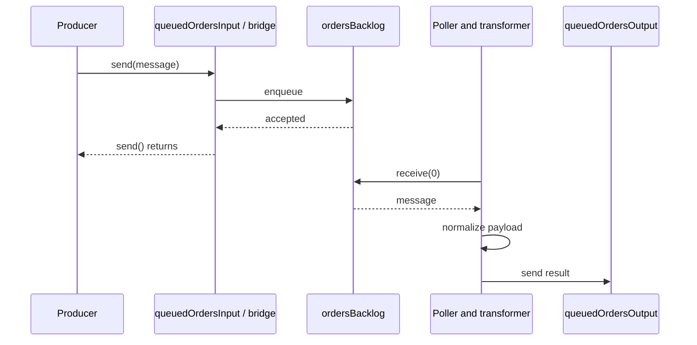

# Channels in Java DSL

## 1. Channels Determine How Endpoints Communicate

In the `SPRING_INTEGRATION_CORE` module, Java DSL lets you describe message flows using components such as `Message`, `MessageChannel`, transformers, filters, routers, and service activators. This lesson focuses on channels: the junction between endpoints and the place that decides whether a message is handed off directly, buffered in a queue, or broadcast to multiple subscribers.

After this lesson, you will be able to:

- Distinguish channels implicitly created by the DSL from explicitly declared channels.
- Reference the same channel from multiple flows without creating duplicate beans.
- Choose `DirectChannel`, `QueueChannel`, `ExecutorChannel`, or `PublishSubscribeChannel` according to processing needs.
- Place pollers in the right spot and explain what a successful message send means.
- Observe results and errors using clearly named channels.

The examples use the Spring Integration 6.5 Java DSL API, Java 17 or higher, and the `org.springframework.integration:spring-integration-core` dependency. Spring dependency versions should be managed consistently via your project's BOM. Test examples use JUnit Jupiter. Complete configuration classes below run in separate application contexts; short configuration snippets are standalone illustrative alternatives.

### 1.1. Endpoints Process; Channels Transport

Consider the following flow:

```java
@Bean
IntegrationFlow normalizeFlow() {
    return IntegrationFlow.from("rawOrders")
            .transform(String.class, String::trim)
            .filter(String.class, text -> !text.isEmpty())
            .channel("normalizedOrders")
            .get();
}
```

`transform` and `filter` create endpoints that perform processing logic. Calling `.channel("normalizedOrders")` specifies the output of the preceding step; it does not add any payload transformation by itself. The consumer of `normalizedOrders` can live in another flow.

The DSL automatically connects adjacent endpoints with a `DirectChannel` when you do not specify another channel. Thus, omitting `.channel(...)` between two steps still creates a channel connecting them; by default that is not an asynchronous queue. See [DSL Basics](https://docs.spring.io/spring-integration/reference/6.5/dsl/java-basics.html).


### 1.2. Do Not Confuse Flow Names with Channel Names

In the example above:

- `normalizeFlow` is the bean name of the flow configuration.
- `rawOrders` is the input channel name.
- `normalizedOrders` is the output channel name.

The name set with `.id(...)` in an endpoint configurer is normally the identifier of that endpoint. It does not replace a channel name and does not make the endpoint an addressable target for sending messages.

When communicating between flows, use business-oriented channel names such as `validatedOrders`, `billingRequests`, or `orderFailures`. Do not rely on auto-generated channel names because endpoint indices can shift when editing a flow.

## 2. Ways to Declare Channels in Java DSL

### 2.1. Referencing by Name

```java
IntegrationFlow.from("orderRequests")
        .transform(String.class, String::trim)
        .channel("validatedOrders")
        .get();
```

With these name-accepting overloads, the DSL uses an existing channel or creates a `DirectChannel` if no bean with that name exists yet. Therefore, the name `validatedOrders` does not imply that the channel is a queue. A typo in a name can also create a different route than intended. This rule is described in [Message Channels in Java DSL](https://docs.spring.io/spring-integration/reference/6.5/dsl/java-channels.html).

When the requirement strictly calls for a queue with capacity 100 messages, declare the exact type and capacity:

```java
@Bean
QueueChannel validatedOrders() {
    return new QueueChannel(100);
}
```

Then use `.channel("validatedOrders")` and `IntegrationFlow.from("validatedOrders")` so two flows communicate through that same channel.

### 2.2. Using Channel Beans via Method Parameters

When multiple beans share the same type, combine dependency injection with `@Qualifier` to avoid ambiguity:

```java
@Bean
IntegrationFlow trimFlow(
        @Qualifier("orderRequests") MessageChannel input,
        @Qualifier("validatedOrders") QueueChannel output) {

    return IntegrationFlow.from(input)
            .transform(String.class, String::trim)
            .channel(output)
            .get();
}
```

This snippet assumes both beans already exist. Passing beans explicitly clarifies the contract: the output must be a `QueueChannel`, not just an arbitrary string name.

### 2.3. Inline Declaration via Channel Builder

```java
@Bean
IntegrationFlow ingestFlow() {
    return IntegrationFlow.from("incomingOrders")
            .transform(String.class, String::trim)
            .channel(channels -> channels.queue("orderBuffer", 100))
            .get();
}
```

The DSL creates and registers `orderBuffer` at this point. Another flow can receive via `IntegrationFlow.from("orderBuffer")`; if that flow uses a queue-consuming endpoint, it must have a poller.

`MessageChannels` also provides static factory methods for the same purpose:

```java
import org.springframework.integration.dsl.MessageChannels;

@Bean
IntegrationFlow alternativeIngestFlow() {
    return IntegrationFlow.from("alternativeInput")
            .transform(String.class, String::trim)
            .channel(MessageChannels.queue("alternativeBuffer", 100))
            .get();
}
```

Common builder expressions are `channels.direct("name")`, `channels.queue("name", capacity)`, `channels.executor("name", executor)`, and `channels.publishSubscribe("name")`. Overloads taking names and capacities are listed in [Channels API](https://docs.spring.io/spring-integration/api/org/springframework/integration/dsl/Channels.html).

### 2.4. One Shared Name Must Point to One Channel Instance

Do not declare two separate builders that both create a channel with the same name:

```java
// Wrong: two flows both request registering two objects under the same bean name.
@Bean
IntegrationFlow producerFlow() {
    return IntegrationFlow.from("sourceInput")
            .channel(MessageChannels.queue("sharedBuffer", 100))
            .get();
}

@Bean
IntegrationFlow consumerFlow() {
    return IntegrationFlow.from(MessageChannels.queue("sharedBuffer", 100))
            .handle(String.class, (payload, headers) -> null,
                    endpoint -> endpoint.poller(Pollers.fixedDelay(100)))
            .get();
}
```

Two builders are not merged just because they share a name. A cleaner organization is to declare one `sharedBuffer` bean and have both flows reference it by name or inject that bean. Creating duplicate inline channels is also warned against in the [Java DSL channels documentation](https://docs.spring.io/spring-integration/reference/6.5/dsl/java-channels.html).

## 3. Choosing a Channel by Delivery Model

| Channel type | How messages are received | Distribution | Has own message buffer by default? | Consumer endpoint needs a poller? |
| --- | --- | --- | --- | --- |
| `DirectChannel` | Subscriber invoked on sending thread | Point-to-point | No | No |
| `ExecutorChannel` | Dispatcher delegates work to an executor | Point-to-point | No own message queue; executor may have a task queue | No |
| `QueueChannel` | Consumer calls `receive(...)` | Point-to-point | Yes, usually in memory | Yes, if a framework endpoint reads the queue |
| `PublishSubscribeChannel` | Invokes subscribers | Broadcast | No | No |

Point-to-point means one message is delivered to one consumer according to the channel's dispatching policy, not that every consumer receives a copy. Broadcast sends messages to registered subscribers; execution is still affected by errors and executor configuration.

Specialized options include `PriorityChannel` to retrieve messages by priority, `RendezvousChannel` for handoff without a waiting buffer, and channels for partitioning or reactive streams. These require specific requirements around ordering, handoff, or backpressure. See [Message Channel Implementations](https://docs.spring.io/spring-integration/reference/channel/implementations.html).

## 4. Complete Example with DirectChannel

Requirement: receive a string order code, trim whitespace, and convert to uppercase. The producer needs normalization to complete right within the send call. The result is placed into a queue so the calling program can retrieve and observe it.

```java
import java.util.Locale;

import org.springframework.beans.factory.annotation.Qualifier;
import org.springframework.context.annotation.Bean;
import org.springframework.context.annotation.Configuration;
import org.springframework.integration.channel.DirectChannel;
import org.springframework.integration.channel.QueueChannel;
import org.springframework.integration.config.EnableIntegration;
import org.springframework.integration.dsl.IntegrationFlow;
import org.springframework.messaging.MessageChannel;

@Configuration(proxyBeanMethods = false)
@EnableIntegration
public class DirectChannelDslConfig {

    @Bean
    MessageChannel directOrdersInput() {
        return new DirectChannel();
    }

    @Bean
    QueueChannel directOrdersOutput() {
        return new QueueChannel(10);
    }

    @Bean
    IntegrationFlow directOrdersFlow(
            @Qualifier("directOrdersInput") MessageChannel input,
            @Qualifier("directOrdersOutput") QueueChannel output) {

        return IntegrationFlow.from(input)
                .transform(String.class,
                        value -> value.trim().toUpperCase(Locale.ROOT))
                .channel(output)
                .get();
    }
}
```

The execution path is:

```text
thread calling send()
  -> directOrdersInput
  -> transformer
  -> directOrdersOutput: enqueue result into queue
  -> send() returns
```

`DirectChannel` invokes the subscriber on the sender's thread. With this configuration, when a successful send returns, the transformer has already run and the result has been placed in the output queue. If a downstream synchronous endpoint is slow, the sender waits too. See [DirectChannel API](https://docs.spring.io/spring-integration/api/org/springframework/integration/channel/DirectChannel.html).

The output queue does not need a poller in this example because the caller retrieves messages itself with `receive(...)`. If you replace manual receiving with a queue-consuming flow, that flow will need a poller.

If you attach two flows consuming the same `directOrdersInput`, you create competing consumers receiving messages. This is not the way for both order processing and auditing to receive every message. Moreover, the dispatcher may try another subscriber when processing fails and failover is enabled; do not infer exactly-once business processing guarantees solely from the channel type.

## 5. QueueChannel: Decoupling Send Time from Processing Time

New requirement: the producer only needs to place requests into a buffer. A worker periodically pulls requests to normalize them. Channels are declared separately so two flows share one queue.

```java
import java.util.Locale;

import org.springframework.context.annotation.Bean;
import org.springframework.context.annotation.Configuration;
import org.springframework.integration.channel.DirectChannel;
import org.springframework.integration.channel.QueueChannel;
import org.springframework.integration.config.EnableIntegration;
import org.springframework.integration.dsl.IntegrationFlow;
import org.springframework.integration.dsl.Pollers;
import org.springframework.messaging.MessageChannel;

@Configuration(proxyBeanMethods = false)
@EnableIntegration
public class QueuedChannelDslConfig {

    @Bean
    MessageChannel queuedOrdersInput() {
        return new DirectChannel();
    }

    @Bean
    QueueChannel ordersBacklog() {
        return new QueueChannel(100);
    }

    @Bean
    QueueChannel queuedOrdersOutput() {
        return new QueueChannel(100);
    }

    @Bean
    QueueChannel orderErrors() {
        return new QueueChannel(20);
    }

    @Bean
    IntegrationFlow enqueueOrdersFlow() {
        return IntegrationFlow.from("queuedOrdersInput")
                .channel("ordersBacklog")
                .get();
    }

    @Bean
    IntegrationFlow processQueuedOrdersFlow() {
        return IntegrationFlow.from("ordersBacklog")
                .transform(String.class, value -> {
                    String normalized = value.trim();
                    if (normalized.isEmpty()) {
                        throw new IllegalArgumentException("Order code is blank");
                    }
                    return normalized.toUpperCase(Locale.ROOT);
                }, endpoint -> endpoint.poller(
                        Pollers.fixedDelay(100)
                                .maxMessagesPerPoll(10)
                                .receiveTimeout(0)
                                .errorChannel("orderErrors")))
                .channel("queuedOrdersOutput")
                .get();
    }
}
```

The segment from `queuedOrdersInput` to `ordersBacklog` only forwards messages; the DSL inserts the required bridge between the two channels. The producer does not directly execute the transformer of the queue-consuming flow.



### 5.1. The Poller Belongs to the Consumer Endpoint

`ordersBacklog` only stores messages and provides the receive operation; it does not run a queue-reading thread by itself. The poller is attached to the `transform` endpoint because that is the first endpoint reading from this channel.

In the configuration above:

- `fixedDelay(100)` sets a 100 ms pause between the end of one run and the start of the next.
- `maxMessagesPerPoll(10)` caps at most 10 messages per polling task run; it does not create 10 threads.
- `receiveTimeout(0)` makes a receive call return immediately when the queue has no messages.
- `errorChannel("orderErrors")` specifies where polling task errors go.

You can declare a shared default poller, but a local poller makes it immediately clear how an endpoint consumes the queue. The poller configuration API is introduced in [Pollers in Java DSL](https://docs.spring.io/spring-integration/reference/dsl/java-pollers.html).

Both `queuedOrdersOutput` and `orderErrors` are observation points for the example and tests. A long-running application needs consumers pulling results and errors; otherwise, these bounded queues will fill up.

### 5.2. Queues Do Not Automatically Guarantee Durability or Reprocessing

`new QueueChannel(100)` uses an in-memory buffer. Switching to a queue does not automatically provide durability across restarts, business acknowledgment, or retries. Once a message is taken from an ordinary queue and the handler fails, there is no automatic mechanism to put the message back on the queue simply by declaring a queue.

If the requirement is crash recovery, you must design a durable message store with appropriate transaction boundaries, or use a broker with corresponding acknowledgment mechanisms. This is an additional choice outside the in-memory example. See [QueueChannel configuration and persistent store](https://docs.spring.io/spring-integration/reference/channel/configuration.html#queuechannel-configuration).

## 6. ExecutorChannel: Handing Work Off to an Executor

When you do not need a consumer actively polling a queue, the channel can hand tasks to an executor. Place the following beans in a `@Configuration` class with Spring Integration enabled:

```java
import org.springframework.beans.factory.annotation.Qualifier;
import org.springframework.context.annotation.Bean;
import org.springframework.integration.dsl.IntegrationFlow;
import org.springframework.scheduling.concurrent.ThreadPoolTaskExecutor;

@Bean
ThreadPoolTaskExecutor billingExecutor() {
    ThreadPoolTaskExecutor executor = new ThreadPoolTaskExecutor();
    executor.setCorePoolSize(2);
    executor.setMaxPoolSize(4);
    executor.setQueueCapacity(50);
    executor.setThreadNamePrefix("billing-");
    return executor;
}

@Bean
IntegrationFlow billingFlow(
        @Qualifier("billingExecutor") ThreadPoolTaskExecutor executor) {

    return IntegrationFlow.from("billingRequests")
            .channel(channels -> channels.executor("billingWork", executor))
            .handle(String.class, (payload, headers) -> {
                System.out.println(Thread.currentThread().getName()
                        + " handles " + payload);
                return null;
            })
            .get();
}
```

Spring manages initializing and shutting down the `ThreadPoolTaskExecutor` bean. Returning `null` in the handler expresses finishing a one-way step without producing a reply.

With the executor above, processing after `billingWork` usually runs on a `billing-*` thread. `ExecutorChannel` is still point-to-point; increasing the thread count does not turn it into a broadcast. Transactions bound to the sender's thread do not automatically propagate to the handler. See [ExecutorChannel API](https://docs.spring.io/spring-integration/api/org/springframework/integration/channel/ExecutorChannel.html).

Capacity 50 is the executor's task queue. When both the pool and the task queue are full, the rejection policy determines what happens. The default policy can cause the send operation to fail; a caller-runs policy can make the sender execute the work immediately. Therefore, do not promise that adding an executor always makes `send()` return instantaneously.

If you need to observe backlog as a message channel and actively control fetch cadence, choosing a queue with a poller usually expresses the requirement more clearly. If you need pool-based concurrent processing without a polling endpoint, an executor fits that model.

## 7. PublishSubscribeChannel: Multiple Branches Receiving the Same Event

When an order is accepted, both auditing and notification need to receive the event. The DSL has a dedicated method to declare a broadcast channel along with subscriber sub-flows:

```java
@Bean
IntegrationFlow acceptedOrderEventsFlow() {
    return IntegrationFlow.from("acceptedOrderEvents")
            .publishSubscribeChannel(subscribers -> subscribers
                    .subscribe(audit -> audit
                            .handle(String.class, (payload, headers) -> {
                                System.out.println("AUDIT: " + payload);
                                return null;
                            }))
                    .subscribe(notification -> notification
                            .handle(String.class, (payload, headers) -> {
                                System.out.println("NOTIFY: " + payload);
                                return null;
                            })))
            .get();
}
```

`acceptedOrderEvents` is the input channel. Calling `publishSubscribeChannel(...)` creates another channel inside the flow to broadcast to both branches. In the non-error case, each event reaches both audit and notification.

Without an executor configured, both subscribers are invoked on the sending thread; publish-subscribe does not implicitly mean parallel execution. If an earlier synchronous branch throws an exception, dispatching can be aborted before calling the next branch. If branches need independent error handling, design appropriate boundaries and error handling.

If the branches will later be combined by an aggregator, consider configuring `applySequence(true)` along with matching correlation and release strategies. Broadcasting alone is not yet a complete scatter-gather flow. Channel executor and sequence properties are explained in [PublishSubscribeChannel Configuration](https://docs.spring.io/spring-integration/reference/channel/configuration.html#publishsubscribechannel-configuration).

The payload may still be the same object referenced by multiple branches. Prefer immutable payloads; do not let audit mutate a shared `List` while another branch is reading it.

## 8. Capacity, Timeouts, and What a Successful Send Means

### 8.1. Send and Receive Contracts

```java
boolean accepted = channel.send(message, 200);
Message<?> result = outputQueue.receive(1_000);
```

The timeouts above are in milliseconds:

- With a full queue, `send(message, 200)` can wait for free space for up to roughly 200 ms and return `false` if it still cannot send.
- With an empty queue, `receive(1_000)` waits for a message and returns `null` on timeout.
- `send(message, 0)` and `receive(0)` do not wait for queue state changes.

Overloads without a timeout can block indefinitely on queues. Handle `false`, `null`, and exceptions appropriately for the operation being called. See [QueueChannel behavior](https://docs.spring.io/spring-integration/reference/channel/implementations.html#queuechannel).

The timeout passed to `send()` is not a total business execution deadline. For example, `DirectChannel` does not interrupt a slow handler simply because the caller used `send(message, 200)`. A send timeout at the head of a flow also does not automatically become the timeout for every send at downstream endpoints.

| Successful send point | What can be concluded | What still needs to be observed |
| --- | --- | --- |
| Input queue | Message was accepted into the queue | Whether the worker has processed and written results |
| Executor channel | Task was accepted for dispatch | Whether the handler completed or emitted an error |
| Synchronous endpoint chain | Synchronous steps for this send returned normally | Whether any async side effects or external commits follow |

### 8.2. Capacity Is a Backlog Limit, Not Processing Throughput

Suppose a worker processes an average of 200 messages/second, while input stays at 300 messages/second. Backlog grows by roughly 100 messages/second. If the queue starts empty with capacity 1,000 messages, it will fill up after roughly 10 seconds, ignoring real-world jitter.

This is an estimate to prompt design questions: will the producer wait, receive an error, slow down, or route requests elsewhere when space runs out? Increasing capacity only delays when the queue fills; sustained mismatch requires changing processing throughput or admission policy.

A FIFO `QueueChannel` defines message retrieval order. If multiple workers process concurrently with varying durations, completion order can still differ from entry order. Distinguish requirements for preserving intake order from requirements for preserving completion order per order or per customer.

## 9. Changing Channels Also Changes Error and Transaction Boundaries

### 9.1. Errors in a Synchronous Chain

When sending directly through a `DirectChannel`, exceptions from synchronous handlers normally propagate back to the caller; the framework may wrap them in a messaging exception. Setting an `errorChannel` header alone does not automatically turn every synchronous error into an error message.

### 9.2. Errors Past an Asynchronous Boundary

In the queue example, normalization errors occur inside the polling task after the sender has finished sending. The poller is configured to send errors to `orderErrors`; the received message is an `ErrorMessage` with a `Throwable` payload. Default error handling in framework-managed tasks can use the `errorChannel` header or the global error channel, depending on configuration. See [Error Handling](https://docs.spring.io/spring-integration/reference/error-handling.html).

The error-receiving flow must decide whether to log, retry, route to manual handling, or emit a failure outcome. Having an `errorChannel` does not automatically mean the original message will be reprocessed.

### 9.3. Transactions Are Not Created by Channels Alone

`DirectChannel` preserves the thread, so it can participate in an active transaction if resources and propagation are configured appropriately. It does not start a transaction by itself.

When adding a queue or executor, define transactions at the consumer rather than assuming the producer's transaction automatically crosses that boundary. For example, saving an "accepted" record in the producer and updating status to "processed" in the worker are two operations whose consistency must be designed separately. Choosing a channel must go hand in hand with deciding how the application recovers if it stops between those two operations.

## 10. Observing Channels with Interceptors

Named channels make it easy to measure message volume, monitor send errors, and attach observation at a stable boundary. The example below prints the order ID before sending through `observedOrders`:

```java
import org.springframework.messaging.Message;
import org.springframework.messaging.MessageChannel;
import org.springframework.messaging.support.ChannelInterceptor;

@Bean
IntegrationFlow observedOrdersFlow() {
    return IntegrationFlow.from("observedInput")
            .channel(channels -> channels.direct("observedOrders")
                    .interceptor(new ChannelInterceptor() {
                        @Override
                        public Message<?> preSend(
                                Message<?> message, MessageChannel channel) {
                            System.out.println("orderId="
                                    + message.getHeaders().get("orderId"));
                            return message;
                        }
                    }))
            .handle(String.class, (payload, headers) -> null)
            .get();
}
```

`preSend` returns the message to continue sending. If the interceptor returns `null`, the send operation is aborted. Receive callbacks such as `preReceive` and `postReceive` apply to pollable channels, not `DirectChannel`. See [Channel Interceptors](https://docs.spring.io/spring-integration/reference/channel/interceptors.html).

Timing on asynchronous channels must distinguish send-acceptance latency from business-processing latency. To measure end-to-end duration, carry an `orderId` or correlation ID across messages and record timestamps at start and completion. Normalization, routing, and business filtering logic should remain expressed through their corresponding endpoints so the flow stays readable.

## 11. Testing Channel Behavior

The following tests illustrate three key contracts: synchronous processing produces the right result, the poller sends errors to the error channel, and a bounded queue rejects immediate sends when full. Place the two configuration classes from sections 4 and 5 in the same package as the test class, or import them according to your project's packages.

```java
import org.junit.jupiter.api.Test;
import org.springframework.context.annotation.AnnotationConfigApplicationContext;
import org.springframework.integration.channel.QueueChannel;
import org.springframework.messaging.Message;
import org.springframework.messaging.MessageChannel;
import org.springframework.messaging.support.ErrorMessage;
import org.springframework.messaging.support.MessageBuilder;

import static org.junit.jupiter.api.Assertions.assertEquals;
import static org.junit.jupiter.api.Assertions.assertFalse;
import static org.junit.jupiter.api.Assertions.assertInstanceOf;
import static org.junit.jupiter.api.Assertions.assertNotNull;
import static org.junit.jupiter.api.Assertions.assertNull;
import static org.junit.jupiter.api.Assertions.assertTrue;

class ChannelDslTest {

    @Test
    void directFlowNormalizesPayloadAndKeepsBusinessHeader() {
        try (var context = new AnnotationConfigApplicationContext(
                DirectChannelDslConfig.class)) {

            MessageChannel input = context.getBean(
                    "directOrdersInput", MessageChannel.class);
            QueueChannel output = context.getBean(
                    "directOrdersOutput", QueueChannel.class);

            Message<String> request = MessageBuilder
                    .withPayload("  order-007  ")
                    .setHeader("orderId", "007")
                    .build();

            assertTrue(input.send(request, 200));

            // The synchronous processing chain has placed the result in the queue.
            Message<?> result = output.receive(0);
            assertNotNull(result);
            assertEquals("ORDER-007", result.getPayload());
            assertEquals("007", result.getHeaders().get("orderId"));
            assertNull(output.receive(0));
        }
    }

    @Test
    void pollingFlowProducesResultAndRoutesInvalidInputToErrors() {
        try (var context = new AnnotationConfigApplicationContext(
                QueuedChannelDslConfig.class)) {

            MessageChannel input = context.getBean(
                    "queuedOrdersInput", MessageChannel.class);
            QueueChannel output = context.getBean(
                    "queuedOrdersOutput", QueueChannel.class);
            QueueChannel errors = context.getBean(
                    "orderErrors", QueueChannel.class);

            assertTrue(input.send(MessageBuilder
                    .withPayload(" order-008 ").build(), 200));

            Message<?> result = output.receive(2_000);
            assertNotNull(result);
            assertEquals("ORDER-008", result.getPayload());

            assertTrue(input.send(MessageBuilder
                    .withPayload("   ").build(), 200));

            Message<?> failure = errors.receive(2_000);
            assertInstanceOf(ErrorMessage.class, failure);
            assertInstanceOf(Throwable.class, failure.getPayload());
            assertEquals("Order code is blank",
                    rootCause((Throwable) failure.getPayload()).getMessage());
        }
    }

    @Test
    void boundedQueueRejectsImmediateSendWhenFull() {
        QueueChannel queue = new QueueChannel(1);
        Message<String> first = MessageBuilder.withPayload("A").build();
        Message<String> second = MessageBuilder.withPayload("B").build();

        assertTrue(queue.send(first, 0));
        assertFalse(queue.send(second, 0));

        Message<?> received = queue.receive(0);
        assertNotNull(received);
        assertEquals("A", received.getPayload());
        assertTrue(queue.send(second, 0));
    }

    private static Throwable rootCause(Throwable error) {
        Throwable current = error;
        while (current.getCause() != null) {
            current = current.getCause();
        }
        return current;
    }
}
```

Asynchronous tests wait on the output or error channel with a finite timeout. This observes the event being tested without guessing timings via `Thread.sleep(...)`. The 2-second limit is a wait budget for the test example, not a latency guarantee for a production system.

## 12. Common Mistakes When Wiring Flows

| Symptom | What to check | Resolution |
| --- | --- | --- |
| `Dispatcher has no subscribers` | Direct/executor channel has no registered endpoint or endpoint has not started | Check channel name, context state, and consumer lifecycle |
| Queue grows in size with no output | Missing consumer, missing poller, or failing worker | Check the first endpoint reading the queue and the error channel |
| Intended all branches to run, but each message hits only one branch | Using a point-to-point channel with multiple consumers | Choose publish-subscribe if broadcast is required |
| `send()` returned, but data is not updated yet | Queue or executor boundary present | Observe completion result or errors at the consumer |
| Duplicate channel bean name error | Two flows both create an inline channel with the same name | Declare the channel once and reference it |
| Producer blocks for a long time | Full queue, slow synchronous handler, or caller-runs executor policy | Locate the waiting point and set an appropriate admission policy |
| `receive(...)` unusable on channel | Channel does not implement `PollableChannel` | Use a subscriber endpoint or choose a queue if active polling is needed |
| Messages vanish after restart | Using an in-memory queue | Design durable storage and recovery as required |

## 13. Applying to an Order Flow

A design can start with the following boundaries:

```text
Gateway or producer
  -> orderRequests: DirectChannel
  -> filter / transformer: validate and normalize
  -> ordersBacklog: bounded QueueChannel
  -> poller + worker: execute business logic
  -> publish-subscribe: broadcast outcome events
       -> audit
       -> notification
```

A gateway provides an appropriate calling API for the producer; it does not replace channel selection. Filters, routers, and transformers express business decisions; channels govern how messages reach those endpoints. If you introduce an aggregator across branches, also define correlation, expected result count, and group release conditions.

Before changing a channel in a flow, determine what becomes observable after the change:

1. Should one message reach one consumer or every subscriber?
2. Which step must complete before the sender returns?
3. If there is a backlog, what is its limit and what happens when full?
4. Will errors be received directly by the caller or routed through an error channel?
5. Where do transactions begin, and what data survives a restart?

Answering these questions ensures channel names and types in Java DSL accurately reflect the system's communication contract, while clarifying what to test at each boundary.
