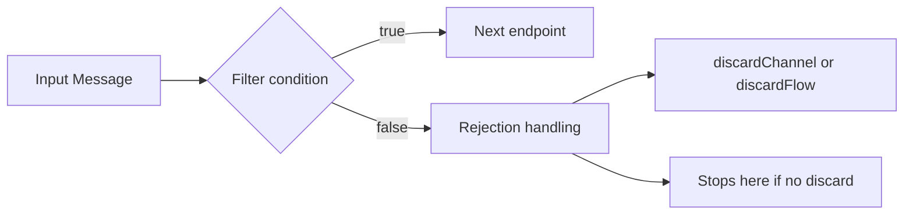
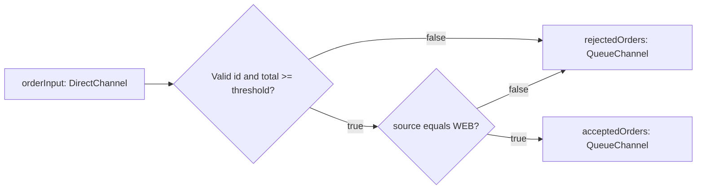

# filter in Java DSL

In the **Java DSL** chapter of the **SPRING_INTEGRATION_CORE** module, the `filter(...)` operation represents the **Message Filter** pattern: inspecting a message and deciding whether to let that message proceed. The condition can be based on the payload, headers, or a business rule encapsulated in a Java object.

This lesson uses an order-intake scenario. Only eligible orders are forwarded to the main processing step; ineligible orders are routed to a rejection branch for inspection. Through this, you will see the relationship between `Message`, `MessageChannel`, endpoints, and `IntegrationFlow`, as well as how to test and handle filter errors.

## 1. Objectives and Prerequisites

After this lesson, you will be able to:

- Write a filter using a lambda that reads the payload or the entire message.
- Separate the selection condition from endpoint configuration.
- Configure `discardChannel`, `discardFlow`, and `throwExceptionOnRejection`.
- Distinguish failing a condition from throwing an error while evaluating the condition.
- Test both the acceptance branch and the rejection branch.
- Position a filter properly when combining transformers, routers, splitters, aggregators, and gateways.

The examples use Java 17 and the Spring Integration 6.5 API. When using Spring Boot, let your project's Boot dependency management select the compatible library versions. There is no need to pin a different Spring Integration version just to run these examples.

For a Maven project with a matching Spring Boot parent or BOM, the two dependencies for the practice exercises are:

```xml
<dependency>
    <groupId>org.springframework.boot</groupId>
    <artifactId>spring-boot-starter-integration</artifactId>
</dependency>

<dependency>
    <groupId>org.springframework.boot</groupId>
    <artifactId>spring-boot-starter-test</artifactId>
    <scope>test</scope>
</dependency>
```

`spring-boot-starter-test` provides the test environment using JUnit Jupiter and AssertJ in this lesson. The examples do not require a broker, database, or external service.

## 2. Semantics: filter Makes a Boolean Decision

Conceptually, a filter receives a `Message<?>`, evaluates a condition, and has two outcomes:

| Condition result | Main flow | Rejection branch |
| --- | --- | --- |
| `true` | Message proceeds to the downstream endpoint or channel | Receives no message from this evaluation |
| `false` | Does not receive that message | Depends on discard and exception configuration |

A filter does not use the boolean value as an output payload. If the condition returns `true`, the message proceeds with its existing content; if it returns `false`, the main flow gets no output for that message. This differs from a transformer producing a boolean payload. See [Message Filter documentation](https://docs.spring.io/spring-integration/reference/filter.html).



The diagram depicts both directions of a single check. When exception-on-rejection mode is enabled, the rejection branch can also throw an exception.

A DSL snippet can be read as follows:

```java
return IntegrationFlow.from("input")
        .filter(String.class, text -> !text.isBlank())
        .transform(String.class, String::trim)
        .channel("output")
        .get();
```

Every message arriving at `input` is checked first. Whitespace-only strings are dropped; `"  Java DSL  "` proceeds and is turned into `"Java DSL"` by the transformer.

Even though the DSL is written as a chain of method calls, this is configuration for Spring-managed messaging components. `filter` corresponds to a Message Filter endpoint; `transform`, `handle`, `route`, and `aggregate` correspond to other roles in the flow. See [DSL Basics](https://docs.spring.io/spring-integration/reference/dsl/java-basics.html).

### How Does filter Differ from Neighboring Operations?

| Operation | Question the operation answers | Example in an order flow |
| --- | --- | --- |
| `filter` | Should this message continue? | Accept only orders meeting a minimum total |
| `transform` | What form should the data be converted into? | Convert JSON into an `Order` object |
| `route` | Which processing branch should the message go to? | Domestic and international orders to two shipping flows |
| `handle` | What action should be performed? | Call an inventory reservation service |
| `aggregate` | When is enough data available to produce a group result? | Combine check results for each line item |

A filter with a discard branch can still express a simple two-way decision. When the problem is primarily selecting among multiple business destinations, a router usually expresses intent more clearly.

## 3. Writing Payload-Based Conditions

### 3.1. Declaring the Payload Type Explicitly

A readable form for beginners is:

```java
.filter(String.class, text -> text.length() <= 200)
```

The first parameter is the expected data type when invoking the selector; the second parameter is the predicate returning a boolean. In the example, `text` is the `String` payload, not `Message<String>`.

With a domain type:

```java
.filter(Order.class, order ->
        order.total() != null
        && order.total().compareTo(new BigDecimal("100000")) >= 0)
```

The example includes values equal to the threshold. If business rules only accept values strictly above the threshold, change `>= 0` to `> 0`.

With `BigDecimal`, use `compareTo` when comparing numeric values. Using `equals` to check a threshold can mislead because `100000` and `100000.00` have different scales.

### 3.2. Specifying Generics Directly

You may also see the form:

```java
.<String>filter(text -> !text.isBlank())
```

Specifying the generic lets the compiler infer the lambda parameter type. When configurations are long or involve multiple overloads, `.filter(String.class, ...)` is often easier to follow.

Overloads accepting `expectedType` may attempt data conversion before invoking the selector. Therefore, `.filter(Order.class, ...)` is not a guarantee that every non-`Order` payload will be treated as `false`; conversion or method invocation can fail and raise an exception. Agree on the payload contract at intake, or convert data beforehand with a transformer. See [filter API in Java DSL 6.5](https://docs.spring.io/spring-integration/docs/6.5.0/api/org/springframework/integration/dsl/BaseIntegrationFlowDefinition.html).

### 3.3. Conditions Should Focus on Evaluation

A good selector typically has these traits:

- Its outcome is easy to explain from the input data.
- It does not mutate the payload while checking it.
- It does not send emails, persist orders, or perform hard-to-undo side effects.
- It handles nullable fields in domain objects explicitly.
- It can be tested with boundary values.

A message payload can be a mutable object. Having an immutable header contract on the message does not automatically make the payload object immutable. If a selector mutates the object while checking it, the discard branch may receive modified data.

## 4. Reading Headers and Reusing Rules

### 4.1. Using the Entire Message

Suppose only orders originating from `WEB` are allowed:

```java
import org.springframework.messaging.Message;

// Configuration snippet inside IntegrationFlow:
.filter(Message.class, message ->
        "WEB".equals(message.getHeaders().get("source")))
```

Here, `Message.class` indicates the lambda needs the entire message. Writing `"WEB".equals(...)` returns `false` when the header is missing or when the value does not equal `"WEB"`.

This condition also rejects `"web"`, `"MOBILE"`, and non-`String` values. If case normalization is needed, decide on the normalization rule before comparing.

Example combining payload and headers:

```java
.filter(Message.class, message ->
        message.getPayload() instanceof Order order
        && order.total() != null
        && order.total().signum() > 0
        && "WEB".equals(message.getHeaders().get("source")))
```

The first condition guards reading the payload inside this lambda itself. It serves a different role from passing `Order.class` so the adapter converts/casts before calling the selector.

### 4.2. Using MessageSelector

When a rule depends on multiple headers or is reused across flows, it can be encapsulated in a `MessageSelector`:

```java
import org.springframework.integration.core.MessageSelector;
import org.springframework.messaging.Message;

public final class WebOrderSelector implements MessageSelector {

    @Override
    public boolean accept(Message<?> message) {
        return message.getPayload() instanceof Order
                && "WEB".equals(message.getHeaders().get("source"));
    }
}
```

Pass this object to the DSL via the `accept` method:

```java
@Bean
public WebOrderSelector webOrderSelector() {
    return new WebOrderSelector();
}

// Inside a @Bean method with parameter WebOrderSelector selector:
return IntegrationFlow.from("webInput")
        .filter(selector, "accept",
                endpoint -> endpoint.discardChannel("webRejected"))
        .channel("webAccepted")
        .get();
```

This snippet is a standalone alternative configuration; channels must be declared or wired to appropriate consumers in an application using it.

### 4.3. Using a Plain Business Object

Not every rule has to implement a Spring interface:

```java
public final class OrderRules {

    private static final BigDecimal MINIMUM = new BigDecimal("100000");

    public boolean isEligible(Order order) {
        return order.id() != null
                && !order.id().isBlank()
                && order.total() != null
                && order.total().compareTo(MINIMUM) >= 0;
    }
}
```

With an `OrderRules orderRules` bean injected into the configuration method:

```java
.filter(orderRules, "isEligible",
        endpoint -> endpoint.discardChannel("rejectedOrders"))
```

The `isEligible` method depends only on the domain model, so it can be unit-tested independently. When renaming the method, note that `"isEligible"` in the configuration is a string and lacks the compile-time safety of a method reference.

### 4.4. Using SpEL for Short Conditions

Example header check:

```java
.filter("headers['source'] == 'WEB'")
```

SpEL is convenient for short expressions. For multi-branch rules, Java is generally easier to rename, test, and debug. Never take expressions directly from user input and execute them as trusted configuration.

## 5. Deciding How to Handle Rejected Messages

`false` is a normal return value from a selector. The application must decide whether that outcome means ignoring, storing, or raising an error.

### 5.1. Rejection Behavior Table

| Has discard channel/flow | `throwExceptionOnRejection` | Behavior when selector returns `false` |
| --- | --- | --- |
| No | `false`, default | Stops the message at the filter; no output on the main flow |
| Yes | `false` | Sends the message to the discard branch |
| No | `true` | Throws `MessageRejectedException` |
| Yes | `true` | Sends to discard first, then throws if that send completes normally |

Both discard and throw-on-rejection can be enabled together. Weigh this carefully, as a single message can both be recorded in the discard branch and cause the caller to see a failure. See [FilterEndpointSpec](https://docs.spring.io/spring-integration/api/org/springframework/integration/dsl/FilterEndpointSpec.html).

### 5.2. Intentional Ignoring

Example filtering out heartbeats before business processing:

```java
.filter(Message.class,
        message -> !"HEARTBEAT".equals(
                message.getHeaders().get("eventType")),
        endpoint -> endpoint.discardChannel("nullChannel"))
```

`nullChannel` is a destination that consumes and drops messages. In an application with Spring Integration infrastructure enabled, the framework provides this bean.

Since Spring Integration 6.1, a filter logs a warning when dropping a message without a configured discard channel or exception-on-rejection enabled. Configuring `nullChannel` makes the intent to drop explicit and avoids that default warning. Dropping must still comply with the application's auditing requirements. See [note on discarded messages](https://docs.spring.io/spring-integration/reference/filter.html).

### 5.3. Routing to an Inspection Branch

```java
.filter(Order.class, order -> order.total() != null,
        endpoint -> endpoint
                .id("nonNullOrderTotalFilter")
                .discardChannel("rejectedOrders"))
```

The discard branch receives the rejected message; the framework does not automatically attach an object describing the business reason. If you need a reason such as `MISSING_TOTAL`, design the evaluation step to produce that reason.

`discardChannel` also does not provide durability by itself. A plain `QueueChannel` keeps messages in memory; surviving restarts requires an appropriate persistence design.

### 5.4. Treating Condition Failure as an Error

```java
.filter(Order.class, order -> order.total() != null,
        endpoint -> endpoint
                .id("requiredOrderTotalFilter")
                .throwExceptionOnRejection(true))
```

This configuration fits when the calling contract requires an order missing a total to fail with an error. It does not convert every error inside the selector into `MessageRejectedException`: if the selector throws a `NullPointerException` or a service-call failure, that is a selector execution error.

## 6. Complete Example: Filtering Orders from WEB

The example consists of a data record and a configuration class. Each public class lives in its own Java file within the `example.integration` package.

Acceptance rules:

1. `id` is non-blank.
2. `total` is non-`null` and greater than or equal to `100000`.
3. Header `source` equals `"WEB"`.

Both filters share one rejection queue. Separating them makes each condition clear, though it does not yet distinguish the rejection reason in the output data.

### 6.1. Data Model

```java
package example.integration;

import java.math.BigDecimal;

public record Order(String id, BigDecimal total) {
}
```

This record intentionally allows `null` field values to illustrate rejection conditions. In a real system, where data constraints are enforced should align with the input contract and domain model.

### 6.2. IntegrationFlow Configuration

```java
package example.integration;

import java.math.BigDecimal;

import org.springframework.beans.factory.annotation.Qualifier;
import org.springframework.context.annotation.Bean;
import org.springframework.context.annotation.Configuration;
import org.springframework.integration.channel.DirectChannel;
import org.springframework.integration.channel.QueueChannel;
import org.springframework.integration.config.EnableIntegration;
import org.springframework.integration.dsl.IntegrationFlow;
import org.springframework.messaging.Message;
import org.springframework.messaging.MessageChannel;

@Configuration(proxyBeanMethods = false)
@EnableIntegration
public class OrderFilterConfiguration {

    private static final BigDecimal MINIMUM_TOTAL =
            new BigDecimal("100000");

    @Bean
    public MessageChannel orderInput() {
        return new DirectChannel();
    }

    @Bean
    public QueueChannel acceptedOrders() {
        return new QueueChannel();
    }

    @Bean
    public QueueChannel rejectedOrders() {
        return new QueueChannel();
    }

    @Bean
    public IntegrationFlow eligibleOrderFlow(
            @Qualifier("orderInput") MessageChannel input,
            @Qualifier("acceptedOrders") QueueChannel accepted,
            @Qualifier("rejectedOrders") QueueChannel rejected) {

        return IntegrationFlow.from(input)
                .filter(Order.class, order ->
                                order.id() != null
                                && !order.id().isBlank()
                                && order.total() != null
                                && order.total()
                                        .compareTo(MINIMUM_TOTAL) >= 0,
                        endpoint -> endpoint
                                .id("orderEligibilityFilter")
                                .discardChannel(rejected))
                .filter(Message.class,
                        message -> "WEB".equals(
                                message.getHeaders().get("source")),
                        endpoint -> endpoint
                                .id("webSourceFilter")
                                .discardChannel(rejected))
                .channel(accepted)
                .get();
    }
}
```

Message path:



Key points to understand in the configuration:

- `@EnableIntegration` turns on the required infrastructure for this standalone Spring context example.
- `IntegrationFlow` is a bean so Spring registers and manages the flow's components.
- `orderInput` uses `DirectChannel`: filter evaluation happens on the sending thread in this example.
- Both result channels are `QueueChannel`s, convenient for receiving and observing results.
- If the first filter returns `false`, the second filter does not run for that message.
- Endpoint IDs have business-meaningful names, helpful when reading logs or inspecting topology.
- `@Qualifier` selects the exact channel in a context with multiple beans of the same type.

No poller is needed on the two result queues just to call `receive(...)` from test code. If you attach an automatic consumer reading from a `QueueChannel`, that consumer needs an appropriate polling mechanism.

### 6.3. Sending Messages and Reading Results

The snippet below sits in a runner method; import the corresponding types:

```java
try (var context = new AnnotationConfigApplicationContext(
        OrderFilterConfiguration.class)) {

    MessageChannel input =
            context.getBean("orderInput", MessageChannel.class);
    QueueChannel accepted =
            context.getBean("acceptedOrders", QueueChannel.class);
    QueueChannel rejected =
            context.getBean("rejectedOrders", QueueChannel.class);

    input.send(MessageBuilder
            .withPayload(new Order(
                    "ORD-001", new BigDecimal("150000")))
            .setHeader("source", "WEB")
            .build());

    input.send(MessageBuilder
            .withPayload(new Order(
                    "ORD-002", new BigDecimal("50000")))
            .setHeader("source", "WEB")
            .build());

    Message<?> passed = accepted.receive(1000);
    Message<?> declined = rejected.receive(1000);

    System.out.println(passed == null ? "No accepted order" : passed);
    System.out.println(declined == null ? "No rejected order" : declined);
}
```

Additional imports:

```java
import org.springframework.context.annotation.AnnotationConfigApplicationContext;
import org.springframework.integration.channel.QueueChannel;
import org.springframework.messaging.Message;
import org.springframework.messaging.MessageChannel;
import org.springframework.messaging.support.MessageBuilder;
```

You also need to import `java.math.BigDecimal` and the two example classes if the runner method is in a different package.

The expected outcome is `ORD-001` appearing in `acceptedOrders` and `ORD-002` appearing in `rejectedOrders`.

Do not interpret `input.send(message)` returning `true` as meaning the order was accepted by business rules. In this flow, a message rejected by the filter can still be delivered successfully to the discard branch without any exception.

## 7. Testing Both Branches and Boundary Values

Filter tests should verify both the channel that should receive the message and the channel that must not receive it. Checking only that `send(...)` succeeds is not enough to catch an inverted condition.

The class below belongs in the same package as the example. Each test creates a fresh context so queues do not retain data from prior tests.

```java
package example.integration;

import java.math.BigDecimal;

import org.junit.jupiter.api.AfterEach;
import org.junit.jupiter.api.BeforeEach;
import org.junit.jupiter.api.Test;
import org.springframework.context.annotation.AnnotationConfigApplicationContext;
import org.springframework.integration.channel.QueueChannel;
import org.springframework.messaging.Message;
import org.springframework.messaging.MessageChannel;
import org.springframework.messaging.support.MessageBuilder;

import static org.assertj.core.api.Assertions.assertThat;

class OrderFilterFlowTest {

    private AnnotationConfigApplicationContext context;
    private MessageChannel input;
    private QueueChannel accepted;
    private QueueChannel rejected;

    @BeforeEach
    void setUp() {
        context = new AnnotationConfigApplicationContext(
                OrderFilterConfiguration.class);
        input = context.getBean("orderInput", MessageChannel.class);
        accepted = context.getBean("acceptedOrders", QueueChannel.class);
        rejected = context.getBean("rejectedOrders", QueueChannel.class);
    }

    @AfterEach
    void tearDown() {
        if (context != null) {
            context.close();
        }
    }

    @Test
    void acceptsWebOrderExactlyAtMinimum() {
        Order order = new Order(
                "ORD-100", new BigDecimal("100000.00"));

        input.send(MessageBuilder.withPayload(order)
                .setHeader("source", "WEB")
                .setHeader("traceId", "trace-100")
                .build());

        Message<?> result = accepted.receive(1000);

        assertThat(result).isNotNull();
        assertThat(result.getPayload()).isEqualTo(order);
        assertThat(result.getHeaders().get("traceId"))
                .isEqualTo("trace-100");
        assertThat(rejected.receive(0)).isNull();
        assertThat(accepted.receive(0)).isNull();
    }

    @Test
    void rejectsOrderBelowMinimum() {
        Order order = new Order(
                "ORD-101", new BigDecimal("99999.99"));

        input.send(MessageBuilder.withPayload(order)
                .setHeader("source", "WEB")
                .build());

        assertRejected(order);
    }

    @Test
    void rejectsOtherwiseValidOrderWithoutSource() {
        Order order = new Order(
                "ORD-102", new BigDecimal("150000"));

        input.send(MessageBuilder.withPayload(order).build());

        assertRejected(order);
    }

    @Test
    void rejectsOrderWithMissingTotalWithoutDereferencingNull() {
        Order order = new Order("ORD-103", null);

        input.send(MessageBuilder.withPayload(order)
                .setHeader("source", "WEB")
                .build());

        assertRejected(order);
    }

    @Test
    void rejectsOrderWithBlankId() {
        Order order = new Order(
                "   ", new BigDecimal("150000"));

        input.send(MessageBuilder.withPayload(order)
                .setHeader("source", "WEB")
                .build());

        assertRejected(order);
    }

    private void assertRejected(Order expected) {
        Message<?> result = rejected.receive(1000);

        assertThat(result).isNotNull();
        assertThat(result.getPayload()).isEqualTo(expected);
        assertThat(accepted.receive(0)).isNull();
        assertThat(rejected.receive(0)).isNull();
    }
}
```

What these tests actually verify:

| Scenario | Regression guarded against |
| --- | --- |
| Exact threshold with different scale | Accidentally using `>` or `BigDecimal.equals` |
| Below threshold | Letting ineligible orders proceed |
| Missing source header | Header condition rejects cleanly |
| `total == null` | Dereferencing amount before null-checking |
| Whitespace-only ID | ID content check works properly |
| `traceId` header | Essential business headers stay attached to the message |

In the current configuration, the path to the result queues is synchronous. Once `send(...)` returns, `receive(0)` is sufficient to check the other queue immediately. If replaced with an `ExecutorChannel` or a polling flow, observing "no message yet" at one instant does not prove the wrong branch will not receive a message later; you would then need proper synchronization and wait timeouts.

For a separate flow enabling `throwExceptionOnRejection(true)`, add tests verifying the exception and that no message reaches the main flow. Do not apply that exception expectation to the default discard configuration above.

## 8. Using discardFlow When the Rejection Branch Has Multiple Steps

`discardChannel` fits when a rejection channel and consumer already exist. `discardFlow` is convenient when you want to declare a short sub-flow inline.

The example below is an alternative to the main flow, reusing the existing `orderInput`, `acceptedOrders`, and `rejectedOrders` channels:

```java
@Bean
public IntegrationFlow missingTotalWithReasonFlow() {
    return IntegrationFlow.from("orderInput")
            .filter(Order.class, order -> order.total() != null,
                    endpoint -> endpoint
                            .id("missingTotalFilter")
                            .discardFlow(discard -> discard
                                    .enrichHeaders(headers -> headers
                                            .header(
                                                    "rejectionReason",
                                                    "MISSING_TOTAL"))
                                    .channel("rejectedOrders")))
            .channel("acceptedOrders")
            .get();
}
```

Use this alternative flow only after unregistering the main flow from the same input. Two independent flows subscribing to the same `DirectChannel` do not form a sequential two-filter chain; that changes message distribution.

The main branch of the alternative example only checks `total != null`. The discard branch enriches a reason header and forwards the message to the rejection queue. It does not return to the steps after the filter.

Note that a fixed header like `MISSING_TOTAL` is only accurate when the rejected condition has that exact meaning. If one filter combines missing ID, missing total, and wrong source, you cannot attach that same reason to every dropped message.

When multiple reasons and explicit business replies are needed, you can create an evaluation result object, such as:

```java
public record OrderDecision(
        Order order,
        boolean accepted,
        String reasonCode) {
}
```

A transformer or evaluation service produces an `OrderDecision`; a router selects the branch based on the result. This design is useful when both acceptance and rejection are business outcomes that must be returned.

## 9. Filters in Gateway Flows

Suppose a messaging gateway has a method returning a result:

```java
@MessagingGateway(
        defaultRequestChannel = "orderRequests",
        defaultReplyTimeout = "2000")
public interface OrderGateway {

    String submit(Order order);
}
```

This snippet illustrates the contract. To register the gateway interface in an application, a gateway scanning mechanism such as `@IntegrationComponentScan` is required on an appropriate configuration; `@EnableIntegration` does not replace that scan.

A gateway's flow can contain a filter:

```java
@Bean
public IntegrationFlow strictOrderFlow() {
    return IntegrationFlow.from("orderRequests")
            .filter(Order.class,
                    order -> order.total() != null
                            && order.total().signum() > 0,
                    endpoint -> endpoint
                            .id("positiveTotalGatewayFilter")
                            .throwExceptionOnRejection(true))
            .<Order, String>transform(
                    order -> "ACCEPTED:" + order.id())
            .get();
}
```

The final transformer builds a reply to send via the request's `replyChannel`. For non-qualifying orders, the filter raises an error instead of letting a request expecting a reply vanish from the flow.

If you omit `throwExceptionOnRejection(true)` without a branch that creates an alternative reply, rejected requests never reach the final transformer. The gateway may wait until the reply timeout expires; the filter's drop mode does not synthesize a return value like `"REJECTED"`. Depending on configuration and return type, missing replies may manifest as `null` or a timeout error. See [Messaging Gateways](https://docs.spring.io/spring-integration/reference/gateway.html).

There are three common design approaches:

| Calling contract | How to handle rejection |
| --- | --- |
| Emitting an event, no return value needed | Drop or store in a discard branch as required |
| Calling a command requiring valid data | Enable throwing an error and handle the exception per contract |
| Always needing a business decision | Create an evaluation result and return replies from both branches |

A gateway with a `void` method does not wait for a reply, yet that does not automatically make the entire flow asynchronous. If the processing path uses `DirectChannel`, the caller may still execute work on its own thread and receive exceptions synchronously.

`defaultReplyTimeout` is also not a forced deadline that stops all synchronous processing. It does not cancel a slow HTTP call running inside a selector. Timeouts for external operations must be configured on the component making that call.

## 10. Distinguishing Discard, Exceptions, and errorChannel

The following three situations have distinct meanings:

| Situation | Meaning | Handling direction |
| --- | --- | --- |
| Selector returns `false` | Data was evaluated and failed the condition | Filter's discard or throw-exception policy |
| Selector throws an exception | Could not complete evaluation | Endpoint and flow error-handling mechanism |
| Sending to discard fails | Rejection branch could not accept or process it | Handle as a message send/processing error |

### 10.1. discardChannel Does Not Replace errorChannel

`discardChannel` receives messages rejected by the condition. `errorChannel` typically receives an `ErrorMessage` created by error-handling infrastructure, with the exception as its payload.

In a call path using `DirectChannel`, exceptions normally propagate back to the sender. Setting an `errorChannel` header on the message does not automatically convert every synchronous exception into a message sent to that channel. With asynchronous paths or pollers, the executing component's error handler can publish an `ErrorMessage`. See [Error Handling](https://docs.spring.io/spring-integration/reference/error-handling.html).

### 10.2. Do Not Use Retry to Repeat a Deterministic Rejection

An order missing an ID will not gain an ID just because the selector runs three times. Retry fits transient failures, such as a lookup service temporarily being unreachable.

If both discard and throw-on-rejection are enabled and retry is applied, a single request could be sent to discard multiple times. With retry advice around a filter, discard handling scope also relates to the `discardWithinAdvice` option; its default value is `true`. Change this option only after determining which parts should be wrapped by the advice. See [filter advice configuration](https://docs.spring.io/spring-integration/api/org/springframework/integration/dsl/FilterEndpointSpec.html).

Sending to a queue or writing an audit record is also not automatically rolled back just because the filter later throws an exception. Atomicity depends on transactions and actual resources, not on steps appearing in the same DSL chain.

## 11. Choosing Filter Placement in an Integration Flow

### 11.1. Before or After a Transformer?

If the condition only needs an existing header, filtering early can save parsing or service-call costs:

```text
Receive message
  -> filter by source
  -> transform JSON to Order
  -> process order
```

If the condition needs the `total` field on an `Order` object, convert the payload first:

```text
Receive JSON
  -> transform to Order
  -> filter by total
  -> process order
```

Malformed JSON in the second case is a transformation error, not a `false` outcome from the total-amount filter.

### 11.2. Before or After a Splitter?

An order containing multiple line items introduces two different semantics:

- A filter before the splitter can reject the entire order.
- A filter after the splitter can reject individual line items.

Choose according to business rules. If an order with one invalid line item must be rejected in full, filtering line-by-line and dropping the bad line could accidentally produce an incomplete order.

### 11.3. Filters Can Affect Aggregator Completion Conditions

Suppose a splitter emits three messages with the same correlation ID and sequence headers indicating a three-item group. A downstream filter drops one message. If the aggregator still expects all three items, the group receives only two and may never release under that condition.

Design approaches to consider:

- Filter the list of line items before splitting if only remaining items belong in the group.
- Emit an evaluation outcome for every item rather than making rejected messages vanish.
- Define a release strategy, timeout, and partial-group handling policy matching the business rules.

Do not manually alter `sequenceSize` on individual messages without accounting for the whole group. The aggregation condition must stay consistent with the messages actually produced and retained.

### 11.4. Filters Do Not Perform Full Security or Deduplication

The `source = WEB` header in this lesson is sample data for illustration, not authentication proof. If an external source can supply this header itself, the filter does not prove the sender is authorized.

Similarly, a lambda checking IDs against a local `HashSet` is insufficient for deduplication across multiple instances or restarts. Deduplication must be designed with appropriate storage scope, concurrency handling, and key retention duration.

## 12. Common Implementation Mistakes

| Symptom | Possible cause | How to check or adjust |
| --- | --- | --- |
| Valid orders go to discard | Flipped comparison operator or inverted boolean | Test values below, equal to, and above threshold |
| Lambda cannot call `getHeaders()` | Parameter is being treated as payload | Use `Message.class` or a selector accepting `Message<?>` |
| Wrong payload type throws exception | Treating `expectedType` as an `instanceof` check returning `false` | Normalize payload or check type inside a message-reading selector |
| Gateway is slow despite very fast filter | Dropped message produces no reply | Define rejection contract and reply timeout |
| Discard also throws send errors | Rejection channel lacks a consumer or cannot accept | Check channel type, consumer, and resource limits |
| Message appears multiple times in rejection branch | Retry re-executes discard handling | Review advice scope and idempotency requirements |
| Unclear why a message was dropped | Combined multiple conditions into a single discard output | Produce evaluation reasons or separate meaningful evaluation points |
| Aggregator never completes | Filter dropped items without updating group condition | Check correlation, sequence, and release strategy |

In operations, name endpoints after business rules and monitor rejection rates over time. A sharp spike may indicate a sender changed schemas, omitted headers, or a new rule was misconfigured.

When logging or emitting metrics, favor bounded-cardinality reason codes, endpoint names, and necessary correlation IDs. Avoid logging full payloads containing sensitive data; also avoid using individual order IDs as metric labels since cardinality can grow without bound.

For the lesson's example, a good next practice step is adding a rule such as rejecting `MOBILE` source, specifying the rejected-message destination, and testing that eligible WEB orders still follow the main flow. Whenever adding a condition, always decide whether it is a business rejection or an unevaluable error.

## 13. References

- [Message Filter](https://docs.spring.io/spring-integration/reference/filter.html): acceptance, rejection, and discard semantics.
- [Java DSL Basics](https://docs.spring.io/spring-integration/reference/dsl/java-basics.html): mapping DSL operations to integration endpoints.
- [Java DSL 6.5 API — BaseIntegrationFlowDefinition](https://docs.spring.io/spring-integration/docs/6.5.0/api/org/springframework/integration/dsl/BaseIntegrationFlowDefinition.html): `filter(...)` variants and selector input types.
- [FilterEndpointSpec](https://docs.spring.io/spring-integration/api/org/springframework/integration/dsl/FilterEndpointSpec.html): discard, exception, and advice configuration.
- [Messaging Gateways](https://docs.spring.io/spring-integration/reference/gateway.html): replies and behavior when no response arrives.
- [Error Handling](https://docs.spring.io/spring-integration/reference/error-handling.html): differences between synchronous errors and `ErrorMessage` publication.
