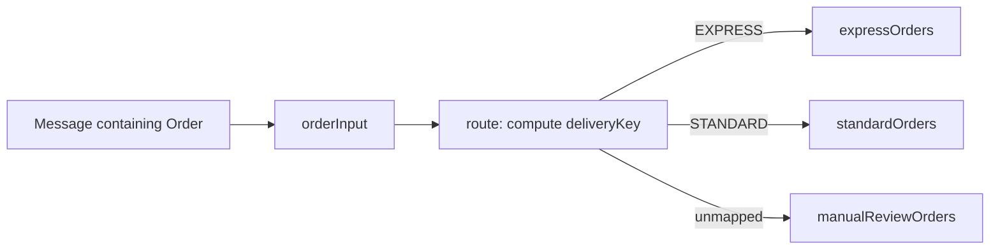

# route in Java DSL

## 1. Objectives and Scope

In the **Java DSL** chapter of the **SPRING_INTEGRATION_CORE** module, this lesson shows how to use `route()` to select a path for a message. This connects knowledge of `Message`, `MessageChannel`, and endpoints into an integration flow with multiple business branches.

After this lesson, you will be able to:

- Compute a routing key from the payload or headers.
- Map keys to channels using `channelMapping()`.
- Define processing branches using `subFlowMapping()`.
- Choose behavior when no destination is found.
- Distinguish routing, replying via a gateway, and combining results via an aggregator.
- Test that messages reach the right branch and preserve needed data.

The examples use **Java 17 or higher and the Spring Integration 6.5.x API**, with the `IntegrationFlow.from(...)` syntax. This is the lesson's API baseline; when applying to an application, use dependencies compatible with that application's Spring version.

## 2. What Decision Does a Router Make?

Suppose an order-intake system has three processing paths:

| Business value | Processing destination |
| --- | --- |
| `EXPRESS` | Express-delivery orders |
| `STANDARD` | Standard-delivery orders |
| Other or missing value | Orders requiring manual review |

The flow needs to read the delivery mode and forward the intact message to the appropriate destination:



There are two separate steps:

1. **Compute the business key:** such as `EXPRESS`.
2. **Find the corresponding destination:** such as the `expressOrders` channel.

The key does not have to be a channel name. Separating the two concepts keeps business names stable even when the flow structure changes.

`route()` supports lambdas, SpEL expressions, object methods, or an existing router. Specialized router types can also read headers, payload types, or recipient lists. [Message Routers documentation](https://docs.spring.io/spring-integration/reference/6.5/dsl/java-routers.html).

### Does a Router Change the Payload?

In this example, the lambda returns `"EXPRESS"` to pick the destination. The payload delivered to the destination is still the `Order` object; the key string does not become a new payload.

If you need to convert `Order` into another representation, use `transform()` before the router or inside a branch. For example, a transformer normalizes partner orders, a router picks the receiving warehouse, and a service activator executes the business action at that warehouse.

## 3. Reading route Syntax Part by Part

The snippet below is the router configuration inside a flow:

```java
.route(Order.class,
        OrderRoutingConfiguration::deliveryKey,
        router -> router
                .channelKeyFallback(false)
                .channelMapping("EXPRESS", "expressOrders")
                .channelMapping("STANDARD", "standardOrders")
                .defaultOutputChannel("manualReviewOrders"))
```

| Part | Meaning in the example |
| --- | --- |
| `Order.class` | Input type of the key-selection function |
| `deliveryKey` | Function taking an order and returning a key |
| `channelMapping("EXPRESS", "expressOrders")` | Maps a business value to a channel name |
| `channelKeyFallback(false)` | Does not treat an unmapped key as a channel name |
| `defaultOutputChannel(...)` | Destination when no channel is resolved |

You can write a shorter lambda with generics:

```java
.<Order, String>route(
        order -> OrderRoutingConfiguration.deliveryKey(order),
        router -> router
                .channelKeyFallback(false)
                .channelMapping("EXPRESS", "expressOrders")
                .defaultOutputChannel("manualReviewOrders"))
```

When you want to read the entire message, the overload accepting `Message.class` lets the lambda access both payload and headers. The typed overload can also perform type conversion when needed; it does not replace a business data validation step. [BaseIntegrationFlowDefinition API](https://docs.spring.io/spring-integration/docs/6.5.0/api/org/springframework/integration/dsl/BaseIntegrationFlowDefinition.html).

## 4. Complete Example: Routing Orders

### 4.1. Practice Prerequisites

The example uses:

- `org.springframework.integration:spring-integration-core`.
- `org.junit.jupiter:junit-jupiter` to run the tests later in the lesson.

If using Spring Boot, you can obtain the matching libraries through `spring-boot-starter-integration` and `spring-boot-starter-test`, letting your project's dependency management manage versions. No broker, database, or network service is required for this example.

### 4.2. Configuration

Save the following class in `OrderRoutingConfiguration.java` when practicing. In this lesson, `Order` is a record nested inside the configuration class so the example is self-contained.

```java
import java.util.Locale;

import org.springframework.context.annotation.Bean;
import org.springframework.context.annotation.Configuration;
import org.springframework.integration.channel.DirectChannel;
import org.springframework.integration.channel.QueueChannel;
import org.springframework.integration.config.EnableIntegration;
import org.springframework.integration.dsl.IntegrationFlow;

@Configuration
@EnableIntegration
public class OrderRoutingConfiguration {

    public record Order(String id, String deliveryMode) {
    }

    public static String deliveryKey(Order order) {
        String mode = order.deliveryMode();
        return mode == null
                ? "UNKNOWN"
                : mode.strip().toUpperCase(Locale.ROOT);
    }

    @Bean
    public DirectChannel orderInput() {
        return new DirectChannel();
    }

    @Bean
    public QueueChannel expressOrders() {
        return new QueueChannel(100);
    }

    @Bean
    public QueueChannel standardOrders() {
        return new QueueChannel(100);
    }

    @Bean
    public QueueChannel manualReviewOrders() {
        return new QueueChannel(100);
    }

    @Bean
    public IntegrationFlow orderRoutingFlow() {
        return IntegrationFlow.from("orderInput")
                .route(Order.class,
                        OrderRoutingConfiguration::deliveryKey,
                        router -> router
                                .id("deliveryModeRouter")
                                .channelKeyFallback(false)
                                .channelMapping("EXPRESS", "expressOrders")
                                .channelMapping("STANDARD", "standardOrders")
                                .defaultOutputChannel("manualReviewOrders")
                                .sendTimeout(1_000))
                .get();
    }
}
```

`deliveryKey()` only reads data and returns a key. It does not call a shipping service or update the order. As a result, the routing decision can be tested with small inputs and zero side effects.

The example intentionally routes missing delivery modes to the manual review branch. This rule belongs to the example's business logic; another application might reject missing data with a filter before routing.

### 4.3. Tracing a Message

With payload `new Order("O-101", " express ")`:

1. The sender calls `send()` on `orderInput`.
2. The router receives the message and invokes `deliveryKey()`.
3. The function trims whitespace and uppercases to `EXPRESS`.
4. The router finds the mapping to `expressOrders`.
5. The queue receives the message with the original `Order` payload.

Normalizing the key does not mutate the record's `deliveryMode` field. If the payload must hold the normalized value, construct a new `Order` in a transformer.

The outputs are `QueueChannel`s so messages can be pulled with `receive()` in tests. Queues store messages in memory by default. If you attach an automatic endpoint to a queue, that endpoint needs a poller; this lesson retrieves data directly so no poller is configured. The `DirectChannel` input invokes the router on the sender's thread. [MessageChannel implementations](https://docs.spring.io/spring-integration/reference/6.5/channel/implementations.html).

`sendTimeout(1_000)` bounds how long sending waits when the target queue is full; it is not a maximum duration for completing all order processing. In real operations, each queue needs a consumer.

## 5. Routing by Header

Sometimes the payload holds only the order content, while headers carry values determined at the system boundary, such as delivery mode or region.

Add the following configuration method to the class in section 4 to create another input:

```java
@Bean
public IntegrationFlow headerRoutingFlow() {
    return IntegrationFlow.from("headerOrderInput")
            .route(org.springframework.messaging.Message.class,
                    message -> {
                        String mode = message.getHeaders()
                                .get("deliveryMode", String.class);
                        return mode == null
                                ? "UNKNOWN"
                                : mode.strip().toUpperCase(Locale.ROOT);
                    },
                    router -> router
                            .channelKeyFallback(false)
                            .channelMapping("EXPRESS", "expressOrders")
                            .channelMapping("STANDARD", "standardOrders")
                            .defaultOutputChannel("manualReviewOrders")
                            .sendTimeout(1_000))
            .get();
}
```

You can build a message sent to `headerOrderInput` as follows:

```java
var message = org.springframework.messaging.support.MessageBuilder
        .withPayload(new OrderRoutingConfiguration.Order("O-201", "STANDARD"))
        .setHeader("deliveryMode", "EXPRESS")
        .setHeader("traceId", "trace-201")
        .build();
```

By this flow's rules, the order goes to `expressOrders`. The `STANDARD` value in the payload plays no part in the decision. If both sources coexist, define clearly which source is authoritative so downstream branches do not interpret the same order differently.

When the header has already been normalized upstream, you can use SpEL:

```java
.route("headers['deliveryMode']",
        router -> router
                .channelKeyFallback(false)
                .channelMapping("EXPRESS", "expressOrders")
                .channelMapping("STANDARD", "standardOrders")
                .defaultOutputChannel("manualReviewOrders"))
```

The expression above has no `strip()` or uppercase step. Therefore, `" express "` will not match the `EXPRESS` mapping. Routing by header value is a directly supported case in Spring Integration. [Router Implementations](https://docs.spring.io/spring-integration/reference/6.5/router/implementations.html).

## 6. When No Destination Is Found: Three Different Scenarios

### 6.1. Unmapped Key

In the main configuration, the key `SAME_DAY` is not declared. Because `channelKeyFallback(false)` is set, the router does not attempt to look up a bean named `SAME_DAY`. It uses `manualReviewOrders`.

This also applies if external data happens to contain an internal channel name. The application only accepts destinations in the declared mapping table.

### 6.2. Key Treated as a Channel Name

With `channelKeyFallback(true)`, an unmapped key can be used to look up a channel by name. This mechanism is useful when a design intentionally allows dynamic routing.

For instance, an internal system might set a `destination` header to a controlled channel name. In that case, the development team must govern the allowed target set and avoid creating a loop back into the router's own input. [AbstractMappingMessageRouter API](https://docs.spring.io/spring-integration/docs/6.5.0/api/org/springframework/integration/router/AbstractMappingMessageRouter.html).

In this practice lesson, explicit mappings fit better because `EXPRESS` and `STANDARD` are business names.

### 6.3. Mapping Exists, but Channel Name Is Wrong

Suppose you mistyped:

```java
.channelMapping("EXPRESS", "expressOderz")
```

The key has a mapping, yet the target bean does not exist. With `resolutionRequired(true)` (the default), a channel resolution error is raised. Having a default channel does not mean every configuration error automatically falls back to the manual branch.

If you explicitly set `resolutionRequired(false)`, unresolvable names are ignored; if no destination remains and a default channel exists, the message can go to the default channel. If there is no default channel, this option does not guarantee the message will be silently ignored without error. [Common Router Parameters](https://docs.spring.io/spring-integration/reference/6.5/router/common-parameters.html).

| Situation | Relevant configuration | Outcome to understand |
| --- | --- | --- |
| Unknown key, default exists | Channel key fallback off | Goes to default |
| Unknown key, no default | Channel key fallback off | No destination; error raised |
| Unknown key treated as channel name | Channel key fallback on | Attempts to resolve that name |
| Mapping points to nonexistent channel | `resolutionRequired(true)` | Reports resolution error |
| No destination resolved | `resolutionRequired(false)`, default exists | Goes to default |
| Channel found, but send or processing fails | Default channel configured | Does not automatically fall back to default to retry |

Since Spring Integration 6.0, setting a default channel also disables channel key fallback unless re-enabled explicitly. Configuring a default, `channelKeyFallback(true)`, and `resolutionRequired(true)` simultaneously is rejected at initialization. Writing `channelKeyFallback(false)` explicitly in this lesson makes the intent clear. [AbstractMappingMessageRouter API: default output](https://docs.spring.io/spring-integration/docs/6.5.0/api/org/springframework/integration/router/AbstractMappingMessageRouter.html#setDefaultOutputChannel(org.springframework.messaging.MessageChannel)).

## 7. Branching with subFlowMapping

`channelMapping()` fits when you want to hand responsibility off to a named channel. If each branch has only a few steps and needs to rejoin a common continuation, you can declare sub-flows.

The example below is also a method you can add to the configuration class in section 4:

```java
@Bean
public IntegrationFlow subflowRoutingFlow() {
    return IntegrationFlow.from("subflowOrderInput")
            .route(Order.class,
                    OrderRoutingConfiguration::deliveryKey,
                    router -> router
                            .channelKeyFallback(false)
                            .subFlowMapping("EXPRESS", branch -> branch
                                    .transform(Order.class,
                                            order -> "FAST:" + order.id()))
                            .subFlowMapping("STANDARD", branch -> branch
                                    .transform(Order.class,
                                            order -> "REGULAR:" + order.id()))
                            .defaultSubFlowMapping(branch -> branch
                                    .transform(Order.class,
                                            order -> "MANUAL:" + order.id())))
            .transform(String.class, result -> result + "|AUDITED")
            .channel(channels -> channels.queue("dispatchResults"))
            .get();
}
```

All branches return strings so the common step after the router processes them uniformly:

| Input payload | Payload read from `dispatchResults` |
| --- | --- |
| `Order("O-301", "EXPRESS")` | `FAST:O-301|AUDITED` |
| `Order("O-302", "STANDARD")` | `REGULAR:O-302|AUDITED` |
| `Order("O-303", "SAME_DAY")` | `MANUAL:O-303|AUDITED` |

`defaultSubFlowMapping()` provides the default branch right inside the DSL. In the example, both matched branches and the default branch include transformers producing output. [AbstractRouterSpec API](https://docs.spring.io/spring-integration/docs/6.5.0/api/org/springframework/integration/dsl/AbstractRouterSpec.html).

### 7.1. Which Branches Execute the Steps After route?

With the sub-flow lambdas above, each branch's result continues into `transform(String.class, ...)` after the router. The DSL supports joining sub-flows into the remainder of the flow. [Sub-flows support](https://docs.spring.io/spring-integration/reference/6.5/dsl/java-subflows.html).

With `channelMapping("EXPRESS", "expressOrders")` in the main example, the message is forwarded to the `expressOrders` queue; there is no automatic step pulling results from the queue and continuing to a transformer after the router.

Therefore, do not assume that calls written after `.route(...)` always run for every mapping. The actual wiring and whether a branch produces output determine that.

### 7.2. Is the Common Continuation Point an Aggregator?

In the example, each order chooses only one branch. An express order reaches the common step as soon as `FAST:...` is produced; it does not wait for a result from the `STANDARD` branch.

If business logic requires sending the same order to multiple services and waiting for all results, design a fan-out and an aggregator with correlation, release conditions, and timeouts. Placing a transformer after a router does not create that waiting mechanism.

## 8. Calling a Separate Flow with gateway

When the express branch grows into its own workflow, you can extract it into a separate flow with a clearly named input:

```java
@Bean
public IntegrationFlow expressProcessingFlow() {
    return IntegrationFlow.from("expressProcessingInput")
            .transform(Order.class, order -> "FAST:" + order.id())
            .get();
}

@Bean
public IntegrationFlow externalBranchRoutingFlow() {
    return IntegrationFlow.from("externalBranchOrderInput")
            .route(Order.class,
                    OrderRoutingConfiguration::deliveryKey,
                    router -> router
                            .channelKeyFallback(false)
                            .subFlowMapping("EXPRESS", branch -> branch
                                    .gateway("expressProcessingInput"))
                            .defaultSubFlowMapping(branch -> branch
                                    .transform(Order.class,
                                            order -> "MANUAL:" + order.id())))
            .transform(String.class, result -> result + "|AUDITED")
            .channel(channels -> channels.queue("externalBranchResults"))
            .get();
}
```

`gateway("expressProcessingInput")` creates a request-reply interaction with the separate flow: it sends `Order`, receives the result string, and continues to the common step.

If you reference a separate `IntegrationFlow` directly inside `subFlowMapping()` and need a reply to continue the parent flow, wrap the call with `gateway()`. For ordinary lambda sub-flows, the DSL handles joining the branch; there is no need to add a gateway just to write an inline transformer. [RouterSpec API: subFlowMapping](https://docs.spring.io/spring-integration/docs/6.5.0/api/org/springframework/integration/dsl/RouterSpec.html#subFlowMapping(K,org.springframework.integration.dsl.IntegrationFlow)).

At the application boundary, `@MessagingGateway` can expose a Java interface so callers do not interact directly with `MessageChannel`. Whether using an interface gateway or the DSL `gateway` operator, the reply contract must still match: a branch that only pushes an order onto a queue without a consumer producing a reply will not synthesize a result for the waiting call. [Messaging Gateways](https://docs.spring.io/spring-integration/reference/6.5/gateway.html).

## 9. Letting the Default Case Continue the Parent Flow

Sometimes you only split off one special group to a dedicated channel, while remaining messages continue immediately after the router. Use `defaultOutputToParentFlow()`:

```java
@Bean
public IntegrationFlow defaultToParentRoutingFlow() {
    return IntegrationFlow.from("defaultToParentOrderInput")
            .route(Order.class,
                    OrderRoutingConfiguration::deliveryKey,
                    router -> router
                            .channelKeyFallback(false)
                            .channelMapping("EXPRESS", "expressOrders")
                            .defaultOutputToParentFlow())
            .transform(Order.class, order -> "REVIEW:" + order.id())
            .channel(channels -> channels.queue("defaultRouteResults"))
            .get();
}
```

With this example:

- `EXPRESS` goes to `expressOrders`.
- `STANDARD` and other keys proceed past the router, producing `REVIEW:...`.
- Orders routed to `expressOrders` do not also go through the transformer producing `REVIEW:...`.

The method name refers to **the default output** returning to the parent flow. It does not add a return path for every channel mapping. [RouterSpec API: defaultOutputToParentFlow](https://docs.spring.io/spring-integration/docs/6.5.0/api/org/springframework/integration/dsl/RouterSpec.html#defaultOutputToParentFlow()).

## 10. Testing Routing Paths and Message Integrity

With the main configuration in section 4, you can test using a small Spring context and the output queues. Save the class below in `OrderRoutingTest.java`, in the same package as the configuration class if you add package declarations.

```java
import org.junit.jupiter.api.AfterEach;
import org.junit.jupiter.api.BeforeEach;
import org.junit.jupiter.api.Test;

import org.springframework.context.annotation.AnnotationConfigApplicationContext;
import org.springframework.integration.channel.QueueChannel;
import org.springframework.messaging.Message;
import org.springframework.messaging.MessageChannel;
import org.springframework.messaging.support.MessageBuilder;

import static org.junit.jupiter.api.Assertions.assertEquals;
import static org.junit.jupiter.api.Assertions.assertNotNull;
import static org.junit.jupiter.api.Assertions.assertNull;
import static org.junit.jupiter.api.Assertions.assertSame;
import static org.junit.jupiter.api.Assertions.assertTrue;

class OrderRoutingTest {

    private AnnotationConfigApplicationContext context;
    private MessageChannel input;

    @BeforeEach
    void openContext() {
        context = new AnnotationConfigApplicationContext(
                OrderRoutingConfiguration.class);
        input = context.getBean("orderInput", MessageChannel.class);
    }

    @AfterEach
    void closeContext() {
        if (context != null) {
            context.close();
        }
    }

    @Test
    void expressOrderKeepsPayloadAndTraceHeader() {
        var order = new OrderRoutingConfiguration.Order("O-101", " express ");
        Message<?> request = MessageBuilder.withPayload(order)
                .setHeader("traceId", "trace-101")
                .build();

        assertTrue(input.send(request, 1_000));

        Message<?> received = queue("expressOrders").receive(1_000);
        assertNotNull(received);
        assertSame(order, received.getPayload());
        assertEquals("trace-101", received.getHeaders().get("traceId"));

        assertAllQueuesEmpty();
    }

    @Test
    void standardOrderGoesOnlyToStandardQueue() {
        var order = new OrderRoutingConfiguration.Order("O-102", "STANDARD");

        assertTrue(input.send(
                MessageBuilder.withPayload(order).build(), 1_000));

        Message<?> received = queue("standardOrders").receive(1_000);
        assertNotNull(received);
        assertEquals(order, received.getPayload());

        assertAllQueuesEmpty();
    }

    @Test
    void unknownModeUsesManualReviewInsteadOfAChannelName() {
        // A value matching the input channel name is still business data.
        var order = new OrderRoutingConfiguration.Order("O-103", "orderInput");

        assertTrue(input.send(
                MessageBuilder.withPayload(order).build(), 1_000));

        Message<?> received = queue("manualReviewOrders").receive(1_000);
        assertNotNull(received);
        assertEquals(order, received.getPayload());

        assertAllQueuesEmpty();
    }

    @Test
    void missingModeUsesManualReview() {
        var order = new OrderRoutingConfiguration.Order("O-104", null);

        assertTrue(input.send(
                MessageBuilder.withPayload(order).build(), 1_000));

        Message<?> received = queue("manualReviewOrders").receive(1_000);
        assertNotNull(received);
        assertEquals(order, received.getPayload());

        assertAllQueuesEmpty();
    }

    private QueueChannel queue(String name) {
        return context.getBean(name, QueueChannel.class);
    }

    private void assertAllQueuesEmpty() {
        assertNull(queue("expressOrders").receive(0));
        assertNull(queue("standardOrders").receive(0));
        assertNull(queue("manualReviewOrders").receive(0));
    }
}
```

Each test creates its own context to prevent messages from earlier tests from lingering in queues. After taking the expected message, verifying that all three queues are empty catches extra or misrouted sends.

`receive(0)` works for checking that no duplicates exist in this configuration because everything from input to enqueuing runs synchronously. If replaced with an executor or asynchronous processing, synchronize on a completion condition before concluding no message exists on another branch.

Additional cases worth testing as the flow grows:

| Change | Behavior to prove |
| --- | --- |
| Adding `SAME_DAY` mode | Goes to the new branch and no longer goes to manual review |
| Switching to header-based routing | Header takes precedence per contract |
| Adding an inline branch | Branch result passes through the common step |
| Extracting a branch into a separate flow | Gateway receives a reply of the right type |
| Renaming a channel | Context startup and actual sends catch misconfigurations |
| Adding a queue or executor in between | Completion-waiting in tests remains accurate |

## 11. Routing Is Not Fallback Error Handling

Separate two decisions:

- **Business decision:** delivery mode is not supported yet, route to manual review.
- **Processing failure:** express branch was selected, yet the shipping service failed.

A default output addresses the case where no destination matches. It does not automatically invoke another branch when a downstream endpoint has already received the message and thrown an exception.

When executing synchronously via `DirectChannel`, errors can propagate back to the sender. Once switched to asynchronous execution, you cannot rely on a `try/catch` around the initial send to catch errors occurring later; an appropriate error flow mechanism is needed. Spring Integration uses `ErrorMessage` for this mechanism. [Error Handling](https://docs.spring.io/spring-integration/reference/6.5/error-handling.html).

In an order system, retrying a call to an express shipping service must consider whether the previous call already created a shipment. An idempotency key based on order ID or request ID helps avoid creating duplicate shipments on retry. That is the responsibility of the business step and error strategy, not of `deliveryKey()`.

## 12. Choosing the Right Component for the Integration Requirement

| Requirement | Appropriate component |
| --- | --- |
| Normalize order data from an external system | Transformer |
| Drop messages failing a condition | Filter |
| Select a branch by delivery mode | Router via `route()` |
| Send to multiple recipient groups under independent conditions | `routeToRecipients()` |
| Broadcast the same event to subscribers | Publish-subscribe channel |
| Invoke a flow and receive a result | Gateway |
| Wait for and combine correlated results | Aggregator |

A general router can return multiple destinations; the word `route` alone does not guarantee a single recipient. In this lesson's example, the function returns a single key and each key points to one branch, so asserting "only one queue receives" is valid. When multiple recipients are needed under independent conditions, `routeToRecipients()` expresses the configuration more directly. [Message Routers and Recipient List](https://docs.spring.io/spring-integration/reference/6.5/dsl/java-routers.html).

## 13. Common Mistakes When Writing Flows

| Symptom | Cause to check | Fix |
| --- | --- | --- |
| Express order goes to manual review | Case mismatch, whitespace, or reading wrong source | Normalize key; clarify whether payload or header is authoritative |
| Channel not found | Typo in bean name or fallback treating key as channel name | Check mappings and fallback setting |
| Step after router never runs | Mapping routes to a separate channel, or branch produces no output | Use a reply-producing sub-flow, gateway, or default to parent flow as needed |
| Gateway waits without getting a reply | Branch ends one-way or lacks a reply-producing consumer | Complete the request-reply contract and set appropriate timeouts |
| Aggregator waits forever | Assumed every router branch produces a result for the same order | Check how many branches actually run and the release condition |
| Endpoint names hard to spot in logs | Meaningful identifiers not assigned | Set `id` on key routers and preserve tracing headers |
| Flow becomes hard to edit when adding delivery modes | Deeply nested branches mixing classification with service calls | Keep key calculation concise and extract large workflows into separate flows |

For an order flow, monitor order counts per branch and the rate entering manual review. If that rate spikes after a partner deploys a new version, unsupported key values help reveal data contract changes.

When adding a new delivery mode, a complete change includes the key-generation rule, mapping, processing branch, and corresponding path tests. Organizing flows this way lets Java DSL express business decisions and handoffs between Spring Integration components clearly.
