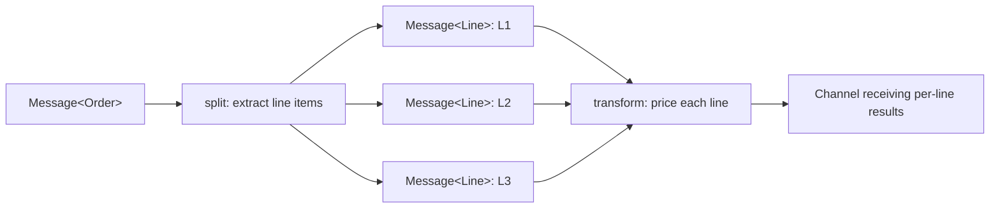

# split in Java DSL

In the `SPRING_INTEGRATION_CORE` module, **Java DSL** chapter, `split` converts a message containing multiple items into a stream of messages to process each item individually. This lesson connects `Message`, `MessageChannel`, and endpoint concepts to a practical workflow: receiving an order, splitting its line items, pricing each line, and, when needed, combining the results back into one reply.

After this lesson, you will be able to choose how to declare a splitter, read sequence headers on child messages, combine a splitter with a transformer and aggregator, and explain scenarios involving missing results, out-of-order completion, or mid-stream failures.

## 1. One Message In, Multiple Messages Out

Suppose the system receives an order with three line items:

```text
Order ORD-100
  L1: BOOK,  quantity = 2
  L2: PEN,   quantity = 5
  L3: PAPER, quantity = 1
```

If the whole order is processed inside a single handler, the handler must loop over the lines and coordinate every action itself. With a splitter, each line becomes an independent unit passing through downstream endpoints:



The arrows in the diagram represent multiple messages, not necessarily multiple execution threads. Whether they run concurrently depends on the channels and executors used.

Comparing common operations in the order example:

| Operation | Unit processed | Desired outcome |
| --- | --- | --- |
| `transform` | One message | Convert `Order` to `OrderSummary` or another payload |
| `split` | One message containing multiple parts | Emit each `Line` as its own message |
| `route` | Current message | Choose destination, such as routing line items by warehouse |
| `filter` | Current message | Pass or drop based on a condition |
| `aggregate` | A group of messages | Produce a combined result from processed lines |

A transformer returning `List<Line>` still produces **one** message carrying the whole list. To let items inside the list continue individually through the flow, a splitter step is required.

Not every case needs splitting. If a validation check requires the entire order or the target service handles batches more efficiently, keeping the payload intact may be preferable. Split when each item needs its own processing cycle, such as warehouse selection, service invocation, result recording, or retries.

## 2. Choosing Java DSL Syntax

The examples use Java 17 and the Spring Integration **6.2.x** API, with `IntegrationFlow.from(...)`. Library versions should follow your project's dependency management. For a Spring Boot application already using compatible dependency management, the main dependency can be:

```xml
<dependency>
    <groupId>org.springframework.boot</groupId>
    <artifactId>spring-boot-starter-integration</artifactId>
</dependency>
```

### 2.1. Payload Is Already a List: Use `split()`

```java
@Bean
IntegrationFlow itemFlow() {
    return IntegrationFlow.from("items.input")
            .split()
            .channel("items.output")
            .get();
}
```

With payload `List.of("BOOK", "PEN", "PAPER")`, the output produces three messages carrying those three strings. `items.output` in the example must be declared or connected to an appropriate consumer.

Zero-argument `split()` creates a `DefaultMessageSplitter`. The splitter supports sources such as collections, arrays, `Iterable`, `Iterator`, `Stream`, and reactive `Publisher`; how messages are emitted also depends on the source type and downstream channel. See [Splitters in Java DSL](https://docs.spring.io/spring-integration/reference/6.2/dsl/java-splitters.html).

### 2.2. Payload Is a Domain Object: Specify the Extraction Function

If the payload is `Order`, the splitter needs to know which list to extract:

```java
.split(Order.class, Order::lines)
```

`Order.class` declares the payload type accepted by the function. `Order::lines` returns the list for the splitter to emit element by element. This function should focus on identifying the parts; pricing or warehouse calls belong in downstream endpoints.

### 2.3. Configuration Needed: Use `splitWith(...)`

```java
.splitWith(spec -> spec
        .expectedType(Order.class)
        .function((Order order) -> order.lines())
        .applySequence(true)
        .discardChannel("orders.empty"))
```

`expectedType(...)` specifies the input type for the function; `function(...)` declares how to obtain the items. The other two options handle sequence tracking and empty split results.

Starting with Spring Integration 6.2, the `.split(spec -> ...)` configuration overload was deprecated in favor of `splitWith(...)`. This does not mean every overload named `split` is deprecated; `split()` and `split(Order.class, Order::lines)` remain distinct declarative forms. See [BaseIntegrationFlowDefinition 6.2.11 API](https://docs.spring.io/spring-integration/docs/6.2.11/api/org/springframework/integration/dsl/BaseIntegrationFlowDefinition.html).

### 2.4. Splitting Strings by Delimiter

```java
.splitWith(spec -> spec.delimiters(","))
.transform(String.class, String::trim)
```

For example, payload `"BOOK,PEN,PAPER"` produces individual string items. `delimiters` are delimiter characters, not a regular expression and not a replacement for a CSV parser with quoting rules. When no delimiter is configured, do not expect `split()` to parse CSV strings automatically. See [DefaultMessageSplitter.setDelimiters](https://docs.spring.io/spring-integration/docs/6.2.11/api/org/springframework/integration/splitter/DefaultMessageSplitter.html#setDelimiters(java.lang.String)).

## 3. Complete Example: Splitting an Order and Pricing Each Line

Place the following configuration in `example.OrderSplitConfiguration`. The configuration declares its channels itself and can be loaded via `AnnotationConfigApplicationContext`; no web server or external messaging system is needed.

```java
package example;

import java.math.BigDecimal;
import java.util.List;
import java.util.Objects;

import org.springframework.context.annotation.Bean;
import org.springframework.context.annotation.Configuration;
import org.springframework.integration.channel.DirectChannel;
import org.springframework.integration.channel.QueueChannel;
import org.springframework.integration.config.EnableIntegration;
import org.springframework.integration.dsl.IntegrationFlow;

@Configuration
@EnableIntegration
public class OrderSplitConfiguration {

    public record Line(
            String lineId,
            String sku,
            int quantity,
            BigDecimal unitPrice) {
    }

    public record Order(String orderId, List<Line> lines) {
        public Order {
            Objects.requireNonNull(orderId, "orderId");
            lines = List.copyOf(lines);
        }
    }

    public record LineTotal(
            String lineId,
            String sku,
            BigDecimal amount) {
    }

    @Bean("orders.input")
    public DirectChannel ordersInput() {
        return new DirectChannel();
    }

    @Bean("orders.lines")
    public QueueChannel lineResults() {
        return new QueueChannel(100);
    }

    @Bean("orders.empty")
    public QueueChannel emptyOrders() {
        return new QueueChannel(10);
    }

    @Bean
    public IntegrationFlow orderLineFlow() {
        return IntegrationFlow.from("orders.input")
                .enrichHeaders(headers -> headers.headerFunction(
                        "orderId",
                        message -> ((Order) message.getPayload()).orderId()))
                .splitWith(spec -> spec
                        .expectedType(Order.class)
                        .function((Order order) -> order.lines())
                        .applySequence(true)
                        .discardChannel("orders.empty"))
                .transform(Line.class, OrderSplitConfiguration::price)
                .channel("orders.lines")
                .get();
    }

    public static LineTotal price(Line line) {
        BigDecimal amount = line.unitPrice()
                .multiply(BigDecimal.valueOf(line.quantity()));
        return new LineTotal(line.lineId(), line.sku(), amount);
    }
}
```

The domain types are records; `Order` copies the list to prevent the source list from being mutated during processing. `List.copyOf(...)` also rejects `null` lists or `null` elements. In this example, prices and quantities are assumed valid; business validation rules should be enforced at order intake.

Flow progression:

1. `orders.input` receives `Message<Order>`.
2. The header enricher stores the order ID in the `orderId` header, since the post-split payload will be only a single line item.
3. The splitter reads `order.lines()` and emits each `Message<Line>`.
4. The transformer receives **one line** and returns **one** `LineTotal`.
5. `orders.lines` holds results for a consumer or test code to retrieve with `receive(...)`.
6. If the order has no lines, the splitter sends the request message to `orders.empty`.

With two lines `BOOK: 2 × 10.00` and `PEN: 3 × 2.50`, the output consists of two `LineTotal` payloads with amounts `20.00` and `7.50`. These are two separate messages; this flow does not yet produce a grand total reply for the order.

The `QueueChannel` at the end of the flow is used to observe results. In a real application, a consumer is needed to drain messages. Bounded queues help reveal slow consumers, though when full they can block senders; appropriate capacity and send timeouts must be chosen.

## 4. Understanding Headers After Splitting

With `applySequence(true)`, the splitter normally generates metadata for the same split operation:

| Header | Example with three lines | Role |
| --- | --- | --- |
| `correlationId` | `P` for all three lines | Links parts belonging to the same split |
| `sequenceNumber` | `1`, `2`, `3` | Item position in the split source |
| `sequenceSize` | `3` | Element count when size can be determined |
| `orderId` | `ORD-100` | Business ID added by the application |

The corresponding constants live in `IntegrationMessageHeaderAccessor`. You can read them in a type-safe manner:

```java
var accessor = new IntegrationMessageHeaderAccessor(message);
Object correlationId = accessor.getCorrelationId();
int sequenceNumber = accessor.getSequenceNumber();
int sequenceSize = accessor.getSequenceSize();
```

Sequence headers describe the split sequence, while `orderId` describes the business entity. For nested splits, `sequenceDetails` stores correlation info for outer layers. See [Message model and integration headers](https://docs.spring.io/spring-integration/reference/6.3/message.html).

Normally, the `correlationId` of a new sequence comes from the ID of the message **entering the splitter**. The example above places a header enricher before the splitter; that step may create a new message. Therefore, do not write tests assuming correlation must equal the ID of the message originally sent by the client.

Two sends with the same `orderId` also do not automatically belong to the same split group. For example, a user resubmits order `ORD-100` after adjusting prices: the business key is identical, yet these are two distinct processing runs. If you explicitly change the correlation strategy to `orderId`, define a way to distinguish processing runs so old results are not mixed with new ones.

When returning ordinary payload objects, the splitter creates messages for them and propagates appropriate headers. When line-specific headers are needed, you can return a list of `Message<?>` instead of a list of payloads. This is useful for per-line metadata such as a selected warehouse code; you do not need to manually recreate the framework's sequence headers.

`applySequence(false)` disables adding sequence metadata by the splitter. Use it only when downstream contracts do not need them or another grouping mechanism is in place. Turning this option off does not strip pre-existing sequence headers, nor does it yield a fixed speedup. See [SplitterSpec](https://docs.spring.io/spring-integration/docs/6.2.11/api/org/springframework/integration/dsl/SplitterSpec.html).

## 5. Combining with Aggregator to Return a Combined Result

A flow ending with per-line results suits independent item processing. If the client needs the complete order result, add an aggregator after the per-line processing step.

By default, an aggregator groups by `correlationId` and relies on sequence size to decide when all items have arrived. That requires each line in the sequence to produce a result and retain the necessary metadata. See [Aggregator programming model](https://docs.spring.io/spring-integration/docs/6.1.3/reference/html/aggregator.html).

To try the aggregation flow separately, add the following imports to the configuration in section 3:

```java
import java.util.Comparator;

import org.springframework.integration.IntegrationMessageHeaderAccessor;
import org.springframework.messaging.Message;
```

Then add the two beans below. They use different channel names from the flow receiving per-line results:

```java
@Bean("orders.aggregated")
public QueueChannel aggregatedOrders() {
    return new QueueChannel(100);
}

@Bean
public IntegrationFlow orderAggregationFlow() {
    return IntegrationFlow.from("orders.aggregate.input")
            .enrichHeaders(headers -> headers.headerFunction(
                    "orderId",
                    message -> ((Order) message.getPayload()).orderId()))
            .split(Order.class, Order::lines)
            .transform(Line.class, OrderSplitConfiguration::price)
            .aggregate(spec -> spec.outputProcessor(group ->
                    group.getMessages().stream()
                            .sorted(Comparator.comparingInt(
                                    (Message<?> message) ->
                                            new IntegrationMessageHeaderAccessor(message)
                                                    .getSequenceNumber()))
                            .map(Message::getPayload)
                            .map(LineTotal.class::cast)
                            .toList()))
            .channel("orders.aggregated")
            .get();
}
```

The DSL creates an input channel named `orders.aggregate.input` as needed. Sending a two-line order to this channel produces one result message whose payload is a list of two `LineTotal`s, received at `orders.aggregated`.

In the output processor, we explicitly sort by `sequenceNumber` to express the contract of returning results in original line order. That way, if parallel processing is added later, the ordering rule remains explicitly encoded in the aggregation logic.

Order total calculation can be done in a transformer after the aggregator. The total step runs only once a set of results considered complete by the system has arrived.

With a request/reply messaging gateway, clearly define the method to return one aggregated result, such as `List<LineTotal>`. To reply via the gateway's `replyChannel`, omit `.channel("orders.aggregated")` at the end of the example so the result follows the reply path. Do not expect a gateway method returning a single value to automatically collect multiple replies emitted by a splitter. Empty orders also need their own reply policy to avoid merely waiting out a timeout.

## 6. When Can an Aggregator Wait Forever?

### 6.1. A Filter Drops Items After the Splitter

Consider the chain:

```text
3 lines -> split -> filter drops 1 line -> 2 results -> aggregate
```

If metadata still declares `sequenceSize = 3`, the group receives only two results. Business-wise the necessary lines may be done, yet the group-completion condition is never satisfied.

There are three design directions depending on what dropping means:

| Business meaning | How to organize |
| --- | --- |
| Invalid lines are not part of processing | Filter the list before splitting so the sequence reflects the actual working set |
| Client must know every line was evaluated | Each line always produces a result such as `SUCCESS`, `SKIPPED`, or `FAILED` |
| Partial results allowed under a defined policy | Use a matching release strategy and timeout policy, with partial-result metadata |

An example business outcome type could be:

```java
record LineOutcome(String lineId, String status, String detail) {
}
```

For a three-line order, an aggregator receiving three `LineOutcome` instances cleanly represents both the two succeeded lines and the rejected line. Logging the dropped line does not automatically supply the missing item to the group.

### 6.2. Split Source with Unknown Size Ahead of Time

A `Collection` normally knows its element count, whereas an ordinary `Iterator` does not provide this number upfront. When indeterminate, `sequenceSize` may be `0`; that value signifies unknown size. Do not read it as a completed group with zero items. The framework provides the `obtainSizeIfPossible(...)` hook for cases where size can be determined. See [AbstractMessageSplitter API](https://docs.spring.io/spring-integration/docs/6.2.11/api/org/springframework/integration/splitter/AbstractMessageSplitter.html).

Example change to weigh carefully:

```java
.split(Order.class, order -> order.lines().iterator())
```

In this case, data is already in a `List`. Switching to an iterator does not free the original list, yet it can lose the size metadata the splitter could obtain directly from the collection.

For truly large sources, streaming sequentially may be necessary instead of loading everything into memory. In that case, define how completion is recognized: total element count from the source, an end-of-stream marker message, or a domain-meaningful release strategy. Timeouts handle waiting too long; they do not prove all items arrived.

If the data source uses a stream tied to a file or connection, define resource lifecycle and closing carefully. Never return a stream that has already been closed inside a `try-with-resources` block before the splitter iterates over it.

## 7. Empty Lists and `null` Results

These two cases must be distinguished:

| Split function returns | Behavior to account for |
| --- | --- |
| Non-empty list | Emits a message for each item |
| Empty container | No child messages; can route the request to `discardChannel` |
| `null` | By default, ends that processing branch; not treated as an empty result routed to discard |

In the flow in section 3, `Order.lines` cannot be `null` because it was copied via `List.copyOf`. If the list is empty, `orders.empty` receives the incoming message that entered the splitter, with payload `Order`, for separate handling. This is neither a `Message<Line>` nor an exception message.

The difference between an empty container and `null` is described in [Stream and Flux section of Splitter](https://docs.spring.io/spring-integration/reference/6.2/splitter.html#_stream_and_flux).

For a pricing problem, you can choose one of these rules:

- Orders with no lines are rejected before splitting.
- Orders with no lines return a zero-total result through a separate branch.
- Empty orders are saved as draft status and bypass pricing.

The rule must be explicit in the flow's contract. You cannot simply add an aggregator and expect it to synthesize a reply for a group that never received any child messages.

## 8. Splitting Items and Running in Parallel Are Two Decisions

With direct channels, processing normally continues on the caller's thread. The splitter emits the first item, downstream processes it, and then execution moves to the next item. `ExecutorChannel` introduces a different execution boundary; `QueueChannel` provides buffering and requires a receiving consumer. See [MessageChannel implementations](https://docs.spring.io/spring-integration/reference/6.2/channel/implementations.html).

If each line must call an independent warehouse service and can execute concurrently, declare a Spring-managed executor:

```java
@Bean
public ThreadPoolTaskExecutor lineExecutor() {
    var executor = new ThreadPoolTaskExecutor();
    executor.setCorePoolSize(4);
    executor.setMaxPoolSize(4);
    executor.setQueueCapacity(100);
    executor.setThreadNamePrefix("order-line-");
    return executor;
}
```

The required import is `org.springframework.scheduling.concurrent.ThreadPoolTaskExecutor`. Then inject this bean as a parameter of the flow declaration method and place the executor channel **after the splitter**:

```java
// lineExecutor is the ThreadPoolTaskExecutor parameter of the @Bean method.
.split(Order.class, Order::lines)
.channel(channels -> channels.executor(lineExecutor))
.transform(Line.class, OrderSplitConfiguration::price)
```

Placing an executor channel before the splitter mainly moves processing of the entire order to another thread; it does not create per-line parallel boundaries downstream.

When adding concurrency, check these problem-specific details:

- Line `L3` may finish before `L1`. If original order must be preserved, sort results by original sequence position.
- Handlers must be thread-safe when invoked concurrently. Avoid a shared mutable total variable across orders.
- Concurrency level must fit the warehouse service's limits and connection pool size.
- Bounded task queues can fill up; decide how to handle task rejection and order intake rate.
- Transactions on the sending thread do not automatically span work running on other threads.

Adding an executor to a flow does not automatically build end-to-end backpressure for the entire system. Account for intake sources, queues, worker concurrency, and overload policies together.

## 9. Handling Errors at the Per-Item Level

Suppose calling the warehouse succeeds for `L1` and fails for `L2`. There are two separate business questions: should `L1` be compensated, and should `L3` continue?

In a synchronous flow over `DirectChannel`, an exception can propagate back to the sender and halt the emission loop for remaining items. In framework-managed asynchronous execution, errors are typically turned into an `ErrorMessage`; destination resolution checks the `errorChannel` header and default configuration. Simply adding this header to a synchronous flow does not automatically convert every exception into asynchronous handling. See [Error Handling](https://docs.spring.io/spring-integration/docs/6.1.x/reference/html/error-handling.html).

For orders, the next design steps could be:

1. Retry the warehouse call at the endpoint processing **a single line**.
2. After exhausting attempts, produce a failed `LineOutcome` if the contract requires always returning results for all lines.
3. If business rules require the entire order to succeed, orchestrate compensation for already-executed actions per the target service's contract.

Retrying the whole `Order` message upstream of the splitter can reprocess lines that already succeeded. For example, the first attempt already deducted inventory for `L1`, yet the entire order is resent because `L2` failed. Therefore, warehouse operations should use an appropriate deduplication key such as `orderId + lineId + operationId`, where `operationId` stays stable across retries of the same operation.

Do not use `sequenceNumber` alone as a deduplication key: many orders have line number 1. Also do not blindly use the splitter-generated `correlationId` for business deduplication, because a fresh send creates a new sequence.

Logging an error to a monitoring channel does not automatically create a result for the aggregator. If returning complete results is chosen, the recovery branch must produce a business output and retain the corresponding group headers.

## 10. Testing the Splitting Contract

The tests below illustrate verifying the actual output of the splitter and transformer. They use the original configuration from section 3 and JUnit Jupiter, and can run in a project configured with the corresponding test dependencies. Place the test class in package `example`.

```java
package example;

import java.math.BigDecimal;
import java.util.List;

import example.OrderSplitConfiguration.Line;
import example.OrderSplitConfiguration.LineTotal;
import example.OrderSplitConfiguration.Order;

import org.junit.jupiter.api.Test;
import org.springframework.context.annotation.AnnotationConfigApplicationContext;
import org.springframework.integration.IntegrationMessageHeaderAccessor;
import org.springframework.messaging.Message;
import org.springframework.messaging.MessageChannel;
import org.springframework.messaging.PollableChannel;
import org.springframework.messaging.support.MessageBuilder;

import static org.junit.jupiter.api.Assertions.*;

class OrderSplitFlowTest {

    @Test
    void emitsOneResultPerLineAndKeepsSequenceHeaders() {
        try (var context = new AnnotationConfigApplicationContext(
                OrderSplitConfiguration.class)) {
            var input = context.getBean("orders.input", MessageChannel.class);
            var output = context.getBean("orders.lines", PollableChannel.class);

            var order = new Order("ORD-100", List.of(
                    new Line("L1", "BOOK", 2, new BigDecimal("10.00")),
                    new Line("L2", "PEN", 3, new BigDecimal("2.50"))));

            assertTrue(input.send(MessageBuilder.withPayload(order).build()));

            Message<?> first = output.receive(1_000);
            Message<?> second = output.receive(1_000);
            assertNotNull(first);
            assertNotNull(second);
            assertNull(output.receive(0));

            assertEquals(new LineTotal("L1", "BOOK", new BigDecimal("20.00")),
                    first.getPayload());
            assertEquals(new LineTotal("L2", "PEN", new BigDecimal("7.50")),
                    second.getPayload());

            var firstHeaders = new IntegrationMessageHeaderAccessor(first);
            var secondHeaders = new IntegrationMessageHeaderAccessor(second);
            assertNotNull(firstHeaders.getCorrelationId());
            assertEquals(firstHeaders.getCorrelationId(),
                    secondHeaders.getCorrelationId());
            assertEquals(1, firstHeaders.getSequenceNumber());
            assertEquals(2, secondHeaders.getSequenceNumber());
            assertEquals(2, firstHeaders.getSequenceSize());
            assertEquals(2, secondHeaders.getSequenceSize());
            assertEquals("ORD-100", first.getHeaders().get("orderId"));
            assertEquals("ORD-100", second.getHeaders().get("orderId"));
        }
    }

    @Test
    void sendsAnEmptyOrderToTheDiscardChannel() {
        try (var context = new AnnotationConfigApplicationContext(
                OrderSplitConfiguration.class)) {
            var input = context.getBean("orders.input", MessageChannel.class);
            var output = context.getBean("orders.lines", PollableChannel.class);
            var empty = context.getBean("orders.empty", PollableChannel.class);
            var order = new Order("ORD-EMPTY", List.of());

            assertTrue(input.send(MessageBuilder.withPayload(order).build()));

            assertNull(output.receive(0));
            Message<?> discarded = empty.receive(1_000);
            assertNotNull(discarded);
            assertEquals(order, discarded.getPayload());
            assertEquals("ORD-EMPTY", discarded.getHeaders().get("orderId"));
            assertNull(empty.receive(0));
        }
    }
}
```

The first test verifies message count, amounts, and metadata after passing through the transformer. The second test verifies that an empty order takes the discard branch, with the payload remaining `Order`.

When extending to an aggregator or executor, add scenarios meaningful to the new contract:

| Scenario | Result to verify |
| --- | --- |
| Two sends with the same order ID | Two runs are not mixed when using default correlation |
| Lines complete out of order | Combined result still follows committed order |
| One invalid line | Rejection output or clear group-termination policy applies |
| One line fails after retries | Group does not hang outside policy; already-succeeded side effects do not repeat |
| Source with unknown size | Completion condition actually works, rather than relying only on default size |

With asynchronous flows, use bounded waits to receive results. Avoid asserting that the first message to arrive must be the first item in the order when tasks are allowed to finish out of order.

## 11. Observing and Diagnosing a Flow with a Splitter

In the order example, a useful diagnostic record should include `orderId`, `lineId`, `correlationId`, `sequenceNumber`, `sequenceSize`, endpoint name, and processing outcome. It is unnecessary to log entire payloads just to pinpoint where a line is stuck.

| Symptom | What to check first |
| --- | --- |
| Downstream still receives the entire list | Using a transformer instead of a splitter, or extracting the wrong property? |
| No output seen for empty orders | Have you defined a discard branch or an empty-result branch? |
| Aggregator returns no result | Missing line, lost headers, unknown size, or altered correlation? |
| Results change order | Executor, poller, or external service completing out of order? |
| A single line processed multiple times | Is retry or resending applied at line level or whole-order level? |
| Send flow slows down or blocks | Is the consumer draining the queue, and are queues/executors full? |
| Memory grows when splitting large batches | Holding source lists, result queues, or incomplete aggregator groups? |

When an order has hundreds of thousands of lines, cost is not limited to the split function. Each line creates another message, task, and tracking metadata; an aggregator may also retain every result until the group completes. Consider chunking into smaller batches first, then processing each batch under its own contract. When splitting into batches, that layer's `sequenceSize` is the number of batches, not the total lines across all batches.

An operable flow must answer four concrete questions: which parts this order produces, how each part terminates, what condition signals the entire order is complete, and which operations are safe to repeat on resend. Those answers determine splitter placement, channel types, error outputs, and how results are aggregated.
