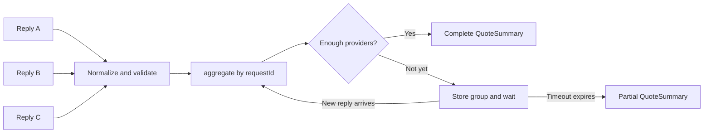

# aggregate in Java DSL

In the `SPRING_INTEGRATION_CORE` module, `aggregate` is the step that combines multiple related messages into a single result. It is an essential building block when designing order-processing workflows, collecting quotes, merging results from multiple services, or closing a `split → process each part → aggregate` sequence.

This lesson belongs to the **Java DSL** chapter and focuses on how to declare an aggregator with `IntegrationFlow` and specify three rules: **which key groups messages, when results are released, and what structure the output takes**. The examples use Java 17 and the Spring Integration 6.5 API. The project requires `spring-integration-core`; the testing section uses JUnit Jupiter. Library versions should be managed consistently by your project's dependency configuration.

## 1. An Aggregator Receives Many Messages but Produces One Result

Suppose a quote request with ID `REQ-101` is sent to three providers A, B, and C. Each provider returns its own message:

| Receive # | Request ID | Provider | Price |
| --- | --- | --- | --- |
| 1 | REQ-101 | B | 125000 |
| 2 | REQ-202 | A | 118000 |
| 3 | REQ-101 | A | 120000 |
| 4 | REQ-101 | C | 123000 |

After the fourth receive, group `REQ-101` has all of A, B, and C to build a result. Group `REQ-202` continues waiting for its remaining replies. Interleaved arrival of messages from different requests does not alter grouping criteria.

`aggregate` creates a stateful endpoint handled by `AggregatingMessageHandler`. It holds messages in a `MessageGroupStore` and asks a `ReleaseStrategy` whether a group is ready to release its result. Because state is stored, an aggregator must be designed around the full group lifecycle, not just the result-calculation function. [Aggregator documentation](https://docs.spring.io/spring-integration/reference/6.5/aggregator.html).

`transform` fits converting a reply from an external format to `QuoteReply`. `filter` checks whether a reply is valid. `router` can classify complete vs. incomplete results. `aggregate` sits where these normalized replies are combined.



## 2. Three Rules to Separate Clearly in Java DSL

An aggregator configuration can be read through three questions:

| Question | Commonly used API | Logic input |
| --- | --- | --- |
| Which group does the message belong to? | `correlationStrategy(...)` or `correlationExpression(...)` | A `Message<?>` |
| Is the group ready to be released? | `releaseStrategy(...)` or `releaseExpression(...)` | A `MessageGroup` |
| What is the group's output? | `outputProcessor(...)` or `outputExpression(...)` | A `MessageGroup` |

The configuration example below illustrates the API shape; `input` and `output` are channel names that must exist in the application:

```java
@Bean
IntegrationFlow batches() {
    return IntegrationFlow.from("input")
            .aggregate(a -> a
                    .correlationExpression("headers['batchId']")
                    .releaseExpression("size() >= 3")
                    .outputExpression("messages.![payload]"))
            .channel("output")
            .get();
}
```

`correlationExpression` is evaluated per message, so it can access `headers` or `payload`. `releaseExpression` and `outputExpression` operate on the group; `size()` is the number of messages in the group, and `messages` is the group's collection of messages.

The expression `messages.![payload]` is a SpEL projection extracting the payload of each message. It does not sort results into business order.

`releaseExpression("size() >= 3")` is only accurate for the contract "each group completes after at least three messages". If two messages arrive from A and one from B, this condition is still satisfied. When the requirement is **three distinct providers**, you must check provider identities.

Lambdas suit rules with strong types, multiple conditions, and independent unit testing. SpEL is convenient for short expressions. The corresponding configuration methods are provided by `AggregatorSpec` and `CorrelationHandlerSpec`. [AggregatorSpec API](https://docs.spring.io/spring-integration/docs/6.5.0/api/org/springframework/integration/dsl/AggregatorSpec.html), [CorrelationHandlerSpec API](https://docs.spring.io/spring-integration/docs/6.5.0/api/org/springframework/integration/dsl/CorrelationHandlerSpec.html).

## 3. When Can You Use Default aggregate()?

When input is split from a finite list, configuration often starts very short. Place the following beans in a `@Configuration` class with `@EnableIntegration` enabled:

```java
@Bean
QueueChannel doubledBatches() {
    return new QueueChannel();
}

@Bean
IntegrationFlow doubleEachNumber() {
    return IntegrationFlow.from("numbersInput")
            .split()
            .<Integer, Integer>transform(number -> number * 2)
            .aggregate()
            .channel("doubledBatches")
            .get();
}
```

Sending a message with payload `List.of(1, 2, 3)` to `numbersInput` creates three child messages. After each number is doubled, the aggregator emits one message whose payload holds the values `2`, `4`, and `6`.

The splitter normally attaches these headers:

| Header | Meaning |
| --- | --- |
| `correlationId` | Links messages belonging to the same split |
| `sequenceNumber` | Position of the item in the sequence |
| `sequenceSize` | Expected number of items |

Processing endpoints between the splitter and aggregator must preserve these linking headers. For an `Iterator`-based splitter where item count cannot be determined, `sequenceSize` may be `0`; an appropriate release rule or timeout must then be provided. An empty list also does not create a group for the aggregator to emit an empty result. [Splitter documentation](https://docs.spring.io/spring-integration/reference/6.5/splitter.html).

With default settings, the aggregator groups by `correlationId` and produces a result holding the collection of payloads. `aggregate()` does not replace a resequencer. If item order matters, sort by business key inside the output processor, or use `resequence()` before aggregating. [Aggregators and Resequencers in Java DSL](https://docs.spring.io/spring-integration/reference/6.5/dsl/java-aggregators.html).

In particular, `SimpleSequenceSizeReleaseStrategy` compares message count against `sequenceSize` and does not check for duplicate `sequenceNumber` values. Do not use it as a business deduplication mechanism. [SimpleSequenceSizeReleaseStrategy API](https://docs.spring.io/spring-integration/docs/6.5.0/api/org/springframework/integration/aggregator/SimpleSequenceSizeReleaseStrategy.html).

If a filter drops one item after the splitter has already determined the size, the aggregator can wait forever for that item. There are three common design options:

- Filter the list before splitting, if you already know which items do not need processing.
- Keep a reply representing failure or missing data for each item.
- Accept partial results after a timeout while explicitly representing what is missing.

The choice depends on the flow's output contract; do not merely tweak the count to force the group to release.

## 4. Designing the Group Key and Release Condition

### 4.1. The Group Key Must Represent One Aggregation Session

In the quote problem, `requestId` identifies a single quote request. Two requests for the same order need two distinct `requestId` values if their results are independent.

Example:

```text
orderId = ORDER-10, requestId = REQ-101
orderId = ORDER-10, requestId = REQ-102
```

If you group by `orderId` here, replies from both calls can land in the same group. With multiple customers or tenants, the key may need additional scoping such as `tenantId + ":" + requestId`.

The key must be stable, non-blank, and have proper `equals`/`hashCode` behavior. Validate data before the aggregator; never replace a missing key with a constant like `"unknown"`, as that mixes unrelated requests together.

A message carrying a `businessRequestId` header does not mean the default aggregator will automatically use that header. Declare it explicitly:

```java
.correlationExpression("headers['businessRequestId']")
```

Or read it from a normalized payload:

```java
.correlationStrategy(message ->
        ((QuoteReply) message.getPayload()).requestId())
```

### 4.2. Release Must Express Business "Completeness"

In this example, the expected set is `{A, B, C}`. The appropriate condition is that the set of received providers contains all three values.

With arrivals `A, A, B`:

```text
Message count:          3
Distinct providers:     2
Missing provider:       C
Released?               No
```

Counting distinct providers prevents premature release, yet it does not discard duplicates from the store. If a provider keeps resending, stored data grows until the group completes or expires. Systems with high duplicate volume should deduplicate before the aggregator using an appropriate event key.

A release strategy should only read state to make a decision. Avoid making HTTP calls, updating business databases, or mutating the group inside the release condition. Those actions make decisions hard to repeat and prolong group processing.

## 5. Complete Example: Aggregating Quotes by requestId

The example rules are:

1. Accept only `QuoteReply` payloads with a valid request ID, provider in A/B/C, and non-negative amount.
2. Group by `requestId`.
3. Release immediately once all of A, B, and C have arrived.
4. If no new reply arrives within one second, emit the quotes received so far and list the missing providers.
5. Keep a marker of completed groups for 60 seconds to discard late messages arriving during that window.

For simplicity, a provider's price for a given `requestId` is immutable. Duplicate copies with the same price are tolerated; a reply changing price for the same key is treated as conflicting data.

Save the following class in your application's package:

```java
package sample.integration;

import java.math.BigDecimal;
import java.util.List;
import java.util.Map;
import java.util.Set;
import java.util.TreeMap;
import java.util.TreeSet;
import java.util.stream.Collectors;

import org.springframework.beans.factory.annotation.Qualifier;
import org.springframework.context.annotation.Bean;
import org.springframework.context.annotation.Configuration;
import org.springframework.integration.channel.DirectChannel;
import org.springframework.integration.channel.QueueChannel;
import org.springframework.integration.config.EnableIntegration;
import org.springframework.integration.dsl.IntegrationFlow;
import org.springframework.integration.store.MessageGroup;
import org.springframework.integration.store.MessageGroupStore;
import org.springframework.integration.store.SimpleMessageStore;

@Configuration
@EnableIntegration
public class QuoteAggregationConfig {

    private static final Set<String> EXPECTED_PROVIDERS =
            Set.of("A", "B", "C");

    public record QuoteReply(
            String requestId,
            String provider,
            BigDecimal amount) {
    }

    public record QuoteSummary(
            String requestId,
            List<QuoteReply> quotes,
            Set<String> missingProviders) {

        public boolean complete() {
            return missingProviders.isEmpty();
        }
    }

    @Bean
    public DirectChannel quoteReplies() {
        return new DirectChannel();
    }

    @Bean
    public QueueChannel quoteSummaries() {
        return new QueueChannel();
    }

    @Bean
    public QueueChannel quoteDiscards() {
        return new QueueChannel();
    }

    @Bean
    public MessageGroupStore quoteGroupStore() {
        return new SimpleMessageStore();
    }

    @Bean
    public IntegrationFlow quoteAggregationFlow(
            @Qualifier("quoteGroupStore") MessageGroupStore store) {

        return IntegrationFlow.from("quoteReplies")
                .<QuoteReply>filter(
                        QuoteAggregationConfig::validReply,
                        filter -> filter.discardChannel("quoteDiscards"))
                .aggregate(aggregator -> aggregator
                        .id("quoteAggregator")
                        .messageStore(store)
                        .correlationStrategy(message ->
                                ((QuoteReply) message.getPayload()).requestId())
                        .releaseStrategy(group ->
                                providers(group).containsAll(EXPECTED_PROVIDERS))
                        .outputProcessor(QuoteAggregationConfig::summarize)
                        .groupTimeout(1_000)
                        .sendPartialResultOnExpiry(true)
                        .expireGroupsUponCompletion(false)
                        .expireGroupsUponTimeout(false)
                        .minimumTimeoutForEmptyGroups(60_000)
                        .discardChannel("quoteDiscards"))
                .channel("quoteSummaries")
                .get();
    }

    private static boolean validReply(QuoteReply reply) {
        return reply.requestId() != null
                && !reply.requestId().isBlank()
                && reply.provider() != null
                && EXPECTED_PROVIDERS.contains(reply.provider())
                && reply.amount() != null
                && reply.amount().signum() >= 0;
    }

    private static Set<String> providers(MessageGroup group) {
        return group.getMessages().stream()
                .map(message -> (QuoteReply) message.getPayload())
                .map(QuoteReply::provider)
                .collect(Collectors.toSet());
    }

    private static QuoteSummary summarize(MessageGroup group) {
        Map<String, QuoteReply> byProvider = new TreeMap<>();

        for (var message : group.getMessages()) {
            QuoteReply reply = (QuoteReply) message.getPayload();

            byProvider.merge(reply.provider(), reply, (previous, current) -> {
                if (previous.amount().compareTo(current.amount()) != 0) {
                    throw new IllegalArgumentException(
                            "Conflicting quotes for request "
                                    + current.requestId()
                                    + ", provider " + current.provider());
                }
                return previous;
            });
        }

        List<QuoteReply> quotes = List.copyOf(byProvider.values());
        Set<String> missing = new TreeSet<>(EXPECTED_PROVIDERS);
        missing.removeAll(byProvider.keySet());

        return new QuoteSummary(
                quotes.get(0).requestId(),
                quotes,
                Set.copyOf(missing));
    }
}
```

### 5.1. Role of Each Component

`quoteReplies` is a `DirectChannel` receiving replies already converted to `QuoteReply`. This configuration assumes the payload type was validated at the boundary; if a payload arrives with another type, processing can throw an error instead of going to the filter discard branch.

The filter drops invalid contract values before they enter a group. This example shares `quoteDiscards` for both filter-rejected data and late messages; when you need separate statistics by cause, split them into two channels.

`quoteGroupStore` is injected directly into the aggregator to make state storage explicit. `SimpleMessageStore` stores in memory, suitable for the example; incomplete data does not survive an application restart. [SimpleMessageStore API](https://docs.spring.io/spring-integration/docs/6.5.0/api/org/springframework/integration/store/SimpleMessageStore.html).

`providers(group)` checks distinct providers to decide release. `summarize(group)` builds a fresh result, sorts quotes by provider name, and holds no reference to the group's internal collection.

Duplicates from the same provider are not duplicated in `quotes`. If two copies have differing prices, the output processor throws an error. This is a contract-violation check, not a group-recovery mechanism; a real system needs a policy for handling conflicting data before persisting state or a clear recovery workflow.

### 5.2. Complete vs. Partial Results

With data:

```text
REQ-101 / B / 125000
REQ-101 / A / 120000
REQ-101 / C / 123000
```

The result looks like:

```text
QuoteSummary(
    requestId = REQ-101,
    quotes = [A:120000, B:125000, C:123000],
    missingProviders = []
)
complete() = true
```

If only A arrives before timeout expires:

```text
QuoteSummary(
    requestId = REQ-101,
    quotes = [A:120000],
    missingProviders = [B, C]
)
complete() = false
```

`missingProviders` is a set and thus has no display-order contract. Sort it explicitly if needed for UI presentation or deterministic logging.

If no provider responds at all, the aggregator never receives a message for that request, so there is no group to time out. The "zero replies received" case must be tracked where the request originates or via a dedicated request-tracking mechanism.

## 6. Timeouts: Measured from When and What Is Emitted?

### 6.1. groupTimeout(long) Is an Idle Window Without New Messages

`groupTimeout(1_000)` sets a one-second wait per group. For an unreleased group, the wait timer is recalculated when a new message enters the group. It does not represent a fixed deadline from when the outbound request was sent.

When the timeout fires, the release strategy is consulted again. If still unsatisfied, `sendPartialResultOnExpiry(true)` allows the output processor to build a result from what has been received; setting `false` drops this partial group and can route it to the discard channel. [Aggregator and Group Timeout](https://docs.spring.io/spring-integration/reference/6.5/aggregator.html#agg-and-group-to).

Example of a group still missing C:

| Time | Event | Behavior |
| --- | --- | --- |
| 0 ms | Receive A | Wait for more; timeout scheduled after 1000 ms |
| 600 ms | Receive B | Not enough; timer shifts to roughly 1600 ms |
| 1200 ms | Receive duplicate A | Still missing C; timer shifts to roughly 2200 ms |
| ~2200 ms | No new messages | Emits partial result missing C |

Actual execution timing also depends on the scheduler and system load. Continuous duplicates can extend the wait duration, so deduplication and deadline policies must be designed together.

Enabling `sendPartialResultOnExpiry(true)` alone does not create a timer. There must be `groupTimeout` or another group-expiry mechanism.

### 6.2. When a Deadline Relative to Group Creation Is Needed

You can replace `groupTimeout(1_000)` with a function returning an absolute instant:

```java
.groupTimeout(group ->
        new java.util.Date(group.getTimestamp() + 5_000))
```

This line sets the target time to five seconds after the group was created. New messages do not keep pushing the deadline out by another five seconds. The API allows the timeout result to be a `Date` to express an absolute timestamp. [Group timeout with absolute timestamp](https://docs.spring.io/spring-integration/reference/7.0/aggregator.html).

Group creation time is still when the aggregator sees the first reply. If the SLA starts as soon as the request is accepted, carry the deadline determined at the start of the flow, check consistency across replies, and use that deadline to compute the wait time.

Another option is `MessageGroupStoreReaper`: it runs periodically to ask the store to process expired groups. A reaper must be scheduled to call `run()`; simply creating the bean does not mean periodic runs are scheduled. [MessageGroupStoreReaper API](https://docs.spring.io/spring-integration/docs/6.5.0/api/org/springframework/integration/store/MessageGroupStoreReaper.html).

## 7. Completed Groups, Removed Groups, and Late Messages

Emitting a result does not necessarily erase all trace of the group. Retaining an empty completed group allows recognizing late messages arriving with the same key.

| Option in the example | Purpose |
| --- | --- |
| `expireGroupsUponCompletion(false)` | Keeps the group marker after normal release |
| `expireGroupsUponTimeout(false)` | Keeps the group marker after timeout completion |
| `minimumTimeoutForEmptyGroups(60_000)` | Sets how long empty groups are kept before cleanup |
| `discardChannel("quoteDiscards")` | Receives messages rejected by the aggregator |

`expireGroupsUponCompletion` defaults to `false`, whereas `expireGroupsUponTimeout` defaults to `true`. Therefore, setting only the first option is not enough to retain markers for groups completed via timeout. [Group lifecycle in Aggregator](https://docs.spring.io/spring-integration/reference/6.3/aggregator.html).

`minimumTimeoutForEmptyGroups` works with the empty-group cleanup mechanism; in a configuration with `groupTimeout`, the framework can schedule cleanup after the group is released. Once that state is purged, another message carrying the same correlation key can create a brand-new group. [AbstractCorrelatingMessageHandler API](https://docs.spring.io/spring-integration/docs/6.5.0/api/org/springframework/integration/aggregator/AbstractCorrelatingMessageHandler.html).

In the example, the marker retention window is one minute. This is an illustrative choice, not a guarantee that "each request produces one result forever". After the group-cleanup window expires, a very late duplicate can start a new group and result.

In deployment, agree on:

- Maximum acceptable latency for replies.
- Group-marker retention duration and state storage cost.
- Whether `requestId` may ever be reused.
- How consumers handle duplicate or re-emitted results.

Retaining group markers and handling idempotency at the output solve different scopes. An endpoint may re-emit a result if a failure occurs between saving, sending, and acknowledging; evaluate the full data path before offering delivery guarantees.

## 8. Payload and Headers After Aggregating

The default output processor creates a result containing a collection payload. In the quote example, `outputProcessor` is replaced with a function building `QuoteSummary` so consumers do not have to interpret an internal message collection. [DefaultAggregatingMessageGroupProcessor API](https://docs.spring.io/spring-integration/api/org/springframework/integration/aggregator/DefaultAggregatingMessageGroupProcessor.html).

Output headers must also be designed. The default merging mechanism preserves non-conflicting headers and drops headers whose values differ across messages. Therefore, do not assume a single reply's `provider` header represents the entire group. [DefaultAggregateHeadersFunction API](https://docs.spring.io/spring-integration/docs/6.5.0/api/org/springframework/integration/aggregator/DefaultAggregateHeadersFunction.html).

You can configure `headersFunction(...)` when custom aggregated headers are needed, or return a `Message<?>` with deliberately constructed headers. When constructing a message yourself, decide explicitly which headers to keep for downstream flows.

Data meaningful to consumers—such as `requestId`, the quote list, and missing providers—is placed inside the payload in the example. This keeps the result self-describing and independent of whether a technical header survives.

For nested splitter flows, `popSequence` unwraps the corresponding sequence layer upon aggregation. Do not disable this option just to keep a correlation header for business tracking. Use a dedicated header or payload field to track requests. [CorrelationHandlerSpec API: popSequence](https://docs.spring.io/spring-integration/docs/6.5.0/api/org/springframework/integration/dsl/CorrelationHandlerSpec.html#popSequence(boolean)).

## 9. Where Are Errors Handled?

Distinguish these situations:

| Situation | Desired behavior in the example |
| --- | --- |
| Negative price, blank requestId, unlisted provider | Filter sends message to `quoteDiscards` |
| Message arrives for an already-completed group still retained | Aggregator sends to `quoteDiscards` |
| Group missing providers after timeout | Emits `QuoteSummary` with `missingProviders` |
| Two differing prices for the same request/provider | Output processor throws an exception |

`discardChannel` does not automatically become a catch-all destination for exceptions.

In a configuration using `DirectChannel`, errors on the synchronous processing branch can propagate back to the `send(...)` call. Errors during timeout release occur on a scheduler thread; if using a custom scheduler and wanting errors turned into `ErrorMessage`, configure an appropriate `MessagePublishingErrorHandler`. [Error Handling documentation](https://docs.spring.io/spring-integration/reference/6.5/error-handling.html).

A router downstream of the aggregator can classify results by `QuoteSummary.complete()` into two business branches. This is a different decision from exception handling: partial results are modeled as valid data, whereas conflicting quote data is a contract error.

If a downstream consumer performs API calls or database writes, specify clearly which steps are retried. Keeping the output processor focused on building the result allows external side effects to be handled and controlled separately.

## 10. Testing the Flow with JUnit Jupiter

The tests below use the application context and channels in `QuoteAggregationConfig` directly. No HTTP server or broker is needed. Place the test class in the same `sample.integration` package and run with JUnit Jupiter.

What needs to be proven is that groups stay isolated, duplicate messages do not trigger early release, timeout results represent missing parts, and late messages route to the right channel.

```java
package sample.integration;

import java.math.BigDecimal;
import java.util.Set;

import org.junit.jupiter.api.Test;
import org.springframework.context.annotation.AnnotationConfigApplicationContext;
import org.springframework.integration.channel.QueueChannel;
import org.springframework.messaging.Message;
import org.springframework.messaging.MessageChannel;
import org.springframework.messaging.support.MessageBuilder;

import sample.integration.QuoteAggregationConfig.QuoteReply;
import sample.integration.QuoteAggregationConfig.QuoteSummary;

import static org.junit.jupiter.api.Assertions.*;

class QuoteAggregationTest {

    @Test
    void separatesInterleavedRequestsAndDiscardsLateReplies() {
        try (var context = new AnnotationConfigApplicationContext(
                QuoteAggregationConfig.class)) {

            QueueChannel output = context.getBean(
                    "quoteSummaries", QueueChannel.class);
            QueueChannel discarded = context.getBean(
                    "quoteDiscards", QueueChannel.class);

            send(context, "R-1", "A", "120000");
            send(context, "R-2", "A", "110000");
            send(context, "R-1", "B", "125000");
            send(context, "R-2", "B", "115000");

            assertNull(output.receive(0));

            send(context, "R-1", "C", "123000");
            QuoteSummary first = receiveSummary(output);
            assertEquals("R-1", first.requestId());
            assertTrue(first.complete());
            assertEquals(3, first.quotes().size());

            send(context, "R-2", "C", "113000");
            QuoteSummary second = receiveSummary(output);
            assertEquals("R-2", second.requestId());
            assertTrue(second.complete());

            send(context, "R-1", "C", "123000");
            Message<?> late = discarded.receive(1_000);
            assertNotNull(late);
            QuoteReply reply = assertInstanceOf(
                    QuoteReply.class, late.getPayload());
            assertEquals("R-1", reply.requestId());
            assertNull(output.receive(0));
        }
    }

    @Test
    void duplicateProviderDoesNotCompleteTheGroupEarly() {
        try (var context = new AnnotationConfigApplicationContext(
                QuoteAggregationConfig.class)) {

            QueueChannel output = context.getBean(
                    "quoteSummaries", QueueChannel.class);

            send(context, "R-3", "A", "120000");
            send(context, "R-3", "A", "120000");
            send(context, "R-3", "B", "125000");

            assertNull(output.receive(0));

            send(context, "R-3", "C", "123000");
            QuoteSummary summary = receiveSummary(output);

            assertTrue(summary.complete());
            assertEquals(3, summary.quotes().size());
            assertEquals(Set.of("A", "B", "C"),
                    summary.quotes().stream()
                            .map(QuoteReply::provider)
                            .collect(java.util.stream.Collectors.toSet()));
        }
    }

    @Test
    void timeoutProducesPartialSummaryAndKeepsCompletionState() {
        try (var context = new AnnotationConfigApplicationContext(
                QuoteAggregationConfig.class)) {

            QueueChannel output = context.getBean(
                    "quoteSummaries", QueueChannel.class);
            QueueChannel discarded = context.getBean(
                    "quoteDiscards", QueueChannel.class);

            send(context, "R-4", "A", "120000");

            QuoteSummary summary = receiveSummary(output);
            assertEquals("R-4", summary.requestId());
            assertFalse(summary.complete());
            assertEquals(Set.of("B", "C"), summary.missingProviders());
            assertEquals(1, summary.quotes().size());

            send(context, "R-4", "B", "125000");
            assertNotNull(discarded.receive(1_000));
            assertNull(output.receive(0));
        }
    }

    private static void send(
            AnnotationConfigApplicationContext context,
            String requestId,
            String provider,
            String amount) {

        MessageChannel input = context.getBean(
                "quoteReplies", MessageChannel.class);

        boolean accepted = input.send(MessageBuilder.withPayload(
                new QuoteReply(
                        requestId,
                        provider,
                        new BigDecimal(amount)))
                .build());

        assertTrue(accepted);
    }

    private static QuoteSummary receiveSummary(QueueChannel output) {
        Message<?> message = output.receive(3_000);
        assertNotNull(message);
        return assertInstanceOf(QuoteSummary.class, message.getPayload());
    }
}
```

`receive(0)` checks queue state immediately. Since prior sends ran over a `DirectChannel`, it is suitable for checking that no synchronous release occurred.

In the timeout test, `receive(3_000)` waits with a bound for the scheduler to perform its work. No `Thread.sleep(...)` is needed. In heavily loaded CI environments, tune the wait window with reasonable margins; do not assert timeout completion against an exact millisecond.

The following scenarios can be added as the application expands:

| Scenario | What to verify |
| --- | --- |
| Invalid provider | Never enters the store |
| Two copies with conflicting prices | Error is detected and a recovery path exists |
| Message arrives after group marker was purged | New-group creation behavior matches contract |
| Zero replies at all | Request-tracking mechanism outside the aggregator reports expiry |
| Mid-flight restart | Persistent store and in-flight group cleanup policy work properly |

## 11. State Storage and Operating Under Growing Load

### 11.1. Choosing a Store Based on Recovery Requirements

`SimpleMessageStore` is not durable. If groups must survive restarts, use a store backed by JDBC, Redis, or MongoDB with the corresponding dependencies and configuration.

When moving to a durable store, verify serializability of payloads and headers. Do not assume a gateway's temporary `replyChannel` survives across a restart. Fixed named result channels or asynchronous reply mechanisms generally need intentional design. [Message Store documentation](https://docs.spring.io/spring-integration/reference/6.5/message-store.html).

The records in the example are data models for an in-memory flow. They are not yet complete serialization configurations for every type of persistent store.

### 11.2. Multiple Instances Must Align on Storage and Locking

When multiple instances process the same correlation key, sharing a database alone is not enough to replace in-memory locking. Coordinate `MessageGroupStore` with an appropriate `LockRegistry` across instances. Mutations to the same group must be synchronized. [Aggregator: Lock Registry](https://docs.spring.io/spring-integration/reference/aggregator.html).

A design implication of this mechanism is that an overly broad group key funnels lots of work onto a single contention point. Using a single correlation key across an entire customer base can reduce concurrency and mix unrelated data simultaneously.

If multiple aggregators share physical storage resources, isolate data regions and group ownership. In particular, expiry callbacks and cleanup tasks must be scoped to the right endpoint; avoid letting one aggregator purge or release groups created by another endpoint. [Aggregator: managing MessageGroupStore](https://docs.spring.io/spring-integration/reference/aggregator.html).

### 11.3. Monitoring Why Groups Do Not Finish

Useful operational signals for the quote problem include:

- Count of waiting groups and age of the oldest group.
- Count of stored messages, including duplicates.
- Ratio of complete results to partial results.
- Providers frequently missing from results.
- Count of filter-rejected messages and late messages.
- Count of empty groups retained to detect late messages.
- Output processor errors, result-send errors, and scheduler errors.

These are metrics to collect from the flow and monitoring infrastructure; they are not all automatically provided simply by calling `aggregate(...)`.

With `providers(group)` in the example, each check re-scans the group. This is readable for small groups of three providers. For very large groups, evaluate the cost of reading the store and re-scanning all items before keeping this approach.

## 12. Extended Practice

Change the expected provider set into per-request data. Before editing code, define the contract:

1. Where is the expected provider set passed and how must it remain consistent across replies?
2. When a provider returns "no quote", does that reply count as having responded?
3. If a new request reuses the same order, which key separates the two aggregation runs?
4. Are partial results used to select a provider or only to display status?
5. Will messages arriving after a result has been emitted be discarded, stored for reconciliation, or start a new aggregation session?

Then implement a router based on result status and add tests for the chosen contract. Completion criteria: being able to explain **the group key, completeness condition, expiry deadline, result structure, and group lifecycle** of the flow you built.
