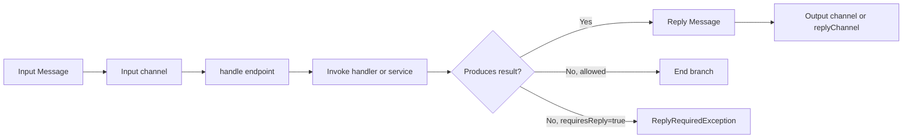

# handle in Java DSL

In the **Java DSL** chapter of the **SPRING_INTEGRATION_CORE** module, `handle()` is the bridge between the message flow and a processing action: invoking business logic, writing data, or using an existing `MessageHandler`. Understanding this step helps you properly design the relationship between `Message`, `MessageChannel`, endpoints, and a caller waiting for a reply.

This lesson focuses on the input and output contracts of `handle()`, passing payloads and headers to services, and testing both success and error paths of a Java DSL flow. The examples use **Java 17 and the Spring Integration 6.5 API**; this is an illustrative baseline, not a statement about your current project's version.

After this lesson, you will be able to:

- Choose the right `handle()` form for lambdas, business beans, and `MessageHandler`s.
- Identify which steps produce a reply and which terminate a processing branch.
- Use headers, `requiresReply`, endpoint configuration, and channels for their intended purpose.
- Test the results, side effects, and exceptions of a Java DSL flow.

## 1. How Does `handle()` Bring Processing Actions into a Flow?

For a POJO or business lambda, `handle()` configures a **Service Activator**. The endpoint receives a message from a channel, delegates work to the handler, and forwards the result to the next step if a reply is produced. For framework-provided handlers, specific behavior also depends on that handler itself. [Service Activator reference](https://docs.spring.io/spring-integration/reference/6.5/service-activator.html).



Distinguish two points in time:

- **Application initialization:** the DSL chain describes the components and how they are wired together.
- **Application runtime:** a message entering a channel is what triggers invoking the service.

Simple example:

```java
@Bean
IntegrationFlow feeFlow() {
    return IntegrationFlow.from("fees.in")
            .handle(Integer.class, (amount, headers) -> amount + 15)
            .get();
}
```

Sending payload `120` with a valid `replyChannel` receives payload `135`. The value `135` is the business result; it is placed in the reply message.

The channel name `fees.in` is the entry point of the flow. `.get()` completes the definition; it does not send a message or retrieve a business result.

## 2. Common Forms of `handle()`

| DSL syntax | Target invoked | When suitable |
|---|---|---|
| `.handle(Integer.class, (p, h) -> ...)` | Lambda receiving payload and headers | Short logic, wanting explicit input type |
| `.<Integer>handle((p, h) -> ...)` | `GenericHandler<Integer>` lambda | Payload already has exact type, no runtime conversion hint needed |
| `.handle(pricingService, "quote")` | Method on an injected bean | Business logic that is named and independently testable |
| `.handle("pricingService", "quote")` | Method on a bean looked up by name | Configuration needing string bean reference |
| `.handle(messageHandler)` | A `MessageHandler` | Reusing a handler or ending with a consumer |
| `.handle(handlerSpec)` | Handler built via a specialized DSL spec | Protocol adapter or outbound gateway integration |

These forms have additional overloads accepting an endpoint configuration callback. The table lists common options, not the entire API. [Javadoc for `handle()` overloads](https://docs.spring.io/spring-integration/docs/6.5.0/api/org/springframework/integration/dsl/BaseIntegrationFlowDefinition.html).

### 2.1. Lambda Receiving Payload and Headers

The core contract of `GenericHandler<P>` is:

```java
Object handle(P payload, MessageHeaders headers);
```

Type `P` is the input; the output may have a different type. The second argument is `MessageHeaders`. [`GenericHandler` Javadoc](https://docs.spring.io/spring-integration/docs/6.5.0/api/org/springframework/integration/core/GenericHandler.html).

Example reading a header to compute a surcharge:

```java
.handle(Integer.class, (amount, headers) -> {
    Boolean express = headers.get("express", Boolean.class);
    return amount + (Boolean.TRUE.equals(express) ? 30 : 10);
})
```

With payload `200`, header `express=true` yields `230`; without that header, it yields `210`. `Boolean.TRUE.equals(...)` safely handles a missing header.

When omitting explicit types in a long expression, parameter `p` can be inferred as `Object`. Specifying `Integer.class` or type witness `<Integer>` makes the input contract easier to read.

### 2.2. Java Type and Runtime Conversion Are Two Different Things

```java
// Supplies target type for runtime handling/conversion.
.handle(Integer.class, (quantity, headers) -> quantity + 1)

// Supplies generic type info for the Java compiler.
.<Integer>handle((quantity, headers) -> quantity + 1)
```

The `Class` parameter tells the framework the target type so it can attempt conversion via `ConversionService` when needed. Lambda generics do not provide the same runtime behavior. [Explanation of lambda payload types](https://docs.spring.io/spring-integration/reference/6.5/dsl/java-handle.html).

For example, a string payload `"41"` can be converted to `Integer` if a suitable converter is registered. That does not mean an arbitrary JSON string automatically turns into a domain object. If the input is order JSON, place an explicit decoding step before invoking the service.

### 2.3. Calling a Business Bean

```java
@Bean
IntegrationFlow paymentFlow(PaymentService paymentService) {
    return IntegrationFlow.from("payments.in")
            .handle(paymentService, "charge")
            .get();
}
```

Here `paymentService` is an injected bean; `charge` is the method to call. Because the method is already specified in the DSL, do not also annotate the same method with `@ServiceActivator(inputChannel=...)` to wire it to the channel a second time.

Prefer clear method names and unambiguous signatures. If multiple overloads share a name while the payload is convertible to several types, resolving the right method becomes harder to follow. You can split into distinct business method names or write a lambda calling the method directly.

## 3. Reply Contract: Return Value Determines Continuation

For a typical service activator, the rules are:

| Result of method/lambda | Handling behavior |
|---|---|
| A non-`null` object | Creates a reply with that object as payload |
| A `Message<?>` | Uses the reply content provided by the method, applying handler header rules |
| `null`, when missing reply is allowed | Sends no reply, ending the current branch |
| POJO method returning `void` | No value to build a reply |
| `null` when `requiresReply(true)` | Throws `ReplyRequiredException` |

When a result is present, an output channel takes precedence; if none exists, the handler checks `replyChannel` on the request. If the request lacks that header while the result is a `Message`, the framework also checks the result's `replyChannel`. [Service Activator reply rules](https://docs.spring.io/spring-integration/reference/6.5/service-activator.html).

### 3.1. Returning `null` Does Not Forward the Previous Payload

The snippet below records an event and stops the branch:

```java
.handle(String.class, (event, headers) -> {
    System.out.println("Received: " + event);
    return null;
})
```

If the goal is to log and continue processing, you must return the data:

```java
.handle(String.class, (event, headers) -> {
    System.out.println("Received: " + event);
    return event;
})
.transform(String.class, String::toUpperCase)
```

The first example fits a sender that only fires a notification. If the caller waits for a reply, design an explicit result or a finite timeout to prevent indefinite waiting.

### 3.2. Requiring a Business Step to Return a Result

```java
.handle(orderService, "place", endpoint -> endpoint
        .id("placeOrderEndpoint")
        .requiresReply(true))
```

`requiresReply(true)` detects when a service violates the "must return a result" contract. It does not synthesize a reply on the service's behalf and does not configure the caller's wait timeout. [`ConsumerEndpointSpec.requiresReply` API](https://docs.spring.io/spring-integration/docs/6.5.0/api/org/springframework/integration/dsl/ConsumerEndpointSpec.html#requiresReply(boolean)).

For instance, order placement needs to return an `OrderResult`. If an order is rejected by normal business rules, return a result with a rejected status. If a technical error occurs, throw an appropriate exception. Returning `null` for both cases obscures the outcome's meaning.

### 3.3. One-Way `MessageHandler`

A `MessageHandler` has the contract:

```java
void handleMessage(Message<?> message);
```

A lambda implementing this interface directly has no return value. [`MessageHandler` Javadoc](https://docs.spring.io/spring-framework/docs/current/javadoc-api/org/springframework/messaging/MessageHandler.html).

```java
@Bean
IntegrationFlow notificationFlow() {
    MessageHandler printer = message ->
            System.out.println(message.getPayload());

    return IntegrationFlow.from("notifications.in")
            .handle(printer)
            .get();
}
```

The example above ends with a consumer printing notifications. Do not chain further processing steps after a purely consuming handler like that. Some framework implementations emit messages themselves via an output channel; read the contract of each specific implementation rather than assuming every `MessageHandler` behaves like the `printer` lambda.

## 4. Headers and the Full `Message`

### 4.1. Mapping Headers to Service Parameters

```java
public Receipt quote(Order order,
                     @Header("tenantId") String tenantId) {
    // Compute result for this tenant.
}
```

The payload maps to `order`; the header maps to `tenantId`. Import `@Header` from `org.springframework.messaging.handler.annotation.Header`.

Headers are required by default. For an optional header, declare it explicitly:

```java
public String label(String payload,
                    @Header(name = "locale", required = false)
                    String locale) {
    String selectedLocale = locale == null ? "vi" : locale;
    return selectedLocale + ":" + payload;
}
```

You can also receive the entire header map with `@Headers`. [Parameter and header mapping](https://docs.spring.io/spring-integration/reference/6.5/configuration/annotations.html).

In a multi-tenant system, header values must be validated at an appropriate entry point; the mere presence of a header does not prove the sender is authorized for that tenant.

### 4.2. When the Lambda Needs the Full Message

With a two-argument lambda, the first argument defaults to the payload. If you need the entire `Message`, pass `Message.class`:

```java
.handle(Message.class, (message, headers) ->
        MessageBuilder.withPayload(message.getPayload())
                .copyHeaders(message.getHeaders())
                .setHeader("processedBy", "order-handler")
                .build())
```

Import `Message` from `org.springframework.messaging.Message`, and `MessageBuilder` from `org.springframework.integration.support.MessageBuilder`.

Writing only `.<Message<?>>handle(...)` is not enough to instruct the framework to pass the entire message to the lambda; it can cause a `ClassCastException` when the payload is passed instead. [Notes on lambdas and `Message<?>`](https://docs.spring.io/spring-integration/reference/6.5/dsl/java-basics.html).

### 4.3. Adding New Headers and Removing Headers

`MessageHeaders` does not support direct mutation via `put()` or `remove()`. Build a message via a builder or use header-focused DSL steps.

With a service activator, request headers not present in the reply may be copied back in. Therefore, merely building a reply lacking `internalToken` does not guarantee it has been removed. When you need to strip a header from outgoing messages, you can use:

```java
.handle(orderService, "place")
.headerFilter("internalToken")
```

At the handler level, `notPropagatedHeaders(...)` configures header names or patterns that must not be copied from the input. Do not exclude `replyChannel` or `errorChannel` when the design still depends on them. [API for controlling propagated headers](https://docs.spring.io/spring-integration/docs/6.5.0/api/org/springframework/integration/handler/AbstractMessageProducingHandler.html#setNotPropagatedHeaders(java.lang.String...)).

## 5. Practice: Pricing an Order and Recording the Result

Suppose a pricing request includes order ID, quantity, and unit price. Header `tenantId` identifies business context; `traceId` supports tracing. Execution flow:

```text
orders.in
  -> PricingService.quote(Order, tenantId)
  -> record Receipt then return Receipt
  -> sender's replyChannel
```

An auxiliary flow `audit.in` only records a `Receipt` without replying. Flow `required.in` intentionally returns `null` to illustrate the `requiresReply` contract.

### 5.1. Preparing the Environment

To run the example in a Java 17 Maven project, you need Spring Integration Core and JUnit Jupiter. Two illustrative dependencies:

```xml
<dependencies>
    <dependency>
        <groupId>org.springframework.integration</groupId>
        <artifactId>spring-integration-core</artifactId>
        <version>6.5.0</version>
    </dependency>
    <dependency>
        <groupId>org.junit.jupiter</groupId>
        <artifactId>junit-jupiter</artifactId>
        <version>5.12.2</version>
        <scope>test</scope>
    </dependency>
</dependencies>
```

Set compiler release to `17`, and use a Maven Surefire version supporting JUnit 5, such as `3.5.3`. If your project already uses a compatible Spring Boot/BOM, let the BOM manage Spring versions instead of manually mixing Spring versions.

The short snippets in earlier sections are independent alternatives. The configuration below is the shared set of flows used by the test suite in section 6.

### 5.2. Configuration and Services

Place the following code in `src/main/java/example/handledsl/HandleDslConfig.java`:

```java
package example.handledsl;

import java.math.BigDecimal;
import java.util.List;
import java.util.concurrent.CopyOnWriteArrayList;

import org.springframework.context.annotation.Bean;
import org.springframework.context.annotation.Configuration;
import org.springframework.integration.config.EnableIntegration;
import org.springframework.integration.dsl.IntegrationFlow;
import org.springframework.messaging.handler.annotation.Header;

@Configuration(proxyBeanMethods = false)
@EnableIntegration
public class HandleDslConfig {

    public record Order(String id, int quantity, BigDecimal unitPrice) {
    }

    public record Receipt(String orderId, BigDecimal total, String tenantId) {
    }

    @Bean
    PricingService pricingService() {
        return new PricingService();
    }

    @Bean
    AuditService auditService() {
        return new AuditService();
    }

    @Bean
    IntegrationFlow orderFlow(PricingService pricingService,
                              AuditService auditService) {
        return IntegrationFlow.from("orders.in")
                .handle(pricingService, "quote", endpoint -> endpoint
                        .id("quoteOrderEndpoint")
                        .requiresReply(true))
                .handle(Receipt.class, (receipt, headers) -> {
                    auditService.record(receipt);
                    return receipt;
                }, endpoint -> endpoint.id("recordReceiptEndpoint"))
                .get();
    }

    @Bean
    IntegrationFlow auditOnlyFlow(AuditService auditService) {
        return IntegrationFlow.from("audit.in")
                .handle(auditService, "record")
                .get();
    }

    @Bean
    IntegrationFlow requiredReplyFlow() {
        return IntegrationFlow.from("required.in")
                .handle(String.class, (payload, headers) -> null,
                        endpoint -> endpoint.requiresReply(true))
                .get();
    }

    public static class PricingService {

        public Receipt quote(Order order,
                             @Header("tenantId") String tenantId) {
            if (order.quantity() <= 0) {
                throw new IllegalArgumentException(
                        "Quantity must be greater than 0");
            }
            if (order.unitPrice() == null
                    || order.unitPrice().signum() < 0) {
                throw new IllegalArgumentException(
                        "Unit price must be present and non-negative");
            }
            if (tenantId.isBlank()) {
                throw new IllegalArgumentException(
                        "tenantId must not be blank");
            }

            BigDecimal total = order.unitPrice()
                    .multiply(BigDecimal.valueOf(order.quantity()));
            return new Receipt(order.id(), total, tenantId);
        }
    }

    public static class AuditService {

        private final List<Receipt> recorded = new CopyOnWriteArrayList<>();

        public void record(Receipt receipt) {
            recorded.add(receipt);
        }

        public List<Receipt> entries() {
            return List.copyOf(recorded);
        }
    }
}
```

In `orderFlow`, the lambda records the result and then does `return receipt`, so the caller still receives a reply. In `auditOnlyFlow`, `record()` returns `void`, matching one-way messaging.

The list inside `AuditService` is only for observing side effects in this exercise; data is lost when the context closes. The example does not model durable storage or a transaction spanning order persistence and audit recording.

## 6. Testing the `handle()` Contract

Place the code below in `src/test/java/example/handledsl/HandleDslTest.java`. Each test creates its own context so recorded data does not affect other tests.

```java
package example.handledsl;

import java.math.BigDecimal;
import java.util.List;

import org.junit.jupiter.api.AfterEach;
import org.junit.jupiter.api.BeforeEach;
import org.junit.jupiter.api.Test;
import org.springframework.context.annotation.AnnotationConfigApplicationContext;
import org.springframework.integration.channel.QueueChannel;
import org.springframework.integration.handler.ReplyRequiredException;
import org.springframework.integration.support.MessageBuilder;
import org.springframework.messaging.Message;
import org.springframework.messaging.MessageChannel;
import org.springframework.messaging.MessageHandlingException;

import example.handledsl.HandleDslConfig.AuditService;
import example.handledsl.HandleDslConfig.Order;
import example.handledsl.HandleDslConfig.Receipt;

import static org.junit.jupiter.api.Assertions.*;

class HandleDslTest {

    private AnnotationConfigApplicationContext context;

    @BeforeEach
    void start() {
        context = new AnnotationConfigApplicationContext(HandleDslConfig.class);
    }

    @AfterEach
    void close() {
        context.close();
    }

    @Test
    void returnsReceiptPreservesTraceAndRecordsSideEffect() {
        QueueChannel replies = new QueueChannel();
        Order order = new Order("ORDER-101", 3, new BigDecimal("125000"));
        Message<Order> request = MessageBuilder.withPayload(order)
                .setHeader("tenantId", "tenant-vn")
                .setHeader("traceId", "trace-101")
                .setReplyChannel(replies)
                .build();

        assertTrue(channel("orders.in").send(request));
        Message<?> reply = replies.receive(1000);

        assertNotNull(reply);
        Receipt receipt = assertInstanceOf(Receipt.class, reply.getPayload());
        assertEquals("ORDER-101", receipt.orderId());
        assertEquals(0, new BigDecimal("375000").compareTo(receipt.total()));
        assertEquals("tenant-vn", receipt.tenantId());
        assertEquals("trace-101", reply.getHeaders().get("traceId"));
        assertEquals(List.of(receipt), audit().entries());
    }

    @Test
    void voidServiceRecordsReceiptWithoutReply() {
        QueueChannel replies = new QueueChannel();
        Receipt receipt = new Receipt("ORDER-102", BigDecimal.TEN, "tenant-vn");

        assertTrue(channel("audit.in").send(MessageBuilder.withPayload(receipt)
                .setReplyChannel(replies)
                .build()));

        assertEquals(List.of(receipt), audit().entries());
        assertNull(replies.receive(0));
    }

    @Test
    void nullResultViolatesRequiredReplyContract() {
        assertThrows(ReplyRequiredException.class, () ->
                channel("required.in").send(
                        MessageBuilder.withPayload("probe").build()));
    }

    @Test
    void invalidOrderPropagatesFailureAndDoesNotRecordReceipt() {
        Order invalid = new Order("ORDER-103", 0, BigDecimal.TEN);
        Message<Order> request = MessageBuilder.withPayload(invalid)
                .setHeader("tenantId", "tenant-vn")
                .build();

        MessageHandlingException error = assertThrows(
                MessageHandlingException.class,
                () -> channel("orders.in").send(request));

        assertInstanceOf(IllegalArgumentException.class,
                error.getMostSpecificCause());
        assertTrue(audit().entries().isEmpty());
    }

    private MessageChannel channel(String name) {
        return context.getBean(name, MessageChannel.class);
    }

    private AuditService audit() {
        return context.getBean(AuditService.class);
    }
}
```

The four tests verify four distinct contracts:

| Test | Contract verified |
|---|---|
| Successful pricing | Correct payload, `traceId` preserved, side effect occurred |
| `void` service | Processing completed without producing a reply, even when request has `replyChannel` |
| Required reply | `null` causes an explicit failure |
| Invalid order | Exception reaches sender, recording step did not run |

In the example, processing steps are connected by default `DirectChannel`s, so side effects complete before `send()` returns. `QueueChannel replies` only holds the reply for the test to retrieve; it does not automatically move `orderFlow` to another execution thread. [Characteristics of `DirectChannel` and `QueueChannel`](https://docs.spring.io/spring-integration/reference/6.5/channel/implementations.html).

`receive(1000)` bounds the wait to at most one second so the test does not hang. For the `void` test, `receive(0)` can check immediately because the service call is synchronous. If you switch the entry point to a channel backed by an executor or poller, adjust how you wait for results and side effects accordingly.

## 7. Endpoint Configuration: Names, Pollers, and Advice

The final callback of a `handle()` overload is where you configure the endpoint, separated from the business lambda:

```java
.handle(Receipt.class, (receipt, headers) -> receipt,
        endpoint -> endpoint
                .id("receiptHandlerEndpoint")
                .requiresReply(true))
```

`id()` names the endpoint for monitoring or lifecycle control. The endpoint name is distinct from the input channel name and service bean name. [Endpoint configuration in Java DSL](https://docs.spring.io/spring-integration/reference/6.5/dsl/java-endpoints.html).

### 7.1. When the Input Requires Polling

The alternative configuration snippet below uses a `QueueChannel` at the input:

```java
@Bean
QueueChannel queuedOrders() {
    return new QueueChannel(100);
}

@Bean
IntegrationFlow queuedOrderFlow(QueueChannel queuedOrders,
                                HandleDslConfig.PricingService pricingService) {
    return IntegrationFlow.from(queuedOrders)
            .handle(pricingService, "quote", endpoint -> endpoint
                    .poller(Pollers.fixedDelay(100))
                    .requiresReply(true))
            .get();
}
```

Import `QueueChannel` from `org.springframework.integration.channel.QueueChannel`, and `Pollers` from `org.springframework.integration.dsl.Pollers`.

The poller pulls orders from the queue each cycle. Requests still need `tenantId` and a reply destination. This is a standalone supplementary example, not part of the test configuration in sections 5–6. With a `DirectChannel`, the handler is invoked on send, so no poller is configured on that endpoint.

### 7.2. Retries Must Pair with a Business Contract

You can attach advice specifically to the service-invocation step:

```java
.handle(remoteService, "reserve", endpoint -> endpoint
        .id("reserveInventoryEndpoint")
        .requiresReply(true)
        .advice(retryAdvice))
```

`remoteService` is a business bean and `retryAdvice` is a configured advice bean. This shows how to attach advice, not a complete retry configuration. `RequestHandlerRetryAdvice` supports retry policies and recovery when retries are exhausted. [Retry Advice documentation](https://docs.spring.io/spring-integration/reference/6.5/handler-advice/classes.html).

For example, an inventory-reservation call may succeed at the warehouse while the caller loses the connection before receiving the response. A retry needs a business key such as `reservationRequestId` so the warehouse recognizes the repeated request. Simply adding retry in the DSL does not prevent duplicate reservations.

Do not retry an order with quantity `0` just because the handler threw an exception: that data will not become valid after a few retries.

## 8. Where Do Exceptions from `handle()` Go?

With same-thread processing via `DirectChannel`, errors propagate back to the sender, typically wrapped in a `MessagingException` containing the cause and failed message. Setting an `errorChannel` header alone does not automatically redirect synchronous direct calls to that channel.

When a handler runs through a Spring Integration-managed asynchronous mechanism, errors can be represented as an `ErrorMessage`. The error-handling mechanism uses the request's `errorChannel` if present, or otherwise the global error channel. Gateways can configure their own error forwarding. [Spring Integration error handling](https://docs.spring.io/spring-integration/reference/6.5/error-handling.html).

In this exercise:

```text
Order quantity = 0
  -> PricingService.quote throws IllegalArgumentException
  -> no Receipt created
  -> recording step not called
  -> send() caller receives message-handling error
```

Avoid masking errors by arbitrarily returning `null`:

```java
// Easily turns technical errors into missing replies.
.handle(String.class, (payload, headers) -> {
    try {
        return remoteService.lookup(payload);
    }
    catch (RuntimeException ex) {
        return null;
    }
})
```

If the contract permits "not found", return a result type representing that state. If it is a connection or processing failure, let the designed error/recovery mechanism handle it instead of erasing the failure signal.

## 9. Choosing `handle()` in Relation to Other DSL Steps

| Primary intent | Step that should express that intent |
|---|---|
| Convert JSON to an object or change data structure | `transform()` |
| Decide whether a message may proceed | `filter()` |
| Choose which branch receives a message | `route()` |
| Combine messages belonging to a group | `aggregate()` |
| Invoke an action or business service | `handle()` |
| Call another flow and get a reply via a channel | `gateway()` |

This is how you communicate design intent. A computation could be written as a lambda in several operators, but using the dedicated operator helps readers understand the step's purpose.

For example, normalizing a product code can be written:

```java
.transform(String.class, code -> code.trim().toUpperCase(Locale.ROOT))
```

Once data is in the right shape, invoke the inventory-reservation service with `handle()`. If you want to drop messages failing a condition, use `filter()` to make the condition explicit and configure how dropped messages are handled.

A transformer is expected to produce a valid result; returning `null` raises an error. A service activator allows having no reply depending on configuration. Therefore, replacing `.transform(...)` with `.handle(...)` can alter the flow's contract. [Transformer contract](https://docs.spring.io/spring-integration/reference/6.5/transformer.html).

## 10. Diagnosing Common Errors

| Symptom | What to check | Adjustment |
|---|---|---|
| Service ran, but next step did not run | Method returns `void` or lambda returns `null` | Return the payload/result if continuation is wanted |
| Caller waits with no reply | A branch has no reply or output is wired elsewhere | Trace the reply path and set a finite timeout |
| Handler produces a result, but fails to find a destination | No output channel and missing `replyChannel` | Provide a target channel or use request–reply |
| Lambda gets `ClassCastException` with `Message` | Declared generics only without passing `Message.class` | Choose the overload taking `Class` |
| String fails to convert to expected type | Missing converter or malformed data | Add an explicit conversion step and validate input |
| Missing header causes service call to fail | `@Header` parameter is required | Supply the header or mark it optional per business rules |
| Header thought to be removed reappears | Input header propagated into the reply | Use `headerFilter()` or configure non-propagated headers |
| Endpoint does not pull messages from queue | Missing poller for a pollable channel | Configure a poller on the appropriate endpoint |
| A write action executes multiple times | Retry/redelivery re-invokes side-effecting operation | Check deduplication keys and idempotency contract |

When investigating, record the channel name, endpoint name, payload type, relevant headers, and root cause of the exception. For "missing reply" bugs, start from the method's return value and trace the output path; for method-invocation errors, start from the payload type and service signature.

## 11. Follow-Up Practice Exercises

1. Add an optional `discountPercent` header to the pricing service, defaulting to `0`. Define valid bounds and monetary rounding rules explicitly.
2. Write a test missing `tenantId`, verifying that the service produces no result and records no `Receipt`.
3. Create a flow that only records an audit entry yet returns an `AuditAcknowledgement` to the caller. Compare its contract against `auditOnlyFlow` returning `void`.
4. Switch one input to a `QueueChannel` with a poller; adjust tests to wait for completion and observe the error-receiving mechanism.
5. Use `headerFilter("internalToken")` after the business step, then verify the sensitive header is removed while `traceId` and the reply path continue working.

Completion criteria: for each `handle()`, be able to explain what data enters, which method is invoked, whether a reply is produced, where the reply goes, and who observes errors.