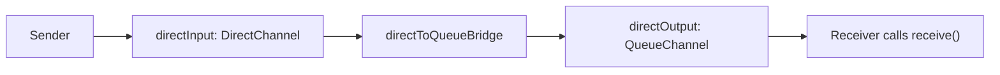
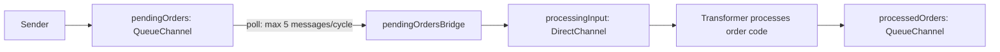

# bridge in Java DSL

## Objectives and Context

In the **Java DSL** chapter of the **SPRING_INTEGRATION_CORE** module, `bridge()` connects segments of a message flow using a forwarding endpoint. When you need to move messages from one channel to another without modifying business data, a bridge is an appropriate component.

This lesson focuses on using a bridge with `Message`, `MessageChannel`, and endpoints in Java DSL. You will practice connecting a push channel to a queue, pulling messages from a queue with a poller, using reply paths, and testing forwarding behavior.

After this lesson, you will be able to:

- Explain the role of `BridgeHandler` inside an `IntegrationFlow`.
- Place `bridge()` in the right spot and configure the endpoint via a lambda.
- Determine when a bridge needs a poller based on its **input channel**.
- Distinguish an explicit output target from the `replyChannel` header.
- Understand how channels affect threads, throughput, and error paths.
- Verify payloads, headers, and forwarding outcomes with test code.

The examples choose **Java 17+ and Spring Integration 6.5.x** as the API baseline, without assuming your project's actual version. Java DSL resides in `spring-integration-core`; configuration code uses Spring Context, and test code uses JUnit Jupiter.

## 1. A Bridge Is a Message-Forwarding Endpoint

### 1.1. Visualizing the Path

```text
input channel -> bridge endpoint -> output channel
```

A channel receives and distributes messages. A bridge is a handler invoked by a consumer endpoint to forward messages to the next destination. These are two distinct roles in the integration graph.

`BridgeHandler` forwards request messages without performing business transformations. A common use case is connecting a `PollableChannel` to a `SubscribableChannel` so polling happens at the bridge instead of at downstream business endpoints. See [Messaging Bridge](https://docs.spring.io/spring-integration/reference/6.5/bridge.html) and [BridgeHandler](https://docs.spring.io/spring-integration/docs/6.5.1/api/org/springframework/integration/handler/BridgeHandler.html).

Real-world example: a system buffers incoming requests into an internal queue, then pulls small batches into an existing processing pipeline. The processing pipeline only needs to receive messages from a direct channel; it does not need to know the queue-polling schedule.

### 1.2. Two Syntactic Forms

```java
.bridge()
```

The form above adds a bridge with default endpoint configuration.

```java
.bridge(endpoint -> endpoint
        .id("handoffBridge")
        .autoStartup(true))
```

The lambda configures the **endpoint**, not payload processing. In the example, `endpoint` exposes lifecycle and operational options for the bridge.

The overloads are documented in [BaseIntegrationFlowDefinition — bridge](https://docs.spring.io/spring-integration/docs/6.5.0/api/org/springframework/integration/dsl/BaseIntegrationFlowDefinition.html).

### 1.3. Choosing a Bridge Based on Need

| Processing step need | Typically suitable component |
| --- | --- |
| Forward the intact message to another channel | `bridge()` |
| Convert `Order` to `Invoice` | `transform()` |
| Allow or reject a message | `filter()` |
| Choose a route by order type | `route()` |
| Invoke a business service | `handle()` |
| Call a flow and wait for a reply to continue | `gateway()` |

A bridge helps when the main goal is connecting channels or controlling forwarding. If a transformer already connects the required input and output, there is no need to insert a bridge between them just to lengthen the DSL chain.

## 2. Complete Example: DirectChannel to QueueChannel

### 2.1. Problem Statement

The intake pipeline sends messages to `directInput`. Those messages must be forwarded to `directOutput`, a queue read later by a receiver.



In this configuration, there is no payload transformation step, no branch selector, and no automatic consumer draining the output queue.

### 2.2. Configuration Class

```java
import org.springframework.context.annotation.Bean;
import org.springframework.context.annotation.Configuration;
import org.springframework.integration.channel.DirectChannel;
import org.springframework.integration.channel.QueueChannel;
import org.springframework.integration.config.EnableIntegration;
import org.springframework.integration.dsl.IntegrationFlow;

@Configuration(proxyBeanMethods = false)
@EnableIntegration
public class DirectBridgeConfig {

    @Bean
    public DirectChannel directInput() {
        return new DirectChannel();
    }

    @Bean
    public QueueChannel directOutput() {
        return new QueueChannel(20);
    }

    @Bean
    public IntegrationFlow directBridgeFlow(
            DirectChannel directInput,
            QueueChannel directOutput) {

        return IntegrationFlow.from(directInput)
                .bridge(endpoint -> endpoint
                        .id("directToQueueBridge")
                        .sendTimeout(500L))
                .channel(directOutput)
                .get();
    }
}
```

Three objects must be distinguished:

| Name | Role |
| --- | --- |
| `directBridgeFlow` | Bean defining the flow |
| `directToQueueBridge` | ID of the consumer endpoint at the bridge step |
| `directOutput` | Output channel of the bridge |

`sendTimeout(500L)` configures the handler's send wait time in milliseconds. It helps if the output queue is full and sending must wait; it is not a deadline for downstream business processing. Specific options are provided by the DSL's endpoint spec.

### 2.3. Why Is There No Poller?

**The bridge's input channel is a `DirectChannel`.** The endpoint is invoked whenever a message is sent to that channel. Having a queue as the output does not make the bridge require polling.

Execution sequence in the example:

1. The sender calls `directInput.send(message)`.
2. The direct channel invokes the bridge's consumer on the sending thread.
3. The bridge sends the message into `directOutput`.
4. Once that send completes, the `send()` call can return.
5. The receiver reads the output queue via `receive()` at another time.

When `send()` succeeds, the valid conclusion here is that the message reached the output queue. There is not yet proof that another business task has read and finished processing that message. Direct and queue channel mechanics are described in [Message Channel Implementations](https://docs.spring.io/spring-integration/reference/6.5/channel/implementations.html).

## 3. QueueChannel to DirectChannel: Placing the Poller on the Bridge

### 3.1. Problem Statement

The intake pipeline places order codes into `pendingOrders`. A bridge must pull messages on a schedule and forward them to `processingInput`. Another flow processes order codes and writes results into `processedOrders`.



The class below is a second standalone example; do not combine it with `DirectBridgeConfig`.

### 3.2. Complete Configuration

```java
import java.time.Duration;
import java.util.Locale;

import org.springframework.beans.factory.annotation.Qualifier;
import org.springframework.context.annotation.Bean;
import org.springframework.context.annotation.Configuration;
import org.springframework.integration.channel.DirectChannel;
import org.springframework.integration.channel.QueueChannel;
import org.springframework.integration.config.EnableIntegration;
import org.springframework.integration.dsl.IntegrationFlow;
import org.springframework.integration.dsl.Pollers;

@Configuration(proxyBeanMethods = false)
@EnableIntegration
public class QueuedBridgeConfig {

    @Bean
    public QueueChannel pendingOrders() {
        return new QueueChannel(50);
    }

    @Bean
    public DirectChannel processingInput() {
        return new DirectChannel();
    }

    @Bean
    public QueueChannel processedOrders() {
        return new QueueChannel(50);
    }

    @Bean
    public IntegrationFlow queuedBridgeFlow(
            @Qualifier("pendingOrders") QueueChannel pending,
            DirectChannel processingInput) {

        return IntegrationFlow.from(pending)
                .bridge(endpoint -> endpoint
                        .id("pendingOrdersBridge")
                        .poller(Pollers
                                .fixedDelay(Duration.ofMillis(100))
                                .maxMessagesPerPoll(5)
                                .receiveTimeout(0)))
                .channel(processingInput)
                .get();
    }

    @Bean
    public IntegrationFlow processingFlow(
            DirectChannel processingInput,
            @Qualifier("processedOrders") QueueChannel results) {

        return IntegrationFlow.from(processingInput)
                .<String, String>transform(orderCode ->
                        "PROCESSED:"
                                + orderCode.strip()
                                        .toUpperCase(Locale.ROOT))
                .channel(results)
                .get();
    }
}
```

`@Qualifier` clarifies which queue is injected when multiple beans share the same type. `proxyBeanMethods = false` pairs with injecting needed beans via parameters rather than calling another `@Bean` method directly.

### 3.3. Reading the Poller Configuration

| Configuration | Meaning in the example |
| --- | --- |
| `fixedDelay(Duration.ofMillis(100))` | Schedules the next poll after the previous one completes plus the delay |
| `maxMessagesPerPoll(5)` | A single poll run processes at most five messages |
| `receiveTimeout(0)` | When the queue has no message, do not wait during that receive call |

If seven messages are waiting in the queue, a normal cycle takes at most five; the remaining ones are pulled in the next cycle. A cycle may take fewer than five if the queue runs empty.

The corresponding APIs are in [Pollers](https://docs.spring.io/spring-integration/docs/6.5.0/api/org/springframework/integration/dsl/Pollers.html) and [PollerSpec](https://docs.spring.io/spring-integration/docs/6.5.0/api/org/springframework/integration/dsl/PollerSpec.html).

`maxMessagesPerPoll(5)` does not create five parallel workers. In the configuration above, no task executor is added to the poller; each received message is forwarded downstream before the polling loop fetches the next message.

### 3.4. Choosing the Consumer by Input

| Input channel | How messages are received | Poller for the bridge |
| --- | --- | --- |
| `DirectChannel` | Received via subscription | No poller configured |
| `PublishSubscribeChannel` | Bridge is a subscriber | No poller configured |
| `ExecutorChannel` | Received via channel dispatch | No poller configured |
| `QueueChannel` | Consumer calls `receive()` | Requires a local poller or matching default poller |

The input type determines whether the consumer endpoint is event-driven or polling. The output destination does not determine this. See [Polling Consumer](https://docs.spring.io/spring-integration/reference/6.5/polling-consumer.html).

## 4. Threads, Throughput, and Queue Bounds

### 4.1. Tracing the Thread

With the queue example in section 3:

```text
Receiving thread:
    pendingOrders.send(message)
    -> put message into queue
    -> return

Polling thread:
    pendingOrders.receive(...)
    -> bridge
    -> processingInput.send(...)
    -> transformer
    -> processedOrders.send(...)
```

The transformer behind the direct channel continues running on the thread forwarding the message, unless another execution boundary exists. Adding a bridge between two direct channels does not spawn a new thread by itself.

### 4.2. Estimating Message-Fetching Cadence

Suppose the queue always has data, each message takes 20 ms to traverse all synchronous downstream steps, and the poller takes at most five messages per cycle.

```text
Approximate processing time per cycle: 5 × 20 ms = 100 ms
Delay after cycle:                               100 ms
Approximate full period:                         200 ms
Estimated throughput:               5 / 0.2 = 25 messages/second
```

This calculation illustrates the configuration and assumptions above. It ignores scheduling overhead, processing-time jitter, send waits, and other tasks. Therefore, do not infer that "100 ms, five messages" always yields 50 messages/second.

If load control is needed, monitor both queue depth and downstream processing time. The poller paces forwarding, yet a slow downstream step still stretches each poll cycle.

### 4.3. Full Queues and Message Durability

All queues in this lesson have bounded capacity. If senders outpace processing over an extended period, the queue will fill up. At that point, a clear policy is required: bounded wait, fail fast, throttle intake, or use suitable durable storage infrastructure.

A send call with timeout:

```java
boolean accepted = pending.send(message, 200);
if (!accepted) {
    // For example: report that the intake pipeline cannot accept more requests yet.
}
```

The snippet above uses `pending`, the input queue of the example. When forwarding via a bridge into a full queue, check the bridge's send timeout as well.

`QueueChannel` stores in memory by default. Do not treat adding a bridge and a queue as guaranteeing automatic durability, automatic retries, or exactly-once processing upon application failure. Those requirements need dedicated resources and policies. See [QueueChannel and message storage](https://docs.spring.io/spring-integration/reference/6.5/channel/implementations.html).

## 5. Bridge Without Explicit Output: Using replyChannel

### 5.1. Forwarding Target Selection Rules

For a bridge, the next destination must be resolvable:

1. If the bridge has a configured output channel, the message goes to that output.
2. If there is no explicit output, the bridge uses `replyChannel` from headers if present.
3. If neither exists, processing fails with an error.

Therefore, `.bridge().get()` at the end of a flow does not mean dropping messages. It can serve as a step returning messages back to the caller. See [BridgeHandler](https://docs.spring.io/spring-integration/docs/6.5.1/api/org/springframework/integration/handler/BridgeHandler.html).

### 5.2. Echo Example Using Bridge

The standalone configuration class below creates a route returning the received message:

```java
import org.springframework.context.annotation.Bean;
import org.springframework.context.annotation.Configuration;
import org.springframework.integration.channel.DirectChannel;
import org.springframework.integration.config.EnableIntegration;
import org.springframework.integration.dsl.IntegrationFlow;

@Configuration(proxyBeanMethods = false)
@EnableIntegration
public class EchoBridgeConfig {

    @Bean
    public DirectChannel echoInput() {
        return new DirectChannel();
    }

    @Bean
    public IntegrationFlow echoFlow(DirectChannel echoInput) {
        return IntegrationFlow.from(echoInput)
                .bridge()
                .get();
    }
}
```

Usage code in an application context registered with `EchoBridgeConfig`:

```java
DirectChannel input = context.getBean(
        "echoInput", DirectChannel.class);

QueueChannel replies = new QueueChannel(1);

Message<String> request = MessageBuilder
        .withPayload("ORDER-101")
        .setHeader("traceId", "trace-101")
        .setReplyChannel(replies)
        .build();

input.send(request);

Message<?> response = replies.receive(1_000);
// response has payload "ORDER-101" and traceId "trace-101".
```

The usage snippet requires importing `QueueChannel`, `Message`, and `MessageBuilder` from the packages used in the test examples below. `replies` is a reply channel placed directly in the header and does not need to be a named bean.

When a messaging gateway creates a request, the gateway can also supply the reply-receiving mechanism. However, `bridge()` itself only forwards; it does not initiate a new gateway call.

### 5.3. Avoid Adding Bridge as a Fix for Missing Destinations

The following configuration still lacks a complete contract if the sender does not supply a reply path:

```java
IntegrationFlow.from("unroutedInput")
        .bridge()
        .get();
```

Choose an output destination, a reply path, or an intentional terminal endpoint. If the goal is to consume a message without producing a reply, use a handler that performs that action; if the goal is to drop messages by design, express that decision explicitly via appropriate configuration.

Adding a bridge after a one-way handler also cannot recover a payload that the handler never emitted. The end of a pipeline must match the input's one-way or request–reply contract.

## 6. Explicit Bridge vs. DSL-Inserted Bridge

### 6.1. Two Consecutive Channels in a Chain

Consider a shortened version of the flow in section 2:

```java
return IntegrationFlow.from(directInput)
        .channel(directOutput)
        .get();
```

In this lesson's API baseline, when the DSL encounters a current channel followed by another channel, it can insert a bridge to connect them. This explains why a configuration that looks like just two channels still has a forwarding endpoint inside.

Conversely, if `.channel(...)` is preceded by a transformer producing output, the DSL can wire the transformer's output directly to that channel; not every `.channel()` call inserts a bridge.

This mechanism can be seen directly in [BaseIntegrationFlowDefinition source in Spring Integration 6.5.0](https://github.com/spring-projects/spring-integration/blob/v6.5.0/spring-integration-core/src/main/java/org/springframework/integration/dsl/BaseIntegrationFlowDefinition.java).

### 6.2. When to Declare a Bridge Explicitly

Use `bridge(endpoint -> ...)` when you want to expose a forwarding step with its own operational configuration:

- Attach an ID to locate the endpoint in logs, graphs, or lifecycle operations.
- Configure a poller right where messages are pulled from a queue.
- Set a send timeout.
- Explicitly enable or disable auto-startup.

The example below is a variant of the polling bridge in section 3:

```java
.bridge(endpoint -> endpoint
        .id("pendingOrdersBridge")
        .autoStartup(false)
        .poller(Pollers
                .fixedDelay(Duration.ofMillis(100))
                .maxMessagesPerPoll(5)
                .receiveTimeout(0)))
```

When it is time to start pulling messages:

```java
org.springframework.context.Lifecycle bridgeEndpoint =
        context.getBean(
                "pendingOrdersBridge",
                org.springframework.context.Lifecycle.class);

bridgeEndpoint.start();
```

With `autoStartup(false)`, a started application context does not mean this endpoint is already polling. Tests must also explicitly start the endpoint when using this variant.

Stopping an endpoint does not automatically clear messages still sitting in a queue. For direct-channel consumers, stopping the endpoint also affects subscriber availability; consider pipeline behavior during operations.

## 7. Errors and Transactions at a Bridge Segment

### 7.1. Synchronous Errors

In the direct-to-queue example, the bridge runs on the sending thread. If forwarding fails and the framework throws an exception, the error can propagate back to the `directInput.send(...)` call.

Similarly, if a bridge sends to a direct channel and a downstream handler throws on the same thread, the synchronous caller can receive the error. A `try/catch` on the sender side applies only to work executing within that call path.

### 7.2. Errors When a Poller Pulls Messages from a Queue

In the polling example, the sender may have already received the result of `pendingOrders.send(...)` before the poller pulls the message. If the transformer downstream of the bridge fails, the exception occurs during poll execution and does not return to the already-completed send call.

You can configure a dedicated error channel on the poller. For example, add the following bean to `QueuedBridgeConfig`:

```java
@Bean
public QueueChannel bridgeErrors() {
    return new QueueChannel(20);
}
```

Then update the poller configuration in `queuedBridgeFlow`:

```java
.poller(Pollers
        .fixedDelay(Duration.ofMillis(100))
        .maxMessagesPerPoll(5)
        .receiveTimeout(0)
        .errorChannel("bridgeErrors"))
```

This channel receives errors via the polling task's error-publication mechanism. The API is in [PollerSpec — errorChannel](https://docs.spring.io/spring-integration/docs/6.5.0/api/org/springframework/integration/dsl/PollerSpec.html).

Error output is typically an `ErrorMessage` whose payload is a `Throwable`. For `MessagingException` failures, you can also inspect the failed message when provided. A message's `errorChannel` header policy can also affect the error destination, so do not assume every error always lands in one fixed queue. See [Error Handling](https://docs.spring.io/spring-integration/reference/6.5/error-handling.html).

If using a queue as an error destination in a real application, something must read and handle it. The error queue in the example aids observation; it is not yet a complete recovery workflow.

### 7.3. Do Not Infer Recovery Capabilities from the Presence of a Bridge

Suppose the poller pulled a message from a regular `QueueChannel`, and then downstream threw an error. The bridge does not automatically put the message back onto the input queue.

If retries or recovery are needed, design them explicitly:

| Requirement | What to examine |
| --- | --- |
| Retry transient failures | Advice and bounded retry policy; operations safe to repeat |
| Persist failed messages | Error destination, root cause details, and replay workflow |
| Roll back resource actions | Transaction manager and transactional resources |
| Prevent data loss on sudden stop | Durable storage mechanism or suitable broker |
| Handle duplicate messages | Business key and idempotency policy |

You can configure transactions on the poller when needed, provided that configuration matches the underlying resources. An in-memory queue does not automatically become rollback-capable just by adding `.transactional(...)`.

A bridge keeps the wiring step simple. Correctness on failure still belongs to the design of the entire pipeline.

## 8. Testing Forwarding Through a Bridge

The test classes below are illustrative code for the two configurations presented above. Compatible JUnit Jupiter and Spring Context dependencies are required; the lesson does not include execution outputs.

### 8.1. Testing That a Direct Bridge Preserves Payload and Headers

```java
import org.junit.jupiter.api.Test;

import org.springframework.context.annotation.AnnotationConfigApplicationContext;
import org.springframework.integration.channel.DirectChannel;
import org.springframework.integration.channel.QueueChannel;
import org.springframework.messaging.Message;
import org.springframework.messaging.support.MessageBuilder;

import static org.junit.jupiter.api.Assertions.*;

class DirectBridgeTest {

    @Test
    void forwardsPayloadAndHeadersToTheOutputQueue() {
        try (var context =
                     new AnnotationConfigApplicationContext(
                             DirectBridgeConfig.class)) {

            var input = context.getBean(
                    "directInput", DirectChannel.class);
            var output = context.getBean(
                    "directOutput", QueueChannel.class);

            Message<String> request = MessageBuilder
                    .withPayload("ORDER-101")
                    .setHeader("traceId", "trace-101")
                    .setHeader("source", "web")
                    .build();

            assertTrue(input.send(request));

            Message<?> forwarded = output.receive(1_000);
            assertNotNull(forwarded);

            assertEquals("ORDER-101", forwarded.getPayload());
            assertEquals(
                    "trace-101",
                    forwarded.getHeaders().get("traceId"));
            assertEquals(
                    "web",
                    forwarded.getHeaders().get("source"));

            assertNull(output.receive(0),
                    "The bridge should forward one message");
        }
    }
}
```

The assertions check the message's content and key metadata. There is no need to couple tests to Java object identity to verify the forwarding contract.

In this synchronous direct setup, by the time `input.send()` finishes successfully, the send to the output queue has already occurred. The test still reads the queue to verify the exact data instead of only asserting the return value of `send()`.

### 8.2. Testing a Polling Bridge Connected to a Business Flow

```java
import org.junit.jupiter.api.Test;

import org.springframework.context.annotation.AnnotationConfigApplicationContext;
import org.springframework.integration.channel.QueueChannel;
import org.springframework.messaging.Message;
import org.springframework.messaging.support.MessageBuilder;

import static org.junit.jupiter.api.Assertions.*;

class QueuedBridgeTest {

    @Test
    void pollsPendingOrdersAndHandsThemToTheProcessingFlow() {
        try (var context =
                     new AnnotationConfigApplicationContext(
                             QueuedBridgeConfig.class)) {

            var pending = context.getBean(
                    "pendingOrders", QueueChannel.class);
            var results = context.getBean(
                    "processedOrders", QueueChannel.class);

            assertTrue(pending.send(MessageBuilder
                    .withPayload(" order-201 ")
                    .setHeader("traceId", "trace-201")
                    .build(), 200));

            Message<?> processed = results.receive(2_000);
            assertNotNull(processed);

            assertEquals(
                    "PROCESSED:ORDER-201",
                    processed.getPayload());
            assertEquals(
                    "trace-201",
                    processed.getHeaders().get("traceId"));
        }
    }
}
```

`receive(2_000)` waits with a bound for polling to complete; there is no need for a fixed `Thread.sleep()` hoping the result has arrived.

This test verifies end-to-end intake, forwarding, and data transformation. It does not prove exact polling cadence or the five-messages-per-cycle cap. To verify per-cycle policies, use a controllable trigger or scheduler and observe at the poller scope; avoid assertions relying tightly on wall-clock timing.

In an asynchronous pipeline, reading a queue immediately with `receive(0)` also does not prove no late message will arrive. Appropriate synchronization points or observation windows are needed when asserting final counts.

### 8.3. Additional Test Matrix

| Scenario | What to verify |
| --- | --- |
| Bridge has output and request also carries `replyChannel` | Result goes to the configured output |
| Echo bridge without output | Result returns to the request's reply channel |
| Neither output nor `replyChannel` | Forwarding error is raised |
| Input queue has no data | Poller does not generate spurious messages |
| Polling bridge with `autoStartup(false)` | Does not forward before start; forwards after start |
| Polling downstream throws exception | Error reaches configured error-handling path |
| Output queue is full | Send behavior follows timeout and error policy |
| Multiple messages with distinct correlation IDs | Payloads or headers are not mixed across messages |

## 9. Diagnosing Bridge Configurations

| Symptom | Causes to inspect | How to check |
| --- | --- | --- |
| Queue holds data, but nothing is pulled | Missing poller, endpoint not started, or wrong input queue | Check endpoint ID, lifecycle, and channel beans |
| Poller configuration error when using direct input | Poller placed on a consumer not reading a pollable channel | Verify actual input channel type |
| Reports output channel cannot be determined | Terminal bridge lacks both output and reply header | Check `.channel(...)` or request–reply contract |
| Bridge sent, yet business logic did not run | Output is a queue lacking a consumer | Check the receiver behind the queue |
| Sender blocks for a long time | Target queue is full or synchronous downstream is slow | Inspect capacity, send timeout, and processing duration |
| Added bridge, yet load did not drop | Input is still direct without buffering or throttling | Redraw channels and execution boundaries |
| Sender cannot catch downstream errors | Processing runs inside a poller or executor | Observe error channel and correlation IDs |
| Two flows do not both receive every message | Both read from a point-to-point channel | Check whether publish-subscribe is needed instead of competing consumers |
| Messages loop endlessly | Bridges wired in a cycle | Inspect the graph, especially paths looping back to input |

When debugging, sketch at least three components: **input channel → bridge endpoint → output channel**. Note channel type, endpoint ID, running state, and error target beside each step. That helps distinguish forwarding errors from downstream business-logic errors.

## 10. Practice Exercises

### Exercise 1: Connect Two Pipelines Without Changing Data

Starting from `DirectBridgeConfig`, send a message containing an order ID and a `sourceSystem` header.

Completion criteria:

- Output has the exact payload and headers sent.
- One input becomes one message in the output queue.
- Explain why this bridge needs no poller.
- Distinguish "present in queue" from "business-processed".

### Exercise 2: Change the Polling Schedule

In `QueuedBridgeConfig`, change the delay to 200 ms and max messages per cycle to two. Send seven distinct order codes.

Completion criteria:

- Eventually receive all seven results with matching order codes.
- Do not add parallel processing just because two messages are pulled per cycle.
- Explain why downstream processing time changes effective throughput.
- Avoid overly tight time limits when guessing exact cycle counts from the real scheduler.

### Exercise 3: Terminal Bridge and Reply Path

Use `EchoBridgeConfig` with two sending styles:

1. Message with `replyChannel` set to a queue.
2. Message without `replyChannel`.

Completion criteria:

- The first style receives back the exact payload.
- The second style is observed as a missing-destination forwarding error.
- State how to replace with a fixed output if the pipeline does not use request–reply.

### Exercise 4: Observe Polling Errors

Add `bridgeErrors` and configure the poller as in section 7. Temporarily modify the transformer so it throws an error for a predetermined order code.

Completion criteria:

- The error is observed on the appropriate error path.
- The `pendingOrders.send()` result is not mistaken for a business processing result.
- Identify the failing message via payload data or available error details.
- Propose a recovery approach while explaining that the bridge does not automatically return the message to the queue.

## 11. Key Takeaways

- `bridge()` creates a message-forwarding endpoint in Java DSL.
- The input channel type determines whether the consumer needs a poller.
- Explicit output and `replyChannel` are two ways to specify the forwarding target.
- A bridge may be inserted implicitly by the DSL when chaining channels consecutively; explicit declaration makes endpoint configuration clear.
- Threading and buffering come from the pipeline's channels, pollers, and executors.
- Per-cycle polling limits help pace forwarding, though downstream duration must also be factored in.
- Tests should verify payloads, headers, and paths on both success and failure.

Before adding a bridge, answer: **"Where are messages pulled from, who invokes the consumer, where do they go next, and where will errors be observed?"** When these four points are clear, bridge configuration is usually concise and easy to verify.
