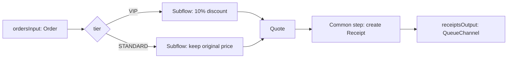
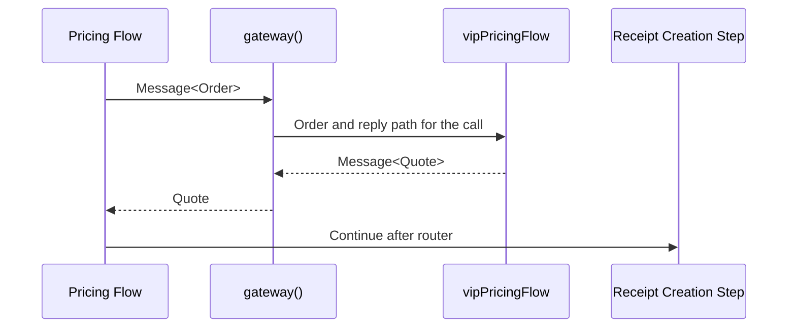

# Subflows in Java DSL

## Objectives and Scope

In the **Advanced DSL** chapter of the **SPRING_INTEGRATION_CORE** module, subflows let you express a processing branch made up of multiple endpoints right inside a message flow definition. This lesson walks through everything from branching order pricing to reusing a flow via a gateway, handling discarded messages, and broadcasting notifications to multiple recipients.

After this lesson, you will be able to:

- Identify the entry point, exit point, and continuation path of each branch.
- Use `subFlowMapping()` to build router branches with a unified output.
- Choose between `channelMapping()`, an inline subflow, or `gateway()` based on the message contract.
- Distinguish between router branches, filter discard branches, and publish-subscribe subscribers.
- Diagnose causes of missing replies, synchronous errors, and errors across asynchronous boundaries.
- Design tests that verify both the content and the number of output messages.

**Prerequisites:** familiarity with `Message`, payload, headers, `MessageChannel`, transformer, router, and service activator. The examples target **Java 17+ and Spring Integration 6.5.x APIs** as a baseline; no assumptions are made about the version currently configured in your project. Java DSL lives in `spring-integration-core`. The test examples use JUnit Jupiter and `AnnotationConfigApplicationContext`, without requiring Spring Boot.

## 1. A Subflow Is Part of the Message Graph

A subflow describes a segment of the endpoint and channel graph. The lambda `sf -> sf.transform(...)` is used when Spring builds the configuration; it is not a business function called directly for each order.

At runtime, messages still flow through the familiar components:

```text
Message<Order>
    -> MessageChannel
    -> Router endpoint
    -> channel of the selected branch
    -> Transformer endpoint
    -> channel of the next step
```

`IntegrationFlow` is how that composition is declared. The DSL registers and wires actual beans in the application context; therefore, nesting lambdas does not by itself create a separate thread, transaction, or process. See [DSL Basics](https://docs.spring.io/spring-integration/reference/dsl/java-basics.html).

Subflows can appear in several places:

| Declaration Location | Branch Semantics | What Needs to Be Determined? |
| --- | --- | --- |
| `route(..., r -> r.subFlowMapping(...))` | Processing by routing key | Does the branch produce a result to continue after the router? |
| `route(..., r -> r.defaultSubFlowMapping(...))` | Processing when no mapping matches | Does the default output share the same contract as the other branches? |
| `filter(..., f -> f.discardFlow(...))` | Handling rejected messages | Where will the message end up? |
| `publishSubscribeChannel(p -> p.subscribe(...))` | A subscriber receiving broadcast messages | Is this an independent task, or do results need to be collected? |
| `routeToRecipients(r -> r.recipientFlow(...))` | A recipient selected by condition | How many conditions can match at the same time? |
| `gateway(...)` | Sending a request to a flow and receiving a reply | Who replies, within what timeout, and what happens on error? |

You cannot infer the behavior of every branch type solely from the `sf -> ...` syntax. Always read the semantics of the enclosing operator.

## 2. Complete Example: Two Pricing Branches, One Receipt Creation Step

### 2.1. Problem and Contract

The system receives an `Order` and calculates the payable amount:

- `VIP` customers: 10% discount; the discount amount is computed using integer division.
- `STANDARD` customers: original price.
- Both branches produce a `Quote`.
- A common step after the router transforms `Quote` into `Receipt`.

Monetary amounts in the example are whole units using `long`. This rounding rule is solely for the practice exercise.



The two arrows entering the common step represent two alternative paths. Each order in the example goes through one branch.

### 2.2. Java Configuration

This is a standalone configuration class. The extensions in later sections are alternatives or guided additions; you do not need to combine all of them into this class.

```java
import java.util.Objects;

import org.springframework.context.annotation.Bean;
import org.springframework.context.annotation.Configuration;
import org.springframework.integration.channel.DirectChannel;
import org.springframework.integration.channel.QueueChannel;
import org.springframework.integration.config.EnableIntegration;
import org.springframework.integration.dsl.IntegrationFlow;

@Configuration(proxyBeanMethods = false)
@EnableIntegration
public class PricingConfig {

    public enum Tier {
        VIP, STANDARD
    }

    public record Order(String id, Tier tier, long amount) {
        public Order {
            Objects.requireNonNull(id, "id");
            Objects.requireNonNull(tier, "tier");
            if (amount < 0) {
                throw new IllegalArgumentException("amount must be >= 0");
            }
        }
    }

    public record Quote(String orderId, long payable, String policy) {
    }

    public record Receipt(
            String orderId,
            long payable,
            String policy,
            String status) {
    }

    @Bean
    public DirectChannel ordersInput() {
        return new DirectChannel();
    }

    @Bean
    public QueueChannel receiptsOutput() {
        return new QueueChannel(20);
    }

    @Bean
    public IntegrationFlow pricingFlow(
            DirectChannel ordersInput,
            QueueChannel receiptsOutput) {

        return IntegrationFlow.from(ordersInput)
                .<Order, Tier>route(Order::tier, routes -> routes
                        .id("pricingRouter")
                        .subFlowMapping(Tier.VIP, sf -> sf
                                .<Order, Quote>transform(order ->
                                        new Quote(
                                                order.id(),
                                                order.amount()
                                                        - order.amount() / 10,
                                                "VIP_10_PERCENT")))
                        .subFlowMapping(Tier.STANDARD, sf -> sf
                                .<Order, Quote>transform(order ->
                                        new Quote(
                                                order.id(),
                                                order.amount(),
                                                "STANDARD"))))
                .<Quote, Receipt>transform(quote ->
                        new Receipt(
                                quote.orderId(),
                                quote.payable(),
                                quote.policy(),
                                "QUOTED"))
                .channel(receiptsOutput)
                .get();
    }
}
```

In `.<Order, Tier>route(...)`, `Order` is the payload type passed into the key-selection function, and `Tier` is the key type. The result of `Order::tier` selects the mapping; it does not replace the payload with `Tier`. The first transformer in each branch still receives `Order`.

The result produced by an inline branch is wired by the DSL to the segment following `route()`. This is an important characteristic to keep in mind when reading router subflows. See [Sub-flows support](https://docs.spring.io/spring-integration/reference/6.5/dsl/java-subflows.html).

### 2.3. Tracing a Message

With `new Order("O-101", Tier.VIP, 100_000)`:

1. `ordersInput` receives `Message<Order>`.
2. The router computes the key `Tier.VIP`.
3. The VIP branch produces `Quote("O-101", 90_000, "VIP_10_PERCENT")`.
4. The common transformer produces `Receipt` with `status = "QUOTED"`.
5. `receiptsOutput` holds the resulting message for the consumer.

For a STANDARD order with the same amount, the result has `payable = 100_000` and `policy = "STANDARD"`.

| Stage | Payload |
| --- | --- |
| Before router | `Order` |
| Entering VIP or STANDARD branch | `Order` |
| After branch transformer | `Quote` |
| After common transformer | `Receipt` |

The consistency in the third row keeps downstream steps after the router from having to guess the data type. If one branch returns `String` while the common step expects `Quote`, the fluent configuration may still compile, but message processing will fail with type or conversion errors.

**The convergence point of two paths is not an aggregator.** This example does not maintain state to wait for results from both VIP and STANDARD.

## 3. The Output Contract Determines Whether a Branch Continues

### 3.1. A Branch That Returns a Result vs. One That Only Consumes

The following two handler styles serve different purposes:

```java
// A branch that produces a result for the next step.
sf -> sf.<PricingConfig.Order>handle((order, headers) ->
        new PricingConfig.Quote(
                order.id(), order.amount(), "STANDARD"))

// A branch that terminates by consuming the message.
sf -> sf.handle(message -> {
    System.out.println(message.getPayload());
})
```

The first handler returns an object; the second is a one-way `MessageHandler`. If the goal is to create a `Receipt` after the router, simply printing the order does not supply a `Quote` to that step.

Similarly, do not use `return null` as a business result meaning "no discount". If the flow needs to continue, return a `Quote` with the original amount. If you want to terminate the branch, make it explicit that it is a decision to discard or consume the message. The distinction between one-way endpoints and reply-producing endpoints is introduced in [DSL Basics](https://docs.spring.io/spring-integration/reference/dsl/java-basics.html).

### 3.2. Normalizing Output Before Leaving a Branch

When each branch calls a different system, the returned data formats may differ:

```text
Branch A: ExternalPriceA -> Quote
Branch B: ExternalPriceB -> Quote
                         |
                         v
                common Receipt creation
```

Let the final transformer of each branch convert to the same domain type. That way, the router is responsible for path selection, the branches are responsible for data adaptation, and the common step applies the rule shared across all results.

For the pricing example, the contract should explicitly specify:

| Property | Convention |
| --- | --- |
| Input | `Order` with a valid `tier` |
| Normal output | One `Quote` |
| Identifier field | `Quote.orderId` preserves the order ID |
| Amount field | `Quote.payable` uses the same unit as the input |
| Technical error | Throws an exception or follows the chosen error policy |
| Rejected order | Has an explicit terminal branch; never pretends to have priced it |

## 4. Distinguishing Subflow, Channel Mapping, and Gateway

### 4.1. `channelMapping()` Only Selects the Destination

The following configuration selects the destination channel:

```java
.<PricingConfig.Order, PricingConfig.Tier>route(
        PricingConfig.Order::tier,
        routes -> routes
                .channelMapping(
                        PricingConfig.Tier.VIP,
                        "vipPricingInput")
                .channelMapping(
                        PricingConfig.Tier.STANDARD,
                        "standardPricingInput"))
```

Both channels must exist and have an appropriate consumer. The router forwards the message; this configuration does not automatically establish a request–reply call back to the step after the router.

If the target flows are independent processing pipelines, channel mapping accurately expresses that intent. If the calling flow needs to receive a result to continue, declare a call contract via a gateway. Rules for referencing external flows are documented in [RouterSpec](https://docs.spring.io/spring-integration/docs/6.5.0/api/org/springframework/integration/dsl/RouterSpec.html).

### 4.2. Extracting the VIP Branch into a Flow with Its Own Input

Suppose multiple flows need to share the VIP pricing logic. You can extract that logic into an `IntegrationFlow` bean that accepts `Order` and returns `Quote`.

The following beans illustrate the alternative to the VIP branch in `PricingConfig`. They use the `Order`, `Tier`, `Quote`, and `Receipt` types defined in Section 2. When placing multiple channels of the same type in one configuration, use `@Qualifier` so dependency injection does not rely on Java parameter names.

```java
@Bean
public DirectChannel vipPricingInput() {
    return new DirectChannel();
}

@Bean
public IntegrationFlow vipPricingFlow(
        @org.springframework.beans.factory.annotation.Qualifier(
                "vipPricingInput")
        DirectChannel input) {

    return IntegrationFlow.from(input)
            .<Order, Quote>transform(order ->
                    new Quote(
                            order.id(),
                            order.amount() - order.amount() / 10,
                            "VIP_10_PERCENT"))
            .get();
}
```

This flow does not hard-code its output to a specific caller's result queue. When invoked via a gateway, the final transformer produces a reply to the request's reply path.

The following method **replaces** `pricingFlow()` in Section 2:

```java
@Bean
public IntegrationFlow pricingFlow(
        @org.springframework.beans.factory.annotation.Qualifier(
                "ordersInput")
        DirectChannel input,
        @org.springframework.beans.factory.annotation.Qualifier(
                "vipPricingInput")
        DirectChannel vipInput,
        @org.springframework.beans.factory.annotation.Qualifier(
                "receiptsOutput")
        QueueChannel output) {

    return IntegrationFlow.from(input)
            .<Order, Tier>route(Order::tier, routes -> routes
                    .subFlowMapping(Tier.VIP, sf -> sf
                            .gateway(vipInput, gateway -> gateway
                                    .requestTimeout(500L)
                                    .replyTimeout(1_000L)
                                    .requiresReply(true)))
                    .subFlowMapping(Tier.STANDARD, sf -> sf
                            .<Order, Quote>transform(order ->
                                    new Quote(
                                            order.id(),
                                            order.amount(),
                                            "STANDARD"))))
            .<Quote, Receipt>transform(quote ->
                    new Receipt(
                            quote.orderId(),
                            quote.payable(),
                            quote.policy(),
                            "QUOTED"))
            .channel(output)
            .get();
}
```

`gateway()` has overloads accepting a channel name, a `MessageChannel` instance, or an `IntegrationFlow`. Here, injecting the input channel directly makes the call target explicit. See [Operator gateway()](https://docs.spring.io/spring-integration/reference/dsl/java-gateway.html).

### 4.3. Reply Path of a Nested Call



The gateway sets up a mechanism to receive the reply, typically based on a temporary reply channel in the headers. When writing a transformer solely to change the payload, prefer letting the framework preserve the necessary headers. If you construct a new `Message` manually, consider preserving `replyChannel`, `errorChannel`, and related correlation headers. See [Messaging Gateways — Setting the Default Reply Channel](https://docs.spring.io/spring-integration/reference/6.5/gateway.html#setting-the-default-reply-channel).

A common design mistake is appending `.channel("vipResults")` at the end of a shared flow while still expecting the gateway to receive the reply directly. Once you do that, the result already has a concrete output destination; having something read `vipResults` does not automatically complete the gateway call.

### 4.4. Timeouts Must Match the Reply Contract

| Option in the Example | Purpose |
| --- | --- |
| `requestTimeout(500L)` | Bounds the send time when the target channel may block |
| `replyTimeout(1_000L)` | Configures how long to wait for a reply |
| `requiresReply(true)` | Treats the gateway endpoint producing no result as an error |

The values above are in milliseconds and are only examples. Do not treat `replyTimeout` as a mechanism that interrupts a synchronously executing Java method. If downstream processing is slow on the caller's thread over a `DirectChannel`, the gateway cannot use the reply timeout to cancel that call on its own. I/O operations require timeouts on the client or component performing the I/O.

These options are documented in [GatewayEndpointSpec](https://docs.spring.io/spring-integration/docs/6.5.0/api/org/springframework/integration/dsl/GatewayEndpointSpec.html); timeout semantics are explained in [Gateway Timeouts](https://docs.spring.io/spring-integration/reference/6.5/gateway.html#gateway-timeouts).

## 5. Default Branches and Unmatched Messages

With an enum containing only VIP and STANDARD, the first example covers all allowed values. In real systems, keys may come from external strings and contain unknown values.

You must choose an explicit policy:

- Reject unsupported keys.
- Route to a default processing subflow.
- Let unmatched messages continue in the parent flow if subsequent steps understand that payload.

### 5.1. A Default Subflow with the Same Output Type

The following standalone example normalizes payment methods. Both the matched branch and the default branch produce a `String`:

```java
@Bean
public IntegrationFlow paymentMethodFlow() {
    return IntegrationFlow.from("paymentMethodInput")
            .<String, String>route(
                    value -> value.strip()
                            .toUpperCase(java.util.Locale.ROOT),
                    routes -> routes
                            .channelKeyFallback(false)
                            .subFlowMapping("CARD", sf -> sf
                                    .<String, String>transform(
                                            value -> "PAY_BY_CARD"))
                            .defaultSubFlowMapping(sf -> sf
                                    .<String, String>transform(
                                            value -> "MANUAL_REVIEW")))
            .<String, String>transform(
                    result -> "DECISION:" + result)
            .channel(channel -> channel.queue("paymentMethodResults"))
            .get();
}
```

`channelKeyFallback(false)` prevents using unmapped keys as channel names to resolve. The default branch here represents a decision to route to manual review. The `defaultSubFlowMapping()` API is described in [AbstractRouterSpec](https://docs.spring.io/spring-integration/docs/6.5.0/api/org/springframework/integration/dsl/AbstractRouterSpec.html).

### 5.2. Continuing Unmatched Messages in the Parent Flow

If no special transformation is needed for the default case:

```java
@Bean
public IntegrationFlow labelFlow() {
    return IntegrationFlow.from("labelInput")
            .<String, Boolean>route(
                    text -> text.startsWith("VIP:"),
                    routes -> routes
                            .subFlowMapping(true, sf -> sf
                                    .<String, String>transform(
                                            text -> text.substring(4)))
                            .defaultOutputToParentFlow())
            .<String, String>transform(
                    text -> text.toUpperCase(java.util.Locale.ROOT))
            .channel(channel -> channel.queue("labelResults"))
            .get();
}
```

Expected results:

| Input | Path | Output |
| --- | --- | --- |
| `VIP:alice` | `true` branch strips prefix, then common step | `ALICE` |
| `bob` | Default goes to common step | `BOB` |

`defaultOutputToParentFlow()` configures the default path to point to the next segment of the parent flow. It does not mean sending an extra copy for every message that matched a branch. For mapping routers, this option also disables channel-key fallback unless reconfigured afterward. See [RouterSpec — defaultOutputToParentFlow](https://docs.spring.io/spring-integration/docs/6.5.0/api/org/springframework/integration/dsl/RouterSpec.html#defaultOutputToParentFlow()).

## 6. `discardFlow()`: Handling Messages Rejected by a Filter

Add a condition requiring the order amount to be greater than 0:

```java
.<Order>filter(
        order -> order.amount() > 0,
        filter -> filter.discardFlow(discard -> discard
                .<Order, String>transform(order ->
                        "REJECTED:" + order.id() + ":ZERO_AMOUNT")
                .channel(channel ->
                        channel.queue("rejectedOrders"))))
```

Place this right before the router in the pricing example:

```text
Order.amount > 0
    -> pricing router
    -> Quote
    -> Receipt

Order.amount == 0
    -> discardFlow
    -> rejectedOrders
```

Messages in the discard branch do not return to the filter's accepted output. Therefore, do not place logic required for both valid and invalid orders after the filter and assume it always executes.

If you need to convert both valid and invalid cases into the same result type and continue shared processing, a boolean router with two subflows usually expresses the intent more clearly. A filter is appropriate when there is a genuine decision to pass or drop from the main pipeline. See [Filter](https://docs.spring.io/spring-integration/reference/filter.html).

**When used in request–reply:** if a request is routed to the `rejectedOrders` queue, the caller does not automatically receive a business reply. Explicitly choose one of these approaches: return a rejection result according to the pipeline contract, throw an exception with an appropriate setting such as `throwExceptionOnRejection(true)`, or design the input as one-way. Never add a silently discarding filter to a flow that requires a reply while ignoring the consequence of missing replies.

## 7. Publish-Subscribe: Multiple Subscribers with Independent Roles

### 7.1. Broadcasting Events to Multiple Recipients

After creating a `Receipt`, the system might want to send notifications to audit and analytics:

```java
@Bean
public IntegrationFlow receiptEventsFlow() {
    return IntegrationFlow.from("receiptEventsInput")
            .publishSubscribeChannel(pubsub -> pubsub
                    .subscribe(audit -> audit
                            .channel(channel ->
                                    channel.queue("auditReceipts")))
                    .subscribe(analytics -> analytics
                            .channel(channel ->
                                    channel.queue("analyticsReceipts"))))
            .channel(channel ->
                    channel.queue("mainReceiptResults"))
            .get();
}
```

In this example, publish-subscribe has three subscriber pipelines:

1. The branch sending the message to `auditReceipts`.
2. The branch sending the message to `analyticsReceipts`.
3. The continuation of the parent flow, sending the message to `mainReceiptResults`.

The segment after `publishSubscribeChannel()` is an additional subscriber. It is not a collection point for return values from audit and analytics. Wiring subscribers in the DSL is illustrated in [Sub-flows support](https://docs.spring.io/spring-integration/reference/dsl/java-subflows.html).

### 7.2. Broadcasting to Multiple Targets vs. Parallel Processing

`PublishSubscribeChannel` broadcasts messages to subscribers. Without a configured executor, dispatching runs on the sender's thread; declaring multiple `subscribe()` calls does not automatically run them in parallel. With an executor, the execution mechanism changes, but you still need to design how results are collected if the business logic requires it. See [Message Channel Implementations — PublishSubscribeChannel](https://docs.spring.io/spring-integration/reference/channel/implementations.html).

The example uses an immutable `Receipt` record. This is a useful choice when multiple subscribers receive the same payload: it prevents the audit branch from mutating a shared object and affecting the analytics branch.

If you need to calculate shipping and check inventory simultaneously and then produce a single result once both responses arrive, you need a result-collection mechanism such as an aggregator or scatter-gather. An aggregator has a correlation strategy and a release strategy; appending `.aggregate()` after a publish-subscribe does not automatically route every subscriber's result into it. When using sequence headers for fan-out and grouping, configure `applySequence` appropriately. See [Aggregator](https://docs.spring.io/spring-integration/reference/aggregator.html).

### 7.3. Recipient List When Only Certain Recipients Apply

If audit receives every receipt while analytics only receives certain kinds, you can use a recipient list:

```java
.routeToRecipients(recipients -> recipients
        .recipientFlow(
                (Receipt receipt) -> true,
                audit -> audit.channel(channel ->
                        channel.queue("auditSelected")))
        .recipientFlow(
                (Receipt receipt) -> "VIP_10_PERCENT"
                        .equals(receipt.policy()),
                analytics -> analytics.channel(channel ->
                        channel.queue("vipAnalytics"))))
```

This snippet is an example replacing the event distribution step. A VIP `Receipt` can match both conditions. If you need a path for messages that match no recipient, configure a separate default; `defaultOutputToParentFlow()` on a recipient list applies when no recipient was selected. See [Message Routers — routeToRecipients](https://docs.spring.io/spring-integration/reference/6.5/dsl/java-routers.html).

## 8. Channels and Errors: Reading Nesting Alone Is Not Enough

### 8.1. Execution Boundaries Live in Channels and Endpoints

| Component | What to Remember When Placed in a Subflow |
| --- | --- |
| `DirectChannel` | Invokes the handler on the sender's thread in normal usage |
| `ExecutorChannel` | Dispatches through an executor; check executor policies and error handling |
| `QueueChannel` at the end of a branch | Buffers messages for a consumer |
| `QueueChannel` in the middle of a branch | The endpoint reading from the queue requires a poller to fetch messages |

Implicit connections in the DSL normally use direct channels. Therefore, extracting a segment into a subflow purely for readability does not make a slow HTTP call asynchronous. See [Message Channel Implementations — DirectChannel](https://docs.spring.io/spring-integration/reference/6.5/channel/implementations.html#channel-implementations-directchannel).

The queue in the first example is an **output read by tests via `receive()`**, so no additional poller endpoint is needed. If you wire a transformer after a queue, you must configure a poller for that endpoint.

A queue having received a message also does not prove that the business logic after the queue has completed. Distinguish three moments: sent, processed, and reply received.

### 8.2. Synchronous Exceptions and `ErrorMessage`

In a synchronous pipeline over `DirectChannel`, downstream exceptions can propagate back up the call stack to the sender. When an executor or poller is present, the execution infrastructure's error-handling mechanism is required, typically via `ErrorMessage`.

In the standard error-publishing mechanism, the request's `errorChannel` header is checked before the global error channel. Do not assume that every error automatically enters a flow named `errorChannel` when invoking a synchronous channel directly. See [Error Handling](https://docs.spring.io/spring-integration/reference/error-handling.html).

For subflows invoked via a gateway, decide upfront:

| Scenario | Decision Required |
| --- | --- |
| Order violates business rules | Return a rejection result or raise a business error per the contract |
| External pricing service fails | Propagate the error, retry with bounds, or use a fallback |
| Gateway receives no reply | Treat as an error or allow termination per the published contract |
| Audit fails across an asynchronous boundary | Handle in the audit pipeline; do not assume completed work in another pipeline can be rolled back |

If you configure an error flow to turn errors into replies, the error flow's output must be compatible with the caller. An error flow that only logs does not produce a `Quote`. Gateway error-channel mechanics are described in [Messaging Gateways — Error Handling](https://docs.spring.io/spring-integration/reference/6.5/gateway.html).

## 9. Keeping Subflows Readable and Reusable

### 9.1. Choose Boundaries by Business Domain

For the pricing example:

- Keep the STANDARD branch inline because it is a single transformation.
- Extract VIP pricing when it grows to include service calls, fallbacks, and multiple callers.
- Place the `Receipt` creation step after the router because every `Quote` needs it.
- Move audit notification to an event distribution pipeline if it has its own contract.

These are design decisions for the example, not framework line-count limits.

### 9.2. Extracting a Helper Method Is Not the Same as Reusing an Endpoint

You can extract a configuration snippet into a helper method:

```java
private static IntegrationFlow standardBranch() {
    return flow -> flow
            .<Order, Quote>transform(order ->
                    new Quote(
                            order.id(),
                            order.amount(),
                            "STANDARD"));
}
```

Then:

```java
.subFlowMapping(Tier.STANDARD, standardBranch())
```

Here the method returns a new branch declaration, is not annotated with `@Bean`, and has no shared named input channel. This approach helps break up configuration code. If you need a standalone flow bean called by multiple places to receive replies, use a stable input channel and a gateway as in Section 4.

Avoid arbitrarily reusing the same stateful endpoint instance across multiple flows. Reusing domain services via dependency injection is usually simpler than sharing configuration components being registered by the DSL.

### 9.3. Limit Deep Nesting

A branch nesting a router, then a publish-subscribe, and then another router makes it hard for readers to determine:

- How many messages does one input produce?
- What is the payload type at the convergence point?
- Which branch terminates and which branch replies?
- Where do errors still propagate back to the caller?

When you have to scroll across multiple nesting levels to answer those questions, split by business responsibility and write clear input/output contracts for each part.

## 10. Testing the Pricing Example's Behavior

### 10.1. Verifying Results and Message Counts

The following test class targets the **original `PricingConfig` from Section 2**. This is illustrative code to run in an environment with the proper dependencies; execution output is not included in the article.

```java
import org.junit.jupiter.api.Test;

import org.springframework.context.annotation.AnnotationConfigApplicationContext;
import org.springframework.integration.channel.DirectChannel;
import org.springframework.integration.channel.QueueChannel;
import org.springframework.messaging.Message;
import org.springframework.messaging.support.MessageBuilder;

import static org.junit.jupiter.api.Assertions.*;

class PricingFlowTest {

    @Test
    void vipBranchReturnsToTheCommonReceiptStep() {
        try (var context =
                     new AnnotationConfigApplicationContext(
                             PricingConfig.class)) {

            var input = context.getBean(
                    "ordersInput", DirectChannel.class);
            var output = context.getBean(
                    "receiptsOutput", QueueChannel.class);

            var order = new PricingConfig.Order(
                    "O-101", PricingConfig.Tier.VIP, 100_000);

            assertTrue(input.send(MessageBuilder
                    .withPayload(order)
                    .setHeader("traceId", "trace-101")
                    .build()));

            Message<?> result = output.receive(1_000);
            assertNotNull(result);

            var receipt = assertInstanceOf(
                    PricingConfig.Receipt.class,
                    result.getPayload());

            assertEquals("O-101", receipt.orderId());
            assertEquals(90_000L, receipt.payable());
            assertEquals("VIP_10_PERCENT", receipt.policy());
            assertEquals("QUOTED", receipt.status());
            assertEquals(
                    "trace-101", result.getHeaders().get("traceId"));

            assertNull(output.receive(0),
                    "One order should produce one receipt");
        }
    }

    @Test
    void standardBranchAlsoUsesTheCommonReceiptStep() {
        try (var context =
                     new AnnotationConfigApplicationContext(
                             PricingConfig.class)) {

            var input = context.getBean(
                    "ordersInput", DirectChannel.class);
            var output = context.getBean(
                    "receiptsOutput", QueueChannel.class);

            var order = new PricingConfig.Order(
                    "O-102", PricingConfig.Tier.STANDARD, 100_000);

            assertTrue(input.send(
                    MessageBuilder.withPayload(order).build()));

            Message<?> result = output.receive(1_000);
            assertNotNull(result);

            var receipt = assertInstanceOf(
                    PricingConfig.Receipt.class,
                    result.getPayload());

            assertEquals("O-102", receipt.orderId());
            assertEquals(100_000L, receipt.payable());
            assertEquals("STANDARD", receipt.policy());
            assertEquals("QUOTED", receipt.status());

            assertNull(output.receive(0));
        }
    }
}
```

Checking `status = "QUOTED"` proves that the message went through the common step after the router. Checking the payload type and `payable` verifies that the corresponding branch produced the expected data. Checking that the queue has no remaining items detects cases where duplicate receipts are emitted in the example's synchronous configuration.

A `true` return value from `input.send(...)` alone does not verify business outcomes. Adding the `traceId` header and asserting it on the output also catches accidental metadata loss during message transformation.

### 10.2. Test Matrix for Extensions

| Case | Observation to Verify |
| --- | --- |
| VIP and STANDARD | Correct branch, correct `Quote`, both pass through `Receipt` creation |
| Order with amount 0 with filter extension | Message appears in `rejectedOrders`, no new receipt |
| Unknown payment key | Enters default branch, not mistaken for a channel name |
| VIP flow invoked via gateway | Receives reply and continues to create `Receipt` |
| VIP flow produces no reply | Outcome matches the configured timeout / required-reply policy |
| VIP flow throws synchronous error | Error or fallback reply reaches the caller |
| Receipt event broadcast | Audit, analytics, and main queues each receive the right number of messages |
| Switched to executor | Verify with bounded wait mechanisms; do not rely on completion order |

For asynchronous pipelines, an immediate `receive(0)` does not prove no late message will arrive. Design an appropriate observation window or synchronization point. To isolate service activators or replace endpoints with mocks, you can use `spring-integration-test`. See [Testing support](https://docs.spring.io/spring-integration/reference/6.5/testing.html).

## 11. Diagnosing Common Errors

| Symptom | How to Check and Fix |
| --- | --- |
| Data appears in a branch queue, but the common step never runs | Check if the branch intentionally ends at the queue; to call and receive a result from an independent flow, use a gateway |
| Gateway waits even though the target flow finished processing | Check for a fixed output channel, a void/non-returning handler, a discarding filter, and reply-path headers |
| Error saying a one-way endpoint is unsuitable for setting an output | Check if a next step was chained after a consuming-only handler, or if an external flow was referenced without a gateway |
| Type error after router | Compare the final payload of all branches, including the default branch |
| An unknown key causes a channel-resolution error | Check `channelKeyFallback` and the default policy |
| Discard branch finishes, but caller has no result | Discard left the accepted pipeline; redesign the response contract |
| Audit receives the payload, but the main pipeline sees modified data | Check whether the payload is mutable and shared among subscribers |
| Adding an executor stops caller `try/catch` from catching errors as before | Identify thread boundaries and the error-channel mechanism |
| Branch stops when there is a queue in the middle | Check the endpoint consuming the queue and its poller configuration |
| Expected two aggregated results, but only one message arrives | Redraw the path; verify fan-out, where results are routed back, and the aggregator |

When diagnosing, start with an order that has a clear ID and mark three checkpoints: right before branching, at the end of the selected branch, and at the start of the common step. Then inspect the payload, correlation headers, and executing thread at each checkpoint.

## 12. Reinforcement Exercises

### Exercise 1: Add Partner Customers

Add `PARTNER` to `Tier`, apply a 5% discount, and keep the branch output as `Quote`.

Completion criteria:

- A 100,000 order produces a `Receipt` with `payable = 95_000`.
- The `Receipt` creation step is still declared only once.
- VIP and STANDARD orders retain their tested behavior.
- Each input produces exactly one receipt.

### Exercise 2: Extract the VIP Logic

Apply the gateway variant from Section 4, then add another input flow that also calls `vipPricingInput`.

Completion criteria:

- Both callers receive the correct result for their respective orders.
- The VIP flow does not hard-code its output to a single caller's queue.
- Contracts for errors and missing replies are explicitly documented.
- Do not invoke `@Bean` methods directly instead of injecting the required channel or flow.

### Exercise 3: Track Rejected Orders

Add the filter from Section 6 to the pricing pipeline. Send one order with amount 0 and one valid order.

Completion criteria:

- The reject queue receives the details with the exact ID of the zero-amount order.
- Only the valid order produces a `Receipt`.
- Explain why the discard branch does not automatically produce a reply for request–reply.
- If changing the input to a gateway requiring a reply, propose a concrete rejection contract.

### Exercise 4: Event Distribution

Send a `Receipt` to `receiptEventsInput` in Section 7 and read all three output queues.

Completion criteria:

- Each queue receives one message for that input.
- Explain why the main pipeline is not waiting for the audit result.
- When adding an executor, update the test waiting mechanism accordingly.
- If the requirement changes to "wait for all responses before deciding", draw the added paths returning responses to a collection point.

## 13. Key Takeaways

- For router subflows, clearly define which result is passed to the segment after the router.
- Branches continuing to the same step should align on payload type and semantics.
- Use a gateway when the calling flow needs a reply from an independent flow.
- Discard branches and subscribers have their own contracts; do not infer behavior from lambda syntax.
- Path convergence, broadcasting to multiple targets, and aggregating multiple results are distinct concepts.
- Channels and execution mechanisms determine threads, waiting behavior, and error-handling paths.
- Test values, preserved headers, and the number of emitted messages.

When designing a new subflow, write a single sentence describing it: **"What type does this branch receive, how many results at most does it produce, where does it send the result, and what does it do when it cannot reply?"** That answer is the basis for choosing operators and testing the flow.
