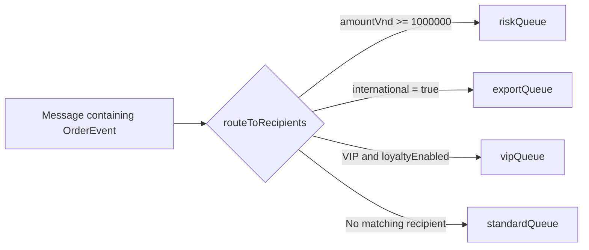
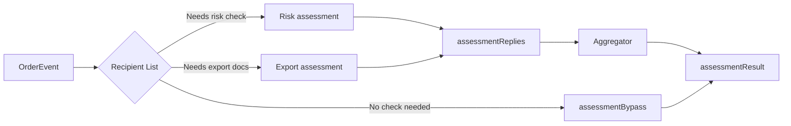

# `routeToRecipients` — Routing a Message to Multiple Recipients

## 1. Objectives and Context

In the `SPRING_INTEGRATION_CORE` module, integration flows are built from `Message`, `MessageChannel`, endpoints, and gateways using Java DSL. This lesson belongs to the **Advanced DSL** chapter and focuses on `routeToRecipients`: how to express the **Recipient List** Enterprise Integration Pattern when a single event must go to multiple independent processing branches.

After this lesson, you will be able to:

- Select recipients using payloads, headers, or SpEL expressions.
- Distinguish target channels from inline subflows.
- Design a default path when no condition matches.
- Explain how channels, send failures, and sequence headers affect the flow.
- Combine transformers, filters, aggregators, and gateways with explicit message contracts.
- Write tests that prove messages reach the exact set of recipients, even when multiple conditions hold true simultaneously.

The examples use `IntegrationFlow.from(...)` syntax from Spring Integration 6.x, referencing the 6.4 documentation branch. The `record` types in the code require Java 17 or later. Java DSL lives in `spring-integration-core`; with Spring Boot, the typical dependency is `spring-boot-starter-integration`. Use the version BOM managed by your project or Spring Boot so Spring libraries stay compatible.

## 2. Recipient List Selects a Set of Targets

Suppose the system receives order events:

- Orders from 1,000,000 VND require a risk assessment.
- International orders require export documentation preparation.
- VIP customer orders are sent to the loyalty program if a header enables that feature.
- If no special branch applies, the order goes to the standard processing queue.

A high-value international order from a VIP customer may need all three of the first branches. The routing result is therefore **a list of matching recipients**, not a single choice.



The router evaluates selectors to determine the list of destinations, then sends to the selected targets. Two selectors both returning `true` result in two sends. A selector returning `false` only excludes that corresponding recipient. This behavior is reflected in [the RecipientListRouter 6.4.0 source code](https://raw.githubusercontent.com/spring-projects/spring-integration/v6.4.0/spring-integration-core/src/main/java/org/springframework/integration/router/RecipientListRouter.java).

Three levels must be distinguished:

| Level | Question to Answer |
| --- | --- |
| Selecting recipients | Which channels or subflows should the message go to? |
| Sending to the channel | Did the channel accept the message, or did a send error occur? |
| Business processing | Did the consumer successfully perform the required task? |

A successful send to a `QueueChannel` only confirms that the message entered the queue. It does not confirm that an email was sent, a document was created, or a transaction was completed.

## 3. Ways to Declare Recipients

`routeToRecipients(...)` accepts a `RecipientListRouterSpec` configuration:

```java
.routeToRecipients(r -> r
    .recipient("auditChannel")
    .recipient("riskChannel", (OrderEvent order) -> order.amountVnd() >= 1_000_000L)
    .recipient("exportChannel", "payload.international()")
    .recipientMessageSelector("vipChannel", message ->
        Boolean.TRUE.equals(message.getHeaders().get("loyaltyEnabled"))))
```

This snippet illustrates the syntax; the named channels in this snippet must exist when applied in an application context.

| API | Data Passed to Selector | When to Use |
| --- | --- | --- |
| `recipient("channel")` | No selector | Always send to this recipient |
| `recipient("channel", (OrderEvent p) -> ...)` | Payload of type `OrderEvent` | Java condition based on payload |
| `recipient("channel", "...")` | SpEL context with `payload`, `headers` | Short condition written as an expression |
| `recipientMessageSelector("channel", m -> ...)` | Full `Message<?>` | Need both payload and headers |
| `recipientFlow(selector, flow)` | Depends on selector overload | Declare an inline processing branch directly |
| `recipientMessageSelectorFlow(selector, flow)` | Full `Message<?>` | Subflow with a message-based condition |

`recipient(...)` overloads also accept a `MessageChannel` instance directly. Method signatures are documented in the [RecipientListRouterSpec Javadoc](https://docs.spring.io/spring-integration/api/org/springframework/integration/dsl/RecipientListRouterSpec.html).

### 3.1. Payload Lambdas and Message Selectors

Here, the lambda parameter is the payload, not `Message<OrderEvent>`:

```java
.recipient("riskQueue",
    (OrderEvent order) -> order.amountVnd() >= 1_000_000L)
```

If headers are needed, choose an API that makes that explicit:

```java
.recipientMessageSelector("vipQueue", message -> {
    OrderEvent order = (OrderEvent) message.getPayload();
    return order.vip()
        && Boolean.TRUE.equals(message.getHeaders().get("loyaltyEnabled"));
})
```

The input contract requires the payload to be `OrderEvent` and `loyaltyEnabled` to have type `Boolean`. A missing header is treated as disabled. The string `"true"` does not equal `Boolean.TRUE`; if headers from HTTP or a broker arrive as strings, normalize them before the router.

Specifying the parameter type explicitly helps the compiler choose the right overload and helps readers recognize the data contract.

### 3.2. SpEL on Payload and Headers

With Java records, you can invoke accessors explicitly:

```java
.recipient("exportQueue", "payload.international()")
.recipient("vipQueue",
    "payload.vip() and headers['loyaltyEnabled'] == true")
```

The expression must return an appropriate boolean result. Complex or reusable rules usually fit better in a clearly named Java method.

Selectors should be side-effect-free checks. Do not update databases, send notifications, or mutate the payload inside a selector; place such work in the branch's endpoint. Evaluating a condition will then never alter the outcome of other selectors.

## 4. Complete Example: Distributing Order Events

The queues in the example serve as observation points for results. No business consumers are attached to the queues yet so learners can pull messages out and inspect the recipient set.

```java
import org.springframework.context.annotation.Bean;
import org.springframework.context.annotation.Configuration;
import org.springframework.integration.channel.DirectChannel;
import org.springframework.integration.channel.QueueChannel;
import org.springframework.integration.config.EnableIntegration;
import org.springframework.integration.dsl.IntegrationFlow;

@Configuration
@EnableIntegration
public class OrderRecipientConfig {

    public record OrderEvent(
        String orderId,
        long amountVnd,
        boolean vip,
        boolean international
    ) {}

    @Bean
    public DirectChannel orderInput() {
        return new DirectChannel();
    }

    @Bean
    public QueueChannel riskQueue() {
        return new QueueChannel(100);
    }

    @Bean
    public QueueChannel exportQueue() {
        return new QueueChannel(100);
    }

    @Bean
    public QueueChannel vipQueue() {
        return new QueueChannel(100);
    }

    @Bean
    public QueueChannel standardQueue() {
        return new QueueChannel(100);
    }

    @Bean
    public IntegrationFlow orderRecipients() {
        return IntegrationFlow.from(orderInput())
            .routeToRecipients(r -> r
                .recipient("riskQueue", (OrderEvent order) ->
                    order.amountVnd() >= 1_000_000L)
                .recipient("exportQueue", "payload.international()")
                .recipientMessageSelector("vipQueue", message -> {
                    OrderEvent order = (OrderEvent) message.getPayload();
                    return order.vip()
                        && Boolean.TRUE.equals(
                            message.getHeaders().get("loyaltyEnabled"));
                })
                .defaultOutputChannel("standardQueue")
                .sendTimeout(500L))
            .get();
    }
}
```

`orderInput` is a `DirectChannel`, so when the sender calls `send(...)`, the router runs on the calling thread. The output queues store messages for consumers to retrieve later. `.sendTimeout(500L)` limits how long a send can wait on a channel that supports blocking, especially when a queue has bounded capacity.

Data contract:

- `orderId` identifies the order at the business level.
- `amountVnd` is a whole-number amount in Vietnamese dong; the threshold uses `>=`.
- `vip` and `international` are normalized before the router.
- `loyaltyEnabled` is a `Boolean` header, which may be absent.

Each selected recipient receives the `OrderEvent` payload of the input event. The router distributes the message; data transformation is placed inside branches when needed.

### 4.1. Expected Results Table

| Order | Amount | International | VIP | `loyaltyEnabled` | Receiving Queues |
| --- | ---: | --- | --- | --- | --- |
| A | 1,500,000 | Yes | Yes | `true` | `riskQueue`, `exportQueue`, `vipQueue` |
| B | 1,000,000 | No | No | `true` | `riskQueue` |
| C | 250,000 | Yes | No | `true` | `exportQueue` |
| D | 250,000 | No | Yes | `true` | `vipQueue` |
| E | 250,000 | No | Yes | Missing header | `standardQueue` |
| F | 250,000 | No | No | `false` | `standardQueue` |

Order A illustrates the difference between Recipient List and an `if/else if` chain: all three conditions are true simultaneously and all three branches must receive the message.

### 4.2. Attaching a Consumer to a Branch

A consumer reading from a `QueueChannel` needs a poller. You can add the following bean to the configuration to consume `riskQueue`:

```java
@Bean
public IntegrationFlow riskConsumer() {
    return IntegrationFlow.from("riskQueue")
        .handle(OrderEvent.class, (order, headers) -> {
            System.out.println("Assessing risk for order " + order.orderId());
            return null;
        }, endpoint -> endpoint.poller(poller -> poller.fixedDelay(100L)))
        .get();
}
```

`return null` terminates a branch without producing a reply. When running the tests in Section 11, use only the initial configuration so the consumer does not drain messages before assertions run.

The queues in the example are in-memory. If messages must survive restarts, design appropriate persistent storage for the channel or use a broker.

## 5. Default Paths and the Rest of the Flow

### 5.1. `defaultOutputChannel(...)`

In the main example, `standardQueue` receives cases where no selector picks a recipient. It is not a branch that always runs after the three recipients.

An unconditional recipient changes this design:

```java
.routeToRecipients(r -> r
    .recipient("auditQueue")
    .recipient("riskQueue", (OrderEvent order) ->
        order.amountVnd() >= 1_000_000L)
    .defaultOutputChannel("standardQueue"))
```

If sending to `auditQueue` succeeds, there is always at least one receiving target. Standard orders only go to `auditQueue` and will not automatically go to `standardQueue` as well. If you need both to audit every order and to classify standard orders, place auditing before the router via an appropriate mechanism or add an explicit selector for the standard-order branch.

When there is no target and no default output is configured, the router throws `MessageDeliveryException`. If the business intentionally drops unmatched messages, you can choose `nullChannel` as the default output and design a way to track dropped message counts.

When `ignoreSendFailures(true)` is enabled, there is a subtlety: in the 6.4 implementation, the router considers the default output if **no send attempt succeeded**. Thus, the default can also receive a message when every send to the selected recipients failed and errors were ignored. If at least one send succeeded, the default is not invoked to compensate for the remaining recipients. This mechanism and the missing-default error are shown in [AbstractMessageRouter 6.4.0](https://raw.githubusercontent.com/spring-projects/spring-integration/v6.4.0/spring-integration-core/src/main/java/org/springframework/integration/router/AbstractMessageRouter.java).

Separate error flows from the standard-order classification path so orders that need no special handling are not mixed with orders that failed delivery to target systems.

### 5.2. `defaultOutputToParentFlow()`

When you want to handle the default case immediately after the router in the DSL chain, use `defaultOutputToParentFlow()`:

```java
@Bean
public IntegrationFlow inlineOrderRecipients() {
    return IntegrationFlow.from("inlineOrderInput")
        .routeToRecipients(r -> r
            .recipientFlow(
                (OrderEvent order) -> order.amountVnd() >= 1_000_000L,
                flow -> flow
                    .<OrderEvent, String>transform(order ->
                        "RISK:" + order.orderId())
                    .channel(c -> c.queue("inlineRiskResult")))
            .recipientFlow(
                (OrderEvent order) -> order.international(),
                flow -> flow
                    .<OrderEvent, String>transform(order ->
                        "EXPORT:" + order.orderId())
                    .channel(c -> c.queue("inlineExportResult")))
            .defaultOutputToParentFlow())
        .<OrderEvent, String>transform(order ->
            "STANDARD:" + order.orderId())
        .channel(c -> c.queue("inlineDefaultResult"))
        .get();
}
```

This is an additional bean you can place in `OrderRecipientConfig`. The channels use distinct names so results do not mix with the main example. The DSL creates `inlineOrderInput` as a named input channel; the `queue(...)` calls register the corresponding result queues.

This flow has two conditions, independent of the VIP condition in the main example:

- High-value international orders produce results in both `inlineRiskResult` and `inlineExportResult`.
- Orders matching neither condition continue to the transformer producing `STANDARD:...`.
- The `STANDARD:...` transformer does not automatically run after every subflow that received a message.

The [Message Routers in Java DSL](https://docs.spring.io/spring-integration/reference/6.4/dsl/java-routers.html) documentation describes `defaultOutputToParentFlow()` as the way to route the default path to the continuation of the parent flow.

Do not use this operator as a step that waits for all branches to finish. If you need a single combined result from multiple recipients, design a reply-collection step.

## 6. Choosing `recipient(...)` vs. `recipientFlow(...)`

`recipient("channelName", selector)` fits when the destination is a clearly named connection point: another flow, a queue, or an adapter. The routing configuration does not need to know the processing details behind that channel.

`recipientFlow(selector, flow -> ...)` fits when a branch is short and placing the condition right next to its transformer or handler makes the behavior immediately readable. The subflow can transform the payload independently while keeping the router readable.

For example, two branches can produce different data contracts:

```text
OrderEvent
  -> risk branch   -> RiskAssessmentRequest
  -> export branch -> ExportDocumentRequest
```

The two messages serve two different receiving systems. If you need to aggregate results, convert responses to a common type or a branch-labeled result model.

In the inline example, each subflow ends at an explicit queue, so the router does not collect replies on its own. Never assume that every `recipientFlow` automatically returns to the DSL chain after `routeToRecipients`.

The router sends to a **channel**, not directly broadcasting to every consumer of that channel. If a `DirectChannel` has multiple subscribers, the channel's dispatcher selects a subscriber using point-to-point semantics. To broadcast to a channel's subscribers, consider `PublishSubscribeChannel`.

## 7. Coordinating with an Aggregator via `applySequence(true)`

Recipient List handles distribution. An aggregator combines related responses into one result.



When `applySequence(true)` is enabled, the router adds sequence information to messages sent to selected recipients. This option is disabled by default on the recipient-list router, as described in [Router Implementations](https://docs.spring.io/spring-integration/reference/7.0/router/implementations.html).

| Header | Role in the Example |
| --- | --- |
| `correlationId` | Links messages from the same dispatch; in the implementation under consideration, the key is derived from the input message ID |
| `sequenceNumber` | Position of the message in the selected destination list |
| `sequenceSize` | Number of destinations selected for this dispatch |

If the configuration has three recipients but only two match, `sequenceSize` on the dispatched copies is `2`. This value reflects the selected destination set, not how many branches succeed in business processing.

### 7.1. Two Assessment Branches, One Combined Result

The following beans can be added to `OrderRecipientConfig`; you will need `import java.util.List;`. The assessment flow uses its own input and output and does not replace `orderRecipients()`.

```java
public record Assessment(String orderId, String check) {}

@Bean
public QueueChannel assessmentResult() {
    return new QueueChannel(100);
}

@Bean
public QueueChannel assessmentDiscard() {
    return new QueueChannel(100);
}

@Bean
public IntegrationFlow assessmentRecipients() {
    return IntegrationFlow.from("assessmentInput")
        .routeToRecipients(r -> r
            .applySequence(true)
            .recipientFlow(
                (OrderEvent order) -> order.amountVnd() >= 1_000_000L,
                flow -> flow
                    .<OrderEvent, Assessment>transform(order ->
                        new Assessment(order.orderId(), "RISK_CHECKED"))
                    .channel("assessmentReplies"))
            .recipientFlow(
                (OrderEvent order) -> order.international(),
                flow -> flow
                    .<OrderEvent, Assessment>transform(order ->
                        new Assessment(order.orderId(), "EXPORT_CHECKED"))
                    .channel("assessmentReplies"))
            .defaultOutputChannel("assessmentBypass"))
        .get();
}

@Bean
public IntegrationFlow combineAssessments() {
    return IntegrationFlow.from("assessmentReplies")
        .aggregate(aggregator -> aggregator
            .groupTimeout(5_000L)
            .sendPartialResultOnExpiry(false)
            .discardChannel("assessmentDiscard"))
        .channel("assessmentResult")
        .get();
}

@Bean
public IntegrationFlow bypassAssessments() {
    return IntegrationFlow.from("assessmentBypass")
        .<OrderEvent, List<Assessment>>transform(order -> List.of(
            new Assessment(order.orderId(), "NO_EXTRA_CHECK")))
        .channel("assessmentResult")
        .get();
}
```

`assessmentReplies` is declared as the named input of the combining flow. Each transformer produces exactly one response and sends it to that channel. By default, the aggregator collects response payloads into a list when the group satisfies the release condition.

The strings `RISK_CHECKED` and `EXPORT_CHECKED` simulate task outcomes. When wiring real services, each branch must define what counts as success or failure and emit contract-compliant results.

By default, the aggregator groups by `correlationId` and determines group completion via sequence headers. Both strategies are customizable; see the [Aggregator documentation](https://docs.spring.io/spring-integration/reference/6.4/aggregator.html).

### 7.2. Conditions for Group Completion

This pattern relies on the contract that **each selected recipient emits exactly one response reaching the aggregator**. The following changes can break that contract:

- A filter inside a branch drops the message without emitting a substitute response.
- A handler returns `null` and ends the branch before the collection channel.
- A branch throws or only logs an error without producing a failure response.
- Code constructs a new `Message` and loses sequence headers.
- A branch emits multiple results while the counter assumes one result per recipient.

If one of the two branches does not reply, the group will never reach two messages. Timeouts bound the wait in that situation; the response contract still must be explicitly defined.

The example configures no partial result emission when a group expires; discarded messages are routed to `assessmentDiscard` for observation. `groupTimeout(5_000L)` uses the aggregator's scheduler and is not a hard deadline for the entire business transaction. Production systems also need a consumer on the discard channel, group cleanup policies, and a suitable message store.

If `ignoreSendFailures(true)` is enabled and a send fails and is ignored, `sequenceSize` still reflects the originally selected recipient count. The aggregator may wait for a reply that never arrives. A more controllable design is to convert branch failures into labeled failure responses while preserving group correlation metadata.

## 8. Execution Flow, Timeouts, and Send Failures

### 8.1. Fan-Out Does Not Create Parallel Execution on Its Own

Recipient List has multiple destinations, but it does not automatically spawn a thread per destination. The channel determines where and when consumers execute:

| Destination Channel | What Does the Sender Observe? | Consequences to Account For |
| --- | --- | --- |
| `DirectChannel` | Handler usually runs immediately on the sender's thread | A slow or failing branch can affect subsequent sends |
| `ExecutorChannel` | Work is handed off to the configured executor | Post-handoff errors need asynchronous handling; executor policies matter |
| `QueueChannel` | Message is placed in the queue if space is available | Consumer needs a poller; a full queue applies backpressure on the sender |
| Broker-backed channel | Depends on adapter, protocol, and configuration | Must understand send acknowledgments, persistence, retries, and redelivery |

Channel semantics are documented in [Message Channel Implementations](https://docs.spring.io/spring-integration/reference/6.4/channel/implementations.html).

If three recipients use `DirectChannel`, sending to the first branch may execute that branch's entire handler before the next send occurs. Do not infer that three tasks start simultaneously just because there are three `.recipient(...)` entries.

With an executor, send order does not guarantee completion order. Aggregator results should carry a branch label or task identifier; avoid assigning business meaning to the order of elements in the returned list.

### 8.2. `sendTimeout(...)` Bounds the Send Operation

If `riskQueue` is full, the router can wait for space up to the timeout limit. This is not a risk-service call timeout because the service has not even been called while enqueuing.

Setting `.sendTimeout(500L)` does not interrupt a synchronous HTTP handler after 500 ms. Connection timeouts, read timeouts, or task deadlines must be configured on the component performing that work.

With multiple recipients, waiting can occur on each send attempt. Channel send limits and the overall request time budget are two separate concepts.

### 8.3. `ignoreSendFailures(...)` Must Follow the Contract

By default, send failures are not ignored. If A receives successfully and sending to B fails, the router may stop before sending to C; the caller receives an error in a synchronous flow. A may already have performed side effects.

```text
Send to A succeeds
  -> send to B fails
  -> exception propagates back to caller
  -> C may not have been sent
```

`ignoreSendFailures(true)` lets the router continue when it catches a `MessagingException` send failure. This flag's scope is limited:

- It does not handle errors while evaluating selectors to build the destination list.
- It does not detect business errors that happen after a message has entered a queue.
- It does not recall messages already sent to other recipients.
- It does not guarantee every recipient executed its business task.

This flag is better suited to branches that can fail independently and have their own monitoring and recovery mechanisms. Mandatory branches require explicit retry policies, error handling, and business state tracking.

### 8.4. `errorChannel` Depends on the Execution Boundary

Errors in a `DirectChannel` chain normally propagate back to the caller. When handled by an asynchronous task or poller managed by Spring Integration, errors can be wrapped as an `ErrorMessage` and sent to the appropriate error channel. Simply setting an `errorChannel` header does not turn a synchronous call into asynchronous error handling; see [Error Handling](https://docs.spring.io/spring-integration/reference/6.4/error-handling.html).

For each branch, identify the component responsible for handling errors: synchronous caller, endpoint with recovery advice, poller, executor, or consumer receiving `ErrorMessage`. Test at the chosen boundary.

### 8.5. Retries Can Cause Duplicate Sends to Already-Succeeded Branches

If a retry wraps the entire fan-out, retrying may re-send to A even though A already succeeded earlier. Calling `routeToRecipients` does not create a distributed rollback across receiving systems.

Idempotency keys can be based on `orderId + branch name + event version`. Do not rely solely on `MessageHeaders.ID` if messages are recreated during retries or redelivery. Transactions also depend on the specific participating resources; do not assume all external system calls roll back together.

## 9. Relating Transformers, Filters, and Gateways

### Transformer

Normalize shared data before the router if selectors expect the same payload type. Place transformers inside subflows if each receiving system expects a different structure. When an aggregator follows, preserve group correlation headers or configure explicit correlation.

### Filter

Use a filter before the router for general acceptance rules, such as rejecting invalid events. Use recipient selectors for branch-selection conditions.

If you add a filter after a recipient in a flow waiting to aggregate results, decide whether discarded messages need a substitute reply such as `SKIPPED`. A silent branch changes the actual number of replies the aggregator receives.

### Gateway

A `void` gateway contract fits fire-and-forget distribution that does not require an immediate return value. If consumers run asynchronously, the gateway call returning does not prove all tasks have finished.

A request-reply gateway needs a single clear final result. If multiple recipients each produce replies, specify how to pick or aggregate them before returning. Section 7 uses a result channel as the foundation for a single combined result contract; wire the appropriate reply path if exposing it via an actual gateway.

## 10. Choosing an Operator for the Problem

| Need | Tool to Consider | Key Distinction |
| --- | --- | --- |
| Check message acceptance rules | `filter(...)` | Decides whether to proceed or drop/route to discard |
| Classify by a key such as order status | `route(...)` | Maps the classification result to destinations |
| Each target has its own condition, possibly overlapping | `routeToRecipients(...)` | Selects multiple recipients via independent selectors |
| Broadcast events to subscribers | `PublishSubscribeChannel` or DSL `publishSubscribeChannel(...)` | Broadcasts per channel/subscriber configuration |
| Split a list of line items into multiple messages | `split(...)` | Breaks payload down into elements |
| Send requests to multiple targets and collect replies | Scatter-Gather or fan-out combined with aggregator | Requires both distribution rules and collection rules |

Do not claim `route(...)` always sends to only one channel: a router can return multiple destinations depending on configuration and return value. The value of `routeToRecipients` lies in directly expressing independent conditions per destination.

If all recipients are unconditional and the primary goal is broadcasting, a publish-subscribe channel can make the configuration clearer. If conditions must be mutually exclusive, prove that with rules and tests; the DSL does not automatically make predicates mutually exclusive.

## 11. Testing the Recipient Set

The following tests target the original `OrderRecipientConfig` in Section 4. They require JUnit Jupiter, Spring Test, and the example's dependencies. In a Boot application, these are typically provided via `spring-boot-starter-test` alongside the Integration starter.

Place the test in the same package as the configuration class to reference `OrderRecipientConfig` as shown below. Code snippets in this article omit package declarations.

```java
import org.junit.jupiter.api.BeforeEach;
import org.junit.jupiter.api.Test;
import org.springframework.beans.factory.annotation.Autowired;
import org.springframework.beans.factory.annotation.Qualifier;
import org.springframework.integration.channel.QueueChannel;
import org.springframework.messaging.Message;
import org.springframework.messaging.MessageChannel;
import org.springframework.messaging.support.MessageBuilder;
import org.springframework.test.context.junit.jupiter.SpringJUnitConfig;

import static org.junit.jupiter.api.Assertions.*;

@SpringJUnitConfig(OrderRecipientConfig.class)
class OrderRecipientConfigTest {

    @Autowired
    @Qualifier("orderInput")
    MessageChannel input;

    @Autowired
    @Qualifier("riskQueue")
    QueueChannel risk;

    @Autowired
    @Qualifier("exportQueue")
    QueueChannel export;

    @Autowired
    @Qualifier("vipQueue")
    QueueChannel vip;

    @Autowired
    @Qualifier("standardQueue")
    QueueChannel standard;

    @BeforeEach
    void clearQueues() {
        for (QueueChannel queue : new QueueChannel[] {
            risk, export, vip, standard
        }) {
            while (queue.receive(0) != null) {
                // Clean up leftover messages between tests sharing the context.
            }
        }
    }

    @Test
    void sendsToEveryMatchingRecipient() {
        var order = new OrderRecipientConfig.OrderEvent(
            "ORDER-A", 1_500_000L, true, true);

        assertTrue(input.send(MessageBuilder.withPayload(order)
            .setHeader("loyaltyEnabled", true)
            .build()));

        assertPayload(order, risk.receive(0));
        assertPayload(order, export.receive(0));
        assertPayload(order, vip.receive(0));
        assertNull(standard.receive(0));
        assertAllQueuesEmpty();
    }

    @Test
    void includesTheExactAmountThreshold() {
        var order = new OrderRecipientConfig.OrderEvent(
            "ORDER-B", 1_000_000L, false, false);

        assertTrue(input.send(MessageBuilder.withPayload(order).build()));

        assertPayload(order, risk.receive(0));
        assertNull(export.receive(0));
        assertNull(vip.receive(0));
        assertNull(standard.receive(0));
        assertAllQueuesEmpty();
    }

    @Test
    void sendsToDefaultWhenVipHeaderIsMissing() {
        var order = new OrderRecipientConfig.OrderEvent(
            "ORDER-E", 250_000L, true, false);

        assertTrue(input.send(MessageBuilder.withPayload(order).build()));

        assertNull(risk.receive(0));
        assertNull(export.receive(0));
        assertNull(vip.receive(0));
        assertPayload(order, standard.receive(0));
        assertAllQueuesEmpty();
    }

    private void assertPayload(
        OrderRecipientConfig.OrderEvent expected,
        Message<?> actual
    ) {
        assertNotNull(actual);
        assertEquals(expected, actual.getPayload());
    }

    private void assertAllQueuesEmpty() {
        assertNull(risk.receive(0));
        assertNull(export.receive(0));
        assertNull(vip.receive(0));
        assertNull(standard.receive(0));
    }
}
```

Assertions verify both receiving targets and non-receiving targets. The final empty-queue check also detects duplicate sends in the synchronous example.

`receive(0)` works here because the router runs over a `DirectChannel`, and enqueuing completes before `input.send(...)` returns. If replaced with asynchronous processing, use an appropriate bounded waiting mechanism; do not assume messages appear immediately when assertions run.

### Scenarios to Add When Extending

| Scenario | What to Prove |
| --- | --- |
| `loyaltyEnabled = false` | VIP does not qualify when the feature is off |
| Only international condition is true | Only `exportQueue` receives |
| Bounded queue is full | Timeout and send failure match the contract |
| Synchronous recipient mid-list fails | Earlier branch may have received, later branch may not have received |
| `applySequence(true)` with two matching recipients | Same correlation, sequence size of 2, distinct sequence numbers |
| Two branches reply to aggregator | One combined result for the dispatch |
| One branch does not reply | Group follows timeout/discard policy |

This is practice test code; the article does not replace compiling and running tests against your project's specific dependency set.

## 12. Common Design Mistakes

| Symptom | Possible Cause | How to Fix |
| --- | --- | --- |
| Order enters more branches than expected | Overlapping predicates while thinking in terms of `else if` | Build a truth/combination table and confirm the recipient set |
| Default path receives no orders | An unconditional recipient always succeeds | Re-examine the role of the unconditional branch and default condition |
| Incorrect header read | Lambda expects payload or header has wrong type | Use a message selector and normalize headers |
| Step after router does not run for routed messages | Misunderstood parent-flow continuation | Wire branch outputs explicitly or use a collection step |
| Slow branch delays fan-out | `DirectChannel` processes synchronously | Evaluate queue/executor and its impact on errors, ordering, and transactions |
| Aggregator waits indefinitely | Missing reply, lost headers, or wrong count | Check branch contracts, sequence headers, and expiry settings |
| Two branches mutate the same mutable data | Payload is shared across sends | Use immutable data or copy at the appropriate boundary |
| Retries produce duplicate emails/transactions | Some recipients already succeeded | Deduplicate using per-branch business keys |

`Message` manages its header map immutably, but it does not deep-freeze the payload object. Creating a new message to add sequence headers does not deep-copy the payload either. `OrderEvent` here only contains `String` and primitives, making it safe to share across branches.

## 13. Practice Exercise

Extend the example with the following steps:

1. Add `fraudQueue` for orders from 5,000,000 VND. Keep the `riskQueue` rule so large orders can enter both branches.
2. Write out a results table for 4,999,999 and 5,000,000 VND orders, with and without the international condition.
3. Add a recipient reading the `sourceSystem` header to specifically select partner events, defining behavior when the header is absent as well.
4. Have two assessment branches create `Assessment` objects and send them to the aggregator; verify result counts match the number of actually matched recipients.
5. Simulate one branch not replying and observe timeout/discard behavior. Then design a branch-labeled failure reply so groups still complete per the contract.

The target outcome is a design where you can clearly identify the recipient set, default path, error-handling boundaries, and completion conditions for every dispatch. These contracts keep flows using `routeToRecipients` easy to understand and verify as the number of branches grows.
