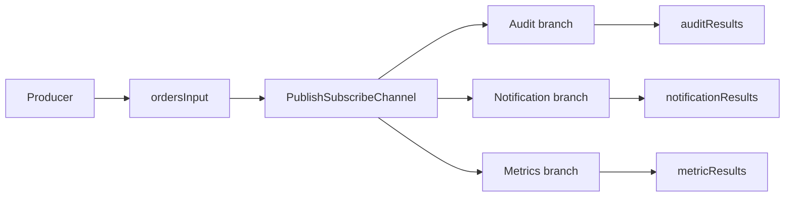
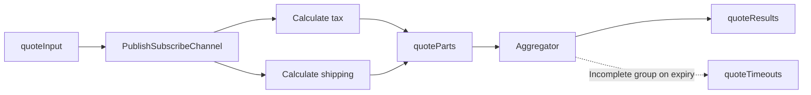

# `publishSubscribe` in the DSL

## 1. Objectives and Context

In the **Advanced DSL** chapter of the **SPRING_INTEGRATION_CORE** module, `publishSubscribeChannel()` lets you express a broadcast point that sends a message to multiple processing flows. It combines `Message`, `MessageChannel`, endpoints, and Java DSL to implement the Publish–Subscribe pattern directly inside a Spring Integration application.

Suppose a system receives an order-created event. The audit department needs to record the event, the notification department needs to build a message for the customer, and the metrics department needs to increment a counter. Each department needs the original event and performs its own work. You can represent those three responsibilities with three subscribers.

After this lesson, you will be able to:

- Declare subflows with `subscribe()` and explain how messages enter each branch.
- Distinguish broadcasting from distributing work to a single consumer.
- Choose between synchronous execution and executor-based execution based on latency and error requirements.
- Wire branch outputs to an aggregator when the business requires a single combined result.
- Test broadcast behavior and identify points prone to missing results.

The examples use Java 17 and Spring Integration 6.x Java DSL syntax, with `IntegrationFlow.from(...)`. The project needs `spring-integration-core` along with compatible Spring dependencies; a Spring Boot project can use `spring-boot-starter-integration` and let Boot's BOM manage versions. The illustrative tests use JUnit Jupiter. Each complete configuration class below is a standalone example.

## 2. How Does Publish–Subscribe Shape a Flow?



In the diagram, each edge leaving the channel represents a subscription. When no error interrupts delivery, the message is sent to every registered subscriber. Each branch receives its input from the broadcast point; the output of the audit branch does not automatically become the input of the notification branch.

`PublishSubscribeChannel` invokes registered `MessageHandler` instances; the channel itself does not have a `receive()` operation like `QueueChannel`. Therefore, to observe outputs in the examples, we place a `QueueChannel` at the end of each branch. See [MessageChannel implementations in Spring Integration](https://docs.spring.io/spring-integration/reference/channel/implementations.html#channel-implementations-publishsubscribechannel).

Three components serve distinct roles:

| Component | Role in Configuration |
| --- | --- |
| `publishSubscribeChannel(...)` | Inserts a broadcast channel at the current position in the flow |
| `subscribe(subflow)` | Registers a subflow to receive messages from that channel |
| Endpoints inside the subflow | Transform, filter, or handle the branch's messages |

The configuration lambda in `subscribe()` runs when Spring builds the flow. It is not a business callback invoked directly each time a producer emits an event. Per-message processing logic lives inside endpoints such as `transform()`, `filter()`, or `handle()`. Java DSL creates and registers channels, handlers, and endpoints in the application context. See [Java DSL configuration mechanics](https://docs.spring.io/spring-integration/reference/dsl.html).

## 3. Subflow Declaration Syntax

Two common forms are:

```java
.publishSubscribeChannel(subscribers -> subscribers
    .subscribe(branchA -> branchA /* branch A endpoints */)
    .subscribe(branchB -> branchB /* branch B endpoints */))
```

```java
.publishSubscribeChannel(executor, subscribers -> subscribers
    .subscribe(branchA -> branchA /* branch A endpoints */)
    .subscribe(branchB -> branchB /* branch B endpoints */))
```

This is a syntax skeleton; each actual branch must be configured with appropriate endpoints or target channels. The first form passes no executor. The second delegates subscriber invocation to the provided executor. The API also supports using an existing `BroadcastCapableChannel`. See the [`publishSubscribeChannel` API](https://docs.spring.io/spring-integration/api/org/springframework/integration/dsl/BaseIntegrationFlowDefinition.html#publishSubscribeChannel(java.util.function.Consumer)).

Each subflow should represent a single clearly named responsibility. If a branch has many processing steps or needs reuse, extract it into a separate `IntegrationFlow` and connect via a named shared channel. Putting all logic inside nested lambdas makes relationships between branches harder to read.

## 4. Complete Example: One Event, Three Independent Branches

This example runs synchronously and uses three queues as result sinks. The strings `AUDIT` and `MAIL` simulate processing outcomes; they do not yet write to a database or send real emails externally.

```java
import java.math.BigDecimal;

import org.springframework.beans.factory.annotation.Qualifier;
import org.springframework.context.annotation.Bean;
import org.springframework.context.annotation.Configuration;
import org.springframework.integration.channel.DirectChannel;
import org.springframework.integration.channel.QueueChannel;
import org.springframework.integration.config.EnableIntegration;
import org.springframework.integration.dsl.IntegrationFlow;

@Configuration(proxyBeanMethods = false)
@EnableIntegration
public class OrderBroadcastConfig {

    public record OrderCreated(
            String orderId,
            String customerId,
            BigDecimal amount) {
    }

    @Bean
    public DirectChannel ordersInput() {
        return new DirectChannel();
    }

    @Bean
    public QueueChannel auditResults() {
        return new QueueChannel(100);
    }

    @Bean
    public QueueChannel notificationResults() {
        return new QueueChannel(100);
    }

    @Bean
    public QueueChannel metricResults() {
        return new QueueChannel(100);
    }

    @Bean
    public IntegrationFlow orderBroadcastFlow(
            @Qualifier("ordersInput") DirectChannel input,
            @Qualifier("auditResults") QueueChannel audit,
            @Qualifier("notificationResults") QueueChannel notifications,
            @Qualifier("metricResults") QueueChannel metrics) {

        return IntegrationFlow.from(input)
                .publishSubscribeChannel(subscribers -> subscribers
                        .id("orderEvents")
                        .subscribe(branch -> branch
                                .<OrderCreated, String>transform(order ->
                                        "AUDIT:" + order.orderId())
                                .channel(audit))
                        .subscribe(branch -> branch
                                .<OrderCreated, String>transform(order ->
                                        "MAIL:" + order.customerId()
                                                + ":" + order.orderId())
                                .channel(notifications))
                        .subscribe(branch -> branch
                                .<OrderCreated, Long>transform(order -> 1L)
                                .channel(metrics)))
                .get();
    }
}
```

`ordersInput` is the input channel. The DSL inserts channel `orderEvents` after it and registers three subflows. Each `transform()` returns the new payload for its branch, and then the branch's terminal channel receives the resulting message.

With the input:

```java
new OrderBroadcastConfig.OrderCreated(
        "OD-001", "CUS-01", new BigDecimal("1200000"));
```

We expect:

| Queue | Received Payload |
| --- | --- |
| `auditResults` | `AUDIT:OD-001` |
| `notificationResults` | `MAIL:CUS-01:OD-001` |
| `metricResults` | `1L` |

The value `1L` represents an event to add to metrics. If you need to store total order counts, place counter-update logic in a dedicated endpoint rather than having subscribers mutate a shared variable inside the payload.

The queues have a capacity of 100 so the example does not grow memory unboundedly. In a real application, they need corresponding consumers and appropriate send configuration if they can fill up. Ending a flow at a queue only indicates the message entered the queue; downstream consumers may not have processed it yet.

### 4.1. Subscriber Using `handle()` Without Producing a Reply

A branch performing a side effect can use a service activator that returns `null`:

```java
.subscribe(branch -> branch
        .handle(OrderCreated.class, (order, headers) -> {
            auditService.record(order.orderId());
            return null;
        }))
```

This snippet assumes `OrderCreated` and `auditService` are in scope in the configuration. The branch stops at the handler because it produces no reply. If subsequent steps after the handler need to keep processing that same payload, the handler must return the payload or produce an appropriate reply.

The decision to terminate a branch should be explicit in the configuration. A handler that returns a result without an output channel can still use the message's `replyChannel` header. In a flow invoked through a gateway, having multiple branches return replies to a single request's reply channel will not automatically produce one combined result.

## 5. What Data Does a Step Written After `publishSubscribeChannel()` Receive?

Consider this variant of the flow in Section 4; `input`, `audit`, `notifications`, and `metrics` are injected channels:

```java
return IntegrationFlow.from(input)
        .publishSubscribeChannel(subscribers -> subscribers
                .subscribe(branch -> branch
                        .<OrderCreated, String>transform(order ->
                                "AUDIT:" + order.orderId())
                        .channel(audit))
                .subscribe(branch -> branch
                        .<OrderCreated, String>transform(order ->
                                "MAIL:" + order.customerId()
                                        + ":" + order.orderId())
                        .channel(notifications)))
        .<OrderCreated, Long>transform(order -> 1L)
        .channel(metrics)
        .get();
```

Here, the metrics branch written after `publishSubscribeChannel()` becomes an additional subscriber of the broadcast channel. The metrics transformer receives `OrderCreated` from the broadcast point. It does not receive the string produced by the audit branch, nor does it receive a list of results from the two branches declared with `subscribe()`.

This way of wiring subflows is illustrated in the [Java DSL subflow support documentation](https://docs.spring.io/spring-integration/reference/dsl/java-subflows.html).

Therefore, the following snippet does NOT represent aggregating two branches' results:

```java
.publishSubscribeChannel(subscribers -> subscribers
        .subscribe(/* branch A */)
        .subscribe(/* branch B */))
.aggregate()
```

This is only an outline to point out a design mistake. An aggregator placed right after the channel becomes another consumer of the broadcast message. To aggregate results A and B, route the output of both branches into the aggregator's input channel. Section 9 builds that configuration.

## 6. Synchronous Execution, Executors, and the Limits of a Successful Send

### 6.1. Without Passing an Executor

The channel invokes subscribers on the sender's thread. If a branch's entire path stays synchronous, the sender executes that branch's endpoints before the send call finishes. A slow branch can increase send latency.

If a branch introduces a `QueueChannel`, `ExecutorChannel`, or another asynchronous boundary, processing beyond that boundary has its own lifecycle. You cannot infer that all business work has completed merely because the initial broadcast channel has no executor.

### 6.2. Passing an Executor

The following beans can be added to `OrderBroadcastConfig` to illustrate a separate asynchronous entry point. Add two imports:

```java
import java.util.concurrent.ThreadPoolExecutor;
import org.springframework.scheduling.concurrent.ThreadPoolTaskExecutor;
```

```java
@Bean
public ThreadPoolTaskExecutor orderFanoutExecutor() {
    ThreadPoolTaskExecutor executor = new ThreadPoolTaskExecutor();
    executor.setCorePoolSize(4);
    executor.setMaxPoolSize(8);
    executor.setQueueCapacity(200);
    executor.setThreadNamePrefix("order-fanout-");
    executor.setRejectedExecutionHandler(
            new ThreadPoolExecutor.AbortPolicy());
    return executor;
}

@Bean
public IntegrationFlow asyncOrderBroadcastFlow(
        @Qualifier("orderFanoutExecutor") ThreadPoolTaskExecutor executor,
        @Qualifier("auditResults") QueueChannel audit,
        @Qualifier("notificationResults") QueueChannel notifications) {

    return IntegrationFlow.from("asyncOrdersInput")
            .publishSubscribeChannel(executor, subscribers -> subscribers
                    .id("asyncOrderEvents")
                    .subscribe(branch -> branch
                            .<OrderCreated, String>transform(order ->
                                    "ASYNC-AUDIT:" + order.orderId())
                            .channel(audit))
                    .subscribe(branch -> branch
                            .<OrderCreated, String>transform(order ->
                                    "ASYNC-MAIL:" + order.orderId())
                            .channel(notifications)))
            .get();
}
```

The executor is declared as a bean so Spring manages pool startup and shutdown. The input channel `asyncOrdersInput` is created by the DSL if no bean with that name exists.

With a multi-worker pool, branches can execute concurrently. Completion order must not be inferred from the order of `subscribe()` calls. A successful send call also does not confirm that tasks succeeded at the business level. Channel threading and error handler behavior are documented in the [`PublishSubscribeChannel` API](https://docs.spring.io/spring-integration/docs/current/api/org/springframework/integration/channel/PublishSubscribeChannel.html).

| Design Question | End-to-End Synchronous Flow | Flow Using a Multi-Worker Executor |
| --- | --- | --- |
| Who runs the branch endpoints? | The thread sending the message | A worker picking up the task from the executor |
| How does a slow branch affect things? | Can block the sender longer | Occupies a worker and can grow the queue |
| Can you rely on completion order? | Depends on handler order and any boundaries in the flow | Must be designed independently of completion order |
| Sender's active transaction? | Can participate if resources and configuration allow | Thread-bound transactions do not automatically propagate to workers |
| What does `send()` returning mean? | Dispatching finished per channel configuration | Not confirmation that all business processing finished |

With the two-subscriber example, every event generates work for two branches. When sizing load, account for events per second, subscriber count, and processing time per branch. The pool numbers in the example are purely illustrative.

When the pool and queue are full, `AbortPolicy` rejects new tasks. A task-submission failure may surface to the sender; other branches may already have been submitted or executed. This is a partial-delivery scenario that must be factored in when deciding whether to retry the whole event.

## 7. Error Handling Across Execution Boundaries

### 7.1. Errors in a Synchronous Flow

By default, `ignoreFailures` is `false`. If a synchronous subscriber throws an exception, the error can propagate back to the sender and halt dispatching before remaining subscribers are invoked. Side effects in branches that already ran are not automatically compensated.

Example of a failing branch:

```java
.subscribe(branch -> branch
        .handle(OrderCreated.class, (order, headers) -> {
            throw new IllegalStateException(
                    "Unable to write audit for " + order.orderId());
        }))
```

`ignoreFailures(true)` allows the dispatcher to ignore handler errors according to channel policy. Only use it when ignoring failures is an explicit business decision and error observability is in place. This setting does not automatically retry or create failure records. See [`PublishSubscribeChannelSpec` options](https://docs.spring.io/spring-integration/api/org/springframework/integration/dsl/PublishSubscribeChannelSpec.html).

### 7.2. Errors in a Subscriber Running on a Worker

When using an executor, business errors occurring later do not unwind onto the sender's call stack as ordinary thrown exceptions. The channel's default error handler publishes an `ErrorMessage` to the channel in the `errorChannel` header, or to the global `errorChannel` if that header is absent. See [Spring Integration Error Handling](https://docs.spring.io/spring-integration/reference/error-handling.html).

To observe this, add the following queue bean and flow to the configuration that already has the executor from Section 6. You need `import org.springframework.messaging.MessageHeaders`:

```java
@Bean
public QueueChannel orderErrors() {
    return new QueueChannel(100);
}

@Bean
public IntegrationFlow asyncFailureDemoFlow(
        @Qualifier("orderFanoutExecutor") ThreadPoolTaskExecutor executor,
        @Qualifier("orderErrors") QueueChannel errors,
        @Qualifier("auditResults") QueueChannel audit) {

    return IntegrationFlow.from("failingAsyncOrdersInput")
            .enrichHeaders(headers ->
                    headers.header(MessageHeaders.ERROR_CHANNEL, errors))
            .publishSubscribeChannel(executor, subscribers -> subscribers
                    .subscribe(branch -> branch
                            .handle(OrderCreated.class, (order, headers) -> {
                                throw new IllegalStateException(
                                        "Simulated error: " + order.orderId());
                            }))
                    .subscribe(branch -> branch
                            .<OrderCreated, String>transform(order ->
                                    "SURVIVING-AUDIT:" + order.orderId())
                            .channel(audit)))
            .get();
}
```

If the executor accepts both tasks, one branch produces an error while the audit branch can still complete. The `orderErrors` queue lets you inspect the `ErrorMessage` in exercises; real applications need a consumer to handle errors, log them, or route them to a recovery mechanism.

The payload of an `ErrorMessage` is a `Throwable`; when it is a `MessagingException`, you can also inspect `failedMessage`. For traceability, keep the event ID or request ID in headers or payload, and give critical steps clear endpoint names.

`PublishSubscribeChannel`'s `errorHandler(...)` is only used when the channel is configured with an executor. In a synchronous configuration, exceptions still follow the call stack. An error flow must also operate reliably; if the error channel's consumer keeps failing, the error cannot be considered recovered just because an `ErrorMessage` was emitted.

### 7.3. Where Should Retries Live?

In the audit, notification, and metrics example, retrying the entire input could re-execute branches that already succeeded. Therefore, a better design typically is:

- Place retries at the endpoint invoking the fallible operation, with explicit attempt counts and retry conditions.
- Make side effects idempotent using a business key such as `eventId` combined with the task name.
- Persist per-task outcomes when recovery is needed after a partial failure.

These are design choices for the example, not guarantees automatically provided by the channel. If recovery after a process crash is required, appropriate durable storage for events or work items is needed.

## 8. Shared Payloads and Per-Branch Filters

### 8.1. Do Not Use the Payload as Shared Memory to Coordinate Subscribers

By default, `applySequence` is `false`. The channel can deliver the same `Message` instance to subscribers. When `applySequence(true)` is enabled, the channel creates messages with the corresponding sequence headers, while still keeping the same payload reference. Thus, creating separate messages per branch does not mean the payload is deep-copied. See [`PublishSubscribeChannel` configuration](https://docs.spring.io/spring-integration/reference/channel/configuration.html#channel-configuration-publishsubscribechannel).

The following design creates hidden coupling between branches:

```java
// The payload is a mutable Map.
payload.put("auditCompleted", true);
```

If another branch reads that key to decide how to proceed, the outcome depends on execution timing and concurrent access. This also breaks the principle that each subscriber processes an independent event.

Use immutable payloads or construct a new result payload in each branch. `record OrderCreated` in the example contains `String` and `BigDecimal`, both suitable for immutable usage. If a record holds mutable `List` or `Map` fields, defensive copying or an appropriate data design is needed; using the `record` keyword alone does not solve all shared-data issues.

### 8.2. A Branch Can Filter After Receiving the Broadcast

Suppose notifications should only be sent for orders of one million VND or more. You can replace the notification subflow with:

```java
.subscribe(branch -> branch
        .<OrderCreated>filter(order ->
                order.amount().compareTo(new BigDecimal("1000000")) >= 0)
        .<OrderCreated, String>transform(order ->
                "HIGH-VALUE-MAIL:" + order.orderId())
        .channel(notifications))
```

For orders below the threshold, the notification branch stops at the filter under default configuration; the audit and metrics branches can still process the event. This shows two distinct steps: the channel selects all subscribers, and then the filter decides whether the message continues inside a given branch.

When branches must return a full set of results to an aggregator, a filter dropping a message removes part of the expected output. In that case, adjust the reply contract—such as always returning `SKIPPED` for inapplicable branches—or use a different completion policy.

## 9. Collecting Results with `applySequence(true)` and an Aggregator

### 9.1. Defining the Output to Collect

A cost-calculation request needs tax and shipping fee results, then returns a summary. Both branches must send their outputs to the same `quoteParts` channel:



When `applySequence(true)` is enabled at the broadcast point, branch messages carry correlation and sequence metadata for aggregation:

| Header | Meaning in the Two-Subscriber Example |
| --- | --- |
| `correlationId` | Links messages produced by the same broadcast |
| `sequenceNumber` | Position of the subscriber in the sequence, typically 1 or 2 |
| `sequenceSize` | Number of subscribers in this broadcast, here 2 |

The sequence number represents position in the group; it does not guarantee branch 1 will finish before branch 2.

### 9.2. Complete Configuration

```java
import java.math.BigDecimal;
import java.util.List;

import org.springframework.beans.factory.annotation.Qualifier;
import org.springframework.context.annotation.Bean;
import org.springframework.context.annotation.Configuration;
import org.springframework.integration.channel.DirectChannel;
import org.springframework.integration.channel.QueueChannel;
import org.springframework.integration.config.EnableIntegration;
import org.springframework.integration.dsl.IntegrationFlow;

@Configuration(proxyBeanMethods = false)
@EnableIntegration
public class PricingFanoutConfig {

    public record QuoteRequest(String orderId, BigDecimal baseAmount) {
    }

    public record QuotePart(String source, BigDecimal amount) {
    }

    public record QuoteSummary(List<QuotePart> parts) {
        public QuoteSummary {
            parts = List.copyOf(parts);
        }
    }

    @Bean
    public DirectChannel quoteInput() {
        return new DirectChannel();
    }

    @Bean
    public DirectChannel quoteParts() {
        return new DirectChannel();
    }

    @Bean
    public QueueChannel quoteResults() {
        return new QueueChannel(100);
    }

    @Bean
    public QueueChannel quoteTimeouts() {
        return new QueueChannel(100);
    }

    @Bean
    public IntegrationFlow quoteFanoutFlow(
            @Qualifier("quoteInput") DirectChannel input,
            @Qualifier("quoteParts") DirectChannel parts) {

        return IntegrationFlow.from(input)
                .publishSubscribeChannel(subscribers -> subscribers
                        .applySequence(true)
                        .subscribe(branch -> branch
                                .<QuoteRequest, QuotePart>transform(request ->
                                        new QuotePart("tax",
                                                request.baseAmount().multiply(
                                                        new BigDecimal("0.10"))))
                                .channel(parts))
                        .subscribe(branch -> branch
                                .<QuoteRequest, QuotePart>transform(request ->
                                        new QuotePart("shipping",
                                                new BigDecimal("30000")))
                                .channel(parts)))
                .get();
    }

    @Bean
    public IntegrationFlow quoteAggregationFlow(
            @Qualifier("quoteParts") DirectChannel parts,
            @Qualifier("quoteResults") QueueChannel results,
            @Qualifier("quoteTimeouts") QueueChannel timeouts) {

        return IntegrationFlow.from(parts)
                .aggregate(aggregator -> aggregator
                        .outputProcessor(group -> new QuoteSummary(
                                group.getMessages().stream()
                                        .map(message ->
                                                (QuotePart) message.getPayload())
                                        .toList()))
                        .groupTimeout(5000)
                        .sendPartialResultOnExpiry(false)
                        .discardChannel(timeouts))
                .channel(results)
                .get();
    }
}
```

With `baseAmount = 1000000`, the summary contains a `tax = 100000.00` part and a `shipping = 30000` part. The tax and shipping rules are illustrative only and do not represent real commercial or legal policies.

By default, the aggregator uses correlation headers to group messages and sequence metadata to decide when a group is complete. The two DSL transformers create new payloads while preserving headers needed for aggregation. If you replace them with code that manually constructs a new `Message`, preserve the required correlation and sequence headers. See [aggregator correlation and release strategies](https://docs.spring.io/spring-integration/reference/aggregator.html).

In the example, `QuoteSummary` holds the new list of parts. The `source` property identifies which branch each value came from; consumers do not need to depend on element ordering in the list.

### 9.3. Each Branch's Contract

For default aggregation to work properly, each subscriber participating in the sequence must produce exactly one result for that aggregator. From this contract, the following situations must be handled:

- **A branch produces no reply:** the group may remain incomplete until expiry.
- **A branch emits multiple messages:** the number of parts reaching the aggregator may differ from the initial subscriber count.
- **Adding an observer subscriber:** `sequenceSize` increases even though the new subscriber sends no output to `quoteParts`.
- **Appending a step after pubsub:** that step can become an extra subscriber and alter the sequence size.

Therefore, an audit branch that merely observes events should sit outside the set of branches used to build the aggregated result, or the entire correlation/release strategy must be redesigned for the new structure.

### 9.4. Timeouts, Errors, and Group Lifecycle

In the example, `groupTimeout(5000)` sets how long the group waits after receiving a message, with the schedule refreshed as the group sees activity. `sendPartialResultOnExpiry(false)` ensures incomplete groups do not emit a `QuoteSummary` as if it were complete; messages discarded upon expiry are sent to `quoteTimeouts` per configuration.

This timeout does not cancel tasks running inside branches. It also only applies once a group has been formed by at least one result. If all branches fail before emitting a result, request-deadline tracking is needed at the caller or orchestration level.

Applications under continuous load need to choose a `MessageGroupStore`, a cleanup policy for completed group metadata, handling for late-arriving results, and idempotency records. Do not automatically purge groups immediately upon completion without considering that duplicate or late messages could start a new group.

In particular, do not replace the correlation key with `orderId` alone if multiple pricing calculations for the same order can run concurrently. In that case, assign a unique request ID per calculation so results from two requests never mix into the same group.

## 10. Testing Broadcast Behavior via Observable Results

### 10.1. Verifying One Event Produces All Results

The following test uses the original `OrderBroadcastConfig` from Section 4. It boots a real application context, sends a message through the channel, and checks all three outputs.

```java
import java.math.BigDecimal;

import org.junit.jupiter.api.Test;
import org.springframework.context.annotation.AnnotationConfigApplicationContext;
import org.springframework.integration.channel.QueueChannel;
import org.springframework.messaging.Message;
import org.springframework.messaging.MessageChannel;
import org.springframework.messaging.support.GenericMessage;

import static org.junit.jupiter.api.Assertions.*;

class OrderBroadcastTest {

    @Test
    void broadcastsOneOrderToThreeSubscribers() {
        try (var context = new AnnotationConfigApplicationContext(
                OrderBroadcastConfig.class)) {

            MessageChannel input =
                    context.getBean("ordersInput", MessageChannel.class);
            QueueChannel audit =
                    context.getBean("auditResults", QueueChannel.class);
            QueueChannel notifications =
                    context.getBean("notificationResults", QueueChannel.class);
            QueueChannel metrics =
                    context.getBean("metricResults", QueueChannel.class);

            var order = new OrderBroadcastConfig.OrderCreated(
                    "OD-001", "CUS-01", new BigDecimal("1200000"));

            assertTrue(input.send(new GenericMessage<>(order)));
            assertPayload("AUDIT:OD-001", audit.receive(1000));
            assertPayload("MAIL:CUS-01:OD-001", notifications.receive(1000));
            assertPayload(1L, metrics.receive(1000));

            assertNull(audit.receive(0));
            assertNull(notifications.receive(0));
            assertNull(metrics.receive(0));
        }
    }

    private static void assertPayload(Object expected, Message<?> actual) {
        assertNotNull(actual);
        assertEquals(expected, actual.getPayload());
    }
}
```

`receive(1000)` sets a bounded wait, while `receive(0)` checks immediately that the queue has no remaining messages. In this synchronous flow, once `send()` returns successfully, results have already reached the queues, so checking for no leftovers detects a branch accidentally emitting extra messages.

### 10.2. Testing Fan-Out and Aggregation

For `PricingFanoutConfig`, you can add the following standalone test. Additional imports beyond those in Section 10.1 are `java.util.Map` and `java.util.stream.Collectors`:

```java
@Test
void collectsTaxAndShippingForOneRequest() {
    try (var context = new AnnotationConfigApplicationContext(
            PricingFanoutConfig.class)) {

        MessageChannel input =
                context.getBean("quoteInput", MessageChannel.class);
        QueueChannel results =
                context.getBean("quoteResults", QueueChannel.class);

        var request = new PricingFanoutConfig.QuoteRequest(
                "OD-002", new BigDecimal("1000000"));
        assertTrue(input.send(new GenericMessage<>(request)));

        Message<?> reply = results.receive(1000);
        assertNotNull(reply);
        var summary = assertInstanceOf(
                PricingFanoutConfig.QuoteSummary.class, reply.getPayload());

        assertEquals(2, summary.parts().size());
        Map<String, BigDecimal> amounts = summary.parts().stream()
                .collect(Collectors.toMap(
                        PricingFanoutConfig.QuotePart::source,
                        PricingFanoutConfig.QuotePart::amount));

        assertEquals(0,
                new BigDecimal("100000.00").compareTo(amounts.get("tax")));
        assertEquals(0,
                new BigDecimal("30000").compareTo(amounts.get("shipping")));
        assertNull(results.receive(0));
    }
}
```

The test compares by branch name so it does not depend on result ordering, and uses `compareTo()` to compare monetary amounts regardless of `BigDecimal` scale.

### 10.3. Scenarios to Add When Changing the Flow

| Scenario | What to Observe |
| --- | --- |
| Notification branch has a filter | Orders below threshold still produce audit and metric, no notification |
| Synchronous subscriber fails | Sender receives the appropriate error and it is clear which branches ran side effects |
| Asynchronous subscriber fails | `ErrorMessage` is emitted; remaining branch still produces its result if task was accepted |
| Two concurrent requests | Each summary contains only the parts for its corresponding request |
| One branch produces no result | Full summary is not emitted; incomplete group follows timeout policy |
| Re-publishing the same event | Side effects do not repeat beyond the chosen idempotency rules |
| Executor rejects task | Send failure and potential partial delivery are captured |

In asynchronous tests, wait for messages at the destination queue or use a latch with a timeout. Do not use `Thread.sleep()` as proof that every subscriber finished. Immediately checking an empty queue right after a single receive also does not prove no late message will arrive; choose a termination condition or observation window suited to the behavior under test.

## 11. Choosing a Structure That Fits the Requirement

| Requirement | Structure to Consider |
| --- | --- |
| Every independent task must receive the event | `publishSubscribeChannel()` with clearly scoped subscribers |
| Distribute one type of work across multiple workers | Point-to-point channel such as `DirectChannel`, `ExecutorChannel`, or an appropriate queue |
| Pick branches based on business data | Conditional router or recipient list |
| Observe an existing processing flow | `wireTap()` with explicitly configured execution and error policies |
| Return one result after multiple calculations | Branches sending outputs to an aggregator or an appropriate scatter–gather structure |
| Broadcast events across processes with durable storage | Broker-backed channel/adapter with appropriate persistence and acknowledgment configuration |

The standard `PublishSubscribeChannel` in this lesson operates in-process. The name publish–subscribe does not automatically add durable persistence, replay for late-joining subscribers, or distributed acknowledgments. Using a broker-backed channel is a separate architectural choice; Java DSL provides overloads accepting `BroadcastCapableChannel` to support subflow configuration on certain channels of that type.

If the business requires auditing to succeed before sending a notification, model that ordering dependency with sequential endpoints. If the business allows only one reply back to the caller, design a dedicated aggregated output and let a gateway receive that reply. The shape of the flow should reflect the business guarantees the system must actually uphold.

## 12. Extended Practice Exercises

Work through the following steps on the examples in this lesson:

1. Add a filter to the notification branch and send one order below the threshold and one above. Observe the outputs of all three branches.
2. Add an executor and log the thread name in each handler to observe execution across workers. Use the result queues to confirm completion.
3. Have the audit branch throw an error in the asynchronous flow, receive the `ErrorMessage` from `orderErrors`, and match the order ID in the error against the submitted event.
4. In the pricing example, make one branch emit no result. Observe the aggregator waiting and expiring; then update the branch to return a result with an explicit inapplicable status.
5. Send two pricing requests for the same `orderId` and verify each broadcast still produces its own separate result group.

With every change, determine upfront the number of subscribers at the broadcast point, the number of results each branch emits, and the channel receiving each result. Those three facts explain how the flow behaves as you add filters, executors, or aggregators.
