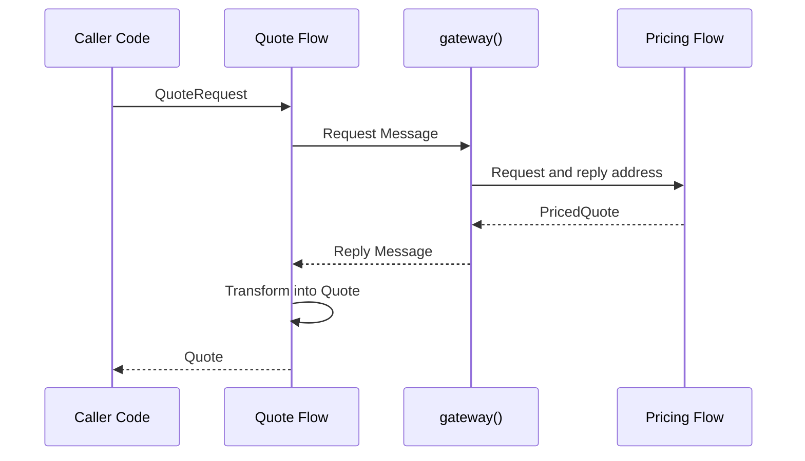

# Gateway in the DSL

## 1. Objectives and Scope

In the **Advanced DSL** chapter of the **SPRING_INTEGRATION_CORE** module, this lesson shows how to use `.gateway(...)` so one message flow can invoke another flow, receive a reply, and continue processing. This is useful when you want to reuse a capability such as pricing, data normalization, or validation while preserving the `Message`, `MessageChannel`, and endpoint model.

After this lesson, you will be able to:

- Choose properly between invoking a subflow via a gateway, forwarding a message to a channel, and calling a service directly.
- Define a request–reply contract for the invoked flow.
- Configure timeouts and handle scenarios where no reply arrives.
- Combine gateways with transformers, filters, routers, and aggregators.
- Write tests for results, headers, rejected branches, and timeouts.

**Example conventions:** Java 17 or later, Spring Integration **6.5.x**, Java DSL built into `spring-integration-core`. Test code uses JUnit Jupiter. With Spring Boot, select dependency versions via the application's BOM so Spring libraries remain compatible. Timeouts in this article are configured explicitly so readers do not have to rely on version-specific defaults.

## 2. What Problem Does a Mid-Flow Gateway Solve?

Suppose the system has two flows that need pricing:

```text
Create Quote ─────┐
                  ├──> Calculate Price ───> Pricing Result
Check Cart   ─────┘
```

Each calling flow uses the pricing result in its own way. If you hard-wire the output of the pricing flow to a channel belonging to the quote flow, the cart-checking flow cannot easily reuse that logic.

`.gateway(...)` creates a request–reply call point: it sends a message to the target flow's input, receives a reply, and passes that reply to the next endpoint in the calling flow. Spring Integration implements this operator via `GatewayMessageHandler`. See [Operator gateway()](https://docs.spring.io/spring-integration/reference/6.5/dsl/java-gateway.html).



The key point to remember is that **the endpoint after the gateway receives the subflow's result**. It does not automatically receive the original payload again, nor does it automatically receive a pair containing both request and reply.

If downstream steps need both the request and the result, design a reply type that carries all required data. For example, `PricedQuote(QuoteRequest request, BigDecimal total)` explicitly records which request was priced.

## 3. Three Forms Using the Word "Gateway" with Different Roles

| Declaration Form | Where Used | Role |
|---|---|---|
| `.gateway("pricingRequests")` | In the middle of an `IntegrationFlow` | The current flow calls another flow and receives a reply |
| `IntegrationFlow.from(QuoteApi.class, ...)` | At the start of a flow | Creates a proxy so Java code calls an interface and enters the flow |
| `@MessagingGateway` and `@Gateway` | Service interface | Declares a gateway using annotations |

An application can use gateways at both boundaries:

```text
QuoteApi.quote(...)
    → entry gateway proxy
    → filter
    → mid-flow gateway("pricingRequests")
    → transformer
    → returns Quote
```

With `IntegrationFlow.from(Interface.class)`, the DSL wires the proxy's input directly into the flow being defined. The interface does not require `@MessagingGateway`. When using this approach, avoid registering another proxy for the same interface via annotation scanning. Refer to [IntegrationFlow as a Gateway](https://docs.spring.io/spring-integration/reference/6.5/dsl/integration-flow-as-gateway.html).

The two configuration callbacks also have different types:

```java
// GatewayProxySpec: configures the proxy invoked by Java code.
IntegrationFlow.from(QuoteApi.class, proxy -> proxy
        .beanName("quoteApi")
        .requestTimeout(200)
        .replyTimeout(1500));

// GatewayEndpointSpec: configures a mid-flow gateway.
// This is a segment within a DSL chain.
.gateway("pricingRequests", gateway -> gateway
        .id("pricingGateway")
        .requestTimeout(200L)
        .replyTimeout(1000L));
```

`beanName(...)` sets the proxy bean name; `id(...)` sets the endpoint identifier. Do not assume every configuration method exists on both specs. The respective APIs are [GatewayProxySpec](https://docs.spring.io/spring-integration/docs/6.5.0/api/org/springframework/integration/dsl/GatewayProxySpec.html) and [GatewayEndpointSpec](https://docs.spring.io/spring-integration/docs/6.5.0/api/org/springframework/integration/dsl/GatewayEndpointSpec.html).

## 4. The Subflow's Request–Reply Contract

Before writing a gateway, describe the target flow as a service contract.

| Element | Pricing Example |
|---|---|
| Input | `QuoteRequest` |
| Output | One `PricedQuote` |
| Business correlation data | `orderId` |
| Success path | Returns the total amount |
| Invalid input | Reports an explicit error |
| Processing error | Propagates error or builds a fallback reply with its own contract |
| No timely reply | Applies timeout policy |

### 4.1. Where Does the Reply Go?

The gateway supplies the reply address for the call. At the end of a subflow, an endpoint that produces a result without declaring an output channel can send the reply via the `replyChannel` header. This applies the **Return Address** pattern.

For a service activator, an explicitly configured output channel takes precedence over the reply address in the header. Therefore, flows serving a gateway typically let the final endpoint return its result naturally. See [Service Activator](https://docs.spring.io/spring-integration/reference/6.5/service-activator.html).

```java
@Bean
IntegrationFlow pricingFlow() {
    return IntegrationFlow.from("pricingRequests")
            .<QuoteRequest>handle((request, headers) ->
                    calculate(request))
            .get();
}
```

The snippet above illustrates the structure; `calculate(...)` is a business method supplied by the application.

If you append `.channel("someResults")` at the end, the reply goes to that channel instead. When nothing routes the result back to the gateway, the calling flow receives no reply.

### 4.2. Which Headers Must Be Preserved?

Business headers such as `requestId`, `tenantId`, and tracing keys should follow clear conventions. Infrastructure headers such as `replyChannel` and `errorChannel` serve the reply and error paths.

Do not strip headers wholesale inside a subflow without considering the reply path. When constructing a `Message` manually or integrating via an adapter with a header mapper, determine which headers are forwarded.

Do not use `MessageHeaders.ID` as a durable business identifier. Creating a new message can generate a new ID. In the quote example, `orderId` identifies the business entity; `requestId` helps trace a single invocation.

An in-memory temporary reply address is also not directly usable across two separate processes. If a subflow crosses a broker or network protocol, design correlation and reply mechanisms appropriate to that protocol.

## 5. Ways to Call a Gateway in Java DSL

### 5.1. Calling by Channel Name

```java
.gateway("pricingRequests", g -> g
        .requestTimeout(200L)
        .replyTimeout(1000L))
```

This suits cases where a named channel serves as the stable entry point for pricing logic. The target flow must exist and have an appropriate consumer.

### 5.2. Calling by `MessageChannel` Instance

```java
.gateway(pricingRequests, g -> g
        .requestTimeout(200L)
        .replyTimeout(1000L))
```

`pricingRequests` is an injected `MessageChannel` bean. When multiple channels share the same type, use `@Qualifier` to specify the intended channel.

### 5.3. Calling an `IntegrationFlow` or Subflow

```java
@Bean
IntegrationFlow normalizeCaller() {
    return IntegrationFlow.from("normalizeRequests")
            .gateway(normalizeSubflow(), g -> g
                    .replyTimeout(500L))
            .<String, String>transform(value -> "[" + value + "]")
            .get();
}

private IntegrationFlow normalizeSubflow() {
    return flow -> flow
            .<String, String>transform(String::trim)
            .<String, String>transform(
                    value -> value.toUpperCase(java.util.Locale.ROOT));
}
```

The subflow above belongs to the caller's configuration. If multiple places need to invoke a shared flow, define a separate bean and inject it, or expose a shared request channel. In particular, with `@Configuration(proxyBeanMethods = false)`, calling a `@Bean` method directly is just an ordinary Java method call; use injection to avoid accidentally instantiating duplicate flows.

You can write the same subflow inline at the call site:

```java
.gateway(subflow -> subflow
        .<String, String>transform(String::trim)
        .<String, String>transform(
                value -> value.toUpperCase(java.util.Locale.ROOT)))
```

Overloads by channel name, channel object, and `IntegrationFlow` are listed in the [gateway operator documentation](https://docs.spring.io/spring-integration/reference/6.5/dsl/java-gateway.html).

## 6. Complete Example: Quote Flow Calling Pricing Flow

The example below makes two design decisions:

1. The filter rejects invalid input with an exception so the caller gets an unambiguous terminal outcome.
2. The pricing flow returns `PricedQuote` containing both the request and total amount, enabling the parent flow to build the reply without relying on shared mutable state.

The functional dependency is `org.springframework.integration:spring-integration-core`. Java DSL is built into core; the example does not need a separate DSL module.

Place the following types in the same file `QuoteFlowConfiguration.java`:

```java
import java.math.BigDecimal;
import java.util.Objects;

import org.springframework.context.annotation.Bean;
import org.springframework.context.annotation.Configuration;
import org.springframework.integration.channel.DirectChannel;
import org.springframework.integration.config.EnableIntegration;
import org.springframework.integration.dsl.IntegrationFlow;
import org.springframework.messaging.MessageChannel;

@Configuration(proxyBeanMethods = false)
@EnableIntegration
public class QuoteFlowConfiguration {

    public record QuoteRequest(
            String orderId,
            int quantity,
            BigDecimal unitPrice) {

        public QuoteRequest {
            Objects.requireNonNull(orderId, "orderId");
            Objects.requireNonNull(unitPrice, "unitPrice");
        }
    }

    public record PricedQuote(
            QuoteRequest request,
            BigDecimal total) {
    }

    public record Quote(
            String orderId,
            BigDecimal total,
            String status) {
    }

    public interface QuoteApi {
        Quote quote(QuoteRequest request);
    }

    @Bean
    public MessageChannel quoteRequests() {
        return new DirectChannel();
    }

    @Bean
    public MessageChannel pricingRequests() {
        return new DirectChannel();
    }

    @Bean
    public IntegrationFlow quoteFlow() {
        return IntegrationFlow.from(
                        QuoteApi.class,
                        proxy -> proxy
                                .beanName("quoteApi")
                                .requestTimeout(200)
                                .replyTimeout(1500))
                .channel("quoteRequests")
                .<QuoteRequest>filter(
                        request -> request.quantity() > 0
                                && request.unitPrice().signum() >= 0,
                        endpoint -> endpoint
                                .throwExceptionOnRejection(true))
                .gateway("pricingRequests", gateway -> gateway
                        .id("pricingGateway")
                        .requestTimeout(200L)
                        .replyTimeout(1000L)
                        .errorOnTimeout(true))
                .<PricedQuote, Quote>transform(priced ->
                        new Quote(
                                priced.request().orderId(),
                                priced.total(),
                                "CALCULATED"))
                .get();
    }

    @Bean
    public IntegrationFlow pricingFlow() {
        return IntegrationFlow.from("pricingRequests")
                .<QuoteRequest>handle(
                        (request, headers) -> {
                            BigDecimal total = request.unitPrice()
                                    .multiply(BigDecimal.valueOf(
                                            request.quantity()));
                            return new PricedQuote(request, total);
                        },
                        endpoint -> endpoint.requiresReply(true))
                .get();
    }
}
```

Invoking from Java code:

```java
import java.math.BigDecimal;

import org.springframework.context.annotation.AnnotationConfigApplicationContext;

public class QuoteExample {

    public static void main(String[] args) {
        try (var context = new AnnotationConfigApplicationContext(
                QuoteFlowConfiguration.class)) {

            var api = context.getBean(
                    QuoteFlowConfiguration.QuoteApi.class);

            var quote = api.quote(
                    new QuoteFlowConfiguration.QuoteRequest(
                            "ORDER-101",
                            3,
                            new BigDecimal("125000")));

            System.out.println(quote);
        }
    }
}
```

Expected output:

```text
Quote[orderId=ORDER-101, total=375000, status=CALCULATED]
```

Payload progression:

| Position | Payload Type | Typical Value |
|---|---|---|
| Through `QuoteApi` proxy | `QuoteRequest` | `ORDER-101, 3, 125000` |
| After filter | `QuoteRequest` | Valid request |
| Entering `pricingRequests` | `QuoteRequest` | Pricing input |
| Pricing flow returns | `PricedQuote` | Request and `375000` |
| After gateway | `PricedQuote` | Subflow reply |
| After transformer | `Quote` | `ORDER-101, 375000, CALCULATED` |

`DirectChannel` is chosen so the example runs on the calling thread. The two timeout configurations on the proxy and mid-flow gateway belong to two separate call points; they are not nested layers automatically enforcing an overall execution deadline.

## 7. Comparing Gateway with Channel, Handle, and WireTap

| Need | Suitable Choice | Reason |
|---|---|---|
| Call another flow and process the result immediately in the current flow | `.gateway(...)` | Expresses a request–reply call point |
| Forward a message to a channel | `.channel(...)` | Continues the message path |
| Call a local business method | `.handle(...)` | No need to introduce another messaging boundary |
| Send a copy for monitoring or auditing | `.wireTap(...)` | Observer branch that does not replace the payload with a reply |
| Choose destination based on content | `.route(...)` | Decides routing path |
| Call an HTTP API and use the HTTP response | HTTP outbound gateway | Connects to an external protocol |

Sending to a `DirectChannel` may invoke the consumer on the same thread. That does not turn a channel into a flow invocation with a declared return point like `.gateway(...)`. A channel describes a transport path; a gateway describes a request–reply interaction.

Similarly, a subflow may contain an HTTP outbound gateway, but `.gateway("pricingRequests")` itself only calls through a Spring Integration channel; it does not create an HTTP request on its own.

Do not split a simple multiplication across multiple gateways just to make a DSL chain longer. In the example, the pricing flow is extracted to illustrate a reusable contract; in production applications, weigh reuse value against observability needs.

## 8. Timeouts: Distinguishing Request Send from Reply Wait

### 8.1. Meaning of Each Setting

| Setting | Controls | Does Not Guarantee |
|---|---|---|
| `requestTimeout(200L)` | Send wait time when the channel supports blocking sends | Stopping the handler after 200 ms |
| `replyTimeout(1000L)` | Wait time for a reply after the send call returns | Total processing time capped at 1000 ms |
| `errorOnTimeout(true)` | Turns reply-wait expiration into an error | Cancelling already-dispatched work |
| `requiresReply(true)` on target handler | Detects a handler returning `null` | Detecting every branch that drops a message |

Timeout values are in milliseconds. `GatewayEndpointSpec.errorOnTimeout(...)` is available since Spring Integration 6.2; it raises an error instead of returning an empty result when reply reception times out. See [GatewayEndpointSpec](https://docs.spring.io/spring-integration/docs/6.5.0/api/org/springframework/integration/dsl/GatewayEndpointSpec.html).

**Do not use `requestTimeout(0L)` to address a subflow not replying.** That value tells the send operation not to block if the channel supports timeouts; waiting to receive a reply is governed by `replyTimeout`.

### 8.2. Over a `DirectChannel`: Handler Still Runs on Calling Thread

```text
Calling thread
  ├─ sends request
  ├─ executes pricing handler for 5 seconds
  ├─ handler produces reply
  ├─ send operation returns
  └─ gateway receives already-available reply
```

If the handler takes 5 seconds, `replyTimeout(1000L)` does not interrupt the handler at the 1-second mark. The reply wait timer starts after the send operation returns. This is an important limitation of timeouts on synchronous gateways, explained in [Gateway Timeouts](https://docs.spring.io/spring-integration/reference/6.5/gateway.html#gateway-timeouts).

If the handler calls HTTP, JDBC, or another resource, configure timeouts on the underlying I/O operation itself.

### 8.3. Over a `QueueChannel` or `ExecutorChannel`

With `QueueChannel`, messages can be buffered in a queue and require a consumer with a poller to process them. With `ExecutorChannel`, the executor typically hands work off to another thread. Once the send operation returns, the synchronous gateway waits for a reply within its configured timeout.

```text
Calling thread: sends request → begins waiting for reply → times out or receives result
Worker thread:            picks up request → calculates price → sends reply
```

Switching to an executor-backed channel does not automatically make the gateway caller non-blocking. If the gateway still performs synchronous request–reply, the calling thread still waits for the result.

`DirectChannel`, `QueueChannel`, and `ExecutorChannel` differ in delivery semantics; changing threads also affects transaction contexts. Refer to [Message Channel Implementations](https://docs.spring.io/spring-integration/reference/6.5/channel/implementations.html).

### 8.4. Timeout Does Not Mean Business Cancellation

Suppose the subflow already submitted a payment request and then the gateway timed out. The transaction on the payment system side may still complete.

Therefore, before retrying a call with side effects:

- Define an idempotency key, such as a payment request ID.
- Specify how to query the status of a prior request.
- Record whether the request was accepted or only queued for sending.
- Design how late-arriving replies are handled.

In a read-only pricing flow, recalculation is usually simpler. In payment-capture or inventory-reservation flows, uncontrolled retries can trigger duplicate operations.

If flows are nested multiple levels deep, set time budgets based on the outermost request's deadline. Do not simply add up `replyTimeout` values and assume that equals a hard execution ceiling.

## 9. What Happens When the Subflow Produces No Reply?

A flow running to completion does not necessarily mean it produced a reply.

| Cause | Impact on Request–Reply Call | Remediation |
|---|---|---|
| Filter silently drops message | Gateway receives no reply from that branch | Throw an exception on rejection or return a domain result |
| Handler returns `null` | No reply from handler | Enable `requiresReply(true)` if the contract mandates a result |
| Handler has `void` return type | Acts as one-way | Use one-way messaging or change the contract |
| Router enters a logging-only branch | Branch produces no result | Have every valid branch return a result or an error |
| Final output channel wired elsewhere | Reply does not return to gateway | Fix the output target and reply path |
| Aggregator has not released the group | No aggregated result yet | Check correlation, release, and group timeout settings |
| Request sits in a queue with no consumer | No processing occurs | Configure an appropriate consumer and poller |

`requiresReply(true)` on the final handler only checks that handler's return value. It will not help if an upstream filter already dropped the message and the handler was never invoked.

Do not place `.requiresReply(true)` on the gateway expecting it to validate every endpoint inside the subflow. That option applies to the gateway handler's own result; it does not substitute for designing contracts for each branch.

If "no result" is a normal business outcome, return a DTO such as `LookupResult(found, value)`. That lets callers distinguish "not found" from "no reply received".

## 10. Error Handling at the Gateway Boundary

### 10.1. Propagating Errors Back to the Caller

Without a dedicated error channel configured, errors can propagate back to the gateway caller. Business exceptions may reside in the cause chain of a `MessagingException`, accompanied by the failed message.

Do not write tests that rely solely on exception message strings. Check the exception types and appropriate causes. Mid-flow gateways use internal message-exchange interfaces; exception wrapping may differ from business-interface proxies.

For flows crossing to an executor or poller, the framework can emit an `ErrorMessage`; the `errorChannel` header determines the destination receiving errors. You cannot assume a `try/catch` block around a one-way send will catch an error that occurs later on another thread. See [Error Handling](https://docs.spring.io/spring-integration/reference/6.5/error-handling.html).

### 10.2. Converting Errors into Fallback Replies

The standalone configuration below illustrates a string contract: the subflow returns an uppercase string; when a processing error occurs, the error flow returns `"UNAVAILABLE"`.

These methods can live in a configuration class annotated with `@EnableIntegration`. Named channels in the example use the DSL's channel-creation mechanism. Add imports for `java.util.Locale`, `Bean`, and `IntegrationFlow`.

```java
@Bean
IntegrationFlow textCallerFlow() {
    return IntegrationFlow.from("textRequests")
            .gateway("uppercaseRequests", g -> g
                    .requestTimeout(100L)
                    .replyTimeout(500L)
                    .errorChannel("uppercaseErrors"))
            .<String, String>transform(
                    value -> "result=" + value)
            .get();
}

@Bean
IntegrationFlow uppercaseFlow() {
    return IntegrationFlow.from("uppercaseRequests")
            .<String>handle(
                    (value, headers) -> {
                        if (value.isBlank()) {
                            throw new IllegalArgumentException(
                                    "Text must not be blank");
                        }
                        return value.toUpperCase(Locale.ROOT);
                    },
                    endpoint -> endpoint.requiresReply(true))
            .get();
}

@Bean
IntegrationFlow uppercaseErrorFlow() {
    return IntegrationFlow.from("uppercaseErrors")
            .<Throwable, String>transform(
                    failure -> "UNAVAILABLE")
            .get();
}
```

When invoked via request–reply, expected results are:

| Request | Parent Flow Result |
|---|---|
| `"spring"` | `"result=SPRING"` |
| `"   "` | `"result=UNAVAILABLE"` |

The error flow receives a message whose payload is `Throwable` and produces a reply of a type the step after the gateway understands. An error flow that only logs and finishes does not achieve the same fallback behavior. Turning exceptions into replies is described in [Messaging Gateways — Error Handling](https://docs.spring.io/spring-integration/reference/6.5/gateway.html#gateway-error-handling).

The example intentionally uses a generic fallback to demonstrate the path. In real business logic, classify errors: bad input may need to fail back to the caller; temporary dependency outages may qualify for a fallback; programming bugs usually need to be surfaced and fixed.

In the pricing problem, do not replace an error with a total of `0` and attach a success status. If a fallback is needed, design a reply with an explicit business status and update the parent flow's contract accordingly.

### 10.3. Avoiding Error Loops

Never send an error flow unconditionally back into the same gateway. If the error flow fails too, re-entering the same processing path can create a loop.

When retrying, define the exact retry scope: a single handler calling an external resource, or the entire subflow. Retrying the whole flow can re-run steps that already caused side effects.

## 11. Combining Gateway with Router, Filter, and Aggregator

### 11.1. Router Branches Calling Shared Flows

Suppose the quote flow accepts requests from multiple customer segments. You can use a router to pick the calculation strategy, then a gateway to invoke a shared pricing flow from a branch:

```java
.<QuoteRequest, Boolean>route(
        request -> request.quantity() >= 10,
        router -> router
                .subFlowMapping(true, branch -> branch
                        .gateway("bulkPricingRequests"))
                .subFlowMapping(false, branch -> branch
                        .gateway("pricingRequests")))
.<PricedQuote, Quote>transform(priced ->
        new Quote(
                priced.request().orderId(),
                priced.total(),
                "CALCULATED"))
```

This is a flow fragment; `QuoteRequest`, `PricedQuote`, and `Quote` are the types from the quote example, while `bulkPricingRequests` needs its own serving flow. Both branches must return `PricedQuote` if the downstream transformer expects that type.

The DSL supports rejoining inline router branches back to the main flow. When referencing an existing `IntegrationFlow` bean and wanting its reply to continue, wrapping the call in a gateway is the key mechanism. You do not need to add a gateway merely because an inline branch has a few transformers. See [Sub-flows support](https://docs.spring.io/spring-integration/reference/6.5/dsl/java-subflows.html).

### 11.2. Filters Must Match the Caller's Contract

In an event-processing pipeline, ignoring an irrelevant event may make sense. In a flow serving request–reply, silent dropping leaves the caller seeing only a timeout or missing result.

In the quote example, a quantity of `0` is an invalid request, so the filter actively signals an error. If the application wants to treat that as a normal status, turn it into an explicit reply instead of dropping the message.

### 11.3. Aggregators Need a Group Termination Policy

If a subflow performs `split → process each item → aggregate`, the gateway can only receive a reply once the group is aggregated and released.

For example, a request has five line items; one item dropped by a filter before aggregation can prevent the group from meeting its release condition. During design, answer:

- Which correlation key groups the items of the same request?
- Is the release condition item count, status completeness, or another rule?
- Is a failed element represented by an error result or dropped?
- Does an expired group emit partial results, throw an error, or route to another processing path?

A gateway timeout lets the caller stop waiting; a group timeout policy governs the lifecycle of the data group. Those are two separate responsibilities.

## 12. Asynchrony and the Limits of Gateway Boundaries

Since Spring Integration 6.5, the gateway operator fully supports `async(true)` with internal exchange backed by `CompletableFuture<Message<?>>`. You can specify an executor for the asynchronous exchange. Refer to [Operator gateway()](https://docs.spring.io/spring-integration/reference/6.5/dsl/java-gateway.html) and [GatewayMessageHandler 6.5.0](https://raw.githubusercontent.com/spring-projects/spring-integration/v6.5.0/spring-integration-core/src/main/java/org/springframework/integration/gateway/GatewayMessageHandler.java).

An illustrative configuration snippet:

```java
.gateway("pricingRequests", g -> g
        .async(true)
        .asyncExecutor(pricingExecutor)
        .replyTimeout(1000L))
```

`pricingExecutor` is an application-managed executor. Do not create a new executor per message.

Distinguish three decisions:

| Decision | Question to Answer |
|---|---|
| Does the channel switch threads? | Which thread does the target endpoint run on? |
| Does the mid-flow gateway process asynchronously? | Does the gateway endpoint yield control while waiting? |
| What type does the outermost API return? | Does calling Java code receive a direct result or a future? |

An outermost interface returning `Quote` still represents a blocking contract waiting for `Quote`. Simply adding `.async(true)` internally does not automatically change the interface return type to `CompletableFuture<Quote>`.

When switching threads, account for transaction contexts, thread-local data, tracing, executor capacity, and queues. Do not assume that invoking a flow via a gateway means the entire pipeline shares one transaction.

## 13. Testing Results and Reply Paths

The test examples are practice material; run them in a project with compatible dependencies. The class below uses the quote configuration from Section 6, without needing Spring Boot or network resources.

The goal is to verify observable behavior: calls return the right result, invalid data is not silently dropped, and business headers remain on the reply.

```java
import static org.junit.jupiter.api.Assertions.*;

import java.math.BigDecimal;

import org.junit.jupiter.api.Test;
import org.springframework.context.annotation.AnnotationConfigApplicationContext;
import org.springframework.integration.MessageRejectedException;
import org.springframework.integration.core.MessagingTemplate;
import org.springframework.messaging.Message;
import org.springframework.messaging.MessageChannel;
import org.springframework.messaging.support.MessageBuilder;

class QuoteFlowTest {

    @Test
    void returnsQuoteAfterCallingPricingFlow() {
        try (var context = new AnnotationConfigApplicationContext(
                QuoteFlowConfiguration.class)) {

            var api = context.getBean(
                    QuoteFlowConfiguration.QuoteApi.class);

            var actual = api.quote(
                    new QuoteFlowConfiguration.QuoteRequest(
                            "ORDER-101",
                            3,
                            new BigDecimal("125000")));

            assertEquals("ORDER-101", actual.orderId());
            assertEquals(
                    0,
                    new BigDecimal("375000")
                            .compareTo(actual.total()));
            assertEquals("CALCULATED", actual.status());
        }
    }

    @Test
    void rejectsInvalidQuantity() {
        try (var context = new AnnotationConfigApplicationContext(
                QuoteFlowConfiguration.class)) {

            var api = context.getBean(
                    QuoteFlowConfiguration.QuoteApi.class);

            var request = new QuoteFlowConfiguration.QuoteRequest(
                    "ORDER-INVALID",
                    0,
                    new BigDecimal("125000"));

            RuntimeException failure = assertThrows(
                    RuntimeException.class,
                    () -> api.quote(request));

            assertTrue(hasCause(
                    failure, MessageRejectedException.class));
        }
    }

    @Test
    void preservesBusinessHeaderAcrossNestedGateway() {
        try (var context = new AnnotationConfigApplicationContext(
                QuoteFlowConfiguration.class)) {

            MessageChannel input = context.getBean(
                    "quoteRequests", MessageChannel.class);

            var template = new MessagingTemplate();
            template.setSendTimeout(200);
            template.setReceiveTimeout(1500);

            Message<?> request = MessageBuilder.withPayload(
                            new QuoteFlowConfiguration.QuoteRequest(
                                    "ORDER-HEADER",
                                    2,
                                    new BigDecimal("100000")))
                    .setHeader("requestId", "REQ-77")
                    .build();

            Message<?> reply = template.sendAndReceive(
                    input, request);

            assertNotNull(reply);
            assertInstanceOf(
                    QuoteFlowConfiguration.Quote.class,
                    reply.getPayload());
            assertEquals(
                    "REQ-77",
                    reply.getHeaders().get("requestId"));
        }
    }

    private static boolean hasCause(
            Throwable failure,
            Class<? extends Throwable> expectedType) {

        for (Throwable current = failure;
                current != null;
                current = current.getCause()) {

            if (expectedType.isInstance(current)) {
                return true;
            }
        }
        return false;
    }
}
```

The header test uses `MessagingTemplate.sendAndReceive` to inspect both payload and headers, rather than only receiving the payload via `QuoteApi`. The template API is documented at [MessagingTemplate](https://docs.spring.io/spring-integration/docs/6.5.0/api/org/springframework/integration/core/MessagingTemplate.html).

Comparing monetary amounts with `BigDecimal.compareTo` verifies numeric value without constraining scale when scale is not part of the example's requirements.

### 13.1. Testing Missing Replies Without `Thread.sleep`

A controlled approach is having the gateway send to a bounded `QueueChannel` with intentionally no registered consumer. The send succeeds, but nothing replies.

The standalone test class below does not simulate a slow handler over `DirectChannel`; it tests reply-wait expiration directly.

```java
import static org.junit.jupiter.api.Assertions.*;

import org.junit.jupiter.api.Test;
import org.junit.jupiter.api.Timeout;
import org.springframework.context.annotation.Bean;
import org.springframework.context.annotation.Configuration;
import org.springframework.context.annotation.AnnotationConfigApplicationContext;
import org.springframework.integration.MessageTimeoutException;
import org.springframework.integration.channel.QueueChannel;
import org.springframework.integration.config.EnableIntegration;
import org.springframework.integration.dsl.IntegrationFlow;

class GatewayTimeoutTest {

    public interface TimeoutApi {
        String invoke(String value);
    }

    @Configuration(proxyBeanMethods = false)
    @EnableIntegration
    static class TimeoutConfiguration {

        @Bean
        QueueChannel neverAnsweredRequests() {
            return new QueueChannel(10);
        }

        @Bean
        IntegrationFlow timeoutFlow() {
            return IntegrationFlow.from(
                            TimeoutApi.class,
                            proxy -> proxy
                                    .beanName("timeoutApi")
                                    .replyTimeout(1000))
                    .gateway("neverAnsweredRequests", g -> g
                            .requestTimeout(50L)
                            .replyTimeout(80L)
                            .errorOnTimeout(true))
                    .get();
        }
    }

    @Test
    @Timeout(10)
    void failsWhenNoReplyArrives() {
        try (var context = new AnnotationConfigApplicationContext(
                TimeoutConfiguration.class)) {

            var api = context.getBean(TimeoutApi.class);

            RuntimeException failure = assertThrows(
                    RuntimeException.class,
                    () -> api.invoke("request"));

            assertTrue(hasTimeoutCause(failure));
        }
    }

    private static boolean hasTimeoutCause(Throwable failure) {
        for (Throwable current = failure;
                current != null;
                current = current.getCause()) {

            if (current instanceof MessageTimeoutException) {
                return true;
            }
        }
        return false;
    }
}
```

The test does not assert that measured duration equals exactly 80 ms because thread scheduling and machine load can skew timing measurements. It tests the business outcome of the configuration: a missing reply becomes a timeout error. `@Timeout` is a safety bound on test execution, not a verification of gateway timer precision.

### 13.2. Scenarios to Add When Extending

| Scenario | What to Confirm |
|---|---|
| Error flow returns fallback | Endpoint after gateway receives the right type and fallback status |
| Every router branch | Every branch terminates with a reply or a defined error |
| Queue is full | Distinguish send failure from sent-but-no-reply |
| Multiple concurrent requests | Results and request IDs do not mix |
| Reply arrives after timeout | Mechanism to record and handle according to application policy |
| Retry on a data-writing task | Does not produce duplicate side effects |

For large flows, you can use `spring-integration-test` to replace or mock specific endpoints. Only reach for that tool when it helps isolate the component under test; see [Testing support](https://docs.spring.io/spring-integration/reference/6.5/testing.html).

## 14. Troubleshooting Common Issues

| Symptom | What to Check First | How to Fix |
|---|---|---|
| Gateway waits and produces no result | Filter branch, `void` handler, or `null` return | Add an appropriate reply or error |
| No subscriber | Channel name, flow bean, and endpoint lifecycle state | Fix wiring or start the endpoint |
| Queue has messages but nothing processes them | Consumer and poller | Configure the receiving side |
| Step after gateway gets a data-type error | Actual reply payloads from subflow and error flow | Align reply contracts |
| Reply goes to another flow | Terminal output channel of the target flow | Fix the reply path |
| Timeout configured, yet handler still runs long | Whether handler still runs on calling thread | Place timeouts on resource I/O; revisit threading model |
| Enabled error flow, then replies vanish | Error flow only logs or returns `null` | Return a properly typed fallback or propagate error |
| Aggregator holds onto group | Correlation, release, dropped elements | Fix group termination policy |
| Result carries wrong request ID | Shared mutable state | Use per-message data and verify correlation |

When tracing the quote example, log `requestId`, `orderId`, the `pricingGateway` endpoint identifier, success/failure outcome, and processing duration. You do not need to log entire payloads if business data is unnecessary for diagnosis.

## 15. Practice Exercise

Extend the quote example in order:

1. Add a pricing flow for orders with quantity 10 or more; both flows return `PricedQuote`.
2. Add a router to select the pricing flow, keeping the `Quote` transformer after the convergence point.
3. Write tests for both branches and one request rejected by the filter.
4. Switch one pricing flow's input to `QueueChannel`, add a poller, and observe the calling thread and processing thread.
5. Simulate no reply using a separate configuration and confirm the timeout policy.
6. Design a new reply type if you need to represent "unable to price", then test that this status is never treated as a success.

Your exercise output should clearly demonstrate each flow's contract, reply path, termination conditions per branch, and the difference between send errors and reply-wait errors.
