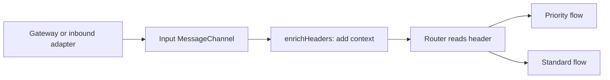

# `enrichHeaders` in the DSL

## 1. Objectives and Context

This lesson belongs to the **Advanced DSL** chapter of the **SPRING_INTEGRATION_CORE** module. Within the scope of designing message flows using `Message`, `MessageChannel`, endpoints, gateways, and Java DSL, `enrichHeaders` is a tool for adding context so downstream transformers, routers, filters, and endpoints process messages consistently.

After this lesson, you will be able to:

- Distinguish static values, SpEL expressions, and Java functions when declaring headers.
- Choose policies for preserving or overwriting existing values.
- Split enrichment steps when one header depends on another header.
- Design metadata for routing, tracing, and error handling.
- Test payloads, headers, routing branches, and input messages.

The examples use Java 17 or later and Spring Integration 6.x Java DSL syntax, referencing APIs at version 6.5.0. This is an illustrative baseline, not a requirement to upgrade your application version. If your project uses Spring Boot, let Boot's BOM manage the related library versions.

## 2. Where Does Header Enrichment Sit in a Flow?

A `Message<T>` carries a payload and a set of headers. The payload describes business content; headers carry information that helps transport, orchestrate, or process that content.

For example, the payload is an order; headers can record the source system, request ID, or priority classification result. That lets a router read a normalized result instead of repeating business calculations.



In the DSL, `enrichHeaders` configures an endpoint backed by `HeaderEnricher`, which belongs to the transformer family. The basic form is:

```java
.enrichHeaders(h -> h
    .header("order_source", "order-api")
    .headerExpression("order_id", "payload.orderId()"))
```

The lambda `h -> ...` declares configuration when constructing the flow. Dynamic values are evaluated when a message passes through the endpoint. The official documentation shows the same combination of `header` and `headerExpression` in [Header Enricher with Java DSL](https://docs.spring.io/spring-integration/reference/content-enrichment.html#header-enricher).

### 2.1. Distinguishing Related Operations

| Need | Approach |
| --- | --- |
| Add a source ID or request ID to metadata | `enrichHeaders(...)` |
| Convert an order into a payment request | `transform(...)` |
| Fetch extra data and augment business content | Payload/content enrichment or a dedicated subflow |
| Remove metadata not allowed to continue | `headerFilter(...)` |
| Pick a branch based on metadata | `route(...)` |

If you only need to add a header, a transformer manually constructing `MessageBuilder` usually obscures intent. Conversely, do not push an entire order transformation into a header-computing function.

### 2.2. Do Not Mutate the Header Map Directly

Do not write:

```java
message.getHeaders().put("order_source", "order-api");
```

`MessageHeaders` is a read-only structure; `put`, `remove`, and `clear` are not how messages are updated. The enricher builds an output from the input message and modifies the configured metadata.

This immutability does not automatically make a `List`, `Map`, or business object stored inside a header immutable. When multiple consumers receive a message, mutable objects must still be managed carefully. See [Message and Message Headers](https://docs.spring.io/spring-integration/reference/message.html).

## 3. Choosing How to Supply Header Values

### 3.1. Static Values with `header`

```java
.enrichHeaders(h -> h
    .header("order_source", "order-api")
    .header("order_schema_version", 2)
    .header("order_audit_required", true))
```

Here, `2` is an `Integer` and `true` is a `Boolean`. Keep data types explicit right when creating headers; that saves consumers from guessing types or parsing strings.

A string that looks like an expression is still a literal string if passed as a static value:

```java
.header("order_id", "payload.orderId()")
```

The configuration above places the literal string `payload.orderId()` into the header.

Another mistake is generating dynamic data at flow construction time:

```java
// UUID is generated when the flow configuration executes.
.header("order_trace_id", java.util.UUID.randomUUID().toString())
```

If a fresh value is needed for each eligible message being enriched, put the calculation inside `headerFunction`. The distinction between static values and message processing is also reflected in [StaticHeaderValueMessageProcessor](https://www.springframework.org/spring-integration/docs/6.5.0/api/org/springframework/integration/transformer/support/StaticHeaderValueMessageProcessor.html).

### 3.2. Expressions with `headerExpression`

```java
.enrichHeaders(h -> h
    .headerExpression("order_id", "payload.orderId()")
    .headerExpression(
        "order_request_id",
        "headers['incoming_request_id'] ?: 'missing'"))
```

In this example:

- `payload.orderId()` invokes the order record's accessor.
- `headers['incoming_request_id']` reads the input header.
- The Elvis operator `?:` supplies a fallback value.

A literal inside SpEL requires SpEL quotes:

```java
.headerExpression("order_region", "'VN'")
```

In this case, `.header("order_region", "VN")` is easier to read. SpEL fits short property/header lookups; long expressions with multiple branches should move to Java for clearer naming and easier testing. The [SpEL Support section of Header Enricher](https://docs.spring.io/spring-integration/reference/content-enrichment.html#header-enricher) describes accessing `payload` and `headers`.

The fallback value `missing` only illustrates syntax. For required identifiers, applications should reject missing data or generate a fresh identifier per contract instead of letting every message share one placeholder value.

### 3.3. Java Functions with `headerFunction`

Suppose the payload has type:

```java
public record Order(String orderId, java.math.BigDecimal total) {
}
```

You can compute headers with a function receiving the entire message:

```java
.enrichHeaders(h -> h
    .<Order>headerFunction(
        "order_high_value",
        message -> message.getPayload().total()
            .compareTo(new java.math.BigDecimal("10000000")) >= 0)
    .<Order>headerFunction(
        "order_trace_id",
        message -> java.util.UUID.randomUUID().toString()))
```

`<Order>` is an explicit type argument so the compiler knows the payload type in `Message<Order>`. The function receives the message, so it can read both payload and headers; the return value becomes the header value.

When the calculation grows longer, call a named method:

```java
private static boolean isHighValue(Order order) {
    return order.total()
        .compareTo(new java.math.BigDecimal("10000000")) >= 0;
}

// Configuration snippet inside the flow:
.enrichHeaders(h -> h
    .<Order>headerFunction(
        "order_high_value",
        message -> isHighValue(message.getPayload())))
```

Java functions are convenient when refactoring or unit testing logic with JUnit. Under the hood, Spring Integration uses [FunctionExpression](https://www.springframework.org/spring-integration/docs/6.5.0/api/org/springframework/integration/expression/FunctionExpression.html) to evaluate values using a `Function` instead of a string SpEL expression.

### 3.4. Multiple Headers with Maps

The following two configurations serve different intents:

```java
// The strings in this map are literal values.
.enrichHeaders(h -> h.headers(java.util.Map.<String, Object>of(
    "order_source", "order-api",
    "order_region", "VN"
)))

// The strings in this map are SpEL expressions.
.enrichHeaders(h -> h.headerExpressions(java.util.Map.of(
    "order_id", "payload.orderId()",
    "order_region", "'VN'"
)))
```

`headers(Map)` also supports `Expression` objects as values; a plain `String` does not automatically become an expression. Overload details are in [HeaderEnricherSpec](https://www.springframework.org/spring-integration/docs/6.5.0/api/org/springframework/integration/dsl/HeaderEnricherSpec.html).

## 4. Overwrite Rules: Defining Who Owns Each Header

Do not treat enrichment as an operation that always replaces values. For each header, decide whether the incoming value or the current calculation takes precedence.

### 4.1. Preserving Existing Values

```java
.enrichHeaders(h -> h
    .defaultOverwrite(false)
    .header("order_source", "order-api"))
```

If the message already has `order_source=batch-import`, that value is preserved. If not present, the enricher adds `order-api`.

`false` is the default; writing it explicitly makes the intent clear to readers. This behavior is documented in [HeaderEnricher](https://www.springframework.org/spring-integration/docs/6.5.0/api/org/springframework/integration/transformer/HeaderEnricher.html).

### 4.2. Selective Overwriting

```java
.enrichHeaders(h -> h
    .defaultOverwrite(false)
    .header("order_source", "order-api")
    .headerExpression("order_id", "payload.orderId()", true)
    .<Order>headerFunction(
        "order_high_value",
        message -> isHighValue(message.getPayload()),
        true))
```

Here, `order_id` and `order_high_value` are owned by the current flow's computation. Existing values under those names are replaced with the computed results.

| Header Already Present? | Default | Per-Header Flag | Action When New Value Is Non-Null |
| --- | --- | --- | --- |
| No | `false` | Unspecified | Add |
| Yes | `false` | Unspecified | Keep existing |
| Yes | `false` | `true` | Replace with new value |
| Yes | `true` | Unspecified | Replace with new value |
| Yes | `true` | `false` | Keep existing |

The per-header flag takes precedence over `defaultOverwrite`. Avoid enabling global overwrite just to fix one header; express ownership directly on each declaration.

Example policy table in a system:

| Category | Suggested Policy for Example |
| --- | --- |
| Validated internal trace ID | Keep if present; generate when missing |
| Classification based on current total | Recompute and overwrite |
| Authenticated tenant info | Derive from trusted authentication context |
| Arbitrary client-supplied metadata | Validate, rename, or strip at ingress |

`defaultOverwrite(false)` does not validate that data is trustworthy. It simply keeps an existing value. If a sender can supply `tenant_id` or `order_high_value` on its own, preserving that value can break the flow's contract.

### 4.3. Functions May Be Skipped

When a header already exists and overwriting is disallowed, the enricher does not need to compute a new value. Therefore, never put side effects inside a header-computing function:

```java
// Do not use header computation to execute mandatory business actions.
.<Order>headerFunction("order_trace_id", message -> {
    // Audit logging here might never run if the header already exists.
    return java.util.UUID.randomUUID().toString();
})
```

An audit step needs its own endpoint with an explicit invocation, retry, and error contract. Details on evaluate-only-when-needed behavior can be seen in [the HeaderEnricher 6.5.0 source code](https://raw.githubusercontent.com/spring-projects/spring-integration/v6.5.0/spring-integration-core/src/main/java/org/springframework/integration/transformer/HeaderEnricher.java).

## 5. Headers in the Same Step Do Not Form a Dependency Chain

The following configuration is misleading:

```java
.enrichHeaders(h -> h
    .headerExpression("order_id", "payload.orderId()")
    .headerExpression(
        "order_partition_key",
        "'order:' + headers['order_id']"))
```

Do not rely on call order to assume the second expression reads the `order_id` just added. Processors evaluate against the endpoint's input message; changes being built do not become the new input for the next expression.

If the message did not yet have `order_id`, this read will not see the new result. If an older `order_id` already existed, the expression may read the stale value. This is a more fundamental nuance than merely reordering declaration lines.

There are two ways to express the intent:

```java
// Two independent headers: both read directly from the payload.
.enrichHeaders(h -> h
    .headerExpression("order_id", "payload.orderId()", true)
    .headerExpression(
        "order_partition_key",
        "'order:' + payload.orderId()",
        true))
```

Or:

```java
// Genuine dependency: read the output message from the previous step.
.enrichHeaders(h -> h
    .headerExpression("order_id", "payload.orderId()", true))
.enrichHeaders(h -> h
    .headerExpression(
        "order_partition_key",
        "'order:' + headers['order_id']",
        true))
```

You can visualize the second approach as:

```text
M0 -> enrichHeaders A -> M1 -> enrichHeaders B -> M2

A reads M0.
B reads M1, which already contains order_id created by A.
```

This follows from how `transform(Message)` passes the input message to each processor in [the HeaderEnricher source code](https://raw.githubusercontent.com/spring-projects/spring-integration/v6.5.0/spring-integration-core/src/main/java/org/springframework/integration/transformer/HeaderEnricher.java). Splitting steps also helps maintainers see data dependencies.

## 6. `null` Values, Optional Headers, and Removal

By default, `shouldSkipNulls(true)` ignores `null` results. If you want a `null` result to remove the corresponding header, use `shouldSkipNulls(false)`; if the header already exists, overwriting must also be allowed. See [setShouldSkipNulls](https://www.springframework.org/spring-integration/docs/6.5.0/api/org/springframework/integration/transformer/HeaderEnricher.html#setShouldSkipNulls(boolean)).

The next snippet assumes the input message might carry `incoming_optional_tag`:

```java
.enrichHeaders(h -> h
    .shouldSkipNulls(true)
    .headerExpression(
        "order_optional_tag",
        "headers['incoming_optional_tag']",
        true))
```

If the source has no tag, a `null` result does not delete an existing `order_optional_tag`. If the contract requires deleting the old value when the source is absent:

```java
.enrichHeaders(h -> h
    .shouldSkipNulls(false)
    .headerExpression(
        "order_optional_tag",
        "headers['incoming_optional_tag']",
        true))
```

The following table distinguishes common cases:

| Prior State | Result | Overwrite | Skip Nulls | Resulting State |
| --- | --- | --- | --- | --- |
| Absent | `null` | Any | `true` | Still absent |
| Had old value | `null` | `true` | `true` | Keeps old value |
| Had old value | `null` | `true` | `false` | Removed |
| Had old value | Not evaluated | `false` | Any | Keeps old value |

If the sole goal is removing a known header name, `headerFilter("order_optional_tag")` usually states the intent more directly.

Never use `null` to signal an error for required data. If an order lacks a required ID, reject it via validation/filter or raise an explicit error before metadata enrichment.

## 7. Complete Example: Routing Orders by Header

### 7.1. Contract for the Example

Assume all totals use VND and the payload has already passed validation. An order of 10,000,000 VND or more enters the priority branch.

The flow must produce metadata per this contract:

| Header | Type | Rule |
| --- | --- | --- |
| `order_source` | `String` | Defaults to `order-api`, preserves existing internal value |
| `order_id` | `String` | Extracted from payload, overwritten |
| `order_high_value` | `Boolean` | Recomputed against threshold |
| `order_trace_id` | `String` | Generates UUID when missing |
| `order_received_at` | `String` ISO-8601 | Records enrichment timestamp if absent |
| `order_route` | `String` | `PRIORITY` or `STANDARD`, computed in the next step |

`order_trace_id` is the correlation ID for this example. Adding this header does not automatically integrate Micrometer Tracing or OpenTelemetry.

### 7.2. Prerequisites to Run the Code

Components needed in the learning project:

- JDK 17 or later.
- `org.springframework.integration:spring-integration-core`.
- Spring Context from a compatible version set.
- JUnit Jupiter to run the test class in the next section.

The example uses `AnnotationConfigApplicationContext`, requiring neither Spring Boot startup nor a broker connection. The isolated snippets in earlier sections were standalone illustrations; do not merge all of them into the class below.

### 7.3. Flow Configuration

```java
package example.enrichment;

import java.math.BigDecimal;
import java.time.Clock;
import java.time.Instant;
import java.util.UUID;

import org.springframework.context.annotation.Bean;
import org.springframework.context.annotation.Configuration;
import org.springframework.integration.channel.DirectChannel;
import org.springframework.integration.channel.QueueChannel;
import org.springframework.integration.config.EnableIntegration;
import org.springframework.integration.dsl.IntegrationFlow;

@Configuration
@EnableIntegration
public class OrderHeaderFlowConfig {

    private static final BigDecimal PRIORITY_THRESHOLD =
        new BigDecimal("10000000");

    public record Order(String orderId, BigDecimal total) {
    }

    @Bean
    public Clock orderClock() {
        return Clock.systemUTC();
    }

    @Bean
    public DirectChannel ordersInput() {
        return new DirectChannel();
    }

    @Bean
    public QueueChannel priorityOrders() {
        return new QueueChannel(10);
    }

    @Bean
    public QueueChannel standardOrders() {
        return new QueueChannel(10);
    }

    @Bean
    public IntegrationFlow orderHeaderFlow(Clock orderClock) {
        return IntegrationFlow.from("ordersInput")
            .enrichHeaders(h -> h
                .defaultOverwrite(false)
                .header("order_source", "order-api")
                .headerExpression(
                    "order_id",
                    "payload.orderId()",
                    true)
                .<Order>headerFunction(
                    "order_high_value",
                    message -> message.getPayload().total()
                        .compareTo(PRIORITY_THRESHOLD) >= 0,
                    true)
                .<Order>headerFunction(
                    "order_trace_id",
                    message -> UUID.randomUUID().toString())
                .<Order>headerFunction(
                    "order_received_at",
                    message -> Instant.now(orderClock).toString()))
            .enrichHeaders(h -> h
                .headerExpression(
                    "order_route",
                    "headers['order_high_value']"
                        + " ? 'PRIORITY' : 'STANDARD'",
                    true))
            .route("headers['order_route']", r -> r
                .channelMapping("PRIORITY", "priorityOrders")
                .channelMapping("STANDARD", "standardOrders"))
            .get();
    }
}
```

The second enrichment step needs to read the normalized `order_high_value`. Both `order_high_value` and `order_route` overwrite so same-named upstream data cannot alter the classification outcome.

Passing `Clock` into the flow lets tests substitute a fixed clock when verifying timestamps. `BigDecimal.compareTo` compares against the threshold independently of decimal scale.

`DirectChannel` at the input makes processing up to the router run on the sender's thread. The two final `QueueChannel` beans act as result sinks. No poller is needed solely for tests calling `receive`; if you attach a consumer endpoint reading from a queue, you must configure a suitable polling mechanism.

Queues of capacity 10 are only for a small example. A continuously running application needs consumers, queue-bounding policies, and timeouts matched to load.

### 7.4. Tracing One Message

With input:

```text
payload = Order("O-1001", 12500000)
headers = {
  order_source: "batch-import",
  order_trace_id: "trace-existing",
  order_high_value: false,
  order_route: "STANDARD"
}
```

Expected outcome:

```text
payload = same input Order instance
relevant business headers = {
  order_source: "batch-import",
  order_trace_id: "trace-existing",
  order_id: "O-1001",
  order_high_value: true,
  order_received_at: "<generated timestamp>",
  order_route: "PRIORITY"
}
destination = priorityOrders
```

Other framework headers are omitted from this illustration. Do not conclude from the snippet above that the message only carries six headers.

## 8. Testing the Flow's Behavior

Tests must verify what consumers actually observe: header types, values, payload, and destination. For preserve-or-overwrite policies, always include at least one case where the message already carries stale values.

The class below uses the same package and configuration class from Section 7:

```java
package example.enrichment;

import java.math.BigDecimal;
import java.util.UUID;

import org.junit.jupiter.api.Test;
import org.springframework.context.annotation.AnnotationConfigApplicationContext;
import org.springframework.integration.channel.DirectChannel;
import org.springframework.integration.channel.QueueChannel;
import org.springframework.messaging.Message;
import org.springframework.messaging.MessagingException;
import org.springframework.messaging.support.MessageBuilder;

import example.enrichment.OrderHeaderFlowConfig.Order;

import static org.junit.jupiter.api.Assertions.*;

class OrderHeaderFlowTest {

    @Test
    void highValueOrderOverwritesDecisionAndPreservesContext() {
        try (var context = new AnnotationConfigApplicationContext(
                OrderHeaderFlowConfig.class)) {

            DirectChannel input =
                context.getBean("ordersInput", DirectChannel.class);
            QueueChannel priority =
                context.getBean("priorityOrders", QueueChannel.class);
            QueueChannel standard =
                context.getBean("standardOrders", QueueChannel.class);

            Order order =
                new Order("O-1001", new BigDecimal("12500000"));
            Message<Order> original = MessageBuilder.withPayload(order)
                .setHeader("order_source", "batch-import")
                .setHeader("order_trace_id", "trace-existing")
                .setHeader("order_id", "stale-order-id")
                .setHeader("order_high_value", false)
                .setHeader("order_route", "STANDARD")
                .build();

            assertTrue(input.send(original));
            Message<?> result = priority.receive(1000);

            assertNotNull(result);
            assertSame(order, result.getPayload());
            assertEquals("batch-import",
                result.getHeaders().get("order_source"));
            assertEquals("trace-existing",
                result.getHeaders().get("order_trace_id"));
            assertEquals("O-1001",
                result.getHeaders().get("order_id"));
            assertEquals(Boolean.TRUE,
                result.getHeaders().get(
                    "order_high_value", Boolean.class));
            assertEquals("PRIORITY",
                result.getHeaders().get("order_route"));
            assertNotNull(result.getHeaders().get(
                "order_received_at", String.class));
            assertNull(standard.receive(0));

            // The input message still retains its original values.
            assertEquals(Boolean.FALSE,
                original.getHeaders().get("order_high_value"));
            assertEquals("STANDARD",
                original.getHeaders().get("order_route"));
            assertEquals("stale-order-id",
                original.getHeaders().get("order_id"));
            assertFalse(original.getHeaders()
                .containsKey("order_received_at"));
        }
    }

    @Test
    void standardOrderReceivesMissingHeaders() {
        try (var context = new AnnotationConfigApplicationContext(
                OrderHeaderFlowConfig.class)) {

            DirectChannel input =
                context.getBean("ordersInput", DirectChannel.class);
            QueueChannel standard =
                context.getBean("standardOrders", QueueChannel.class);
            QueueChannel priority =
                context.getBean("priorityOrders", QueueChannel.class);

            Order order =
                new Order("O-1002", new BigDecimal("500000"));

            assertTrue(input.send(
                MessageBuilder.withPayload(order).build()));
            Message<?> result = standard.receive(1000);

            assertNotNull(result);
            assertEquals("order-api",
                result.getHeaders().get("order_source"));
            assertEquals(Boolean.FALSE,
                result.getHeaders().get(
                    "order_high_value", Boolean.class));
            assertEquals("STANDARD",
                result.getHeaders().get("order_route"));

            String traceId = result.getHeaders()
                .get("order_trace_id", String.class);
            assertNotNull(traceId);
            assertDoesNotThrow(() -> UUID.fromString(traceId));
            assertNull(priority.receive(0));
        }
    }

    @Test
    void amountExactlyAtThresholdIsPriority() {
        try (var context = new AnnotationConfigApplicationContext(
                OrderHeaderFlowConfig.class)) {

            DirectChannel input =
                context.getBean("ordersInput", DirectChannel.class);
            QueueChannel priority =
                context.getBean("priorityOrders", QueueChannel.class);

            Order order =
                new Order("O-1003", new BigDecimal("10000000.00"));

            assertTrue(input.send(
                MessageBuilder.withPayload(order).build()));

            Message<?> result = priority.receive(1000);
            assertNotNull(result);
            assertEquals("PRIORITY",
                result.getHeaders().get("order_route"));
        }
    }

    @Test
    void invalidPayloadFailsOnCallerThread() {
        try (var context = new AnnotationConfigApplicationContext(
                OrderHeaderFlowConfig.class)) {

            DirectChannel input =
                context.getBean("ordersInput", DirectChannel.class);
            QueueChannel priority =
                context.getBean("priorityOrders", QueueChannel.class);
            QueueChannel standard =
                context.getBean("standardOrders", QueueChannel.class);

            // Intentionally violates the example's validation precondition.
            Order invalid = new Order("O-invalid", null);

            assertThrows(MessagingException.class, () ->
                input.send(
                    MessageBuilder.withPayload(invalid).build()));

            assertNull(priority.receive(0));
            assertNull(standard.receive(0));
        }
    }
}
```

The final test illustrates a failure during header computation when the payload is invalid. In an application, validate `total != null` before this endpoint rather than relying on `NullPointerException` as a validation rule.

`receive(1000)` bounds the wait; `receive(0)` checks immediately for remaining items in the queue. Creating a separate context per test prevents leftover messages from one test from falsely passing another.

Cases to add when extending the example:

| Change in Contract | Observation to Verify |
| --- | --- |
| Add optional header | Missing source, present source, and stale value |
| Change overwrite flag | Incoming value conflicts with computed result |
| Add processing deadline | Fixed clock and time boundaries |
| Add asynchronous step | Error destination and failed message |
| Cross a broker | Actually mapped headers and post-conversion types |

These test snippets are practice code to run in a project with compatible dependencies; they do not mean all operational failure modes have been verified.

## 9. Standard Headers and Their Impact on Endpoints

### 9.1. `replyChannel` and `errorChannel`

They can be declared using dedicated methods:

```java
.enrichHeaders(h -> h
    .replyChannel("orderReplies")
    .errorChannel("orderErrors"))
```

Both names must refer to registered channels in the application. Channel headers can hold a bean name or a channel object; the corresponding methods belong to [HeaderEnricherSpec](https://www.springframework.org/spring-integration/docs/6.5.0/api/org/springframework/integration/dsl/HeaderEnricherSpec.html).

With gateways, examine carefully before replacing `replyChannel`: request-reply calls usually already carry the reply address for the caller. Arbitrary overwriting can send the reply elsewhere.

A `replyChannel` header does not override an endpoint's explicitly declared output channel. See the description of this header in [Message Headers](https://docs.spring.io/spring-integration/reference/message.html).

Setting `errorChannel` also does not turn every synchronous exception into an `ErrorMessage`. With `DirectChannel`, errors thrown on the sender's thread usually propagate back to the `send` call. Error emission by async tasks, pollers, or gateways depends on each component's configuration. See [Error Handling](https://docs.spring.io/spring-integration/reference/error-handling.html).

### 9.2. Metadata Must Exist Before Failure Points

If header calculation itself fails, the endpoint has not produced an output message yet. Do not expect an `errorChannel` being added inside the failing step to already exist on the incoming message context.

When business enrichment can fail, set required error and tracing context at ingress or in an earlier step:

```text
inbound
  -> create/validate tracing and error-handling metadata
  -> asynchronous boundary if any
  -> fallible enrichment
  -> business processing
```

When using `ExecutorChannel` or a poller, test the actual error path under that configuration. When using a gateway, also test what the caller receives.

### 9.3. `correlationId` for Grouping

If messages belonging to the same order need to be correlated, configure:

```java
.enrichHeaders(h -> h
    .correlationIdExpression("payload.orderId()"))
```

Decide whether to preserve an upstream correlation ID or replace it with the order ID. Never overwrite correlation metadata from a splitter or nested flow merely because the header name looks convenient.

For an aggregator, the correlation key only identifies the group. You also need release, timeout, and group cleanup strategies. If orders across multiple tenants can share IDs, build a composite key combining tenant and order ID derived from authenticated tenant data.

The main example in Section 7 uses `order_id` purely as business metadata; it does not configure an aggregator.

### 9.4. `id` and `timestamp` Are Framework-Managed Headers

Do not use `enrichHeaders` to set `MessageHeaders.ID` or `MessageHeaders.TIMESTAMP`. Under default builder configuration, declaring these read-only headers in an enricher is rejected at initialization.

Create dedicated names for business data:

- `order_id`: order identifier.
- `order_trace_id`: application-contract correlation ID across steps.
- `order_received_at`: application-defined receipt or enrichment timestamp.

Do not equate a single message instance's ID with a business key that must remain stable across steps. The rule protecting these two system headers is visible in [the HeaderEnricher source code](https://raw.githubusercontent.com/spring-projects/spring-integration/v6.5.0/spring-integration-core/src/main/java/org/springframework/integration/transformer/HeaderEnricher.java).

## 10. Designing Enrichment for Production Systems

### 10.1. Keep Computations Small, Clear, and Repeatable

Extracting an ID from the payload or classifying by threshold fits `headerFunction`. A slow HTTP call to look up customer profiles usually belongs in its own step so timeouts, retries, and error handling are explicit.

If you still invoke a service inside a header function, understand that:

- In a synchronous flow, call latency adds directly to the sender's processing time.
- The function might be skipped when an existing header is preserved.
- The function might run again when a message re-enters the endpoint via retry or redelivery.
- Any service instance or state captured by the lambda must be safe for concurrent messages.

For example, generating a new UUID every time an endpoint re-runs will change the trace ID if overwrite is enabled. Keeping a validated upstream ID is usually better for tracking one request across retries.

Similarly, distinguish initial receipt time from the latest retry attempt timestamp. A preserved `order_received_at` header should not simultaneously be interpreted as the timestamp of every retry.

### 10.2. Internal Headers vs. Transport Headers Have Different Contracts

Within the same JVM, a header can be any Java object. When a message crosses JMS, AMQP, HTTP, or persistent storage, inspect mappers and serialization support.

More portable choices are strings, numbers, booleans, and standardized timestamps agreed upon by both sides. For example, the sample uses ISO-8601 strings for timestamps so the contract stays explicit.

Do not put database connections, JPA entities attached to a persistence context, or unnecessary sensitive data into metadata just because headers accept `Object`. For each adapter, review and test its header-mapping configuration.

`headerChannelsToString()` helps register channel references in a registry and convert them to string representations. It does not create a distributed reply address shared across JVMs. If request-reply spans a broker, design transport-level reply destinations and correlation.

### 10.3. Do Not Use Unverified Metadata for Authorization Decisions

A header named `tenant_id` does not prove the sender belongs to that tenant. At message ingress, define which headers may be preserved, which must be recomputed, and which must come from the authentication context.

In the order example, `order_high_value` and `order_route` are owned by the flow and therefore overwritten. If adding `tenant_id`, document its verified source in its own contract; never copy it blindly from the payload and treat it as authenticated.

### 10.4. Naming Conventions and Flow Observability

Follow a consistent naming convention for headers and avoid colliding with framework or adapter constants. For headers shared across multiple flows, declare Java constants rather than repeating string literals.

When logging for observability, record only necessary fields such as order ID, correlation ID, and classification result. Avoid dumping all headers if they may contain tokens, personal data, or large objects.

If the payload is transformed after enrichment, review which headers remain valid. For example, `order_high_value` computed before a total-adjustment step can become stale. Place enrichment after data-modifying steps or recompute headers owned by the current stage.

## 11. Common Pitfalls and How to Spot Them

| Symptom | Possible Cause | How to Fix |
| --- | --- | --- |
| Header contains literal `payload.orderId()` | Used static value | Switch to `headerExpression` or function |
| Many messages share the same generated UUID | Generated UUID during flow assembly | Move generation into message-processing function |
| Function is never called | Header already exists, overwrite disabled | Check overwrite policy |
| Header keeps stale classification | Flow did not take ownership of value | Overwrite the computed header explicitly |
| Header B does not see A's new result | Both declared in the same step | Split into two steps or read common source |
| `null` does not clear old value | Nulls are being skipped | Check `shouldSkipNulls` and overwrite |
| Router picks wrong branch | Wrong header value or type | Verify header contract right before router |
| Caller gets exception despite `errorChannel` | Error occurred on synchronous path | Check executing thread and gateway/advice configuration |
| Headers disappear across broker | Mapper or incompatible type | Test across the actual transport |
| Flow initialization fails when setting `id` | Touched read-only system header | Use a dedicated business header name |

To isolate issues, start from one concrete message: incoming payload, pre-existing headers, overwrite policy, values right before the router, and executing thread. This separates data issues from flow-configuration bugs.

## 12. Extended Practice

Starting from the configuration in Section 7, complete these steps in order:

1. Add `order_partition_key` formatted as `order:<order_id>` in a step after `order_id` is normalized.
2. Replace `Clock.systemUTC()` in a test configuration with `Clock.fixed(...)`, then assert the exact `order_received_at` value.
3. Add an optional header and test three scenarios: new source present, new source missing with old value present, and both absent.
4. Add validation for `orderId` and `total` before enrichment; define explicitly whether invalid input is rejected or routed to a separate channel.
5. If introducing an asynchronous boundary, test failures via an error-collecting channel rather than expecting an exception at `send`.

Verify the flow's contract end to end: metadata has expected types, routing decisions come from normalized data, payloads remain intact during header-only enrichment, and errors arrive where the application designed them to.

## 13. References

- [Spring Integration Reference: Content Enricher](https://docs.spring.io/spring-integration/reference/content-enrichment.html) — distinguishing header enrichment from payload enrichment.
- [HeaderEnricherSpec 6.5.0](https://www.springframework.org/spring-integration/docs/6.5.0/api/org/springframework/integration/dsl/HeaderEnricherSpec.html) — Java DSL API and overloads.
- [HeaderEnricher 6.5.0](https://www.springframework.org/spring-integration/docs/6.5.0/api/org/springframework/integration/transformer/HeaderEnricher.html) — transformer, overwrite, and null handling.
- [HeaderEnricher 6.5.0 Source Code](https://raw.githubusercontent.com/spring-projects/spring-integration/v6.5.0/spring-integration-core/src/main/java/org/springframework/integration/transformer/HeaderEnricher.java) — message used when evaluating each header.
- [Spring Integration Reference: Message](https://docs.spring.io/spring-integration/reference/message.html) — message structure and standard headers.
- [Spring Integration Reference: Error Handling](https://docs.spring.io/spring-integration/reference/error-handling.html) — distinguishing synchronous and asynchronous error handling.
