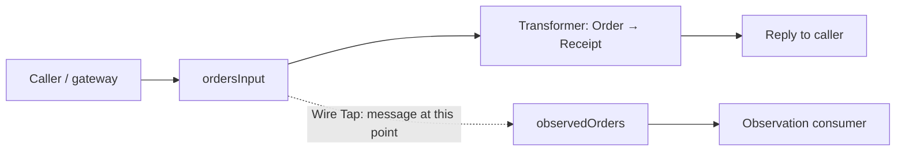

# `wireTap` in the DSL

## 1. Objectives and Scope

In the **SPRING_INTEGRATION_CORE** module, this lesson belongs to the **Advanced DSL** chapter. It focuses on using `wireTap` to observe messages at a point in an `IntegrationFlow` while letting the business processing flow continue to the next endpoint.

After this lesson, you will be able to:

- Choose a tap position that matches the data you need to observe.
- Write taps to channels and taps with subflows in Java DSL.
- Use selectors to observe only a subset of messages.
- Explain how `DirectChannel`, `QueueChannel`, and `ExecutorChannel` impact latency, errors, and processing order.
- Test business outcomes and observation-branch data independently.

The examples use Java 17 and Spring Integration 6.5.0 APIs as an illustrative baseline. When applying in an application with Spring Boot or a BOM, use the compatible version set managed by your project. Java DSL builds on Spring Integration components and registers flows as Spring beans; at runtime these are still channels, interceptors, and endpoints in the application context. [Java DSL Documentation](https://docs.spring.io/spring-integration/reference/6.5/dsl.html).

## 2. What Problem Does Wire Tap Solve?

Suppose a system receives an order, produces an acceptance result, and replies to the caller. You want to capture a diagnostic trace without turning the observation step into a transformation of the business result.

`wireTap` creates a side branch that sends the message to a secondary target at the observation point:



In the diagram:

- The main branch receives `Order` and produces `Receipt`.
- The observation branch receives data at `ordersInput`.
- The result of the observation branch is not used to construct `Receipt`.

Suitable use cases include technical tracing, sampling messages for diagnostics, and collecting data for metrics. If recording or event emission is a mandatory condition for business success, model that requirement directly in your processing design.

### 2.1. The Mechanism Lives on the Channel

`WireTap` is a `ChannelInterceptor`. Java DSL attaches the interceptor to the current channel; when needed, the DSL creates an implicit channel to connect endpoints. Overloads accept a channel name, a `MessageChannel` instance, or an `IntegrationFlow` as a subflow. [DSL Javadoc](https://docs.spring.io/spring-integration/docs/6.5.0/api/org/springframework/integration/dsl/BaseIntegrationFlowDefinition.html#wireTap(java.lang.String)).

In the baseline version, the tap sends to the side branch during `preSend`, before the main channel dispatches the message. Therefore, data appearing at the tap indicates the message reached the observation point; it does not prove downstream steps succeeded. [WireTap 6.5.0 Source Code](https://github.com/spring-projects/spring-integration/blob/v6.5.0/spring-integration-core/src/main/java/org/springframework/integration/channel/interceptor/WireTap.java).

One design consequence: if you need to observe the acceptance outcome, place the tap after the transformer that produces it. If you need to record committed state, design a mechanism tied to the commit or durable event emission; moving a single DSL line alone does not create that guarantee.

### 2.2. The Observed Message Is Not a Deep Copy

A `Message` contains a payload and headers. The header map structure prevents direct mutation, but the payload and individual header values can still be mutable objects. Never assume the two branches have two independent object graphs. [Message and Mutability Documentation](https://docs.spring.io/spring-integration/reference/6.5/message.html#message-headers).

For example, if the payload is an `ArrayList` and the observation consumer calls `clear()`, the main branch may see a modified list. Switching to another thread also introduces data races.

Practical rules:

1. Prefer immutable payloads.
2. When transforming, create new result objects.
3. If a snapshot is needed, create an explicit snapshot; with nested data, handle inner mutable objects as well.
4. Do not mutate a shared payload merely to mask fields before logging.

## 3. Distinguishing Neighboring Components

| Component | Design Question to Answer | Relationship to Main Branch |
| --- | --- | --- |
| `wireTap` | Where should messages be observed? | Creates a side branch at a channel |
| `transform` | How should the data representation change? | Output becomes the data for the next step |
| `filter` | Should the message continue? | Can drop messages from the flow |
| `route` | Which destination should the message go to? | Chooses destinations per routing criteria |
| `publishSubscribeChannel` | Which subscribers all need the message? | Broadcasts to registered subscribers |
| `gateway` | How does a caller send a request and receive a reply? | Establishes a call-and-reply contract |
| `aggregate` | When is enough data collected for a group to emit a result? | Collects messages by correlation and release criteria |

This table guides model selection. For example, if the system needs both tax calculation and shipping fee calculation to answer the customer, design coordination of both results explicitly. A `wireTap` branch by itself provides no mechanism to wait for and combine those results.

## 4. Syntax in Java DSL

The condensed snippets below show where `wireTap` fits in a DSL chain. Named channels must be configured with suitable types and consumers in the application.

### 4.1. Tapping to a Named Channel

```java
IntegrationFlow.from("input")
        .wireTap("observationChannel")
        .transform(String.class, String::trim)
        .channel("output")
        .get();
```

The message at the tap point holds the string before `trim`. The `"observationChannel"` argument is the secondary target; it is not the name of the channel being tapped.

Declaring the secondary channel as a bean lets readers clearly see the channel type and how it is consumed, rather than relying on implicit channels created by the DSL.

### 4.2. Tapping to a Channel Instance

```java
IntegrationFlow.from(inputChannel)
        .wireTap(observationChannel)
        .transform(String.class, String::trim)
        .channel(outputChannel)
        .get();
```

This fits when injecting channels as `@Bean` method parameters. Use `@Qualifier` when the application context has multiple beans of the same type.

### 4.3. Tapping with a Subflow

```java
IntegrationFlow.from("textInput")
        .wireTap(tap -> tap
                .transform(String.class, text -> "Length: " + text.length())
                .handle((org.springframework.messaging.MessageHandler) message ->
                        System.out.println(message.getPayload())))
        .transform(String.class, String::trim)
        .channel("textOutput")
        .get();
```

The transformer in the subflow produces data for the observation consumer. The main branch continues with the payload as it stood at the tap point, and only then runs `trim`.

Here `MessageHandler` has a `void` method, clearly marking the end of the observation branch. The subflow does not have an executor channel, so writing a lambda alone does not make it asynchronous.

### 4.4. Adding a Selector and Timeout

```java
.wireTap("observationChannel", tap -> tap
        .selector(message ->
                Boolean.TRUE.equals(message.getHeaders().get("observe")))
        .timeout(0))
```

The selector receives the full `Message<?>`, so it can inspect payload or headers. `WireTapSpec` supports selectors via `MessageSelector`, a SpEL string, or an `Expression`, along with send timeout configuration. [WireTapSpec Javadoc](https://docs.spring.io/spring-integration/docs/6.5.0/api/org/springframework/integration/dsl/WireTapSpec.html).

With the condition above:

| `observe` Header | Observation Branch | Main Flow |
| --- | --- | --- |
| `Boolean.TRUE` | Selected to send | Continues if send does not throw |
| `Boolean.FALSE` | Not sent | Continues |
| Missing header | Not sent | Continues |
| String `"true"` | Not sent | Continues |

Comparing via `Boolean.TRUE.equals(...)` intentionally requires an actual boolean value.

A selector does not act as a filter on the main branch. However, the selector still runs during the send: keep the condition short, avoid network calls, and do not mutate shared state.

An equivalent condition can be written in SpEL:

```java
.wireTap("observationChannel",
        tap -> tap.selector("headers['observe'] == true"))
```

## 5. Complete Example: Observing Orders and Returning a Business Result

The example uses a `QueueChannel` of capacity 16 as the observation sink. The program reads the queue itself after calling the main flow, so no poller is needed yet.

In a Maven project not managing versions with a BOM, the core dependency for the example is:

```xml
<dependency>
    <groupId>org.springframework.integration</groupId>
    <artifactId>spring-integration-core</artifactId>
    <version>6.5.0</version>
</dependency>
```

Set the Java compilation level to 17 or higher. If your project already uses a BOM, use the managed version and avoid overriding this dependency individually.

Illustrative file `WireTapDemo.java`:

```java
package example.integration;

import org.springframework.beans.factory.annotation.Qualifier;
import org.springframework.context.annotation.AnnotationConfigApplicationContext;
import org.springframework.context.annotation.Bean;
import org.springframework.context.annotation.Configuration;
import org.springframework.integration.channel.DirectChannel;
import org.springframework.integration.channel.QueueChannel;
import org.springframework.integration.config.EnableIntegration;
import org.springframework.integration.core.MessagingTemplate;
import org.springframework.integration.dsl.IntegrationFlow;
import org.springframework.messaging.Message;
import org.springframework.messaging.MessageChannel;
import org.springframework.messaging.support.MessageBuilder;

@Configuration
@EnableIntegration
public class WireTapDemo {

    public record Order(String id, long amountVnd) {
    }

    public record Receipt(String orderId, String status) {
    }

    @Bean
    public DirectChannel ordersInput() {
        return new DirectChannel();
    }

    @Bean
    public QueueChannel observedOrders() {
        return new QueueChannel(16);
    }

    @Bean
    public IntegrationFlow ordersFlow(
            @Qualifier("ordersInput") DirectChannel input,
            @Qualifier("observedOrders") QueueChannel observed) {

        return IntegrationFlow.from(input)
                .wireTap(observed, tap -> tap
                        .selector(message -> Boolean.TRUE.equals(
                                message.getHeaders().get("observe")))
                        .timeout(0))
                .<Order, Receipt>transform(order ->
                        new Receipt(order.id(), "ACCEPTED"))
                .get();
    }

    public static void main(String[] args) {
        try (var context =
                     new AnnotationConfigApplicationContext(WireTapDemo.class)) {

            MessagingTemplate template = new MessagingTemplate();
            template.setSendTimeout(1_000);
            template.setReceiveTimeout(1_000);

            Message<Order> request = MessageBuilder
                    .withPayload(new Order("ORD-001", 250_000))
                    .setHeader("observe", true)
                    .setHeader("correlationId", "REQ-001")
                    .build();

            MessageChannel input =
                    context.getBean("ordersInput", MessageChannel.class);

            Message<?> reply = template.sendAndReceive(input, request);
            Message<?> observed = context
                    .getBean("observedOrders", QueueChannel.class)
                    .receive(1_000);

            if (reply == null || observed == null) {
                throw new IllegalStateException("Missing reply or observation data");
            }

            System.out.println("Reply: " + reply.getPayload());
            System.out.println("Observed: " + observed.getPayload());
            System.out.println("Correlation: "
                    + observed.getHeaders().get("correlationId"));
        }
    }
}
```

Expected business output:

```text
Reply: Receipt[orderId=ORD-001, status=ACCEPTED]
Observed: Order[id=ORD-001, amountVnd=250000]
Correlation: REQ-001
```

Walkthrough:

1. `MessagingTemplate` sends the request and sets up the reply path for the call.
2. The selector accepts the message because `observe` is `true`.
3. The tap attempts to place `Order` into the observation queue.
4. The main flow's transformer creates `Receipt`.
5. The reply travels back via the call's reply mechanism.
6. The program reads the queue to inspect the data captured at the tap point.

`record Order` contains only `String` and `long`, making it suitable as an immutable payload for the example. A record with a mutable `List` component would need extra handling; the `record` keyword itself does not make nested data immutable.

### 5.1. Why Is There No Automatic Consumer Yet?

`QueueChannel` holds messages until a receiver reads them. It does not spawn business processing tasks on its own. In the program above, `receive(1_000)` is a direct read.

If you add a poller-driven consumer, do not simultaneously keep `receive(...)` expecting to read the same message: both readers will compete for items from the queue.

## 6. Synchronous vs. Asynchronous Behavior Is Determined by the Channel

Wire tap does not run asynchronously by default. Switching threads depends on the channel and how downstream consumers read from it. [Official Wire Tap Explanation](https://docs.spring.io/spring-integration/reference/6.5/channel/configuration.html#channel-wiretap).

| Observation Target | What Happens When the Tap Sends | Effects to Account For |
| --- | --- | --- |
| `DirectChannel` | Invokes subscriber on the sender's thread | Secondary branch execution time adds to the call path |
| `QueueChannel` | Enqueues the message | Waits for space up to timeout; needs a receiver |
| `ExecutorChannel` | Hands task off to executor | Depends on queue, thread count, and rejection policy |

`ExecutorChannel` does not guarantee the sender always returns immediately either: a policy like `CallerRunsPolicy` can run the task on the sender's thread when the executor is saturated. The sender's transaction also does not automatically cross an executor boundary. [ExecutorChannel Documentation](https://docs.spring.io/spring-integration/reference/6.5/channel/implementations.html#executorchannel).

### 6.1. Accounting for Latency Along the Call Path

Suppose an observation branch calls an external service taking 300 ms. If the tap target is a `DirectChannel`, before the main channel even dispatches the message, the call may have to wait for that full 300 ms.

If you move the work to an executor:

- The sender primarily pays the time before the executor boundary plus task handoff overhead.
- Observation work can finish after the caller has already received its reply.
- When traffic exceeds processing capacity, queue depth or rejection policies become the decisive factor.

This is an analysis of the configuration's execution path, not a fixed latency guarantee by the framework.

### 6.2. Completion Order

With a synchronous branch, tap work runs on the send path before the main channel dispatches. With an executor or a separate queue consumer, never rely on completion order between the two branches as a business condition.

If processed by multiple workers, the completion order of observation records may also differ from arrival order. Attach business IDs, correlation IDs, and event timestamps when reconciliation is needed.

## 7. What Does Timeout Bound?

In the example, `timeout(0)` tells the tap to attempt sending without waiting for space in the queue. For `QueueChannel`:

| Send Timeout | Behavior When Queue Is Full |
| --- | --- |
| `0` | Returns immediately |
| Positive number | Waits at most the configured milliseconds |
| Negative number per channel send semantics | May block until space is available or interrupted |

Capacity and send-waiting rules are documented in [QueueChannel Javadoc](https://docs.spring.io/spring-integration/docs/6.5.0/api/org/springframework/integration/channel/QueueChannel.html).

The tap's timeout is not a maximum execution time for the entire observation consumer. Specifically:

- It does not interrupt a slow handler running over a `DirectChannel`.
- It does not replace HTTP or JDBC timeouts inside the handler.
- It does not set an execution deadline for a task already accepted by an executor.

To bound external service calls, configure timeouts on the corresponding client. To control backlogs, size queue capacity, consumer throughput, and overload handling policies.

### 7.1. Returning `false` vs. Throwing an Exception

In `WireTap` 6.5.0, if `send(...)` returns `false`, the interceptor logs a warning and returns the message to the main flow. If the send call or selector throws an exception, this method does not swallow that exception. [preSend Implementation](https://github.com/spring-projects/spring-integration/blob/v6.5.0/spring-integration-core/src/main/java/org/springframework/integration/channel/interceptor/WireTap.java#L149).

Therefore, with the capacity-16 queue example:

- A full queue with timeout 0 can drop new observations while `Receipt` is still produced.
- Do not generalize that result into "no tap error ever affects business processing."
- If the design requires complete observation capture, use a delivery mechanism better suited than dropping when space runs out.

## 8. Adding a Poller Consumer for the Queue Branch

In a long-running application, you can add the bean below to `WireTapDemo`. The consumer will poll `observedOrders` periodically:

```java
@Bean
public IntegrationFlow observationConsumer(
        @Qualifier("observedOrders") QueueChannel observed) {

    return IntegrationFlow.from(observed)
            .handle(
                    (org.springframework.messaging.MessageHandler) message -> {
                        Order order = (Order) message.getPayload();
                        System.out.println("Observed order: " + order.id());
                    },
                    endpoint -> endpoint.poller(
                            org.springframework.integration.dsl.Pollers
                                    .fixedDelay(200)
                                    .maxMessagesPerPoll(10)))
            .get();
}
```

This is a variant of the initial configuration. When using this variant, remove the direct queue `receive(...)` in `main` and adjust tests for an asynchronous consumer.

`fixedDelay(200)` sets the delay between completed polls. `maxMessagesPerPoll(10)` limits how many messages are processed per poll cycle.

The queue in the example lives in process memory. Accepting a message into the queue does not mean the data is durably persisted or that the consumer has finished processing it.

## 9. Subflow via Executor and Dedicated Error Channel

The variant below illustrates another input flow, `asyncOrdersInput`. You can add these beans to the example configuration class; they reuse `Order` and `Receipt`.

The side branch performs three explicit steps before observing:

1. Drops reply and error headers inherited from the request.
2. Sets a dedicated error channel for the observation branch.
3. Hands observation work off to an executor.

Additional imports:

```java
import java.util.concurrent.ThreadPoolExecutor;

import org.springframework.messaging.MessageHandler;
import org.springframework.messaging.MessageHeaders;
import org.springframework.scheduling.concurrent.ThreadPoolTaskExecutor;
```

The beans:

```java
@Bean
public ThreadPoolTaskExecutor observationExecutor() {
    ThreadPoolTaskExecutor executor = new ThreadPoolTaskExecutor();
    executor.setCorePoolSize(2);
    executor.setMaxPoolSize(4);
    executor.setQueueCapacity(128);
    executor.setThreadNamePrefix("observation-");
    executor.setRejectedExecutionHandler(new ThreadPoolExecutor.AbortPolicy());
    return executor;
}

@Bean
public DirectChannel observationErrors() {
    return new DirectChannel();
}

@Bean
public IntegrationFlow asyncOrdersFlow(
        @Qualifier("observationExecutor") ThreadPoolTaskExecutor executor) {

    return IntegrationFlow.from("asyncOrdersInput")
            .wireTap(
                    tap -> tap
                            .headerFilter(
                                    MessageHeaders.REPLY_CHANNEL,
                                    MessageHeaders.ERROR_CHANNEL)
                            .enrichHeaders(headers -> headers.header(
                                    MessageHeaders.ERROR_CHANNEL,
                                    "observationErrors"))
                            .channel(channels -> channels.executor(executor))
                            .handle((MessageHandler) message -> {
                                Order order = (Order) message.getPayload();
                                System.out.println(
                                        "Async observation: " + order.id());
                            }),
                    spec -> spec
                            .selector(message -> Boolean.TRUE.equals(
                                    message.getHeaders().get("observe")))
                            .timeout(0))
            .<Order, Receipt>transform(order ->
                    new Receipt(order.id(), "ACCEPTED"))
            .get();
}

@Bean
public IntegrationFlow observationErrorFlow() {
    return IntegrationFlow.from("observationErrors")
            .handle((MessageHandler) errorMessage -> {
                Throwable failure = (Throwable) errorMessage.getPayload();
                System.err.println(
                        "Observation branch error: "
                                + failure.getClass().getSimpleName());
            })
            .get();
}
```

Spring manages the lifecycle of `ThreadPoolTaskExecutor` because the executor is declared as a `@Bean`. The values 2, 4, and 128 are illustrative parameters only; tune them based on load and consumer cost.

### 9.1. Error Boundaries in the Example

| Where Does the Error Occur? | How Observation Is Affected |
| --- | --- |
| Selector or step before executor | Can propagate error back on the current send path |
| Executor rejects task with `AbortPolicy` | Task-submission failure can propagate back to the sender |
| Handler on executor worker | Spring Integration's async error mechanism publishes `ErrorMessage` |
| Handler of `observationErrors` | Must be kept simple and reliable to handle observation errors |

Spring Integration uses the failed message's `errorChannel` header when present, falling back to the global error channel. Emitting `ErrorMessage` for asynchronous tasks differs from throwing an exception on the same thread. Adding an error header alone does not automatically turn synchronous exceptions into error messages. [Error Handling Documentation](https://docs.spring.io/spring-integration/reference/6.5/error-handling.html).

In this configuration, header filtering and enrichment still run before submitting the task to the executor. Only the processing on the worker benefits from the asynchronous boundary.

### 9.2. Why Control Headers?

Requests sent through a gateway or template may carry `replyChannel`. The observation branch should not emit a reply competing with the business result. Therefore, the example both strips the inherited reply path and terminates with a `void` `MessageHandler`.

Similarly, the error path serving a business request may be unsuitable for an observation task that finishes late. Setting a dedicated error channel clarifies error ownership and avoids coupling to the original call's lifecycle.

Business correlation should still be preserved for reconciliation. Copy only necessary headers if later forwarding events across a broker or storing them out-of-process.

## 10. Tap Position Determines Data Meaning

### 10.1. Observing Raw Input vs. Normalized Data?

```java
// Observation branch sees the input string.
IntegrationFlow.from("rawInput")
        .wireTap("rawObservations")
        .transform(String.class, String::trim)
        .channel("normalizedOutput")
        .get();

// Observation branch sees the string after trim.
IntegrationFlow.from("anotherRawInput")
        .transform(String.class, String::trim)
        .wireTap("normalizedObservations")
        .channel("anotherNormalizedOutput")
        .get();
```

Choose the position based on the question you need to answer:

- Want to know what the client sent: observe near input.
- Want to know what normalized data looks like: observe after the normalization step.
- Want to know what an endpoint produced: observe after the result-producing endpoint.
- Want to know whether a change committed: use a mechanism tied to commit status.

### 10.2. Tapping Before a Filter Sees Rejected Messages Too

If you place a tap before a filter checking `amountVnd > 0`, the trace can include invalid orders as well. If placed after the filter, the branch only sees messages that passed the condition.

This is an intentional choice. For ingress traffic metrics, you may want rejected data too; for valid-order metrics, place the observation point after validation.

### 10.3. Shared Channels Widen the Tap Scope Beyond Expectations

A tap is attached to a channel, not scoped to a single business call statement. If multiple producers send to the same tapped channel, the observation scope will include messages from all of those producers.

When you need a private observation point for one flow, use a dedicated channel at that spot. Avoid inferring scope solely from the fact that the `wireTap` line sits inside a specific `@Bean` method.

In addition, avoid routing the observation branch's output back to the channel being tapped. A cycle across multiple channels can still generate large volumes of looping messages, even though the framework rejects an interceptor directly tapping its own target.

## 11. Testing the Main Flow and Observation Branch

With the baseline configuration in Section 5, without a poller, tests can use `QueueChannel` to receive observed data deterministically. The tests below use JUnit Jupiter in the same package `example.integration`.

```java
package example.integration;

import org.junit.jupiter.api.AfterEach;
import org.junit.jupiter.api.BeforeEach;
import org.junit.jupiter.api.Test;
import org.springframework.context.annotation.AnnotationConfigApplicationContext;
import org.springframework.integration.channel.QueueChannel;
import org.springframework.integration.core.MessagingTemplate;
import org.springframework.messaging.Message;
import org.springframework.messaging.MessageChannel;
import org.springframework.messaging.support.GenericMessage;
import org.springframework.messaging.support.MessageBuilder;

import static org.junit.jupiter.api.Assertions.assertEquals;
import static org.junit.jupiter.api.Assertions.assertNotNull;
import static org.junit.jupiter.api.Assertions.assertNull;
import static org.junit.jupiter.api.Assertions.assertTrue;

class WireTapDemoTest {

    private AnnotationConfigApplicationContext context;
    private MessagingTemplate template;
    private MessageChannel input;
    private QueueChannel observed;

    @BeforeEach
    void setUp() {
        context = new AnnotationConfigApplicationContext(WireTapDemo.class);
        template = new MessagingTemplate();
        template.setSendTimeout(1_000);
        template.setReceiveTimeout(1_000);
        input = context.getBean("ordersInput", MessageChannel.class);
        observed = context.getBean("observedOrders", QueueChannel.class);
    }

    @AfterEach
    void tearDown() {
        context.close();
    }

    @Test
    void selectedMessageProducesBusinessReplyAndObservation() {
        WireTapDemo.Order order =
                new WireTapDemo.Order("ORD-001", 250_000);

        Message<?> reply = template.sendAndReceive(
                input, request(order, true));
        Message<?> tapped = observed.receive(1_000);

        assertNotNull(reply);
        assertEquals(
                new WireTapDemo.Receipt("ORD-001", "ACCEPTED"),
                reply.getPayload());

        assertNotNull(tapped);
        assertEquals(order, tapped.getPayload());
        assertEquals("REQ-001",
                tapped.getHeaders().get("correlationId"));
    }

    @Test
    void selectorRejectsObservationWhileBusinessFlowContinues() {
        WireTapDemo.Order order =
                new WireTapDemo.Order("ORD-002", 100_000);

        Message<?> reply = template.sendAndReceive(
                input, request(order, false));

        assertNotNull(reply);
        assertEquals(
                new WireTapDemo.Receipt("ORD-002", "ACCEPTED"),
                reply.getPayload());
        assertNull(observed.receive(0));
    }

    @Test
    void fullObservationQueueStillAllowsBusinessReply() {
        for (int i = 0; i < 16; i++) {
            assertTrue(observed.send(
                    new GenericMessage<>("occupied-" + i), 0));
        }

        Message<?> reply = template.sendAndReceive(
                input,
                request(new WireTapDemo.Order("ORD-003", 75_000), true));

        assertNotNull(reply);
        assertEquals(
                new WireTapDemo.Receipt("ORD-003", "ACCEPTED"),
                reply.getPayload());
        assertEquals(16, observed.getQueueSize());
    }

    private Message<WireTapDemo.Order> request(
            WireTapDemo.Order order, boolean observe) {

        return MessageBuilder.withPayload(order)
                .setHeader("observe", observe)
                .setHeader("correlationId", "REQ-001")
                .build();
    }
}
```

The three tests verify three distinct contracts:

1. A selected message produces both the right reply and the right observation data.
2. A rejecting selector does not drop the request from the main flow.
3. A full secondary queue with timeout 0 does not fail the business result in this specific configuration.

The third test intentionally has no observation consumer and may log a warning. If you add a poller, the queue might be drained during the test, invalidating the "full queue" precondition.

### 11.1. Extending Tests for the Executor Branch

When testing the asynchronous variant, avoid `Thread.sleep(...)` to guess when tasks finish. Use a result queue or a `CountDownLatch` with a timeout:

- Hold the observation worker at a latch, verify the main flow already returned a reply, then release the worker.
- Have the observation handler throw an error and receive `ErrorMessage` via a test-dedicated error channel.
- Saturate the executor in a controlled manner to test the rejection policy.
- Send multiple requests with different correlation IDs to catch data mixing.

Keep these scenarios separate from baseline queue tests. Each channel type introduces different execution boundaries and requires corresponding test preconditions.

## 12. Choosing an Observation Policy Based on Operational Needs

### 12.1. Observation That Can Be Dropped Under Overload

If records are strictly diagnostic, you can choose a bounded queue and a short send timeout. In return, accept and monitor dropped records.

Capacity planning example: observed traffic is 80 messages/second, while the consumer processes 50 messages/second. During this load spike, backlog grows by roughly 30 messages/second. A capacity-600 queue, starting empty, absorbs only about 20 seconds of that rate mismatch.

This is a steady-rate estimate that excludes bursts and payload sizes. Increasing queue capacity only stretches how long the mismatch can be buffered; sustaining prolonged overload requires scaling consumer capacity or reducing observation sampling rates.

Useful metrics include queue depth, message age, consumer errors, and rejected or failed sends.

### 12.2. Mandatory Observation That Must Be Persisted

If the requirement is "whenever business processing succeeds, the event must be persisted", define durable storage and transactional boundaries. One design approach writes business data and an outbox record in the same transaction, then publishes events in a separate process.

When retries or replays exist, consumers must detect duplicates using business keys or a stable `eventId`. Writing a clean DSL flow does not automatically deliver exactly-once semantics.

This is an architectural choice driven by the business contract; `wireTap` can still be used for supplementary diagnostics around that flow.

### 12.3. Creating Minimal Observation Data

Instead of recording the entire `Message`, create a small DTO containing useful fields, such as:

```java
public record OrderObservation(
        String orderId,
        String correlationId,
        String observedStage) {
}
```

The observation branch can build this DTO from the payload and headers, then send it to storage. Pick an accurate `observedStage` such as `"RECEIVED"` or `"VALIDATED"` matching the tap position; only use `"COMMITTED"` when the design truly reflects commit state.

This also avoids accidentally leaking tokens, personal data, or internal channel references into logs and external events.

## 13. Troubleshooting Common Errors

| Symptom | What to Check | How to Fix |
| --- | --- | --- |
| Adding a tap noticeably slows requests | Does the side branch use `DirectChannel` with slow I/O? | Evaluate moving work to an executor or queue |
| Observation queue keeps growing | Is there a consumer, and is throughput sufficient? | Add consumers, check load and selection rate |
| Caller gets errors when tap is enabled | Did selector, sync consumer, or task handoff throw? | Check whether the error happens before or after the async boundary |
| Business reply exists, but observation is missing | Selector, full queue, send warnings, or consumer errors | Inspect each stage: receive, process, and store |
| Observed data differs from expectations | Is the tap before or after transformer/filter? | Reposition the tap to match the question being answered |
| Observation exists, yet business failed | Tap only reflects arrival at the observation point | Observe downstream outcomes or emit events tied to business state |
| Tests intermittently lose data | Are a poller and test code both reading the queue? | Keep a single reader per scenario |
| Messages loop continuously | Is there a path from the observation branch back into the tapped flow? | Break cycles and strictly scope participating channels |
| Fails only under multithreading | Are payload or header values mutable? | Use immutable types or independent snapshots |
| Reply has the wrong type | Did the side branch produce a reply using inherited headers? | Control headers and terminate the observation consumer cleanly |

## 14. Practice Design Modifications

Using `WireTapDemo` as the starting point, perform these steps in order:

1. Add a filter accepting only orders with `amountVnd > 0`. Place the tap before the filter and then move it after the filter; note the difference for a negative-amount order.
2. Move the tap after the transformer creating `Receipt`. Update the expected payload type in the observation test.
3. Replace the header condition with one selecting only orders of 1,000,000 VND or more, then verify an order below the threshold still receives its reply.
4. Switch to the executor variant. Separately test a slow worker and an executor rejecting a task.
5. Create an `OrderObservation` carrying order ID and correlation ID instead of forwarding the whole request to storage.

Verify that business replies conform to the contract, observed data reflects the exact tap placement, and the policy for slow or failing observation branches exhibits testable behavior.
