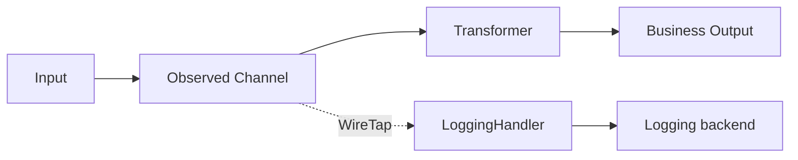

# `log` in the DSL

## 1. Objectives and Context

In the **Advanced DSL** chapter of the **SPRING_INTEGRATION_CORE** module, the `log()` operator helps observe messages at specific points inside an `IntegrationFlow`. When a flow comprises transformers, filters, routers, gateways, or aggregators, contextual logs help determine how far a message got and what state it held at that moment.

Suppose an order event goes through validation and then order-ID normalization. When no output appears, we need to distinguish several possibilities: input never arrived, the filter dropped the message, the transformer failed, or the result was sent but no consumer processed it yet. Placing logs on the right channels and picking the right fields answers each question.

After this lesson, you will be able to:

- Explain the relationship between `log()`, `WireTap`, and `LoggingHandler`.
- Choose levels, logger categories, lambdas, or SpEL expressions to log exactly the needed details.
- Place logs before and after endpoints without confusing observation time with business completion time.
- End a one-way flow or preserve the reply path for a gateway according to Spring Integration 6.x behavior.
- Test log contents alongside the actual flow output.

The examples use Java 17 and Spring Integration 6.x, taking the 6.5 API as the specific baseline. The project needs `spring-integration-core` and compatible Spring dependencies. With Spring Boot, you can use `spring-boot-starter-integration` and let Boot's BOM manage versions. The testing section uses JUnit Jupiter; the test that captures log events assumes Logback as the logging backend.

## 2. How Does `log()` Observe Messages?

In Java DSL, `log()` is implemented using a `WireTap` `ChannelInterceptor` wired to a `LoggingHandler`. It observes messages on the current channel or the implicit channel the DSL creates to link endpoints. The main flow continues per configuration. See [the `log()` operator in the Spring Integration documentation](https://docs.spring.io/spring-integration/reference/dsl/java-log.html).



The dashed line represents the observation branch. The function used to build the log message does not replace a transformer on the business path.

```java
.<String>log(message -> "length=" + message.getPayload().length())
```

With payload `"hello"`, the snippet above produces log text `length=5`; the payload on the main path remains `"hello"`. If you need to convert the payload to the number `5`, use a separate transformer.

There are two implications when reading a flow:

1. **A log describes what was observed at a single point.** It does not confirm that a transaction committed, that the final consumer processed the message, or that data was durably persisted.
2. **The log branch still executes work.** Evaluating expressions, building strings, and writing to appenders all carry cost. Broken expressions or formatting code that throws exceptions can also fail sends on the channel.

Therefore, keep log-formatting functions short, non-mutating, and free of business operations.

## 3. Common `log()` Forms

### 3.1. Level, Category, and Content

| Call Form | Meaning |
| --- | --- |
| `.log()` | Logs the entire `Message` at `INFO` level using the default category |
| `.log(LoggingHandler.Level.DEBUG)` | Logs the entire message at `DEBUG` level |
| `.log("demo.integration.orders")` | Uses the specified category at `INFO` level |
| `.log(level, category)` | Selects level and category, logging the entire message |
| `.<OrderSubmitted>log(level, category, function)` | Builds log content from `Message<OrderSubmitted>` |
| `.log(level, category, spelString)` | Uses a SpEL expression to build log content |

The default category for standard overloads is `org.springframework.integration.handler.LoggingHandler`. When no custom function or expression is supplied, the DSL configures logging the entire message. These details are listed in the [Spring Integration 6.5 Java DSL API](https://docs.spring.io/spring-integration/docs/6.5.0/api/org/springframework/integration/dsl/BaseIntegrationFlowDefinition.html#log()).

Do not infer `.log()` defaults from a manually constructed `LoggingHandler`: a manually created handler defaults to logging only the payload, whereas the DSL explicitly configures logging the entire message when no custom expression is given.

### 3.2. Lambdas Receiving `Message<P>`

With `log()`, the lambda parameter is `Message<P>`, so you can read both payload and headers:

```java
.<OrderSubmitted>log(
        LoggingHandler.Level.INFO,
        "demo.integration.orders",
        message -> "stage=received"
                + " requestId=" + message.getHeaders().get("requestId")
                + " orderId=" + message.getPayload().orderId())
```

`OrderSubmitted` is defined in the complete example in Section 4. Specifying `<OrderSubmitted>` helps the compiler determine the payload type inside the lambda. The DSL does not enforce an end-to-end static type system across all endpoints, so the type declared at `log` must match the payload actually arriving at that spot.

The lambda's return value is used solely for logging. Returning a clear formatted string is usually easier to verify than returning a large object and relying solely on `toString()`.

### 3.3. SpEL with `Message` as Root Object

You can express the same idea using SpEL:

```java
.log(LoggingHandler.Level.INFO,
        "demo.integration.orders",
        "'stage=received requestId=' + headers['requestId']"
                + " + ' orderId=' + payload.orderId()")
```

In this expression, `headers` and `payload` are read from the message. An absent header can evaluate to `null`; if a fallback value is needed, express that policy in the expression or a Java function.

The string in the third parameter is a **SpEL expression**, not an SLF4J format string with `{}` placeholders. For example:

```java
.log(LoggingHandler.Level.INFO,
        "demo.integration.orders",
        "'stage=received'")
```

The single quotes inside the Java string denote a SpEL string literal. By contrast:

```java
.log("stage=received")
```

A single-`String` call selects the category overload; it creates a logger named `stage=received` rather than logging that literal as content. When formatting involves data handling or reuse, a Java function usually communicates intent more clearly than a long expression.

## 4. Complete Example: Observing Order Validation and Normalization

The following flow logs incoming orders, routes invalid ones to a reject queue, normalizes valid order IDs, and sends results to an output queue. Log entries only pick `stage`, `requestId`, and `orderId`.

```java
import java.math.BigDecimal;
import java.util.Locale;
import java.util.Objects;

import org.springframework.beans.factory.annotation.Qualifier;
import org.springframework.context.annotation.Bean;
import org.springframework.context.annotation.Configuration;
import org.springframework.integration.channel.DirectChannel;
import org.springframework.integration.channel.QueueChannel;
import org.springframework.integration.config.EnableIntegration;
import org.springframework.integration.dsl.IntegrationFlow;
import org.springframework.integration.handler.LoggingHandler;
import org.springframework.messaging.Message;

@Configuration(proxyBeanMethods = false)
@EnableIntegration
public class OrderLogConfig {

    public static final String ORDER_LOG = "demo.integration.orders";

    public record OrderSubmitted(String orderId, BigDecimal amount) {
    }

    @Bean
    public DirectChannel orderInput() {
        return new DirectChannel();
    }

    @Bean
    public QueueChannel orderResults() {
        return new QueueChannel(100);
    }

    @Bean
    public QueueChannel rejectedOrders() {
        return new QueueChannel(100);
    }

    @Bean
    public IntegrationFlow orderFlow(
            @Qualifier("orderInput") DirectChannel input,
            @Qualifier("orderResults") QueueChannel results,
            @Qualifier("rejectedOrders") QueueChannel rejected) {

        return IntegrationFlow.from(input)
                .<OrderSubmitted>log(
                        LoggingHandler.Level.DEBUG,
                        ORDER_LOG,
                        message -> describe("received", message))
                .filter(OrderSubmitted.class,
                        OrderLogConfig::isValid,
                        endpoint -> endpoint.discardFlow(discard -> discard
                                .<OrderSubmitted>log(
                                        LoggingHandler.Level.WARN,
                                        ORDER_LOG,
                                        message -> describe("rejected", message))
                                .channel(rejected)))
                .<OrderSubmitted, OrderSubmitted>transform(order ->
                        new OrderSubmitted(
                                order.orderId().strip().toUpperCase(Locale.ROOT),
                                order.amount()))
                .<OrderSubmitted>log(
                        LoggingHandler.Level.INFO,
                        ORDER_LOG,
                        message -> describe("normalized", message))
                .channel(results)
                .get();
    }

    private static boolean isValid(OrderSubmitted order) {
        return order.orderId() != null
                && !order.orderId().isBlank()
                && order.amount() != null
                && order.amount().signum() > 0;
    }

    private static String describe(
            String stage, Message<OrderSubmitted> message) {

        return "stage=" + stage
                + " requestId=" + oneLine(
                        message.getHeaders().get("requestId"))
                + " orderId=" + oneLine(message.getPayload().orderId());
    }

    private static String oneLine(Object value) {
        String text = Objects.toString(value, "missing")
                .replace('\r', '_')
                .replace('\n', '_')
                .replace('\t', '_')
                .strip();
        return text.length() <= 64 ? text : text.substring(0, 64);
    }
}
```

`oneLine()` bounds length and sanitizes newline characters so the illustrative output stays easy to read. If a system needs JSON logs or strict escaping rules, use an appropriate encoder and logging configuration; string concatenation above merely builds key–value text.

For a request with `requestId=req-007`, order ID `" od-007 "`, and a positive amount, DEBUG-level log content includes:

```text
stage=received requestId=req-007 orderId=od-007
stage=normalized requestId=req-007 orderId=OD-007
```

Queue `orderResults` receives an `OrderSubmitted` with ID `OD-007`. The two log strings do not become result payloads. When the amount is invalid, the flow enters the discard subflow and logs `stage=rejected`; the normalization transformer is not called for that message.

The queues have a capacity of 100 and serve as observation sinks in the lesson. In a real application, attach consumers for each queue and configure send policies if queues can fill up.

## 5. Log Placement Determines What You Can Conclude

### 5.1. Before and After Endpoints

| Placement | What the Log Can Tell You | What Is Not Yet Proven |
| --- | --- | --- |
| Before filter | Message reached the check point | Message will pass the condition |
| After filter | Message passed the filter on this path | All downstream steps succeeded |
| Inside discard subflow | Message entered the reject branch | Rejection was recovered or reported to caller |
| After transformer | A message with transformed payload exists | Final consumer persisted the result |
| Before router | Message is about to enter routing | Which target branch finished |
| After aggregator | Output emitted by aggregator exists | Group was complete if partial results on expiry are enabled |

For example, placing `.log()` only after a filter and seeing no log line is not enough to conclude the producer sent nothing. The message might have arrived at the filter and been dropped. To check that case, observe before the filter or inside the discard branch.

Similarly, logging at `ERROR` level only indicates the log event's severity. It does not throw an exception or route the message to an error channel.

### 5.2. Logs on Shared Channels Have Shared Scope

If a flow places a log on a channel named `sharedInput`, the interceptor belongs to that channel. Messages sent by another producer to that same channel can also be observed, even if that producer never passed through earlier steps in the flow you are reading.

Therefore, when logs appear more often than expected, identify the exact channel holding the interceptor and all producers sending to it. Reading only the name of the `IntegrationFlow` bean containing `.log()` is not enough to determine runtime observation scope.

### 5.3. `preSend` Is Not Processing Completion

`WireTap` sends to the observation branch during `preSend`. With a queue, a log at that point may appear before the message is successfully enqueued. With an executor channel, it may appear before the task is successfully submitted. This mechanism is shown in [Spring Integration 6.5's `WireTap` source code](https://github.com/spring-projects/spring-integration/blob/v6.5.0/spring-integration-core/src/main/java/org/springframework/integration/channel/interceptor/WireTap.java).

Consequently, event names like `stage=before-dispatch` are more accurate than `stage=delivered` when observing prior to dispatch. To measure send outcomes or endpoint completion, place observation at the corresponding milestone instead of renaming a pre-send log line.

## 6. `log()` at the End of a Flow Since Spring Integration 6.0

Since version 6.0, `log()` at the end of a flow keeps the same observational semantics as in the middle of a flow. It no longer acts by default as a terminal consumer for every flow. Official docs recommend using `nullChannel()` after a trailing log when no reply is needed. When reading older examples, check against this change. See [`log()` operator behavior](https://docs.spring.io/spring-integration/reference/dsl/java-log.html).

### 6.1. One-Way Flow: Log and Terminate

The standalone bean below accepts a string, logs its length, and terminates explicitly:

```java
@Bean
public IntegrationFlow oneWayLogFlow() {
    return IntegrationFlow.from("oneWayLogInput")
            .<String>log(
                    LoggingHandler.Level.INFO,
                    "demo.integration.events",
                    message -> "stage=observed length="
                            + message.getPayload().length())
            .nullChannel();
}
```

`nullChannel()` is a terminal operator returning `IntegrationFlow`, so do not append `.get()` in this example. The message is consumed at the terminal point; the flow produces no business reply.

If a gateway is waiting for a reply from this flow, the caller may block until timeout because the configuration intentionally returns no result. Gateway method signatures and flow shapes must agree.

### 6.2. Reply-Producing Flow: Log and Return via `replyChannel`

You can add the following bean to `OrderLogConfig`; the class already imports `Locale`:

```java
@Bean
public IntegrationFlow normalizeReplyFlow() {
    return IntegrationFlow.from("normalizeReplyInput")
            .<String, String>transform(value ->
                    value.strip().toUpperCase(Locale.ROOT))
            .<String>log(
                    LoggingHandler.Level.INFO,
                    "demo.integration.reply",
                    message -> "stage=reply-ready length="
                            + message.getPayload().length())
            .get();
}
```

For messages carrying `replyChannel`, the normalized result has a path back to the reply channel. The string `stage=reply-ready ...` is purely observational text. A request–reply gateway is one way to provide that reply path; tests can also set that header manually.

If you send a message with no reply path directly into a reply-producing flow, seeing the log does not guarantee the send call will succeed. Errors resolving output or reply channels can still occur after the observation point.

### 6.3. Using `LoggingHandler` as a Terminal Consumer

Another option for a logging sink is declaring a handler bean and wiring it directly with `.handle(...)`:

```java
@Bean
public LoggingHandler terminalEventLogger() {
    LoggingHandler handler = new LoggingHandler(LoggingHandler.Level.INFO);
    handler.setLoggerName("demo.integration.event-sink");
    handler.setLogExpressionString(
            "'requestId=' + headers['requestId']");
    return handler;
}

@Bean
public IntegrationFlow terminalLoggingFlow(
        LoggingHandler terminalEventLogger) {

    return IntegrationFlow.from("terminalLogInput")
            .handle(terminalEventLogger)
            .get();
}
```

In this configuration, `LoggingHandler` is the final consumer of the main path and produces no reply. Use this when the entire purpose of the flow is delivering messages to a logging sink. Properties like `logExpression`, logger name, and full-message mode are described in [Logging Channel Adapter](https://docs.spring.io/spring-integration/reference/logging-adapter.html).

## 7. Levels in the DSL vs. Backend Configuration

The log level in the flow and the threshold allowed by the logging backend are two separate settings:

```java
.log(LoggingHandler.Level.DEBUG, "demo.integration.orders")
```

This call requests emitting an event at `DEBUG` level. If the effective logger level is `INFO`, DEBUG content will not be written under normal configuration. That does not mean the flow failed to run.

With Spring Boot, per-category log levels can be placed in your application's `application.yml`:

```yaml
logging:
  level:
    root: INFO
    demo.integration.orders: DEBUG
    demo.integration.events: INFO
    demo.integration.reply: INFO
```

This is an example configuration for a learning application, not content to add to lesson YAML metadata. In plain Spring applications, configure your chosen logging backend directly; `logging.level.*` is a Spring Boot convention. See [Spring Boot logging configuration](https://docs.spring.io/spring-boot/reference/features/logging.html#features.logging.log-levels).

One way to assign log levels for the order example:

| Level | Example Content |
| --- | --- |
| `TRACE` | Low-level technical details for short-term investigation under controlled traffic |
| `DEBUG` | Event reaching a step, selected fields for diagnostics |
| `INFO` | Meaningful processing milestones at a reasonable frequency |
| `WARN` | Rejected or degraded cases requiring tracking per application policy |
| `ERROR` | Processing failures requiring corrective action |

Not every message dropped by a filter warrants `WARN`. If the filter condition represents normal, high-frequency business filtering, pick `DEBUG` or use counters/metrics. Severity should reflect operational meaning, not just endpoint placement.

Use stable category names aligned with features, such as `demo.integration.orders`. Order IDs or request IDs belong in the log body because categories containing dynamic IDs make log levels and configuration scope hard to manage.

## 8. Message Correlation and Thread Boundaries

### 8.1. Choosing the Right Correlation Identifier

`MessageHeaders.ID` helps identify a specific message instance. Across transformers, splitters, or steps creating new messages, the message ID can change. An application-defined `requestId` or `eventId` ties together steps of the same business operation, provided steps preserve that header.

Example input send:

```java
Message<OrderLogConfig.OrderSubmitted> request =
        MessageBuilder.withPayload(
                        new OrderLogConfig.OrderSubmitted(
                                " od-007 ", new BigDecimal("125000")))
                .setHeader("requestId", "req-007")
                .build();

input.send(request);
```

This uses `org.springframework.messaging.support.MessageBuilder`; `input` is the `orderInput` bean. For error-handling, retry, or branching steps, include branch names and attempt numbers in log entries when available.

Do not arbitrarily overwrite `correlationId` used by splitters or aggregators just to get an easily searchable log value. Observation headers can use distinct names so they never alter an EIP's correlation contract.

### 8.2. Logging Around Executor Channels

Consider the following flow skeleton; `executor` is an application-managed executor bean:

```java
.channel(channels -> channels.executor(executor))
.<String>log(
        LoggingHandler.Level.DEBUG,
        "demo.integration.threads",
        message -> "stage=before-dispatch thread="
                + Thread.currentThread().getName())
.<String, String>transform(String::strip)
.<String>log(
        LoggingHandler.Level.DEBUG,
        "demo.integration.threads",
        message -> "stage=after-transform thread="
                + Thread.currentThread().getName())
```

The first log attaches to the executor channel and executes during `preSend`, so it can still run on the sender's thread. The transformer runs when the task executes; the log at the transformer's output observes the message on the subsequent processing path.

Therefore, seeing `.log()` after `.channel(...)` in source code is not enough to claim the log runs on a worker thread. Check which channel is intercepted and which endpoint has actually executed.

### 8.3. Headers Do Not Automatically Become MDC

MDC is typically bound to the logging backend's thread context. Having a `requestId` header on a message does not automatically populate MDC, nor does it automatically propagate all MDC entries from sender to worker.

The straightforward approach in this lesson is reading `requestId` directly from the message. If your system uses MDC or distributed tracing, set up context propagation and cleanup matched to your executor and observability tooling. Never put MDC initialization, MDC clearing, or business state updates inside a `.log()` lambda, because log formatting may be skipped when the level is disabled.

## 9. Logging Errors and Handling Errors Are Two Different Jobs

A `.log()` placed before an endpoint does not catch that endpoint's exceptions. A `.log()` placed after an endpoint also does not run if the endpoint throws before producing output. To observe errors, use an error path or advice suited to the execution boundary.

In synchronous flows, exceptions usually propagate back to the caller. For asynchronous tasks managed by Spring Integration, errors can be wrapped into an `ErrorMessage` and sent to an `errorChannel` per the component's mechanics. See [Error Handling in Spring Integration](https://docs.spring.io/spring-integration/reference/error-handling.html).

Example logging sink for errors already routed to a dedicated channel:

```java
@Bean
public IntegrationFlow errorLoggingFlow() {
    return IntegrationFlow.from("orderErrorLogInput")
            .log(
                    LoggingHandler.Level.ERROR,
                    "demo.integration.orders.errors",
                    message -> message.getPayload())
            .nullChannel();
}
```

This flow only processes messages sent to `orderErrorLogInput`. For it to receive real task failures, the error-emitting component or `errorChannel` header must point to that channel. Naming a bean `errorLoggingFlow` does not automatically wire every exception in the application to it.

For an `ErrorMessage`, the payload is a `Throwable`. `LoggingHandler` supports printing stack traces when the expression evaluates to a `Throwable`; returning the payload preserves richer error context than taking only `getMessage()`. See [`LoggingHandler` API](https://docs.spring.io/spring-integration/docs/current/api/org/springframework/integration/handler/LoggingHandler.html).

However, stack traces and `failedMessage` can carry input data. Select logged details carefully per your system's data sensitivity rules. If the business requires retries, routing to a recovery queue, or reporting failure status to the caller, configure those behaviors explicitly. A logging sink ending at `nullChannel()` merely records and consumes the error message.

## 10. Log Cost and Content

### 10.1. Pick Needed Fields Instead of Logging Whole Messages

Parameterless `.log()` is handy when experimenting with toy data, but it can dump both payload and headers. In an HTTP-backed flow, headers may contain tokens; payloads may contain customer records or large documents.

The example in Section 4 intentionally selects a small set of fields. Apply the same approach in production systems:

| Field | Purpose |
| --- | --- |
| `stage` | Identifies the observation milestone |
| `requestId` or `eventId` | Correlates related events |
| Permitted business IDs | Links to the entity being processed |
| Branch name, attempt count, status | Explains path taken and retries |
| Size or element count | Observes large data without dumping full contents |

Never read an entire stream, open files, or serialize huge structures solely for logging. For an `InputStream`, reading it can even alter or exhaust the data the next endpoint receives.

### 10.2. Keep Log-Formatting Lambdas Side-Effect-Free

In the Spring Integration 6.5 implementation, `LoggingHandler` uses a `Supplier` to evaluate log content on demand based on the log level. When the level is disabled, do not expect the formatting function to run. See [`LoggingHandler` 6.5 Source Code](https://github.com/spring-projects/spring-integration/blob/v6.5.0/spring-integration-core/src/main/java/org/springframework/integration/handler/LoggingHandler.java).

Therefore, actions like incrementing business counters, writing mandatory audit records, or mutating payloads must live in proper endpoints. If placed inside `.log()` lambdas, changing logging levels can alter business behavior.

When the level is enabled, the expression still incurs cost and must match the payload type. A bad cast, unhandled `null` dereference, or remote call inside a formatter can disrupt the send path. Observing via wire tap does not automatically imply zero error risk or zero latency.

### 10.3. Logs Do Not Replace All Telemetry

Detailed logs excel at explaining a single event. Questions like rejection rate, errors per minute, or latency percentiles need proper metrics. Counting log lines skews when levels change, sampling is active, appenders filter events, or messages are retried.

Mandatory durable auditing also needs its own storage and confirmation mechanism. A `stage=normalized` log line proves only what that observation point actually witnesses.

## 11. Testing Log Output and Flow Results

### 11.1. Capturing Logback Events

The test below uses `OrderLogConfig` from Section 4. The test runtime must have Logback as the SLF4J backend with Spring logging wired to it. If your project uses Log4j2 or another backend, use the corresponding capture mechanism.

`ListAppender` retains logging events in memory for assertions. See [Logback `ListAppender` API](https://logback.qos.ch/apidocs/ch.qos.logback.core/ch/qos/logback/core/read/ListAppender.html).

```java
import java.math.BigDecimal;

import ch.qos.logback.classic.Level;
import ch.qos.logback.classic.Logger;
import ch.qos.logback.classic.spi.ILoggingEvent;
import ch.qos.logback.core.read.ListAppender;
import org.junit.jupiter.api.Test;
import org.slf4j.LoggerFactory;
import org.springframework.context.annotation.AnnotationConfigApplicationContext;
import org.springframework.integration.channel.QueueChannel;
import org.springframework.messaging.Message;
import org.springframework.messaging.MessageChannel;
import org.springframework.messaging.support.MessageBuilder;

import static org.junit.jupiter.api.Assertions.*;

class OrderLogTest {

    @Test
    void logsSelectedFieldsAndKeepsBusinessOutput() {
        Logger logger = (Logger) LoggerFactory.getLogger(OrderLogConfig.ORDER_LOG);
        Level previousLevel = logger.getLevel();
        boolean previousAdditive = logger.isAdditive();

        ListAppender<ILoggingEvent> appender = new ListAppender<>();
        appender.setContext(logger.getLoggerContext());
        appender.start();
        logger.addAppender(appender);
        logger.setLevel(Level.DEBUG);
        logger.setAdditive(false);

        try (var context = new AnnotationConfigApplicationContext(
                OrderLogConfig.class)) {

            MessageChannel input =
                    context.getBean("orderInput", MessageChannel.class);
            QueueChannel results =
                    context.getBean("orderResults", QueueChannel.class);
            QueueChannel rejected =
                    context.getBean("rejectedOrders", QueueChannel.class);

            var order = new OrderLogConfig.OrderSubmitted(
                    " od-007 ", new BigDecimal("125000"));
            Message<?> request = MessageBuilder.withPayload(order)
                    .setHeader("requestId", "req-007")
                    .setHeader("authorization", "secret-token-for-test")
                    .build();

            assertTrue(input.send(request));

            Message<?> reply = results.receive(1000);
            assertNotNull(reply);
            assertEquals(
                    new OrderLogConfig.OrderSubmitted(
                            "OD-007", new BigDecimal("125000")),
                    reply.getPayload());
            assertEquals("req-007", reply.getHeaders().get("requestId"));
            assertNull(rejected.receive(0));

            assertEquals(2, appender.list.size());
            assertEquals(Level.DEBUG, appender.list.get(0).getLevel());
            assertEquals(Level.INFO, appender.list.get(1).getLevel());
            assertEquals(
                    "stage=received requestId=req-007 orderId=od-007",
                    appender.list.get(0).getFormattedMessage());
            assertEquals(
                    "stage=normalized requestId=req-007 orderId=OD-007",
                    appender.list.get(1).getFormattedMessage());
            assertTrue(appender.list.stream().noneMatch(event ->
                    event.getFormattedMessage().contains("secret-token-for-test")));
        }
        finally {
            logger.detachAppender(appender);
            appender.stop();
            logger.setLevel(previousLevel);
            logger.setAdditive(previousAdditive);
        }
    }
}
```

The test verifies both business output and observation content. The `authorization` header remains part of the input message, yet the formatter excludes it from log entries. This check only proves logs emitted by the captured category; it does not assert every other logger in the application shares the same policy.

Event order is asserted because this flow runs synchronously and handles a single message. Do not assume the same strict ordering for concurrent requests or executor-backed flows. Loggers are JVM-wide shared resources, so avoid running tests that mutate the same category concurrently, or use your test runner's resource locking.

### 11.2. Verifying a Trailing Log Preserves the Reply

After adding `normalizeReplyFlow()` from Section 6 to the configuration, you can add the following test method to `OrderLogTest`:

```java
@Test
void keepsReplyWhenLogIsAtTheEndOfFlow() {
    try (var context = new AnnotationConfigApplicationContext(
            OrderLogConfig.class)) {

        MessageChannel input =
                context.getBean("normalizeReplyInput", MessageChannel.class);
        QueueChannel replies = new QueueChannel(1);

        Message<?> request = MessageBuilder.withPayload("  ready  ")
                .setReplyChannel(replies)
                .build();

        assertTrue(input.send(request));
        Message<?> reply = replies.receive(1000);
        assertNotNull(reply);
        assertEquals("READY", reply.getPayload());
    }
}
```

The `replyChannel` header is set manually to exercise the reply path. Getting `"READY"` proves the trailing log neither overwrote the payload with the formatted log string nor consumed the reply.

### 11.3. Additional Tests for Configuration Changes

| Change or Scenario | Result to Verify |
| --- | --- |
| Invalid order | `stage=rejected` logged, no `stage=normalized`, message enters reject queue |
| Logger set to INFO only | Entry DEBUG log does not appear, business output remains valid |
| Missing `requestId` | Formatter uses fallback value, flow does not fail on missing header |
| ID contains newlines | Formatter sanitizes per chosen rules |
| Executor added | Correlation stays accurate even if events interleave or cross threads |
| One-way flow ending with `nullChannel()` | Message is consumed per the one-way contract |
| Formatter expects wrong payload type | Configuration error caught and type fixed at the right spot |

For asynchronous flows, wait for results via queues or synchronize with timeout-bounded primitives. The `ListAppender` shown above must not be used as an inter-thread synchronization mechanism, and `Thread.sleep()` does not reliably prove endpoints have finished.

## 12. Diagnosing Common Confusions

| Symptom | Where to Check |
| --- | --- |
| DEBUG lines missing | Check effective level on the exact category and appender configuration |
| Entry log appears, post-filter log does not | Check filter condition and discard subflow |
| Log appears, yet send still fails | Check endpoints after the log point, output/reply channels, and `preSend` timing |
| Log dumps entire payload and headers | Check parameterless overload; select only needed fields |
| Changing log level alters business behavior | Look for side effects mistakenly placed inside log lambdas |
| Duplicate logs for the same request ID | Distinguish retries, multiple tap points, multiple producers, and additive appenders |
| Log on executor still shows sender thread name | Check whether the log sits on the channel or after an endpoint running on a worker |
| Business error occurred, yet `.log(ERROR)` is silent | Check if messages reach the log point and whether the `ErrorMessage` path is wired |
| Flow hangs waiting for reply | Compare gateway contract with terminal consumer, `nullChannel()`, and reply path |

When investigating, start with the observed channel, level/category, and the path of a single concrete request. Then compare actual outputs, errors, and endpoint states; a single log line usually explains only one slice of the journey.

## 13. Extended Practice Exercises

1. Run the order flow with the logger at DEBUG, then switch to INFO. Confirm the normalized output stays identical and only the logged lines change per configuration.
2. Send an order with amount `0`. Inspect the reject queue and observe the absence of any `normalized` event for that request.
3. Add a long notes field to the test data record while keeping the formatter limited to request ID and order ID. Verify the notes content never appears in the flow's logs.
4. Add an executor, log the thread name at two points as in Section 8, and send multiple requests with distinct IDs. Use the correlation ID to group events rather than relying on log line order.
5. Compare a reply-producing flow ending in `.log(...).get()` with a one-way flow ending in `.log(...).nullChannel()`. Verify behavior with a reply channel and bounded wait.

For each new log point, document the milestone it observes, the permitted fields, and what outcomes still must be verified downstream. That keeps logs meaningful as filters, branches, or asynchronous execution are added to the flow.
