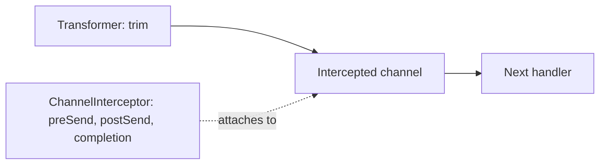

# `intercept` in the DSL

## 1. Objectives and Context

In the **Advanced DSL** chapter of the **SPRING_INTEGRATION_CORE** module, `intercept()` lets you place cross-cutting behavior at message-transfer boundaries. You can enrich metadata, record send outcomes, or enforce acceptance conditions without repeating the same code in every transformer and service activator.

This lesson builds the following capabilities:

- Identify which channel actually receives the interceptor at a given spot in Java DSL.
- Choose the appropriate callback for send, receive, or executor-based handling.
- Distinguish preserving, replacing, blocking, and rejecting messages with exceptions.
- Order multiple interceptors and understand when completion callbacks fire.
- Test flow behavior, headers, and rejection paths.

Examples use **Java 17 or later, Spring Integration 6.5.x**, and JUnit Jupiter. Java DSL is included in `spring-integration-core`. With Spring Boot, choose dependencies according to your application's compatible BOM. Snippets marked as "fragments" illustrate part of a DSL chain, not a standalone Java file.

## 2. Intercept Attaches to a Channel

`intercept(ChannelInterceptor...)` registers one or more interceptors on the flow's current channel. The operator has been available since Spring Integration 5.3. It is a concise way to attach interceptors right inside a DSL chain. Refer to [Operator intercept()](https://docs.spring.io/spring-integration/reference/6.5/dsl/java-intercept.html).

```java
// Fragment: both interceptor variables are pre-supplied instances.
.transform(String.class, String::trim)
.intercept(requestIdInterceptor, sendOutcomeInterceptor)
.handle((payload, headers) -> payload)
```

Conceptual structure:



Here, the interceptor observes messages **after the transformer** as they cross the corresponding channel. It does not automatically wrap every method call inside a handler.

A flow typically has multiple channels, including implicit channels created by the DSL. Therefore, saying "an interceptor was added to the flow" is not precise enough. Always specify **which channel, at which boundary**.

### 2.1. Explicit Channels vs. Implicit Channels

When the current channel is an `InterceptableChannel`, the DSL attaches the interceptor to that channel. If no suitable channel is present, the DSL creates an implicit `DirectChannel` to perform the interception. The API documents this behavior in [BaseIntegrationFlowDefinition](https://docs.spring.io/spring-integration/docs/6.5.0/api/org/springframework/integration/dsl/BaseIntegrationFlowDefinition.html).

To attach reliably to a specific channel bean, pass the injected instance directly:

```java
@Bean
IntegrationFlow incomingFlow(
        @Qualifier("incoming") DirectChannel incoming,
        ChannelInterceptor boundaryInterceptor) {

    return IntegrationFlow.from(incoming)
            .intercept(boundaryInterceptor)
            .<String, String>transform(String::trim)
            .channel("results")
            .get();
}
```

This example assumes the `incoming` bean, `results` bean, and a matching interceptor already exist.

Be careful with the following style:

```java
.channel("sharedInput")
.intercept(boundaryInterceptor)
```

During DSL assembly, a channel name may be represented as a reference object rather than a resolved channel bean instance. In the version used in this article, the DSL can insert an implicit channel at that position. Do not rely on the snippet above to assume the interceptor was attached directly to the `sharedInput` bean. If attaching to that exact bean is required, pass the instance or configure the interceptor where the channel is created. You can verify this in [the BaseIntegrationFlowDefinition 6.5.0 source code](https://raw.githubusercontent.com/spring-projects/spring-integration/v6.5.0/spring-integration-core/src/main/java/org/springframework/integration/dsl/BaseIntegrationFlowDefinition.java).

### 2.2. Shared Channels Have Shared Scope

If two flows send to the same intercepted channel, both send paths are affected by that interceptor. Placing `.intercept(...)` inside one configuration method does not scope the interceptor exclusively to one caller.

Practical consequence: an interceptor checking payload types must fit the channel's contract. If the channel carries multiple message types, an interceptor accepting only one DTO will affect other flows using that channel as well.

## 3. `ChannelInterceptor` Callbacks

`ChannelInterceptor` belongs to package `org.springframework.messaging.support`. The interface provides default methods so you only need to override the callbacks you use.

| Callback | Timing | Return Value or Primary Effect |
|---|---|---|
| `preSend(message, channel)` | Before sending executes | Return original message, new message, or `null` to block the send |
| `postSend(message, channel, sent)` | After the send operation returns normally | Observe the `sent` flag |
| `afterSendCompletion(message, channel, sent, ex)` | At the end of a send for interceptors that passed preparation | Cleanup and error observation |
| `preReceive(channel)` | Before pulling a message from a pollable channel | `false` to skip receiving |
| `postReceive(message, channel)` | After pulling a message, before returning to caller | Can replace the message or return `null` |
| `afterReceiveCompletion(message, channel, ex)` | At the end of a receive for eligible interceptors | Cleanup; message may be `null` |

Full callback contracts are in [ChannelInterceptor in Spring Framework 6.2](https://docs.spring.io/spring-framework/docs/6.2.x/javadoc-api/org/springframework/messaging/support/ChannelInterceptor.html).

Three common points of confusion:

1. `postSend` is not a callback that always runs when a send throws an error. Error cleanup belongs in completion callbacks.
2. `afterSendCompletion` is only invoked for interceptors whose `preSend` completed and returned a non-`null` message.
3. Receive callbacks apply to `PollableChannel`; they are not "before handler runs" callbacks on a `DirectChannel`.

Never treat `ex == null` as proof that the message was sent. A send blocked with `null` can finish with `sent == false` and no exception.

## 4. Modifying Messages Properly

### 4.1. Adding Headers with `MessageBuilder`

For standard messages, headers are not a map you mutate directly:

```java
// Do not do this with standard MessageHeaders.
message.getHeaders().put("requestId", "REQ-101");
```

Use a builder to construct a message with the updates:

```java
@Override
public Message<?> preSend(
        Message<?> message,
        MessageChannel channel) {

    return MessageBuilder.fromMessage(message)
            .setHeader("sourceSystem", "order-api")
            .build();
}
```

`fromMessage(...)` preserves the payload and copyable headers, helping avoid accidental loss of `replyChannel`, `errorChannel`, or business metadata. The message structure does not make every payload object and every header value deeply immutable; avoid mutating shared mutable DTOs inside an interceptor. See [Message and Message Headers](https://docs.spring.io/spring-integration/reference/6.5/message.html).

When creating a new message, do not use the message ID as a stable business identifier. Use headers like `requestId` or fields like `orderId` when correlating across multiple steps.

### 4.2. Preserve, Block, or Throw

| How `preSend` Ends | Meaning |
|---|---|
| `return message;` | Allow sending the current message |
| `return rebuiltMessage;` | Allow sending the new version |
| `return null;` | Do not send through this channel |
| `throw new ...;` | End the send attempt with an error |

In the Spring Integration channels used in this article, `preSend` returning `null` causes `send(...)` to return `false`. Higher-level abstractions like templates or gateways may interpret an unsuccessful send as an error; never assume blocking with `null` is silently ignored across the entire application.

In request–reply calls, a message blocked on an intermediate channel can also prevent the caller from receiving a reply. Choose a rejection policy aligned with the caller's contract.

## 5. Complete Example: Order Intake

Requirements for the example:

- Supply `requestId` when missing or not a non-blank string.
- Preserve an existing valid `requestId`.
- Count successful and unsuccessful sends on the input channel.
- Accept only `OrderRequest` instances with a non-blank order ID and positive quantity.
- Transform valid requests into `OrderAccepted` and send them to the result channel.

This is an in-memory example. The `ACCEPTED` status represents the practice transformation output; the example does not yet include database persistence or durable intake guarantees.

Save the configuration as `InterceptFlowConfiguration.java` in your practice project:

```java
import java.util.Objects;
import java.util.UUID;
import java.util.concurrent.atomic.LongAdder;

import org.springframework.beans.factory.annotation.Qualifier;
import org.springframework.context.annotation.Bean;
import org.springframework.context.annotation.Configuration;
import org.springframework.integration.channel.DirectChannel;
import org.springframework.integration.channel.QueueChannel;
import org.springframework.integration.channel.interceptor.MessageSelectingInterceptor;
import org.springframework.integration.config.EnableIntegration;
import org.springframework.integration.dsl.IntegrationFlow;
import org.springframework.messaging.Message;
import org.springframework.messaging.MessageChannel;
import org.springframework.messaging.support.ChannelInterceptor;
import org.springframework.messaging.support.MessageBuilder;

@Configuration(proxyBeanMethods = false)
@EnableIntegration
public class InterceptFlowConfiguration {

    public static final String REQUEST_ID = "requestId";

    public record OrderRequest(String orderId, int quantity) {
        public OrderRequest {
            Objects.requireNonNull(orderId, "orderId");
        }
    }

    public record OrderAccepted(
            String orderId,
            int quantity,
            String status) {
    }

    public static final class RequestIdInterceptor
            implements ChannelInterceptor {

        @Override
        public Message<?> preSend(
                Message<?> message,
                MessageChannel channel) {

            Object current = message.getHeaders().get(REQUEST_ID);
            if (current instanceof String id && !id.isBlank()) {
                return message;
            }

            return MessageBuilder.fromMessage(message)
                    .setHeader(REQUEST_ID, UUID.randomUUID().toString())
                    .build();
        }
    }

    public static final class SendOutcomeInterceptor
            implements ChannelInterceptor {

        private final LongAdder successful = new LongAdder();
        private final LongAdder unsuccessful = new LongAdder();

        @Override
        public void afterSendCompletion(
                Message<?> message,
                MessageChannel channel,
                boolean sent,
                Exception ex) {

            if (sent && ex == null) {
                successful.increment();
            }
            else {
                unsuccessful.increment();
            }
        }

        public long successfulSends() {
            return successful.sum();
        }

        public long unsuccessfulSends() {
            return unsuccessful.sum();
        }
    }

    @Bean
    public DirectChannel orderInput() {
        return new DirectChannel();
    }

    @Bean
    public QueueChannel orderResults() {
        return new QueueChannel(10);
    }

    @Bean
    public RequestIdInterceptor requestIds() {
        return new RequestIdInterceptor();
    }

    @Bean
    public SendOutcomeInterceptor sendOutcomes() {
        return new SendOutcomeInterceptor();
    }

    @Bean
    public IntegrationFlow orderFlow(
            @Qualifier("orderInput") DirectChannel input,
            RequestIdInterceptor requestIds,
            SendOutcomeInterceptor sendOutcomes) {

        var validOrder = new MessageSelectingInterceptor(
                message -> message.getPayload()
                        instanceof OrderRequest order
                        && !order.orderId().isBlank()
                        && order.quantity() > 0);

        return IntegrationFlow.from(input)
                .intercept(requestIds, sendOutcomes, validOrder)
                .<OrderRequest, OrderAccepted>transform(
                        order -> new OrderAccepted(
                                order.orderId(),
                                order.quantity(),
                                "ACCEPTED"))
                .channel("orderResults")
                .get();
    }
}
```

`MessageSelectingInterceptor` is built into Spring Integration. When the selector rejects a message, the 6.5.0 implementation throws `org.springframework.messaging.MessageDeliveryException`; this differs from a custom `preSend` returning `null`. See [MessageSelectingInterceptor API](https://docs.spring.io/spring-integration/docs/6.5.0/api/org/springframework/integration/channel/interceptor/MessageSelectingInterceptor.html) and [the 6.5.0 source code](https://raw.githubusercontent.com/spring-projects/spring-integration/v6.5.0/spring-integration-core/src/main/java/org/springframework/integration/channel/interceptor/MessageSelectingInterceptor.java).

### 5.1. Test Send and Receive Result

```java
import org.springframework.context.annotation.AnnotationConfigApplicationContext;
import org.springframework.integration.channel.QueueChannel;
import org.springframework.messaging.MessageChannel;
import org.springframework.messaging.support.MessageBuilder;

public class InterceptExample {

    public static void main(String[] args) {
        try (var context = new AnnotationConfigApplicationContext(
                InterceptFlowConfiguration.class)) {

            MessageChannel input = context.getBean(
                    "orderInput", MessageChannel.class);
            QueueChannel results = context.getBean(
                    "orderResults", QueueChannel.class);

            var request = MessageBuilder.withPayload(
                            new InterceptFlowConfiguration.OrderRequest(
                                    "ORDER-101", 3))
                    .build();

            boolean sent = input.send(request, 1000);
            var result = results.receive(1000);

            System.out.println("sent=" + sent);
            if (result != null) {
                System.out.println(result.getPayload());
                System.out.println(result.getHeaders().get("requestId"));
            }
        }
    }
}
```

Expected output:

```text
sent=true
OrderAccepted[orderId=ORDER-101, quantity=3, status=ACCEPTED]
<a generated UUID for requestId>
```

`orderInput` is a `DirectChannel` passed by instance, so all three interceptors attach to that exact channel. `orderResults` is a queue for the program to read outputs; because the example reads directly with `receive`, no poller is required on the result channel.

The example sends only a single message. If run as a continuous service, add a consumer draining the queue and a full-queue policy. The timeout on `input.send(...)` does not automatically bound the total runtime of synchronous downstream handlers.

### 5.2. Why Does Registration Order Matter?

The order in the example is:

```text
requestIds → sendOutcomes → validOrder → send into channel
```

- The selector sees headers added by the preceding interceptor.
- The metrics interceptor has already passed default `preSend` before the selector can throw.
- When the selector rejects, the unsuccessful counter still updates via the completion callback.
- If the metrics interceptor were placed after the selector, it would never have been reached when the selector rejected and would miss that attempt.

The counters here measure **send attempts through `orderInput`**. They do not measure unique orders, committed transactions, or notifications delivered to external systems.

## 6. Callback Order and Completion Conditions

Suppose a channel has two interceptors `A`, `B`, in registration order, with no others and normal handler execution:

```text
A.preSend
B.preSend
send / deliver message to subscriber
A.postSend
B.postSend
B.afterSendCompletion
A.afterSendCompletion
```

Pre-send callbacks run in registration order; completion callbacks unwind in reverse order for interceptors that completed the preparation step. `postSend` is a normal post-send callback, not a substitute for completion.

In Spring Integration 6.5.0, `postSend` also runs in registration order; you can verify this in [AbstractMessageChannel](https://raw.githubusercontent.com/spring-projects/spring-integration/v6.5.0/spring-integration-core/src/main/java/org/springframework/integration/channel/AbstractMessageChannel.java).

### 6.1. Interceptor B Returns `null`

```text
A.preSend → returns message
B.preSend → returns null
A.afterSendCompletion(sent=false, ex=null)
send(...) → false
```

No actual send occurs, no `postSend` runs, and `B`'s own completion does not run. `B` did not satisfy the condition of completing preparation.

If `B` acquired resources before deciding to return `null`, it must clean up its own resources before returning. Do not rely on `B`'s completion callback in this case.

### 6.2. Interceptor B Throws an Exception

```text
A.preSend → returns message
B.preSend → throws exception
A.afterSendCompletion(sent=false, ex=exception)
caller receives send error
```

If a handler throws an exception after both `A` and `B` allowed the send, both completion callbacks can run in reverse order with the corresponding exception. An interceptor that throws directly from `preSend` does not get its own completion callback.

Thus, the statement "completion always runs" must be understood with the API's condition: it applies only to interceptors whose `preSend` succeeded and returned a message. Likewise, receive completion requires `preReceive` to have returned `true`.

### 6.3. One Send Can Trigger Nested Sends

With `DirectChannel`, a subscriber can send onward to another channel on the same thread. Callback logs can therefore interleave across multiple channels:

```text
input.preSend
  handler sends to results
    results.preSend
    results.postSend
    results.afterSendCompletion
input.postSend
input.afterSendCompletion
```

When reading logs, include channel names and request IDs. Never deduce callback order for one channel from log lines belonging to another channel.

## 7. Receive Callbacks Are Not Handler Callbacks

`preReceive`, `postReceive`, and `afterReceiveCompletion` apply to pulling messages from a `PollableChannel`, such as `QueueChannel`.

| Scenario | Callbacks to Watch |
|---|---|
| Sending into queue | Send callbacks |
| Consumer calls `receive` and gets a message | Receive callbacks |
| Queue is empty, receive times out | Receive completion may receive `message == null` |
| `preReceive` returns `false` | Message is not pulled from the channel |
| `postReceive` returns `null` | Caller does not receive that message from the receive call |

In the versions used here, `postReceive` is not called when no message was retrieved. Use `afterReceiveCompletion` if you need to observe empty receive attempts as well. The exact method name in Java is **`afterReceiveCompletion`**. Refer to [Channel Interceptors](https://docs.spring.io/spring-integration/reference/6.5/channel/interceptors.html).

With a queue, the message has already been removed before `postReceive` runs. Returning `null` here does not automatically put the message back onto the queue. If rejected data needs handling, design a discard path, error handling, or an appropriate transaction.

Do not use receive callbacks as a proxy for handler completion. A poller may pull a message successfully and then have the handler fail afterward.

## 8. `DirectChannel`, `QueueChannel`, and `ExecutorChannel`

| Channel | What Send Callbacks Usually Observe | What Cannot Be Concluded |
|---|---|---|
| `DirectChannel` | Synchronous send and subscriber call on sender's thread | External systems finished or transaction committed |
| `QueueChannel` | Message was placed in the queue | Consumer pulled or processed the message |
| `ExecutorChannel` | Handoff of the message to an executor | Worker handler finished processing |
| `PublishSubscribeChannel` | Dispatch to subscribers per configuration | One send corresponds to a single handler |

Channel implementations are described in [Message Channel Implementations](https://docs.spring.io/spring-integration/reference/6.5/channel/implementations.html).

### 8.1. Do Not Name Metrics Beyond What They Measure

Measuring from `preSend` to `afterSendCompletion` gives the duration of sending through that channel:

- On a synchronous path, that duration can include downstream endpoints' work.
- On a queue, it primarily reflects enqueue time and associated callbacks.
- On an executor, handler completion has no fixed ordering relationship with the sender thread's `postSend` log.

Therefore, metrics should be named like `channel.send.duration`, never assumed to represent end-to-end order completion time.

Similarly, `sent=true` on a queue only says the enqueue operation was accepted. It does not prove inventory was reserved, payment was captured, or an email was delivered.

### 8.2. Use `ExecutorChannelInterceptor` Around Executor Handlers

`ExecutorChannelInterceptor` extends `ChannelInterceptor` with:

- `beforeHandle(message, channel, handler)`: runs before the subscriber inside the task executed by the executor.
- `afterMessageHandled(message, channel, handler, ex)`: observes completion and cleans up after the subscriber.

These callbacks run on the worker task side, distinct from send callbacks on the calling thread. API and completion conditions are in [ExecutorChannelInterceptor](https://docs.spring.io/spring-framework/docs/6.2.x/javadoc-api/org/springframework/messaging/support/ExecutorChannelInterceptor.html).

```java
// Example interceptor shape; logging omitted.
public final class WorkerBoundaryInterceptor
        implements ExecutorChannelInterceptor {

    @Override
    public Message<?> beforeHandle(
            Message<?> message,
            MessageChannel channel,
            MessageHandler handler) {

        // Read requestId from the message to set up worker context.
        return message;
    }

    @Override
    public void afterMessageHandled(
            Message<?> message,
            MessageChannel channel,
            MessageHandler handler,
            Exception ex) {

        // Restore previous worker context, if modified.
    }
}
```

The snippet above requires importing `Message`, `MessageChannel`, `MessageHandler` from `org.springframework.messaging` and `ExecutorChannelInterceptor` from `org.springframework.messaging.support`.

Do not use `preReceive` as a substitute for `beforeHandle` on an `ExecutorChannel`. An executor channel does not provide a queue-style polling mechanism.

If propagating MDC or `ThreadLocal` values, restoration must occur on the exact thread whose context was modified. Clearing MDC on the sender thread does not clear MDC on the worker thread. With nested handling, restore the previous value rather than blindly wiping everything.

## 9. Local vs. Global Interceptor Registration

### 9.1. Registering Directly in the DSL

```java
.intercept(requestIds, sendOutcomes)
```

This clearly expresses behavior at a flow boundary. Instances are appended after existing interceptors on the current channel, in argument order.

If dependency injection is needed, define the interceptor as a bean and inject it into the configuration method as in the order example. An interceptor instantiated with `new` still works if it does not depend on bean-managed features.

### 9.2. Registering on the Channel Bean

You can configure the channel directly:

```java
@Bean
DirectChannel orderInput(RequestIdInterceptor requestIds) {
    var channel = new DirectChannel();
    channel.addInterceptor(requestIds);
    return channel;
}
```

This is an alternative to the corresponding registration in the main example. If you use it, remove the duplicate `.intercept(...)` for the same interceptor on `orderInput`. Registering twice can duplicate callbacks, logs, and metrics.

`RequestIdInterceptor` above is the class declared in the example; when used from another class, import it or qualify it with its enclosing class name.

### 9.3. Using `GlobalChannelInterceptor` by Channel Name

When multiple channels need the same policy, annotate an interceptor bean globally:

```java
@Bean
@GlobalChannelInterceptor(
        patterns = {"orders.*"},
        order = -100)
ChannelInterceptor globalOrderRequestIds() {
    return new InterceptFlowConfiguration.RequestIdInterceptor();
}
```

Import `GlobalChannelInterceptor` from `org.springframework.integration.config`. This example applies to channels named like `orders.input`, `orders.accepted`; it does not match `orderInput` in the main configuration.

`patterns` matches channels by bean name, not by payload or handler method name. Negative `order` places the global interceptor before locally declared interceptors; positive `order` places it after. The API also supports negated patterns prefixed with `!`. See [GlobalChannelInterceptor](https://docs.spring.io/spring-integration/docs/6.5.0/api/org/springframework/integration/config/GlobalChannelInterceptor.html).

Follow channel naming conventions so global scope is easy to audit. For interceptors that alter messages, applying `*` without accounting for reply and error channels can affect control paths too.

Global annotations only take effect when the bean and Spring Integration infrastructure are registered in the context. Putting the annotation on a manually constructed unmanaged instance will not automatically discover and attach to channels. Refer to [Configuring Message Channels](https://docs.spring.io/spring-integration/reference/6.5/channel/configuration.html).

## 10. Choosing Intercept, Advice, or a Dedicated Endpoint

| Need | Tool to Consider |
|---|---|
| Add tracing IDs at a channel boundary | `ChannelInterceptor` |
| Observe queue sends or receives | `ChannelInterceptor` |
| Wrap subscribers on an executor | `ExecutorChannelInterceptor` |
| Retry a handler calling an external resource | Endpoint advice |
| Convert DTOs or business formats | Transformer |
| Add headers as an explicit step in the flow | Header enricher |
| Accept or reject by business rules | Filter with discard policy or error |
| Select processing branches | Router |
| Send messages to an observation branch | Wire tap |

### 10.1. Interceptor vs. Endpoint Advice

Interceptors place behavior on channels; advice wraps endpoint execution according to the chosen advice scope. Retrying an HTTP call should live at the boundary performing that call, rather than re-invoking `channel.send(...)` from `postSend`.

If you replay an entire flow segment, steps that already caused side effects may re-execute. Define the retry boundary before picking a tool. See [Adding Behavior to Endpoints](https://docs.spring.io/spring-integration/reference/6.5/handler-advice.html).

### 10.2. Interceptor vs. Transformer and Filter

Technically, `preSend` can swap payloads or block messages. However, when the core business rule is pricing, changing data models, or rejecting orders by sales criteria, expressing it with transformers/filters makes the business step visible in the flow.

The order example uses a selector to illustrate a channel acceptance guard. If the requirement is "orders with quantity 0 go to a branch that explains why to the user", a filter or router with an explicit reply fits better than an infrastructure-level block.

### 10.3. Wire Tap Is Channel-Based Observation

Wire tap sends messages to an observation channel. It does not take the observation branch's reply as a new payload for the main flow.

Still, a tap branch does not automatically become asynchronous. If the observation channel processes synchronously and slowly, it can add latency to the send path. Nor is the message deep-copied into an independent payload where you can freely mutate shared DTOs. Refer to [MessageChannelSpec.wireTap()](https://docs.spring.io/spring-integration/reference/6.5/dsl/java-wiretap.html).

## 11. Errors Inside Interceptors and Limits of Observation

### 11.1. Throwing Before Send vs. Failing After Send

`preSend` throws before the message is delivered through the channel on that attempt. By contrast, `postSend` runs after the send operation returns; if it fails, the message may already sit in a queue or the subscriber may already have been invoked.

Therefore, an error seen by the caller does not prove the message was never accepted. Retrying blindly just because "send threw an exception" can create duplicate side effects.

Observation callbacks should do minimal work and define clear behavior when logging or metric systems fail. Do not turn observation callbacks into places that call multiple synchronous network services.

### 11.2. Do Not Assume `errorChannel` Catches Every Exception

When sending directly to a `DirectChannel`, errors usually unwind on the call stack back to the sender. Merely adding an `errorChannel` header does not cause synchronous exceptions to be published to that channel automatically.

With executor or poller processing, Spring Integration has mechanisms to emit `ErrorMessage` per configuration. If an error happens on the sender thread before the task is handed off, handle errors at the call site. Refer to [Error Handling](https://docs.spring.io/spring-integration/reference/6.5/error-handling.html).

Shared interceptors must not assume every payload is a business DTO. If an interceptor also matches an error channel, it can receive a `Throwable` payload; assuming a wrong type can cause secondary failures inside the error-handling path itself.

### 11.3. Interceptor Completion Is Not Transaction Completion

`afterSendCompletion` signals that the channel send operation finished. It is not an "after transaction commit" callback. An enclosing transaction may still be uncommitted when the callback runs.

If the requirement is emitting an event guaranteed to match committed data, design around transaction boundaries and durable delivery mechanisms. Logging inside a completion callback provides no such guarantee.

## 12. Designing Interceptors for Concurrent Messages

Interceptors are typically singleton beans. Many sends may invoke the same instance concurrently.

Avoid mutable per-send fields like:

```java
// Do not use instance fields to hold state for individual sends.
private String currentRequestId;
private long startedAtNanos;
```

Another thread can overwrite the fields before the earlier send's completion callback runs. The main example uses `LongAdder` for shared counters; `requestId` lives on each message.

Decisions to state clearly during implementation:

| Concern | Design Decision |
|---|---|
| What does the metric count? | Send attempts, unique messages, or business outcomes |
| Are retries counted again? | Send counters typically increment on every attempt |
| Messages crossing multiple channels | Each channel traversal can emit its own measurement |
| Tracing | Preserve correlation IDs per contract rather than regenerating on every channel |
| Logging | Record channel name, request ID, and outcome; avoid dumping full payloads unnecessarily |
| Metric tags/labels | Use bounded value sets; never use `requestId` as a time-series label |
| Cleanup | Restore the exact context on the exact thread and execution |

If an interceptor is designed for a single payload type, constrain its channel scope. If designed to be global, work with common interfaces or metadata rather than unconditional casts.

### 12.1. Combining with Other Integration Patterns

- **Transformer:** placement before vs. after a transformer determines which data shape the interceptor sees.
- **Router:** an interceptor on the router's input channel observes before branch selection; an interceptor on a branch channel observes only messages entering that branch.
- **Gateway:** if an interceptor strips reply headers or blocks the reply path, the caller may fail to receive a result.
- **Splitter and aggregator:** the number of sends after a splitter equals the number of emitted items. Blocking one item while the aggregator still waits for the full group can prevent the group from releasing.

For example, an order with four line items: a counter before the splitter sees one send, while a counter on the item channel may see four sends. Never add both counters together and conclude the system received five orders.

## 13. Testing Interceptors and Flows

The following classes are practice code to run in a project with compatible dependencies; they require neither a broker nor a database. Flow configuration reuses the class from Section 5.

### 13.1. Headers and Rejection Path

```java
import static org.junit.jupiter.api.Assertions.*;

import java.util.UUID;

import org.junit.jupiter.api.Test;
import org.springframework.context.annotation.AnnotationConfigApplicationContext;
import org.springframework.integration.channel.QueueChannel;
import org.springframework.messaging.Message;
import org.springframework.messaging.MessageChannel;
import org.springframework.messaging.MessageDeliveryException;
import org.springframework.messaging.support.MessageBuilder;

class InterceptFlowTest {

    @Test
    void addsRequestIdAndProducesAcceptedOrder() {
        try (var context = new AnnotationConfigApplicationContext(
                InterceptFlowConfiguration.class)) {

            MessageChannel input = context.getBean(
                    "orderInput", MessageChannel.class);
            QueueChannel results = context.getBean(
                    "orderResults", QueueChannel.class);
            var outcomes = context.getBean(
                    InterceptFlowConfiguration.SendOutcomeInterceptor.class);

            var request = MessageBuilder.withPayload(
                            new InterceptFlowConfiguration.OrderRequest(
                                    "ORDER-101", 3))
                    .build();

            assertTrue(input.send(request, 1000));
            Message<?> result = results.receive(1000);

            assertNotNull(result);
            assertEquals(
                    new InterceptFlowConfiguration.OrderAccepted(
                            "ORDER-101", 3, "ACCEPTED"),
                    result.getPayload());

            String requestId = result.getHeaders().get(
                    InterceptFlowConfiguration.REQUEST_ID,
                    String.class);

            assertNotNull(requestId);
            assertDoesNotThrow(() -> UUID.fromString(requestId));
            assertEquals(1, outcomes.successfulSends());
            assertEquals(0, outcomes.unsuccessfulSends());
        }
    }

    @Test
    void keepsAnExistingRequestId() {
        try (var context = new AnnotationConfigApplicationContext(
                InterceptFlowConfiguration.class)) {

            MessageChannel input = context.getBean(
                    "orderInput", MessageChannel.class);
            QueueChannel results = context.getBean(
                    "orderResults", QueueChannel.class);

            var request = MessageBuilder.withPayload(
                            new InterceptFlowConfiguration.OrderRequest(
                                    "ORDER-102", 2))
                    .setHeader(
                            InterceptFlowConfiguration.REQUEST_ID,
                            "REQ-EXISTING")
                    .build();

            assertTrue(input.send(request, 1000));
            Message<?> result = results.receive(1000);

            assertNotNull(result);
            assertEquals(
                    "REQ-EXISTING",
                    result.getHeaders().get(
                            InterceptFlowConfiguration.REQUEST_ID));
        }
    }

    @Test
    void rejectsInvalidQuantityBeforeProducingAResult() {
        try (var context = new AnnotationConfigApplicationContext(
                InterceptFlowConfiguration.class)) {

            MessageChannel input = context.getBean(
                    "orderInput", MessageChannel.class);
            QueueChannel results = context.getBean(
                    "orderResults", QueueChannel.class);
            var outcomes = context.getBean(
                    InterceptFlowConfiguration.SendOutcomeInterceptor.class);

            var request = MessageBuilder.withPayload(
                            new InterceptFlowConfiguration.OrderRequest(
                                    "ORDER-INVALID", 0))
                    .build();

            assertThrows(
                    MessageDeliveryException.class,
                    () -> input.send(request, 1000));

            assertNull(results.receive(0));
            assertEquals(0, outcomes.successfulSends());
            assertEquals(1, outcomes.unsuccessfulSends());
        }
    }
}
```

The last test verifies three things at once: the caller gets an exception, no order result is produced, and the metrics interceptor still observes the failed attempt. It tests the actual effect of registration order rather than merely checking whether an interceptor appears in a list.

### 13.2. Testing Callback Order and Returning `null`

Using a standalone channel lets you observe callbacks without mixing callbacks from multiple channels in a flow.

```java
import static org.junit.jupiter.api.Assertions.*;

import java.util.ArrayList;
import java.util.List;

import org.junit.jupiter.api.Test;
import org.springframework.integration.channel.DirectChannel;
import org.springframework.messaging.Message;
import org.springframework.messaging.MessageChannel;
import org.springframework.messaging.support.ChannelInterceptor;
import org.springframework.messaging.support.GenericMessage;

class CallbackOrderTest {

    private static final class RecordingInterceptor
            implements ChannelInterceptor {

        private final String name;
        private final List<String> events;
        private final boolean block;

        private RecordingInterceptor(
                String name,
                List<String> events,
                boolean block) {

            this.name = name;
            this.events = events;
            this.block = block;
        }

        @Override
        public Message<?> preSend(
                Message<?> message,
                MessageChannel channel) {

            events.add(name + ".pre");
            return block ? null : message;
        }

        @Override
        public void postSend(
                Message<?> message,
                MessageChannel channel,
                boolean sent) {

            events.add(name + ".post:" + sent);
        }

        @Override
        public void afterSendCompletion(
                Message<?> message,
                MessageChannel channel,
                boolean sent,
                Exception ex) {

            events.add(name + ".after");
        }
    }

    @Test
    void completesInReverseOrderAfterASuccessfulSend() {
        List<String> events = new ArrayList<>();
        var channel = new DirectChannel();

        channel.addInterceptor(
                new RecordingInterceptor("A", events, false));
        channel.addInterceptor(
                new RecordingInterceptor("B", events, false));
        channel.subscribe(message -> events.add("handler"));

        assertTrue(channel.send(new GenericMessage<>("payload")));

        assertEquals(
                List.of(
                        "A.pre",
                        "B.pre",
                        "handler",
                        "A.post:true",
                        "B.post:true",
                        "B.after",
                        "A.after"),
                events);
    }

    @Test
    void doesNotCompleteTheInterceptorThatReturnedNull() {
        List<String> events = new ArrayList<>();
        var channel = new DirectChannel();

        channel.addInterceptor(
                new RecordingInterceptor("A", events, false));
        channel.addInterceptor(
                new RecordingInterceptor("B", events, true));
        channel.subscribe(message -> events.add("handler"));

        assertFalse(channel.send(new GenericMessage<>("payload")));

        assertEquals(
                List.of("A.pre", "B.pre", "A.after"),
                events);
    }
}
```

`ArrayList` works in these two tests because the channel runs synchronously and all writes happen on the same thread. When adapting tests to an executor, use thread-safe collections and bounded waiting mechanisms.

### 13.3. Testing When Extending to Asynchronous Execution

If adding an `ExecutorChannel`, do not use `Thread.sleep` to guess when tasks finish. Use a `CountDownLatch` decremented inside `afterMessageHandled`, combined with a timeout-bounded `await`, then assert outcomes.

Cases to add as the application evolves:

| Case | Expectation to Verify |
|---|---|
| Handler on worker throws | Worker callback observes exception; error message path matches configuration |
| `beforeHandle` returns `null` | Corresponding subscriber is not invoked; check interceptor cleanup conditions |
| Empty queue | No `postReceive`; receive completion handles `message == null` |
| Selector placed before counter | Attempts rejected by selector do not reach downstream counter |
| Global interceptor | Only channels matching the pattern are affected |
| Same interceptor added twice | Tests detect duplicated callbacks or metrics |
| Concurrent requests | Per-request headers never mix |
| Request–reply | Replies and infrastructure headers follow the right path |

For complex flows where an endpoint must be mocked, Spring Integration provides utilities in `spring-integration-test`. See [Testing support](https://docs.spring.io/spring-integration/reference/6.5/testing.html).

## 14. Troubleshooting

| Symptom | Cause to Check | How to Fix |
|---|---|---|
| Interceptor sees pre-transformation payload | Attached to channel before transformer | Re-identify the target boundary |
| Added `.intercept(...)`, yet channel bean lacks it | DSL used an implicit channel at the current spot | Pass the channel instance or configure on the channel bean |
| A callback runs twice | Registered both locally and globally, or added twice | Inspect interceptor lists and registration points |
| Interceptor's completion never runs | Its `preSend` returned `null` or threw | Clean up prepared resources inside that branch |
| No receive callbacks on direct channel | Channel has no polling receive operation | Use send callbacks or endpoint advice instead |
| Counter reports successful sends, yet orders stay unprocessed | Measuring queue insertion or task handoff | Add processing metrics at business boundaries |
| Trace context disappears after executor | Context lived only on sender thread | Propagate metadata and set scope on worker |
| Errors when intercepting error channel | Casting `Throwable` payload to DTO | Narrow global patterns or honor channel payload contracts |
| Gateway receives no reply | Reply header lost or message blocked | Preserve required headers and design explicit rejection |
| Aggregator holds onto group | One item was blocked by an interceptor | Review correlation, release, and error paths |

When debugging, start from an explicitly named channel, one concrete request, and its expected result. Logging both channel name and `requestId` distinguishes a single message crossing multiple boundaries from a doubly registered callback.

## 15. Practice Exercise

Extend the order intake example step by step:

1. Add an interceptor normalizing the `sourceSystem` header at the input channel; test both existing and newly supplied values.
2. Swap the order of the selector and the outcome counter, and observe how recorded failure counts change.
3. Replace the selector with a filter having a discard channel, and compare the contract seen by the sender.
4. Add a router splitting orders into two branches by quantity; attach distinct interceptors on each branch.
5. Switch one boundary to an executor, use worker callbacks, and test with an explicit waiting mechanism.
6. If adding a splitter/aggregator, distinguish original request counts from item counts and define how rejected items are handled.

Your exercise output should clearly show which channel each interceptor belongs to, how it modifies messages, which thread invokes it, and what its measurements actually reflect.
