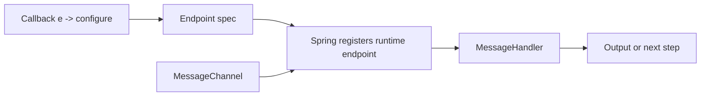
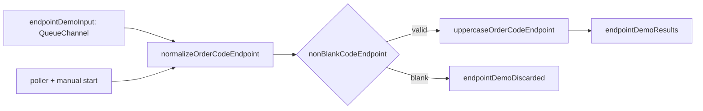

# `EndpointSpec`

## 1. Lesson Objectives

This lesson belongs to the **Advanced DSL** chapter of the **SPRING_INTEGRATION_CORE** module. When designing flows with `Message`, `MessageChannel`, endpoints, gateways, and Java DSL, choosing a transformer, router, or filter only describes part of the behavior. You also need to decide whether an endpoint starts automatically, how it receives messages, and where advice applies.

`EndpointSpec` is a base class in the Java DSL configuration hierarchy that expresses common options for endpoints. In application code, you typically interact with its subclasses via configuration callbacks.

After this lesson, you will be able to:

- Distinguish channels, handlers, runtime endpoints, and spec objects.
- Identify methods belonging to `EndpointSpec` versus methods provided by subclasses.
- Use IDs, lifecycle, phases, roles, and pollers appropriately.
- Configure common properties of consumer endpoints.
- Test holding messages in a queue before explicitly starting an endpoint.

Examples use Java 17 or later and Spring Integration 6.x APIs, specifically referencing 6.5.0. This is a baseline for explaining syntax; keep dependencies compatible according to the BOM used by your project.

## 2. From Business Handler to Operational Endpoint

Consider a processing step:

```java
.handle(
    String.class,
    (payload, headers) -> payload.toUpperCase(java.util.Locale.ROOT),
    e -> e.id("uppercaseEndpoint"))
```

The snippet has two callbacks with different roles:

- `(payload, headers) -> ...` executes message processing.
- `e -> ...` configures the endpoint while building the flow.

The second callback does not re-run for every message. It does not receive payloads; it receives a spec to set properties on the component Spring creates.

### 2.1. Four Concepts to Distinguish

| Component | Question It Answers | Example |
| --- | --- | --- |
| `MessageChannel` | Where are messages transferred or buffered? | `DirectChannel`, `QueueChannel` |
| Handler | Upon receiving a message, what work runs? | Normalize a string, call a service |
| Runtime endpoint | What component binds a handler to a receive mechanism and lifecycle? | `EventDrivenConsumer`, `PollingConsumer` |
| Endpoint spec | How do we declare configuration for the endpoint and related components? | `GenericEndpointSpec`, `FilterEndpointSpec` |

Java DSL collects components inside an `IntegrationFlow`; Spring processes that configuration to register actual beans. See [Java DSL](https://docs.spring.io/spring-integration/reference/dsl.html).



Do not grab a spec and invoke it as a handler. When you need to start or stop processing while the application is running, operate on the registered runtime endpoint.

### 2.2. Same Handler, Different Message-Receiving Mechanism

A string-normalization function can run in two ways:

```text
DirectChannel
    -> EventDrivenConsumer
    -> handler

QueueChannel
    -> PollingConsumer fetches messages on a schedule
    -> handler
```

In standard pipelines, the factory picks the consumer based on the input channel type. Reactive consumers have additional rules when reactive configuration is used. Details are in [ConsumerEndpointFactoryBean 6.5.0](https://raw.githubusercontent.com/spring-projects/spring-integration/v6.5.0/spring-integration-core/src/main/java/org/springframework/integration/config/ConsumerEndpointFactoryBean.java).

Therefore, adding an endpoint callback does not automatically turn a synchronous channel into a queue. Endpoint configuration and channel selection must match each other.

## 3. `EndpointSpec` in the DSL Type System

You can read part of the inheritance tree as follows:

```text
IntegrationComponentSpec
└── EndpointSpec
    ├── ConsumerEndpointSpec
    │   ├── GenericEndpointSpec
    │   ├── FilterEndpointSpec
    │   ├── HeaderEnricherSpec
    │   └── other specialized specs
    └── SourcePollingChannelAdapterSpec
```

This diagram only shows branches relevant to the lesson, not every class in the DSL.

### 3.1. Three Type Parameters `S`, `F`, and `H`

In the 6.5.0 API, `EndpointSpec` has three type parameters:

| Parameter | Meaning When Reading the API |
| --- | --- |
| `S` | Concrete spec type, enabling fluent chaining |
| `F` | `FactoryBean` that creates the endpoint |
| `H` | Handler or message-source component attached to the spec |

`F` is not the runtime endpoint itself. On the consumer branch, the corresponding factory is `ConsumerEndpointFactoryBean`, and `H` is a `MessageHandler` subtype.

You do not need to write out all these generics when authoring everyday flows. What matters is understanding that calling `e.id(...).autoStartup(...)` preserves the concrete spec type so configuration can continue fluently.

`EndpointSpec` is an abstract class with a protected constructor; normal applications use the DSL API instead of calling `new EndpointSpec(...)` directly. See [EndpointSpec 6.5.0](https://www.springframework.org/spring-integration/docs/6.5.0/api/org/springframework/integration/dsl/EndpointSpec.html).

### 3.2. Do Not Attribute Every Method to the Base Class

Core capabilities of the base class include:

- `id(...)`.
- `poller(...)` overloads.
- `autoStartup(...)`, `phase(...)`, and `role(...)` contracts.

Methods such as `advice(...)`, `requiresReply(...)`, `sendTimeout(...)`, or `async(...)` live on the `ConsumerEndpointSpec` branch.

A specific callback can expose additional specialized options. For example, a filter callback supports `discardChannel(...)`; a router callback supports destination-mapping configuration.

```java
.filter(
    String.class,
    text -> !text.isBlank(),
    f -> f
        .id("nonBlankEndpoint")
        .discardChannel("rejectedText"))
```

Here, `f` is a specialized spec for filters. Variable names `e`, `f`, or `endpoint` are just naming choices; the callback type is determined by the DSL method overload.

## 4. Reading Configuration Callbacks Properly

### 4.1. Configuration Callback vs. Processing Callback

```java
.handle(
    String.class,
    (payload, headers) -> {
        // Runs when a message is processed.
        return payload.trim();
    },
    e -> {
        // Runs when declaring the flow component.
        e.id("trimEndpoint");
        e.autoStartup(false);
    })
```

Do not put message-dependent logic inside callback `e`. Conversely, do not recreate endpoint configuration inside the business lambda.

`autoStartup(false)` does not alter the result of `trim()`. It controls whether the endpoint starts receiving messages when the context initializes.

### 4.2. Configuration Applies by Flow Position

```java
.transform(
    String.class,
    String::trim,
    e -> e.id("trimEndpoint"))
.transform(
    String.class,
    text -> text.toUpperCase(java.util.Locale.ROOT),
    e -> e.id("uppercaseEndpoint"))
```

Each callback configures the endpoint of the step immediately preceding it. The ID `trimEndpoint` does not apply to the uppercase step.

Similarly, a poller attached to a step reading from a `QueueChannel` does not automatically apply to all downstream endpoints. Later steps may receive messages via intermediate channels created by the DSL.

### 4.3. When Do You Need to Name a Concrete Spec Class?

Normally, let the compiler infer types through lambdas:

```java
.handle(
    String.class,
    (payload, headers) -> payload,
    e -> e.id("echoEndpoint"))
```

When writing shared helper methods, pick the spec type matching the methods you actually need to invoke. Avoid raw types or casts solely to silence compiler errors: those errors usually indicate you are using the wrong spec type or overload.

See the relationships of the common configuration class in [GenericEndpointSpec](https://www.springframework.org/spring-integration/docs/6.5.0/api/org/springframework/integration/dsl/GenericEndpointSpec.html).

## 5. `id`: Naming for Observability and Control

```java
.handle(
    String.class,
    (payload, headers) -> payload.trim(),
    e -> e.id("normalizeOrderCodeEndpoint"))
```

An explicit ID lets lifecycle-control code and logs refer to a stable endpoint.

Distinguish these names:

| Name | Represents |
| --- | --- |
| `IntegrationFlow` bean name | The entire declared flow |
| Input channel name | Message send or receive point |
| Endpoint ID in callback | Endpoint of a single step |
| Message `id` header | Identifier of a message instance |

Setting `e.id("normalizeOrderCodeEndpoint")` neither writes a header onto messages nor renames the input channel.

In the statically registered flow of the example below, you can retrieve the runtime endpoint:

```java
org.springframework.integration.endpoint.AbstractEndpoint endpoint =
    context.getBean(
        "normalizeOrderCodeEndpoint",
        org.springframework.integration.endpoint.AbstractEndpoint.class);
```

Do not reuse the same ID for two distinct endpoints in the same context. When dynamically registering multiple flow copies with bean-name prefixes, follow the naming rules of that registration mechanism; do not assume static example names always remain unchanged.

The source code of [EndpointSpec.id](https://raw.githubusercontent.com/spring-projects/spring-integration/v6.5.0/spring-integration-core/src/main/java/org/springframework/integration/dsl/EndpointSpec.java) shows the ID being passed into the endpoint factory.

## 6. Lifecycle Control: `autoStartup`, `phase`, and `role`

### 6.1. `autoStartup(false)`

```java
e -> e
    .id("normalizeOrderCodeEndpoint")
    .autoStartup(false)
```

The endpoint is created and configured, but does not start automatically during context refresh. You can explicitly invoke:

```java
endpoint.start();

// When stopping is needed:
endpoint.stop();
```

Impact on senders depends on the channel:

| Input Channel | While Consumer Is Not Running |
| --- | --- |
| `QueueChannel` | Can accept messages if space remains; messages wait for consumer |
| `DirectChannel` | Does not buffer messages; if no matching subscriber exists, send fails |
| Channel managed by adapter or external system | Must also consider that component's contract |

Stopping one endpoint does not mean stopping every step of a flow. When pausing an entire pipeline, clearly identify which entry point must stop and how already-accepted messages are handled.

Additionally, `stop()` should not be assumed to immediately cancel every in-flight task or drain every queue. Design shutdown behavior and in-flight message handling according to the actual endpoint.

### 6.2. `phase`: Lifecycle Ordering

```java
e -> e.phase(100)
```

Per `SmartLifecycle`, lower phases start first; on shutdown, the order reverses. Components sharing the same phase have no guaranteed relative ordering from phase alone. Explicit bean dependencies must also be considered.

Design example:

| Component | Illustrative Phase | Intent |
| --- | --- | --- |
| Downstream consumer | `0` | Ready to receive first |
| Endpoint feeding data into pipeline | `100` | Starts after consumer |

`phase(100)` does not mean messages at this step carry priority 100. Nor does phase guarantee an external system is healthy; that is a separate readiness concern.

Startup and shutdown rules are documented in [SmartLifecycle](https://docs.spring.io/spring-framework/docs/6.2.7/javadoc-api/org/springframework/context/SmartLifecycle.html).

### 6.3. `role`: Grouping for Lifecycle Control

```java
e -> e.role("order-code-import")
```

A role assigns the endpoint to a group controllable via `SmartLifecycleRoleController`. The controller starts or stops components in a role respecting phase order.

For example, once the application retrieves the controller registered by the integration infrastructure:

```java
roleController.startLifecyclesInRole("order-code-import");
roleController.stopLifecyclesInRole("order-code-import");
```

The variable `roleController` here has type `org.springframework.integration.support.SmartLifecycleRoleController`.

Roles serve lifecycle orchestration. They do not enforce message access permissions and do not automatically implement leader election across instances. See [SmartLifecycleRoleController](https://www.springframework.org/spring-integration/docs/6.5.0/api/org/springframework/integration/support/SmartLifecycleRoleController.html).

## 7. `poller`: Configuration When an Endpoint Must Actively Pull Messages

### 7.1. Place the Poller on the Pollable Input

If a consumer reads from a `QueueChannel`, it requires an explicit polling configuration or the context's default poller.

```java
IntegrationFlow.from("pendingCodes")
    .transform(
        String.class,
        String::trim,
        e -> e
            .id("normalizeOrderCodeEndpoint")
            .poller(org.springframework.integration.dsl.Pollers
                .fixedDelay(java.time.Duration.ofMillis(100))
                .maxMessagesPerPoll(5)
                .receiveTimeout(0)))
    .channel("normalizedCodes")
    .get();
```

Assuming `pendingCodes` is a `QueueChannel`, this poller controls message retrieval for the trim step. `normalizedCodes` must be a registered channel or appropriately declared in the application configuration.

Do not attach a poller to a consumer receiving from a `DirectChannel`. In this standard setup, the factory rejects pollers on a `SubscribableChannel`. Conversely, omitting both a dedicated poller and a default poller for a pollable consumer fails initialization. See [ConsumerEndpointFactoryBean](https://raw.githubusercontent.com/spring-projects/spring-integration/v6.5.0/spring-integration-core/src/main/java/org/springframework/integration/config/ConsumerEndpointFactoryBean.java).

### 7.2. Three Common Overloads

```java
// Convenience factory creating a PollerSpec.
e.poller(Pollers.fixedDelay(Duration.ofMillis(100)));

// Callback receiving a PollerFactory.
e.poller(p -> p.fixedDelay(Duration.ofMillis(100))
    .maxMessagesPerPoll(5));

// Reusing preconfigured metadata.
e.poller(sharedPollerMetadata);
```

Above, `Pollers` is in `org.springframework.integration.dsl`, `Duration` is in `java.time`, and `sharedPollerMetadata` has type `org.springframework.integration.scheduling.PollerMetadata`.

Choose the form that fits your configuration style. You never need all three for the same endpoint.

### 7.3. Understanding Each Parameter

| Setting | Meaning in the Example |
| --- | --- |
| `fixedDelay(Duration.ofMillis(100))` | Polling schedule with a fixed delay between completed runs |
| `maxMessagesPerPoll(5)` | At most five message fetches/processes per poll cycle |
| `receiveTimeout(0)` | Do not wait when the queue is currently empty |
| `taskExecutor(...)` | Delegates polling task execution to the configured executor |

Five messages per poll is not a precise rate limit of five messages per second. Actual throughput depends on handler duration, scheduling, executor behavior, and available data.

Nor can you infer parallel processing solely from `maxMessagesPerPoll(5)`. Without a separate executor, messages are processed sequentially within the polling task.

`Pollers` builds schedules, while `PollerSpec` configures metadata for the polling task. See [Pollers](https://www.springframework.org/spring-integration/docs/6.5.0/api/org/springframework/integration/dsl/Pollers.html) and [PollerSpec](https://www.springframework.org/spring-integration/docs/6.5.0/api/org/springframework/integration/dsl/PollerSpec.html).

### 7.4. Polling Consumer vs. Polling Message Source

The following two positions do not mean the same thing:

```java
// Pulls messages waiting in a QueueChannel.
IntegrationFlow.from("pendingCodes")
    .handle(
        String.class,
        (payload, headers) -> payload,
        e -> e.poller(Pollers.fixedDelay(Duration.ofSeconds(1))))
    .channel("results")
    .get();
```

```java
// Calls a supplier on a schedule to produce input data.
IntegrationFlow.fromSupplier(
        () -> "next-code",
        source -> source.poller(
            Pollers.fixedDelay(Duration.ofSeconds(1))))
    .channel("results")
    .get();
```

The first snippet configures the consumer of a pollable channel. The second configures a source polling adapter. Seeing the word `poller` in both does not mean both callbacks share the same spec type or responsibility.

## 8. Options from `ConsumerEndpointSpec`

When a callback provides a consumer spec, additional methods appear that must be interpreted against the actual handler type.

| Option | Applicability |
| --- | --- |
| `requiresReply(true)` | Requires the handler to produce a reply if the handler supports this property |
| `sendTimeout(...)` | Timeout when the handler sends output messages |
| `advice(...)` | Wraps handler processing with advice |
| `transactional(...)` | Attaches transaction advice per configuration |
| `order(...)` | Handler order used by order-aware dispatching mechanisms |
| `async(true)` | Enables supported asynchronous reply handling |
| `notPropagatedHeaders(...)` | Restricts which input headers are copied to the output |

These methods are not global flow properties. Applicability depends on the handler class; some mismatched settings may only log warnings. See [ConsumerEndpointSpec 6.5.0](https://www.springframework.org/spring-integration/docs/6.5.0/api/org/springframework/integration/dsl/ConsumerEndpointSpec.html).

### 8.1. `requiresReply` Is Not a Timeout

```java
.handle(
    String.class,
    (payload, headers) -> payload.isBlank() ? null : payload,
    e -> e
        .id("requiredCodeEndpoint")
        .requiresReply(true))
```

If this handler returns `null`, an endpoint with a required-reply contract throws an error. This setting does not mean it must reply within a certain number of milliseconds.

If blank input is an expected case to discard, a filter with a discard channel expresses that rule more clearly than turning it into a missing-reply error.

### 8.2. `sendTimeout` Differs from Business Timeouts

```java
e -> e.sendTimeout(500)
```

This value applies to sending the output, such as when the target channel is full. It does not impose a 500 ms timeout on an HTTP call inside the handler.

To bound calls to an external system, configure timeouts on the appropriate client or adapter, then define how the endpoint handles that failure.

### 8.3. `order` Differs from `phase` and Message Ordering

`phase` controls lifecycle; `order` on a consumer spec belongs to the handler and dispatcher mechanics. It does not replace the step order in the DSL, nor does it sort messages by order ID.

When a channel has multiple subscribers, behavior also depends on channel type, load balancing, and failover. Avoid using `order(1)` as a way to guarantee all messages finish in strict arrival order.

### 8.4. `async(true)` Does Not Move Arbitrary Handlers to Another Thread

At the 6.5.0 API baseline used in this lesson, `async(true)` supports sending results once a `CompletableFuture` reply completes. A method performing synchronous I/O does not automatically become asynchronous solely from this flag.

Distinguish three choices: asynchronous reply return types, executor-backed channels, and reactive consumers. Each has its own execution-thread model and error path.

## 9. Advice and Transactions Must Match the Right Scope

### 9.1. Attaching Retry to a Handler

The snippet below assumes the application has a `catalogService` bean with a `lookup` method and a configured `catalogRetryAdvice` bean:

```java
.handle(
    catalogService,
    "lookup",
    e -> e
        .id("catalogLookupEndpoint")
        .advice(catalogRetryAdvice))
```

In Spring Integration 6.5, `RequestHandlerRetryAdvice` uses Spring Retry. Minimal practice configuration example:

```java
@Bean
public org.springframework.integration.handler.advice.RequestHandlerRetryAdvice
        catalogRetryAdvice() {

    var policy = new org.springframework.retry.policy.SimpleRetryPolicy(3);
    var backOff = new org.springframework.retry.backoff.FixedBackOffPolicy();
    backOff.setBackOffPeriod(100);

    var template = new org.springframework.retry.support.RetryTemplate();
    template.setRetryPolicy(policy);
    template.setBackOffPolicy(backOff);

    var advice =
        new org.springframework.integration.handler.advice.RequestHandlerRetryAdvice();
    advice.setRetryTemplate(template);
    return advice;
}
```

A compatible `org.springframework.retry:spring-retry` dependency is needed to use this configuration. `SimpleRetryPolicy(3)` configures at most three total attempts, including the initial call; this broad policy is for illustration.

In production, pick retryable exception types selectively and design idempotency for operations with side effects. Invalid-input errors are rarely solved by retrying the same call.

See [Retry Advice for 6.5](https://docs.spring.io/spring-integration/reference/6.5/handler-advice/classes.html) and [RequestHandlerRetryAdvice 6.5.0](https://raw.githubusercontent.com/spring-projects/spring-integration/v6.5.0/spring-integration-core/src/main/java/org/springframework/integration/handler/advice/RequestHandlerRetryAdvice.java).

### 9.2. Do Not Assume Retry Wraps Downstream Steps

For reply-producing handlers, request-handler advice typically wraps handling the request inside the current handler. It does not automatically retry the entire downstream flow.

`handleMessageAdvice(...)` has a different scope: it wraps `handleMessage`, which can encompass downstream steps still running on the same synchronous call chain. Any thread boundary or asynchronous processing changes what falls within that scope.

Before adding retries, determine which operation is safe to repeat. If handler A already succeeded and downstream handler B fails, retrying A can trigger duplicate side effects. See [Handling Message Advice](https://docs.spring.io/spring-integration/reference/handler-advice/handle-message.html).

### 9.3. Handler Transactions vs. Polling Task Transactions

Example when an appropriate transaction manager is present:

```java
.handle(
    orderRepository,
    "save",
    e -> e
        .id("saveOrderEndpoint")
        .transactional(transactionManager))
```

This attaches transaction advice to the handler. By contrast, `poller(...transactional(...))` binds a transaction to the polling task.

A single local transaction does not automatically span databases, HTTP services, and every broker in a flow. Crossing a queue or executor boundary also requires reconsidering transaction context across threads and participating resources.

When combining retry and transactions, clarify whether each attempt opens a new transaction or participates in an existing one. Advice order and propagation govern the behavior. See [Transaction Support](https://docs.spring.io/spring-integration/reference/transactions.html).

## 10. Complete Example: Manually Started Order-Code Normalization Endpoint

### 10.1. Requirements

An order-code intake pipeline needs to:

1. Accept strings into a bounded queue.
2. Not consume data immediately when the context starts.
3. Once started, pull messages via a poller and trim strings.
4. Route blank strings to a discard channel.
5. Uppercase valid codes and place them into a result queue.

In this example, order codes are modeled as strings needing normalization. Real business rules may be stricter.



Only the first endpoint is set to `autoStartup(false)`. Downstream steps are ready to receive data as soon as the first endpoint starts polling.

### 10.2. Java Configuration

The project needs JDK 17 or later, `spring-integration-core`, compatible Spring Context, and JUnit Jupiter for the tests below. The example needs no broker, HTTP server, or database.

```java
package example.endpoints;

import java.time.Duration;
import java.util.Locale;

import org.springframework.context.annotation.Bean;
import org.springframework.context.annotation.Configuration;
import org.springframework.integration.channel.QueueChannel;
import org.springframework.integration.config.EnableIntegration;
import org.springframework.integration.dsl.IntegrationFlow;
import org.springframework.integration.dsl.Pollers;

@Configuration
@EnableIntegration
public class ManagedEndpointFlowConfig {

    @Bean
    public QueueChannel endpointDemoInput() {
        return new QueueChannel(100);
    }

    @Bean
    public QueueChannel endpointDemoResults() {
        return new QueueChannel(100);
    }

    @Bean
    public QueueChannel endpointDemoDiscarded() {
        return new QueueChannel(100);
    }

    @Bean
    public IntegrationFlow managedOrderCodeFlow() {
        return IntegrationFlow.from("endpointDemoInput")
            .transform(
                String.class,
                String::trim,
                e -> e
                    .id("normalizeOrderCodeEndpoint")
                    .autoStartup(false)
                    .phase(100)
                    .role("order-code-import")
                    .poller(Pollers
                        .fixedDelay(Duration.ofMillis(100))
                        .maxMessagesPerPoll(5)
                        .receiveTimeout(0)))
            .filter(
                String.class,
                code -> !code.isBlank(),
                f -> f
                    .id("nonBlankCodeEndpoint")
                    .discardChannel("endpointDemoDiscarded"))
            .transform(
                String.class,
                code -> code.toUpperCase(Locale.ROOT),
                e -> e.id("uppercaseOrderCodeEndpoint"))
            .channel("endpointDemoResults")
            .get();
    }
}
```

Key points to note:

- The poller sits on the endpoint reading directly from `endpointDemoInput`.
- The next two endpoints use intermediate channels of the flow and do not need their own pollers.
- The discard channel stores messages after the trim step, so a whitespace-only string arrives with an empty payload.
- Output queues are used to observe results with `receive`, with no automatic consumer in the example.

All three queues are bounded to avoid assuming queues can grow without limit. In a continuously running application, attach consumers to output queues and define full-queue handling policies.

### 10.3. Controlling the Runtime Endpoint

The snippet below illustrates running the configuration in a small program:

```java
package example.endpoints;

import org.springframework.context.annotation.AnnotationConfigApplicationContext;
import org.springframework.integration.channel.QueueChannel;
import org.springframework.integration.endpoint.AbstractEndpoint;
import org.springframework.messaging.Message;
import org.springframework.messaging.support.MessageBuilder;

public class ManagedEndpointDemo {

    public static void main(String[] args) {
        try (var context = new AnnotationConfigApplicationContext(
                ManagedEndpointFlowConfig.class)) {

            QueueChannel input =
                context.getBean("endpointDemoInput", QueueChannel.class);
            QueueChannel results =
                context.getBean("endpointDemoResults", QueueChannel.class);
            AbstractEndpoint endpoint = context.getBean(
                "normalizeOrderCodeEndpoint",
                AbstractEndpoint.class);

            boolean accepted = input.send(
                MessageBuilder.withPayload("  order-001  ")
                    .setHeader("request_id", "R-001")
                    .build(),
                1000);

            if (!accepted) {
                throw new IllegalStateException("Input queue is full");
            }

            // Message was accepted into queue; endpoint is not running yet.
            System.out.println(endpoint.isRunning()); // false
            System.out.println(input.getQueueSize()); // 1

            endpoint.start();

            Message<?> result = results.receive(5000);
            if (result == null) {
                throw new IllegalStateException("No result within timeout");
            }

            System.out.println(result.getPayload()); // ORDER-001
            System.out.println(
                result.getHeaders().get("request_id")); // R-001
        }
    }
}
```

`input.send(...)` returning `true` only confirms the channel accepted the message within the allowed timeout. It does not confirm all business work is done.

When closing the context, Spring shuts down and releases components cleanly. The example does not need `Thread.sleep` to wait for results because `receive(5000)` already performs a bounded wait.

## 11. Testing Behavior Rather Than Only Reading Configuration

Place the test in the same package as the configuration:

```java
package example.endpoints;

import org.junit.jupiter.api.Test;
import org.springframework.context.annotation.AnnotationConfigApplicationContext;
import org.springframework.integration.channel.QueueChannel;
import org.springframework.integration.endpoint.AbstractEndpoint;
import org.springframework.messaging.Message;
import org.springframework.messaging.support.MessageBuilder;

import static org.junit.jupiter.api.Assertions.*;

class ManagedEndpointFlowTest {

    @Test
    void messageWaitsInQueueUntilEndpointStarts() {
        try (var context = new AnnotationConfigApplicationContext(
                ManagedEndpointFlowConfig.class)) {

            QueueChannel input =
                context.getBean("endpointDemoInput", QueueChannel.class);
            QueueChannel results =
                context.getBean("endpointDemoResults", QueueChannel.class);
            AbstractEndpoint endpoint = context.getBean(
                "normalizeOrderCodeEndpoint",
                AbstractEndpoint.class);

            Message<String> original =
                MessageBuilder.withPayload("  order-001  ")
                    .setHeader("request_id", "R-001")
                    .build();

            assertFalse(endpoint.isRunning());
            assertTrue(input.send(original, 1000));

            // No other consumer is reading the input queue yet.
            assertEquals(1, input.getQueueSize());
            assertNull(results.receive(0));

            endpoint.start();

            Message<?> result = results.receive(5000);
            assertNotNull(result);
            assertEquals("ORDER-001", result.getPayload());
            assertEquals("R-001",
                result.getHeaders().get("request_id"));

            // Transformer does not mutate the original message.
            assertEquals("  order-001  ", original.getPayload());
        }
    }

    @Test
    void blankCodeIsDiscardedAndNextValidMessageStillPasses() {
        try (var context = new AnnotationConfigApplicationContext(
                ManagedEndpointFlowConfig.class)) {

            QueueChannel input =
                context.getBean("endpointDemoInput", QueueChannel.class);
            QueueChannel results =
                context.getBean("endpointDemoResults", QueueChannel.class);
            QueueChannel discarded =
                context.getBean("endpointDemoDiscarded", QueueChannel.class);
            AbstractEndpoint endpoint = context.getBean(
                "normalizeOrderCodeEndpoint",
                AbstractEndpoint.class);

            assertTrue(input.send(
                MessageBuilder.withPayload("   ")
                    .setHeader("request_id", "R-empty")
                    .build(),
                1000));

            assertTrue(input.send(
                MessageBuilder.withPayload("  order-002 ")
                    .setHeader("request_id", "R-valid")
                    .build(),
                1000));

            endpoint.start();

            Message<?> rejected = discarded.receive(5000);
            Message<?> accepted = results.receive(5000);

            assertNotNull(rejected);
            assertEquals("", rejected.getPayload());
            assertEquals("R-empty",
                rejected.getHeaders().get("request_id"));

            assertNotNull(accepted);
            assertEquals("ORDER-002", accepted.getPayload());
            assertEquals("R-valid",
                accepted.getHeaders().get("request_id"));
        }
    }
}
```

The first test proves the difference between a channel accepting a message and an endpoint beginning processing. The second test proves discard is an intentional path and does not drop subsequent valid messages.

Do not use fixed sleeps to check whether "the poller probably ran." Waiting for messages at the observation point with a timeout lets tests reflect the actual behavior being verified.

These test snippets are practice code to run in a project with compatible dependencies. They do not cover every advice, transaction, or shutdown configuration.

## 12. Error Handling by Thread and Endpoint Type

For consumers receiving from a `DirectChannel`, the handler usually runs on the sender's thread. Synchronous errors can propagate back to the send call or gateway.

In the polling example, the sender merely places the message in the queue. If the handler fails later, the sender is no longer on that call stack. Look to the polling task's error-handling mechanism.

You can configure the poller to send errors to a dedicated channel:

```java
e -> e.poller(Pollers
    .fixedDelay(Duration.ofMillis(100))
    .receiveTimeout(0)
    .maxMessagesPerPoll(5)
    .errorChannel("endpointDemoErrors"))
```

The name `endpointDemoErrors` must point to a registered channel. Example queue to capture errors in exercises:

```java
@Bean
public QueueChannel endpointDemoErrors() {
    return new QueueChannel(100);
}
```

This is an extension option, not yet attached to the complete configuration class in Section 10.

When testing polling errors, make the handler deliberately throw and receive `ErrorMessage` on the error channel. Do not wrap `input.send(...)` in `assertThrows` expecting to catch an error from a task that runs asynchronously later.

Retries also do not automatically put a message back into a plain in-memory `QueueChannel` after attempts are exhausted. Design recovery, error persistence, or redelivery based on the resources and mechanisms used. See [Error Handling for 6.5](https://docs.spring.io/spring-integration/reference/6.5/error-handling.html).

## 13. Reusing Configuration While Keeping Intent Clear

A helper can apply shared consumer options:

```java
private static void configureImportConsumer(
        org.springframework.integration.dsl.ConsumerEndpointSpec<?, ?> spec) {

    spec.phase(100);
    spec.role("order-code-import");
}
```

Then use the callback to add step-specific properties:

```java
.transform(
    String.class,
    String::trim,
    e -> {
        configureImportConsumer(e);
        e.id("normalizeOrderCodeEndpoint");
        e.poller(Pollers.fixedDelay(Duration.ofMillis(100)));
    })
```

In this isolated snippet, the input to the transform step must be a pollable channel. Do not put a poller inside a shared helper applied to endpoints receiving from `DirectChannel`.

Principles to keep configuration maintainable:

- Give each endpoint its own ID reflecting the business step.
- Put only genuinely shared attributes inside helpers.
- Keep flags affecting auto-startup easy to spot.
- Do not reuse the same stateful spec instance across multiple endpoints.
- Ensure shared advice or services are safe for concurrent invocations.

Methods on specs that register sub-components serve the DSL infrastructure. Normal applications do not need to manipulate internal maps or manually extract factory/handler pairs to register in place of Spring.

## 14. Common Configuration Errors

| Symptom | What to Check | How to Fix |
| --- | --- | --- |
| Initialization fails for missing poller | Input is a `QueueChannel` | Add a poller on the consumer or a default poller |
| Initialization fails for invalid poller | Input is a `SubscribableChannel` | Remove the poller or redesign the input |
| Queue has data, yet no results appear | Endpoint is stopped, scheduler or downstream issue | Check endpoint state and logs by ID |
| `DirectChannel` has no subscribers | Consumer not started or already stopped | Start the appropriate consumer before sending |
| Bean not found by ID | Confused flow name, channel name, or prefixed names | Check flow registration naming rules |
| `phase` does not change message completion order | Confused lifecycle with message processing | Check channels, executors, and ordering strategy |
| Handler remains slow despite `sendTimeout` | Timeout applies to output send | Configure timeouts on business I/O calls |
| Retry does not re-run downstream steps | Advice wraps only the current handler | Pick the right scope and check side effects |
| Polling fails, yet send throws no exception | Error occurred on a later scheduled task | Capture failures via error channel |
| Stopped endpoint, yet one task still finished | Work was already in flight | Design graceful stop and in-flight completion handling |
| `async(true)` does not make I/O run concurrently | Handler still returns results synchronously | Check reply types and execution model |

When investigating, follow the chain: **input channel → is the endpoint running → handler → output send point → error mechanism**. Explicit IDs tie configuration together with logs and tests.

## 15. Extended Practice

Starting from the example in Section 10, proceed step by step:

1. Remove `autoStartup(false)`, then update the test to confirm messages are processed after sending without calling `start()`.
2. Create a standalone configuration using `DirectChannel`, remove the poller, and observe the effect of stopping the consumer when the channel has no remaining subscribers.
3. Add a dedicated error channel for the poller and test a handler that deliberately throws an exception.
4. Attach retry to a simulated lookup step, counting invocations both when it succeeds on a subsequent attempt and when all attempts fail.
5. Use a role controller to control a group of endpoints while tracking which queue buffers messages while the group is stopped.

For each change, document what to observe: was the message accepted, which endpoint is running, which channel holds results, and where errors go. Those questions turn endpoint configuration into verifiable behavior.

## 16. References

- [EndpointSpec 6.5.0](https://www.springframework.org/spring-integration/docs/6.5.0/api/org/springframework/integration/dsl/EndpointSpec.html) — base class and common configuration methods.
- [ConsumerEndpointSpec 6.5.0](https://www.springframework.org/spring-integration/docs/6.5.0/api/org/springframework/integration/dsl/ConsumerEndpointSpec.html) — additional consumer options.
- [GenericEndpointSpec 6.5.0](https://www.springframework.org/spring-integration/docs/6.5.0/api/org/springframework/integration/dsl/GenericEndpointSpec.html) — commonly encountered callback spec.
- [PollerSpec 6.5.0](https://www.springframework.org/spring-integration/docs/6.5.0/api/org/springframework/integration/dsl/PollerSpec.html) — polling task configuration.
- [Spring Integration: Message Endpoints](https://docs.spring.io/spring-integration/reference/endpoint.html) — event-driven consumers, polling consumers, and default pollers.
- [Spring Framework: SmartLifecycle](https://docs.spring.io/spring-framework/docs/6.2.7/javadoc-api/org/springframework/context/SmartLifecycle.html) — lifecycle, auto-startup, and phase.
- [Spring Integration 6.5: Error Handling](https://docs.spring.io/spring-integration/reference/6.5/error-handling.html) — synchronous and asynchronous error paths.
