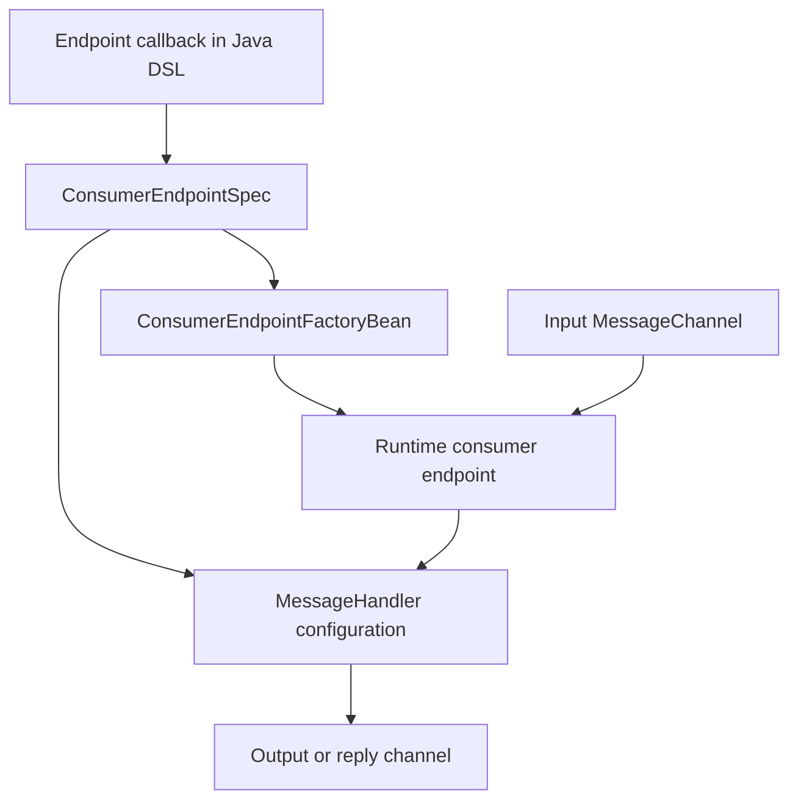

# `ConsumerEndpointSpec`

## 1. Objectives and Context

In the **SPRING_INTEGRATION_CORE** module, this lesson belongs to the **Advanced DSL** chapter. After expressing flows using `Message`, `MessageChannel`, and operations like `handle`, `transform`, or `filter`, you need to configure how each endpoint starts, receives messages, sends results, and applies cross-cutting behavior.

`ConsumerEndpointSpec` is the part of the DSL built for that job. This lesson focuses on reading endpoint callbacks accurately and predicting runtime behavior from configuration.

After this lesson, you will be able to:

- Distinguish channels, handlers, endpoints, and the spec objects used during flow construction.
- Use `id`, `autoStartup`, `phase`, `role`, and `poller` appropriately.
- Specify reply contracts via `requiresReply`, bound send waits via `sendTimeout`, and control header propagation.
- Distinguish handler advice, `handleMessage` advice, and poller advice.
- Recognize the scope of transactions, `async(true)`, and `reactive()`.
- Test endpoint lifecycle and error handling using messages flowing through channels.

Examples take **Java 17 and Spring Integration 6.5.0** as the API baseline. When using Spring Boot or a BOM, maintain the compatible Spring version set managed by your project. Snippets are practice material; configuration changes must be applied to their corresponding examples.

## 2. Where Does `ConsumerEndpointSpec` Fit in a Flow?

Look at this condensed configuration:

```java
IntegrationFlow.from("ordersInput")
        .handle(
                Order.class,
                (order, headers) -> new Receipt(order.id(), "ACCEPTED"),
                endpoint -> endpoint
                        .id("acceptOrderEndpoint")
                        .requiresReply(true))
        .channel("acceptedOrders")
        .get();
```

In this snippet:

- `ordersInput` is the channel delivering messages to the processing step.
- The lambda `(order, headers) -> ...` handles the data.
- The lambda `endpoint -> ...` configures the endpoint and the handler properties exposed by the DSL.
- `acceptedOrders` is the channel receiving results.

`ConsumerEndpointSpec` is an abstract class for configuring consumer endpoints. Many concrete specs extend this class; for common `handle(...)` overloads, the callback typically receives `GenericEndpointSpec`. [ConsumerEndpointSpec Javadoc](https://docs.spring.io/spring-integration/docs/6.5.0/api/org/springframework/integration/dsl/ConsumerEndpointSpec.html), [GenericEndpointSpec Javadoc](https://docs.spring.io/spring-integration/docs/6.5.0/api/org/springframework/integration/dsl/GenericEndpointSpec.html).

### 2.1. Four Concepts to Keep Separate

| Component | Responsibility | Example |
| --- | --- | --- |
| Channel | Transfers or buffers messages | `DirectChannel`, `QueueChannel` |
| Handler | Executes processing logic | `ServiceActivatingHandler`, transformer, filter |
| Consumer endpoint | Connects handler to input and manages receiving | `EventDrivenConsumer`, `PollingConsumer` |
| Endpoint spec | Collects configuration during DSL assembly | `GenericEndpointSpec` and specialized specs |

A handler computing order outcomes does not decide on its own to be invoked every 100 ms. With a queue input, the endpoint's poller decides when to poll messages and invoke the handler.

Conversely, merely changing an endpoint's `phase` does not alter the calculation formula inside the handler.

### 2.2. From Spec to Runtime Component



The factory creates the consumer type matching the channel and configuration. In the standard model, `PollableChannel` yields `PollingConsumer`, `SubscribableChannel` yields `EventDrivenConsumer`; reactive mode uses `ReactiveStreamsConsumer`. [ConsumerEndpointFactoryBean Javadoc](https://docs.spring.io/spring-integration/docs/6.5.0/api/org/springframework/integration/config/ConsumerEndpointFactoryBean.html).

The spec exists for declaration time. To control a registered endpoint, look up the endpoint bean by `id` and use the appropriate lifecycle API.

### 2.3. Meaning of the Two Generic Parameters

The class signature simplifies to:

```java
ConsumerEndpointSpec<
        S extends ConsumerEndpointSpec<S, H>,
        H extends MessageHandler>
```

- `S` represents the concrete spec type, allowing fluent chaining to return the exact subtype.
- `H` is the type of handler being configured.

When using `handle` to invoke a POJO service, `H` is usually the Spring Integration handler wrapping the service call. It is neither the payload type nor the POJO service type.

In most applications, you use callbacks supplied by the DSL. You do not need to instantiate `ConsumerEndpointSpec` manually or subclass it just to set `id` and a poller.

## 3. Reading Endpoint Callbacks Properly

### 3.1. Each Callback Applies to the Step Being Declared

```java
IntegrationFlow.from("incoming")
        .transform(
                String.class,
                String::trim,
                endpoint -> endpoint.id("trimEndpoint"))
        .handle(
                String.class,
                (text, headers) -> text.toUpperCase(java.util.Locale.ROOT),
                endpoint -> endpoint.id("uppercaseEndpoint"))
        .channel("results")
        .get();
```

`trimEndpoint` is the transformer's endpoint. `uppercaseEndpoint` is the `handle` step's endpoint. Settings in the second callback do not apply retroactively to the first step.

In condensed snippets, named output channels must have matching configuration and consumers. The complete example in Section 6 uses queues so results can be received directly.

### 3.2. Generic Specs vs. Specialized Specs

Transformers, filters, routers, splitters, and aggregators have specialized options. Common options like lifecycle are inherited, but DSL overloads do not necessarily share identical callback signatures.

For example:

```java
.filter(
        String.class,
        text -> !text.isBlank(),
        endpoint -> endpoint
                .id("nonBlankFilter")
                .throwExceptionOnRejection(true))
```

Here `throwExceptionOnRejection` belongs to specialized filter configuration. It is not a universal method available on every `ConsumerEndpointSpec`.

When reading an overload, identify both the callback spec type and the handler type. That avoids assuming every method shown in IDE autocomplete applies meaningfully to every endpoint kind.

## 4. Major Configuration Groups

| Group | Typical Methods | Affected Target |
| --- | --- | --- |
| Identification | `id(...)` | Registered bean name of the endpoint |
| Lifecycle | `autoStartup(...)`, `phase(...)`, `role(...)` | Consumer endpoint startup/shutdown behavior |
| Pulling from queues | `poller(...)` | How the endpoint polls its input |
| Scheduling | `taskScheduler(...)` | Scheduler used by the endpoint |
| Reply contract | `requiresReply(...)` | Reply-capable handlers |
| Sending results | `sendTimeout(...)` | Handler sending output/reply |
| Header propagation | `notPropagatedHeaders(...)` | Copying request headers to output |
| Handler ordering | `order(...)` | Handler ordering in matching dispatchers |
| Around behavior | `advice(...)`, `handleMessageAdvice(...)` | Scope wrapping handler invocation |
| Transaction | `transactional(...)` | Transaction advice on the handler |
| Async replies | `async(...)` | Supported asynchronous result handling |
| Reactive consumer | `reactive(...)` | How the consumer consumes messages |

Some options depend on the handler class. For instance, `requiresReply` requires a reply-producing handler; in the 6.5.0 implementation, inapplicable handler options may only emit warnings instead of achieving the desired effect. [ConsumerEndpointSpec Source Code](https://github.com/spring-projects/spring-integration/blob/v6.5.0/spring-integration-core/src/main/java/org/springframework/integration/dsl/ConsumerEndpointSpec.java).

Therefore, verify behavior with messages and configuration logs rather than assuming a compiling DSL chain guarantees runtime behavior.

## 5. Endpoint Identification and Lifecycle

### 5.1. `id` Helps Operate and Test the Right Component

```java
endpoint -> endpoint.id("acceptOrderEndpoint")
```

This name lets you reference the registered endpoint in the application context. `id` is used as the bean name for the corresponding component. [EndpointSpec.id Javadoc](https://docs.spring.io/spring-integration/docs/6.5.0/api/org/springframework/integration/dsl/EndpointSpec.html#id(java.lang.String)).

Distinguish three names:

| Name | Role in the Example |
| --- | --- |
| `ordersFlow` | `IntegrationFlow` bean declaring the whole flow |
| `ordersInput` | Input channel |
| `acceptOrderEndpoint` | Consumer endpoint of a single processing step |

Assign stable names to endpoints that need start/stop control or monitoring. Each endpoint must have a unique identifier within the application context.

### 5.2. `autoStartup(false)` Defers Message Consumption

```java
endpoint -> endpoint
        .id("acceptOrderEndpoint")
        .autoStartup(false)
```

The endpoint is still created and configured, but does not automatically start during context refresh.

Impact also depends on the channel:

- With a queue, senders can enqueue messages while space remains; messages wait for the consumer to start.
- With a `DirectChannel` whose sole consumer is stopped, send calls may fail with no subscriber.
- With multiple consumers on the same channel, stopping one consumer does not stop all message processing.

`autoStartup(false)` also does not bypass configuration validation. A polling endpoint without a valid poller still requires complete configuration.

### 5.3. `phase` Controls Lifecycle Ordering

```java
endpoint -> endpoint.phase(100)
```

Under `SmartLifecycle`, components with lower phase values start first, while shutdown proceeds in reverse order. Components sharing the same phase have no guaranteed order; explicit `depends-on` relationships may take precedence over phase. [SmartLifecycle Javadoc](https://docs.spring.io/spring-framework/docs/6.2.7/javadoc-api/org/springframework/context/SmartLifecycle.html).

One planning pattern:

| Component | Illustrative Phase | Purpose |
| --- | --- | --- |
| Downstream processing consumer | `100` | Ready before the upstream source begins emitting |
| Upstream source feeding data | `200` | Starts after the consumer |

These numbers are application conventions. Audit all participating lifecycle components before choosing them.

Phase does not govern per-message ordering. Calling `start()` directly on an endpoint also does not run a lifecycle ordering sequence across all other components.

### 5.4. `role` Groups Lifecycle Management

```java
endpoint -> endpoint.role("order-processing")
```

Roles let you group endpoints for coordinated lifecycle management via mechanisms such as `SmartLifecycleRoleController`. This is useful when enabling or disabling a group of consumers serving the same workflow.

Stopping consumers must pair with a policy for in-flight work and messages waiting in channels. Never assume stopping implies all messages have finished processing.

## 6. Complete Example: Queue, Poller, and Manual Startup

The example reads `Order` from a queue, builds `Receipt`, and sends it to a result queue. The endpoint does not auto-start. Processing errors go to a dedicated error queue.

Core dependency when not using a BOM:

```xml
<dependency>
    <groupId>org.springframework.integration</groupId>
    <artifactId>spring-integration-core</artifactId>
    <version>6.5.0</version>
</dependency>
```

Set the Java compilation level to 17 or higher. If your project manages dependencies with a BOM, use your project's compatible version.

Illustrative file `EndpointSpecDemo.java`:

```java
package example.integration;

import org.springframework.beans.factory.annotation.Qualifier;
import org.springframework.context.Lifecycle;
import org.springframework.context.annotation.AnnotationConfigApplicationContext;
import org.springframework.context.annotation.Bean;
import org.springframework.context.annotation.Configuration;
import org.springframework.integration.channel.QueueChannel;
import org.springframework.integration.config.EnableIntegration;
import org.springframework.integration.dsl.IntegrationFlow;
import org.springframework.messaging.Message;
import org.springframework.messaging.support.MessageBuilder;

@Configuration
@EnableIntegration
public class EndpointSpecDemo {

    public record Order(String id, long amountVnd) {
    }

    public record Receipt(String orderId, String status) {
    }

    @Bean
    public QueueChannel ordersInput() {
        return new QueueChannel(32);
    }

    @Bean
    public QueueChannel acceptedOrders() {
        return new QueueChannel(32);
    }

    @Bean
    public QueueChannel orderErrors() {
        return new QueueChannel(16);
    }

    @Bean
    public IntegrationFlow ordersFlow(
            @Qualifier("ordersInput") QueueChannel input,
            @Qualifier("acceptedOrders") QueueChannel output,
            @Qualifier("orderErrors") QueueChannel errors) {

        return IntegrationFlow.from(input)
                .handle(
                        Order.class,
                        (order, headers) -> {
                            if (order.amountVnd() <= 0) {
                                throw new IllegalArgumentException(
                                        "amountVnd must be greater than 0");
                            }
                            return new Receipt(order.id(), "ACCEPTED");
                        },
                        endpoint -> endpoint
                                .id("acceptOrderEndpoint")
                                .autoStartup(false)
                                .phase(100)
                                .requiresReply(true)
                                .sendTimeout(250)
                                .notPropagatedHeaders("internal*")
                                .poller(poller -> poller
                                        .fixedDelay(100)
                                        .receiveTimeout(0)
                                        .maxMessagesPerPoll(5)
                                        .errorChannel(errors)))
                .channel(output)
                .get();
    }

    public static void main(String[] args) {
        try (var context = new AnnotationConfigApplicationContext(
                EndpointSpecDemo.class)) {

            QueueChannel input =
                    context.getBean("ordersInput", QueueChannel.class);
            QueueChannel output =
                    context.getBean("acceptedOrders", QueueChannel.class);
            Lifecycle endpoint =
                    context.getBean("acceptOrderEndpoint", Lifecycle.class);

            Message<Order> request = MessageBuilder
                    .withPayload(new Order("ORD-010", 300_000))
                    .setHeader("correlationId", "REQ-010")
                    .setHeader("internalToken", "demo-only")
                    .build();

            if (!input.send(request, 1_000)) {
                throw new IllegalStateException("Could not enqueue order");
            }

            System.out.println("Running before start: " + endpoint.isRunning());
            System.out.println("Pending: " + input.getQueueSize());

            endpoint.start();

            Message<?> result = output.receive(3_000);
            if (result == null) {
                throw new IllegalStateException("No result received");
            }

            System.out.println("Result: " + result.getPayload());
            System.out.println("Correlation: "
                    + result.getHeaders().get("correlationId"));
            System.out.println("Has internalToken: "
                    + result.getHeaders().containsKey("internalToken"));

            endpoint.stop();
        }
    }
}
```

Expected output:

```text
Running before start: false
Pending: 1
Result: Receipt[orderId=ORD-010, status=ACCEPTED]
Correlation: REQ-010
Has internalToken: false
```

Execution walkthrough:

1. Context creates the flow and channels; the consumer is idle because `autoStartup(false)` is set.
2. Request is placed in the input queue.
3. `start()` activates the polling endpoint.
4. Poller pulls the message and invokes the handler.
5. Handler builds `Receipt`, satisfies the reply contract, and sends the result.
6. The `internalToken` header is not copied from request to result; `correlationId` passes through.
7. Program reads the result directly from the output queue.

The output queue has no automatic consumer. If you attach a consumer reading this queue, do not simultaneously use `receive(...)` expecting to read the same message.

## 7. Configuring Pollers Based on the Input Channel

### 7.1. Poller Belongs on the Endpoint Consuming the Queue

An endpoint reading a `QueueChannel` needs its own poller or a valid default poller. An endpoint connected to a `DirectChannel` operates as an event-driven subscriber in the standard model. [Polling Consumer Documentation](https://docs.spring.io/spring-integration/reference/6.5/polling-consumer.html).

A common confusion is where the channel sits:

```java
IntegrationFlow.from("directInput")
        .transform(String.class, String::trim)
        .channel(workQueue)
        .handle(
                String.class,
                (payload, headers) -> payload.length(),
                endpoint -> endpoint.poller(poller -> poller
                        .fixedDelay(200)
                        .receiveTimeout(0)
                        .maxMessagesPerPoll(10)))
        .channel(resultQueue)
        .get();
```

Here `workQueue` and `resultQueue` are declared `QueueChannel` beans. The poller belongs to the `handle` endpoint because that endpoint pulls its input from `workQueue`.

The fact that `resultQueue` is a queue does not mean the preceding handler needs a poller to send its output. A consumer behind `resultQueue`, if any, configures its own receive mechanism.

### 7.2. Meaning of the Parameters in the Example

| Setting | Meaning |
| --- | --- |
| `fixedDelay(100)` | Wait 100 ms after a poll task completes before the next run in standard configuration |
| `receiveTimeout(0)` | Each receive attempt does not block when the queue is empty |
| `maxMessagesPerPoll(5)` | At most 5 messages per poll cycle |
| `errorChannel(errors)` | Destination for errors raised during polling |
| `taskExecutor(executor)` inside poller | Offloads polling task execution to the chosen executor |

`maxMessagesPerPoll(5)` does not spawn 5 workers and does not bundle payloads into a 5-element list. It caps how many messages are processed in one poll cycle.

Do not calculate exact throughput caps from the poll interval alone. Handler execution time, queue waits, and executor scheduling also affect throughput.

Poller options belong to `PollerSpec`, even though they are declared inside the endpoint callback. [PollerSpec Javadoc](https://docs.spring.io/spring-integration/docs/6.5.0/api/org/springframework/integration/dsl/PollerSpec.html).

### 7.3. `taskScheduler` and `taskExecutor` Have Different Purposes

`taskScheduler(...)` on the endpoint picks the scheduler driving scheduled tasks such as polling. `taskExecutor(...)` inside the poller picks the executor running the polling task.

Increasing threads does not automatically provide ordering guarantees, cross-thread transactions, or appropriate backpressure limits. Pick each mechanism based on the workload and downstream capacity.

In addition, a channel consumer's poller differs from an inbound source poller such as `fromSupplier(...)`. Source configuration belongs to the source polling adapter spec; do not mechanically apply every consumer-endpoint option to inbound sources.

## 8. Reply Contracts and Sending Output

### 8.1. `requiresReply(true)` Catches `null` Results

For reply-capable handlers:

```java
.handle(
        String.class,
        (payload, headers) -> {
            if (payload.isBlank()) {
                return null;
            }
            return payload.trim();
        },
        endpoint -> endpoint.requiresReply(true))
```

When the handler returns `null`, requiring a reply raises `ReplyRequiredException` under normal processing. When not required, `null` can terminate the flow at that step. [AbstractReplyProducingMessageHandler Contract](https://docs.spring.io/spring-integration/docs/6.5.0/api/org/springframework/integration/handler/AbstractReplyProducingMessageHandler.html#setRequiresReply(boolean)).

Use this option when a step's contract guarantees it always produces a result. When the job is dropping invalid messages, a filter usually expresses that decision more clearly.

`requiresReply(true)` does NOT:

- Create a `replyChannel` for the request.
- Guarantee a gateway already received the result.
- Enforce an execution deadline on the handler.
- Turn a `void`-returning `MessageHandler` into a reply-producing handler.

A generated result still needs a valid output/reply path. Failing to find a reply destination is a different error from the handler returning `null`.

### 8.2. `sendTimeout` Bounds Sending the Reply

```java
endpoint -> endpoint.sendTimeout(250)
```

This property sets the timeout for the handler's send of its reply/output. It matters when the output channel can block, such as a full bounded queue. [setSendTimeout Javadoc](https://docs.spring.io/spring-integration/docs/6.5.0/api/org/springframework/integration/handler/AbstractMessageProducingHandler.html#setSendTimeout(long)).

In Section 6's example, if the result queue has no space left, the handler waits at most the configured timeout. Failing to send can become a poller processing error.

Distinguish these timeouts:

| Timeout | Operation Bounded |
| --- | --- |
| `input.send(message, 1_000)` | Waiting to place request onto input channel |
| `poller.receiveTimeout(0)` | Waiting to pull a message from input channel |
| `endpoint.sendTimeout(250)` | Waiting to send result from handler |
| `output.receive(3_000)` | Test/caller waiting to receive result |
| HTTP/JDBC timeout | I/O operation executed by the respective client |

`sendTimeout` does not interrupt a long-running business method. If output is a `DirectChannel` and downstream runs synchronously, it also sets no deadline cancelling all downstream processing.

### 8.3. `notPropagatedHeaders` Controls Header Copying

```java
endpoint -> endpoint.notPropagatedHeaders(
        "internal*",
        "temporaryContext")
```

This option prevents request headers matching the patterns from being copied to the output when the handler performs header propagation.

This is a policy on the configured handler. It does not modify the original request, does not mask fields inside the payload, and does not automatically strip a header that handler code explicitly places on the output message.

If you need to drop headers at a specific point in a flow, use an explicit `headerFilter(...)` step. When building gateway-backed flows, preserve reply and error control headers needed by the design.

## 9. `order` Differs from `phase` and DSL Step Order

```java
endpoint -> endpoint.order(10)
```

`order` is passed to handlers that support ordering. It matters in dispatcher/subscriber mechanisms when multiple handlers subscribe to the same channel.

Keep three questions separate:

| Question | Relevant Setting |
| --- | --- |
| Which endpoint starts first? | `phase` |
| Which steps run sequentially on one message? | Channel and flow structure |
| In what order does a dispatcher consider subscribers? | `order` and channel policy |

For example, two flows reading from the same `DirectChannel` create competing consumers. Setting `order(1)` and `order(2)` does not turn them into a sequential "step 1 then step 2" chain. The channel also has load-balancing and failover policies.

With publish-subscribe backed by an executor, dispatch order also does not guarantee completion order. Channel semantics must be read alongside endpoint settings. [MessageChannel Implementations](https://docs.spring.io/spring-integration/reference/6.5/channel/implementations.html).

If validation must always run before persistence, chain those two steps sequentially inside a flow or wire explicit channels between them.

## 10. Advice: Choosing the Right Wrapping Scope

### 10.1. `advice` for Handler Behavior

```java
endpoint -> endpoint.advice(timingAdvice, retryAdvice)
```

`timingAdvice` and `retryAdvice` here are already created and configured advice instances. Example of a `MethodInterceptor` timing the call:

```java
org.aopalliance.intercept.MethodInterceptor timingAdvice = invocation -> {
    long startedAt = System.nanoTime();
    try {
        return invocation.proceed();
    }
    finally {
        long elapsedMicros =
                (System.nanoTime() - startedAt) / 1_000;
        System.out.println("Handler duration, microseconds: " + elapsedMicros);
    }
};
```

For reply-producing handlers, standard advice applies around the handler's request-processing logic. By default, it does not wrap sending the result and all downstream steps.

Spring Integration provides advice for retry, circuit breakers, and other concerns. Retry advice uses Spring Retry; if used, include compatible dependencies and retry policies. [Provided Advice Classes Documentation](https://docs.spring.io/spring-integration/reference/6.5/handler-advice/classes.html).

Place retries around operations safe to repeat. If a handler triggers an external side effect and then fails, a subsequent attempt can duplicate that side effect; use business keys or proper idempotency mechanisms.

### 10.2. `handleMessageAdvice` Has a Wider Scope

```java
endpoint -> endpoint.handleMessageAdvice(tracingInterceptor)
```

The argument here is a `MethodInterceptor`. It wraps `handleMessage(...)`, so it can encompass downstream steps invoked synchronously on the same execution path. [Handling Message Advice Documentation](https://docs.spring.io/spring-integration/reference/6.5/handler-advice/handle-message.html).

Visual comparison:

```text
standard advice, with reply-producing handler:
    [ process request ]
    build/send output -> downstream

handleMessageAdvice:
    [ handleMessage
        process request
        build/send output -> synchronous downstream
    ]
```

If downstream puts the message into a queue for another worker to process, the current call only wraps putting the message in the queue. It does not wait for the worker's entire task.

When mixing advice types with different scopes, do not assume declaration order forms one uniform wrapper chain. Which method an advice attaches to determines the real boundary.

### 10.3. Poller Advice Wraps Different Work

```java
endpoint -> endpoint.poller(poller -> poller
        .fixedDelay(200)
        .advice(pollingAdvice))
```

This advice belongs to the polling task. It is not equivalent to `endpoint.advice(...)`. Decide whether you want to wrap message polling, business handling, or downstream invocation.

## 11. Transactions on the Endpoint vs. on the Poller

### 11.1. Transaction Around the Handler

The snippets below assume `transactionManager` is configured for the actual transactional resource.

```java
endpoint -> endpoint.transactional(transactionManager)
```

This adds transaction advice to the handler. You can select the variant that wraps `handleMessage`:

```java
endpoint -> endpoint.transactional(transactionManager, true)
```

Transaction scope must be evaluated alongside advice type and synchronous downstream calls. The `true` boolean in this overload selects the `handleMessage` advice mode; it is not a switch creating distributed transactions.

### 11.2. Transaction Around the Poll

```java
endpoint -> endpoint.poller(poller -> poller
        .fixedDelay(200)
        .receiveTimeout(0)
        .transactional(transactionManager))
```

A poller transaction starts around the polling task, fitting cases where pulling messages from a transactional resource must share the same scope. Transactions only take effect for resources actually managed by that transaction manager. [Transaction Support Documentation](https://docs.spring.io/spring-integration/reference/6.5/transactions.html).

In Section 6's example, `QueueChannel` uses plain in-memory storage. Simply adding `transactional(...)` will not automatically put a message back in the queue if a database operation rolls back.

Before choosing a configuration, clarify:

1. Which resources need to commit or roll back?
2. Does message retrieval participate in the transaction?
3. Do the handler and downstream still run on the same thread?
4. On failure, what holds the message for potential retries?

Queue, executor, and external service boundaries must be designed individually. An endpoint spec alone does not give an entire system exactly-once delivery.

## 12. `async(true)`, `reactive()`, and `customizeMonoReply`

### 12.1. `async(true)` Supports Asynchronous Results

The condensed snippet below assumes `lookupService.lookupAsync(id)` returns `CompletableFuture<String>`:

```java
.handle(
        String.class,
        (id, headers) -> lookupService.lookupAsync(id),
        endpoint -> endpoint
                .id("lookupEndpoint")
                .async(true))
```

With a `CompletableFuture` result, the handler can send the future's completed value instead of sending the future object itself as output payload. This flag does not automatically move a blocking method to another thread. [Asynchronous Service Activator Documentation](https://docs.spring.io/spring-integration/reference/6.5/service-activator.html#async-service-activator).

If the method performs 5 seconds of synchronous I/O before returning the future, the calling thread still spends those 5 seconds. Design how the future is created and where work executes properly.

Also verify error paths when the future completes exceptionally and reply paths when the original caller has already timed out.

### 12.2. `reactive()` Changes How the Consumer Receives

```java
endpoint -> endpoint.reactive()
```

This option requests a reactive consumer regardless of input channel type. You can supply a customizer for `Flux<Message<?>>`:

```java
endpoint -> endpoint.reactive(flux -> flux.doOnNext(message ->
        System.out.println(message.getHeaders().getId())))
```

This configures the consumer's reactive source, distinct from handling a future returned by a handler. Nor does it automatically turn blocking JDBC code into non-blocking I/O. [Reactive Streams Support Documentation](https://docs.spring.io/spring-integration/reference/6.5/reactive-streams.html).

Do not add both a poller and `reactive` just to "enable every mode." Pick the right receive model, then examine its scheduler, demand/backpressure, and processing boundaries.

### 12.3. `customizeMonoReply` Operates on the Result `Mono`

```java
endpoint -> endpoint.customizeMonoReply(
        (request, reply) -> reply.doOnError(error ->
                System.err.println("Mono reply failed")))
```

This option customizes a `Mono` reply via reactive request-handler advice. It acts on the handler's reactive result, whereas `reactive(...)` above customizes the consumer's incoming message stream.

The snippet only logs errors while processing the `Mono`. Logging does not produce a fallback result and does not mean the error was recovered.

## 13. Reusing Shared Configuration Conventions

When multiple endpoints share operational conventions, extract common settings into a helper:

```java
private static void configureManagedEndpoint(
        org.springframework.integration.dsl.ConsumerEndpointSpec<?, ?> endpoint,
        String endpointId) {

    endpoint.id(endpointId)
            .autoStartup(false)
            .phase(100)
            .role("order-processing");
}
```

Use the helper in the callback, then append step-specific options:

```java
endpoint -> {
    configureManagedEndpoint(endpoint, "acceptOrderEndpoint");
    endpoint.requiresReply(true)
            .sendTimeout(250)
            .poller(poller -> poller
                    .fixedDelay(100)
                    .receiveTimeout(0)
                    .maxMessagesPerPoll(5));
}
```

Pass a distinct `endpointId` on each call. Never put a poller or `requiresReply(true)` on every endpoint out of habit: an endpoint fed by `DirectChannel` or a side-effect-only consumer with no reply has different needs.

This helper runs at configuration build time before the flow is registered. To control running components, use the endpoint bean and runtime lifecycle APIs.

## 14. Error Handling Across Execution Boundaries

In Section 6's example, `input.send(...)` succeeding means the request entered the queue. If the handler later fails on the poller, the exception cannot be thrown back onto the already-completed send call.

| Execution Path | Where Errors Surface |
| --- | --- |
| Synchronous handler via `DirectChannel` | Sender can receive the exception |
| Handler executed by poller | Polling error mechanism emits an error message |
| Task executed via executor | Asynchronous error-handling path required |
| Future completes exceptionally | Async reply error-handling path must be checked |

Spring Integration represents asynchronous errors as `ErrorMessage` in the corresponding error-handling mechanisms. Merely setting an `errorChannel` header does not automatically turn synchronous exceptions into error messages. [Error Handling Documentation](https://docs.spring.io/spring-integration/reference/6.5/error-handling.html).

The `orderErrors` queue in the example lets test programs read errors. Long-running applications need an explicit consumer or error-handling workflow, plus capacity limits and full-error-channel behavior.

Having an error channel alone does not guarantee messages will be retried. Retries, storing failed messages, and recovery capabilities are separate decisions that must be explicitly configured.

## 15. Testing Behavior Rather Than Only Bean Existence

### 15.1. Testing Lifecycle, Data, and Poller Errors

The tests below use JUnit Jupiter and `EndpointSpecDemo` from Section 6. Each test creates a fresh context, keeping queue and endpoint state independent.

```java
package example.integration;

import org.junit.jupiter.api.AfterEach;
import org.junit.jupiter.api.BeforeEach;
import org.junit.jupiter.api.Test;
import org.springframework.context.Lifecycle;
import org.springframework.context.annotation.AnnotationConfigApplicationContext;
import org.springframework.integration.channel.QueueChannel;
import org.springframework.messaging.Message;
import org.springframework.messaging.support.ErrorMessage;
import org.springframework.messaging.support.MessageBuilder;

import static org.junit.jupiter.api.Assertions.assertEquals;
import static org.junit.jupiter.api.Assertions.assertFalse;
import static org.junit.jupiter.api.Assertions.assertInstanceOf;
import static org.junit.jupiter.api.Assertions.assertNotNull;
import static org.junit.jupiter.api.Assertions.assertNull;
import static org.junit.jupiter.api.Assertions.assertTrue;

class EndpointSpecDemoTest {

    private AnnotationConfigApplicationContext context;
    private QueueChannel input;
    private QueueChannel output;
    private QueueChannel errors;
    private Lifecycle endpoint;

    @BeforeEach
    void setUp() {
        context = new AnnotationConfigApplicationContext(
                EndpointSpecDemo.class);
        input = context.getBean("ordersInput", QueueChannel.class);
        output = context.getBean("acceptedOrders", QueueChannel.class);
        errors = context.getBean("orderErrors", QueueChannel.class);
        endpoint = context.getBean(
                "acceptOrderEndpoint", Lifecycle.class);
    }

    @AfterEach
    void tearDown() {
        context.close();
    }

    @Test
    void queuedOrderWaitsUntilEndpointIsStarted() {
        assertFalse(endpoint.isRunning());

        assertTrue(input.send(
                request("ORD-010", 300_000), 1_000));

        assertEquals(1, input.getQueueSize());
        assertNull(output.receive(0));

        endpoint.start();

        Message<?> result = output.receive(3_000);
        assertNotNull(result);
        assertEquals(
                new EndpointSpecDemo.Receipt("ORD-010", "ACCEPTED"),
                result.getPayload());
        assertEquals("REQ-010",
                result.getHeaders().get("correlationId"));
        assertFalse(result.getHeaders().containsKey("internalToken"));
        assertNull(errors.receive(0));
    }

    @Test
    void pollingFailureIsAvailableOnDedicatedErrorChannel() {
        endpoint.start();

        assertTrue(input.send(
                request("ORD-BAD", -1), 1_000));

        Message<?> error = errors.receive(3_000);
        assertInstanceOf(ErrorMessage.class, error);
        assertInstanceOf(Throwable.class, error.getPayload());
        assertNull(output.receive(0));
    }

    private Message<EndpointSpecDemo.Order> request(
            String orderId, long amountVnd) {

        return MessageBuilder.withPayload(
                        new EndpointSpecDemo.Order(orderId, amountVnd))
                .setHeader("correlationId", "REQ-010")
                .setHeader("internalToken", "demo-only")
                .build();
    }
}
```

The first test needs no `sleep`: before starting, the endpoint is inactive so data must remain in the queue. After starting, `receive(3_000)` waits with a timeout for an observable result.

The second test verifies the difference between successful enqueuing and successful business processing. In deeper tests, also assert the root exception type and attached failed message.

### 15.2. Testing the `requiresReply` Contract Independently

Use a small configuration with `DirectChannel` so missing replies surface immediately on the send path:

```java
package example.integration;

import org.junit.jupiter.api.Test;
import org.springframework.context.annotation.AnnotationConfigApplicationContext;
import org.springframework.context.annotation.Bean;
import org.springframework.context.annotation.Configuration;
import org.springframework.integration.config.EnableIntegration;
import org.springframework.integration.dsl.IntegrationFlow;
import org.springframework.integration.handler.ReplyRequiredException;
import org.springframework.messaging.MessageChannel;
import org.springframework.messaging.support.GenericMessage;

import static org.junit.jupiter.api.Assertions.assertThrows;

class RequiresReplyTest {

    @Configuration
    @EnableIntegration
    static class RequiredReplyConfiguration {

        @Bean
        IntegrationFlow requiredReplyFlow() {
            return IntegrationFlow.from("requiredReplyInput")
                    .handle(
                            String.class,
                            (payload, headers) -> null,
                            endpoint -> endpoint
                                    .id("requiredReplyEndpoint")
                                    .requiresReply(true))
                    .channel("nullChannel")
                    .get();
        }
    }

    @Test
    void nullResultViolatesReplyContract() {
        try (var context = new AnnotationConfigApplicationContext(
                RequiredReplyConfiguration.class)) {

            MessageChannel input = context.getBean(
                    "requiredReplyInput", MessageChannel.class);

            assertThrows(
                    ReplyRequiredException.class,
                    () -> input.send(new GenericMessage<>("request")));
        }
    }
}
```

`nullChannel` is the terminal destination if an output is produced. Here the handler returns `null` and violates the contract before any output exists to send there.

To test `sendTimeout`, you can fill the output queue, send a valid request, start the endpoint, and receive the error from `orderErrors`. Do not assert that elapsed time equals exactly 250 ms; schedulers and runtime environments vary.

## 16. Diagnosing `ConsumerEndpointSpec` Configuration

| Symptom | What to Check | How to Fix |
| --- | --- | --- |
| Queue has data, yet no results appear | Is the endpoint started, and does it have a poller? | Check consumer lifecycle and poller settings |
| Context reports missing poller | Endpoint reads from a pollable channel | Add a local poller or an appropriate default poller |
| Sending to direct channel reports no subscribers | Consumer not started or stopped | Check `autoStartup` and endpoint state by `id` |
| `requiresReply` has no effect | Does the handler support producing replies? | Inspect handler type and configuration warnings |
| Gateway waits forever despite handler producing result | Are output/reply paths and timeouts compatible? | Check where results are sent and how caller waits |
| Request stays slow despite `async(true)` | Is service blocking before returning the future? | Move async work into the service or channel |
| Internal header still appears | Was it set explicitly on output or propagated from request? | Control both output creation and header filtering |
| `order` does not run two steps sequentially | Are multiple competing consumers on the same channel? | Express sequential dependencies in the flow |
| Rollback does not return message to queue | Does the queue actually participate in transactions? | Pick resources and receive mechanisms supporting the contract |
| Retry repeats downstream side effects | Which scope is the advice wrapping? | Distinguish handler advice from `handleMessageAdvice` |
| Same `id` used for multiple endpoints | Bean name collision | Assign stable, unique IDs per endpoint |
| Endpoint stopped, yet work still finishes | In-flight task or async downstream? | Design graceful shutdown and track remaining work |

## 17. Practicing Configuration Changes

Start from `EndpointSpecDemo` and make each change independently:

1. Change `autoStartup(false)` to `true`. Update the test to wait for results without calling `start()`.
2. Switch the input to `DirectChannel`, remove the poller, and observe where the exception appears when sending an invalid order.
3. Reduce output queue capacity to 1, fill the queue, and verify the output send failure under `sendTimeout`.
4. Add one header matching `internal*` and one non-matching header; prove the header-propagation policy via the output message.
5. Attach timing advice to the handler, then try `handleMessageAdvice` when there is a slow synchronous downstream step. Compare the measured scopes.
6. Extract `id`, `phase`, and `role` conventions into a shared helper, keeping pollers and reply contracts at the specific steps that need them.

Explain every change through the message's journey: which endpoint receives it, which handler processes it, where results go, and who observes errors. That foundation keeps `ConsumerEndpointSpec` consistent as flows grow with transformers, routers, filters, gateways, or aggregators.
