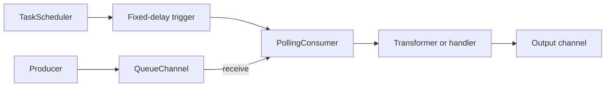

# `Pollers.fixedDelay` — Scheduling Polling After the Previous Run Completes

## 1. Objectives and Place in Spring Integration

In the `SPRING_INTEGRATION_CORE` module, messages travel through `MessageChannel`s and are processed by transformers, routers, filters, service activators, or aggregators. When an endpoint's input is a pollable channel, or a data source only supports pulling, the system needs a poller to actively fetch messages.

This lesson belongs to the **Advanced DSL** chapter and focuses on `Pollers.fixedDelay(...)`: how to configure the pause between polling runs in Java DSL, read the execution timeline accurately, and test that behavior.

After this lesson, you will be able to:

- Distinguish a polling consumer from an event-driven consumer.
- Explain fixed delay relative to the completion time of the previous task.
- Attach pollers at the right spot for `QueueChannel`s and inbound sources.
- Combine delay, max messages per poll, and receive timeout.
- Identify the effects of executors, errors, and transaction boundaries.
- Test triggers without waiting in wall-clock time.

Examples use Java 17 or later and Spring Integration 6.x APIs, referencing the 6.4 branch. Java DSL lives in `spring-integration-core`; Spring Boot applications typically use `spring-boot-starter-integration`. Keep Spring versions aligned via your project's dependency management.

## 2. What Problem Does a Poller Solve?

### 2.1. Two Ways an Endpoint Receives Messages

With `DirectChannel`, a handler registers as a subscriber. When a producer sends a message, the channel delivers it to the handler in an event-driven manner.

With `QueueChannel`, a producer places messages into a queue. Another endpoint must call receive to pull messages from the queue; the poller decides when that endpoint starts pulling and how many messages it takes per run.



For inbound sources such as a data-checking method, the adapter uses a `SourcePollingChannelAdapter` to poll a `MessageSource`. Both `PollingConsumer` and `SourcePollingChannelAdapter` are endpoints that can use pollers, as explained in the [Poller documentation](https://docs.spring.io/spring-integration/reference/6.4/polling-consumer.html).

### 2.2. A Poller Attaches to an Endpoint

The snippet below schedules pulling from a queue on the transformer endpoint:

```java
IntegrationFlow.from(workQueue())
    .<String, String>transform(String::strip,
        endpoint -> endpoint.poller(
            Pollers.fixedDelay(Duration.ofSeconds(1))))
    .channel(resultQueue())
    .get();
```

The `workQueue()` and `resultQueue()` beans must be declared, as in the complete example in Section 5. A poller does not turn every channel in the flow into a queue, nor does it add a delay to every DSL step.

If the input is a `DirectChannel`, the endpoint is normally event-driven and needs no poller. Configuring a poller on an endpoint backed by a subscribable channel mismatches the model and can be rejected at initialization.

A common mistake with `IntegrationFlow.from("workQueue")` is forgetting to declare the corresponding queue bean. A nonexistent channel name may be created by the DSL as a `DirectChannel`; having "queue" in the name does not determine channel type. Declare `QueueChannel` explicitly when polling is needed.

## 3. Exact Semantics of Fixed Delay

### 3.1. The Pause Starts After Completion

`Pollers.fixedDelay(...)` creates a `PollerSpec` backed by `PeriodicTrigger` in fixed-delay mode. Per the contract of [PeriodicTrigger](https://docs.spring.io/spring-framework/docs/6.2.x/javadoc-api/org/springframework/scheduling/support/PeriodicTrigger.html), the next execution time is computed from the completion time of the previous task plus the delay.

Notation:

- `Sₙ`: actual start time of run `n`.
- `Cₙ`: completion time of that run's task.
- `D`: fixed delay duration.
- `Eₙ = Cₙ − Sₙ`: task execution duration.

In the synchronous model, when the scheduler has sufficient resources:

```text
Next scheduled time = Cₙ + D
Sₙ₊₁ ≈ Sₙ + Eₙ + D
```

A busy scheduler, CPU starvation, or system pauses can cause the actual run to start later. Delay is not a millisecond-exact start guarantee.

Example with `D = 1 second` and task taking `300 ms`:

```text
0.0 s        0.3 s                       1.3 s        1.6 s
| run poll 1 |------ wait 1 second --------| run poll 2 |
```

Two consecutive starts are about `1.3 seconds` apart, not strictly `1 second`.

If the next task takes `2 seconds`, the run after that is scheduled roughly `3 seconds` after that run started. Polling pace naturally slows down with synchronous processing time.

### 3.2. Fixed Delay vs. Fixed Rate

| Scheduling Mode | Reference Point | Good Fit |
| --- | --- | --- |
| `Pollers.fixedDelay(D)` | Completion time of the previous task | Wanting a rest interval after finishing each run |
| `Pollers.fixedRate(P)` | Scheduled start instants | Wanting a periodic scheduling cadence |
| `Pollers.cron(...)` | Schedule per cron expression | Needing calendar milestones like hourly or business hours |

Suppose start is at `0 s`, task takes `300 ms`, and period is `1 s`:

```text
Fixed delay: starts around 0.0 -> 1.3 -> 2.6 -> 3.9 seconds
Fixed rate:  scheduled at  0.0 -> 1.0 -> 2.0 -> 3.0 seconds
```

Fixed rate also depends on scheduler resources and execution mechanisms. Never infer that choosing fixed rate automatically runs multiple tasks concurrently. Overlap behavior must be evaluated separately alongside the scheduler, executor, and asynchronous boundaries.

Fixed delay is a duration, not a timezone-aware calendar schedule. If you need "every day at 08:00 sharp", use cron with an explicit timezone.

### 3.3. Fixed Delay Is Not a Per-Message Delay

With this configuration:

```java
Pollers.fixedDelay(Duration.ofSeconds(1))
    .maxMessagesPerPoll(3)
```

a single poll run can process three messages back-to-back. The one-second pause occurs after that run completes, not between the first and second message.

```text
Run 1: receive M1 -> process M1 -> receive M2 -> process M2 -> receive M3 -> process M3
       end run -> pause 1 second -> Run 2
```

To pace individual messages, use rate-limiting components or bounds aligned with the business contract. Simply shrinking `fixedDelay` or increasing max messages per poll does not enforce an exact request quota toward an external API.

## 4. Java DSL API and Time Units

Common forms:

```java
Pollers.fixedDelay(Duration.ofMillis(500));
Pollers.fixedDelay(Duration.ofSeconds(2));
Pollers.fixedDelay(500L); // 500 milliseconds

Pollers.fixedDelay(
    Duration.ofSeconds(2),  // pause after each run
    Duration.ofSeconds(5)   // delay before the first run
);
```

Overloads accepting `long` use milliseconds; overloads accepting `Duration` express units explicitly. Signatures and trigger creation are in [Pollers 6.4.0](https://raw.githubusercontent.com/spring-projects/spring-integration/v6.4.0/spring-integration-core/src/main/java/org/springframework/integration/dsl/Pollers.java).

With the two-argument overload:

- `initialDelay` applies before the schedule's first execution.
- `period` applies between the previous completion and the next execution.
- The two values can differ.

When no initial delay is specified, the trigger does not deliberately wait a full period before the first run. The first run still depends on when the endpoint starts and when the scheduler can run the task.

Initial delay is no substitute for verifying dependency readiness. If a database or external service is not ready yet, use proper connection handling, retries, or lifecycle coordination; waiting a fixed number of seconds does not prove the system is ready.

## 5. Complete Example: Pulling Work from a `QueueChannel`

The system receives work strings into `workQueue`, normalizes them, and sends them to `resultQueue`. Whitespace-only strings are considered invalid and route errors to `pollErrors`.

```java
import java.time.Duration;
import java.util.Locale;

import org.springframework.context.annotation.Bean;
import org.springframework.context.annotation.Configuration;
import org.springframework.integration.channel.QueueChannel;
import org.springframework.integration.config.EnableIntegration;
import org.springframework.integration.dsl.IntegrationFlow;
import org.springframework.integration.dsl.Pollers;

@Configuration
@EnableIntegration
public class FixedDelayFlowConfig {

    @Bean
    public QueueChannel workQueue() {
        return new QueueChannel(100);
    }

    @Bean
    public QueueChannel resultQueue() {
        return new QueueChannel(100);
    }

    @Bean
    public QueueChannel pollErrors() {
        return new QueueChannel(100);
    }

    @Bean
    public IntegrationFlow normalizeWork() {
        return IntegrationFlow.from(workQueue())
            .<String, String>transform(text -> {
                String normalized = text.strip();
                if (normalized.isEmpty()) {
                    throw new IllegalArgumentException(
                        "Work payload must not be blank");
                }
                return normalized.toUpperCase(Locale.ROOT);
            }, endpoint -> endpoint
                .id("normalizePollingEndpoint")
                .poller(Pollers.fixedDelay(Duration.ofMillis(500))
                    .maxMessagesPerPoll(3)
                    .receiveTimeout(0L)
                    .errorChannel("pollErrors")))
            .channel(resultQueue())
            .get();
    }
}
```

This configuration establishes four distinct policies:

| Setting | Meaning |
| --- | --- |
| `fixedDelay(500 ms)` | Pause roughly 500 ms after the previous polling task |
| `maxMessagesPerPoll(3)` | Receive and process at most three messages per run |
| `receiveTimeout(0)` | If the queue is empty when receiving, return immediately |
| `errorChannel("pollErrors")` | Sets the default error channel for this poller task |

When a producer sends `"  order-17  "`, the result payload is `"ORDER-17"`. Neither result queue has a business consumer in the example so tests can pull messages directly.

The queues are bounded and stored only in memory. When `resultQueue` is full, sending the output may block or fail per the sender's configuration; that time can lengthen the polling run. `receiveTimeout(0)` only affects pulling from the input queue, not sending to the output.

## 6. What Happens Inside One Poll Run?

A single trigger-fired run can repeat receiving and processing multiple times. Conceptually, the synchronous model reads as:

```text
When scheduled:
    repeat at most N times:
        receive one message
        if no message: end run
        process and forward message down the flow
    task completes
    compute next run from completion time + delay
```

This is pseudocode explaining normal behavior, not a replacement for the framework's lifecycle, advice, and error-handling mechanics.

### 6.1. `maxMessagesPerPoll` Is a Per-Run Limit

A positive number such as `1`, `3`, or `10` sets an explicit bound. If the source returns `null` or the queue has no messages, the run can finish before reaching that limit.

`maxMessagesPerPoll(3)` does not combine three messages into a list payload. The transformer is still called per message. To combine them into one message, use an aggregator or an appropriate batching component.

Defaults differ by endpoint kind:

| Endpoint | Input | Typical Default in 6.4 Branch |
| --- | --- | --- |
| `PollingConsumer` | `PollableChannel`, such as `QueueChannel` | `-1`, unlimited messages per run |
| `SourcePollingChannelAdapter` | `MessageSource`, including supplier-backed sources | `1` message per run |

A negative value like `-1` allows continuing as long as messages arrive and the endpoint remains active. If a queue is continuously replenished quickly or a source never returns `null`, a single run can drag on and the fixed-delay pause may rarely occur.

For inbound adapters, `0` means temporarily skipping pulls from the source. Never pass `0` intending "unlimited"; use a positive limit in normal examples. Default differences and inbound behavior are described in [Channel Adapter](https://docs.spring.io/spring-integration/reference/6.4/channel-adapter.html).

### 6.2. `receiveTimeout` Is the Wait Time on Receive

For a polling consumer reading from a queue:

```java
Pollers.fixedDelay(Duration.ofSeconds(1))
    .maxMessagesPerPoll(5)
    .receiveTimeout(200L)
```

Each receive call can wait up to `200 ms` if no message is present yet. Once a receive gets no message, the run stops; it does not perform five empty waits.

For example, suppose a run processed two messages and then the queue became empty. The next receive can wait up to 200 ms before ending the run, and only then does the one-second fixed delay start.

Distinguish these durations:

| Parameter or Duration | Scope |
| --- | --- |
| `fixedDelay` | Pause between tasks per trigger |
| `initialDelay` | Wait before the first execution |
| `receiveTimeout` | Waiting to receive a message from a pollable channel |
| HTTP/JDBC/client timeout | Time spent interacting with an external system |
| Send time to the next channel | Depends on the channel and sending component |

`receiveTimeout` does not force an arbitrary inbound source to respond within that duration. If a supplier makes a synchronous HTTP call, configure timeouts on the HTTP client. The [PollerSpec](https://docs.spring.io/spring-integration/api/org/springframework/integration/dsl/PollerSpec.html) Javadoc defines `receiveTimeout(long)` for waiting to receive a message from a channel.

### 6.3. Estimating Throughput in the Synchronous Model

Assuming every run always handles `b` messages, each message averages `h` seconds, delay is `D`, and other overhead is ignored:

```text
Cycle duration ≈ b × h + D
Throughput ≈ b / (b × h + D) messages/second
```

Example with `b = 5`, `h = 0.1 seconds`, `D = 1 second`:

```text
5 / (5 × 0.1 + 1) ≈ 3.33 messages/second
```

This is an estimation model, not a performance guarantee. Empty receive waits, retries, or blocked output sends increase cycle duration. With asynchronous handoff, model downstream worker capacity and queues separately.

## 7. Polling an Inbound Source with a Supplier

For a source that actively supplies data when invoked, attach the poller to the source configuration:

```java
import java.time.Duration;
import java.util.List;
import java.util.Queue;
import java.util.concurrent.ConcurrentLinkedQueue;

import org.springframework.context.annotation.Bean;
import org.springframework.context.annotation.Configuration;
import org.springframework.integration.config.EnableIntegration;
import org.springframework.integration.dsl.IntegrationFlow;
import org.springframework.integration.dsl.Pollers;

@Configuration
@EnableIntegration
public class FixedDelaySourceConfig {

    @Bean
    public IntegrationFlow pendingSourceFlow() {
        Queue<String> pending = new ConcurrentLinkedQueue<>(
            List.of("JOB-A", "JOB-B", "JOB-C"));

        return IntegrationFlow.fromSupplier(pending::poll,
                endpoint -> endpoint
                    .id("pendingSourceEndpoint")
                    .poller(Pollers.fixedDelay(Duration.ofSeconds(2))
                        .maxMessagesPerPoll(2)))
            .channel(channel -> channel.queue("sourceResults"))
            .get();
    }
}
```

How to read it:

1. The first run calls the supplier at most twice, creating messages for `JOB-A` and `JOB-B`.
2. After the task finishes, it waits roughly two seconds.
3. The next run gets `JOB-C`; the following call returns `null`, ending the run early.
4. Subsequent runs still get scheduled, emitting no messages while the source remains empty.

Here, the result queue is just an observation sink. If you chain synchronous endpoints directly after the source instead of a queue, those endpoints' execution time also counts toward the polling task's duration.

With real sources, `null` means no message is currently available to emit. Do not synthesize dummy empty payloads just to report "no data", because downstream will still see a message to process.

If a supplier returns `List<Order>`, each invocation produces one message whose payload is that list. `maxMessagesPerPoll(2)` then limits the number of messages produced from invocations, not the total number of elements inside lists. Add a splitter if downstream contracts expect one order per message.

The simulated source using `pending.poll()` removes elements from memory before downstream completes. If sending the output fails, the element does not automatically return to the source. With databases, files, or brokers, explicitly design claim, acknowledgment, rollback, or recovery mechanisms.

## 8. Shared Pollers and External Configuration

### 8.1. Declaring a Global Default Poller

When many endpoints need the same default policy, you can declare:

```java
import java.time.Duration;

import org.springframework.context.annotation.Bean;
import org.springframework.integration.dsl.PollerSpec;
import org.springframework.integration.dsl.Pollers;
import org.springframework.integration.scheduling.PollerMetadata;

@Bean(name = PollerMetadata.DEFAULT_POLLER)
public PollerSpec defaultPoller() {
    return Pollers.fixedDelay(Duration.ofSeconds(1))
        .maxMessagesPerPoll(5)
        .receiveTimeout(0L);
}
```

Place the bean in a configuration class with Spring Integration enabled. This avoids repeating a local poller on every endpoint.

`PollerSpec` is a `FactoryBean` producing `PollerMetadata`. Inside a `@Bean` method, return the `PollerSpec` for Spring to manage; do not call `getObject()` here. This guidance is documented in [Pollers in Java DSL](https://docs.spring.io/spring-integration/reference/6.4/dsl/java-pollers.html).

The default poller applies to endpoints requiring polling that have no dedicated poller configured. It does not make event-driven endpoints start polling. Endpoints sharing metadata also do not become a single task or share a mutual-exclusion business lock.

### 8.2. Named Pollers and Externalized Values

You can create a dedicated poller for a group of tasks. For example, add `import org.springframework.beans.factory.annotation.Value` and place this bean in a configuration class:

```java
@Bean
public PollerSpec ordersPoller(
    @Value("${orders.poll.delay:PT1S}") String delayText,
    @Value("${orders.poll.max-messages:10}") int maxMessages
) {
    Duration delay = Duration.parse(delayText);
    if (delay.isZero() || delay.isNegative()) {
        throw new IllegalArgumentException("Delay must be greater than 0");
    }
    if (maxMessages <= 0) {
        throw new IllegalArgumentException("Limit must be greater than 0");
    }
    return Pollers.fixedDelay(delay)
        .maxMessagesPerPoll(maxMessages)
        .receiveTimeout(0L);
}
```

Example property values:

```properties
orders.poll.delay=PT2S
orders.poll.max-messages=20
```

Endpoints reference the poller by name:

```java
.handle(orderHandler,
    endpoint -> endpoint.poller("ordersPoller"))
```

This attaches to a flow that already has `orderHandler` and a pollable input channel. In the bean method, `Duration.parse(...)` parses ISO-8601 strings such as `PT2S`; a string like `2s` does not follow the same parsing contract.

Reading values from configuration does not automatically update a running poller when a file changes. Runtime updates require dynamic management and trigger reconfiguration outside the scope of static configuration here.

## 9. Schedulers, Executors, and Completion Scope

### 9.1. Synchronous Case

Without an asynchronous task executor configured on the poller, the task normally includes both receiving messages and synchronous downstream processing. A slow handler lengthens the polling run while occupying scheduler execution capacity.

If multiple pollers share a scheduler, an unbounded poll run or a network call lacking timeouts can delay other schedules. Treat processing time, receive waits, and scheduler threads as one shared system.

### 9.2. `taskExecutor(...)` Changes What Is Tracked

You can configure:

```java
Pollers.fixedDelay(Duration.ofSeconds(1))
    .maxMessagesPerPoll(5)
    .taskExecutor(pollingExecutor)
```

`pollingExecutor` must be a properly configured and managed `Executor`. In this model, the scheduler's callback can finish right after handing work to the executor, before the worker finishes processing the message.

Therefore, never apply the formula "business processing finishes, then wait one second" mechanically to an executor-offloaded configuration. Polling tasks on workers can overlap; the extent depends on the executor, work queue, and rejection policy. Handoff behavior is visible in [AbstractPollingEndpoint 6.4.0](https://raw.githubusercontent.com/spring-projects/spring-integration/v6.4.0/spring-integration-core/src/main/java/org/springframework/integration/endpoint/AbstractPollingEndpoint.java).

Check the following:

- Is the source safe when multiple workers call receive concurrently?
- Is the executor's queue bounded?
- When full, is work rejected, blocked, or run on the calling thread?
- Does task generation rate exceed processing capacity?

Another option is keeping polling sequential and placing an `ExecutorChannel` downstream to parallelize processing. Even then, fixed delay still does not wait for business tasks handed off across that channel to finish. Choose asynchronous boundaries based on ordering, error, and transaction requirements.

### 9.3. Multiple Instances Mean Multiple Pollers

Running three application instances with the same configuration typically means three independent polling endpoints. `fixedDelay` does not create a single cluster-wide schedule.

With a shared database, "fetch unprocessed records" queries need proper claiming or locking to prevent multiple instances from processing the same record. With external APIs, total call rate comes from all instances multiplied by receives per poll.

Never use fixed delay as a substitute for a distributed lock or deduplication mechanism.

## 10. Error Handling, Retries, and Transactions

### 10.1. The Next Poll Run Does Not Automatically Retry Failed Messages

In Section 5's example, the producer successfully sends to `workQueue` before the transformer runs. If the transformer throws an exception, the producer does not receive that exception through its already-completed `send(...)` call.

The poller can emit an `ErrorMessage` to an error channel. Under Spring Integration's error-handling mechanics, an `errorChannel` header on the message can determine the error destination; `.errorChannel("pollErrors")` sets the default error destination for this poller's error handler. See [Error Handling](https://docs.spring.io/spring-integration/reference/6.4/error-handling.html).

With an in-memory `QueueChannel`, the message has already been removed from the queue. The next poll run will not automatically receive that failed message again. To retry the same message, use retry advice or an explicitly designed recovery, redelivery, or requeue mechanism.

After the error handler processes an error in standard configurations, the scheduler can continue subsequent runs. Custom error handlers can also affect whether scheduling continues, so test the error path thoroughly.

### 10.2. Retry Placement Affects Timing and Side Effects

Synchronous retries inside a handler or polling task extend the run's duration. With synchronous fixed delay, the pause starts after that execution completes.

If retries wrap downstream steps that already caused side effects, sending emails or calling external services may repeat. Scope retries to recoverable errors, cap attempts, and use business keys for idempotency.

Routing errors to `nullChannel` only discards error information; it provides no data recovery.

### 10.3. Transactions Must Bind to Real Resources

Pollers offer transaction/advice settings, yet enabling transactions does not automatically roll back every channel and external service.

Clarify specifically:

- Does the receiving source participate in transactions?
- Which databases are managed by the transaction manager?
- Does downstream stay on the same thread or hand off asynchronously?
- On rollback, does the source return the message, preserve state, or lose it?

Asynchronous boundaries normally break thread-bound transaction scopes. An in-memory `QueueChannel` does not automatically offer transactional message rollback semantics. Transaction integration points are documented in [Transaction Support](https://docs.spring.io/spring-integration/reference/6.4/transactions.html).

`maxMessagesPerPoll` also does not automatically define a single transaction spanning the whole batch. Inspect the endpoint's advice and transaction scope rather than inferring it from poll batch size.

## 11. Testing Fixed Delay Without Measuring Wall-Clock Time

### 11.1. Verifying Schedule Calculations with `TriggerContext`

Instead of calling `Thread.sleep(...)` and comparing elapsed time with loose tolerances, supply the previous run's timestamps directly via `SimpleTriggerContext`.

```java
import java.time.Clock;
import java.time.Duration;
import java.time.Instant;
import java.time.ZoneOffset;

import org.junit.jupiter.api.Test;
import org.springframework.integration.dsl.Pollers;
import org.springframework.scheduling.Trigger;
import org.springframework.scheduling.support.SimpleTriggerContext;

import static org.junit.jupiter.api.Assertions.assertEquals;

class FixedDelayTriggerTest {

    @Test
    void nextExecutionIsBasedOnCompletion() {
        Trigger trigger = Pollers.fixedDelay(Duration.ofSeconds(2))
            .getObject()
            .getTrigger();

        Instant scheduled = Instant.parse("2026-01-01T00:00:00Z");
        Instant actual = scheduled.plusMillis(20);
        Instant completed = scheduled.plusMillis(320);

        SimpleTriggerContext context = new SimpleTriggerContext(
            scheduled, actual, completed);

        assertEquals(completed.plusSeconds(2),
            trigger.nextExecution(context));
    }

    @Test
    void initialDelayOnlyAffectsTheFirstExecution() {
        Trigger trigger = Pollers.fixedDelay(
                Duration.ofSeconds(2), Duration.ofSeconds(5))
            .getObject()
            .getTrigger();

        Instant now = Instant.parse("2026-01-01T00:00:00Z");
        SimpleTriggerContext context = new SimpleTriggerContext(
            Clock.fixed(now, ZoneOffset.UTC));

        assertEquals(now.plusSeconds(5), trigger.nextExecution(context));

        Instant firstStart = now.plusSeconds(5);
        Instant completed = firstStart.plusMillis(400);
        context.update(firstStart, firstStart, completed);

        assertEquals(completed.plusSeconds(2),
            trigger.nextExecution(context));
    }
}
```

This is a standalone unit test for timestamp calculation that does not boot an application context. Calling `getObject()` here extracts metadata from a local spec solely for testing; do not apply that pattern inside `@Bean` methods as shown in Section 8.

`SimpleTriggerContext` stores scheduled, actual, and completion timestamps; it can also accept a fixed `Clock` as documented in [SimpleTriggerContext Javadoc](https://docs.spring.io/spring-framework/docs/6.2.x/javadoc-api/org/springframework/scheduling/support/SimpleTriggerContext.html).

### 11.2. Verifying Flow Success and Error Emission

Place the test in the same package as `FixedDelayFlowConfig` from Section 5. Requires JUnit Jupiter and Spring Test; Boot applications typically use `spring-boot-starter-test` alongside the Integration starter.

```java
import org.junit.jupiter.api.Test;
import org.springframework.beans.factory.annotation.Autowired;
import org.springframework.beans.factory.annotation.Qualifier;
import org.springframework.integration.channel.QueueChannel;
import org.springframework.messaging.Message;
import org.springframework.messaging.support.ErrorMessage;
import org.springframework.messaging.support.MessageBuilder;
import org.springframework.test.annotation.DirtiesContext;
import org.springframework.test.context.junit.jupiter.SpringJUnitConfig;

import static org.junit.jupiter.api.Assertions.*;

@SpringJUnitConfig(FixedDelayFlowConfig.class)
@DirtiesContext(classMode = DirtiesContext.ClassMode.AFTER_EACH_TEST_METHOD)
class FixedDelayFlowConfigTest {

    @Autowired
    @Qualifier("workQueue")
    QueueChannel input;

    @Autowired
    @Qualifier("resultQueue")
    QueueChannel results;

    @Autowired
    @Qualifier("pollErrors")
    QueueChannel errors;

    @Test
    void processesQueuedMessages() {
        assertTrue(input.send(MessageBuilder.withPayload("  order-17  ")
            .build()));

        Message<?> result = results.receive(3_000L);

        assertNotNull(result);
        assertEquals("ORDER-17", result.getPayload());
        assertNull(errors.receive(0L));
    }

    @Test
    void reportsFailureAndContinuesWithLaterWork() {
        assertTrue(input.send(MessageBuilder.withPayload("   ").build()));
        assertTrue(input.send(MessageBuilder.withPayload("job-ok").build()));

        Message<?> failure = errors.receive(3_000L);
        assertInstanceOf(ErrorMessage.class, failure);

        Message<?> result = results.receive(3_000L);
        assertNotNull(result);
        assertEquals("JOB-OK", result.getPayload());
    }
}
```

`receive(3_000L)` waits at most three seconds and returns early as soon as a message arrives. This timeout bounds the test while observing asynchronous processing; it does not assert that the poller always fires on an exact millisecond tick.

The test refreshes the context after each method so endpoints and leftover messages never leak into other test methods. The second test verifies that the system emits an error and continues processing valid work; it does not assume the failed message is automatically retried.

These test snippets are practice code in the lesson; compile and run them in your project with its specific dependency set. Avoid tight wall-clock assertions inside integration tests just to re-check trigger math already verified independently.

### 11.3. Extended Scenarios to Observe

| Scenario | What to Prove |
| --- | --- |
| Empty queue, `receiveTimeout(0)` | Run ends quickly and then waits for delay |
| Empty queue, positive receive timeout | Receive wait time counts inside task execution time |
| Source has three messages, limit two per run | Does not pull beyond the limit within the same run |
| Slow synchronous handler | Next run is scheduled from completion |
| Poller hands off to executor | Do not infer business completion from scheduler callback completion |
| Transformer failure | Error message is emitted and continuation policy is verified |
| Unbounded run with continuously non-empty source | Run can stretch, affecting scheduler fairness |

## 12. Relationship to Core Components

The poller governs how an endpoint acquires data. Downstream EIPs retain their own responsibilities:

- **Transformer:** converts payloads; place the poller on the transformer when it is the direct consumer of a queue.
- **Filter:** drops messages by condition. A filtered message does not mean the polling run received nothing; distinguish messages polled from messages emitted downstream.
- **Router:** selects target channels after a message is received; fixed delay does not alter routing rules.
- **Aggregator:** correlates related messages. Input fixed delay does not replace group timeouts or release strategies.
- **Gateway:** hides messaging APIs. If a gateway only enqueues under a one-way contract, the call returning does not prove the polling endpoint finished processing. For request-reply, wait budgets must account for both queue residence time and processing time.

This design separates message acquisition timing from business rules while keeping latency and error origins visible.

## 13. Common Configuration Errors

| Symptom | Possible Cause | How to Fix |
| --- | --- | --- |
| Queue has messages, yet none are processed | Missing poller, endpoint not started, or scheduler unable to run | Check channel type, lifecycle, and poller config |
| Endpoint rejects poller configuration | Input is a subscribable channel | Use event-driven mode or declare a pollable channel |
| Actual cycle longer than delay | Processing time and receive wait add to the cycle | Measure task, receive, and rest durations separately |
| Multiple messages processed back-to-back | Per-run limit greater than one | Distinguish polling runs from per-message spacing |
| Queue never gets a rest despite delay | Unlimited run with continuous data present | Set a positive limit and monitor run duration |
| External API called too frequently | One poll runs multiple calls or multiple instances run | Sum total calls across instances and cap per API limits |
| Source unsafe under concurrent polling | Using a task executor without considering concurrency | Choose concurrency boundaries and guard the source |
| Failed messages never reappear | Queue/source lacks expected redelivery | Design explicit retry, error storage, and recovery |
| Properties edited, yet schedule unchanged | Configuration read only at bean creation | Use runtime trigger update mechanisms or restart per procedure |
| Flaky integration tests | Measuring tight wall-clock intervals with sleep | Test triggers with simulated time and bounded result waits |

In operations, monitor poll count, empty polls, messages received, processing duration, queue depth, and error count. Proper delay configuration alongside growing queues indicates consumer capacity and producer rate need examination, not just schedule settings.

## 14. Practice Exercises

1. With `maxMessagesPerPoll(3)`, 500 ms delay, and roughly 100 ms processing per message, estimate throughput when the queue always has data. Note which overheads are excluded.
2. Replace `receiveTimeout(0)` with `receiveTimeout(200)` and sketch the timeline for a run with only one message.
3. Use a finite five-element source limited to two messages per run. Determine the expected message counts emitted across each run, including once the source is empty.
4. Add a three-second initial delay and verify the first scheduled time using `Clock.fixed(...)` without waiting three real seconds.
5. Have the transformer fail on one input payload, inspect the error channel, and design a bounded retry policy. Distinguish retrying the old message from polling a new message.
6. Analyze how the system changes when running two instances or adding an executor. Pinpoint where the source can be polled concurrently and which side effects need deduplication.

Your exercise output should clearly specify channel types, poller placement, delay reference timestamps, messages per run, and error paths. Those factors determine whether `Pollers.fixedDelay` satisfies the data-acquisition cadence and processing contract of your integration flow.
