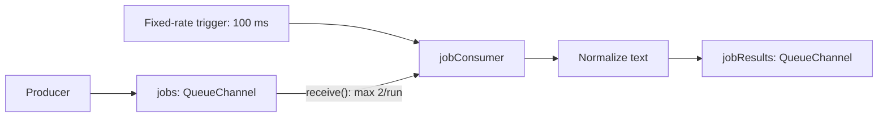

# `Pollers.fixedRate`

## 1. Objectives and Scope

In the **Advanced DSL** chapter of the **SPRING_INTEGRATION_CORE** module, `Pollers.fixedRate(...)` configures a polling cadence for an endpoint in Java DSL. It is useful when actively pulling messages from a queue or invoking a data source at fixed intervals.

This lesson places fixed rate in the full context of a message flow: input channel, consumer endpoint, message source, downstream processing, and error paths. After this lesson, you will be able to:

- Explain the reference timestamp used by fixed rate.
- Distinguish `fixedRate` from `fixedDelay`.
- Use overloads with `Duration`, milliseconds, and initial delay.
- Attach pollers to the right endpoint in Java DSL.
- Tune max messages per poll and receive timeout.
- Analyze slow processing, overdue schedules, and polling tasks running via an executor.
- Write trigger tests that do not rely on `Thread.sleep()`.

Examples use **Java 17+, Spring Integration 6.5.x, and Spring Framework 6.x APIs** as a baseline. This baseline serves the lesson and does not assume the exact version in your project. Java DSL lives in `spring-integration-core`; configuration examples use Spring Context, and test code uses JUnit Jupiter.

## 2. How Does Fixed Rate Schedule Polling?

### 2.1. Spacing Between Scheduled Start Times

`Pollers.fixedRate(Duration.ofSeconds(1))` configures a one-second cadence measured from **scheduled start times**. It does not add one second to the work completion time.

You can visualize the target schedule after the first execution is scheduled at `t = 0`:

```text
Scheduled polling ticks: 0 s      1 s      2 s      3 s
                         |        |        |        |
                         poll     poll     poll     poll
```

This is a target schedule. Actual start times still depend on the scheduler, thread availability, and processing duration. Fixed rate does not provide a real-time guarantee across the entire pipeline. API definitions are in [Pollers — fixedRate](https://docs.spring.io/spring-integration/docs/6.5.0/api/org/springframework/integration/dsl/Pollers.html).

### 2.2. Distinguishing Three Timestamps of a Run

| Timestamp | Meaning |
| --- | --- |
| Scheduled start | The instant the task was scheduled to start |
| Actual start | The instant the task actually started |
| Completion | The instant the task finished |

For example, suppose a task was scheduled to start at 1,000 ms, actually started at 1,040 ms, and completed at 1,300 ms. With a 1,000 ms period:

- Fixed rate calculates the next tick from scheduled start: 2,000 ms.
- Fixed delay calculates the next tick from completion: 2,300 ms.

In the `PeriodicTrigger` implementation used as this lesson's baseline, fixed rate computes `lastScheduledExecution + period`; fixed delay computes `lastCompletion + period`. See [Spring Framework's PeriodicTrigger source code](https://github.com/spring-projects/spring-framework/blob/v6.2.0/spring-context/src/main/java/org/springframework/scheduling/support/PeriodicTrigger.java).

### 2.3. One Poll Run Can Process Multiple Messages

Separate two concepts:

```text
Trigger period
    -> one execution of the polling task
        -> receive and process first message
        -> receive and process second message
        -> ...
```

Triggering once per second does not mean processing only one message per second. The maximum number of messages per run is governed by `maxMessagesPerPoll`, while the actual count depends on available data and whether processing completes normally.

## 3. Syntax in Java DSL

### 3.1. Declaring Period and Initial Delay

```java
// One-second period, using Duration for explicit units.
Pollers.fixedRate(Duration.ofSeconds(1))

// Same period meaning: long parameter uses milliseconds.
Pollers.fixedRate(1_000)

// One-second period, five-second initial delay.
Pollers.fixedRate(
        Duration.ofSeconds(1),
        Duration.ofSeconds(5))

// Parameter order remains period first, initialDelay second.
Pollers.fixedRate(1_000, 5_000)
```

These expressions are alternative configuration options, not statements to run sequentially.

`initialDelay` affects only the schedule's first execution; it is not added as a pause after every run. Without an initial delay, the trigger does not wait a full period before the first run; actual execution time still depends on the scheduler.

`Pollers` is a utility class creating a `PollerSpec`. Calling this method only builds configuration; it does not start a job by itself. You must attach it to a Spring-managed endpoint. See [Pollers API](https://docs.spring.io/spring-integration/docs/6.5.0/api/org/springframework/integration/dsl/Pollers.html).

### 3.2. Attaching a Poller to a Queue Consumer

```java
IntegrationFlow.from(jobs)
        .<String>handle(
                (payload, headers) -> payload.toUpperCase(
                        java.util.Locale.ROOT),
                endpoint -> endpoint.poller(Pollers
                        .fixedRate(Duration.ofMillis(200))
                        .maxMessagesPerPoll(3)
                        .receiveTimeout(0)))
        .channel(results)
        .get();
```

In this snippet, `jobs` is a `QueueChannel` and `results` is an output channel. The poller belongs to the `handle` endpoint consuming the queue. It is not a property of the queue, nor does it automatically apply to every step in the flow.

If a flow has multiple intermediate queues, each consumer reading a queue needs an appropriate poller configuration, either local or via a default poller.

### 3.3. Distinguishing Two Common Places Poll Config Appears

| Where Used | What Is Polled | Example |
| --- | --- | --- |
| `PollingConsumer` | `PollableChannel` | Pulls jobs from a `QueueChannel` and invokes a handler |
| `SourcePollingChannelAdapter` | `MessageSource` or DSL-wrapped supplier | Invokes a data source to produce inbound messages |

With a `DirectChannel`, consumers receive messages via subscription; do not attach a poller to that consumer trying to make it run periodically. To trigger a source on a schedule, place the poller on the source. See [Polling Consumer](https://docs.spring.io/spring-integration/reference/6.5/polling-consumer.html).

## 4. Complete Example: Processing Jobs from a `QueueChannel`

### 4.1. Problem Statement

The system accepts text-normalization jobs. A poller runs on a 100 ms period, pulling at most two jobs per run and emitting results.



The example intentionally disables consumer auto-start so jobs can be preloaded before polling starts. This also lets exercises clearly observe endpoint lifecycle.

### 4.2. Java Configuration

```java
import java.time.Duration;
import java.util.Locale;

import org.springframework.beans.factory.annotation.Qualifier;
import org.springframework.context.annotation.Bean;
import org.springframework.context.annotation.Configuration;
import org.springframework.integration.channel.QueueChannel;
import org.springframework.integration.config.EnableIntegration;
import org.springframework.integration.dsl.IntegrationFlow;
import org.springframework.integration.dsl.Pollers;

@Configuration(proxyBeanMethods = false)
@EnableIntegration
public class FixedRateJobsConfig {

    public record Job(String id, String text) {
    }

    public record JobResult(String jobId, String normalizedText) {
    }

    @Bean
    public QueueChannel jobs() {
        return new QueueChannel(20);
    }

    @Bean
    public QueueChannel jobResults() {
        return new QueueChannel(20);
    }

    @Bean
    public IntegrationFlow jobsFlow(
            @Qualifier("jobs") QueueChannel input,
            @Qualifier("jobResults") QueueChannel output) {

        return IntegrationFlow.from(input)
                .<Job>handle(
                        (job, headers) -> new JobResult(
                                job.id(),
                                job.text().strip()
                                        .toUpperCase(Locale.ROOT)),
                        endpoint -> endpoint
                                .id("jobConsumer")
                                .autoStartup(false)
                                .poller(Pollers
                                        .fixedRate(
                                                Duration.ofMillis(100))
                                        .maxMessagesPerPoll(2)
                                        .receiveTimeout(0)))
                .channel(output)
                .get();
    }
}
```

In the example:

- Input payload is `Job`.
- Output payload is `JobResult`.
- `jobConsumer` is the ID of the consumer endpoint with the poller.
- `jobsFlow` is the bean defining the flow, not the name of the queue.
- `receiveTimeout(0)` prevents polling runs from blocking once the queue has no more items.

After creating the application context and enqueuing jobs, start the consumer with:

```java
org.springframework.context.Lifecycle consumer =
        context.getBean(
                "jobConsumer",
                org.springframework.context.Lifecycle.class);

consumer.start();
```

If you want the endpoint to start automatically with the application lifecycle, remove `autoStartup(false)` or set it appropriately. Any change to this choice must be reflected in tests as well.

### 4.3. A Successful Enqueue Does Not Mean Processing Is Done

When a sender calls `jobs.send(message)`, the message enters the queue. The handler runs later during a polling run. Thus:

```text
Placed into jobs
    is distinct from
Pulled by jobConsumer
    is distinct from
JobResult produced
```

To verify business results, observe `jobResults` or the pipeline's designed reply mechanism. Never use the return value of a queue send alone as proof of processing success.

## 5. Fixed Rate vs. Fixed Delay Over a Timeline

### 5.1. When Each Run Finishes Faster Than the Period

Suppose one run takes 300 ms, period is one second, and the first run starts right at 0:

| Run | Fixed Rate: Start → End | Fixed Delay: Start → End |
| --- | --- | --- |
| 1 | 0.0 → 0.3 s | 0.0 → 0.3 s |
| 2 | 1.0 → 1.3 s | 1.3 → 1.6 s |
| 3 | 2.0 → 2.3 s | 2.6 → 2.9 s |

The table assumes no scheduler contention and no separate executor for polling tasks. With fixed delay, task duration adds onto the gap between starts. With fixed rate, scheduled ticks advance by period.

### 5.2. When a Run Takes Longer Than the Period

If one run takes 1.6 seconds while the period is one second:

```text
Target schedule:      0.0       1.0       2.0       3.0 s
Actual first run:     [----------------]  finishes at 1.6 s
Next tick:                      1.0 s    already overdue
```

The trigger can calculate the next tick to lie in the past relative to when the previous task finished. The scheduler can then execute the next run as soon as possible to stay on schedule. Never assume the framework spawns extra threads for each missed tick, or that it always skips past ticks.

With standard scheduler usage and no dedicated poller executor, polling runs of the same endpoint do not overlap merely because fixed rate was chosen. To analyze a different scheduler configuration, inspect its actual execution mechanics.

Overdue tick calculation is visible in [PeriodicTrigger.nextExecution](https://github.com/spring-projects/spring-framework/blob/v6.2.0/spring-context/src/main/java/org/springframework/scheduling/support/PeriodicTrigger.java). Distinguishing scheduler threads from polling-execution threads is covered in [TaskExecutor Support](https://docs.spring.io/spring-integration/reference/6.5/endpoint.html).

### 5.3. Matching Cadence to the Goal

| Goal | Option to Consider |
| --- | --- |
| Keep polling schedule aligned to periodic ticks | Fixed rate |
| Guarantee a pause after each completed run | Fixed delay |
| Run at specific hours or days | Cron trigger |
| Adapt schedule based on load state | Custom trigger or appropriate control mechanism |

This is requirement-driven selection. Fixed rate does not make handlers faster and does not replace rate limits toward external services.

## 6. `maxMessagesPerPoll` and `receiveTimeout`

### 6.1. Bounding Work per Run

```java
Pollers.fixedRate(Duration.ofSeconds(1))
        .maxMessagesPerPoll(10)
        .receiveTimeout(0)
```

If the queue holds at least ten messages, processing is fast enough, and no errors occur, one run can process ten messages. If the queue holds only three, that run finishes once data is exhausted and does not wait further because receive timeout is 0.

Configure max messages per poll explicitly when your design depends on that bound. Per the API branch used here, defaults typically differ: `PollingConsumer` defaults to `-1`, while `SourcePollingChannelAdapter` defaults to `1`. An unlimited value can cause a single run to drag on whenever a source continuously supplies data. See [Message Endpoints — Poller Configuration](https://docs.spring.io/spring-integration/reference/6.5/endpoint.html).

### 6.2. Receive Wait Time Also Counts Inside the Run

`receiveTimeout` is how long receiving from a pollable channel waits, in milliseconds. It is NOT:

- The polling schedule period.
- A timeout for HTTP, JDBC, or source I/O calls.
- A deadline for downstream business logic.

Example with a 100 ms period and 1,000 ms receive timeout: if the queue is empty, one receive call can wait longer than the period. Consequently, a 100 ms period does not guarantee a completed run every 100 ms.

In this lesson's queue-processing example, `receiveTimeout(0)` keeps cadence observation simple. When blocking waits for data are desired, pick another value based on requirements and available threads. See [PollerSpec — receiveTimeout](https://docs.spring.io/spring-integration/docs/6.5.0/api/org/springframework/integration/dsl/PollerSpec.html).

### 6.3. Estimating Throughput Under Favorable Conditions

Suppose period is one second, max messages per poll is ten, and each message takes 20 ms on the synchronous path:

```text
Time to process a full run: 10 × 20 ms = 200 ms
Interval between ticks:                1,000 ms
Target throughput when queue has data: roughly 10 messages/second
```

If each message takes 200 ms, a full run takes about two seconds; a one-second schedule cannot make a single-threaded pipeline achieve ten messages/second. Processing capacity has become the bottleneck.

These calculations are an analytical load model. They omit resource contention, timeouts, retries, and execution-time variance.

## 7. Polling a Source with `fromSupplier`

Fixed rate is also used when a flow begins from a source that actively generates messages.

The example below can live inside a `@Configuration` class with `@EnableIntegration`. In addition to previous imports, add `java.util.concurrent.atomic.AtomicLong`.

```java
@Bean
public QueueChannel heartbeatResults() {
    return new QueueChannel(20);
}

@Bean
public IntegrationFlow heartbeatFlow(
        @Qualifier("heartbeatResults") QueueChannel output) {

    AtomicLong sequence = new AtomicLong();

    return IntegrationFlow.fromSupplier(
                    () -> "HEARTBEAT-" + sequence.incrementAndGet(),
                    source -> source
                            .id("heartbeatSource")
                            .poller(Pollers
                                    .fixedRate(
                                            Duration.ofSeconds(5),
                                            Duration.ofSeconds(1))
                                    .maxMessagesPerPoll(1)))
            .channel(output)
            .get();
}
```

Configuration intent:

- Delay the first poll by roughly one second.
- Afterward, maintain a target schedule spaced five seconds apart.
- Call the supplier at most once per run.
- Send results to the output queue.

Relative target ticks are around 1 s, 6 s, 11 s from when the schedule starts. Actual execution times may lag.

This supplier always returns data. Capping at one message per run makes the contract explicit and prevents a run from pulling indefinitely if configured as unlimited. For sources with no new data, use the source's "no message" signal—usually returning `null`—rather than emitting empty dummy messages just to fill the schedule.

This flow is a short-lived example: the output queue must be read or wired to an appropriate consumer; generating data without consuming it will fill the bounded queue.

Differences between polling sources and polling channels are explained in [Inbound Channel Adapters](https://docs.spring.io/spring-integration/reference/6.5/dsl/java-inbound-adapters.html).

## 8. Scheduler and Executor Are Two Different Settings

### 8.1. Scheduler Determines Trigger Timing

The scheduler manages running tasks per trigger. Without a separate executor configured for the poller, the handler usually runs on the thread executing the polling task.

Slow downstream logic can tie up the scheduler thread for a long time. If multiple endpoints share a scheduler, evaluate how one slow endpoint impacts scheduling of other endpoints.

Spring Integration lets you configure the central scheduler via a bean named `taskScheduler`. When customizing the scheduler, preserve the desired error-handling policy. See [Configuring the Task Scheduler](https://docs.spring.io/spring-integration/reference/6.5/configuration/namespace-taskscheduler.html).

### 8.2. `taskExecutor` Runs Polling Work

When polling runs truly need concurrent execution capability, attach an executor to the poller. Example executor bean:

```java
@Bean
public org.springframework.scheduling.concurrent.ThreadPoolTaskExecutor
        pollWorkers() {

    var executor =
            new org.springframework.scheduling.concurrent
                    .ThreadPoolTaskExecutor();

    executor.setCorePoolSize(2);
    executor.setMaxPoolSize(2);
    executor.setQueueCapacity(4);
    executor.setThreadNamePrefix("poll-worker-");
    return executor;
}
```

Spring manages this executor bean's lifecycle. After injecting it into the flow-declaring method, configure the poller with:

```java
Pollers.fixedRate(Duration.ofMillis(200))
        .maxMessagesPerPoll(2)
        .receiveTimeout(0)
        .taskExecutor(pollWorkers)
```

Above, `pollWorkers` is the injected `ThreadPoolTaskExecutor` parameter, not a direct call to the `@Bean` method.

With an executor, the scheduler can keep firing and submitting polling tasks while earlier tasks are still running on workers. Polling runs can overlap depending on settings. Account for thread safety when multiple threads invoke the handler, output ordering, and executor rejection policies.

### 8.3. Two Places Where Work Can Accumulate

```text
Input message queue
    + polling-task queue inside the executor
    + currently executing tasks
```

Shortening the period does not shrink every backlog layer. Even when the input message queue is empty, a long receive timeout can tie up multiple waiting workers while the scheduler keeps submitting more polling tasks.

The documentation analyzes the combination of short fixed rate, long receive timeout, and unbounded executor queue. Tune period, receive timeout, worker count, and task queue capacity together. See [Asynchronous Polling](https://docs.spring.io/spring-integration/reference/6.5/endpoint.html).

### 8.4. Downstream Thread Switching Also Changes How You Read Schedules

An `ExecutorChannel` after the endpoint can hand subsequent processing to another thread. Once message delivery completes, the polling task may consider its job finished even though downstream business logic is still running.

Therefore, analyzing "how long each run takes" requires specifying the completion boundary being measured:

| Observation Scope | What It May Include |
| --- | --- |
| Polling task | Receiving data and all synchronous downstream steps |
| Business worker | Work beyond an asynchronous boundary |
| Entire request | From initial input intake to final contract result |

Never conclude the whole pipeline is keeping up with load based solely on short polling task times.

## 9. Errors, Retries, and Duplicate Data

### 9.1. Error Path of a Polling Task

In `FixedRateJobsConfig`, the sender may have already sent to `jobs` successfully before the handler processes the content. If the handler fails during a polling run, the exception is not thrown back onto the already-completed send call.

You can add an error-observation queue:

```java
@Bean
public QueueChannel jobErrors() {
    return new QueueChannel(20);
}
```

Then extend the consumer's poller configuration:

```java
.poller(Pollers
        .fixedRate(Duration.ofMillis(100))
        .maxMessagesPerPoll(2)
        .receiveTimeout(0)
        .errorChannel("jobErrors"))
```

This queue needs a consumer handling errors or tests draining it. Letting errors accumulate unconsumed can also affect error reporting once the queue fills up.

The standard mechanism emits `ErrorMessage` to publish exceptions; a message's `errorChannel` header can override the error destination. See [Error Handling](https://docs.spring.io/spring-integration/reference/6.5/error-handling.html).

### 9.2. The Next Poll Run Is Not Automatically a Retry of Failed Data

These are two separate actions:

```text
Schedule comes due -> continue checking source
Business error     -> retry processing the same data per retry policy
```

Once a message is pulled from a plain `QueueChannel` and the handler fails, fixed rate does not automatically put it back into the queue. With external data sources, the next poll run might see the same record again depending on read and mark-as-processed mechanics.

Design explicitly:

- What criteria define new data at the source.
- Which messages qualify for retries.
- Where retries execute, max attempts, and whether they lengthen polling runs.
- Which business key identifies duplicate messages.
- When results or processed states are persisted.

### 9.3. Transactions and Multiple Instances

A poller can have transactions, yet rollback capability depends on the transaction manager and participating resources. An in-memory queue does not gain full recovery guarantees simply by enabling transactions on the poller.

If deploying multiple application instances each running the same polling source, each instance runs its own schedule. `fixedRate` does not elect a single leader or lock records across instances. When a source can be read concurrently, implement claiming, locking, marking, or idempotency suited to your system.

## 10. Testing Fixed Rate Without Relying on Sleep

The tests below are illustrative code; the article does not include execution output. Trigger tests verify timestamp math, while flow tests verify actual message consumption through the real DSL configuration.

### 10.1. Verifying the Next Tick Using `TriggerContext`

`PeriodicTrigger` reads schedule state from `TriggerContext`. You can supply simulated timestamps and compare `Instant`s without waiting on a real clock.

```java
import java.time.Clock;
import java.time.Duration;
import java.time.Instant;
import java.time.ZoneOffset;

import org.junit.jupiter.api.Test;

import org.springframework.scheduling.support.PeriodicTrigger;
import org.springframework.scheduling.support.SimpleTriggerContext;

import static org.junit.jupiter.api.Assertions.*;

class FixedRateTriggerTest {

    @Test
    void fixedRateUsesTheLastScheduledStart() {
        Instant scheduled =
                Instant.parse("2026-01-01T00:00:00Z");

        var context = new SimpleTriggerContext();
        context.update(
                scheduled,
                scheduled.plusMillis(40),
                scheduled.plusMillis(300));

        var fixedRate =
                new PeriodicTrigger(Duration.ofSeconds(1));
        fixedRate.setFixedRate(true);

        var fixedDelay =
                new PeriodicTrigger(Duration.ofSeconds(1));
        fixedDelay.setFixedRate(false);

        assertEquals(
                scheduled.plusSeconds(1),
                fixedRate.nextExecution(context));

        assertEquals(
                scheduled.plusMillis(1_300),
                fixedDelay.nextExecution(context));
    }

    @Test
    void slowWorkCanLeaveTheNextScheduledStartInThePast() {
        Instant scheduled =
                Instant.parse("2026-01-01T00:00:00Z");

        var context = new SimpleTriggerContext();
        context.update(
                scheduled,
                scheduled,
                scheduled.plusMillis(1_600));

        var trigger =
                new PeriodicTrigger(Duration.ofSeconds(1));
        trigger.setFixedRate(true);

        assertEquals(
                scheduled.plusSeconds(1),
                trigger.nextExecution(context));
    }

    @Test
    void initialDelayAppliesToTheFirstScheduledExecution() {
        Instant now =
                Instant.parse("2026-01-01T00:00:00Z");

        var context = new SimpleTriggerContext(
                Clock.fixed(now, ZoneOffset.UTC));

        var trigger =
                new PeriodicTrigger(Duration.ofSeconds(1));
        trigger.setFixedRate(true);
        trigger.setInitialDelay(Duration.ofSeconds(5));

        assertEquals(
                now.plusSeconds(5),
                trigger.nextExecution(context));
    }
}
```

The second test verifies the trigger's calculation; it does not simulate overlapping scheduler execution or catch-up runs on new threads.

The state APIs used are in [SimpleTriggerContext](https://github.com/spring-projects/spring-framework/blob/v6.2.0/spring-context/src/main/java/org/springframework/scheduling/support/SimpleTriggerContext.java). How `Pollers.fixedRate(...)` constructs a periodic trigger in fixed-rate mode can be verified in [the Pollers source code](https://github.com/spring-projects/spring-integration/blob/v6.5.0/spring-integration-core/src/main/java/org/springframework/integration/dsl/Pollers.java).

### 10.2. Testing That the Flow Actually Pulls and Processes Data

The class below uses the original `FixedRateJobsConfig` from Section 4, with the consumer initially stopped.

```java
import java.util.HashMap;
import java.util.Map;

import org.junit.jupiter.api.Test;

import org.springframework.context.Lifecycle;
import org.springframework.context.annotation.AnnotationConfigApplicationContext;
import org.springframework.integration.channel.QueueChannel;
import org.springframework.messaging.Message;
import org.springframework.messaging.support.MessageBuilder;

import static org.junit.jupiter.api.Assertions.*;

class FixedRateJobsFlowTest {

    @Test
    void consumesQueuedJobsAfterTheEndpointStarts() {
        try (var context =
                     new AnnotationConfigApplicationContext(
                             FixedRateJobsConfig.class)) {

            var input = context.getBean(
                    "jobs", QueueChannel.class);
            var output = context.getBean(
                    "jobResults", QueueChannel.class);
            var consumer = context.getBean(
                    "jobConsumer", Lifecycle.class);

            assertFalse(consumer.isRunning());

            for (int i = 1; i <= 5; i++) {
                var job = new FixedRateJobsConfig.Job(
                        "J-" + i, " item-" + i + " ");

                assertTrue(input.send(MessageBuilder
                        .withPayload(job)
                        .setHeader("traceId", "trace-" + i)
                        .build(), 200));
            }

            assertNull(output.receive(0));

            consumer.start();

            Map<String, String> results = new HashMap<>();
            for (int i = 0; i < 5; i++) {
                Message<?> message = output.receive(2_000);
                assertNotNull(message);

                var result = assertInstanceOf(
                        FixedRateJobsConfig.JobResult.class,
                        message.getPayload());

                assertNull(results.put(
                        result.jobId(), result.normalizedText()),
                        "Unexpected duplicate job result");

                String index = result.jobId().substring(2);
                assertEquals(
                        "trace-" + index,
                        message.getHeaders().get("traceId"));
            }

            for (int i = 1; i <= 5; i++) {
                assertEquals(
                        "ITEM-" + i,
                        results.get("J-" + i));
            }

            consumer.stop();
        }
    }
}
```

This test verifies that the endpoint starts on cue, five jobs produce the expected results, and correlation headers are preserved. It does not treat completion order as a mandatory contract, so collecting by job ID scales naturally when concurrency is introduced.

Do not assert "exactly three runs after exactly 200 ms" against a wall clock. Schedulers exhibit jitter and the first run may fire immediately upon start; overly tight timing assertions easily flake even when business behavior is right.

### 10.3. Additional Scenarios Worth Testing

| Scenario | Observation Needed |
| --- | --- |
| Empty queue, receive timeout 0 | No dummy results produced |
| Non-zero initial delay | Verify trigger math using a fixed clock |
| Fewer items in a run than limit | Processes all available items and finishes polling when exhausted |
| One job fails | Error message emitted and failing job identifiable |
| Executor added | Task bounds, thread-safe handler, and rejection policy |
| Source returns same data multiple times | Duplicate detection and handling mechanism |
| Endpoint stopped | Stops picking up new jobs once shutdown completes |
| Sustained load | Queue length and latency stay within acceptable bounds |

## 11. Diagnosing `Pollers.fixedRate` Configurations

| Symptom | Causes to Check |
| --- | --- |
| No jobs are polled | Endpoint not started, no data, wrong input, or poller not attached to endpoint |
| Poller configured, yet consumer fails to initialize | Consumer reads from a non-pollable channel |
| One-second schedule, yet a run takes several seconds | Slow handler, receive timeout, retries, or output blocking |
| Processing rate differs from expectations | Confused trigger period with max messages per poll |
| Source called continuously in one run | Missing per-run message limit while source always returns data |
| Increased scheduler threads, yet one endpoint stays sequential | No concurrency configured for polling task or downstream |
| Memory grows after adding executor | Polling tasks accumulate faster than workers process them |
| Sender does not catch processing error | Error happened after queue send, inside polling task |
| Record processed multiple times | Source lacks claiming/marking, multiple instances, or retries lack idempotency |
| Tests fail intermittently | Relying on sleep or overly tight wall-clock timing |

When investigating an endpoint, record period, initial delay, max messages, receive timeout, executor, and error path. Then measure actual run duration alongside business processing time rather than looking at period alone.

## 12. Practice Exercises

### Exercise 1: Compare Two Schedules

Simulate a run with scheduled start at 0 s, actual start at 0.1 s, and completion at 0.4 s. Period is two seconds.

Completion criteria:

- Fixed rate computes the next tick at 2.0 s.
- Fixed delay computes the next tick at 2.4 s.
- Write tests using a trigger context without waiting on a real clock.

### Exercise 2: Change Messages per Poll

In `FixedRateJobsConfig`, change the period to 200 ms and `maxMessagesPerPoll` to 3. Enqueue seven jobs before starting the consumer.

Completion criteria:

- Receive all seven results with exact data.
- Explain why one run does not mean one message.
- Distinguish testing final results from testing exact poll-run counts.
- Do not add sleep to guess whether the machine keeps up with the schedule.

### Exercise 3: Periodic Source with Initial Delay

Create a supplier-backed source with a five-second period and two-second initial delay.

Completion criteria:

- State the relative target ticks: 2 s, 7 s, 12 s.
- Limit to one message per run.
- Attach a consumer or reader for outputs so data does not pile up indefinitely.
- Explain the difference between source polling and queue-consumer polling.

### Exercise 4: Load Analysis When Adding an Executor

Suppose the trigger creates five polling tasks per second, each task holds a worker for two seconds on average, and the pool has two workers.

Completion criteria:

- Estimate completion capacity at roughly one task per second under the stated assumptions.
- Recognize that continuing to submit five tasks per second causes backlog growth.
- Propose adjustments to period, worker count, receive timeout, or per-task work.
- Bound the task queue and specify how rejected tasks are observed.

## 13. Key Takeaways

- Fixed rate measures cycles between scheduled start timestamps.
- Initial delay applies to the first run; period governs subsequent cadence.
- Pollers attach to endpoints; they are not self-running standalone objects.
- `maxMessagesPerPoll` caps messages per run.
- `receiveTimeout` can stretch a polling run even when the period is short.
- Concurrency comes from the execution mechanism; fixed rate does not spawn a worker per tick.
- Periodic scheduling, retries, transactions, and deduplication are distinct responsibilities requiring explicit design.
- Test schedule calculations with a clock or trigger context; test flow results with bounded waits.

When choosing `Pollers.fixedRate`, state clearly: **"What work does each scheduled tick trigger, how much at most does one run do, where does processing time live, and what happens when the pipeline falls behind?"**
