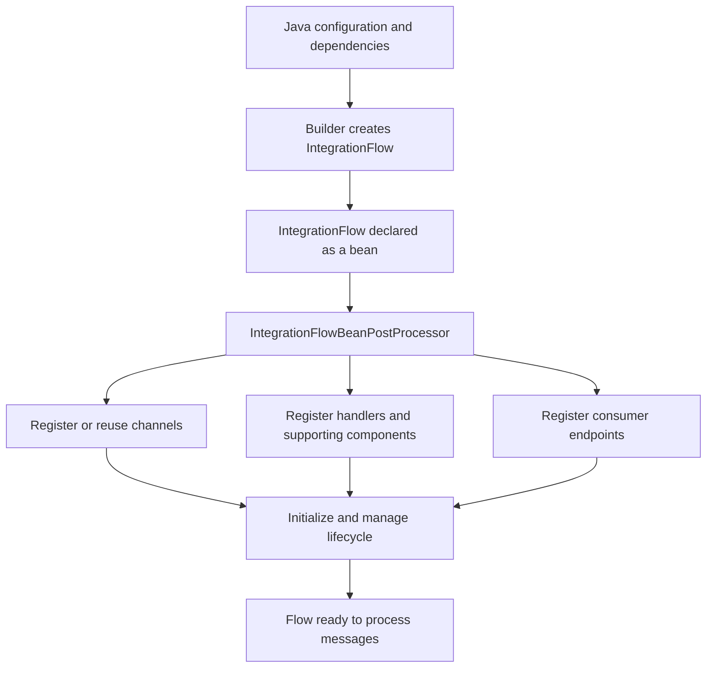

# DSL and Bean Registration

## 1. Objectives and Context

In the **Advanced DSL** chapter of the **SPRING_INTEGRATION_CORE** module, understanding how beans are registered helps you design flows with clear identities, share channels properly, and use Spring-managed services correctly. This knowledge also explains startup failures such as duplicate bean names, missing dependencies, or a channel existing without any subscriber.

Java DSL describes message flows with calls like `channel()`, `transform()`, `filter()`, `handle()`, and `aggregate()`. Behind that chain of calls lie real Spring Integration objects: `MessageChannel`s, handlers, and endpoints. They must be registered, initialized, and lifecycle-managed in the application context to process messages.

After this lesson, you will be able to:

- Distinguish constructing an `IntegrationFlow` from registering that flow in the Spring container.
- Explain the role of `IntegrationFlowBeanPostProcessor` in registering DSL components.
- Use bean names, endpoint IDs, and handler aliases properly.
- Share a channel across flows without accidentally creating two distinct objects with the same name.
- Declare an `IntegrationComponentSpec` as a `FactoryBean` and inject its produced object.
- Inspect registered beans, endpoint states, and actual flow outputs.

Examples use Java 17 and Spring Integration 6.x, taking the 6.5 API as the baseline. The project needs `spring-integration-core` and compatible Spring dependencies. Spring Boot projects can use `spring-boot-starter-integration` and let Boot's BOM manage versions. Complete examples use `AnnotationConfigApplicationContext` and `@EnableIntegration`, so they do not depend on running a Boot application. Illustrative tests use JUnit Jupiter.

## 2. Building a Flow and Registering a Flow Are Two Separate Phases

### 2.1. The Builder Collects Configuration

Consider a configuration snippet:

```java
IntegrationFlow flow = IntegrationFlow.from("textInput")
        .<String, String>transform(String::strip)
        .channel(MessageChannels.queue("textResults", 20))
        .get();
```

This snippet uses `org.springframework.integration.dsl.IntegrationFlow` and `MessageChannels`. It builds an object describing the flow and its related components. Calling `.get()` completes the builder; that call alone does not look up an application context to register the flow automatically.

For a flow to participate in an application, you normally return it from a `@Bean` method. When creating and destroying flows at runtime, use `IntegrationFlowContext` as shown in Section 11. A flow sitting only in a local variable lacks the initialization, subscriptions, and lifecycle management of a container-managed flow.

### 2.2. The Post-Processor Registers Components into the Container

`IntegrationFlowBeanPostProcessor` processes `IntegrationFlow` beans, discovers components, and registers them into the bean factory as needed. The DSL uses Spring Integration classes directly without generating an intermediate XML configuration. See [Java DSL mechanics](https://docs.spring.io/spring-integration/reference/dsl.html).



This is a conceptual model, not a guarantee that every bean is created in a strict fixed linear order. Dependency injection, `FactoryBean`s, and lifecycle rules can make initialization involve multiple interdependent steps.

### 2.3. DSL Calls Are Not Per-Message Processing Calls

Configuration lambdas like `endpoint -> endpoint.id("normalizeOrder")` run to set up the endpoint. Logic like `String::strip` is invoked by the endpoint when processing payloads.

Likewise, an `IntegrationFlow` instance is not a business method that takes a payload and walks the builder chain for each message. Wired channels and endpoints perform the runtime work. To send data, use the appropriate input channel or gateway.

## 3. Distinguishing the Registered Objects

A single DSL line can bring multiple objects with different roles into play:

| Component | Responsibility |
| --- | --- |
| `IntegrationFlow` bean | Holds configuration and component set of a flow; supports flow lifecycle control |
| `MessageChannel` | Connects producers to consumers according to the channel type's semantics |
| `MessageHandler` | Executes transformation, routing, or message-handling logic |
| Consumer endpoint | Connects handler to channel, manages subscription or polling and lifecycle |
| Business service | Contains domain logic called by handlers or transformers |
| DSL spec | Builder configuring a component; many specs act as `FactoryBean`s |

For example, `transform()` can create a `MessageTransformingHandler` and a `ConsumerEndpointFactoryBean`. With a `SubscribableChannel` input, the factory creates an event-driven endpoint; with a `PollableChannel`, the endpoint is usually a polling consumer and requires a matching poller configuration. See [`ConsumerEndpointFactoryBean` API](https://docs.spring.io/spring-integration/docs/6.5.0/api/org/springframework/integration/config/ConsumerEndpointFactoryBean.html).

This explains why the following actions differ:

- Calling the service directly to unit-test normalization logic.
- Sending a message through a channel to test the whole flow.
- Stopping an endpoint to halt message consumption at one point.
- Looking up a handler to inspect the processing component behind an endpoint.

Do not use a service's bean name in place of an endpoint ID, or retrieve a flow bean and cast it to `MessageHandler`.

## 4. Complete Example: Flow Using Managed Channels and Services

The application accepts order-code normalization commands. The service uses a `NormalizationRules` configuration bean and produces a result containing the normalized code and source system code. The output queue is declared via a DSL spec to illustrate the `FactoryBean` mechanism.

```java
import java.util.Locale;
import java.util.Objects;

import org.springframework.beans.factory.annotation.Qualifier;
import org.springframework.context.annotation.Bean;
import org.springframework.context.annotation.Configuration;
import org.springframework.integration.channel.DirectChannel;
import org.springframework.integration.channel.QueueChannel;
import org.springframework.integration.config.EnableIntegration;
import org.springframework.integration.dsl.IntegrationFlow;
import org.springframework.integration.dsl.MessageChannels;
import org.springframework.integration.dsl.QueueChannelSpec;

@Configuration(proxyBeanMethods = false)
@EnableIntegration
public class BeanRegistrationConfig {

    public record OrderCommand(String orderId) {
    }

    public record NormalizedOrder(String orderId, String sourceSystem) {
    }

    public record NormalizationRules(String sourceSystem) {
    }

    public static class OrderNormalizer {

        private final NormalizationRules rules;

        public OrderNormalizer(NormalizationRules rules) {
            this.rules = Objects.requireNonNull(rules);
        }

        public NormalizedOrder normalize(OrderCommand command) {
            if (command.orderId() == null || command.orderId().isBlank()) {
                throw new IllegalArgumentException("orderId must not be blank");
            }
            return new NormalizedOrder(
                    command.orderId().strip().toUpperCase(Locale.ROOT),
                    rules.sourceSystem());
        }
    }

    @Bean
    public NormalizationRules normalizationRules() {
        return new NormalizationRules("ORDER-SERVICE");
    }

    @Bean
    public OrderNormalizer orderNormalizer(NormalizationRules rules) {
        return new OrderNormalizer(rules);
    }

    @Bean
    public DirectChannel orderRequests() {
        return new DirectChannel();
    }

    @Bean
    public QueueChannelSpec normalizedOrders() {
        return MessageChannels.queue(100);
    }

    @Bean
    public IntegrationFlow orderFlow(
            @Qualifier("orderRequests") DirectChannel input,
            @Qualifier("normalizedOrders") QueueChannel output,
            OrderNormalizer normalizer) {

        return IntegrationFlow.from(input)
                .transform(normalizer, "normalize",
                        endpoint -> endpoint.id("normalizeOrder"))
                .channel(output)
                .get();
    }
}
```

Here:

- `orderFlow` is the flow's bean name, derived by default from the `@Bean` method name.
- `orderRequests` is an explicitly declared `DirectChannel`.
- `normalizedOrders` is the name the application uses to retrieve the `QueueChannel` produced by the spec.
- `orderNormalizer` is the service injected into the flow; the service receives rules via constructor injection.
- `normalizeOrder` is the ID of the consumer endpoint configured inside `transform()`.

With payload `new OrderCommand(" od-013 ")`, the expected output is `new NormalizedOrder("OD-013", "ORDER-SERVICE")`.

The queue has capacity 100 for lessons and tests. Real applications need a consumer or matching receive mechanism, plus send policies when the queue can fill up.

### 4.1. What Happens When Creating the Application Context?

Spring resolves dependencies of `@Bean` methods, creates the required services and channels, and then processes the flow to register handlers and endpoints. Once the context starts normally under default settings, the endpoint subscribes to the input channel to receive messages.

Having the container create `orderNormalizer` ensures the flow uses the service's managed dependencies. Injecting `orderRequests` ensures producer and endpoint share the exact same channel instance, rather than two similarly configured distinct objects.

## 5. Flow, Channel, Endpoint, and Handler Names

### 5.1. `id` Depends on Configuration Context

The word `id` appears on many specs, but what gets named depends on the spec type:

```java
MessageChannels.direct("orderRequests")
```

This sets the ID of the channel being built.

```java
.transform(normalizer, "normalize",
        endpoint -> endpoint.id("normalizeOrder"))
```

Here the callback configures the consumer endpoint. The ID does not rename the `orderNormalizer` service or the input channel.

In the standard configuration of this example, Spring Integration registers an alias `normalizeOrder.handler` to look up the associated handler. The handler itself may have an auto-generated bean name, and this convenient alias points to it. Endpoint and alias registration is shown in [the `IntegrationFlowBeanPostProcessor` 6.5 source code](https://github.com/spring-projects/spring-integration/blob/v6.5.0/spring-integration-core/src/main/java/org/springframework/integration/dsl/context/IntegrationFlowBeanPostProcessor.java).

### 5.2. Useful Lookup Names in the Example

| Lookup Name | Object or Role |
| --- | --- |
| `orderFlow` | Flow bean |
| `orderRequests` | Input channel |
| `normalizedOrders` | Output queue, i.e. the product of the spec `FactoryBean` |
| `orderNormalizer` | Business service |
| `normalizeOrder` | Consumer endpoint, product of the endpoint factory |
| `normalizeOrder.handler` | Alias to the endpoint's handler in this configuration |

An alias does not create a second handler. When inventorying beans during troubleshooting, distinguish multiple names pointing to one object from genuinely separate objects.

### 5.3. Auto-Generated Names Are Structural Details

The DSL can create `DirectChannel` instances between endpoints when you do not declare an explicit channel. Unnamed channels typically follow the pattern:

```text
<flowBeanName>.channel#<index>
```

Adding or splitting an endpoint can shift those indices. Auto-generated names are useful when reading logs or diagnosing the context, but unsuitable as stable addresses for producers or long-lived tests. Give explicit names to flow boundaries meant for external use.

## 6. Four Ways to Introduce a Channel into a Flow

| Syntax | Behavior to Understand |
| --- | --- |
| `.channel("someChannel")` | References a channel by name; if no bean exists, the DSL can create a `DirectChannel` with that name |
| `.channel(existingChannel)` | Uses the provided channel object, typically an injected bean |
| `.channel(MessageChannels.queue("results", 20))` | Declares a new inline channel via spec |
| `@Bean` returning `MessageChannel` or a channel spec | Declares a shared point with explicit dependencies and identity |

`IntegrationFlow.from("someInput")` can also create the input channel if that name does not already exist. See [configuring MessageChannel in Java DSL](https://docs.spring.io/spring-integration/reference/dsl/java-channels.html).

### 6.1. Referencing by Name Does Not Prove the Channel Already Existed

Suppose a flow writes:

```java
.channel("sharedQeue")
```

If the intended name was `sharedQueue`, a typo can quietly create a new channel instead of failing immediately for a missing bean at the reference site. A context starting cleanly does not prove the topology is right. The newly created channel may also lack consumers or have different semantics from the intended channel type.

For important boundaries, declaring an explicit bean and injecting it with `@Qualifier` lets Spring validate names and dependency types when building flows.

### 6.2. Same ID String Does Not Turn Two Builders into One Channel

Here is a misconfiguration example illustrating two inline objects colliding on the same name:

```java
@Bean
public IntegrationFlow badProducer() {
    return IntegrationFlow.from("rawInput")
            .<String, String>transform(String::strip)
            .channel(MessageChannels.direct("sharedOrders"))
            .get();
}

@Bean
public IntegrationFlow badConsumer() {
    return IntegrationFlow.from(MessageChannels.direct("sharedOrders"))
            .handle(message -> {
                System.out.println(message.getPayload());
            })
            .get();
}
```

Each call to `MessageChannels.direct("sharedOrders")` constructs a new spec and channel. These are not two ways of fetching a singleton by name. Registration can fail because two distinct objects claim the same bean name.

Fix this by declaring one channel definition and injecting that same bean into both flows. The beans below belong to a standalone configuration with `@Configuration` and `@EnableIntegration`:

```java
@Bean
public DirectChannel sharedOrders() {
    return new DirectChannel();
}

@Bean
public IntegrationFlow producerFlow(
        @Qualifier("sharedOrders") DirectChannel shared) {

    return IntegrationFlow.from("rawInput")
            .<String, String>transform(String::strip)
            .channel(shared)
            .get();
}

@Bean
public IntegrationFlow consumerFlow(
        @Qualifier("sharedOrders") DirectChannel shared) {

    return IntegrationFlow.from(shared)
            .<String, String>transform(value ->
                    value.toUpperCase(Locale.ROOT))
            .channel(MessageChannels.queue("handoffResults", 20))
            .get();
}
```

Required imports already appear in the complete example. Both flows share one managed channel. Channel type still dictates dispatch semantics: attaching multiple consumers to a `DirectChannel` does not turn it into a broadcast. If every subscriber must receive every message, choose a channel with publish–subscribe semantics.

## 7. `IntegrationComponentSpec` Is a `FactoryBean`

### 7.1. Keep the Spec in the Bean Definition, Inject the Product into the Flow

In the complete example:

```java
@Bean
public QueueChannelSpec normalizedOrders() {
    return MessageChannels.queue(100);
}
```

The spec is both a builder and a `FactoryBean`. The container manages the spec and supplies its `QueueChannel` product wherever a channel is requested. Thus, the flow signature is:

```java
@Bean
public IntegrationFlow orderFlow(
        @Qualifier("orderRequests") DirectChannel input,
        @Qualifier("normalizedOrders") QueueChannel output,
        OrderNormalizer normalizer) {
    // Wire beans resolved by the container.
    return IntegrationFlow.from(input)
            .transform(normalizer, "normalize",
                    endpoint -> endpoint.id("normalizeOrder"))
            .channel(output)
            .get();
}
```

You do not need to cast the spec to a channel or call `getObject()` manually to retrieve the product. The API expects the framework to manage the spec's lifecycle when used as a bean definition. See [`IntegrationComponentSpec` API](https://docs.spring.io/spring-integration/docs/6.5.0/api/org/springframework/integration/dsl/IntegrationComponentSpec.html).

### 7.2. Avoid Unwrapping the Product Manually in Configuration

The following is not a recommended bean declaration style:

```java
@Bean
public QueueChannel manuallyUnwrappedChannel() {
    return MessageChannels.queue(100).getObject();
}
```

It pulls the product out of the spec prematurely inside configuration instead of letting the spec participate in the intended container lifecycle. Complex specs also carry supporting components requiring registration and lifecycle hooks. Either return the spec as-is, or instantiate `new QueueChannel(100)` directly when only a plain channel is needed.

### 7.3. Looking Up Products and Factories When Diagnosing

Per Spring's `FactoryBean` convention, the plain name returns the product while the `&` prefix retrieves the factory:

```java
QueueChannel queue = context.getBean(
        "normalizedOrders", QueueChannel.class);

QueueChannelSpec factory = context.getBean(
        "&normalizedOrders", QueueChannelSpec.class);
```

Similarly, `normalizeOrder` yields the endpoint, while `&normalizeOrder` lets you inspect the underlying `ConsumerEndpointFactoryBean`. This is a diagnostic technique, not a reason for business flows to depend directly on factories. See [container extension points and `FactoryBean`](https://docs.spring.io/spring-framework/reference/core/beans/factory-extension.html).

## 8. `@Configuration`, Dependency Injection, and Object Identity

### 8.1. What Changes with `proxyBeanMethods = false`

In the complete configuration, `@Bean` methods receive dependencies via parameters. That works cleanly with:

```java
@Configuration(proxyBeanMethods = false)
```

In this mode, a direct Java call to another method in the same class is not proxied to fetch the container singleton. The following example risks using a different channel instance from the registered bean:

```java
@Bean
public DirectChannel commands() {
    return new DirectChannel();
}

@Bean
public IntegrationFlow wrongFlow() {
    return IntegrationFlow.from(commands())
            .handle(message -> {
                System.out.println(message.getPayload());
            })
            .get();
}
```

In a class with `proxyBeanMethods = false`, `commands()` here is a plain Java method call and creates a second instance. Instead, inject `@Qualifier("commands") DirectChannel commands` as a parameter of `wrongFlow()` and use that parameter.

With full proxied `@Configuration`, inter-`@Bean` calls are usually intercepted by the container. Even so, parameter injection keeps configuration independent of internal method-call proxying. In particular, DSL specs declared as beans should be consumed via their injected product, as guided in Section 7. See [Spring's full configuration vs. lite mode](https://docs.spring.io/spring-framework/reference/core/beans/java/basic-concepts.html).

### 8.2. A Helper Returning a Flow Does Not Register a Bean on Its Own

You can extract flow-building logic into a helper for reuse, but a helper without `@Bean` and without `IntegrationFlowContext` registration only returns a Java object. The caller is responsible for registering the result into the container.

Conversely, if the same helper sets fixed component IDs and is called to register multiple flows, those IDs can still collide in the same context. Renaming Java variables or helper methods does not create separate namespaces for inner endpoints.

### 8.3. Avoid Reverse Dependencies on Inline Beans Not Yet Created by the Flow

Inline beans are discovered while processing the flow. If a flow-creating method itself asks to inject an internal channel that is only created inline by that very flow, dependencies can form an initialization cycle.

Rather than masking unclear relationships with `@DependsOn`, promote the shared channel to an explicit `@Bean`. Dependency direction then cleanly flows from channel to flow, matching how configuration is built.

## 9. Services, Proxies, and Scope Inside a Flow

### 9.1. Use Container Services When Dependencies and Advice Are Needed

The following configuration uses an injected service:

```java
.transform(normalizer, "normalize")
```

Or you can invoke that service via a method reference:

```java
.<OrderCommand, NormalizedOrder>transform(normalizer::normalize)
```

In both cases, `normalizer` must be the container-provided reference as in the complete example. If the service is AOP-proxied, invoking through the proxy reference enables advice to apply per your AOP configuration.

Never assume that objects instantiated with `new` inside a lambda automatically become Spring service beans. The DSL registers the integration components it recognizes, but it does not replace dependency management for arbitrary business objects captured by lambdas.

If you need `@Transactional`, caching, or other advice on a service, register and inject the service properly. Bean registration provides container management eligibility; it does not automatically create a transaction manager, enable all annotation processors, or bypass AOP proxy limitations like self-invocation.

### 9.2. Reusing a Service vs. Reusing a Handler

A stateless normalization service can be called by multiple flows. Each flow can create its own endpoint and handler while sharing that service.

By contrast, a handler can hold an `outputChannel` setting or position-specific properties in a flow. Sharing a single handler instance across multiple spots with different output paths may be invalid. Therefore, share business logic via services; only share a handler when you have verified its API and configuration support that usage.

### 9.3. Singleton Does Not Mean Safe Under Concurrent Access

Beans default to singleton scope in the container. If multiple senders or executors invoke an endpoint concurrently, a singleton service can receive concurrent calls. Never store the current payload in an instance field of a service to pass state between steps.

`OrderNormalizer` in the example holds only immutable rules and uses local variables during processing, so it needs no per-order fields. When state across a group of messages is needed, choose components like aggregators and message stores with explicit correlation rules.

### 9.4. A Prototype Injected into a Singleton Is Not Re-Created per Message

If a prototype dependency is injected when a singleton flow is constructed, the flow holds onto that single instance assigned at startup. Declaring a bean as prototype does not automatically give every message a fresh instance.

When you genuinely need a new object per invocation, fetch instances dynamically at runtime or redesign state handling. Also note that prototype destruction lifecycles have special rules, so never use prototype scope merely to dodge bean-name collisions. See [bean scopes and prototype dependencies in singletons](https://docs.spring.io/spring-framework/reference/core/beans/factory-scopes.html).

## 10. Bean Registration vs. Endpoint Startup

A bean can already exist while its endpoint is not running yet. For example:

```java
.transform(normalizer, "normalize", endpoint -> endpoint
        .id("normalizeOrder")
        .autoStartup(false))
```

The endpoint is created in the context without starting automatically. You can retrieve and start it when the application is ready:

```java
AbstractEndpoint endpoint = context.getBean(
        "normalizeOrder", AbstractEndpoint.class);

endpoint.start();
```

This snippet uses `org.springframework.integration.endpoint.AbstractEndpoint`. It illustrates an alternative configuration; the complete configuration in Section 4 uses default auto-startup.

Each operation has a distinct effect:

| Operation | Effect to Understand |
| --- | --- |
| Declare bean | Places the definition and object under container management |
| `start()` endpoint | Starts subscription or polling according to endpoint type |
| `stop()` endpoint or flow | Stops active processing; does not remove the bean |
| Destroy dynamic registration | Removes the dynamic flow and dependent beans managed by that registration |
| Close application context | Runs shutdown and destruction across managed beans |

With a `DirectChannel`, sending a message when no active subscriber remains can cause a delivery error. With a queue, messages may enter the queue without any running consumer to process them. Thus, `containsBean(...)` returning `true` does not prove a flow is operationally ready.

A managed `IntegrationFlow` can also coordinate lifecycle control across the components in that flow. When shared channels or resources are involved, check control boundaries before stopping a flow so you do not assume shared resources belong exclusively to that flow.

## 11. Dynamic Flow Registration with `IntegrationFlowContext`

### 11.1. When Configuration Must Appear at Runtime

If an application needs to create a flow per tenant configuration or a connection added after startup, use `IntegrationFlowContext`. This API registers a flow along with its components and returns a handle to manage lifecycle. See [Dynamic and Runtime Integration Flows](https://docs.spring.io/spring-integration/reference/dsl/java-runtime-flows.html).

The snippet below assumes `context` is an application context with `@EnableIntegration`. Additional imports are `IntegrationFlowContext`, `Message`, `GenericMessage`, and `MessageChannel` from the packages used in the test section:

```java
IntegrationFlowContext flowContext =
        context.getBean(IntegrationFlowContext.class);

QueueChannel tenantResults = new QueueChannel(20);

IntegrationFlow tenantFlow = IntegrationFlow.from(new DirectChannel())
        .<String, String>transform(
                value -> value.strip().toUpperCase(Locale.ROOT),
                endpoint -> endpoint.id("normalize"))
        .channel(tenantResults)
        .get();

var registration = flowContext.registration(tenantFlow)
        .id("tenantAFlow")
        .useFlowIdAsPrefix()
        .register();

try {
    registration.getInputChannel().send(
            new GenericMessage<>(" od-099 "));
    Message<?> result = tenantResults.receive(1000);
    if (result == null) {
        throw new IllegalStateException("Did not receive result for tenant A");
    }
    System.out.println(result.getPayload());
}
finally {
    registration.destroy();
}
```

Expected output is `OD-099`. The example registers, sends, and destroys within one block to demonstrate the complete lifecycle. In applications with long-lived dynamic flows, a manager component retains the registration until it is actually time to stop and remove the flow.

`new DirectChannel()` and `tenantResults` here are integration components passed directly into the flow for the registration API to manage. This differs from arbitrary business objects instantiated inside a message-handling lambda.

### 11.2. Flow ID and Prefix Have Specific Purposes

`id("tenantAFlow")` identifies the registration and must be unique within the context. `useFlowIdAsPrefix()` avoids component ID collisions when registering multiple copies of the same flow template. For the `normalize` endpoint in the example, the prefixed endpoint name becomes `tenantAFlow.normalize` and its handler alias becomes `tenantAFlow.normalize.handler`.

A flow ID is required when using `useFlowIdAsPrefix()`. Do not assume prefixing renames pre-existing beans or isolates channels referenced by name. If two flows deliberately inject the same external channel or service, they still share that resource.

### 11.3. Keep Resource Ownership Clear

A registration provides `start()`, `stop()`, and `destroy()`. `stop()` keeps the registration intact so it can be restarted later; `destroy()` removes the registration and dependent beans managed on its behalf. See [`IntegrationFlowRegistration` API](https://docs.spring.io/spring-integration/docs/6.5.0/api/org/springframework/integration/dsl/context/IntegrationFlowContext.IntegrationFlowRegistration.html).

The builder also offers `addBean(...)` to register supporting beans as dependencies of the dynamic flow. Only register objects whose lifecycle the registration should genuinely own. Shared singleton services or connection factories used across multiple flows need independent ownership rather than being tied to one arbitrary dynamic flow.

The tenant example above creates dedicated input and output channels per registration. When a factory method builds multiple similar flows, either create separate components per instance or explicitly inject intentionally shared components.

## 12. Testing Bean Registration and Runtime Behavior

### 12.1. Verifying Endpoints, Handlers, and Factory Products

The test below uses the complete configuration from Section 4:

```java
import org.junit.jupiter.api.Test;
import org.springframework.context.annotation.AnnotationConfigApplicationContext;
import org.springframework.integration.channel.QueueChannel;
import org.springframework.integration.config.ConsumerEndpointFactoryBean;
import org.springframework.integration.dsl.IntegrationFlow;
import org.springframework.integration.dsl.QueueChannelSpec;
import org.springframework.integration.endpoint.AbstractEndpoint;
import org.springframework.messaging.Message;
import org.springframework.messaging.MessageChannel;
import org.springframework.messaging.MessageHandler;
import org.springframework.messaging.support.MessageBuilder;

import static org.junit.jupiter.api.Assertions.*;

class BeanRegistrationTest {

    @Test
    void registersComponentsAndProcessesAnOrder() {
        try (var context = new AnnotationConfigApplicationContext(
                BeanRegistrationConfig.class)) {

            assertNotNull(context.getBean("orderFlow", IntegrationFlow.class));

            MessageChannel input =
                    context.getBean("orderRequests", MessageChannel.class);
            QueueChannel output =
                    context.getBean("normalizedOrders", QueueChannel.class);

            assertNotNull(context.getBean(
                    "&normalizedOrders", QueueChannelSpec.class));

            AbstractEndpoint endpoint = context.getBean(
                    "normalizeOrder", AbstractEndpoint.class);
            assertTrue(endpoint.isRunning());

            MessageHandler handler = context.getBean(
                    "normalizeOrder.handler", MessageHandler.class);
            ConsumerEndpointFactoryBean endpointFactory = context.getBean(
                    "&normalizeOrder", ConsumerEndpointFactoryBean.class);
            assertSame(handler, endpointFactory.getHandler());

            Message<?> request = MessageBuilder.withPayload(
                            new BeanRegistrationConfig.OrderCommand(" od-013 "))
                    .setHeader("requestId", "req-013")
                    .build();

            assertTrue(input.send(request));

            Message<?> result = output.receive(1000);
            assertNotNull(result);
            assertEquals(
                    new BeanRegistrationConfig.NormalizedOrder(
                            "OD-013", "ORDER-SERVICE"),
                    result.getPayload());
            assertEquals("req-013", result.getHeaders().get("requestId"));
            assertNull(output.receive(0));
        }
    }
}
```

Checking the output proves the endpoint was wired to the channels and the service used the expected rules. Checking only that bean names exist would miss cases where an endpoint never started or the topology failed to route results to the right output.

In this synchronous example, a successful send puts the result into the queue within the send call. `receive(1000)` still uses a bounded timeout so the test never hangs if misconfigured.

### 12.2. Testing Dynamic Flow Removal

You can add the following method to the test class. Add imports for `Locale`, `DirectChannel`, `IntegrationFlowContext`, and `GenericMessage`:

```java
@Test
void removesDynamicFlowAndKeepsTheStaticFlow() {
    try (var context = new AnnotationConfigApplicationContext(
            BeanRegistrationConfig.class)) {

        IntegrationFlowContext flowContext =
                context.getBean(IntegrationFlowContext.class);
        QueueChannel output = new QueueChannel(10);

        IntegrationFlow dynamicFlow = IntegrationFlow.from(new DirectChannel())
                .<String, String>transform(
                        value -> value.strip().toUpperCase(Locale.ROOT),
                        endpoint -> endpoint.id("normalize"))
                .channel(output)
                .get();

        var registration = flowContext.registration(dynamicFlow)
                .id("tenantAFlow")
                .useFlowIdAsPrefix()
                .register();

        try {
            assertTrue(context.containsBean("tenantAFlow.normalize"));
            assertTrue(registration.getInputChannel().send(
                    new GenericMessage<>(" od-099 ")));

            Message<?> result = output.receive(1000);
            assertNotNull(result);
            assertEquals("OD-099", result.getPayload());
        }
        finally {
            registration.destroy();
        }

        assertFalse(context.containsBean("tenantAFlow"));
        assertFalse(context.containsBean("tenantAFlow.normalize"));
        assertTrue(context.containsBean("orderFlow"));
        assertTrue(context.getBean(
                "normalizeOrder", AbstractEndpoint.class).isRunning());
    }
}
```

The test verifies that the dynamic flow works before removal and that destroying it leaves the independent static flow intact. When shared resources exist, add assertions tailored to those resources' ownership.

### 12.3. Additional Valuable Checks

| Scenario | What to Confirm |
| --- | --- |
| Two flows sharing a channel | Both use the same bean and messages cross the right boundary |
| Two inline specs given the same ID | Conflicting configuration is caught at context startup |
| Endpoint with `autoStartup(false)` | Bean exists yet is idle; processes only after starting |
| Injecting a spec's product | Dependency has the concrete channel type and expected capacity |
| Two registrations with the same structure | Component IDs do not collide when prefixed properly |
| Destroying one registration | Private components are removed; shared resources retain lifecycle |

Avoid asserting exact auto-generated bean names or total context bean counts. Adding an endpoint or upgrading versions can change internal bean structure without breaking the flow contract.

## 13. Troubleshooting and Design Rules

| Symptom | Where to Check |
| --- | --- |
| Duplicate bean name on startup | Find multiple definitions or inline instances claiming the same bean name |
| Cannot inject `QueueChannel` | Check return type, bean name, qualifier, and proper spec declaration |
| Channel exists, yet no messages arrive | Check whether producer holds the right instance, endpoint is running, and subscription exists |
| Flow missing from context | Check if the object was only built locally or actually registered as a bean |
| Missing poller after switching channels | Check consumers switched to `PollableChannel` input and polling config |
| AOP on service does not trigger | Check which bean/proxy the flow uses, invocation path, and AOP setup |
| Second runtime registration fails | Check flow ID, hardcoded endpoint IDs, and prefix scope |
| Dependency cycle at startup | Look for reverse dependencies from a flow method onto inline components created by that same flow |

When a component is needed in multiple places, prefer declaring a named bean and injecting it. When a component is purely internal to one flow, declare it inline and let the DSL register it. For business services, clarify dependencies and scope before reaching for shorter lambdas.

Bean names define identity in the context; channel types govern message delivery; endpoint lifecycles determine when consumers run. Check all three together when designing or investigating a flow.

## 14. Extended Practice Exercises

1. Run the complete configuration and inspect the roles of `orderFlow`, `orderRequests`, `normalizeOrder`, `normalizeOrder.handler`, and `normalizedOrders`. Use the `&` prefix to distinguish factories from products during inspection.
2. Split producer and consumer into two flows sharing an explicitly declared `DirectChannel`. Send a message from the producer and verify the result in the consumer's queue.
3. In a standalone test configuration, create two inline channels with the same ID to observe the registration failure. Fix it with one shared bean definition.
4. Change the normalization endpoint to `autoStartup(false)`. Verify its state before and after calling `start()`, distinguishing bean existence from an active consumer.
5. Register two dynamic flows whose local endpoints are both named `normalize`, giving them distinct flow IDs and enabling prefixing. Destroy one registration and confirm the remaining flow still processes messages.

In each exercise, identify clearly which objects are container-owned, which components are shared, and which names serve as stable boundaries. Those decisions keep DSL configurations true to the intended topology as flows grow with transformers, routers, aggregators, or gateways.
