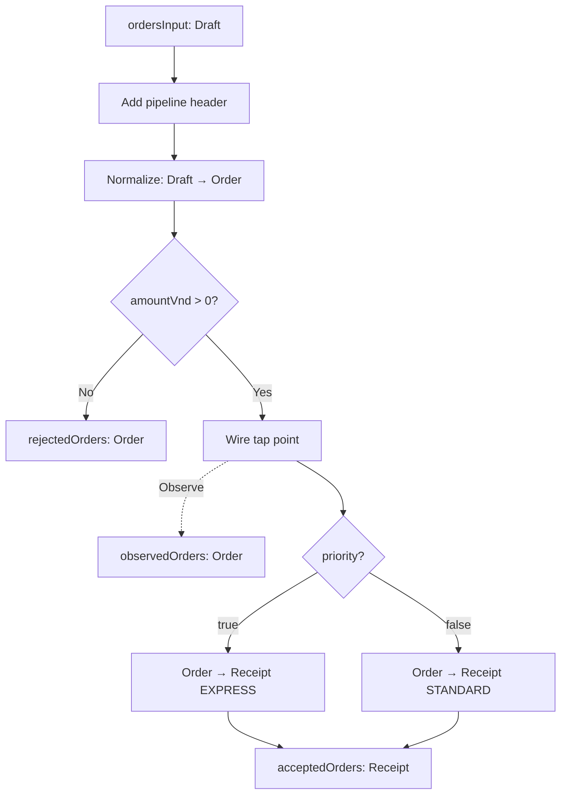

# Reading a DSL Flow as a Pipeline

## 1. Objectives and Scope

In the **Advanced DSL** chapter of the **SPRING_INTEGRATION_CORE** module, reading a flow must go beyond recognizing individual method names. You need to trace where a message enters, what data type it carries, which conditions it crosses, which branch it takes, and whether it ends in a result or an error.

This lesson uses an order-intake pipeline to tie together core concepts: `Message`, headers, channels, endpoints, transformers, filters, routers, and wire taps. It then extends that reading technique to gateways, splitters, aggregators, and asynchronous boundaries.

After this lesson, you will be able to:

- Translate a DSL chain into a diagram of processing steps and branches.
- Track payload types and key headers at every point.
- Distinguish the main processing path, observation branches, discard branches, and error paths.
- Spot points where message counts change or state is retained.
- Identify thread boundaries and where callers observe errors.
- Write tests covering the paths deduced from configuration.

Examples take **Java 17 and Spring Integration 6.5.0** as the API baseline. When applying to a project using Spring Boot or a BOM, maintain the compatible Spring version set managed by your project.

## 2. Two-Phase Reading: Declaring Structure vs. Processing Messages

Look at this DSL snippet:

```java
IntegrationFlow.from("input")
        .transform(String.class, String::trim)
        .filter(String.class, text -> !text.isEmpty())
        .channel("output")
        .get();
```

When Spring runs the configuration method, this code describes components and wiring relationships. It does not grab a concrete string and call `trim` right while constructing beans.

Once a message is sent to `input`, the registered endpoints execute processing according to that structure. Java DSL creates channel, handler, and endpoint beans inside the application context. [Java DSL Documentation](https://docs.spring.io/spring-integration/reference/6.5/dsl.html).

Therefore:

- `from(...)` identifies the entry point of the flow structure.
- EIP operators describe the processing components.
- `get()` finishes building the flow configuration object.
- `get()` at the end of the DSL is not an operation waiting for a business result.

### 2.1. Why Call It a Pipeline?

For a straight segment, the natural reading is:

```text
Input → Normalize → Validate → Process → Output
```

Real flows, however, can branch, broadcast to multiple subscribers, split one message into many parts, or aggregate many parts into one result. Whenever you hit those points, expand the pipeline sketch into a graph.

The purpose of the pipeline mental model is tracing handoffs. It does not imply every step runs on the same thread, every input always produces one output, or all processing sits inside a single transaction.

### 2.2. Five Questions for Every Step

| Question | What to Record |
| --- | --- |
| What does it receive? | Payload type and headers used |
| What does it do? | Transform, validate, route, call a service, or hold state |
| What does it emit? | New payload type and message count |
| Where does it go? | Next step, channel, discard branch, or reply |
| How does it run? | Synchronous, poller, executor, timeouts, and error path |

You do not need to write down every attribute upfront. Start with the data path, then layer on conditions that alter paths and execution boundaries.

## 3. Vocabulary for Reading the DSL

Endpoints are typically expressed as verbs in the DSL. [DSL Basics Documentation](https://docs.spring.io/spring-integration/reference/6.5/dsl/java-basics.html).

| DSL Element | How to Read While Tracing a Message |
| --- | --- |
| `from(...)` | Messages enter from this input |
| `enrichHeaders(...)` | Adds or updates metadata per configuration |
| `transform(...)` | Produces a data representation for the next step |
| `filter(...)` | Allows continuation or sends along the discard path |
| `handle(...)` | Invokes processing behavior; inspect the reply contract |
| `route(...)` | Picks one or more destinations per router rules |
| `channel(...)` | Transfers across the specified channel |
| `wireTap(...)` | Sends the message at the observation point to a side branch |
| `publishSubscribeChannel(...)` | Broadcasts to registered subscribers |
| `split(...)` | Produces multiple messages from one input |
| `aggregate(...)` | Retains related messages until a group result can be emitted |
| `gateway(...)` | Sends a request to another flow and continues with the reply per contract |
| `get()` | Ends configuration assembly |

### 3.1. Does the Lambda Receive the Payload or the Whole `Message`?

Never guess from a parameter name like `message` or `m`. For many overloads, the lambda receives the payload.

```java
.transform(String.class, text -> text.trim())
```

This lambda receives a `String`. If both payload and headers are needed, choose a matching overload. For example, when calling a handler:

```java
.handle(
        Order.class,
        (order, headers) -> new Receipt(
                order.id(),
                String.valueOf(headers.get("lane"))))
```

You can use an overload accepting `Message.class` when access to the full message is needed inside a transformer:

```java
.transform(
        org.springframework.messaging.Message.class,
        message -> message.getPayload().toString())
```

Lambda parameter types, generic type arguments, and DSL overloads must be read together. A parameter named `m` does not prove the object has `getHeaders()`.

### 3.2. Endpoint Callbacks Describe How the Current Step Runs

```java
.handle(
        Order.class,
        (order, headers) -> new Receipt(order.id(), "STANDARD"),
        endpoint -> endpoint
                .id("createReceipt")
                .requiresReply(true))
```

The first lambda describes data processing. The `endpoint -> ...` callback configures the corresponding component. Properties such as poller, lifecycle, advice, or timeouts can change how a step behaves even though the data path looks identical on screen.

## 4. Complete Example: Order-Intake Pipeline

The illustrative pipeline has these requirements:

1. Accept an order draft.
2. Normalize the order ID by stripping whitespace and uppercasing.
3. Route orders with non-positive amounts to a separate queue.
4. Observe valid orders after normalization.
5. Produce a result along either the express or standard branch.
6. Send results to a queue for the program to read directly.

Diagram:



### 4.1. Dependencies and Configuration

In a Maven project without a BOM, the core dependency is:

```xml
<dependency>
    <groupId>org.springframework.integration</groupId>
    <artifactId>spring-integration-core</artifactId>
    <version>6.5.0</version>
</dependency>
```

Set the Java compilation level to 17 or higher. If your project manages versions with a BOM, use your project's compatible version.

Illustrative file `PipelineReadingDemo.java`:

```java
package example.integration;

import java.util.Locale;

import org.springframework.beans.factory.annotation.Qualifier;
import org.springframework.context.annotation.AnnotationConfigApplicationContext;
import org.springframework.context.annotation.Bean;
import org.springframework.context.annotation.Configuration;
import org.springframework.integration.channel.DirectChannel;
import org.springframework.integration.channel.QueueChannel;
import org.springframework.integration.config.EnableIntegration;
import org.springframework.integration.dsl.IntegrationFlow;
import org.springframework.messaging.Message;
import org.springframework.messaging.support.MessageBuilder;

@Configuration
@EnableIntegration
public class PipelineReadingDemo {

    public record Draft(String id, long amountVnd, boolean priority) {
    }

    public record Order(String id, long amountVnd, boolean priority) {
    }

    public record Receipt(String orderId, String lane) {
    }

    @Bean
    public DirectChannel ordersInput() {
        return new DirectChannel();
    }

    @Bean
    public QueueChannel acceptedOrders() {
        return new QueueChannel(32);
    }

    @Bean
    public QueueChannel rejectedOrders() {
        return new QueueChannel(32);
    }

    @Bean
    public QueueChannel observedOrders() {
        return new QueueChannel(32);
    }

    @Bean
    public IntegrationFlow orderIntakeFlow(
            @Qualifier("ordersInput") DirectChannel input,
            @Qualifier("acceptedOrders") QueueChannel accepted,
            @Qualifier("rejectedOrders") QueueChannel rejected,
            @Qualifier("observedOrders") QueueChannel observed) {

        return IntegrationFlow.from(input)
                // 1. Metadata travels with the message.
                .enrichHeaders(headers ->
                        headers.header("pipeline", "order-intake"))

                // 2. Payload changes from Draft to Order.
                .transform(
                        Draft.class,
                        PipelineReadingDemo::normalize,
                        endpoint -> endpoint.id("normalizeOrder"))

                // 3. Invalid orders leave the main processing path.
                .filter(
                        Order.class,
                        order -> order.amountVnd() > 0,
                        endpoint -> endpoint
                                .id("positiveAmountFilter")
                                .discardChannel(rejected))

                // 4. Observe Orders that passed the filter.
                .wireTap(observed, tap -> tap.timeout(0))

                // 5. Each branch produces the same Receipt result type.
                .<Order, Boolean>route(
                        Order::priority,
                        router -> router
                                .subFlowMapping(
                                        true,
                                        branch -> branch.transform(
                                                Order.class,
                                                order -> new Receipt(
                                                        order.id(), "EXPRESS")))
                                .subFlowMapping(
                                        false,
                                        branch -> branch.transform(
                                                Order.class,
                                                order -> new Receipt(
                                                        order.id(), "STANDARD"))))

                // 6. Branch result returns to the shared continuation path.
                .channel(accepted)
                .get();
    }

    private static Order normalize(Draft draft) {
        if (draft.id() == null || draft.id().isBlank()) {
            throw new IllegalArgumentException("Order ID must not be blank");
        }

        return new Order(
                draft.id().trim().toUpperCase(Locale.ROOT),
                draft.amountVnd(),
                draft.priority());
    }

    public static void main(String[] args) {
        try (var context = new AnnotationConfigApplicationContext(
                PipelineReadingDemo.class)) {

            DirectChannel input =
                    context.getBean("ordersInput", DirectChannel.class);
            QueueChannel accepted =
                    context.getBean("acceptedOrders", QueueChannel.class);
            QueueChannel observed =
                    context.getBean("observedOrders", QueueChannel.class);

            Message<Draft> request = MessageBuilder
                    .withPayload(new Draft(" ord-014 ", 1_250_000, true))
                    .setHeader("requestId", "REQ-014")
                    .build();

            if (!input.send(request, 1_000)) {
                throw new IllegalStateException("Could not send request");
            }

            Message<?> result = accepted.receive(1_000);
            Message<?> observation = observed.receive(1_000);

            if (result == null || observation == null) {
                throw new IllegalStateException("Missing result or observation");
            }

            System.out.println("Result: " + result.getPayload());
            System.out.println("Observed: " + observation.getPayload());
            System.out.println("Request: "
                    + result.getHeaders().get("requestId"));
            System.out.println("Pipeline: "
                    + result.getHeaders().get("pipeline"));
        }
    }
}
```

Expected output:

```text
Result: Receipt[orderId=ORD-014, lane=EXPRESS]
Observed: Order[id=ORD-014, amountVnd=1250000, priority=true]
Request: REQ-014
Pipeline: order-intake
```

The queues in the example have no automatic consumers. The program calls `receive(...)` itself to inspect data; therefore no pollers are needed for those terminal queues.

## 5. Tracing One Message from Start to Finish

### 5.1. Tabulating Data Types

For the priority request in the example:

| Observation Point | Payload | Notable Headers | What Happens Next |
| --- | --- | --- | --- |
| `ordersInput` | `Draft(" ord-014 ", 1250000, true)` | `requestId=REQ-014` | Enters flow |
| After header enrichment | Still `Draft` | Adds `pipeline=order-intake` | Normalized |
| After transformer | `Order("ORD-014", 1250000, true)` | Preserves required metadata | Amount checked |
| After filter | Still `Order` | Unchanged by validation | Reaches tap point |
| Observation queue | `Order` at tap point | Carries request metadata | Waits for reader |
| Router | Payload remains `Order` | `priority` read from payload | Picks `true` branch |
| After express branch | `Receipt("ORD-014", "EXPRESS")` | Request metadata travels along | Sent to result queue |

The router uses the boolean value as a routing key. That value does not become the payload sent to the branch. The branch's transformer still receives `Order`.

### 5.2. Tracing a Rejected Order

Sending:

```java
new Draft(" ord-bad ", 0, true)
```

The path is:

```text
Draft
  → enrich metadata
  → Order("ORD-BAD", 0, true)
  → filter rejects
  → rejectedOrders
```

The message never reaches the tap, router, or result queue. It was already normalized before rejection, so the payload inside `rejectedOrders` is `Order`.

A filter decides whether to continue on the main output; the discard channel is a dedicated path for rejected messages. [Filter Documentation](https://docs.spring.io/spring-integration/reference/6.5/filter.html).

This is why the order of filters and transformers matters. If you move the filter ahead of normalization, re-evaluate the input type and the shape of discarded messages.

### 5.3. Tracing a Normalization Error

Sending a `Draft` whose ID consists only of whitespace:

```text
Draft
  → enrich metadata
  → normalize throws
  → never reaches filter, tap, or router
```

In the example's synchronous configuration, the caller of `send(...)` can receive a messaging exception wrapping the business error.

Orders rejected by the filter and errors thrown inside the transformer are two distinct outcomes: one is a designed path for dropping data, while the other is an exception when an endpoint fails to complete.

## 6. Counting Messages at Structural Change Points

Alongside data types, track the number of messages passing through each operator.

| Operator | Common Count Pattern | What to Verify |
| --- | --- | --- |
| Normal reply-producing transformer | `1 → 1` | Output type and content |
| Filter | `1 → 0 or 1` on main path | Discard path |
| Router in boolean example | `1 → 1` to one selected branch | Key has a valid mapping |
| Wire tap | Main flow continues, adds side send | Side-branch send policy |
| Publish-subscribe | `1 → N` deliveries to subscribers | Which subscribers actually receive |
| Splitter | `1 → N` | `N=0` is possible |
| Aggregator | `N → 1` when released | Correlation, release, and group state |
| Handler returning `null` | Can be `1 → 0` | `requiresReply` and handling contract |

This table describes how to read the design, not a guarantee that every send succeeds. Exceptions, timeouts, and channel saturation can still alter actual counts.

In the main example, one valid order produces one `Receipt` while also attempting one observation send. One invalid-amount order produces one message on the discard path and zero `Receipt`s.

## 7. Reading Branches and Flow Return Points

### 7.1. Inline Router Subflows

In the example, two branches are declared with `subFlowMapping`:

```java
.<Order, Boolean>route(
        Order::priority,
        router -> router
                .subFlowMapping(true, branch -> branch
                        .transform(Order.class, order ->
                                new Receipt(order.id(), "EXPRESS")))
                .subFlowMapping(false, branch -> branch
                        .transform(Order.class, order ->
                                new Receipt(order.id(), "STANDARD"))))
.channel(accepted)
```

These inline subflows produce results that the DSL wires to the continuation after the router. Both branches return the same `Receipt` type so the shared downstream step has an explicit data contract. [Sub-flows support documentation](https://docs.spring.io/spring-integration/reference/6.5/dsl/java-subflows.html).

Do not read `.channel(accepted)` as a third branch receiving `Order` directly. In this structure, it is the destination for the selected branch's output.

### 7.2. `channelMapping` Must Be Read as a Path to a Destination

```java
.<Order, Boolean>route(
        Order::priority,
        router -> router
                .channelMapping(true, "expressInput")
                .channelMapping(false, "standardInput"))
.get();
```

This snippet routes to named channels. To know what happens next, inspect the consumers attached to those targets.

Never assume a channel name behaves like a function call returning a value to continue on the next line. Depending on structure, a router can also route to multiple targets or use a default output. [Message Routers in DSL Documentation](https://docs.spring.io/spring-integration/reference/6.5/dsl/java-routers.html).

In particular, verify whether a referenced separate flow replies or only processes one-way according to its connection contract.

### 7.3. Gateways Express a Call Expecting a Reply

When encountering:

```java
.gateway("pricingInput")
```

Read it as: send a request to the pricing flow via `pricingInput`, then use the reply to continue per the gateway's configuration. You must trace both the input and the reply path of the invoked flow. [Gateway Operator Documentation](https://docs.spring.io/spring-integration/reference/6.5/dsl/java-gateway.html).

Note four questions:

1. What payload type is sent to the invoked flow?
2. Is every branch expected to produce a reply?
3. What payload type does the reply carry?
4. When no reply arrives or an error occurs, how does the caller handle it?

If a branch of the invoked flow uses a filter to drop messages without producing a reply, the gateway contract can end up missing a result. Adding another processing line after the gateway does not fix that contract by itself.

## 8. Wire Tap and Publish-Subscribe on a Pipeline Diagram

### 8.1. Wire Tap Observes a Specific Point

In the example, the tap sits after the filter and before the router. Therefore the observation queue holds amount-validated `Order`s, not `Receipt`s yet.

If you move the tap:

| New Position | Observed Data |
| --- | --- |
| Before normalization | Original `Draft` |
| After normalization, before filter | `Order` for both accepted and amount-rejected orders |
| After result creation | `Receipt` |

Wire tap performs a side send at a channel; synchronous vs. asynchronous behavior depends on the target and how it is consumed. [Wire Tap Explanation](https://docs.spring.io/spring-integration/reference/6.5/channel/configuration.html#channel-wiretap).

In the example, the side target is a bounded queue with `timeout(0)`. When the queue fills, observations can be dropped. Never use an observation existing as proof that the entire business process finished, or infer that all tap errors are ignored.

### 8.2. Publish-Subscribe Opens Multiple Processing Paths

When encountering publish-subscribe, draw each subscriber as a branch:

```text
                       → Audit subscriber
Order → broadcast event
                       → Metrics subscriber
```

Then read each branch independently: what payload they use, whether they mutate shared data, and how errors affect execution.

Having two subscribers does not mean they run in parallel. Whether an executor is present and channel policies determine execution. If both branches' results must be collected, also design a result-coordination mechanism.

### 8.3. Branches Do Not Automatically Have Isolated Data

A `Message` has a payload and headers; message-structure immutability does not turn a mutable payload into an immutable one. [Message Documentation](https://docs.spring.io/spring-integration/reference/6.5/message.html#message-headers).

With multiple branches, check additionally:

- Does a handler mutate a shared collection?
- Are new result objects constructed?
- Are references retained to data another thread might mutate?

The records in the example hold only `String`, numbers, and booleans, which keeps branch tracing simple. A record holding a mutable list would require additional data policies.

## 9. Channels Define Execution Boundaries

### 9.1. Implicit Channels Still Exist

Two adjacent endpoint lines in Java DSL are still linked by channels configured by the DSL. In normal usage, the implicit connecting channel is a `DirectChannel`. A channel name may also reference an existing bean, so inspect the actual bean type. [Message Channels in DSL Documentation](https://docs.spring.io/spring-integration/reference/6.5/dsl/java-channels.html).

Reading an entire dot-chain as sequential Java method calls misses this critical connecting layer.

### 9.2. Annotate Boundaries by Channel Type

| Channel | When Sending a Message | Add to the Diagram |
| --- | --- | --- |
| `DirectChannel` | Invokes subscriber on the sender's execution path | Sequential synchronous steps |
| `QueueChannel` | Places data in queue if space permits | Wait point and receiving consumer |
| `ExecutorChannel` | Hands work off to an executor | Task boundary and rejection policy |
| `PublishSubscribeChannel` | Delivers to subscribers per configuration | Multiple receiving paths |

Threading, buffering, and transaction traits differ across channels. `ExecutorChannel` also depends on the executor; a policy like caller-runs can execute work on the sender's thread under overload. [MessageChannel Implementations Documentation](https://docs.spring.io/spring-integration/reference/6.5/channel/implementations.html).

### 9.3. Inserting a Queue Changes How You Read the Pipeline

The structural variant below assumes `input` is a direct channel, while `workQueue` and `resultQueue` are declared queues:

```java
IntegrationFlow.from(input)
        .transform(Draft.class, PipelineReadingDemo::normalize)
        .channel(workQueue)
        .handle(
                Order.class,
                (order, headers) -> new Receipt(order.id(), "STANDARD"),
                endpoint -> endpoint.poller(poller -> poller
                        .fixedDelay(100)
                        .receiveTimeout(0)
                        .maxMessagesPerPoll(10)))
        .channel(resultQueue)
        .get();
```

The execution path becomes:

```text
Sender thread:
    Draft → normalize → enqueue Order → returns

Poller task:
    pull Order → create Receipt → enqueue result
```

The poller belongs to the consumer reading `workQueue`. It does not belong to the transformer merely because the transformer sits right before the queue. [Polling Consumer Documentation](https://docs.spring.io/spring-integration/reference/6.5/polling-consumer.html).

From this change you can deduce:

- Enqueuing successfully does not prove the downstream handler finished.
- Handler errors on the poller do not unwind as exceptions to the already-returned send call.
- Thread-bound transactions do not automatically cross this processing boundary.
- Consumers, queue capacity, and processing throughput become part of the operational contract.

Plain in-memory queues also do not provide durable persistence on their own.

## 10. Reading Splitters and Aggregators as a Stateful Segment

### 10.1. One Message Can Become Many Messages

The standalone example below can be added to a configuration class:

```java
@Bean
public QueueChannel batchResults() {
    return new QueueChannel(16);
}

@Bean
public IntegrationFlow batchFlow(
        @Qualifier("batchResults") QueueChannel results) {

    return IntegrationFlow.from("batchInput")
            .split()
            .transform(Integer.class, number -> number * 2)
            .aggregate()
            .channel(results)
            .get();
}
```

With payload `List.of(2, 3, 4)`, the reading is:

```text
One Message<List<Integer>>
    → split into 3 Integer messages
    → transform each part to 4, 6, 8
    → aggregate into one group result
    → batchResults
```

The splitter attaches correlation and sequence metadata to track related parts per configuration. [Splitter Documentation](https://docs.spring.io/spring-integration/reference/6.5/splitter.html).

Do not read `split()` like an operator that merely changes payload types. From that point onward, every downstream endpoint can be invoked multiple times for a single initial request.

### 10.2. Aggregators Require Satisfying the Release Condition

An aggregator holds messages in groups and emits a result only when its release condition is met. Under default mechanics in this scenario, correlation and sequence metadata identify the group and expected part count. [Aggregator Documentation](https://docs.spring.io/spring-integration/reference/6.5/aggregator.html).

Whenever you see `aggregate()`, add these questions:

1. Which key groups the parts?
2. When is a group considered complete?
3. Are the headers needed for correlation and release still intact?
4. How long before an incomplete group is handled?
5. Where is group state stored?

An aggregator not yet emitting output does not necessarily mean a thread is blocked in a synchronous call. It may have stored part of a group and be waiting for messages arriving later.

### 10.3. A Filter After Split Can Leave Groups Incomplete

Consider this variant:

```java
.split()
.filter(Integer.class, number -> number > 0)
.transform(Integer.class, number -> number * 2)
.aggregate()
```

With payload `List.of(2, 0, 4)`:

| Step | Result to Trace |
| --- | --- |
| Split | Emits 3 parts with group sequence metadata |
| Filter | Drops the `0` part from the path to the aggregator |
| Transform | Remaining two parts become 4 and 8 |
| Aggregate | Receives only 2 parts for a group expecting 3 |

Without changing the release design or incomplete-group handling, output may never appear.

Business-driven design options include filtering the collection before splitting, representing each item as an accepted/rejected result so the full count arrives, or configuring an appropriate release/timeout policy. Never pick an option just to unblock a test without defining what the group result means.

Empty input collections must also be considered: if zero items are emitted, no empty aggregated reply is automatically produced.

## 11. Reading Termination Points and Reply Contracts

### 11.1. `handle` Does Not Always Return Data to a Next Step

These two forms have different contracts:

```java
// Produces a result to continue.
.handle(String.class, (text, headers) -> text.length())

// Terminates with behavior producing no reply.
.handle((org.springframework.messaging.MessageHandler) message ->
        System.out.println(message.getPayload()))
```

With a reply-producing handler, returning `null` can end the path; when required reply is enabled, it becomes a contract violation error. Check the handler type and endpoint configuration. [Service Activator Documentation](https://docs.spring.io/spring-integration/reference/6.5/service-activator.html).

Do not blindly chain another step after a terminal consumer without verifying whether that endpoint produces output.

### 11.2. Result Queues vs. Gateway Replies Are Two Connection Styles

The main example sends `Receipt` into `acceptedOrders`. The caller uses `receive(...)` to pull data from that queue.

In a different request–reply design, the handler may send results via the `replyChannel` set up by a gateway or template. Simply seeing a flow return a value from a service is not enough to conclude the gateway caller received it.

At the endpoint boundary, verify:

- Is an explicit output channel configured?
- If not, does the request carry a valid reply path?
- Where does the receiver read data and how long does it wait?
- Do filter, discard, and error branches satisfy the reply contract?

### 11.3. Distinguishing Identifiers

| Identifier | Usage When Reading a Flow |
| --- | --- |
| `requestId` in the example | Application-assigned ID to trace a request |
| `MessageHeaders.ID` | Identifier of one message instance |
| Group correlation | Links parts needing aggregation or coordination per design |

When new messages are created, message IDs can change. Splitters can also assign correlation metadata for their own groups. Therefore, use explicit business tracking IDs when tracing one request across multiple transformations.

## 12. Reading Error Paths Alongside Data Paths

A flow is only completely understood when its error paths are traced too. For the main example:

| Failure or Stop Point | Predicted Outcome |
| --- | --- |
| Blank order ID | Normalize throws; never reaches filter |
| Non-positive amount | Message goes to discard channel |
| Observation queue full | Observation may be missing |
| Unmatched router key in another design | Check default output and error policy |
| Result queue full | May block or fail send on timeout |
| Downstream consumer across executor fails | Requires asynchronous error handling |

With `DirectChannel`, processing errors can propagate back to the sender. With poller or executor tasks managed by Spring Integration, error-handling mechanics can emit `ErrorMessage` to the corresponding error channel. Setting an error header alone does not automatically turn synchronous exceptions into error messages. [Error Handling Documentation](https://docs.spring.io/spring-integration/reference/6.5/error-handling.html).

When reading timeouts, identify which operation is bounded: enqueue wait, receive wait, reply wait, or I/O call. A channel send timeout is not a deadline that cancels the entire pipeline.

Similarly, when seeing retry or transaction advice, determine which call scope is wrapped. Synchronous execution paths and thread boundaries decide what work remains inside that scope.

## 13. Testing the Paths You Read

The tests below use JUnit Jupiter and `PipelineReadingDemo` from Section 4. Each test builds a fresh context so queue data never leaks across scenarios.

```java
package example.integration;

import org.junit.jupiter.api.AfterEach;
import org.junit.jupiter.api.BeforeEach;
import org.junit.jupiter.api.Test;
import org.springframework.context.annotation.AnnotationConfigApplicationContext;
import org.springframework.integration.channel.DirectChannel;
import org.springframework.integration.channel.QueueChannel;
import org.springframework.messaging.Message;
import org.springframework.messaging.MessagingException;
import org.springframework.messaging.support.MessageBuilder;

import static org.junit.jupiter.api.Assertions.assertEquals;
import static org.junit.jupiter.api.Assertions.assertNotNull;
import static org.junit.jupiter.api.Assertions.assertNull;
import static org.junit.jupiter.api.Assertions.assertThrows;
import static org.junit.jupiter.api.Assertions.assertTrue;

class PipelineReadingDemoTest {

    private AnnotationConfigApplicationContext context;
    private DirectChannel input;
    private QueueChannel accepted;
    private QueueChannel rejected;
    private QueueChannel observed;

    @BeforeEach
    void setUp() {
        context = new AnnotationConfigApplicationContext(
                PipelineReadingDemo.class);
        input = context.getBean("ordersInput", DirectChannel.class);
        accepted = context.getBean("acceptedOrders", QueueChannel.class);
        rejected = context.getBean("rejectedOrders", QueueChannel.class);
        observed = context.getBean("observedOrders", QueueChannel.class);
    }

    @AfterEach
    void tearDown() {
        context.close();
    }

    @Test
    void priorityOrderProducesExpressReceiptAndNormalizedObservation() {
        assertTrue(input.send(
                request(" ord-014 ", 1_250_000, true), 1_000));

        Message<?> result = accepted.receive(1_000);
        Message<?> observation = observed.receive(1_000);

        assertNotNull(result);
        assertEquals(
                new PipelineReadingDemo.Receipt("ORD-014", "EXPRESS"),
                result.getPayload());
        assertEquals("REQ-014",
                result.getHeaders().get("requestId"));
        assertEquals("order-intake",
                result.getHeaders().get("pipeline"));

        assertNotNull(observation);
        assertEquals(
                new PipelineReadingDemo.Order("ORD-014", 1_250_000, true),
                observation.getPayload());
        assertNull(rejected.receive(0));
    }

    @Test
    void regularOrderProducesStandardReceipt() {
        assertTrue(input.send(
                request(" ord-015 ", 200_000, false), 1_000));

        Message<?> result = accepted.receive(1_000);

        assertNotNull(result);
        assertEquals(
                new PipelineReadingDemo.Receipt("ORD-015", "STANDARD"),
                result.getPayload());
        assertNull(rejected.receive(0));
    }

    @Test
    void nonPositiveAmountStopsBeforeTapAndRouter() {
        assertTrue(input.send(
                request(" ord-bad ", 0, true), 1_000));

        Message<?> discarded = rejected.receive(1_000);

        assertNotNull(discarded);
        assertEquals(
                new PipelineReadingDemo.Order("ORD-BAD", 0, true),
                discarded.getPayload());
        assertNull(observed.receive(0));
        assertNull(accepted.receive(0));
    }

    @Test
    void normalizationFailureReachesSynchronousSender() {
        assertThrows(
                MessagingException.class,
                () -> input.send(request("   ", 100_000, false), 1_000));

        assertNull(rejected.receive(0));
        assertNull(observed.receive(0));
        assertNull(accepted.receive(0));
    }

    private Message<PipelineReadingDemo.Draft> request(
            String id, long amountVnd, boolean priority) {

        return MessageBuilder.withPayload(
                        new PipelineReadingDemo.Draft(id, amountVnd, priority))
                .setHeader("requestId", "REQ-014")
                .build();
    }
}
```

The tests derive directly from the data contracts:

- Express branch produces the right output type and values.
- Standard branch produces a different result under the same `Receipt` contract.
- Discard path holds data in its shape at the point of rejection and stops advancing.
- Normalization failure surfaces before any downstream outputs are created.

The `receive(0)` assertions work here because the baseline flow runs synchronously and the queues have no other consumers. If you add an executor or poller, use bounded wait conditions or synchronization points to verify an output did not appear rather than relying immediately on a non-blocking receive.

## 14. Process for Reading a Long Flow

### 14.1. First Pass: Map the Paths

Temporarily ignoring implementation details inside services, read:

```text
Source
  → sequential steps
  → branching points
  → where each branch ends or rejoins
  → output/reply destination
```

Give each step a short label reflecting its real responsibility: normalize, validate amount, pick lane, build result. Clearly mark handoffs to other flows.

### 14.2. Second Pass: Layer On Data Contracts

For each edge, write down:

```text
Payload: Draft / Order / Receipt / individual part / group result
Headers: requestId, replyChannel, errorChannel, correlation, sequence
Cardinality: one, many, possibly zero
```

Pay special attention wherever branches emit different output types before entering a shared step. The shared step must support the contract of every branch that can reach it.

### 14.3. Third Pass: Layer On Execution Conditions

Mark:

- Which channels are direct, queue, executor, or publish-subscribe.
- Which consumers have pollers and whether they auto-start.
- Which steps retain state or wait for group completion.
- Which operations can block due to full queues or waiting for replies.
- Whether errors return to the caller or go to an error channel.
- Which scopes advice wraps.

After this pass, you should be able to explain a successful request, a rejected request, and a failing request.

### 14.4. A Short Summary Reading for the Main Example

You can summarize the flow in one paragraph like this:

> Accepts a `Draft` over a direct channel, adds metadata, and normalizes it into an `Order`. Orders with non-positive amounts go to the discard queue. Remaining orders attempt a send to the observation queue, then a router picks a branch to build a `Receipt`. Branch results go to the `acceptedOrders` queue. The main steps run synchronously up through enqueuing; the example does not use a gateway to return direct replies.

This summary serves as a model to cross-check against the code. If you cannot write a consistent summary like this, revisit unclear branch points, payload types, or termination paths.

## 15. Common Misreading Signals

| Easy Misconception | How to Re-Check |
| --- | --- |
| Every DSL line is a service call executed during bean setup | Separate configuration construction from message processing |
| Naming a lambda parameter `message` proves it is `Message<?>` | Check the overload and parameter types |
| `route` turns the payload into the routing key | Trace the payload delivered to branches |
| Every branch automatically returns to the line after `route` | Distinguish inline subflows, channel mappings, and gateways |
| `wireTap` always runs on another thread | Check the target channel and consumer |
| Sending a message successfully means business work finished | Identify delivery points and queue/executor boundaries |
| Filter is just a check that never changes flow structure | Record the discard path and main output count |
| `split` merely converts a collection into its element type | Count messages and check sequence headers |
| Aggregator emits a result as soon as a few parts arrive | Check correlation and release strategy |
| Two consumers on a direct channel form two sequential steps | Check competing-consumer semantics and wiring |
| `handle` always produces output | Check handler type, return value, and `requiresReply` |
| Having a timeout means the pipeline cancels upon expiration | Identify which exact operation is bounded |
| `Message` is immutable, so shared payloads are always safe | Check mutability of payload and header values |

## 16. Practice Reading and Modifying a Pipeline

Apply each change independently to the baseline example:

1. Move the wire tap ahead of the filter. Predict the observed payload when sending an order with amount `0`, then update the test for the new position.
2. Move the wire tap after the router. Note the new payload type and adjust the observation consumer contract accordingly.
3. Add a `source` header at the start of the flow. Track it on both the main output and the discard path.
4. Replace the `STANDARD` branch with a flow invoked via a gateway. Trace the reply path before rejoining the common downstream step.
5. Insert a queue and poller before the result-creation step. Redraw thread boundaries and how errors are tested.
6. For the split/aggregate snippet, test a collection containing an item dropped by a filter. Define the group-result requirement before picking how to handle missing items.

Your practice artifact should include a path diagram, a payload/headers table, and test scenarios. When those three artifacts align with the DSL configuration, you have a solid basis to modify or extend the pipeline while preserving its message contracts.
