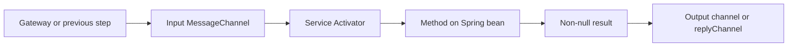

# @ServiceActivator

## 1. Objectives and Scope

This lesson belongs to the **Annotations and XML** chapter of the **SPRING_INTEGRATION_CORE** module. In an integration flow, you often already have a Java service to confirm orders, record events, or look up data. `@ServiceActivator` connects a method on that bean to the Message and MessageChannel system.

After this lesson, you can:

- Register a service activator using annotations.
- Map a payload, a header, or the entire message to Java parameters.
- Distinguish between a business result, a reply message, and the case where no reply is produced.
- Choose an output channel, use `replyChannel`, and configure a poller when needed.
- Test an endpoint through channels.
- Read the equivalent configuration in XML and Java DSL.

Examples use Java 17 or higher and Spring Integration 6.x APIs, referenced against 6.5.0. If your project uses a BOM to manage dependencies, keep Spring libraries compatible according to that BOM.

## 2. What Problem Does a Service Activator Solve?

Suppose a service has an operation:

```java
public Confirmation confirm(Order order) {
    return new Confirmation(order.orderId(), "ACCEPTED");
}
```

This method knows how to process an order, but it does not know who sends the message, which queue the message sits in, or where the result should go.

A service activator connects both sides:



In this model, the endpoint receives a message, maps data into the method invocation, and handles the return value. This is the role described in [Service Activator](https://docs.spring.io/spring-integration/reference/6.5/service-activator.html).

### 2.1. An Annotation Does Not Turn Any Arbitrary Object into an Endpoint

```java
@ServiceActivator(
    inputChannel = "ordersInput",
    outputChannel = "confirmationsOutput")
public Confirmation confirm(Order order) {
    return new Confirmation(order.orderId(), "ACCEPTED");
}
```

The snippet above only takes effect when the class containing the method is managed by Spring and the integration infrastructure processes that annotation.

Calling directly:

```java
service.confirm(order);
```

is still a direct Java method call. It does not go through the input channel, header transfer mechanism, or endpoint configuration just because the method has an annotation.

### 2.2. Choosing the Right Integration Pattern

| Step Intent | Appropriate Component |
| --- | --- |
| Invoke a business operation on a service | Service Activator |
| Transform the shape or representation of data | Transformer |
| Accept or discard a message | Filter |
| Select a destination for a message | Router |
| Combine multiple messages into one result | Aggregator |

A method returning a channel name string under `@ServiceActivator` produces a string payload. It does not automatically become a router. Similarly, returning `false` produces a `Boolean` payload, rather than automatically meaning the message should be discarded.

## 3. Conditions for Annotations to Work

In a plain Spring application, you can enable the infrastructure:

```java
@Configuration
@EnableIntegration
public class IntegrationConfig {
}
```

`@EnableIntegration` registers Spring Integration's infrastructure components and annotation processors. It does not automatically scan every business class in the project. See [EnableIntegration](https://raw.githubusercontent.com/spring-projects/spring-integration/v6.5.0/spring-integration-core/src/main/java/org/springframework/integration/config/EnableIntegration.java).

The bean containing the method can be registered via:

- `@Bean` in configuration.
- Component scanning for `@Component`, `@Service`, or `@MessageEndpoint` classes.
- Another Spring bean configuration.

`@MessageEndpoint` is a stereotype used for component scanning. For a class already created via `@Bean`, there is no need to add a stereotype just to get it detected again.

The complete example in this lesson uses `@Bean` so it does not depend on component scan scope. See also [Annotation Support](https://docs.spring.io/spring-integration/reference/6.5/configuration/annotations.html).

### 3.1. Explicit Channel Declaration

```java
@Bean
public DirectChannel ordersInput() {
    return new DirectChannel();
}

@Bean
public QueueChannel confirmationsOutput() {
    return new QueueChannel(10);
}
```

Annotations reference beans by name. Choose `DirectChannel` for synchronous invocation paths and `QueueChannel` to buffer results waiting to be read in the example.

Spring Integration supports creating some undeclared channels during annotation processing. Even so, explicit declaration helps learners clearly see the channel type, capacity, and processing model.

In particular, writing an input channel name in an annotation does not mean you have created a queue.

## 4. Mapping a Message to Method Parameters

The following parameter-mapping annotations belong to the package:

```java
org.springframework.messaging.handler.annotation.Payload
org.springframework.messaging.handler.annotation.Header
org.springframework.messaging.handler.annotation.Headers
```

These are not Spring MVC annotations.

### 4.1. Receiving the Payload

```java
@ServiceActivator(inputChannel = "ordersInput")
public void accept(Order order) {
    System.out.println(order.orderId());
}
```

For simple payload parameters, the framework can infer the mapping. When the signature is more complex, use `@Payload` to make the intent explicit:

```java
public Confirmation confirm(@Payload Order order) {
    return new Confirmation(order.orderId(), "ACCEPTED");
}
```

Do not assume that every JSON string is automatically converted into an `Order`. Type conversion depends on converters and configuration upstream of the endpoint. If the input is JSON, design explicit conversion and validation steps.

### 4.2. Receiving a Single Header

```java
public Confirmation confirm(
        @Payload Order order,
        @Header("request_id") String requestId) {

    return new Confirmation(order.orderId(), requestId);
}
```

In the isolated snippet above, the `Confirmation` constructor only illustrates using the mapped value. In the full example later, the data types will be defined concretely.

`@Header` requires the header to exist by default. If it is missing, parameter mapping fails; the business method does not receive a valid value to proceed.

For optional data:

```java
public void audit(
        @Payload Order order,
        @Header(value = "operator_id", required = false) String operatorId) {

    String actor = operatorId == null ? "system" : operatorId;
    System.out.println(order.orderId() + ":" + actor);
}
```

Use a reference type or a type capable of representing absence. For instance, `Integer` is more appropriate than `int` if an optional header may not exist. The annotation's attributes are described in [Header](https://docs.spring.io/spring-framework/docs/6.2.7/javadoc-api/org/springframework/messaging/handler/annotation/Header.html).

### 4.3. Receiving All Headers

```java
public void inspect(
        @Payload Order order,
        @Headers java.util.Map<String, Object> headers) {

    Object requestId = headers.get("request_id");
    System.out.println(order.orderId() + ":" + requestId);
}
```

Use `@Headers` when you genuinely need multiple metadata entries. If you only use one field, `@Header` makes the method contract clearer.

Do not use this map as a place to mutate the message. If you need to add metadata for downstream steps, return an appropriate result or use a header enrichment step.

### 4.4. Receiving the Message Directly

```java
public String describe(org.springframework.messaging.Message<Order> message) {
    return message.getPayload().orderId()
        + ":" + message.getHeaders().get("request_id");
}
```

This approach fits when the class acts as an adapter and needs the message structure. For a pure business service, receiving the payload and needed values is usually easier to test and reuse.

### 4.5. Avoiding Ambiguous Signatures

Two parameters without explicit mapping easily cause confusion:

```java
// Unclear which parameter is the payload and which is metadata.
public String process(String orderCode, String requestId) {
    return orderCode + ":" + requestId;
}
```

Write it explicitly:

```java
public String process(
        @Payload String orderCode,
        @Header("request_id") String requestId) {

    return orderCode + ":" + requestId;
}
```

If the payload itself is a `Map`, it is even more important to distinguish `@Payload Map` from `@Headers Map`. The rules and ambiguous cases are described in [Message Mapping Rules and Conventions](https://docs.spring.io/spring-integration/reference/6.5/configuration/message-mapping-rules.html).

## 5. Return Value Determines the Next Step

### 5.1. Returning an Object

If the method returns `Confirmation`, the framework creates a reply message whose payload is that object.

```java
@ServiceActivator(
    inputChannel = "ordersInput",
    outputChannel = "confirmationsOutput",
    requiresReply = "true")
public Confirmation confirm(Order order) {
    return new Confirmation(order.orderId(), "ACCEPTED");
}
```

There is no need to manually use `MessageBuilder` just to wrap a regular business result. The [ServiceActivator](https://docs.spring.io/spring-integration/docs/6.5.0/api/org/springframework/integration/annotation/ServiceActivator.html) API describes how the return value is placed into the reply.

### 5.2. Returning void or null

```java
@ServiceActivator(inputChannel = "auditInput")
public void record(String event) {
    System.out.println(event);
}
```

This is a terminal endpoint that produces no reply. A method returning `null` can also terminate a processing branch when no reply is required.

If a result is mandatory:

```java
@ServiceActivator(
    inputChannel = "requiredResultInput",
    outputChannel = "requiredResultOutput",
    requiresReply = "true")
public String requiredResult(String value) {
    return value.isBlank() ? null : value.trim();
}
```

When the method returns `null`, the required reply contract triggers `ReplyRequiredException`. `requiresReply` is not a timeout for waiting on processing.

If you want to intentionally drop data based on a condition, a filter and a discard channel usually express that intent more clearly than returning `null` from a service.

### 5.3. Returning a Message to Add Metadata

Suppose you already have a `Confirmation receipt`; the method can return:

```java
return org.springframework.messaging.support.MessageBuilder
    .withPayload(receipt)
    .setHeader("confirmation_status", "ACCEPTED")
    .build();
```

With a service activator, headers from the request can be propagated to the reply if the reply does not already have that header, according to the propagation mechanism. Therefore, constructing a new message is not a guaranteed way to strip input metadata.

If you need to filter headers before crossing a system boundary, use a header filter step or an appropriate propagation policy and test the result. This is a notable difference compared to a transformer returning a full `Message`. See [Service Activator and Method Return Type](https://docs.spring.io/spring-integration/reference/6.5/service-activator.html#service-activator-method-return-type).

## 6. Where Is the Result Sent?

In a standard flow without a routing slip, you can visualize it as:

```text
Method produces a non-null result
    -> Is there an explicit outputChannel?
        -> Yes: send to outputChannel
        -> No: use replyChannel in request/reply context
```

### 6.1. Explicit outputChannel

```java
@ServiceActivator(
    inputChannel = "ordersInput",
    outputChannel = "confirmationsOutput")
```

The result is sent to `confirmationsOutput`. Even when the request has a `replyChannel`, the step's explicit output channel takes precedence.

This fits an intermediate pipeline step where the result needs to continue to a transformer, router, or another endpoint.

### 6.2. replyChannel for Per-Request Reply Destinations

A variant of a pipeline-end endpoint can omit `outputChannel`:

```java
@ServiceActivator(
    inputChannel = "ordersInput",
    requiresReply = "true")
public Confirmation confirm(
        @Payload Order order,
        @Header("request_id") String requestId) {

    return new Confirmation(order.orderId(), "ACCEPTED", requestId);
}
```

The sender supplies `replyChannel`, such as through a messaging gateway or a directly built message:

```java
QueueChannel replies = new QueueChannel(1);

Message<Order> request = MessageBuilder.withPayload(order)
    .setHeader("request_id", "R-1001")
    .setReplyChannel(replies)
    .build();

ordersInput.send(request);
Message<?> reply = replies.receive(1000);
```

The snippet above assumes `ordersInput` is the input channel retrieved from the context and the endpoint is using the variant without a declared output channel.

Do not load both variants as two unintended endpoints on the same input channel. With a point-to-point channel, doing so alters message distribution.

If the handler produced a result but there is no valid destination to send it to, that is a reply routing error. `requiresReply = "false"` only allows producing no result; it does not mean a non-null result is silently discarded when a destination is missing.

### 6.3. Intentionally Discarding the Result

If the service must run but its result does not need to be forwarded:

```java
@ServiceActivator(
    inputChannel = "commandsInput",
    outputChannel = "nullChannel")
```

`nullChannel` is a special channel for terminating forwarding. Do not use it merely to mask a configuration that drops a reply the caller is expecting.

## 7. Complete Example: Confirming an Order

### 7.1. Example Contract

The input is an `Order` with:

- Non-blank order ID.
- Positive total amount.
- Required non-blank `request_id` header.

The result is a `Confirmation`, containing the order ID, status, and request ID. To stay focused on the endpoint, the example only validates the data and builds the result without calling a database or external service.

The input uses `DirectChannel`, and the output uses a `QueueChannel` with capacity 10. The service activator runs synchronously when sending to the input; the result is queued in the output for the program or test to read.

### 7.2. Configuration and Service

The project needs `spring-integration-core`, a compatible Spring Context, and JUnit Jupiter if running the tests in the later section.

```java
package example.activators;

import java.math.BigDecimal;

import org.springframework.context.annotation.Bean;
import org.springframework.context.annotation.Configuration;
import org.springframework.integration.annotation.EndpointId;
import org.springframework.integration.annotation.ServiceActivator;
import org.springframework.integration.channel.DirectChannel;
import org.springframework.integration.channel.QueueChannel;
import org.springframework.integration.config.EnableIntegration;
import org.springframework.messaging.handler.annotation.Header;
import org.springframework.messaging.handler.annotation.Payload;

@Configuration
@EnableIntegration
public class ServiceActivatorConfig {

    public record Order(String orderId, BigDecimal total) {
    }

    public record Confirmation(
            String orderId,
            String status,
            String requestId) {
    }

    @Bean
    public DirectChannel ordersInput() {
        return new DirectChannel();
    }

    @Bean
    public QueueChannel confirmationsOutput() {
        return new QueueChannel(10);
    }

    @Bean
    public OrderConfirmationService orderConfirmationService() {
        return new OrderConfirmationService();
    }

    public static class OrderConfirmationService {

        @ServiceActivator(
            inputChannel = "ordersInput",
            outputChannel = "confirmationsOutput",
            requiresReply = "true",
            sendTimeout = "1000")
        @EndpointId("confirmOrderEndpoint")
        public Confirmation confirm(
                @Payload Order order,
                @Header("request_id") String requestId) {

            if (order.orderId() == null || order.orderId().isBlank()) {
                throw new IllegalArgumentException("orderId is required");
            }

            if (order.total() == null || order.total().signum() <= 0) {
                throw new IllegalArgumentException("total must be positive");
            }

            if (requestId.isBlank()) {
                throw new IllegalArgumentException("request_id is required");
            }

            return new Confirmation(
                order.orderId(),
                "ACCEPTED",
                requestId);
        }
    }
}
```

The `requiresReply` and `sendTimeout` attributes accept strings in the annotation; do not write `requiresReply = true` like a boolean parameter on a builder.

`sendTimeout = "1000"` limits the wait time when sending the result to a bounded output channel such as a full queue. It does not limit the execution time of the `confirm` method.

`@EndpointId` names the consumer endpoint, not the ID of individual messages. An explicit name is helpful when reading logs or retrieving the endpoint from the context to control its lifecycle.

### 7.3. Sending and Receiving a Message

```java
package example.activators;

import java.math.BigDecimal;

import org.springframework.context.annotation.AnnotationConfigApplicationContext;
import org.springframework.integration.channel.DirectChannel;
import org.springframework.integration.channel.QueueChannel;
import org.springframework.messaging.Message;
import org.springframework.messaging.support.MessageBuilder;

import example.activators.ServiceActivatorConfig.Order;

public class ServiceActivatorDemo {

    public static void main(String[] args) {
        try (var context = new AnnotationConfigApplicationContext(
                ServiceActivatorConfig.class)) {

            DirectChannel input =
                context.getBean("ordersInput", DirectChannel.class);
            QueueChannel output =
                context.getBean("confirmationsOutput", QueueChannel.class);

            Order order =
                new Order("O-1001", new BigDecimal("1250000"));

            Message<Order> request = MessageBuilder.withPayload(order)
                .setHeader("request_id", "R-1001")
                .build();

            input.send(request);

            Message<?> result = output.receive(1000);
            if (result == null) {
                throw new IllegalStateException("No confirmation received");
            }

            System.out.println(result.getPayload());
            System.out.println(
                result.getHeaders().get("request_id"));
        }
    }
}
```

Expected business output:

```text
Confirmation[
  orderId=O-1001,
  status=ACCEPTED,
  requestId=R-1001
]
```

In the representation above, line breaks are only for readability. Actual `record.toString()` output typically prints on a single line.

## 8. Testing the Endpoint Through Channels

Unit testing the service method is useful for validation. However, it does not verify whether the annotation is processed, whether the input channel has a consumer, or whether headers map properly.

The following tests go through the context and channels:

```java
package example.activators;

import java.math.BigDecimal;

import org.junit.jupiter.api.Test;
import org.springframework.context.annotation.AnnotationConfigApplicationContext;
import org.springframework.integration.channel.DirectChannel;
import org.springframework.integration.channel.QueueChannel;
import org.springframework.messaging.Message;
import org.springframework.messaging.MessagingException;
import org.springframework.messaging.support.MessageBuilder;

import example.activators.ServiceActivatorConfig.Confirmation;
import example.activators.ServiceActivatorConfig.Order;

import static org.junit.jupiter.api.Assertions.*;

class ServiceActivatorEndpointTest {

    @Test
    void confirmationGoesToExplicitOutputChannel() {
        try (var context = new AnnotationConfigApplicationContext(
                ServiceActivatorConfig.class)) {

            DirectChannel input =
                context.getBean("ordersInput", DirectChannel.class);
            QueueChannel output =
                context.getBean("confirmationsOutput", QueueChannel.class);
            QueueChannel alternativeReplies = new QueueChannel(1);

            Order order =
                new Order("O-1001", new BigDecimal("1250000"));
            Message<Order> request = MessageBuilder.withPayload(order)
                .setHeader("request_id", "R-1001")
                .setReplyChannel(alternativeReplies)
                .build();

            assertTrue(input.send(request));

            Message<?> result = output.receive(1000);
            assertNotNull(result);
            assertEquals(
                new Confirmation("O-1001", "ACCEPTED", "R-1001"),
                result.getPayload());
            assertEquals("R-1001",
                result.getHeaders().get("request_id"));

            // Explicit outputChannel takes precedence.
            assertNull(alternativeReplies.receive(0));

            // Request still carries the input payload.
            assertSame(order, request.getPayload());
        }
    }

    @Test
    void missingRequiredHeaderFailsDuringMessageHandling() {
        try (var context = new AnnotationConfigApplicationContext(
                ServiceActivatorConfig.class)) {

            DirectChannel input =
                context.getBean("ordersInput", DirectChannel.class);
            QueueChannel output =
                context.getBean("confirmationsOutput", QueueChannel.class);

            Order order =
                new Order("O-1002", new BigDecimal("500000"));

            assertThrows(MessagingException.class, () ->
                input.send(
                    MessageBuilder.withPayload(order).build()));

            assertNull(output.receive(0));
        }
    }

    @Test
    void invalidOrderProducesNoConfirmation() {
        try (var context = new AnnotationConfigApplicationContext(
                ServiceActivatorConfig.class)) {

            DirectChannel input =
                context.getBean("ordersInput", DirectChannel.class);
            QueueChannel output =
                context.getBean("confirmationsOutput", QueueChannel.class);

            Order invalid =
                new Order("O-invalid", new BigDecimal("-1"));

            assertThrows(MessagingException.class, () ->
                input.send(
                    MessageBuilder.withPayload(invalid)
                        .setHeader("request_id", "R-invalid")
                        .build()));

            assertNull(output.receive(0));
        }
    }
}
```

These tests verify three observable contracts:

1. The result is created properly and arrives at the explicit output channel.
2. Required headers are checked through the mapping mechanism.
3. A business error does not produce a successful confirmation.

`receive(1000)` waits for the result up to the timeout; `receive(0)` checks a queue immediately. No fixed sleeps are needed in these synchronous tests.

This is runnable practice code in a project with compatible dependencies. Describing these tests does not replace testing with real transports, retries, and production data.

## 9. When the Input Is a QueueChannel: Adding @Poller

Suppose we replace the input with a queue:

```java
@Bean
public QueueChannel ordersInput() {
    return new QueueChannel(100);
}
```

The endpoint must actively pull messages. You can configure this directly:

```java
@ServiceActivator(
    inputChannel = "ordersInput",
    outputChannel = "confirmationsOutput",
    requiresReply = "true",
    poller = @Poller(
        fixedDelay = "100",
        maxMessagesPerPoll = "5",
        receiveTimeout = "0"))
```

Additional import needed:

```java
import org.springframework.integration.annotation.Poller;
```

This is an alternative endpoint configuration to section 7, not a second endpoint to register alongside it.

| Attribute | Meaning in the Example |
| --- | --- |
| `fixedDelay = "100"` | Polling delay in milliseconds |
| `maxMessagesPerPoll = "5"` | Maximum of five messages pulled per poll |
| `receiveTimeout = "0"` | Do not wait when the queue is empty |

Five messages per poll does not mean five messages per second or five messages processed in parallel.

If no dedicated poller is declared, a pollable consumer requires a default poller in the context. Do not attach a poller to an endpoint receiving from a `DirectChannel`.

For complex polling configuration, create a `PollerMetadata` bean and reference it:

```java
poller = @Poller("ordersPoller")
```

When referencing metadata by name, place the other parameters on that bean; do not mix a metadata reference name with inline schedule options in the same annotation. See [Poller](https://docs.spring.io/spring-integration/docs/6.5.0/api/org/springframework/integration/annotation/Poller.html).

## 10. Two Ways to Use the Annotation to Distinguish

### 10.1. On a POJO Business Method

This is the approach used in the example:

```java
@ServiceActivator(
    inputChannel = "ordersInput",
    outputChannel = "confirmationsOutput",
    requiresReply = "true")
public Confirmation confirm(
        @Payload Order order,
        @Header("request_id") String requestId) {
    // Validation and result creation.
    return new Confirmation(order.orderId(), "ACCEPTED", requestId);
}
```

The `confirm` method is invoked by the endpoint for each message.

### 10.2. On a @Bean Returning a MessageHandler

In a standalone configuration, you can create the handler via a factory method:

```java
@Bean("uppercaseEndpoint.handler")
@ServiceActivator(inputChannel = "textInput")
@EndpointId("uppercaseEndpoint")
public org.springframework.integration.handler.ServiceActivatingHandler
        uppercaseHandler() {

    org.springframework.integration.handler.ServiceActivatingHandler handler =
        new org.springframework.integration.handler.ServiceActivatingHandler(
            new UppercaseService(),
            "uppercase");

    handler.setOutputChannelName("textOutput");
    handler.setRequiresReply(true);
    return handler;
}

public static class UppercaseService {

    public String uppercase(String value) {
        return value.toUpperCase(java.util.Locale.ROOT);
    }
}
```

The snippet above assumes the configuration has `@EnableIntegration` and has declared `textInput` and `textOutput`.

Here:

- `uppercaseHandler()` creates the handler bean when the Spring configuration initializes.
- The handler invokes `UppercaseService.uppercase(...)` when receiving a message.
- Handler properties such as output channel and requiresReply are set directly on the handler.

Do not assume that the `@Bean` method will be called to process each payload. When the annotation is placed on an existing handler bean, handler-specific properties must be configured on that object itself; do not mechanically copy the style used for POJO methods.

This is the rule of [Annotations on @Bean Methods](https://docs.spring.io/spring-integration/reference/6.5/configuration/meta-annotations.html#annotations_on_beans). The handler class used here is [ServiceActivatingHandler](https://docs.spring.io/spring-integration/docs/6.5.0/api/org/springframework/integration/handler/ServiceActivatingHandler.html).

## 11. Equivalent Representation in XML and Java DSL

The configurations below are alternatives to the annotation endpoint. Do not load all variants simultaneously with the same channels and IDs.

### 11.1. Creating a POJO Without Endpoint Declarations

To avoid accidentally registering two endpoints, use the following class for the XML or DSL variants. The `Order` and `Confirmation` records are reused from the complete example:

```java
package example.activators;

import org.springframework.messaging.handler.annotation.Header;
import org.springframework.messaging.handler.annotation.Payload;

import example.activators.ServiceActivatorConfig.Confirmation;
import example.activators.ServiceActivatorConfig.Order;

public class PlainOrderConfirmationService {

    public Confirmation confirm(
            @Payload Order order,
            @Header("request_id") String requestId) {

        if (order.orderId() == null || order.orderId().isBlank()) {
            throw new IllegalArgumentException("orderId is required");
        }

        if (order.total() == null || order.total().signum() <= 0) {
            throw new IllegalArgumentException("total must be positive");
        }

        if (requestId.isBlank()) {
            throw new IllegalArgumentException("request_id is required");
        }

        return new Confirmation(order.orderId(), "ACCEPTED", requestId);
    }
}
```

This class keeps the parameter-mapping annotations, without `@ServiceActivator`. The endpoint topology will reside in XML or DSL.

### 11.2. XML Configuration

Standalone XML resource example:

```xml
<?xml version="1.0" encoding="UTF-8"?>
<beans xmlns="http://www.springframework.org/schema/beans"
       xmlns:int="http://www.springframework.org/schema/integration"
       xmlns:xsi="http://www.w3.org/2001/XMLSchema-instance"
       xsi:schemaLocation="
           http://www.springframework.org/schema/beans
           https://www.springframework.org/schema/beans/spring-beans.xsd
           http://www.springframework.org/schema/integration
           https://www.springframework.org/schema/integration/spring-integration.xsd">

    <int:channel id="ordersInput"/>

    <int:channel id="confirmationsOutput">
        <int:queue capacity="10"/>
    </int:channel>

    <bean id="plainOrderConfirmationService"
          class="example.activators.PlainOrderConfirmationService"/>

    <int:service-activator
            id="confirmOrderEndpoint"
            input-channel="ordersInput"
            output-channel="confirmationsOutput"
            ref="plainOrderConfirmationService"
            method="confirm"
            requires-reply="true"
            send-timeout="1000"/>

</beans>
```

To use this variant, load the XML resource via application configuration or `ClassPathXmlApplicationContext`. Do not simultaneously load `ServiceActivatorConfig` just to get the records; referencing a Java type does not require registering that configuration class in the context.

Corresponding elements:

| Annotation on POJO | XML |
| --- | --- |
| `inputChannel` | `input-channel` |
| `outputChannel` | `output-channel` |
| `requiresReply` | `requires-reply` |
| `sendTimeout` | `send-timeout` |
| `@EndpointId` | `id` |
| Annotated method | `ref` and `method` |

### 11.3. Java DSL Configuration

In the DSL variant, redeclare the two channels and the `PlainOrderConfirmationService` bean in an `@EnableIntegration` configuration, then add the flow:

```java
@Bean
public IntegrationFlow orderConfirmationFlow(
        PlainOrderConfirmationService plainOrderConfirmationService) {

    return IntegrationFlow.from("ordersInput")
        .handle(
            plainOrderConfirmationService,
            "confirm",
            e -> e
                .id("confirmOrderEndpoint")
                .requiresReply(true)
                .sendTimeout(1000))
        .channel("confirmationsOutput")
        .get();
}
```

Import `IntegrationFlow` from `org.springframework.integration.dsl`.

Annotations place wiring next to the method; XML or DSL lets you centralize topology outside that method. When converting, preserve the contract for channel types, required headers, and return values.

## 12. Lifecycle, Advice, and Error Handling

### 12.1. Naming and Controlling the Endpoint

With the annotation example, you can retrieve the runtime endpoint:

```java
org.springframework.integration.endpoint.AbstractEndpoint endpoint =
    context.getBean(
        "confirmOrderEndpoint",
        org.springframework.integration.endpoint.AbstractEndpoint.class);
```

You can use `autoStartup = "false"` if you want to start it manually:

```java
@ServiceActivator(
    inputChannel = "ordersInput",
    outputChannel = "confirmationsOutput",
    autoStartup = "false")
```

Then call `endpoint.start()` when appropriate. With `DirectChannel`, if no consumer is running yet, messages are not buffered to wait as in a queue.

`phase` is used for lifecycle ordering, not per-order priority. `@EndpointId` has distinct naming conventions between POJO methods and `@Bean` methods; see [EndpointId 6.5.0](https://raw.githubusercontent.com/spring-projects/spring-integration/v6.5.0/spring-integration-core/src/main/java/org/springframework/integration/annotation/EndpointId.java).

### 12.2. adviceChain References Advice Beans

```java
@ServiceActivator(
    inputChannel = "ordersInput",
    outputChannel = "confirmationsOutput",
    adviceChain = "orderRetryAdvice")
```

The name `orderRetryAdvice` must point to a configured advice bean. Adding the name in the annotation does not automatically create a retry policy.

For a standard request handler advice, the scope is the current handler's execution. Do not assume the entire downstream flow is included in the same retry attempt.

If the operation has side effects such as deducting inventory or sending payments, design an idempotency key and classify retryable errors. Retrying a validation error will not fix a bad payload.

### 12.3. Synchronous Errors and Errors in Subsequent Tasks

In the `DirectChannel` example, exceptions from the handler can propagate back to the send call as messaging errors. That is why the test uses `assertThrows(MessagingException.class, ...)` at `send`.

If you change the input to a queue and process via a poller, the sender only places the message onto the queue. Errors occurring afterward must be observed through the task's error handling mechanism.

Extended example:

```java
poller = @Poller(
    fixedDelay = "100",
    receiveTimeout = "0",
    maxMessagesPerPoll = "5",
    errorChannel = "orderErrors")
```

`orderErrors` must be a registered channel. When testing, collect `ErrorMessage` from that channel instead of expecting a synchronous exception from the enqueue operation.

An `errorChannel` header does not automatically turn all `DirectChannel` calls into asynchronous error handling. The error path depends on the channel, gateway, poller, and advice. See [Error Handling](https://docs.spring.io/spring-integration/reference/6.5/error-handling.html).

### 12.4. async Does Not Replace Choosing an Execution Model

`async = "true"` supports asynchronous reply handling such as `CompletableFuture` in the version used in this lesson. It does not make a synchronous I/O method automatically run on another thread.

If the service returns a future, define the executor performing the work, how context is propagated, and the error destination when the future completes exceptionally. Do not combine `poller` and `reactive` on the same annotation; they are mutually exclusive options.

## 13. Common Pitfalls

| Symptom | Cause to Investigate | Fix |
| --- | --- | --- |
| Method is not invoked | Object is not a Spring bean or annotation infrastructure is missing | Check bean registration and `@EnableIntegration` |
| Sending to a channel with no consumer | Wrong channel name, endpoint not started, or not registered | Verify channel name and endpoint state |
| Two unintended handlers exist | Same topology registered via both annotation and DSL/XML | Keep only the endpoint of the chosen approach |
| Missing header causes handling failure | `@Header` is required by default | Supply the header or explicitly mark optional fields |
| JSON does not become Order | Missing appropriate conversion step | Add conversion and test the payload |
| Handler returns result but reports missing destination | No valid output/reply channel | Complete the reply contract |
| Gateway waits but service returns nothing | `void`/`null` method on a route requiring a reply | Choose a one-way contract or return a result |
| Sending channel name string does not route | Using a service activator instead of a router | Use a router when the goal is selecting a destination |
| Queue is not consumed | Missing poller or endpoint not started | Configure polling and lifecycle |
| Timeout is set but HTTP call still takes long | Timeout applies to sending output | Set timeouts on the business client/adapter |
| Removed header when building reply but it reappears | Service activator has header propagation | Use a header filter or appropriate policy |
| Output config on @Bean handler behaves unexpectedly | Confusing endpoint attributes with handler attributes | Set output on the handler object |

When investigating a message, check in order: whether the bean is registered, which channels the endpoint attaches to, what the method signature receives, whether a result is produced, and where the reply destination is.

## 14. Extended Practice

Starting from the complete example, do the following in order:

1. Add an optional `operator_id` header; test both with and without the header.
2. Create a variant omitting `outputChannel`, then send a request with a dedicated reply channel.
3. Switch the input to a queue and add a poller; update error tests to observe the error channel.
4. Create a method that intentionally returns `null`, and compare behavior with `requiresReply` enabled versus disabled.
5. Rewrite the endpoint using XML or DSL with a POJO that has no endpoint-declaring annotations.
6. If adding side effects, identify cases where retries could invoke operations repeatedly and how to maintain idempotency.

Each exercise should clearly define the input, headers, result type, output channel, and error destination. That is the true contract of a service activator.

## 15. Reference Documentation

- [Spring Integration 6.5: Service Activator](https://docs.spring.io/spring-integration/reference/6.5/service-activator.html) — endpoint pattern, results, and reply paths.
- [ServiceActivator 6.5.0 API](https://docs.spring.io/spring-integration/docs/6.5.0/api/org/springframework/integration/annotation/ServiceActivator.html) — annotation attributes.
- [Annotation Support](https://docs.spring.io/spring-integration/reference/6.5/configuration/annotations.html) — registration and method mapping.
- [Message Mapping Rules and Conventions](https://docs.spring.io/spring-integration/reference/6.5/configuration/message-mapping-rules.html) — payload and parameter rules.
- [Annotations on @Bean Methods](https://docs.spring.io/spring-integration/reference/6.5/configuration/meta-annotations.html) — distinguishing factory methods from business methods.
- [ServiceActivatingHandler 6.5.0 API](https://docs.spring.io/spring-integration/docs/6.5.0/api/org/springframework/integration/handler/ServiceActivatingHandler.html) — handler used for service invocation.
- [Spring Integration 6.5: Error Handling](https://docs.spring.io/spring-integration/reference/6.5/error-handling.html) — synchronous errors and errors from tasks.
